# AI 功能集成

> Repo Wiki 节点 `ai-integration`
> 导出自 Qoder 知识库快照 `8fbe02f6-57c2-4874-b725-1a8130851fd9`，代码基线 `7a7a8e75e18bd90294e09cd422dd7ed5a04813a0`（分支 main，zh-CN）。

<cite>
**本文引用的文件**   
- [crates/moriq-ai/src/lib.rs](../crates/moriq-ai/src/lib.rs)
- [crates/moriq-ai/src/models.rs](../crates/moriq-ai/src/models.rs)
- [crates/moriq-ai/src/llama.rs](../crates/moriq-ai/src/llama.rs)
- [crates/moriq-ai/src/qwen_faces.rs](../crates/moriq-ai/src/qwen_faces.rs)
- [crates/moriq-ai/src/runtime.rs](../crates/moriq-ai/src/runtime.rs)
- [crates/moriq-library/src/ai/qwen_faces.rs](../crates/moriq-library/src/ai/qwen_faces.rs)
- [crates/moriq-library/src/ai/similarity.rs](../crates/moriq-library/src/ai/similarity.rs)
- [crates/moriq-library/src/ai/analysis.rs](../crates/moriq-library/src/ai/analysis.rs)
- [crates/moriq-app/src/inference.rs](../crates/moriq-app/src/inference.rs)
- [crates/moriq-domain/src/ai.rs](../crates/moriq-domain/src/ai.rs)
- [scripts/prepare-ai-runtime.ps1](../scripts/prepare-ai-runtime.ps1)
- [scripts/ai-runtime-files.ps1](../scripts/ai-runtime-files.ps1)
</cite>

## 目录

1. [引言](#引言)
2. [项目结构](#项目结构)
3. [核心组件](#核心组件)
4. [架构总览](#架构总览)
5. [详细组件分析](#详细组件分析)
6. [依赖关系分析](#依赖关系分析)
7. [性能与配置调优](#性能与配置调优)
8. [故障排除指南](#故障排除指南)
9. [结论](#结论)
10. [附录：扩展自定义模型支持](#附录扩展自定义模型支持)

## 引言

本文件专门说明 Moriq Space 的 AI 能力，重点覆盖 Qwen 模型管理、llama.cpp 推理引擎集成、硬件检测机制、人脸识别与人物匹配、相似性搜索和内容分析流程。文档同时给出模型配置参数调优建议、性能优化方法和常见问题的排查方式，并说明如何扩展对自定义模型的支持。

Qwen 在该项目中是本地图像分析的主模型；模型权重通过受控清单下载、校验和安装，运行时以 llama.cpp 启动本机服务，由 Moriq 应用进程通过 HTTP 接口调用。人脸识别采用“先检测后比较”的两阶段方案，相似性搜索则基于感知指纹与向量检索共同实现。

## 项目结构

AI 相关代码主要分布在以下模块：

| 路径 | 职责 |
|---|---|
| `crates/moriq-ai` | 暴露 Qwen 模型管理、llama.cpp 推理入口、人脸视觉会话、运行器控制等能力 |
| `crates/moriq-library` | 将 AI 结果持久化到数据库，实现人脸存储、内容分析、相似指纹与语义检索 |
| `crates/moriq-app` | 把 UI 和工作任务转换为具体推理调用，封装可取消的执行流程 |
| `crates/moriq-domain` | 定义统一的分类体系、AiProfile 以及固定媒介/主题词表 |
| `scripts` | 准备 llama.cpp 运行时、生成校验清单、打包发布元数据 |

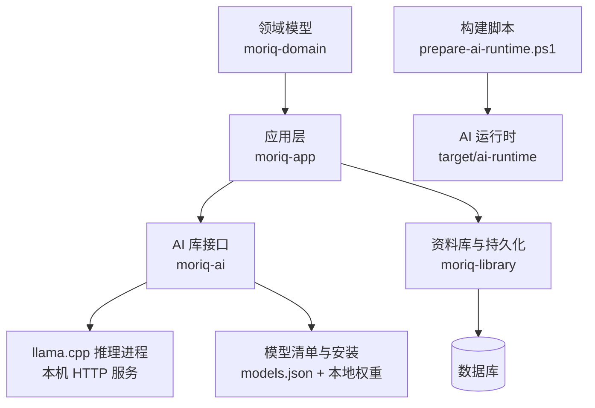

**图表来源**
- [crates/moriq-app/src/inference.rs:1-200](../crates/moriq-app/src/inference.rs#L1-L200)
- [crates/moriq-ai/src/lib.rs:1-15](../crates/moriq-ai/src/lib.rs#L1-L15)
- [crates/moriq-library/src/ai/analysis.rs:1-200](../crates/moriq-library/src/ai/analysis.rs#L1-L200)
- [scripts/prepare-ai-runtime.ps1:1-62](../scripts/prepare-ai-runtime.ps1#L1-L62)

**章节来源**
- [crates/moriq-ai/src/lib.rs:1-15](../crates/moriq-ai/src/lib.rs#L1-L15)
- [scripts/prepare-ai-runtime.ps1:1-62](../scripts/prepare-ai-runtime.ps1#L1-L62)

## 核心组件

### 模型管理与版本控制

模型管理负责读取内置模型清单、定位用户模型目录、校验安装完整性、执行带断点续传的下载、卸载模型，并提供运行时可见的库存信息。

| 概念 | 行为 |
|---|---|
| 模型规格 | 包含模型身份、名称、修订、许可证、来源、最低内存预算和多个模型文件 |
| 模型清单 | 从嵌入的 `workers/ai/models.json` 解析，用于固定版本控制 |
| 模型根目录 | Windows 使用 `APPDATA`，macOS 使用应用支持目录，其他平台优先 `XDG_DATA_HOME` 或 `~/.local/share` |
| 安装状态 | 通过 `current.json` 记录当前已发布修订，并按每个文件的 SHA-256 和大小校验 |
| 下载控制 | 支持暂停、续传、范围请求重试、重定向白名单和最终哈希校验 |
| 卸载保护 | 删除前释放推理进程，排他锁定安装锁，拒绝越界目录和仍在使用的临时目录 |

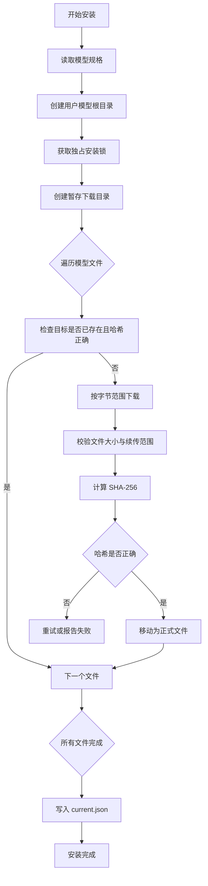

**图表来源**
- [crates/moriq-ai/src/models.rs:201-589](../crates/moriq-ai/src/models.rs#L201-L589)

**章节来源**
- [crates/moriq-ai/src/models.rs:1-200](../crates/moriq-ai/src/models.rs#L1-L200)
- [crates/moriq-ai/src/models.rs:201-589](../crates/moriq-ai/src/models.rs#L201-L589)

### llama.cpp 推理引擎集成

llama.cpp 不是直接链接进主程序，而是作为独立子进程启动。Moriq 通过本机回环地址与其通信，并使用 API Key 进行鉴权。

关键特性包括：

- 运行时根目录位于程序目录下的 `ai/llama`。
- 启动前验证完整 AI 运行时目录和 llama 子目录的嵌入校验清单。
- 启动时加载 Qwen 语言模型权重和视觉投影模型。
- 限制线程数、上下文长度、并行度、GPU 层数和 CPU 视觉阶段。
- 禁用 mmproj offload，避免可变人像形状耗尽 Vulkan 分配器。
- 使用健康检查端点等待服务就绪，超时后返回错误。
- 推理请求限制响应体大小，并在取消信号到来时终止请求线程。

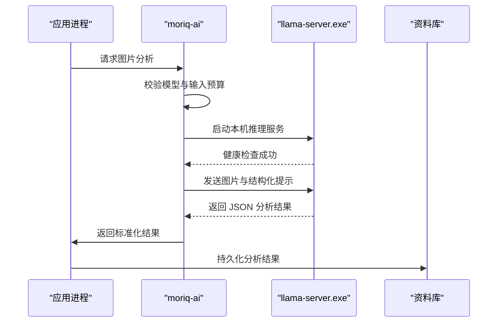

**图表来源**
- [crates/moriq-ai/src/llama.rs:1-200](../crates/moriq-ai/src/llama.rs#L1-L200)
- [crates/moriq-ai/src/llama.rs:201-579](../crates/moriq-ai/src/llama.rs#L201-L579)
- [crates/moriq-app/src/inference.rs:1-200](../crates/moriq-app/src/inference.rs#L1-L200)

**章节来源**
- [crates/moriq-ai/src/llama.rs:1-200](../crates/moriq-ai/src/llama.rs#L1-L200)
- [crates/moriq-ai/src/llama.rs:201-579](../crates/moriq-ai/src/llama.rs#L201-L579)

### 硬件检测机制

硬件信息主要用于资源预算、线程选择和可用性判断：

| 指标 | 用途 |
|---|---|
| 总内存 | 显示设备能力 |
| 可用内存 | 启动 Qwen 前判断是否至少有约 4 GiB 可用 |
| 逻辑 CPU 数量 | 设置推理线程数，取一半并在 1 到 8 之间限制 |
| 后端标识 | 向外部展示 Vulkan、llama.cpp 和 Qwen3.5-4B 组合 |

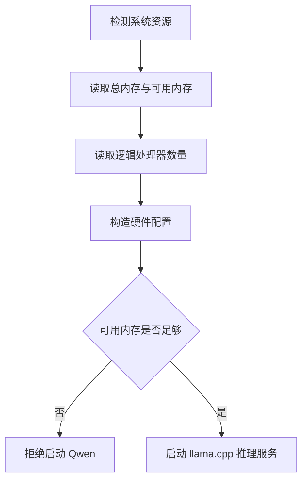

**图表来源**
- [crates/moriq-ai/src/models.rs:1-200](../crates/moriq-ai/src/models.rs#L1-L200)
- [crates/moriq-ai/src/llama.rs:201-579](../crates/moriq-ai/src/llama.rs#L201-L579)

**章节来源**
- [crates/moriq-ai/src/models.rs:1-200](../crates/moriq-ai/src/models.rs#L1-L200)
- [crates/moriq-ai/src/llama.rs:201-579](../crates/moriq-ai/src/llama.rs#L201-L579)

### 人脸识别与人物比较

Qwen 人脸流程分为两步：

1. 使用视觉会话检测图片中的清晰人脸，输出归一化边界框和置信度。
2. 对每个有效人脸裁剪参考图，并与项目内已有真实人物头像对比，判断是否为同一人。

该流程不合成人脸嵌入，而是直接使用真实人脸截图进行比较。

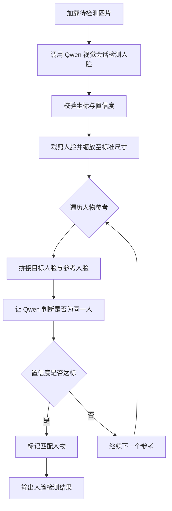

**图表来源**
- [crates/moriq-ai/src/qwen_faces.rs:1-172](../crates/moriq-ai/src/qwen_faces.rs#L1-L172)
- [crates/moriq-library/src/ai/qwen_faces.rs:1-200](../crates/moriq-library/src/ai/qwen_faces.rs#L1-L200)

**章节来源**
- [crates/moriq-ai/src/qwen_faces.rs:1-172](../crates/moriq-ai/src/qwen_faces.rs#L1-L172)
- [crates/moriq-library/src/ai/qwen_faces.rs:1-200](../crates/moriq-library/src/ai/qwen_faces.rs#L1-L200)

### 相似性搜索与内容分析

相似性搜索由两部分组成：

- **感知指纹**：将图片缩放到固定小尺寸，计算颜色均值、宽高比和离散余弦变换特征，生成稳定指纹。
- **向量检索**：对文本描述或历史嵌入进行归一化向量查询，结合语义计划执行检索。

内容分析则负责把 Qwen 的输出规范化，并写入 `ai_results`、内容运行记录和人脸相关表。

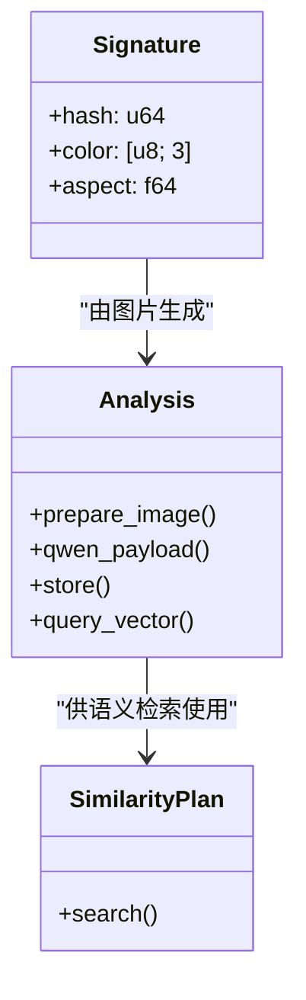

**图表来源**
- [crates/moriq-library/src/ai/similarity.rs:1-131](../crates/moriq-library/src/ai/similarity.rs#L1-L131)
- [crates/moriq-library/src/ai/analysis.rs:1-200](../crates/moriq-library/src/ai/analysis.rs#L1-L200)

**章节来源**
- [crates/moriq-library/src/ai/similarity.rs:1-131](../crates/moriq-library/src/ai/similarity.rs#L1-L131)
- [crates/moriq-library/src/ai/analysis.rs:1-200](../crates/moriq-library/src/ai/analysis.rs#L1-L200)

## 架构总览

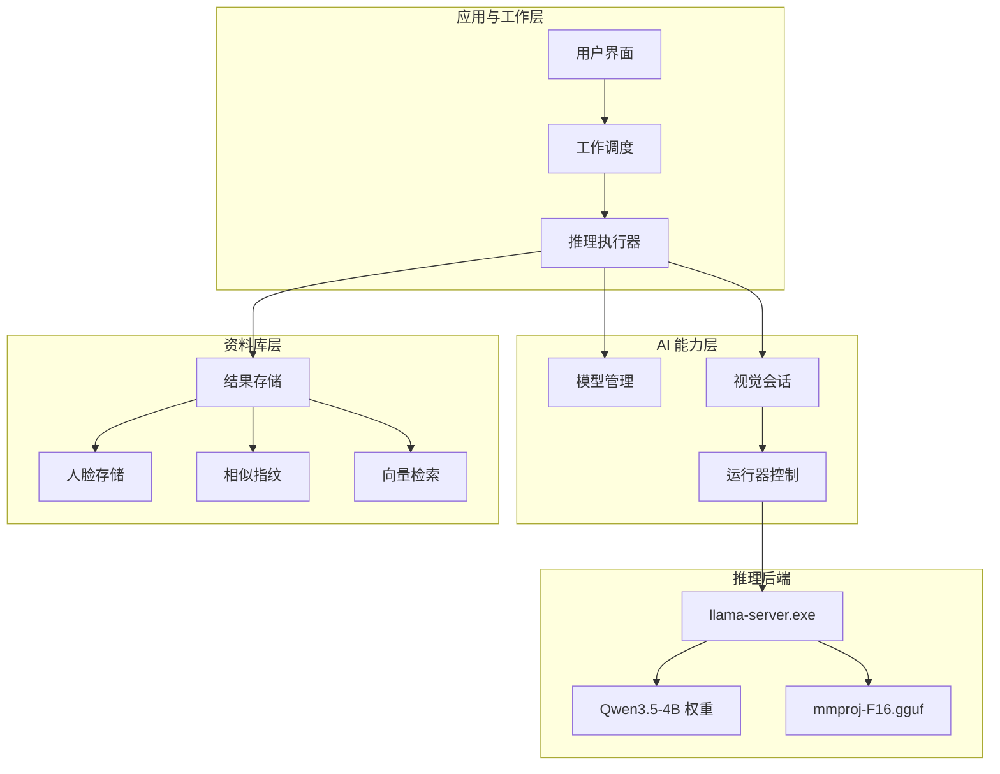

**图表来源**
- [crates/moriq-app/src/inference.rs:1-200](../crates/moriq-app/src/inference.rs#L1-L200)
- [crates/moriq-ai/src/llama.rs:1-200](../crates/moriq-ai/src/llama.rs#L1-L200)
- [crates/moriq-library/src/ai/analysis.rs:1-200](../crates/moriq-library/src/ai/analysis.rs#L1-L200)

## 详细组件分析

### 模型生命周期

模型生命周期包括注册、安装、验证、运行、卸载五个阶段：

| 阶段 | 关键行为 |
|---|---|
| 注册 | 从嵌入清单解析 `ModelSpec`，并通过 ID 查找 |
| 安装 | 分块下载、范围续传、SHA-256 校验、原子发布 `current.json` |
| 验证 | 启动推理前再次校验权重、投影模型和目录结构 |
| 运行 | 启动 `llama-server.exe`，绑定端口、API Key 和资源参数 |
| 卸载 | 释放推理进程、删除版本目录，保留安装锁保护 |

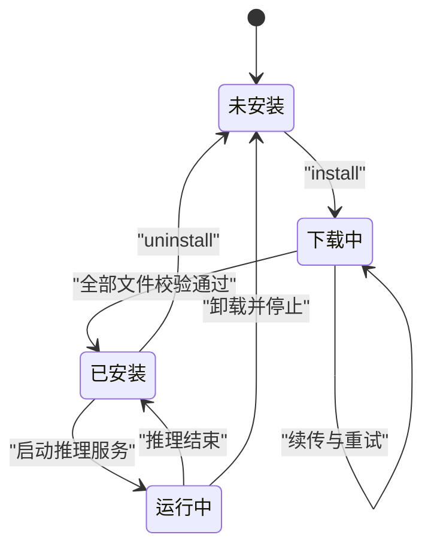

**图表来源**
- [crates/moriq-ai/src/models.rs:1-200](../crates/moriq-ai/src/models.rs#L1-L200)
- [crates/moriq-ai/src/models.rs:201-589](../crates/moriq-ai/src/models.rs#L201-L589)
- [crates/moriq-ai/src/llama.rs:1-200](../crates/moriq-ai/src/llama.rs#L1-L200)

**章节来源**
- [crates/moriq-ai/src/models.rs:1-200](../crates/moriq-ai/src/models.rs#L1-L200)
- [crates/moriq-ai/src/models.rs:201-589](../crates/moriq-ai/src/models.rs#L201-L589)
- [crates/moriq-ai/src/llama.rs:1-200](../crates/moriq-ai/src/llama.rs#L1-L200)

### 推理流程与控制流

应用层根据任务类型选择分类或描述流程，并将结果包装为带模型身份和修订的分析回执。

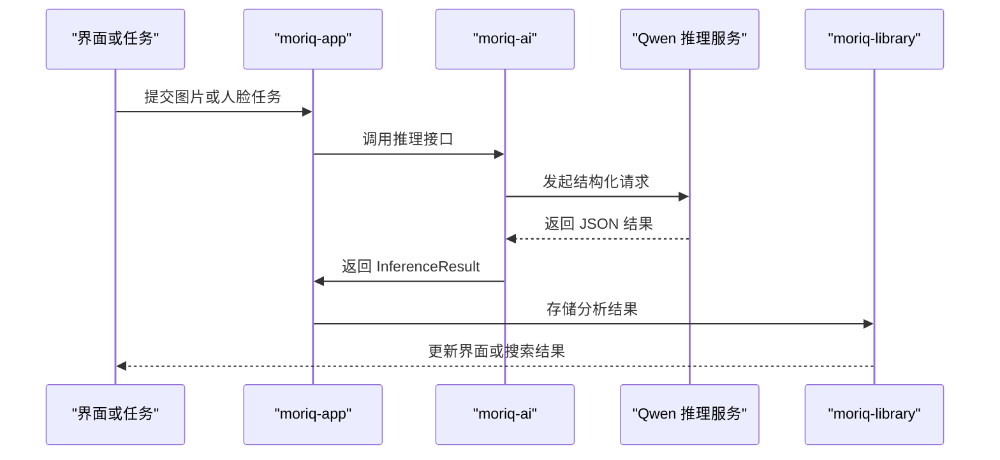

**图表来源**
- [crates/moriq-app/src/inference.rs:1-200](../crates/moriq-app/src/inference.rs#L1-L200)
- [crates/moriq-ai/src/llama.rs:201-579](../crates/moriq-ai/src/llama.rs#L201-L579)
- [crates/moriq-library/src/ai/analysis.rs:201-450](../crates/moriq-library/src/ai/analysis.rs#L201-L450)

**章节来源**
- [crates/moriq-app/src/inference.rs:1-200](../crates/moriq-app/src/inference.rs#L1-L200)
- [crates/moriq-library/src/ai/analysis.rs:201-450](../crates/moriq-library/src/ai/analysis.rs#L201-L450)

### 内容分析与提示工程

Qwen 的内容分析支持两类任务：

| 任务 | 输入 | 输出字段 | 约束 |
|---|---|---|---|
| 分类 | 图片和分类配置 | `medium`、`themes`、`uncertainties` | 媒介只能选一个；主题来自启用列表；不确定性最多 5 项 |
| 描述 | 图片 | `description`、`tags`、`uncertainties` | 描述最多 300 字；标签最多 12 个；单标签最多 24 字 |

提示词会根据启用的 AiCategory 动态生成，避免把未启用的分类注入模型上下文。标签还会做空白清理、去重和“角色扮演”等约定词汇归一化。

**章节来源**
- [crates/moriq-ai/src/llama.rs:201-579](../crates/moriq-ai/src/llama.rs#L201-L579)
- [crates/moriq-library/src/ai/analysis.rs:1-200](../crates/moriq-library/src/ai/analysis.rs#L1-L200)
- [crates/moriq-domain/src/ai.rs:1-187](../crates/moriq-domain/src/ai.rs#L1-L187)

## 依赖关系分析

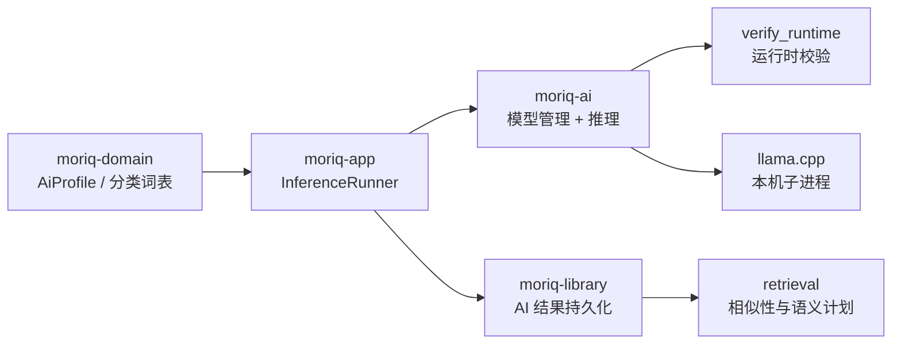

**图表来源**
- [crates/moriq-domain/src/ai.rs:1-187](../crates/moriq-domain/src/ai.rs#L1-L187)
- [crates/moriq-app/src/inference.rs:1-200](../crates/moriq-app/src/inference.rs#L1-L200)
- [crates/moriq-ai/src/lib.rs:1-15](../crates/moriq-ai/src/lib.rs#L1-L15)
- [crates/moriq-library/src/ai/analysis.rs:1-200](../crates/moriq-library/src/ai/analysis.rs#L1-L200)

**章节来源**
- [crates/moriq-domain/src/ai.rs:1-187](../crates/moriq-domain/src/ai.rs#L1-L187)
- [crates/moriq-app/src/inference.rs:1-200](../crates/moriq-app/src/inference.rs#L1-L200)
- [crates/moriq-ai/src/lib.rs:1-15](../crates/moriq-ai/src/lib.rs#L1-L15)

## 性能与配置调优

### 模型配置参数

| 参数 | 默认值或行为 | 调整建议 |
|---|---|---|
| 最大主题数 | 3 | 可通过 AiProfile 调整，但需满足总数不超过 8，分类总数不超过 64 |
| 启用主题上限 | 24 | 超过会触发配置校验失败 |
| 分类说明总长度 | 1600 字符 | 过大时会增加本地模型上下文压力 |
| 分类描述长度上限 | 512 字符 | 单个分类说明不应过长 |
| 图片输入大小 | 32 MiB | 过大将被拒绝，避免请求体和解码开销 |
| 推理请求体大小 | 36 MiB | 超出预算会被拒绝 |
| 推理响应体大小 | 1 MiB | 防止异常长输出占用内存 |
| 推理超时 | 约 300 秒 | 大图片或慢硬件可能需要更长时间 |
| 模型服务健康检查超时 | 约 120 秒 | 首次加载 GPU/Vulkan 较慢时可能耗时较长 |

### 硬件与运行时参数

| 参数 | 当前行为 | 优化建议 |
|---|---|---|
| 推理线程数 | 逻辑 CPU 数量的一半，限制在 1 到 8 | 多核机器可适当提高，但过多会增加内存竞争 |
| GPU 层数 | 设置为尽可能高 | 显存充足时可保持较高 offload，否则降低以避免 OOM |
| 上下文长度 | 4096 | 一般无需修改；超长描述可能浪费显存 |
| 并行度 | 1 | 单人机场景下并发推理容易争抢资源 |
| 视觉投影 offload | 关闭 | 避免可变人像形状耗尽 Vulkan 分配器 |
| 缓存 RAM | 256 MiB | 过小可能导致频繁换页 |
| 最小可用内存 | 约 4 GiB | 不足时拒绝启动推理服务 |

### 下载与 I/O 优化

- 使用镜像源可降低延迟，但必须信任域名白名单。
- 断点续传依赖服务器支持 `Range` 和 `Content-Range`。
- 429 或服务器错误会按指数退避重试，最长等待时间受限。
- 安装完成后通过 `current.json` 和 SHA-256 快速判断版本一致性。

### 常驻与内存控制

- 常驻策略开启后，推理结束后不会立即释放 llama.cpp 进程。
- 常驻关闭后，下一次推理需要重新加载模型，首请求延迟更高。
- 对于频繁批量分析，开启常驻可减少重复加载成本。
- 对于低内存环境，建议关闭常驻并逐批处理。

**章节来源**
- [crates/moriq-ai/src/llama.rs:1-200](../crates/moriq-ai/src/llama.rs#L1-L200)
- [crates/moriq-ai/src/llama.rs:201-579](../crates/moriq-ai/src/llama.rs#L201-L579)
- [crates/moriq-ai/src/models.rs:1-200](../crates/moriq-ai/src/models.rs#L1-L200)
- [crates/moriq-domain/src/ai.rs:1-187](../crates/moriq-domain/src/ai.rs#L1-L187)

## 故障排除指南

| 现象 | 可能原因 | 处理方法 |
|---|---|---|
| 模型无法启动 | 可用内存不足 | 关闭其他程序，确保至少约 4 GiB 可用内存 |
| 模型启动超时 | Vulkan/GPU 初始化失败或驱动异常 | 检查显卡驱动、Vulkan 支持、显存是否被占用 |
| 推理失败且附带子进程诊断 | llama-server 内部错误 | 查看守护进程诊断尾部日志，并重试一次 |
| 下载失败 | 网络不可用、服务器限流或范围不支持 | 切换 Hugging Face 或 HF-Mirror，保留断点后继续 |
| 下载报范围错误 | 服务器未正确返回 `Content-Range` | 更换镜像源或网络环境后重试 |
| 模型文件缺失或损坏 | 安装中断或磁盘写入异常 | 卸载后重新安装 |
| 模型版本需要升级 | `current.json` 与实际规格不一致 | 在模型页面更新模型 |
| 模型正在安装或卸载 | 安装锁仍被占用 | 等待任务完成后再操作 |
| 人脸检测结果为空 | 图片无人脸、人脸模糊或被遮挡 | 更换清晰正面人脸图片 |
| 人脸匹配置信度低 | 角度、光线、遮挡差异较大 | 提供更清晰的参考头像 |
| 相似性搜索无结果 | 图片差异太大或未生成指纹 | 检查导入流程是否计算了感知指纹 |
| 语义搜索报错 | 向量维度非法或非有限值 | 检查上游嵌入模型输出，或重建向量 |

### 常见错误来源定位

- **运行时校验失败**：AI 运行时目录或 llama 子目录的嵌入校验清单不匹配。
- **模型租约失败**：权重路径或 SHA-256 与清单不一致。
- **推理回调中断**：用户取消或 UI 请求被销毁。
- **模型退役**：非 `qwen35-4b` 的旧模型 ID 会被拒绝。
- **人脸协议违规**：人脸数量、坐标范围、置信度或输出结构不符合预期。

**章节来源**
- [crates/moriq-ai/src/runtime.rs:1-82](../crates/moriq-ai/src/runtime.rs#L1-L82)
- [crates/moriq-ai/src/llama.rs:1-200](../crates/moriq-ai/src/llama.rs#L1-L200)
- [crates/moriq-ai/src/models.rs:201-589](../crates/moriq-ai/src/models.rs#L201-L589)
- [crates/moriq-ai/src/qwen_faces.rs:1-172](../crates/moriq-ai/src/qwen_faces.rs#L1-L172)

## 结论

Moriq Space 的 AI 功能以 Qwen3.5-4B 为核心，通过 llama.cpp 在本机运行图像分析。模型生命周期由固定清单、SHA-256 校验和本地目录管理保障；推理过程通过健康检查、资源预算、响应体限制和取消信号控制稳定性。人脸能力采用真实头像比对而非合成嵌入，相似性搜索则结合感知指纹与向量检索，兼顾压缩/缩放变体和语义理解。

生产环境中建议：

- 明确区分常驻与按需模式，批量任务优先常驻，低内存环境优先按需。
- 合理设置分类词表和主题数量，避免上下文膨胀。
- 使用镜像源提升下载速度，但始终依赖 SHA-256 校验。
- 定期重装模型，避免因权重文件损坏导致推理失败。
- 在 GPU 驱动或 Vulkan 异常时优先恢复运行时，再重试推理。

## 附录：扩展自定义模型支持

当前代码以 Qwen3.5-4B 为主模型，但模型管理机制本身支持清单式扩展。若要在未来支持更多本地模型，应遵循以下扩展点：

1. **新增模型清单条目**  
   在 `workers/ai/models.json` 中增加新的 `ModelSpec`，包含唯一 ID、名称、修订、许可证、来源、最低内存预算和多个 `ModelFile`。

2. **提供推理适配**  
   如果新模型使用不同推理后端，可在 `moriq-ai` 中新增适配模块，复用现有的下载、安装、卸载和运行时校验逻辑。

3. **统一运行时校验**  
   通过 `verify_runtime` 和构建时生成的校验清单保证二进制安全；新组件必须由构建脚本生成对应 checksum。

4. **添加任务路由**  
   在 `runtime.rs` 和 `app/inference.rs` 中登记新模型 ID，并限制只允许受支持的模型进入执行路径。

5. **持久化适配**  
   如果新模型产生不同类型结果，应在 `moriq-library/ai/analysis.rs` 中添加对应的存储和校验逻辑。

6. **构建与发布**  
   使用 `prepare-ai-runtime.ps1` 生成 AI 运行时目录、校验清单和来源元数据，确保离线安装和分发一致性。

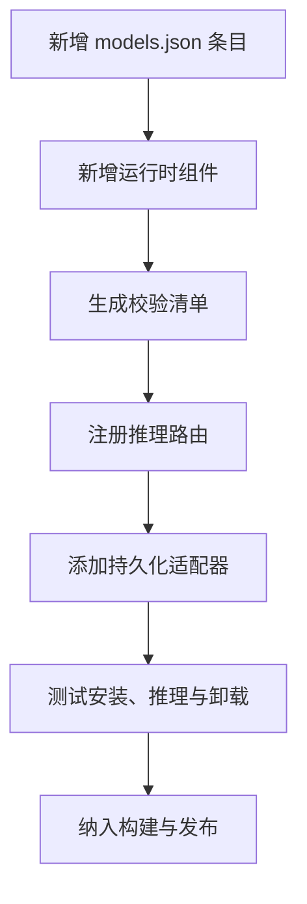

**图表来源**
- [crates/moriq-ai/src/models.rs:1-200](../crates/moriq-ai/src/models.rs#L1-L200)
- [crates/moriq-ai/src/runtime.rs:1-82](../crates/moriq-ai/src/runtime.rs#L1-L82)
- [crates/moriq-app/src/inference.rs:1-200](../crates/moriq-app/src/inference.rs#L1-L200)
- [scripts/prepare-ai-runtime.ps1:1-62](../scripts/prepare-ai-runtime.ps1#L1-L62)
- [scripts/ai-runtime-files.ps1:1-3](../scripts/ai-runtime-files.ps1#L1-L3)

**章节来源**
- [crates/moriq-ai/src/models.rs:1-200](../crates/moriq-ai/src/models.rs#L1-L200)
- [crates/moriq-ai/src/runtime.rs:1-82](../crates/moriq-ai/src/runtime.rs#L1-L82)
- [crates/moriq-app/src/inference.rs:1-200](../crates/moriq-app/src/inference.rs#L1-L200)
- [scripts/prepare-ai-runtime.ps1:1-62](../scripts/prepare-ai-runtime.ps1#L1-L62)
- [scripts/ai-runtime-files.ps1:1-3](../scripts/ai-runtime-files.ps1#L1-L3)