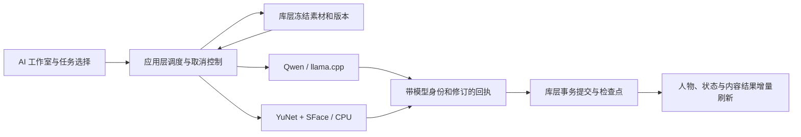

# AI 功能集成

> 当前实现说明，按 2026-11-07 的 1.2.0 开发更新维护。此页已更新，旧 Qoder 快照的默认 Qwen 人脸流程不再适用。

## 能力与入口

| 能力 | 执行器 | 后台任务 |
|---|---|---|
| 媒介与主题分类 | Qwen3.5-4B / llama.cpp | `QwenClassification` |
| 标签与描述 | Qwen3.5-4B / llama.cpp | `QwenDescription` |
| 人脸检测与人物匹配 | 内置 YuNet + SFace / OpenCV CPU | `Analysis(ModelId::Faces)` |
| 近似图片检索 | 感知指纹等既有处理 | 与人脸向量、内容分类分开 |

Qwen 模型卡片的“重新分析”只提交两项 Qwen 内容任务。智能整理页的“重新分析”先显示选择弹窗，只有选中的部分入队；人脸分组默认不勾选。单独“人脸分组”入口先确认整理范围。已有项目时需选择项目，没有项目时可处理库内全部素材。

详细操作见 [AI 工作室与人物整理](AI%20工作室与人物整理.md)，接口见 [人脸识别 API](API%20参考文档/Library%20层%20API/AI%20功能%20API/人脸识别%20API.md)。

## 分层与执行

- `moriq-app` 拥有运行器调用和资源预算，存储层准备输入、检查回执并提交数据。
- 人脸输入使用有界预览；CPU 工作进程返回归一化人脸框和 128 维特征向量，按当前项目匹配代表向量。
- `ai_results` 保存版本绑定的人脸分析结果；`detected_faces`、`people`、`person_vectors` 维护检测、人物和代表向量。
- 人物删除保留原片，将已有检测置为人工未归组，再移除人物与代表向量，防止已领取的结果直接恢复旧分组。
- 内容分类、标签描述继续由内容分析表和人工覆盖层管理；人脸分析不会伪造 Qwen 媒介或主题。

## 刷新与生命周期

逐项完成的结果可在整批结束前显示。头像批次不因普通轮询或摘要刷新被取消；离开相关页面或切换范围时作废旧请求。后台分析更新图库时保留当前布局和图像，在新布局与照片都就绪后提交。

Qwen 和 CPU 人脸进程共用按需驻留策略。后台批次内复用，按需模式在最后一个批次租约释放后卸载；关闭资源库尝试停止两类运行器。历史 `QwenFaces` 路径仍为兼容和诊断保留，不是当前界面的默认人脸实现。

## 模型和打包

Qwen 权重通过模型管理按需下载。CPU 人脸模型、OpenCV 与所需运行库包含在 Windows 完整包的 `ai/faces` 中；组件摘要随构建嵌入，工作进程启动前校验。完整包无需 Python、CUDA 或另装 VC++ 运行库。

构建步骤见 [构建与部署](构建与部署.md)，验证边界见 [测试策略](测试策略.md)。语义向量检索尚未恢复；普通 AI 标签描述搜索和近似图片查找仍可使用。

## 源码

- [任务选择](../crates/moriq-ui/src/analysis_options.rs)、[人物操作](../crates/moriq-ui/src/people_actions.rs)、[头像和模型入口](../crates/moriq-ui/src/ai.rs)
- [推理调度](../crates/moriq-app/src/inference.rs)、[后台调度器](../crates/moriq-app/src/scheduler.rs)
- [CPU 运行器](../crates/moriq-ai/src/cpu_faces.rs)、[原生工作进程](../crates/moriq-ai/native/face-worker.cpp)
- [结果与分组存储](../crates/moriq-library/src/ai/analysis.rs)、[状态汇总](../crates/moriq-library/src/ai/ai_profile.rs)
