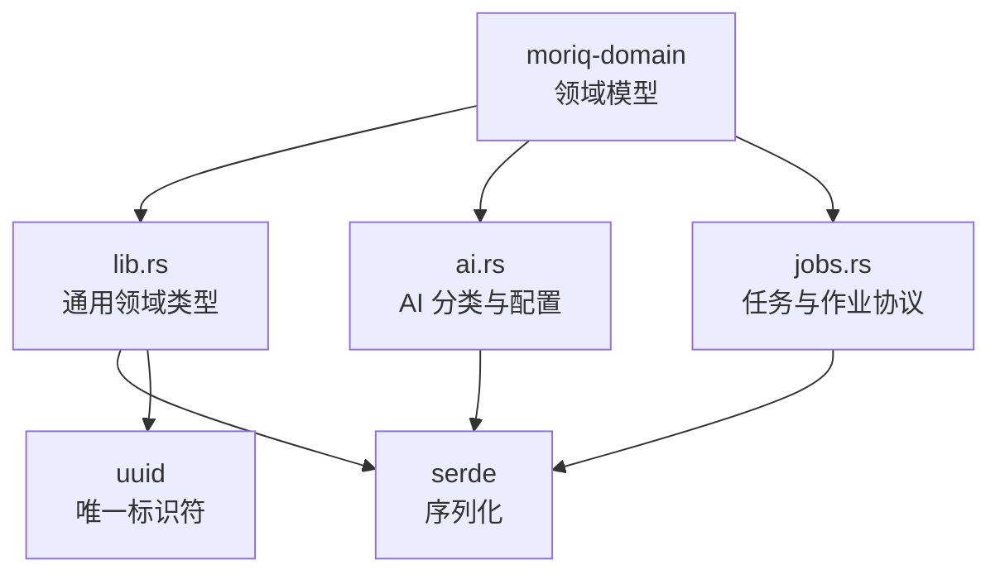
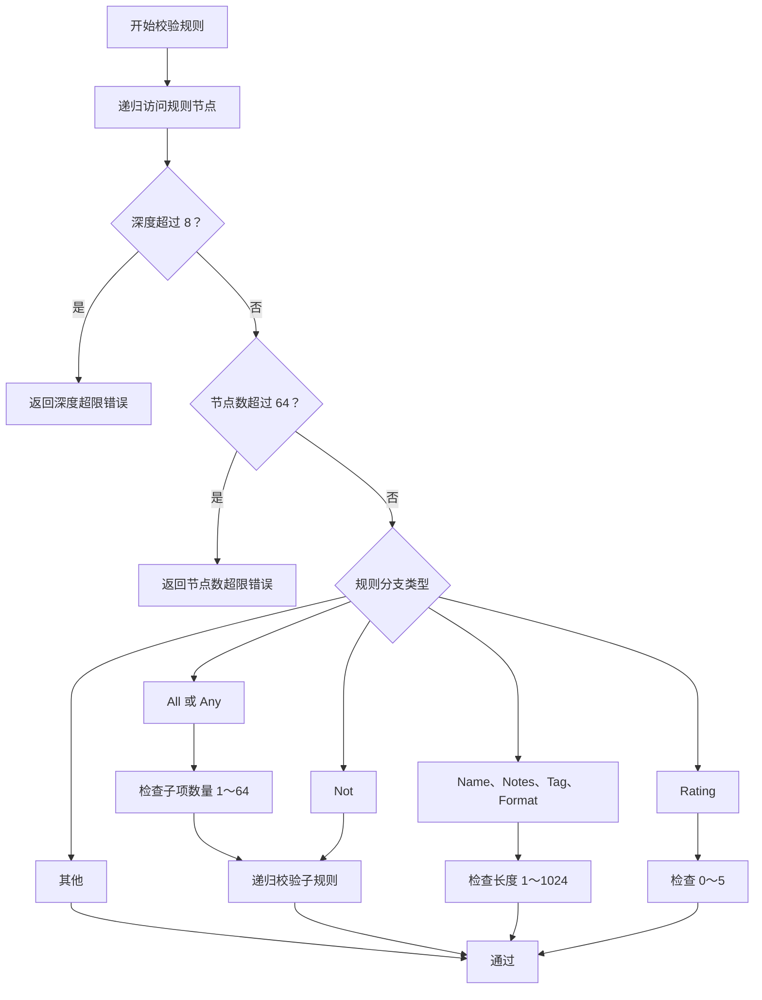
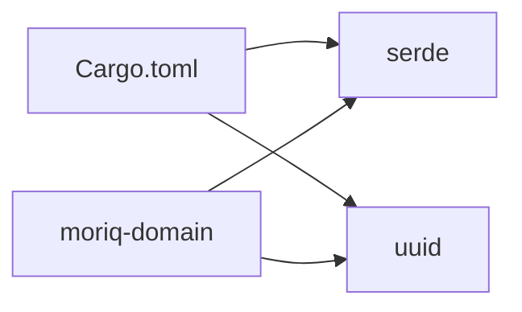

# 领域模型 API

> Repo Wiki 节点 `domain-model-api`
> 导出自 Qoder 知识库快照 `8fbe02f6-57c2-4874-b725-1a8130851fd9`，代码基线 `7a7a8e75e18bd90294e09cd422dd7ed5a04813a0`（分支 main，zh-CN）。

<cite>
**本文引用的文件**   
- [crates/moriq-domain/src/lib.rs](../../crates/moriq-domain/src/lib.rs)
- [crates/moriq-domain/src/ai.rs](../../crates/moriq-domain/src/ai.rs)
- [crates/moriq-domain/src/jobs.rs](../../crates/moriq-domain/src/jobs.rs)
- [crates/moriq-domain/Cargo.toml](../../crates/moriq-domain/Cargo.toml)
</cite>

## 目录
1. [简介](#简介)
2. [项目结构与定位](#项目结构与定位)
3. [核心身份标识符](#核心身份标识符)
4. [核心领域实体](#核心领域实体)
5. [查询与筛选模型](#查询与筛选模型)
6. [AI 相关模型](#ai-相关模型)
7. [任务、作业与错误模型](#任务作业与错误模型)
8. [用户设置与偏好模型](#用户设置与偏好模型)
9. [导出、导入与维护报告](#导出导入与维护报告)
10. [序列化格式与版本兼容性](#序列化格式与版本兼容性)
11. [数据验证规则与业务约束](#数据验证规则与业务约束)
12. [依赖关系与扩展点](#依赖关系与扩展点)
13. [常见问题与排错建议](#常见问题与排错建议)
14. [结论](#结论)

## 简介
本文件为 Moriq 的 **Domain 层** 提供完整的数据模型 API 文档。该模块只暴露稳定的领域类型，不包含 I/O、渲染或具体运行时实现；它由 `moriq-domain` crate 定义，并通过 `serde` 和 `uuid` 提供可序列化的标识符与结构化数据。本文覆盖以下范围：
- 领域身份标识符：`LibraryId`、`AssetId`、`AssetVersionId`、`ProjectId`。
- 核心数据结构：`LibraryInfo`、`Project`、`Asset`、`Query`、`Rule`、`MetadataPredicate`。
- AI 模型：`AiCategoryKind`、`AiCategory`、`AiProfile`、`AiGroup`、`AiEdit`。
- 任务与作业：`ModelId`、`JobKind`、`JobState`、`TaskError`、`BackgroundJob`、`JobCommand`。
- 用户设置、偏好、导入导出选项及维护报告。
- 序列化约定、版本兼容策略、扩展点和数据校验规则。

## 项目结构与定位
`moriq-domain` 是纯领域库，对外暴露三个主要来源：
- 主模块：`lib.rs`，包含身份标识符、资产、项目、查询、组织视图、用户设置等通用领域类型。
- AI 模块：`ai.rs`，包含 AI 分类、主题、配置、分组与编辑操作。
- 任务模块：`jobs.rs`，包含模型标识、作业种类、状态、错误以及持久化协议字符串映射。

**图示来源**
- [crates/moriq-domain/src/lib.rs:1-20](../../crates/moriq-domain/src/lib.rs#L1-L20)
- [crates/moriq-domain/src/ai.rs:1-10](../../crates/moriq-domain/src/ai.rs#L1-L10)
- [crates/moriq-domain/src/jobs.rs:1-10](../../crates/moriq-domain/src/jobs.rs#L1-L10)
- [crates/moriq-domain/Cargo.toml:1-10](../../crates/moriq-domain/Cargo.toml#L1-L10)

**章节来源**
- [crates/moriq-domain/src/lib.rs:1-20](../../crates/moriq-domain/src/lib.rs#L1-L20)
- [crates/moriq-domain/Cargo.toml:1-10](../../crates/moriq-domain/Cargo.toml#L1-L10)

## 核心身份标识符
所有领域标识符都是基于 UUID 的类型安全包装，具备相等性、哈希、显示格式化能力，并支持 `serde` 序列化。新对象默认使用随机 UUID，避免复用已有身份。

| 类型 | 含义 | 内部类型 | 默认值 | 约束与说明 |
|---|---|---|---|---|
| `LibraryId` | 资源库标识 | `Uuid` | 随机 v4 UUID | 用于区分不同资源库实例 |
| `AssetId` | 资产标识 | `Uuid` | 随机 v4 UUID | 用于引用图片、视频等资源 |
| `AssetVersionId` | 资产版本标识 | `Uuid` | 随机 v4 UUID | 用于追踪同一资产的不同版本 |
| `ProjectId` | 项目标识 | `Uuid` | 随机 v4 UUID | 用于组织资产归属和项目树 |

这些类型本身不携带业务语义，仅提供强类型身份。实际字段语义由所属结构体决定，例如 `Project.id`、`Asset.id`、`AssetVersion.id`。

**章节来源**
- [crates/moriq-domain/src/lib.rs:1-40](../../crates/moriq-domain/src/lib.rs#L1-L40)

## 核心领域实体

### LibraryInfo
描述一个资源库的概览信息。

| 字段 | 类型 | 默认值 | 约束与说明 |
|---|---|---|---|
| `id` | `LibraryId` | 无 | 资源库稳定身份 |
| `name` | `String` | 空串 | 资源库显示名称 |
| `count` | `u64` | 0 | 资源库中资产数量 |
| `favorites` | `u64` | 0 | 收藏资产数量 |
| `bytes` | `u64` | 0 | 资源库总字节数 |
| `created_at` | `u64` | 0 | 创建时间戳 |
| `updated_at` | `u64` | 0 | 更新时间戳 |
| `projects` | `Vec<Project>` | 空列表 | 资源库内项目集合 |

**章节来源**
- [crates/moriq-domain/src/lib.rs:40-75](../../crates/moriq-domain/src/lib.rs#L40-L75)

### Project
描述一个项目的基本信息。

| 字段 | 类型 | 默认值 | 约束与说明 |
|---|---|---|---|
| `visited_at` | `u64` | 0 | 最近访问时间戳 |
| `id` | `ProjectId` | 无 | 项目身份 |
| `parent` | `Option<ProjectId>` | `None` | 父项目，用于构建项目树 |
| `name` | `String` | 空串 | 项目名称 |
| `count` | `u64` | 0 | 项目下资产数量 |

**章节来源**
- [crates/moriq-domain/src/lib.rs:75-95](../../crates/moriq-domain/src/lib.rs#L75-L95)

### Asset
描述一个资产的展示投影。

| 字段 | 类型 | 默认值 | 约束与说明 |
|---|---|---|---|
| `id` | `AssetId` | 无 | 资产身份 |
| `version_id` | `AssetVersionId` | 无 | 当前版本身份 |
| `name` | `String` | 空串 | 资产文件名或标题 |
| `format` | `String` | 空串 | 媒体格式 |
| `width` | `u32` | 0 | 宽度 |
| `height` | `u32` | 0 | 高度 |
| `bytes` | `u64` | 0 | 文件大小 |
| `favorite` | `bool` | `false` | 是否收藏 |
| `rating` | `u8` | 0 | 评分 |
| `tags` | `Vec<String>` | 空列表 | 标签集合 |
| `imported_at` | `u64` | 0 | 导入时间戳 |

注意：`rating` 在业务规则中通常受评分上限约束，详见“数据验证规则”部分。

**章节来源**
- [crates/moriq-domain/src/lib.rs:95-120](../../crates/moriq-domain/src/lib.rs#L95-L120)

### AssetDetails、AssetVersion、Face、AssetLocation
这些是资产详情、版本、人脸和地理位置相关的辅助领域结构。

| 类型 | 关键字段 | 含义 |
|---|---|---|
| `AssetDetails` | `project_copies`、`versions`、`exif`、`faces` | 资产详细信息聚合，包括项目副本、版本列表、EXIF 元数据和人脸列表 |
| `AssetVersion` | `id`、`origin`、`parent` | 资产版本身份、来源、父版本 |
| `Face` | `id`、`version`、`person`、`bounds` | 人脸标识、所属版本、人物名称、边界框坐标 |
| `AssetLocation` | `latitude`、`longitude`、`label` | 地理坐标和地点标签，并提供有效性检查与地图链接生成 |

**章节来源**
- [crates/moriq-domain/src/lib.rs:201-260](../../crates/moriq-domain/src/lib.rs#L201-L260)
- [crates/moriq-domain/src/lib.rs:650-711](../../crates/moriq-domain/src/lib.rs#L650-L711)

## 查询与筛选模型

### Query
`Query` 是跨 UI、检索和存储的稳定查询表达。它包含多种过滤条件、排序方式、分页上下文和语义搜索开关。

| 字段 | 类型 | 默认值 | 含义 |
|---|---|---|---|
| `legacy_category` | `String` | 空串 | 历史分类字段，保留兼容 |
| `medium` | `String` | 空串 | 媒介类型筛选 |
| `themes` | `Vec<String>` | 空列表 | 主题词筛选 |
| `metadata` | `Vec<MetadataPredicate>` | 空列表 | 元数据谓词列表 |
| `folder` | `Option<String>` | `None` | 文件夹筛选 |
| `category` | `String` | 空串 | 分类筛选 |
| `person` | `Option<String>` | `None` | 人物筛选 |
| `semantic_ids` | `Vec<AssetId>` | 空列表 | 语义参考资产 ID |
| `semantic_active` | `bool` | `false` | 是否启用语义筛选 |
| `rule` | `Option<Rule>` | `None` | 结构化规则树 |
| `media_kind` | `MediaKind` | `All` | 媒体种类 |
| `text` | `String` | 空串 | 文本搜索 |
| `favorites_only` | `bool` | `false` | 仅收藏 |
| `project` | `Option<ProjectId>` | `None` | 按项目筛选 |
| `project_exact` | `bool` | `false` | 是否精确匹配项目 |
| `format` | `String` | 空串 | 格式筛选 |
| `storage` | `u8` | 0 | 存储维度筛选 |
| `min_rating` | `u8` | 0 | 最低评分 |
| `min_bytes` | `u64` | 0 | 最小文件大小 |
| `max_bytes` | `u64` | 0 | 最大文件大小 |
| `since` | `u64` | 0 | 起始时间 |
| `before` | `u64` | 0 | 截止时间 |
| `edited_since` | `u64` | 0 | 修改时间筛选 |
| `min_width` | `u32` | 0 | 最小宽度 |
| `orientation` | `u8` | 0 | 方向筛选 |
| `untagged` | `bool` | `false` | 未标签资产 |
| `unassigned` | `bool` | `false` | 未分配资产 |
| `trash` | `bool` | `false` | 回收站资产 |
| `tag` | `String` | 空串 | 单标签筛选 |
| `color` | `String` | 空串 | 颜色筛选 |
| `sort` | `SortOrder` | `Newest` | 排序方式 |

`Query` 使用 `#[serde(default)]`，因此缺失字段会回退到默认值，便于向后兼容。

**章节来源**
- [crates/moriq-domain/src/lib.rs:120-175](../../crates/moriq-domain/src/lib.rs#L120-L175)

### Rule 与 MetadataPredicate
`Rule` 是有限深度的结构化筛选树，禁止 SQL 或文件系统路径进入该表达式树。

| 变体 | 含义 | 约束 |
|---|---|---|
| `All(Vec<Rule>)` | 全部条件必须满足 | 子项数量 1～64 |
| `Any(Vec<Rule>)` | 任一条件满足即可 | 子项数量 1～64 |
| `Not(Box<Rule>)` | 否定单个规则 | 深度增加一层 |
| `Name(String)` | 名称匹配 | 长度 1～1024 字节 |
| `Notes(String)` | 备注匹配 | 长度 1～1024 字节 |
| `Tag(String)` | 标签匹配 | 长度 1～1024 字节 |
| `Format(String)` | 格式匹配 | 长度 1～1024 字节 |
| `Rating(u8)` | 评分匹配 | 取值范围 0～5 |
| `Favorite` | 收藏筛选 | 无额外参数 |
| `Raw` | RAW 格式筛选 | 无额外参数 |
| `HasLocation` | 有位置信息筛选 | 无额外参数 |

`MetadataPredicate` 表示简单元数据条件。

| 字段 | 类型 | 含义 |
|---|---|---|
| `field` | `String` | 元数据字段名 |
| `contains` | `String` | 包含匹配值 |
| `min` | `Option<i64>` | 最小值 |
| `max` | `Option<i64>` | 最大值 |

**章节来源**
- [crates/moriq-domain/src/lib.rs:175-200](../../crates/moriq-domain/src/lib.rs#L175-L200)

### MediaKind 与 SortOrder
| 枚举 | 取值 | 含义 |
|---|---|---|
| `MediaKind` | `All`、`Raw`、`Video` | 媒体种类，默认 `All` |
| `SortOrder` | `Newest`、`Oldest`、`Name`、`Largest`、`Rating` | 排序方式，默认 `Newest` |

**章节来源**
- [crates/moriq-domain/src/lib.rs:175-200](../../crates/moriq-domain/src/lib.rs#L175-L200)

## AI 相关模型

### AiCategoryKind
| 值 | 含义 |
|---|---|
| `Medium` | 固定媒介类型 |
| `Theme` | 主题分类 |

**章节来源**
- [crates/moriq-domain/src/ai.rs:1-20](../../crates/moriq-domain/src/ai.rs#L1-L20)

### AiCategory
| 字段 | 类型 | 含义 |
|---|---|---|
| `id` | `String` | 稳定分类身份 |
| `kind` | `AiCategoryKind` | 分类种类 |
| `label` | `String` | 显示名称 |
| `definition` | `String` | 识别说明 |
| `enabled` | `bool` | 是否启用 |

**章节来源**
- [crates/moriq-domain/src/ai.rs:10-25](../../crates/moriq-domain/src/ai.rs#L10-L25)

### AiProfile
AI 分类配置文件，包含修订号、主题上限和分类集合。

| 字段 | 类型 | 默认值 | 含义 |
|---|---|---|---|
| `revision` | `u64` | 1 | 配置版本 |
| `max_themes` | `u8` | 3 | 单次推理最多主题数 |
| `categories` | `Vec<AiCategory>` | 默认模板 | 分类集合 |

关键行为：
- 默认模板包含固定媒介和主题词表。
- `with_template` 合并模板并保留旧分类身份。
- `validate` 限制启用主题数、说明长度、分类总数、ID 合法性、标签唯一性等。

**章节来源**
- [crates/moriq-domain/src/ai.rs:20-120](../../crates/moriq-domain/src/ai.rs#L20-L120)

### AiGroup
| 字段 | 类型 | 含义 |
|---|---|---|
| `id` | `String` | AI 分组身份 |
| `label` | `String` | 分组名称 |
| `query` | `Query` | 分组使用的查询 |
| `count` | `u64` | 分组资产数量 |
| `cover` | `Option<AssetVersionId>` | 封面版本 |

**章节来源**
- [crates/moriq-domain/src/ai.rs:120-150](../../crates/moriq-domain/src/ai.rs#L120-L150)

### AiEdit
表示用户对 AI 分类结果的一次编辑意图。

| 变体 | 含义 |
|---|---|
| `Classification(String, Vec<String>)` | 修改分类及其主题 |
| `Medium(Option<String>)` | 修改媒介 |
| `Themes(Option<Vec<String>>)` | 修改主题 |
| `Description(Option<String>)` | 修改描述 |
| `RejectTag(String)` | 拒绝某个标签 |
| `PromoteTag(String)` | 提升某个标签 |
| `ResetRejectedTags` | 重置已拒绝标签 |

**章节来源**
- [crates/moriq-domain/src/ai.rs:150-187](../../crates/moriq-domain/src/ai.rs#L150-L187)

## 任务、作业与错误模型

### ModelId
表示后台分析模型的身份。

| 值 | 协议字符串 | 含义 |
|---|---|---|
| `ChineseClip` | `chinese-clip` | 中文视觉模型 |
| `Florence` | `florence` | Florence 模型 |
| `Faces` | `faces` | 人脸模型 |
| `Qwen35_4b` | `qwen35-4b` | Qwen 大模型 |

解析时拒绝未知值，避免错误调度。

**章节来源**
- [crates/moriq-domain/src/jobs.rs:1-40](../../crates/moriq-domain/src/jobs.rs#L1-L40)

### JobKind
表示后台任务种类。

| 值 | 协议字符串 | 内存预算 | 关联模型 |
|---|---|---|---|
| `Metadata` | `metadata` | 128 MiB | 无 |
| `Integrity` | `integrity` | 128 MiB | 无 |
| `Fingerprints` | `fingerprints` | 1024 MiB | 无 |
| `Thumbnails` | `thumbnails` | 1024 MiB | 无 |
| `Batch` | `batch` | 128 MiB | 无 |
| `Analysis(ModelId)` | `analysis:<model>` | 依模型而定 | 指定模型 |
| `QwenClassification` | `analysis:qwen35-4b/classify` | 3072 MiB | `Qwen35_4b` |
| `QwenDescription` | `analysis:qwen35-4b/describe` | 3072 MiB | `Qwen35_4b` |
| `QwenFaces` | `analysis:qwen35-4b/faces` | 3072 MiB | `Qwen35_4b` |

**章节来源**
- [crates/moriq-domain/src/jobs.rs:40-120](../../crates/moriq-domain/src/jobs.rs#L40-L120)

### JobState
任务生命周期状态。

| 值 | 含义 | 活动状态 | 结束状态 |
|---|---|---:|---:|
| `Queued` | 已排队 | 是 | 否 |
| `Running` | 运行中 | 是 | 否 |
| `Paused` | 已暂停 | 是 | 否 |
| `Completed` | 已完成 | 否 | 是 |
| `Cancelled` | 已取消 | 否 | 是 |

**章节来源**
- [crates/moriq-domain/src/jobs.rs:120-170](../../crates/moriq-domain/src/jobs.rs#L120-L170)

### TaskError 与 TaskResult
| 变体 | 含义 |
|---|---|
| `Cancelled` | 任务被取消 |
| `StaleLibrary` | 任务所属资源库已切换 |
| `InvalidInput(String)` | 输入无效 |
| `Storage(String)` | 存储错误 |
| `Runtime(String)` | 运行时错误 |
| `Unavailable` | 后台服务不可用 |

`TaskResult<T>` 是 `Result<T, TaskError>` 的别名。

**章节来源**
- [crates/moriq-domain/src/jobs.rs:170-200](../../crates/moriq-domain/src/jobs.rs#L170-L200)

### BackgroundJob 与 JobCommand
| 类型 | 关键字段 | 含义 |
|---|---|---|
| `BackgroundJob` | `id`、`kind`、`state`、`priority`、`completed`、`total`、`failed`、`error` | 后台作业展示与进度信息 |
| `JobCommand` | `RetryFailed`、`Pause`、`Resume`、`Cancel`、`Priority(i32)` | 用户对作业的操作命令 |

**章节来源**
- [crates/moriq-domain/src/lib.rs:260-330](../../crates/moriq-domain/src/lib.rs#L260-L330)

## 用户设置与偏好模型

### UserSettings
| 字段 | 类型 | 默认值 | 含义 |
|---|---|---|---|
| `category_template` | `Option<AiProfile>` | `None` | 分类模板 |
| `synco` | `SyncoPreferences` | 默认值 | Synco 同步偏好 |
| `ai` | `AiPreferences` | 默认值 | AI 功能偏好 |
| `recent` | `Vec<(String, PathBuf)>` | 空列表 | 最近打开路径 |
| `import` | `ImportPreferences` | 默认值 | 导入并发与内存偏好 |
| `diagnostic_logging` | `bool` | `false` | 诊断日志开关 |
| `reduced_motion` | `bool` | `false` | 减少动效 |
| `language` | `Language` | `SimplifiedChinese` | 界面语言 |
| `appearance` | `Appearance` | `Light` | 外观主题 |

**章节来源**
- [crates/moriq-domain/src/lib.rs:330-420](../../crates/moriq-domain/src/lib.rs#L330-L420)

### Language 与 Appearance
| 枚举 | 取值 | 默认值 | 序列化格式 |
|---|---|---|---|
| `Language` | `SimplifiedChinese`、`English` | `SimplifiedChinese` | kebab-case：`simplified-chinese`、`english` |
| `Appearance` | `Light`、`Dark` | `Light` | kebab-case：`light`、`dark` |

**章节来源**
- [crates/moriq-domain/src/lib.rs:380-420](../../crates/moriq-domain/src/lib.rs#L380-L420)

### SyncoPreferences 与 AiPreferences
| 类型 | 字段 | 默认值 | 含义 |
|---|---|---|---|
| `SyncoPreferences` | `executable` | `None` | 可执行文件路径 |
| `SyncoPreferences` | `auto_start` | `true` | 自动启动 |
| `AiPreferences` | `on_demand` | `true` | 按需加载 |
| `AiPreferences` | `retain_indexes` | `true` | 保留索引 |
| `AiPreferences` | `use_mirror` | `true` | 使用镜像 |

**章节来源**
- [crates/moriq-domain/src/lib.rs:420-470](../../crates/moriq-domain/src/lib.rs#L420-L470)

### ImportPreferences
| 字段 | 类型 | 默认值 | 含义 |
|---|---|---|---|
| `workers` | `usize` | 0 | 并发工作线程数；0 表示自动计算 |
| `memory_mib` | `u32` | 2048 | 导入内存预算（MiB） |

关键方法：
- `effective_workers(logical_cpus)`：自动模式下取逻辑 CPU 的一半，范围 2～16；手动模式限制 1～32。
- `validated()`：要求 `workers ≤ 32` 且 `memory_mib ∈ [256, 4096]`。

**章节来源**
- [crates/moriq-domain/src/lib.rs:470-530](../../crates/moriq-domain/src/lib.rs#L470-L530)

## 导出、导入与维护报告

### 导出选项
| 类型 | 字段 | 默认值 | 含义 |
|---|---|---|---|
| `ExportOptions` | `directory_template` | 空串 | 目录模板 |
| `ExportOptions` | `preserve_exif` | `false` | 保留 EXIF |
| `ExportOptions` | `format` | `Original` | 输出格式 |
| `ExportOptions` | `max_edge` | 0 | 最大边长 |
| `ExportOptions` | `quality` | 90 | 质量 |
| `ExportOptions` | `rotate` | 0 | 旋转角度 |
| `ExportOptions` | `resampling` | `Area` | 重采样算法 |
| `ExportOptions` | `layout` | `Flat` | 布局策略 |
| `ExportOptions` | `metadata_sidecar` | `false` | 写入旁侧元数据 |

| 枚举 | 取值 | 默认值 |
|---|---|---|
| `ExportFormat` | `Original`、`Jpeg`、`Png`、`Webp`、`Tiff`、`Bmp` | `Original` |
| `Resampling` | `Area`、`Lanczos3`、`Bicubic`、`Nearest` | `Area` |
| `ExportLayout` | `Flat`、`Format`、`ImportDate` | `Flat` |

**章节来源**
- [crates/moriq-domain/src/lib.rs:530-630](../../crates/moriq-domain/src/lib.rs#L530-L630)

### 导入、清理与维护报告
| 类型 | 关键字段 | 含义 |
|---|---|---|
| `ImportReport` | `imported`、`duplicates`、`failed`、`failures`、`cancelled` | 导入统计 |
| `ImportFile` | `path`、`relative`、`project_name` | 待导入文件 |
| `PurgeReport` | `deleted`、`cleanup_pending` | 清理报告 |
| `CacheReport` | `removed_files`、`removed_bytes`、`remaining_bytes`、`skipped` | 缓存清理报告 |
| `OrphanReport` | `moved`、`bytes`、`skipped` | 孤立文件报告 |
| `MaintenanceReport` | `checked`、`missing`、`damaged`、`repaired`、`warnings` | 维护报告 |

**章节来源**
- [crates/moriq-domain/src/lib.rs:630-711](../../crates/moriq-domain/src/lib.rs#L630-L711)

## 序列化格式与版本兼容性

### 标识符序列化
身份标识符基于 `uuid::Uuid`，并使用 `serde` 的默认 UUID 序列化格式。由于每个新对象默认生成随机 UUID，因此：
- 不应把 `default()` 当作稳定 ID。
- 应在创建领域对象后显式赋值或使用工厂生成。

### 结构体默认值
`Query`、`UserSettings`、`ImportPreferences`、`ExportOptions`、`SavedVisit`、`SavedNavigation` 等结构体使用 `#[serde(default)]`，缺失字段会回退到 Rust 默认值。这有利于向前兼容：旧客户端可以省略可选字段，新服务端可使用默认行为。

### 枚举序列化
- `Rule` 使用带标签和内容格式：`{ op: "...", value: "..." }`，并按 snake_case 命名。
- `Language`、`Appearance` 使用 kebab-case。
- `AiCategoryKind` 使用 snake_case。
- `JobKind`、`ModelId`、`JobState` 通过 `as_str`、`Display` 和 `FromStr` 提供稳定协议字符串。

### 协议稳定性
任务相关类型明确注释“运行时协议使用类型值，SQLite 保留现有字符串格式”。新增 `JobKind` 或 `ModelId` 时必须：
1. 新增枚举值。
2. 更新 `as_str`。
3. 更新 `FromStr`。
4. 必要时更新 `memory_mib` 或 `model` 映射。
5. 确保未知值不被静默接受。

**章节来源**
- [crates/moriq-domain/src/lib.rs:120-175](../../crates/moriq-domain/src/lib.rs#L120-L175)
- [crates/moriq-domain/src/ai.rs:1-20](../../crates/moriq-domain/src/ai.rs#L1-L20)
- [crates/moriq-domain/src/jobs.rs:1-40](../../crates/moriq-domain/src/jobs.rs#L1-L40)
- [crates/moriq-domain/src/jobs.rs:40-120](../../crates/moriq-domain/src/jobs.rs#L40-L120)

## 数据验证规则与业务约束

### Rule 校验
`Rule::validate` 递归校验规则树：
- 最大深度：8 层。
- 节点总数：最多 64。
- 分组子项数量：1～64。
- 字符串类规则：非空且不超过 1024 字节。
- 评分规则：0～5。

**图示来源**
- [crates/moriq-domain/src/lib.rs:175-200](../../crates/moriq-domain/src/lib.rs#L175-L200)

**章节来源**
- [crates/moriq-domain/src/lib.rs:175-200](../../crates/moriq-domain/src/lib.rs#L175-L200)

### AiProfile 校验
`AiProfile::validate` 控制本地模型上下文预算：
- 启用主题最多 24 个。
- 识别说明字符总数最多 1600。
- `max_themes` 必须在 1～8。
- 分类总数最多 64。
- 分类 ID 不能为空、不能以 `_` 开头、长度不超过 64、只能包含小写字母、数字和下划线。
- 分类标签不能重复、不能为空、不能超过 32 字符、不能使用“未分类”。
- 识别说明不能为空、不能超过 512 字符。
- 媒介类型固定，不允许删除或新增媒介分类。

**章节来源**
- [crates/moriq-domain/src/ai.rs:60-120](../../crates/moriq-domain/src/ai.rs#L60-L120)

### ImportPreferences 校验
- 自动并发：`(logical_cpus / 2).clamp(2, 16)`。
- 手动并发：`workers.clamp(1, 32)`。
- 有效输入：`workers ≤ 32` 且 `memory_mib ∈ [256, 4096]`。

**章节来源**
- [crates/moriq-domain/src/lib.rs:470-530](../../crates/moriq-domain/src/lib.rs#L470-L530)

### AssetLocation 校验
- 经纬度必须是有限浮点数。
- 纬度范围 -90～90。
- 经度范围 -180～180。
- 标签长度不超过 1024 字节。
- 标签字符数不超过 256。

**章节来源**
- [crates/moriq-domain/src/lib.rs:680-711](../../crates/moriq-domain/src/lib.rs#L680-L711)

## 依赖关系与扩展点

### 外部依赖
- `serde`：用于序列化与反序列化。
- `uuid`：用于领域身份。

**图示来源**
- [crates/moriq-domain/Cargo.toml:1-10](../../crates/moriq-domain/Cargo.toml#L1-L10)

### 扩展点
1. **新增任务类型**：扩展 `JobKind`，并更新协议字符串、内存预算和模型映射。
2. **新增分析模型**：扩展 `ModelId`，并更新解析、显示和任务分发。
3. **新增分类**：扩展 `AiCategory`，但不得改变固定媒介集合；可通过 `AiProfile::with_template` 合并模板。
4. **新增查询字段**：在 `Query` 中添加字段，并为兼容旧数据保留 `serde(default)`。
5. **新增偏好字段**：在 `UserSettings` 或对应偏好结构体中添加字段，并保持默认值稳定。

**章节来源**
- [crates/moriq-domain/src/jobs.rs:40-120](../../crates/moriq-domain/src/jobs.rs#L40-L120)
- [crates/moriq-domain/src/ai.rs:20-120](../../crates/moriq-domain/src/ai.rs#L20-L120)
- [crates/moriq-domain/src/lib.rs:120-175](../../crates/moriq-domain/src/lib.rs#L120-L175)

## 常见问题与排错建议

| 问题 | 可能原因 | 处理建议 |
|---|---|---|
| 任务解析失败 | `JobKind` 或 `ModelId` 使用了未登记协议字符串 | 检查 `as_str` 与 `FromStr` 是否一致 |
| 规则校验失败 | 规则树过深、节点过多或字符串过长 | 拆分复杂规则，限制嵌套层级 |
| AI 分类配置无效 | 分类 ID、标签、说明或启用数量违反约束 | 检查 `AiProfile::validate` 的错误信息 |
| 导入并发异常 | 手动 `workers` 超出上限或内存预算不在允许范围 | 使用 `validated()` 检查结果 |
| 地理信息无效 | 经纬度超出范围或非有限数 | 使用 `AssetLocation::valid()` 校验 |
| 查询缺少字段 | 旧数据未包含可选字段 | 依赖 `serde(default)` 使用默认值 |

**章节来源**
- [crates/moriq-domain/src/jobs.rs:120-200](../../crates/moriq-domain/src/jobs.rs#L120-L200)
- [crates/moriq-domain/src/ai.rs:60-120](../../crates/moriq-domain/src/ai.rs#L60-L120)
- [crates/moriq-domain/src/lib.rs:470-530](../../crates/moriq-domain/src/lib.rs#L470-L530)
- [crates/moriq-domain/src/lib.rs:680-711](../../crates/moriq-domain/src/lib.rs#L680-L711)

## 结论
`moriq-domain` 是 Moriq 的核心领域模型层，定义了资源库、项目、资产、查询、AI 配置、任务、用户设置和报告等稳定数据结构。它通过类型安全的标识符、有限的规则树、稳定的协议字符串和明确的校验函数，将业务约束从 I/O 和 UI 中剥离出来。扩展时应优先新增枚举值和配置项，而不是引入新的任意字符串；同时保持序列化默认值和协议映射稳定，以确保数据库、UI、任务和存储服务之间的长期兼容。