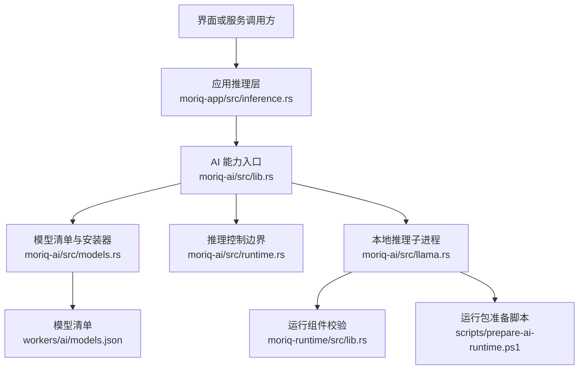
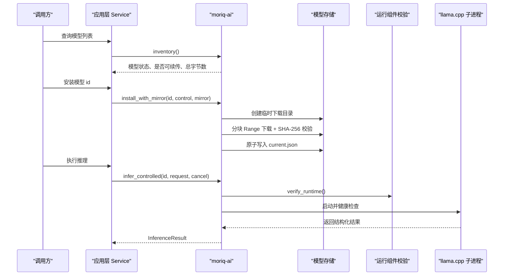
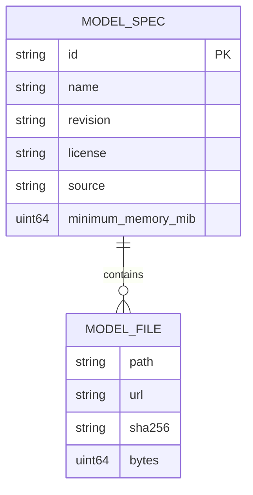
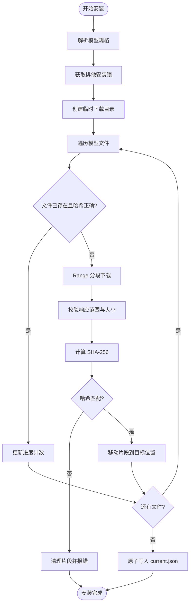
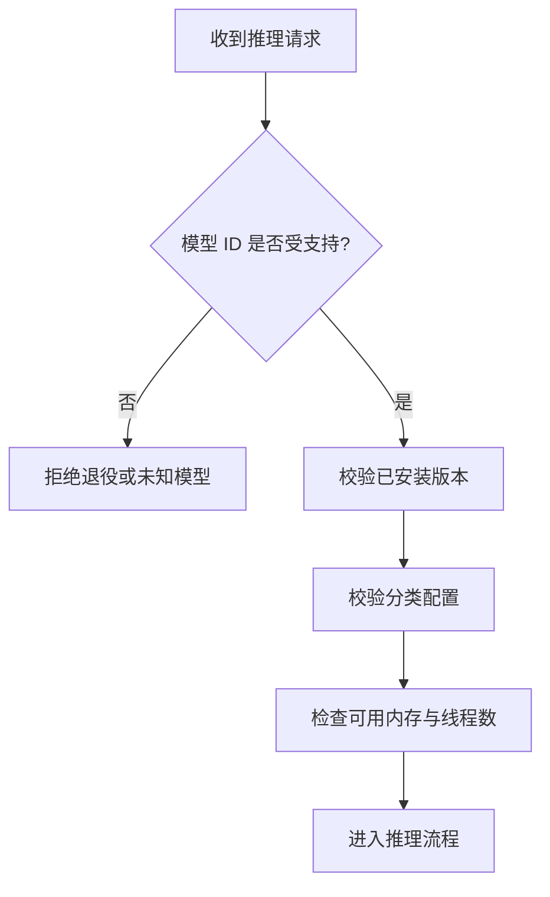
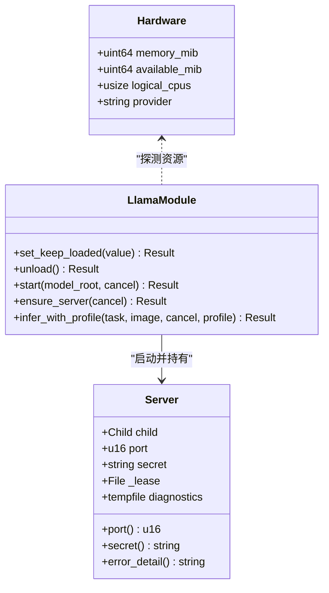
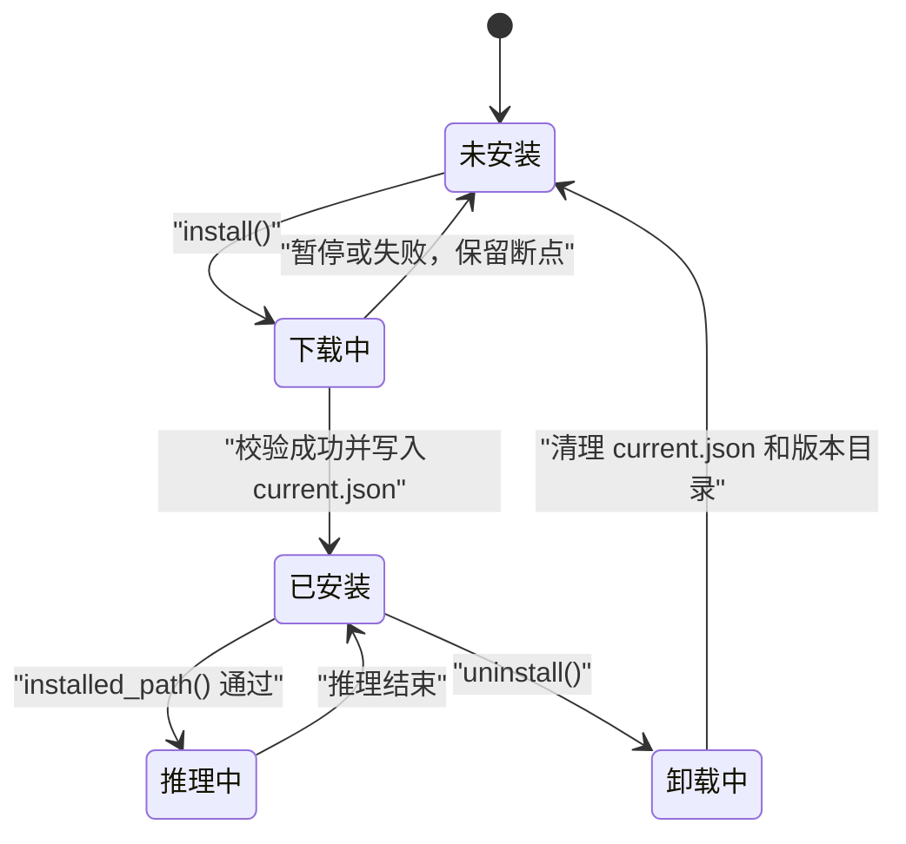
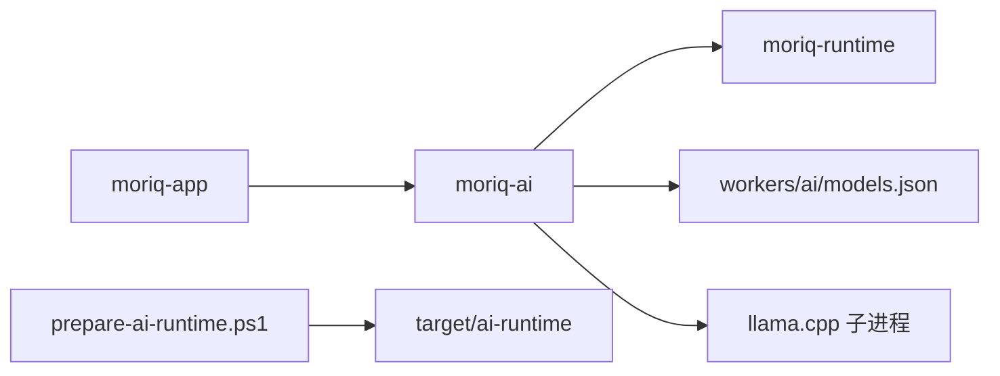

# AI 模型管理 API

> Repo Wiki 节点 `ai-model-management`
> 导出自 Qoder 知识库快照 `8fbe02f6-57c2-4874-b725-1a8130851fd9`，代码基线 `7a7a8e75e18bd90294e09cd422dd7ed5a04813a0`（分支 main，zh-CN）。

<cite>
**本文引用的文件**   
- [moriq-ai/src/lib.rs](../../../../crates/moriq-ai/src/lib.rs)
- [moriq-ai/src/models.rs](../../../../crates/moriq-ai/src/models.rs)
- [moriq-ai/src/runtime.rs](../../../../crates/moriq-ai/src/runtime.rs)
- [moriq-ai/src/llama.rs](../../../../crates/moriq-ai/src/llama.rs)
- [moriq-runtime/src/lib.rs](../../../../crates/moriq-runtime/src/lib.rs)
- [moriq-domain/src/ai.rs](../../../../crates/moriq-domain/src/ai.rs)
- [moriq-app/src/inference.rs](../../../../crates/moriq-app/src/inference.rs)
- [workers/ai/models.json](../../../../workers/ai/models.json)
- [scripts/prepare-ai-runtime.ps1](../../../../scripts/prepare-ai-runtime.ps1)
- [scripts/ai-runtime-files.ps1](../../../../scripts/ai-runtime-files.ps1)
- [ARCHITECTURE.md](../../../../ARCHITECTURE.md)
</cite>

## 目录
1. [引言](#引言)
2. [项目结构](#项目结构)
3. [核心组件](#核心组件)
4. [架构总览](#架构总览)
5. [详细组件分析](#详细组件分析)
6. [依赖关系分析](#依赖关系分析)
7. [性能与内存优化](#性能与内存优化)
8. [故障排查](#故障排查)
9. [结论](#结论)
10. [附录：API 参考](#附录api-参考)

## 引言
本文档面向 AI 模型管理者、集成开发者及高级用户，系统性说明本仓库中 AI 模型的下载、安装、卸载、版本管理、运行时初始化、硬件检测、资源分配、预热策略、缓存机制、兼容性检查、更新与回滚实现。当前代码库以 Qwen3.5-4B 的本地推理为核心，通过 llama.cpp 子进程提供受控推理服务；同时保留历史模型 ID 的兼容边界，并对未登记或退役模型进行拒绝。

## 项目结构
AI 模型管理能力集中在以下模块：
- `moriq-ai`：模型清单解析、下载安装、卸载、版本校验、硬件探测、推理入口。
- `moriq-runtime`：构建时嵌入的运行组件清单校验，防止篡改、链接和越界访问。
- `moriq-app`：应用层调度接口，暴露模型查询、安装、卸载等异步 API，并绑定取消令牌和共享内存预算。
- `moriq-domain`：AI 分类配置、类别模板、输入校验与语义标签约束。
- `workers/ai/models.json`：内置模型规格与权重下载地址、大小、SHA-256 清单。
- `scripts/prepare-ai-runtime.ps1`：准备 llama.cpp 运行包、生成完整性清单和来源声明。

**图表来源**
- [moriq-app/src/inference.rs:1-120](../../../../crates/moriq-app/src/inference.rs#L1-L120)
- [moriq-ai/src/lib.rs:1-15](../../../../crates/moriq-ai/src/lib.rs#L1-L15)
- [moriq-ai/src/models.rs:1-120](../../../../crates/moriq-ai/src/models.rs#L1-L120)
- [moriq-ai/src/runtime.rs:1-82](../../../../crates/moriq-ai/src/runtime.rs#L1-L82)
- [moriq-ai/src/llama.rs:1-120](../../../../crates/moriq-ai/src/llama.rs#L1-L120)
- [moriq-runtime/src/lib.rs:1-60](../../../../crates/moriq-runtime/src/lib.rs#L1-L60)
- [workers/ai/models.json:1-24](../../../../workers/ai/models.json#L1-L24)
- [scripts/prepare-ai-runtime.ps1:1-62](../../../../scripts/prepare-ai-runtime.ps1#L1-L62)

**章节来源**
- [ARCHITECTURE.md:1-40](../../../../ARCHITECTURE.md#L1-L40)

## 核心组件
- 模型清单与规格：`ModelSpec`、`ModelFile`、`ModelInfo`、`registry()`、`inventory()`。
- 下载与安装：`install()`、`install_with_mirror()`、断点续传、范围请求、重试、SHA-256 校验、原子发布 `current.json`。
- 卸载与锁：`uninstall()`、排他安装锁、使用期共享锁、路径越界保护。
- 运行时环境：`verify_runtime()`、llama.cpp 子进程启动、健康检查、鉴权密钥、诊断日志。
- 硬件探测：`hardware()` 返回可用内存、逻辑 CPU 数、后端标识。
- 推理入口：`infer()`、`infer_controlled()`、`llama_infer_profile()`、常驻与释放策略。
- 分类配置：`AiProfile`、类别模板合并、启用数量与定义长度限制。

**章节来源**
- [moriq-ai/src/lib.rs:1-15](../../../../crates/moriq-ai/src/lib.rs#L1-L15)
- [moriq-ai/src/models.rs:1-200](../../../../crates/moriq-ai/src/models.rs#L1-L200)
- [moriq-ai/src/runtime.rs:1-82](../../../../crates/moriq-ai/src/runtime.rs#L1-L82)
- [moriq-ai/src/llama.rs:1-200](../../../../crates/moriq-ai/src/llama.rs#L1-L200)
- [moriq-domain/src/ai.rs:1-120](../../../../crates/moriq-domain/src/ai.rs#L1-L120)

## 架构总览
AI 模型管理采用“清单驱动 + 受控子进程”的架构：
- 模型清单由编译时嵌入的 JSON 描述固定修订、源地址、文件大小与哈希。
- 安装过程在隔离临时目录下载，完成后再原子替换为稳定版本目录，并写入 `current.json`。
- 推理前再次校验模型文件，并通过文件租约阻止并发卸载。
- llama.cpp 作为本机子进程启动，监听环回地址，通过 Bearer Token 认证。
- 运行组件通过构建时清单校验，拒绝符号链接、重解析点和未知文件。

**图表来源**
- [moriq-app/src/inference.rs:250-339](../../../../crates/moriq-app/src/inference.rs#L250-L339)
- [moriq-ai/src/models.rs:200-589](../../../../crates/moriq-ai/src/models.rs#L200-L589)
- [moriq-ai/src/runtime.rs:1-82](../../../../crates/moriq-ai/src/runtime.rs#L1-L82)
- [moriq-ai/src/llama.rs:200-579](../../../../crates/moriq-ai/src/llama.rs#L200-L579)
- [moriq-runtime/src/lib.rs:1-133](../../../../crates/moriq-runtime/src/lib.rs#L1-L133)

## 详细组件分析

### 模型清单与配置文件格式
模型清单位于 `workers/ai/models.json`，每个模型包含：
- `id`：模型身份，例如 `qwen35-4b`。
- `name`：显示名称，例如 `Qwen3.5-4B`。
- `revision`：固定修订标识。
- `source`：上游源地址。
- `license`：许可证。
- `minimum_memory_mib`：最低内存需求，用于资源预算提示。
- `files`：权重与多模态投影文件数组，每项包含：
  - `path`：相对安装目录的路径。
  - `url`：固定修订下的下载地址。
  - `sha256`：内容哈希。
  - `bytes`：文件大小。

清单由 `registry()` 加载，并在安装、卸载、推理前被多次复用。`model_root()` 根据操作系统选择用户数据根目录，最终落在 `MORIQ/models` 下。

**图表来源**
- [workers/ai/models.json:1-24](../../../../workers/ai/models.json#L1-L24)
- [moriq-ai/src/models.rs:1-120](../../../../crates/moriq-ai/src/models.rs#L1-L120)

**章节来源**
- [moriq-ai/src/models.rs:1-120](../../../../crates/moriq-ai/src/models.rs#L1-L120)
- [workers/ai/models.json:1-24](../../../../workers/ai/models.json#L1-L24)

### 下载、安装与断点续传
安装流程关键行为：
1. 解析模型规格，创建模型根目录。
2. 获取排他安装锁，防止并发安装或卸载。
3. 使用临时目录 `.download-{revision_key}` 保存部分文件。
4. 对每个文件计算期望总字节数，跳过已存在且 SHA-256 匹配的文件。
5. 使用 HTTP Range 请求支持续传，校验服务器返回的 `Content-Range`。
6. 遇到 429 或服务器错误时按 `Retry-After` 或指数退避重试。
7. 文件完成后校验 SHA-256，失败则删除临时片段。
8. 所有文件成功后将临时目录原子替换为目标版本目录。
9. 原子写入 `current.json`，记录当前安装的完整 `ModelSpec`。

**图表来源**
- [moriq-ai/src/models.rs:200-589](../../../../crates/moriq-ai/src/models.rs#L200-L589)

**章节来源**
- [moriq-ai/src/models.rs:200-589](../../../../crates/moriq-ai/src/models.rs#L200-L589)

### 卸载与版本回滚
卸载逻辑：
- 先尝试释放正在运行的推理服务。
- 定位模型根目录，验证其确实在预期的模型根目录下。
- 获取排他安装锁，避免与安装任务冲突。
- 删除 `current.json`。
- 仅删除与当前模型相关的版本目录和下载临时目录，不递归清理无关内容。
- 如果已有其他版本目录，不会主动删除，从而实现“可保留旧版本以便回滚”的策略；但系统默认只识别 `current.json` 指向的版本。

回滚建议：
- 若需要明确回滚到历史版本，应重新安装目标修订，使 `current.json` 指向该修订。
- 当前实现没有显式“版本号历史表”，而是以 `current.json` 作为活跃版本指针。

**章节来源**
- [moriq-ai/src/models.rs:470-589](../../../../crates/moriq-ai/src/models.rs#L470-L589)

### 兼容性检查与退役模型处理
兼容性检查发生在多个层次：
- 模型清单中的 `minimum_memory_mib` 用于展示和预算规划。
- 推理前调用 `installed_path()` 校验 `current.json` 是否与预期规格一致。
- `infer_controlled()` 明确拒绝非 `qwen35-4b` 的模型 ID，已退役模型如 `chinese-clip`、`florence`、`faces` 会被直接拒绝。
- 分类配置 `AiProfile` 限制启用主题数量、定义长度、类别总数和唯一性。

**图表来源**
- [moriq-ai/src/runtime.rs:1-82](../../../../crates/moriq-ai/src/runtime.rs#L1-L82)
- [moriq-ai/src/models.rs:120-200](../../../../crates/moriq-ai/src/models.rs#L120-L200)
- [moriq-domain/src/ai.rs:1-120](../../../../crates/moriq-domain/src/ai.rs#L1-L120)

**章节来源**
- [moriq-ai/src/runtime.rs:1-82](../../../../crates/moriq-ai/src/runtime.rs#L1-L82)
- [moriq-ai/src/models.rs:120-200](../../../../crates/moriq-ai/src/models.rs#L120-L200)
- [moriq-domain/src/ai.rs:1-120](../../../../crates/moriq-domain/src/ai.rs#L1-L120)

### 运行时环境初始化与硬件检测
运行时初始化步骤：
1. 定位 `ai/llama` 目录，调试模式可切换开发路径。
2. 校验顶层 AI 运行目录和 `llama` 子目录的构建时清单。
3. 校验已安装模型文件的 SHA-256。
4. 申请环回端口，启动 `llama-server.exe`。
5. 传入模型权重、多模态投影、主机地址、端口、并行度、线程数、Jinja 模板、API Key 等参数。
6. 周期性轮询 `/health` 健康接口，超时或进程退出即失败。

硬件检测：
- `hardware()` 读取系统总内存、可用内存、逻辑 CPU 数量。
- 线程数取可用逻辑 CPU 的一半，并限制在 1 到 8。
- 推理启动前检查可用内存是否至少满足阈值。

**图表来源**
- [moriq-ai/src/models.rs:40-100](../../../../crates/moriq-ai/src/models.rs#L40-L100)
- [moriq-ai/src/llama.rs:1-200](../../../../crates/moriq-ai/src/llama.rs#L1-L200)
- [moriq-ai/src/llama.rs:200-579](../../../../crates/moriq-ai/src/llama.rs#L200-L579)

**章节来源**
- [moriq-ai/src/models.rs:40-100](../../../../crates/moriq-ai/src/models.rs#L40-L100)
- [moriq-ai/src/llama.rs:1-200](../../../../crates/moriq-ai/src/llama.rs#L1-L200)
- [moriq-ai/src/llama.rs:200-579](../../../../crates/moriq-ai/src/llama.rs#L200-L579)

### 模型预热、缓存管理与内存优化
- 常驻策略：通过 `set_keep_loaded(true)` 保持推理服务常驻，避免频繁启动开销；关闭后空闲实例会被释放。
- 会话级释放：默认推理结束后若未开启常驻，会立即释放服务。
- 图片输入预算：单张图片不超过 32MB，人脸比较每张图片不超过 16MB。
- 请求体预算：推理请求不超过 36MB，响应体不超过 1MB。
- GPU/CPU 分层：语言模型层优先留在 GPU，视觉投影阶段禁用 offload，限制图像 token 数和缓存 RAM。
- 线程预算：逻辑 CPU 的一半，限制在 1~8。
- 安装文件校验缓存：避免重复扫描大文件时频繁哈希，内部维护最多 128 项缓存。

最佳实践：
- 批量任务场景开启常驻以降低启动延迟。
- 交互式任务关闭常驻，避免长时间占用 GPU 和内存。
- 控制分类数量和定义长度，减少提示词上下文。
- 合理设置镜像源，避免因网络限速导致下载中断。

**章节来源**
- [moriq-ai/src/llama.rs:1-200](../../../../crates/moriq-ai/src/llama.rs#L1-L200)
- [moriq-ai/src/llama.rs:200-579](../../../../crates/moriq-ai/src/llama.rs#L200-L579)
- [moriq-ai/src/models.rs:120-200](../../../../crates/moriq-ai/src/models.rs#L120-L200)

### 模型更新策略与回滚机制
- 更新策略：重新安装同一 `id` 的不同 `revision`，新安装会覆盖 `current.json`。
- 一致性检查：安装完成后写入 `current.json`；推理前校验 `current.json` 与实际规格一致。
- 损坏恢复：若文件缺失或哈希不一致，返回重新安装提示。
- 回滚机制：当前实现不自动保留历史版本索引；可通过重新安装目标修订实现回滚。
- 安装锁：安装、卸载和推理前均使用文件锁，确保操作串行化。

**图表来源**
- [moriq-ai/src/models.rs:200-589](../../../../crates/moriq-ai/src/models.rs#L200-L589)
- [moriq-ai/src/models.rs:120-200](../../../../crates/moriq-ai/src/models.rs#L120-L200)

**章节来源**
- [moriq-ai/src/models.rs:120-589](../../../../crates/moriq-ai/src/models.rs#L120-L589)

## 依赖关系分析
- `moriq-app` 依赖 `moriq-ai` 暴露的模型安装、卸载、清单查询和推理接口。
- `moriq-ai` 依赖 `moriq-runtime` 校验 llama.cpp 运行组件。
- `moriq-ai` 内嵌 `workers/ai/models.json` 作为模型清单。
- `moriq-ai` 通过子进程启动 `llama-server.exe`，并使用环回端口和本机鉴权。
- `scripts/prepare-ai-runtime.ps1` 负责准备 `target/ai-runtime` 下的运行包，生成 `checksums.json`、`provenance.json` 和 `models.json`。

**图表来源**
- [moriq-app/src/inference.rs:1-120](../../../../crates/moriq-app/src/inference.rs#L1-L120)
- [moriq-ai/src/lib.rs:1-15](../../../../crates/moriq-ai/src/lib.rs#L1-L15)
- [moriq-runtime/src/lib.rs:1-60](../../../../crates/moriq-runtime/src/lib.rs#L1-L60)
- [scripts/prepare-ai-runtime.ps1:1-62](../../../../scripts/prepare-ai-runtime.ps1#L1-L62)

**章节来源**
- [ARCHITECTURE.md:1-40](../../../../ARCHITECTURE.md#L1-L40)
- [moriq-app/src/inference.rs:1-120](../../../../crates/moriq-app/src/inference.rs#L1-L120)
- [moriq-ai/src/lib.rs:1-15](../../../../crates/moriq-ai/src/lib.rs#L1-L15)

## 性能与内存优化
- 安装阶段避免重复哈希：已校验文件进入缓存，减少大权重重复计算。
- 下载阶段使用 Range 请求，支持断点续传，降低弱网环境重试成本。
- 推理阶段限制请求体、响应体、图片大小、标签数量和输出 token 数。
- GPU/CPU 分层加载，避免视觉投影阶段耗尽 GPU 分配器。
- 常驻策略在批量场景中减少子进程启动和模型加载开销。
- 共享内存预算在应用层控制语义检索和分析任务的并发。

[本节为通用性能指导，不直接分析具体代码行]

## 故障排查
常见问题与定位方式：
- 下载失败或网络受限：检查是否为 429 或服务器错误，确认镜像源是否可用；断点文件仍保留在临时目录。
- 模型哈希不一致：重新安装对应修订，确认 `current.json` 与实际文件一致。
- 推理启动超时：检查可用内存是否低于阈值，查看 llama.cpp 诊断日志尾部。
- 退役模型报错：确认模型 ID 是否为 `qwen35-4b`。
- 运行组件校验失败：检查 `ai/llama` 目录是否完整，是否存在符号链接、重解析点或被篡改文件。
- 分类配置无效：检查启用主题数量、定义长度、类别唯一性和媒介类型约束。

**章节来源**
- [moriq-ai/src/models.rs:200-589](../../../../crates/moriq-ai/src/models.rs#L200-L589)
- [moriq-ai/src/llama.rs:200-579](../../../../crates/moriq-ai/src/llama.rs#L200-L579)
- [moriq-runtime/src/lib.rs:1-133](../../../../crates/moriq-runtime/src/lib.rs#L1-L133)
- [moriq-domain/src/ai.rs:1-120](../../../../crates/moriq-domain/src/ai.rs#L1-L120)

## 结论
本项目的 AI 模型管理以固定修订清单为核心，通过安全的下载、安装、卸载流程保证模型完整性；通过文件锁和运行组件校验保障并发安全与环境可信；通过常驻策略、输入预算和 GPU/CPU 分层提升推理性能。对于版本管理，系统以 `current.json` 表示活跃版本，更新即覆盖，回滚需重新安装目标修订。未来扩展更多模型时，应遵循现有清单格式、校验流程和资源预算约定。

[本节为总结性内容，不直接分析具体代码行]

## 附录：API 参考

### 模型清单与状态
- 读取内置模型清单：`registry()`
- 列出模型信息与安装状态：`inventory()`
- 获取本机硬件信息：`hardware()`
- 获取模型根目录：`model_root()`
- 查询已安装模型路径：`installed_path(id)`

**章节来源**
- [moriq-ai/src/models.rs:1-200](../../../../crates/moriq-ai/src/models.rs#L1-L200)

### 模型安装与卸载
- 默认安装：`install(id, control)`
- 可选镜像安装：`install_with_mirror(id, control, use_mirror)`
- 卸载模型：`uninstall(id)`
- 下载控制对象字段：`stop`、`downloaded`、`total`

**章节来源**
- [moriq-ai/src/models.rs:200-589](../../../../crates/moriq-ai/src/models.rs#L200-L589)

### 推理与生命周期
- 默认推理入口：`infer(id, request)`
- 可控推理入口：`infer_controlled(id, request, cancel)`
- 设置常驻策略：`set_keep_loaded(value)`
- 释放推理服务：`unload()`
- 带分类配置的推理：`llama_infer_profile(task, image, cancel, profile)`
- 导出运行时校验函数：`verify_runtime(root, manifest, replaceable)`

**章节来源**
- [moriq-ai/src/lib.rs:1-15](../../../../crates/moriq-ai/src/lib.rs#L1-L15)
- [moriq-ai/src/runtime.rs:1-82](../../../../crates/moriq-ai/src/runtime.rs#L1-L82)
- [moriq-ai/src/llama.rs:1-200](../../../../crates/moriq-ai/src/llama.rs#L1-L200)
- [moriq-runtime/src/lib.rs:1-133](../../../../crates/moriq-runtime/src/lib.rs#L1-L133)

### 应用层异步接口
- 查询模型清单与硬件：`Service::models()`
- 安装模型：`Service::install_model(model, control)`
- 选择镜像安装：`Service::install_model_with_mirror(model, control, use_mirror)`
- 卸载模型：`Service::uninstall_model(model)`

**章节来源**
- [moriq-app/src/inference.rs:250-339](../../../../crates/moriq-app/src/inference.rs#L250-L339)

### 模型配置文件示例字段
- `id`、`name`、`revision`、`source`、`license`、`minimum_memory_mib`
- `files[]`：`path`、`url`、`sha256`、`bytes`

**章节来源**
- [workers/ai/models.json:1-24](../../../../workers/ai/models.json#L1-L24)

### 运行包准备产物
- `target/ai-runtime/llama/`：llama.cpp 可执行文件和依赖 DLL。
- `target/ai-runtime/checksums.json`：AI 运行目录完整性清单。
- `target/ai-runtime/llama/checksums.json`：llama 子目录清单。
- `target/ai-runtime/provenance.json`：运行组件来源与后端信息。
- `target/ai-runtime/models.json`：随运行包发布的模型清单副本。

**章节来源**
- [scripts/prepare-ai-runtime.ps1:1-62](../../../../scripts/prepare-ai-runtime.ps1#L1-L62)
- [scripts/ai-runtime-files.ps1:1-3](../../../../scripts/ai-runtime-files.ps1#L1-L3)