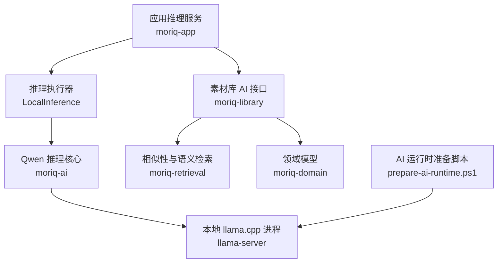
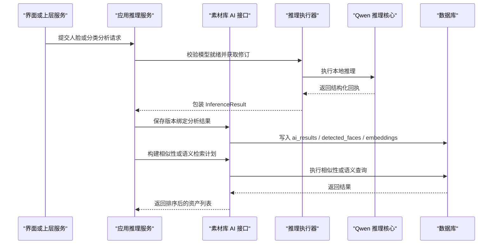
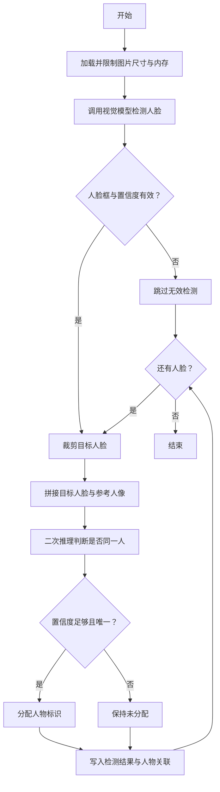
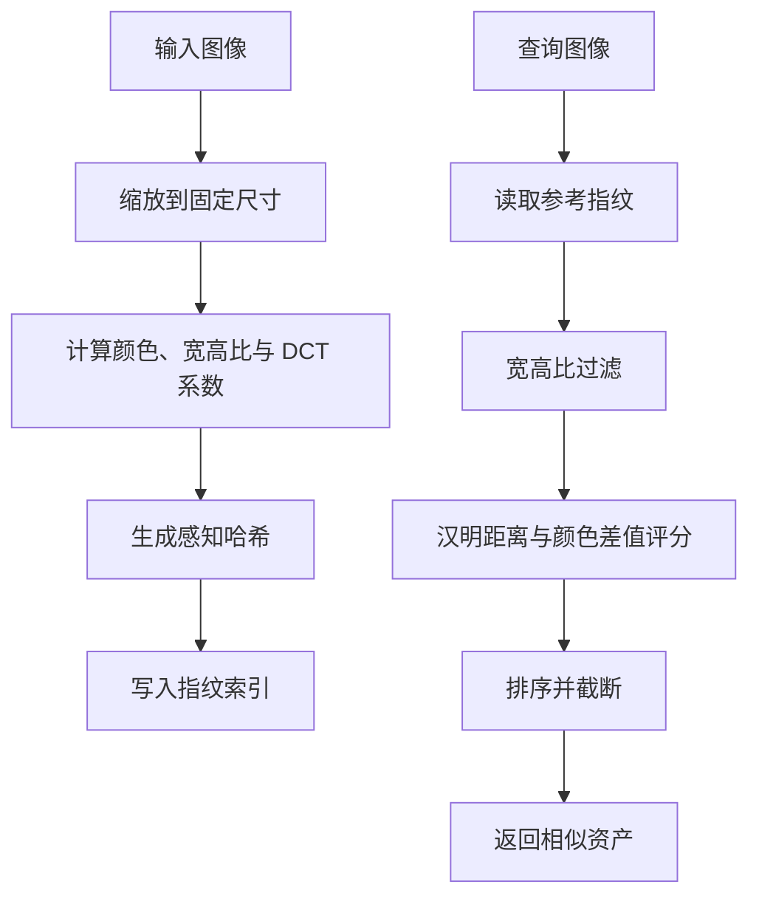
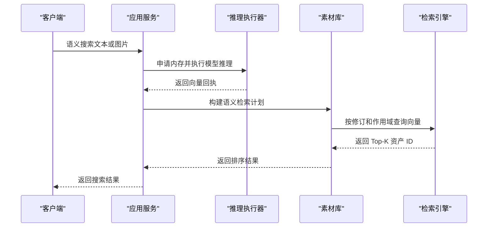
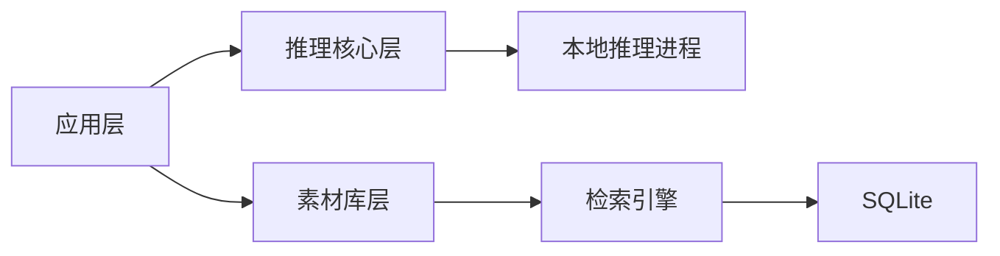

# AI 功能 API

> Repo Wiki 节点 `ai-api`
> 导出自 Qoder 知识库快照 `8fbe02f6-57c2-4874-b725-1a8130851fd9`，代码基线 `7a7a8e75e18bd90294e09cd422dd7ed5a04813a0`（分支 main，zh-CN）。

> **当前接口补充（2026-11-07）：** 本页后文保留旧快照。默认人脸模型已改为 CPU，人物删除保留照片及人工未归组检测，查询新增 `Query.face_analyzed`。当前签名和行为见 [人脸识别 API](人脸识别%20API.md)，任务入口与界面约束见 [AI 工作室与人物整理](../../../AI%20工作室与人物整理.md)。

<cite>
**本文引用的文件**   
- [qwen_faces.rs](../../../../crates/moriq-library/src/ai/qwen_faces.rs)
- [analysis.rs](../../../../crates/moriq-library/src/ai/analysis.rs)
- [portraits.rs](../../../../crates/moriq-library/src/ai/portraits.rs)
- [similarity.rs](../../../../crates/moriq-library/src/ai/similarity.rs)
- [lib.rs（moriq-retrieval）](../../../../crates/moriq-retrieval/src/lib.rs)
- [ai.rs（领域模型）](../../../../crates/moriq-domain/src/ai.rs)
- [jobs.rs（任务协议）](../../../../crates/moriq-domain/src/jobs.rs)
- [inference.rs（应用推理服务）](../../../../crates/moriq-app/src/inference.rs)
- [lib.rs（moriq-ai）](../../../../crates/moriq-ai/src/lib.rs)
- [qwen_faces.rs（Qwen 人脸实现）](../../../../crates/moriq-ai/src/qwen_faces.rs)
- [llama.rs（本地推理运行时）](../../../../crates/moriq-ai/src/llama.rs)
- [prepare-ai-runtime.ps1（AI 运行时准备脚本）](../../../../scripts/prepare-ai-runtime.ps1)
</cite>

## 目录
1. [引言](#引言)
2. [项目结构](#项目结构)
3. [核心组件](#核心组件)
4. [架构总览](#架构总览)
5. [详细组件分析](#详细组件分析)
6. [依赖关系分析](#依赖关系分析)
7. [性能与调优](#性能与调优)
8. [故障排查](#故障排查)
9. [结论](#结论)
10. [附录：API 参考与示例](#附录api参考与示例)

## 引言
本文件面向需要调用或扩展本项目 AI 子系统的开发者，系统性记录内容分析、人脸识别、相似性检索和语义检索等能力。文档重点覆盖：
- Qwen 人脸检测、人物比对、结果持久化接口
- Qwen 分类与描述任务的输入输出、配置与校验
- 相似度指纹索引、向量嵌入存储、语义检索流程
- 异步推理、进度控制、取消策略与错误处理
- 批量分析与结果过滤的实用方法

## 项目结构
AI 子系统按职责拆分为多个 crate：
- `moriq-domain`：定义稳定的模型标识、任务种类、分类词表与人机交互数据结构。
- `moriq-library`：封装素材库中的人脸检测、人物分组、头像裁剪、相似度指纹与语义向量落库逻辑。
- `moriq-app`：将用户操作编排为后台任务，协调推理执行器、内存预算、取消令牌与查询计划。
- `moriq-ai`：管理 Qwen 模型清单、安装状态和本地 llama.cpp 受控推理进程。
- `moriq-retrieval`：提供无 UI、无媒体解码依赖的相似性与语义检索 SQL 实现。
- 构建与部署脚本负责准备可验证的 Qwen 运行组件。

**图示来源**
- [inference.rs:1-120](../../../../crates/moriq-app/src/inference.rs#L1-L120)
- [lib.rs（moriq-ai）:1-15](../../../../crates/moriq-ai/src/lib.rs#L1-L15)
- [similarity.rs:1-131](../../../../crates/moriq-library/src/ai/similarity.rs#L1-L131)
- [lib.rs（moriq-retrieval）:1-200](../../../../crates/moriq-retrieval/src/lib.rs#L1-L200)
- [prepare-ai-runtime.ps1:1-62](../../../../scripts/prepare-ai-runtime.ps1#L1-L62)

**章节来源**
- [ai.rs（领域模型）:1-187](../../../../crates/moriq-domain/src/ai.rs#L1-L187)
- [jobs.rs（任务协议）:1-200](../../../../crates/moriq-domain/src/jobs.rs#L1-L200)
- [inference.rs（应用推理服务）:1-200](../../../../crates/moriq-app/src/inference.rs#L1-L200)
- [lib.rs（moriq-ai）:1-15](../../../../crates/moriq-ai/src/lib.rs#L1-L15)
- [similarity.rs:1-131](../../../../crates/moriq-library/src/ai/similarity.rs#L1-L131)
- [lib.rs（moriq-retrieval）:1-200](../../../../crates/moriq-retrieval/src/lib.rs#L1-L200)
- [prepare-ai-runtime.ps1:1-62](../../../../scripts/prepare-ai-runtime.ps1#L1-L62)

## 核心组件
- 领域模型与分类配置
  - 媒介类型与主题分类统一在领域层定义，包含默认词表、启用数量限制、上下文长度控制和分类 ID 校验。
  - 支持模板合并，保留旧分类身份并隐藏未包含项。
- 任务与模型协议
  - 稳定枚举包括 `ChineseClip`、`Florence`、`Faces`、`Qwen35_4b`，以及对应任务种类。
  - 每个任务种类有固定内存预算，用于共享内存准入控制。
- 推理执行器
  - 通过 `InferenceRunner` 暴露 Qwen 人脸、通用 Qwen 推理、模型修订查询与就绪检查。
  - 默认本地执行器会校验模型安装、读取固定修订、调用底层推理并包装带模型身份的 `InferenceResult`。
- 素材库 AI 能力
  - 人脸检测与人物匹配：Qwen 人脸路径使用真实人像裁剪进行视觉比对，不生成合成向量。
  - 通用分析：Qwen 分类与描述任务经过字段、词表和长度校验后写入版本绑定的分析结果。
  - 相似性检索：对图像计算感知指纹并存储，基于哈希距离与颜色差异排序。
  - 语义检索：中文 CLIP 向量经归一化后存入数据库，按余弦相似度返回结果。
- 检索引擎
  - 相似性检索：按宽高比范围筛选候选，再按汉明距离和 RGB 差值评分。
  - 语义检索：按模型修订与项目作用域过滤，流式维护 Top-K 分数。

**章节来源**
- [ai.rs（领域模型）:1-187](../../../../crates/moriq-domain/src/ai.rs#L1-L187)
- [jobs.rs（任务协议）:1-200](../../../../crates/moriq-domain/src/jobs.rs#L1-L200)
- [inference.rs（应用推理服务）:1-200](../../../../crates/moriq-app/src/inference.rs#L1-L200)
- [analysis.rs:1-200](../../../../crates/moriq-library/src/ai/analysis.rs#L1-L200)
- [similarity.rs:1-131](../../../../crates/moriq-library/src/ai/similarity.rs#L1-L131)
- [lib.rs（moriq-retrieval）:1-200](../../../../crates/moriq-retrieval/src/lib.rs#L1-L200)

## 架构总览
AI 推理采用“应用编排 + 素材库数据 + 本地模型”的分层设计：
- 应用层负责调度任务、申请内存、绑定取消令牌、构造输入并消费结果。
- 素材库层负责数据校验、向量化、指纹计算、结果持久化和检索计划。
- 推理核心层启动受控的本地推理进程，加载 Qwen 模型，执行多模态推理。
- 检索层独立于媒体解码器和 UI，仅依赖数据库连接与作用域。

**图示来源**
- [inference.rs（应用推理服务）:1-200](../../../../crates/moriq-app/src/inference.rs#L1-L200)
- [analysis.rs:1-200](../../../../crates/moriq-library/src/ai/analysis.rs#L1-L200)
- [qwen_faces.rs（Qwen 人脸实现）:1-172](../../../../crates/moriq-ai/src/qwen_faces.rs#L1-L172)
- [lib.rs（moriq-retrieval）:1-200](../../../../crates/moriq-retrieval/src/lib.rs#L1-L200)

## 详细组件分析

### Qwen 人脸检测与人物比对
该能力以 Qwen 视觉模型为核心，先检测人脸框，再将目标人脸与当前工作区的有效人物参考图进行对比，最终持久化检测结果和人物归属。

- 输入
  - 图片路径。
  - 参考资料列表，每项包含人物标识与实际图片路径。
  - 取消标志，用于中断推理。
- 处理流程
  - 使用受控推理会话发送检测提示，限定返回结构，仅接受置信度不低于阈值的合法人脸框。
  - 将归一化坐标转换为像素裁剪区域，并与每个参考人像拼成对比图。
  - 对每张对比图发起二次推理，要求模型给出是否同一人、置信度和证据说明。
  - 只有置信度达到严格阈值且唯一匹配时才分配人物标识；重复人物在同一张图中只分配一次。
- 输出
  - 包含人脸框、可能的人物标识和每次比对候选的结构化回执。
- 持久化
  - 素材库层校验边界框有效性、人数上限、模型修订和结果大小。
  - 与已有检测结果进行边界框重叠和向量相似度匹配，保留人工修正。
  - 自动创建未命名人物，并在检测到空向量时清理无效人物分组。

**图示来源**
- [qwen_faces.rs（Qwen 人脸实现）:1-172](../../../../crates/moriq-ai/src/qwen_faces.rs#L1-L172)
- [qwen_faces.rs（素材库 Qwen 人脸）:1-200](../../../../crates/moriq-library/src/ai/qwen_faces.rs#L1-L200)
- [analysis.rs:201-602](../../../../crates/moriq-library/src/ai/analysis.rs#L201-L602)

**章节来源**
- [qwen_faces.rs（Qwen 人脸实现）:1-172](../../../../crates/moriq-ai/src/qwen_faces.rs#L1-L172)
- [qwen_faces.rs（素材库 Qwen 人脸）:1-200](../../../../crates/moriq-library/src/ai/qwen_faces.rs#L1-L200)
- [portraits.rs:1-166](../../../../crates/moriq-library/src/ai/portraits.rs#L1-L166)
- [analysis.rs:201-602](../../../../crates/moriq-library/src/ai/analysis.rs#L201-L602)

#### Qwen 人脸接口约定
- 推理入口
  - 接收图片路径、参考资料数组和取消标志。
  - 返回结构化 JSON，包含人脸数组，每个元素含边界框、可选人物标识和比对候选。
- 数据约束
  - 人脸数量不超过固定上限。
  - 人脸坐标必须位于合理范围，边界框宽度高度为正数。
  - 匹配置信度需达到较高阈值，避免误配。
- 结果校验
  - 素材库层拒绝非有限数值、越界坐标、非法宽高比。
  - 与历史检测结果做 IoU 与向量相似度联合匹配，优先保留人工修正。

**章节来源**
- [qwen_faces.rs（Qwen 人脸实现）:1-172](../../../../crates/moriq-ai/src/qwen_faces.rs#L1-L172)
- [qwen_faces.rs（素材库 Qwen 人脸）:1-200](../../../../crates/moriq-library/src/ai/qwen_faces.rs#L1-L200)
- [analysis.rs:201-602](../../../../crates/moriq-library/src/ai/analysis.rs#L201-L602)

### Qwen 内容分类与描述
Qwen 分类与描述任务由领域层的分类配置驱动，确保返回字段、词表、标签数量和文本长度符合协议。

- 分类任务
  - 输入：图片路径、分类配置。
  - 输出：媒介类型、主题列表、不确定性信息和配置摘要哈希。
  - 校验：媒介类型必须在固定集合中；主题数量不超过配置上限；主题标签来自已启用的主题分类。
- 描述任务
  - 输入：图片路径、默认分类配置。
  - 输出：描述文本和标签列表。
  - 校验：描述长度受限；标签数量和单标签长度受限；标签去重并规范化空格。
- 存储策略
  - 按版本、模型、修订和预处理版本写入 `ai_results`。
  - Qwen 任务替换自身字段，同时保留其他成功任务，避免重新分析覆盖人工分类。

```mermaid
flowchart TD
    Start["开始"] --> Profile["加载分类配置"]
    Profile --> Task{"任务类型？"}
    Task -->|分类| Classify["校验媒介类型与主题词表"]
    Task -->|描述| Describe["校验描述长度与标签格式"]
    Classify --> Normalize["排序、去重主题"]
    Describe --> NormalizeTags["规范化标签"]
    Normalize --> Merge["合并历史结果"]
    NormalizeTags --> Merge
    Merge --> Persist["写入版本绑定分析结果"]
    Persist --> End["结束"]
```

**图示来源**
- [analysis.rs:1-200](../../../../crates/moriq-library/src/ai/analysis.rs#L1-L200)
- [ai.rs（领域模型）:1-187](../../../../crates/moriq-domain/src/ai.rs#L1-L187)

**章节来源**
- [analysis.rs:1-200](../../../../crates/moriq-library/src/ai/analysis.rs#L1-L200)
- [ai.rs（领域模型）:1-187](../../../../crates/moriq-domain/src/ai.rs#L1-L187)

### 相似性检索与向量索引
相似性检索分为两类：
- 感知指纹相似性：用于识别缩放、重压缩或近似图像。
- 语义向量相似性：基于中文 CLIP 向量，用于文本或图片语义检索。

#### 感知指纹相似性
- 特征提取
  - 将图像缩放到固定小尺寸，计算颜色均值、宽高比。
  - 使用离散余弦变换系数生成感知哈希，并对系数排序取中位数作为阈值。
- 索引存储
  - 指纹、RGB 均值和宽高比写入 `image_fingerprints`。
  - 算法标识固定，便于后续查询。
- 查询机制
  - 按宽高比区间筛选候选。
  - 计算哈希汉明距离与 RGB 差值和，双重过滤后排序。
  - 结果数量限制在固定范围内，并按距离与名称排序。

**图示来源**
- [similarity.rs:1-131](../../../../crates/moriq-library/src/ai/similarity.rs#L1-L131)
- [lib.rs（moriq-retrieval）:1-200](../../../../crates/moriq-retrieval/src/lib.rs#L1-L200)

**章节来源**
- [similarity.rs:1-131](../../../../crates/moriq-library/src/ai/similarity.rs#L1-L131)
- [lib.rs（moriq-retrieval）:1-200](../../../../crates/moriq-retrieval/src/lib.rs#L1-L200)

#### 语义向量索引与检索
- 向量生成
  - 中文 CLIP 模型根据图片或文本生成向量。
  - 向量需通过维度、有限值和归一化校验。
- 向量存储
  - 小端字节编码后写入 `ai_embeddings`。
  - 与 `chinese-clip` 模型标识和修订版本绑定。
- 检索优化
  - 查询前校验文本长度或图片可读取。
  - 按模型修订建立只读检索计划，避免持有写入连接。
  - 流式维护 Top-K，防止全量排序导致内存压力。
  - 排除当前素材，保证推荐结果不包含原图。

**图示来源**
- [inference.rs（应用推理服务）:201-339](../../../../crates/moriq-app/src/inference.rs#L201-L339)
- [analysis.rs:1-200](../../../../crates/moriq-library/src/ai/analysis.rs#L1-L200)
- [lib.rs（moriq-retrieval）:1-200](../../../../crates/moriq-retrieval/src/lib.rs#L1-L200)

**章节来源**
- [analysis.rs:1-200](../../../../crates/moriq-library/src/ai/analysis.rs#L1-L200)
- [inference.rs（应用推理服务）:201-339](../../../../crates/moriq-app/src/inference.rs#L201-L339)
- [lib.rs（moriq-retrieval）:1-200](../../../../crates/moriq-retrieval/src/lib.rs#L1-L200)

### 头像裁剪与人物代表图
- 代表头像选择
  - 从当前展示版本中查找某人物的人脸，按人脸面积降序和导入时间排序。
  - 排除回收站中的素材和旧展示版本。
- 裁剪规则
  - 校验预览尺寸、边界框合法性。
  - 围绕人脸中心扩展固定比例边长，避免越界。
  - 将裁剪区域缩放到固定输出尺寸，并保持 RGBA 通道完整性。

**章节来源**
- [portraits.rs:1-166](../../../../crates/moriq-library/src/ai/portraits.rs#L1-L166)

## 依赖关系分析
- 应用层依赖
  - `moriq-app` 依赖 `moriq-library` 的数据访问与检索计划，依赖 `moriq-ai` 的模型管理与推理入口。
  - 通过 `JobKind` 和 `ModelId` 与任务调度系统解耦。
- 推理核心依赖
  - `moriq-ai` 通过本地进程启动 `llama-server.exe`，使用随机端口、随机密钥和受限环境变量。
  - 模型路径、投影模型、上下文窗口、线程数、GPU 卸载策略等参数在启动时固化。
- 检索层依赖
  - `moriq-retrieval` 仅依赖 SQLite 连接与作用域，不耦合媒体解码、UI 或模型运行时。

**图示来源**
- [inference.rs（应用推理服务）:1-200](../../../../crates/moriq-app/src/inference.rs#L1-L200)
- [llama.rs（本地推理运行时）:1-200](../../../../crates/moriq-ai/src/llama.rs#L1-L200)
- [lib.rs（moriq-retrieval）:1-200](../../../../crates/moriq-retrieval/src/lib.rs#L1-L200)

**章节来源**
- [jobs.rs（任务协议）:1-200](../../../../crates/moriq-domain/src/jobs.rs#L1-L200)
- [llama.rs（本地推理运行时）:1-200](../../../../crates/moriq-ai/src/llama.rs#L1-L200)
- [lib.rs（moriq-retrieval）:1-200](../../../../crates/moriq-retrieval/src/lib.rs#L1-L200)

## 性能与调优
- 模型运行时参数
  - 上下文窗口、并行数、线程数、GPU 层卸载、CPU 视觉阶段限制、最大 token 数和缓存内存均被显式设置。
  - 线程数按逻辑 CPU 数动态限制，避免过度占用。
  - 关闭推理增强模式，减少延迟。
- 资源预算
  - 不同任务种类分配固定内存预算，例如 Qwen 相关任务和通用分析任务使用较大预算，批处理与元数据任务使用较小预算。
  - 语义检索申请共享内存租约，失败时快速返回。
- 检索优化
  - 相似性检索使用宽高比预筛和哈希距离快速过滤。
  - 语义检索流式维护 Top-K，避免全量排序。
  - 检索计划使用只读连接，避免阻塞写入端。
- 模型常驻策略
  - 可通过常驻开关决定是否释放空闲推理服务，减少冷启动开销。

**章节来源**
- [llama.rs（本地推理运行时）:1-200](../../../../crates/moriq-ai/src/llama.rs#L1-L200)
- [jobs.rs（任务协议）:1-200](../../../../crates/moriq-domain/src/jobs.rs#L1-L200)
- [lib.rs（moriq-retrieval）:1-200](../../../../crates/moriq-retrieval/src/lib.rs#L1-L200)

## 故障排查
- 模型未安装或不可用
  - 应用层在推理前检查模型安装路径，未知模型返回输入错误。
  - 本地推理进程启动失败时会读取诊断日志尾部，补充失败原因。
- 任务被取消
  - 推理执行器在关键步骤读取取消标志，返回取消错误。
  - 界面请求丢弃时会触发取消信号，阻止后台推理继续发布结果。
- 输入无效
  - 向量维度、有限值、归一化长度、人脸坐标、置信度、描述长度、标签数量等均会被严格校验。
  - 无效输入返回明确的输入错误，不会静默丢弃。
- 结果不一致
  - Qwen 分类与描述任务合并历史结果，避免重新分析覆盖人工分类。
  - 人物分组保留人工修正，自动结果仅在未冲突时更新。
- 检索无结果
  - 相似性检索要求指纹索引已建立，否则返回“尚未建立索引”类错误。
  - 语义检索要求向量存在且修订一致，否则返回空结果或无效范围错误。

**章节来源**
- [inference.rs（应用推理服务）:1-200](../../../../crates/moriq-app/src/inference.rs#L1-L200)
- [llama.rs（本地推理运行时）:1-200](../../../../crates/moriq-ai/src/llama.rs#L1-L200)
- [analysis.rs:1-200](../../../../crates/moriq-library/src/ai/analysis.rs#L1-L200)
- [qwen_faces.rs（Qwen 人脸实现）:1-172](../../../../crates/moriq-ai/src/qwen_faces.rs#L1-L172)
- [lib.rs（moriq-retrieval）:1-200](../../../../crates/moriq-retrieval/src/lib.rs#L1-L200)

## 结论
本项目 AI 子系统以稳定协议为核心，将模型管理、推理执行、数据持久化和检索解耦。Qwen 人脸检测与人物比对强调真实人像比较和强校验；相似性检索兼顾感知指纹与语义向量；分类与描述任务通过领域词表控制上下文预算和输出一致性。异步推理、内存预算、取消控制和错误分类共同构成可运维、可扩展的本地 AI 推理体系。

## 附录：API 参考与示例

### 模型与任务协议
- 模型标识
  - `ChineseClip`：中文 CLIP，用于语义向量。
  - `Florence`：图像分析模型。
  - `Faces`：通用人脸分析模型。
  - `Qwen35_4b`：Qwen 多模态模型。
- 任务种类
  - `QwenClassification`：Qwen 分类。
  - `QwenDescription`：Qwen 描述。
  - `QwenFaces`：Qwen 人脸检测与人物比对。
  - `Analysis(ModelId)`：通用模型分析。

**章节来源**
- [jobs.rs（任务协议）:1-200](../../../../crates/moriq-domain/src/jobs.rs#L1-L200)

### 推理执行器接口
- `qwen_faces(image, references, cancel)`
  - 用途：执行 Qwen 人脸检测与人物比对。
  - 输入：图片路径、参考资料数组、取消标志。
  - 输出：结构化人脸回执。
- `qwen_infer(task, image, profile, cancel)`
  - 用途：执行 Qwen 分类或描述任务。
  - 输入：任务名、图片路径、分类配置、取消标志。
  - 输出：带模型修订的分析回执。
- `infer(model, input, cancel)`
  - 用途：执行已登记模型的通用推理。
  - 输入：模型标识、结构化输入、取消标志。
  - 输出：带模型修订的分析回执。
- `revision(model)` 与 `ready(model)`
  - 用途：查询模型修订和可用性。

**章节来源**
- [inference.rs（应用推理服务）:1-200](../../../../crates/moriq-app/src/inference.rs#L1-L200)

### Qwen 人脸配置与参数
- 检测约束
  - 人脸数量上限。
  - 坐标范围限制与置信度阈值。
  - 禁止猜测遮挡或不清晰人脸。
- 人物比对
  - 对比图布局固定，左右各一张独立人脸。
  - 要求模型输出是否同一人、置信度和证据说明。
  - 仅当置信度达到严格阈值且唯一匹配时分配人物。
- 参考图来源
  - 从当前工作区的有效人物人脸中选择真实素材预览进行裁剪。
  - 不生成合成向量，避免伪造嵌入。

**章节来源**
- [qwen_faces.rs（Qwen 人脸实现）:1-172](../../../../crates/moriq-ai/src/qwen_faces.rs#L1-L172)
- [qwen_faces.rs（素材库 Qwen 人脸）:1-200](../../../../crates/moriq-library/src/ai/qwen_faces.rs#L1-L200)
- [portraits.rs:1-166](../../../../crates/moriq-library/src/ai/portraits.rs#L1-L166)

### 相似度检索与结果排序
- 指纹相似性
  - 候选筛选：宽高比接近参考图。
  - 评分标准：哈希汉明距离优先，RGB 差值辅助。
  - 排序：按距离升序，再按名称排序，限制结果数量。
- 语义相似性
  - 向量归一化后按点积计算相似度。
  - 流式维护 Top-K，最后整体排序并截断。
  - 可排除当前素材，适合推荐场景。

**章节来源**
- [similarity.rs:1-131](../../../../crates/moriq-library/src/ai/similarity.rs#L1-L131)
- [lib.rs（moriq-retrieval）:1-200](../../../../crates/moriq-retrieval/src/lib.rs#L1-L200)

### 批量分析与结果过滤
- 批量分析
  - 通过任务种类分发到 Qwen 人脸、分类、描述或通用模型推理。
  - 每个任务有固定内存预算，避免资源争用。
- 结果过滤
  - 分类结果保留人工分类优先。
  - 人脸结果保留人工修正，自动结果仅在 IoU 与向量相似度满足条件时匹配。
  - 人物分组去重，避免同图重复分配。
  - 语义检索按修订版本过滤，防止旧向量污染新结果。

**章节来源**
- [analysis.rs:201-602](../../../../crates/moriq-library/src/ai/analysis.rs#L201-L602)
- [jobs.rs（任务协议）:1-200](../../../../crates/moriq-domain/src/jobs.rs#L1-L200)

### 异步执行、进度跟踪与错误处理
- 异步执行
  - 文本向量和图片向量推理在阻塞线程中执行，避免阻塞主循环。
  - 模型安装与卸载也在阻塞线程中进行。
- 进度与取消
  - 交互式推理登记取消令牌，切库或请求销毁时统一停止。
  - 推理过程中多次检查取消标志，及时返回取消错误。
- 错误分类
  - 输入错误：模型未登记、向量无效、人脸坐标非法。
  - 存储错误：数据库写入失败、回执过大。
  - 运行时错误：模型不可用、推理进程异常。
  - 取消错误：任务被用户或界面主动取消。

**章节来源**
- [inference.rs（应用推理服务）:201-339](../../../../crates/moriq-app/src/inference.rs#L201-L339)
- [jobs.rs（任务协议）:1-200](../../../../crates/moriq-domain/src/jobs.rs#L1-L200)

### 实用示例指引
- 初始化 Qwen 人脸分析
  - 准备图片路径。
  - 准备人物参考图列表。
  - 调用人脸推理接口并传入取消标志。
  - 将回执交给素材库层存储。
- 执行 Qwen 分类
  - 构建分类配置，设置媒介类型和主题分类。
  - 调用分类推理接口。
  - 校验返回字段后写入分析结果。
- 执行语义检索
  - 输入自然语言或参考图片。
  - 申请内存并执行中文 CLIP 推理。
  - 构建语义检索计划并执行向量查询。
  - 返回 Top-K 资产 ID。

上述示例可直接映射到现有模块：
- 人脸推理入口：[qwen_faces.rs（Qwen 人脸实现）:1-172](../../../../crates/moriq-ai/src/qwen_faces.rs#L1-L172)
- 分类与描述校验：[analysis.rs:1-200](../../../../crates/moriq-library/src/ai/analysis.rs#L1-L200)
- 语义检索流程：[inference.rs（应用推理服务）:201-339](../../../../crates/moriq-app/src/inference.rs#L201-L339)
- 向量与指纹存储：[analysis.rs:1-200](../../../../crates/moriq-library/src/ai/analysis.rs#L1-L200)、[similarity.rs:1-131](../../../../crates/moriq-library/src/ai/similarity.rs#L1-L131)

### 部署与运行时准备
- 构建脚本从固定版本下载 llama.cpp 二进制，校验 SHA-256。
- 复制必要 DLL 到 AI 运行时目录，生成校验清单。
- 程序启动时验证运行时和模型组件，确保离线可用与完整性。

**章节来源**
- [prepare-ai-runtime.ps1:1-62](../../../../scripts/prepare-ai-runtime.ps1#L1-L62)
