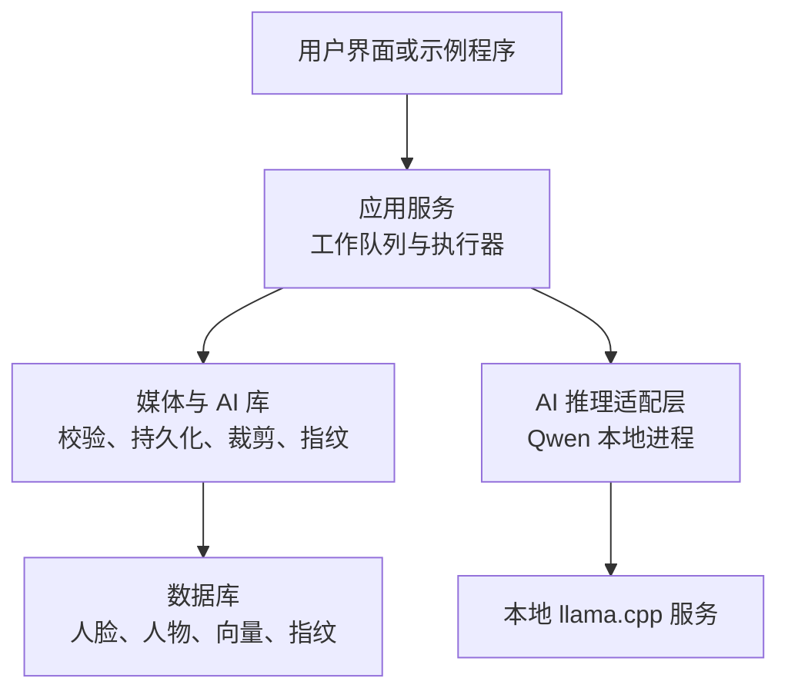
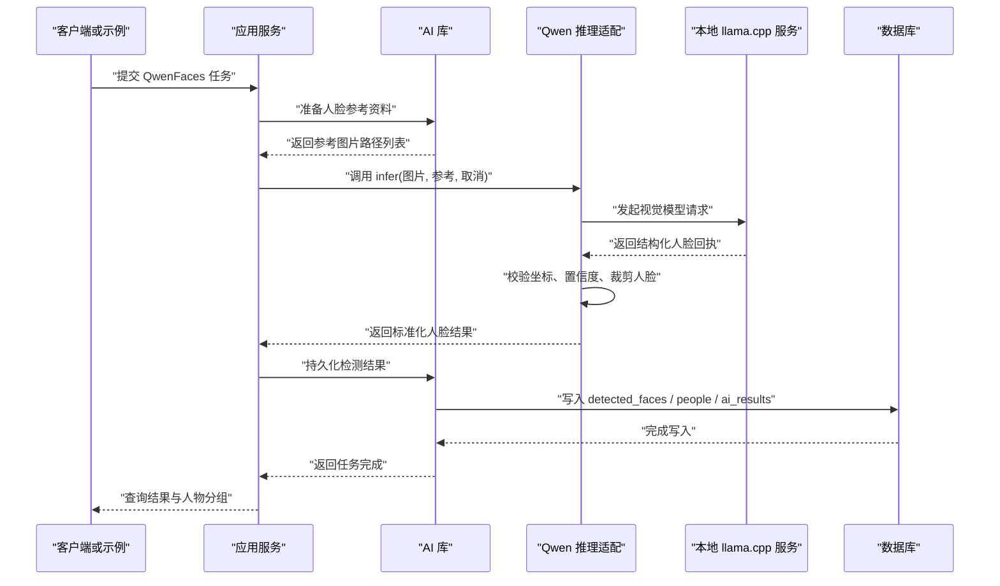
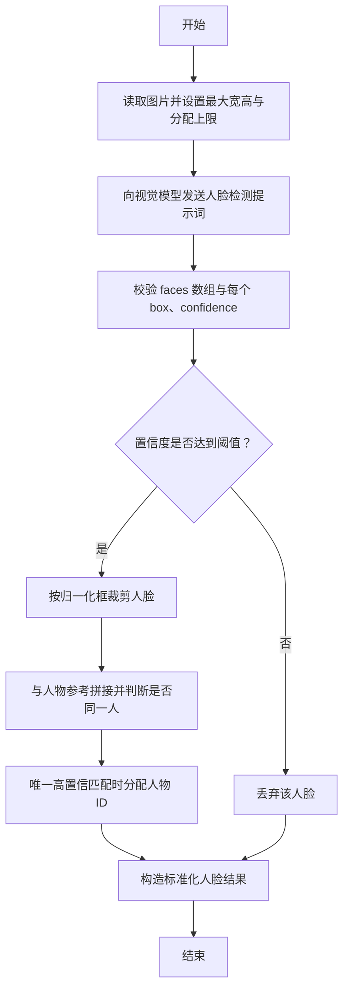
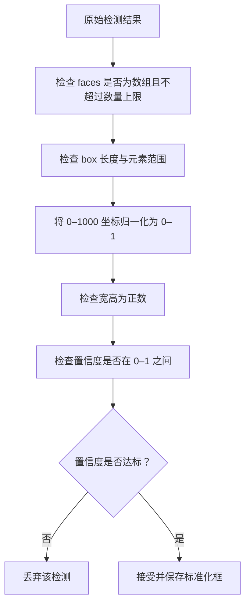
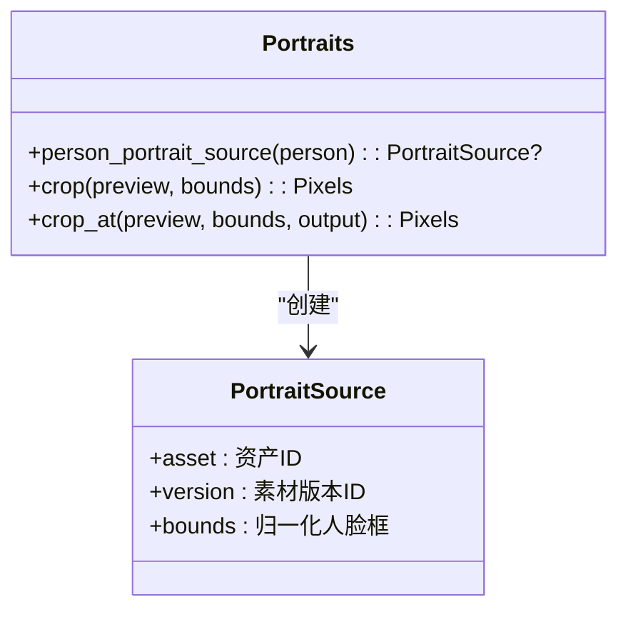
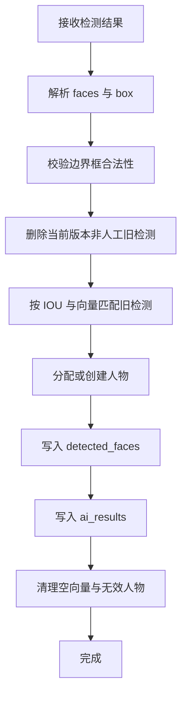
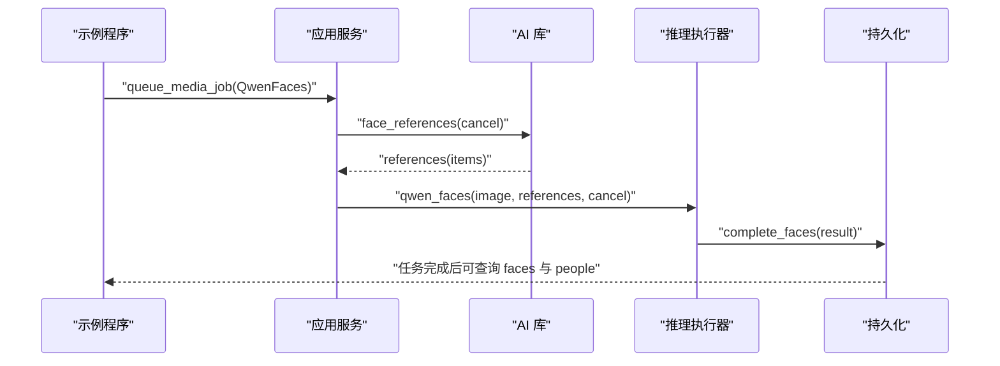
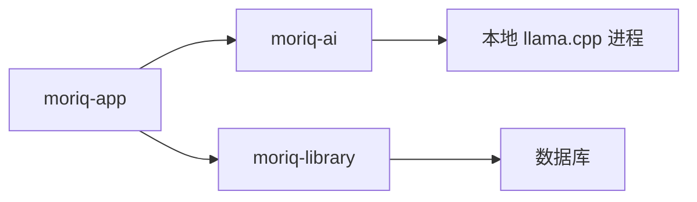
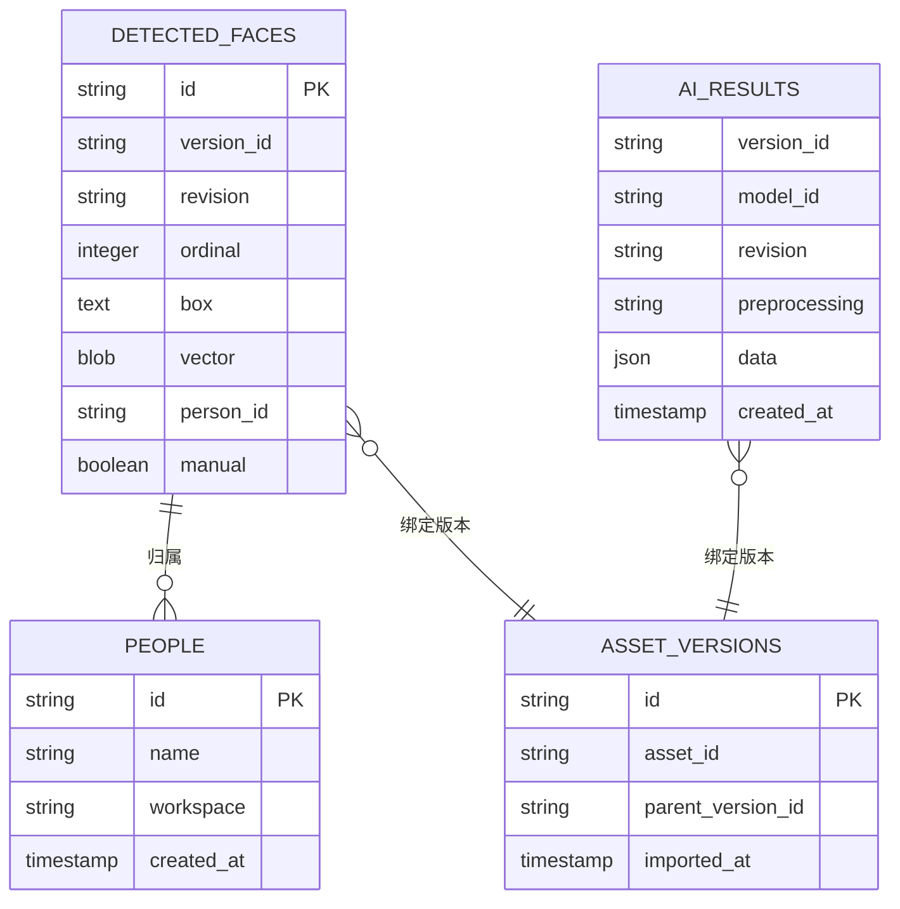
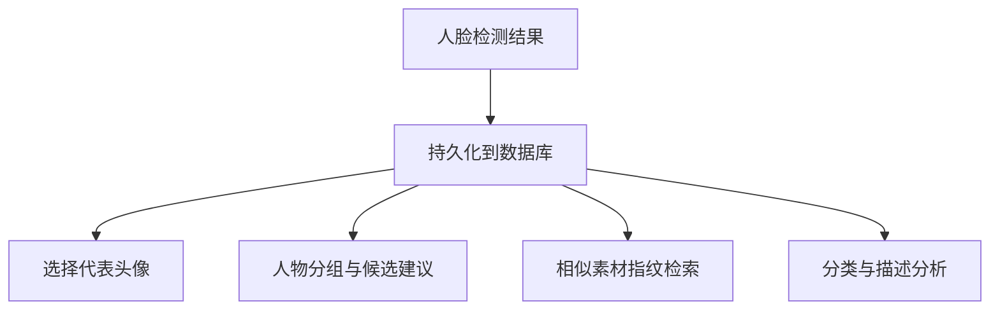

# 人脸识别 API

> Repo Wiki 节点 `face-detection-api`
> 导出自 Qoder 知识库快照 `8fbe02f6-57c2-4874-b725-1a8130851fd9`，代码基线 `7a7a8e75e18bd90294e09cd422dd7ed5a04813a0`（分支 main，zh-CN）。

<cite>
**本文引用的文件**   
- [qwen_faces.rs](../../../../crates/moriq-library/src/ai/qwen_faces.rs)
- [qwen_faces.rs](../../../../crates/moriq-ai/src/qwen_faces.rs)
- [portraits.rs](../../../../crates/moriq-library/src/ai/portraits.rs)
- [analysis.rs](../../../../crates/moriq-library/src/ai/analysis.rs)
- [similarity.rs](../../../../crates/moriq-library/src/ai/similarity.rs)
- [inference.rs](../../../../crates/moriq-app/src/inference.rs)
- [llama.rs](../../../../crates/moriq-ai/src/llama.rs)
- [lib.rs](../../../../crates/moriq-ai/src/lib.rs)
- [infer_qwen.rs](../../../../crates/moriq-ai/examples/infer_qwen.rs)
- [qwen_faces_smoke.rs](../../../../crates/moriq-app/examples/qwen_faces_smoke.rs)
- [region.rs](../../../../crates/moriq-library/src/media/region.rs)
</cite>

## 目录
1. [简介](#简介)
2. [项目结构](#项目结构)
3. [核心组件](#核心组件)
4. [架构总览](#架构总览)
5. [详细组件分析](#详细组件分析)
6. [依赖关系分析](#依赖关系分析)
7. [性能与内存优化](#性能与内存优化)
8. [数据结构与后续处理](#数据结构与后续处理)
9. [故障排查指南](#故障排查指南)
10. [结论](#结论)

## 简介
本文件面向使用 Qwen 人脸检测能力的应用开发者，说明在该项目中如何完成图像预处理、人脸定位、特征点向量生成、人物分组、人像裁剪、相似度检索和结果持久化。该实现不是传统 REST API，而是通过本地推理进程调用 Qwen 视觉模型，并结合数据库与任务系统完成批量入库、去重、人物归属和后续分析。

关键要点：
- 人脸检测由本地受控 llama.cpp 服务执行，输入为图片路径，输出为带边界框、置信度及可选人物标识的结构化 JSON。
- 检测结果会经过严格校验、归一化和去重，再写入 `detected_faces` 表，并关联 `people` 表的人物实体。
- 项目同时提供人像裁剪、代表头像选择、人脸向量存储与相似素材指纹检索能力。
- 批量任务通过应用层工作队列驱动，支持取消、超时控制和资源预算限制。

## 项目结构
本项目围绕多个 Rust crate 组织：
- `moriq-ai`：封装 Qwen 模型安装、本地推理进程启动、受控会话与人脸推理入口。
- `moriq-library`：负责 AI 数据模型、检测结果校验、持久化、人像裁剪、相似性指纹和任务提交。
- `moriq-app`：将库层任务与工作队列结合，调度实际推理执行器。
- `moriq-ui`：用户界面状态、人物管理、分类与描述等（本文件侧重后端 API）。

**图示来源**
- [inference.rs:1-120](../../../../crates/moriq-app/src/inference.rs#L1-L120)
- [qwen_faces.rs:1-172](../../../../crates/moriq-ai/src/qwen_faces.rs#L1-L172)
- [qwen_faces.rs:1-200](../../../../crates/moriq-library/src/ai/qwen_faces.rs#L1-L200)
- [llama.rs:1-200](../../../../crates/moriq-ai/src/llama.rs#L1-L200)

**章节来源**
- [inference.rs:1-200](../../../../crates/moriq-app/src/inference.rs#L1-L200)
- [lib.rs:1-15](../../../../crates/moriq-ai/src/lib.rs#L1-L15)

## 核心组件
- **Qwen 人脸推理入口**：暴露 `infer` 函数，接收图片路径、人物参考列表和取消标志，返回结构化人脸结果。
- **检测结果校验器**：限定人脸数量、坐标范围、置信度阈值，并剔除无效或不确定的检测。
- **人像裁剪器**：根据归一化边界框从原图或预览像素中提取有上下文的人脸区域。
- **结果持久化器**：将检测结果、人物归属、版本信息和修订信息写入数据库，同时维护人工修正结果。
- **代表头像与裁剪工具**：为人物选择有效且可展示的代表人脸，并安全裁剪出固定尺寸头像。
- **相似性指纹模块**：为图像计算感知哈希、颜色均值和宽高比，用于非人脸维度的近似重复检测。
- **推理执行桥接**：应用层将库任务转换为本地推理调用，并封装模型身份与修订。

**章节来源**
- [qwen_faces.rs:1-172](../../../../crates/moriq-ai/src/qwen_faces.rs#L1-L172)
- [qwen_faces.rs:1-200](../../../../crates/moriq-library/src/ai/qwen_faces.rs#L1-L200)
- [portraits.rs:1-166](../../../../crates/moriq-library/src/ai/portraits.rs#L1-L166)
- [analysis.rs:1-200](../../../../crates/moriq-library/src/ai/analysis.rs#L1-L200)
- [similarity.rs:1-131](../../../../crates/moriq-library/src/ai/similarity.rs#L1-L131)
- [inference.rs:1-200](../../../../crates/moriq-app/src/inference.rs#L1-L200)

## 架构总览
Qwen 人脸识别的整体流程如下：

**图示来源**
- [qwen_faces.rs:1-172](../../../../crates/moriq-ai/src/qwen_faces.rs#L1-L172)
- [qwen_faces.rs:1-200](../../../../crates/moriq-library/src/ai/qwen_faces.rs#L1-L200)
- [inference.rs:1-200](../../../../crates/moriq-app/src/inference.rs#L1-L200)
- [llama.rs:1-200](../../../../crates/moriq-ai/src/llama.rs#L1-L200)

## 详细组件分析

### Qwen 人脸检测接口
该接口是本次文档的核心 API，主要职责包括：
- 读取图片并设置解码限制，防止超大图像导致内存爆炸。
- 向本地视觉模型发出提示词，要求只返回清晰可见的人脸。
- 对模型返回的 `faces` 数组进行强校验。
- 按置信度阈值过滤不确定检测。
- 基于边界框裁剪人脸，并与人物参考进行对比匹配。
- 最终输出包含人脸框、人物标识和比较明细的结构化结果。

**图示来源**
- [qwen_faces.rs:1-172](../../../../crates/moriq-ai/src/qwen_faces.rs#L1-L172)

关键行为说明：
- 输入：图片路径、人物参考 `(人物ID, 参考图片路径)` 列表、取消标志。
- 输出：`faces` 数组，每项含 `box`、`person`、`comparisons`。
- 坐标格式：检测阶段返回 0–1000 整数坐标；内部会归一化为 0–1 的浮点边界框 `[左上x, 左上y, 宽, 高]`。
- 置信度阈值：默认不低于 0.8 的检测才会进入结果；人物匹配通常要求更高置信度。
- 取消控制：每次循环都会检查取消标志，避免长时间任务占用资源。

**章节来源**
- [qwen_faces.rs:1-172](../../../../crates/moriq-ai/src/qwen_faces.rs#L1-L172)

### 图像预处理与边界框校验
预处理与校验逻辑确保下游不会收到非法图像或非法人脸框：
- 图像读取限制：最大宽度、高度与分配大小被显式限制。
- 坐标范围校验：`box` 元素必须是有限数值且在合理范围内。
- 有效性校验：宽和高必须大于零，左上角坐标不能越界。
- 置信度过滤：低于阈值的检测结果直接丢弃。

**图示来源**
- [qwen_faces.rs:1-172](../../../../crates/moriq-ai/src/qwen_faces.rs#L1-L172)

**章节来源**
- [qwen_faces.rs:1-172](../../../../crates/moriq-ai/src/qwen_faces.rs#L1-L172)

### 人像分割与轮廓提取相关接口
当前代码没有独立的“人像分割掩码”或“轮廓骨架”接口，但提供了与“人像区域”密切相关的功能：
- 代表头像选择：从某个 `person_id` 的有效检测中挑选最大人脸框对应版本，并冻结素材版本与裁剪范围。
- 安全裁剪：根据归一化边界框从预览像素中裁出带上下文的人脸区域，并缩放到目标尺寸。
- 参考人像构建：扫描已检测人脸，导出 PNG 作为 Qwen 身份比对参考。

这些能力可用于：
- 在 UI 中展示人物头像。
- 为后续身份比对准备高质量小图。
- 在检测后重建稳定的人像样本。

**图示来源**
- [portraits.rs:1-166](../../../../crates/moriq-library/src/ai/portraits.rs#L1-L166)

**章节来源**
- [portraits.rs:1-166](../../../../crates/moriq-library/src/ai/portraits.rs#L1-L166)
- [qwen_faces.rs:1-200](../../../../crates/moriq-library/src/ai/qwen_faces.rs#L1-L200)

### 检测结果持久化与人物分组
检测结果不仅保存边界框，还关联人物实体、版本号、修订号和排序序号。持久化过程包括：
- 解析 `faces` 数组，校验每个 `box`。
- 删除当前版本下非人工标记的旧检测。
- 根据 IOU 与向量相似度匹配旧检测，尽量保留人工修正。
- 若未匹配到已知人物，则创建临时人物并赋予命名规则。
- 写入 `detected_faces`、`ai_results`，并清理空向量引用。

**图示来源**
- [qwen_faces.rs:1-200](../../../../crates/moriq-library/src/ai/qwen_faces.rs#L1-L200)

**章节来源**
- [qwen_faces.rs:1-200](../../../../crates/moriq-library/src/ai/qwen_faces.rs#L1-L200)
- [analysis.rs:201-450](../../../../crates/moriq-library/src/ai/analysis.rs#L201-L450)

### 批量人脸检测流程与应用集成
应用层通过任务类型 `QwenFaces` 触发完整流程：
1. 准备当前项目中有效人物的参考人脸。
2. 调用本地推理执行器执行 Qwen 人脸检测。
3. 将结果交给库层持久化。
4. 前端或外部程序通过页面、详情、人物分组接口查询结果。

**图示来源**
- [qwen_faces_smoke.rs:1-99](../../../../crates/moriq-app/examples/qwen_faces_smoke.rs#L1-L99)
- [inference.rs:1-200](../../../../crates/moriq-app/src/inference.rs#L1-L200)

**章节来源**
- [qwen_faces_smoke.rs:1-99](../../../../crates/moriq-app/examples/qwen_faces_smoke.rs#L1-L99)
- [inference.rs:1-200](../../../../crates/moriq-app/src/inference.rs#L1-L200)

## 依赖关系分析
- `moriq-ai` 暴露 `llama_faces`、`llama_infer_profile`、`set_keep_loaded`、`unload_llama` 等能力。
- `moriq-app` 定义 `InferenceRunner` trait，将库任务映射到本地推理。
- `moriq-library` 提供 `References`、`store`、`crop`、`signature`、`suggest_people` 等 AI 领域逻辑。
- 本地推理通过 `llama.rs` 启动隔离子进程，并限制上下文、线程数和响应大小。

**图示来源**
- [lib.rs:1-15](../../../../crates/moriq-ai/src/lib.rs#L1-L15)
- [llama.rs:1-200](../../../../crates/moriq-ai/src/llama.rs#L1-L200)
- [inference.rs:1-200](../../../../crates/moriq-app/src/inference.rs#L1-L200)

**章节来源**
- [lib.rs:1-15](../../../../crates/moriq-ai/src/lib.rs#L1-L15)
- [llama.rs:1-200](../../../../crates/moriq-ai/src/llama.rs#L1-L200)
- [inference.rs:1-200](../../../../crates/moriq-app/src/inference.rs#L1-L200)

## 性能与内存优化
### 配置选项与控制参数
以下参数来自源码中的常量、限制与函数参数，可直接指导调优：

| 类别 | 参数或约束 | 默认或实现值 | 影响与建议 |
|---|---|---|---|
| 人脸数量 | `faces` 最大项数 | 32 | 超过预算直接报错，适合控制单次推理成本 |
| 检测置信度阈值 | 单个人脸最低置信度 | 0.8 | 低于该值会被丢弃，提高精度但可能漏检 |
| 人物匹配置信度 | 判定同人的最低置信度 | 0.95 | 仅当证据充分时才分配人物，降低误匹配 |
| 图像读取限制 | 最大宽高 | 1600×1600 | 防止超大图解码占满内存 |
| 图像读取限制 | 最大分配大小 | 约 16 MiB | 限制解码缓冲增长 |
| 模型上下文窗口 | `--c` | 4096 | 控制本地模型上下文长度 |
| 图像令牌上限 | `--image-max-tokens` | 1024 | 限制视觉阶段 token 数量 |
| CPU 线程数 | `--threads` | 逻辑核数的一半，范围 1–8 | 平衡吞吐与延迟 |
| 缓存内存 | `--cache-ram` | 256 MiB | 控制本地运行器缓存 |
| 响应大小 | `MAX_RESPONSE_BYTES` | 1 MiB | 防止模型输出过大 |
| 健康检查超时 | `HEALTH_TIMEOUT` | 120 秒 | 控制模型服务启动等待 |
| 请求超时 | `REQUEST_TIMEOUT` | 300 秒 | 控制单次推理请求超时 |

**章节来源**
- [qwen_faces.rs:1-172](../../../../crates/moriq-ai/src/qwen_faces.rs#L1-L172)
- [llama.rs:1-200](../../../../crates/moriq-ai/src/llama.rs#L1-L200)

### 批量处理建议
- 使用任务队列分批提交 `QwenFaces`，避免一次性加载大量图片。
- 在多次推理前调用 `set_keep_loaded(true)`，减少模型进程反复启动开销。
- 推理完成后调用 `set_keep_loaded(false)` 释放空闲运行器。
- 利用参考人像预生成机制，只在必要时重新裁剪 PNG。
- 对大图先做边缘预览缩放，再进行检测，以减少解码和传输成本。

### 内存管理建议
- 使用 `Limits` 限制图像解码的最大宽高和分配大小。
- 优先使用 `preview_edge` 生成的预览像素，而不是整张高分辨率图像。
- 使用临时目录保存中间 PNG，避免在内存中长时间持有大缓冲区。
- 及时关闭推理进程或允许其按常驻策略自动释放。
- 对于区域解码场景，使用分块缓存和超时控制，避免阻塞整个应用。

**章节来源**
- [qwen_faces.rs:1-172](../../../../crates/moriq-ai/src/qwen_faces.rs#L1-L172)
- [region.rs:1-200](../../../../crates/moriq-library/src/media/region.rs#L1-L200)
- [llama.rs:1-200](../../../../crates/moriq-ai/src/llama.rs#L1-L200)

## 数据结构与后续处理

### 人脸检测结果字段
| 字段 | 类型 | 含义 | 备注 |
|---|---|---|---|
| `faces` | 数组 | 检测到的所有人脸 | 最多 32 项 |
| `faces[].box` | 数值数组 | 归一化人脸框 `[左上x, 左上y, 宽, 高]` | 值应在 0–1 之间，宽高为正 |
| `faces[].person` | 字符串或空 | 匹配成功的人物 ID | 仅当唯一高置信匹配时填写 |
| `faces[].comparisons` | 数组 | 与该人脸比较的所有候选 | 包含候选 ID、结果与置信度 |
| `faces[].confidence` | 数值 | 检测置信度 | 用于过滤低质量检测 |
| `faces[].vector` | 向量或字节 | 人脸嵌入向量 | Qwen 流程本身不生成合成向量，但其他模型或扩展流程可能使用 |

注意：
- 检测阶段的 `box` 可能以 0–1000 整数返回，随后会被规范化。
- 持久化阶段的 `box` 通常以 0–1 浮点数组存储。
- 人物匹配采用“同一照片不能自动把两个检测归为同一个人”的保护逻辑。

**章节来源**
- [qwen_faces.rs:1-172](../../../../crates/moriq-ai/src/qwen_faces.rs#L1-L172)
- [qwen_faces.rs:1-200](../../../../crates/moriq-library/src/ai/qwen_faces.rs#L1-L200)
- [analysis.rs:201-450](../../../../crates/moriq-library/src/ai/analysis.rs#L201-L450)

### 人物与检测结果关系
- `detected_faces` 记录每张图片中的人脸位置、向量、排序序号和人物归属。
- `people` 记录人物实体及其名称、工作区和时间戳。
- `ai_results` 记录每个版本的 AI 结果摘要，包括模型、修订和预处理版本。
- `person_vectors` 可存储每个人物的聚合向量，用于快速候选推荐。

**图示来源**
- [qwen_faces.rs:1-200](../../../../crates/moriq-library/src/ai/qwen_faces.rs#L1-L200)
- [analysis.rs:201-450](../../../../crates/moriq-library/src/ai/analysis.rs#L201-L450)

### 后续处理流程
检测结果写入后，系统可进行以下后续处理：
- 显示人物头像：从 `detected_faces` 中选择最大人脸对应的展示版本。
- 人物分组：依据向量相似度和 IOU 合并候选，并保留人工修正。
- 相似素材检索：使用感知指纹、颜色和宽高比查找压缩或缩放后的重复内容。
- 内容分析：对同一图片继续执行分类、描述等 Qwen 任务，并与人脸结果共存。

**图示来源**
- [portraits.rs:1-166](../../../../crates/moriq-library/src/ai/portraits.rs#L1-L166)
- [analysis.rs:201-450](../../../../crates/moriq-library/src/ai/analysis.rs#L201-L450)
- [similarity.rs:1-131](../../../../crates/moriq-library/src/ai/similarity.rs#L1-L131)

**章节来源**
- [portraits.rs:1-166](../../../../crates/moriq-library/src/ai/portraits.rs#L1-L166)
- [similarity.rs:1-131](../../../../crates/moriq-library/src/ai/similarity.rs#L1-L131)
- [analysis.rs:201-450](../../../../crates/moriq-library/src/ai/analysis.rs#L201-L450)

## 故障排查指南
常见问题与排查方向：

| 问题 | 可能原因 | 排查方法 |
|---|---|---|
| 人脸数量为 0 | 置信度低于阈值，或模型未检测到清晰人脸 | 检查提示词、图像清晰度、置信度阈值 |
| 坐标异常 | 模型返回超出 0–1000 或非整数坐标 | 查看 `boxes` 校验逻辑和日志 |
| 人物未分组 | 匹配置信度不足，或两张脸在同一照片中 | 检查 `comparisons` 和匹配阈值 |
| 推理超时 | 模型服务未就绪或请求过长 | 检查健康检查超时、请求超时和诊断文件 |
| 内存不足 | 图片过大或未限制解码 | 确认 `Limits` 和预览缩放 |
| 任务未完成 | 后台任务失败或被取消 | 检查任务状态、取消标志和错误输出 |
| 人像无法显示 | 当前展示版本已变更或删除 | 检查 `person_portrait_source` 的筛选条件 |

常用调试入口：
- 本地推理示例：`infer_qwen.rs` 用于验证 Qwen 推理是否可用。
- 端到端示例：`qwen_faces_smoke.rs` 用于验证真实库、任务和分组结果。
- 本地进程诊断：`llama.rs` 中保留运行器诊断尾部，便于定位底层错误。
- 区域解码错误：`region.rs` 中记录区域解码失败、超时和缓存头校验错误。

**章节来源**
- [infer_qwen.rs:1-33](../../../../crates/moriq-ai/examples/infer_qwen.rs#L1-L33)
- [qwen_faces_smoke.rs:1-99](../../../../crates/moriq-app/examples/qwen_faces_smoke.rs#L1-L99)
- [llama.rs:1-200](../../../../crates/moriq-ai/src/llama.rs#L1-L200)
- [region.rs:1-200](../../../../crates/moriq-library/src/media/region.rs#L1-L200)

## 结论
该项目的人脸识别能力并非单一 HTTP API，而是一套完整的本地视觉推理、结果校验、人像裁剪、人物分组、持久化和后续分析管线。对于使用者而言，最直接的调用方式是提交 `QwenFaces` 任务，并通过库与服务提供的查询接口获取人脸框、人物分组和头像。

实际使用中应重点关注：
- 控制图像尺寸与解码限制，避免内存峰值过高。
- 调整置信度阈值以平衡召回率和准确率。
- 使用参考人像和人物分组功能减少重复标注。
- 通过常驻模型和批量化任务提升吞吐。
- 利用持久化结构和后续分析能力，将人脸结果扩展到检索、展示和内容理解。