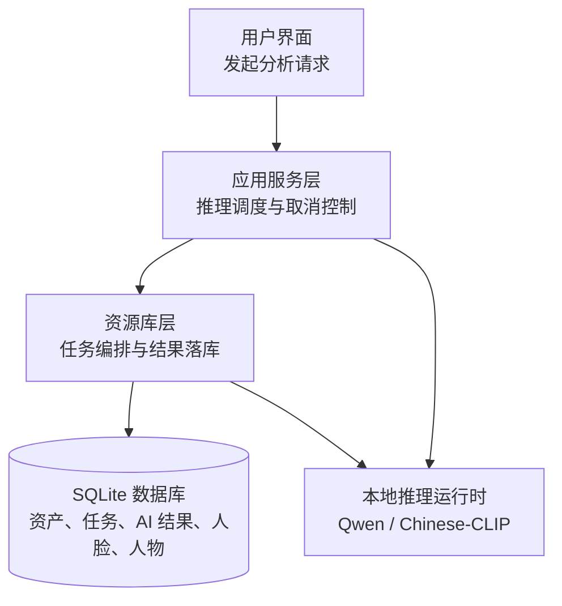
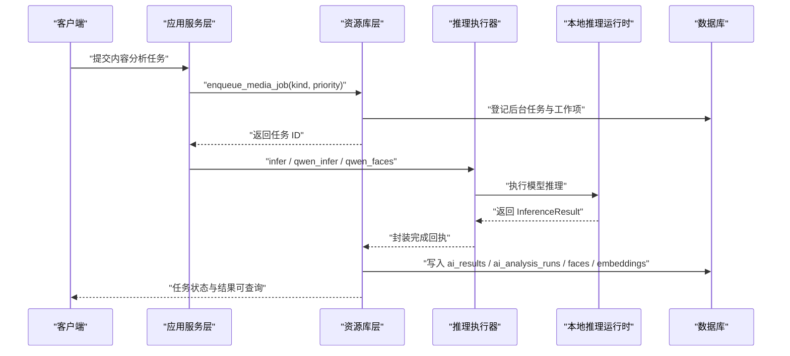
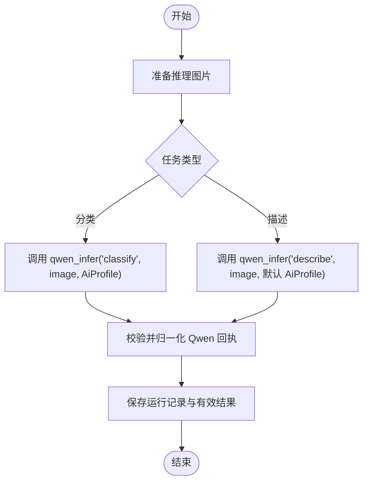
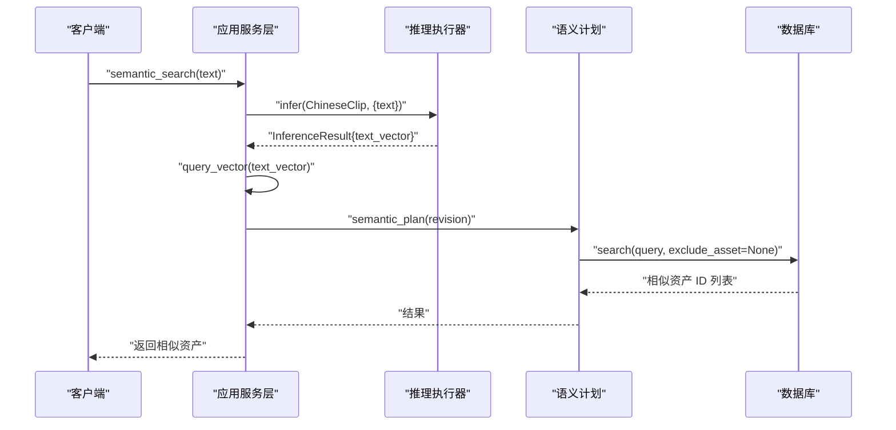
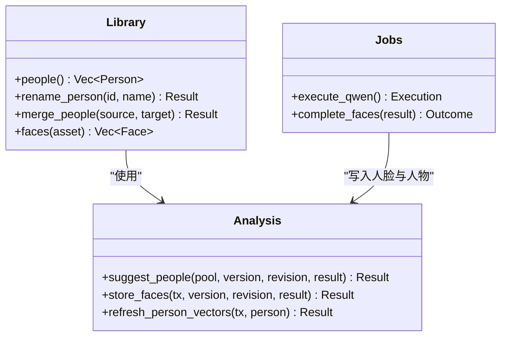
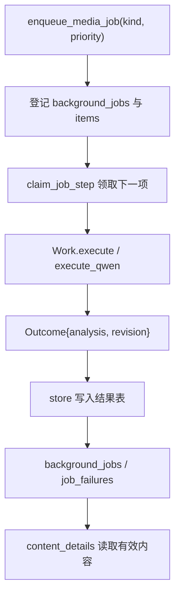
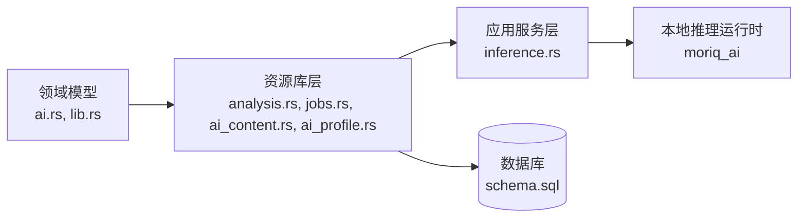

# 内容分析 API

> Repo Wiki 节点 `ai-content-analysis`
> 导出自 Qoder 知识库快照 `8fbe02f6-57c2-4874-b725-1a8130851fd9`，代码基线 `7a7a8e75e18bd90294e09cd422dd7ed5a04813a0`（分支 main，zh-CN）。

<cite>
**本文引用的文件**   
- [analysis.rs](../../../../crates/moriq-library/src/ai/analysis.rs)
- [ai_content.rs](../../../../crates/moriq-library/src/ai/ai_content.rs)
- [ai_profile.rs](../../../../crates/moriq-library/src/ai/ai_profile.rs)
- [domain_ai.rs](../../../../crates/moriq-domain/src/ai.rs)
- [domain_lib.rs](../../../../crates/moriq-domain/src/lib.rs)
- [jobs.rs](../../../../crates/moriq-library/src/tasks/jobs.rs)
- [inference.rs](../../../../crates/moriq-app/src/inference.rs)
- [schema.sql](../../../../crates/moriq-library/src/database/schema.sql)
</cite>

## 目录
1. [简介](#简介)
2. [项目结构](#项目结构)
3. [核心组件](#核心组件)
4. [架构总览](#架构总览)
5. [详细组件分析](#详细组件分析)
6. [依赖关系分析](#依赖关系分析)
7. [性能与批量优化](#性能与批量优化)
8. [错误处理与重试最佳实践](#错误处理与重试最佳实践)
9. [结论](#结论)

## 简介
本文件面向需要集成或理解“内容分析”能力的开发者，系统化记录图像内容分类、标签提取、质量评估、人脸检测与人物关联、语义检索等相关接口与实现。系统采用本地推理模型（Qwen 系列、Chinese-CLIP）与持久化后台任务机制，将异步任务的提交、执行、进度查询和结果落库统一在资源库与应用服务层之间进行协调。

内容分析能力包括：
- 图像内容分类：根据媒介类型（摄影、插画、三维渲染、界面截图等）和主题（人像、风景、建筑等）进行分类。
- 标签提取与描述生成：从图像生成自然语言描述与可显示标签，并支持人工拒绝与提升为正式标签。
- 质量评估与向量表示：对图像生成嵌入向量，用于语义检索与推荐。
- 人脸检测与人物分组：检测人脸、计算相似度、建议人物归属、维护人物代表向量。
- 异步任务管理：按工作项排队、分片执行、暂停恢复、取消与失败重试。

## 项目结构
内容分析相关代码分布在以下模块中：
- 领域模型：定义分类词表、任务种类、错误类型等稳定类型。
- 资源库层：负责数据库写入、AI 结果存储、有效结果合并、配置读取、任务队列管理。
- 应用服务层：负责模型运行时访问、推理执行、取消控制、内存预算、语义检索。
- 数据模式：SQL 建表语句定义资产、版本、任务、AI 结果、人脸、人物等基础表。

**图示来源**
- [inference.rs:1-200](../../../../crates/moriq-app/src/inference.rs#L1-L200)
- [jobs.rs:1-200](../../../../crates/moriq-library/src/tasks/jobs.rs#L1-L200)
- [analysis.rs:1-200](../../../../crates/moriq-library/src/ai/analysis.rs#L1-L200)
- [schema.sql:1-42](../../../../crates/moriq-library/src/database/schema.sql#L1-L42)

**章节来源**
- [analysis.rs:1-200](../../../../crates/moriq-library/src/ai/analysis.rs#L1-L200)
- [ai_content.rs:1-169](../../../../crates/moriq-library/src/ai/ai_content.rs#L1-L169)
- [ai_profile.rs:1-200](../../../../crates/moriq-library/src/ai/ai_profile.rs#L1-L200)
- [domain_ai.rs:1-187](../../../../crates/moriq-domain/src/ai.rs#L1-L187)
- [jobs.rs:1-200](../../../../crates/moriq-library/src/tasks/jobs.rs#L1-L200)
- [inference.rs:1-200](../../../../crates/moriq-app/src/inference.rs#L1-L200)
- [schema.sql:1-42](../../../../crates/moriq-library/src/database/schema.sql#L1-L42)

## 核心组件
本节聚焦内容分析的关键类型与职责。

- 分类配置与词表
  - 固定媒介类型：摄影、插画、三维渲染、界面截图、不确定。
  - 固定主题类型：人像、风景、建筑、动物、植物、美食、角色扮演、界面与文档。
  - AiProfile 包含分类修订号、主题数量上限、分类列表及启用状态。
  - 校验规则限制启用主题数量、说明长度、分类总数与 ID 格式，以控制本地模型上下文预算。

- 分析与结果
  - InferenceResult 携带模型身份、修订号和 JSON 回执。
  - qwen_payload 与 qwen_payload_for_profile 对 Qwen 返回字段做严格校验、归一化与摘要哈希。
  - store 将不同模型的 AI 结果写入 ai_results；chinese-clip 写入向量；faces 写入人脸与人物；qwen35-4b 写入有效内容与运行记录。

- 有效内容与人工覆盖
  - save_run 记录每个任务的运行快照，并更新有效结果指针。
  - Library.content_details 汇总自动与人工分类、主题、描述与标签。
  - edit_ai_content 支持人工修改分类、媒介、主题、描述、拒绝/提升标签，并验证当前版本一致性。

- 任务与工作流
  - Work 冻结媒体、项目范围、任务种类与优先级。
  - Execution 区分普通媒体结果、通用推理、Qwen 分类、Qwen 描述、Qwen 人脸。
  - enqueue_media_job 创建后台任务，background_jobs 查询状态，control_model_jobs 批量控制模型任务。

- 推理执行器
  - InferenceRunner 约定 qwen_faces、qwen_infer、infer、revision、ready。
  - LocalInference 调用 moriq_ai 本地运行时，绑定模型修订，支持取消信号。
  - Service 提供语义搜索、图片语义搜索、推荐、模型安装与卸载。

**章节来源**
- [domain_ai.rs:1-187](../../../../crates/moriq-domain/src/ai.rs#L1-L187)
- [analysis.rs:1-200](../../../../crates/moriq-library/src/ai/analysis.rs#L1-L200)
- [ai_content.rs:1-169](../../../../crates/moriq-library/src/ai/ai_content.rs#L1-L169)
- [jobs.rs:1-200](../../../../crates/moriq-library/src/tasks/jobs.rs#L1-L200)
- [inference.rs:1-200](../../../../crates/moriq-app/src/inference.rs#L1-L200)

## 架构总览
内容分析的整体调用链分为三层：
- 应用服务层：接收前端或上层调用，准备输入、申请内存预算、注册取消令牌、调用推理执行器。
- 资源库层：将任务入队、分片执行、持久化结果、合并有效结果、维护人脸与人物。
- 推理运行时：本地加载模型，执行分类、描述、人脸、向量推理，并返回带模型修订的回执。

**图示来源**
- [jobs.rs:201-551](../../../../crates/moriq-library/src/tasks/jobs.rs#L201-L551)
- [inference.rs:1-200](../../../../crates/moriq-app/src/inference.rs#L1-L200)
- [analysis.rs:201-602](../../../../crates/moriq-library/src/ai/analysis.rs#L201-L602)
- [ai_content.rs:1-169](../../../../crates/moriq-library/src/ai/ai_content.rs#L1-L169)

## 详细组件分析

### 图像内容分类与标签提取
该功能通过 Qwen 模型对图像进行分析，输出媒介类型、主题列表与自然语言描述与标签。

- 分类配置
  - AiProfile 指定分类修订、最大主题数、分类列表与启用状态。
  - classification_hash 对启用的分类定义生成哈希，用于判断配置是否过期。
  - save_ai_profile 校验分类 ID、名称、说明、启用数量，并在配置变化时取消相关分析任务。

- Qwen 任务
  - JobKind::QwenClassification 对应“classify”，使用 AiProfile 作为上下文。
  - JobKind::QwenDescription 对应“describe”，使用默认 AiProfile。
  - execute_qwen 准备图片路径后进入 Execution::QwenClassification 或 Execution::QwenDescription。
  - complete_qwen 对推理结果执行 output.checked(ModelId::Qwen35_4b)，然后按任务类型调用 qwen_payload_for_profile 或 qwen_payload 进行字段校验、长度限制与归一化。

- 结果落库
  - store 将 qwen35-4b 的结果转为 task 标记的有效内容，并通过 save_run 写入 ai_analysis_runs 与 ai_effective_results。
  - qwen_classification 会写入 medium、themes 与 profile_hash。
  - qwen_description 会写入 description 与 tags，并对标签做去重、空格规范化与“cosplay”→“角色扮演”映射。

**图示来源**
- [jobs.rs:201-551](../../../../crates/moriq-library/src/tasks/jobs.rs#L201-L551)
- [analysis.rs:1-200](../../../../crates/moriq-library/src/ai/analysis.rs#L1-L200)
- [ai_content.rs:1-169](../../../../crates/moriq-library/src/ai/ai_content.rs#L1-L169)
- [ai_profile.rs:1-200](../../../../crates/moriq-library/src/ai/ai_profile.rs#L1-L200)

**章节来源**
- [analysis.rs:1-200](../../../../crates/moriq-library/src/ai/analysis.rs#L1-L200)
- [ai_content.rs:1-169](../../../../crates/moriq-library/src/ai/ai_content.rs#L1-L169)
- [ai_profile.rs:1-200](../../../../crates/moriq-library/src/ai/ai_profile.rs#L1-L200)
- [jobs.rs:201-551](../../../../crates/moriq-library/src/tasks/jobs.rs#L201-L551)

### 质量评估与语义检索
质量评估主要通过 Chinese-CLIP 生成图像或文本向量，用于相似性检索与推荐。

- 向量处理
  - query_vector 将 JSON 向量维度与有限值校验后归一化为单位向量。
  - vector_bytes 与 decode_vector 用于 SQLite 中的小端字节存储与还原。
  - store 对 chinese-clip 的 image_vector 写入 ai_embeddings。

- 语义检索
  - semantic_plan 冻结读租约、查询范围与模型修订，返回 SemanticPlan。
  - Service.semantic_search 申请共享内存预算，调用 infer(ModelId::ChineseClip, {"text": text})，再执行 plan.search(query, None)。
  - Service.search_by_image 读取素材的检索源，prepare_image 后 infer(ModelId::ChineseClip, {"image": path})，再执行 plan.search(query, Some(asset))。
  - recommendations 基于 revision 获取计划并查询推荐结果。

**图示来源**
- [analysis.rs:1-200](../../../../crates/moriq-library/src/ai/analysis.rs#L1-L200)
- [inference.rs:201-339](../../../../crates/moriq-app/src/inference.rs#L201-L339)

**章节来源**
- [analysis.rs:1-200](../../../../crates/moriq-library/src/ai/analysis.rs#L1-L200)
- [inference.rs:201-339](../../../../crates/moriq-app/src/inference.rs#L201-L339)

### 人脸检测与人物关联
人脸检测由 Qwen Faces 任务驱动，结果经过去重、相似度匹配、人物归属与代表向量刷新。

- 人脸检测流程
  - Execution::QwenFaces 调用 runner.qwen_faces(image_path, references, cancel)。
  - complete_faces 校验模型身份与修订，封装为 Outcome。
  - store_faces 删除旧自动检测结果，保留手动标注，按边界框重叠与向量余弦相似度匹配旧人脸，必要时新建人物。
  - suggest_people 基于 person_vectors 给出候选人物，设置 suggested_person。
  - refresh_person_vectors 聚合同一人物的多版本向量，归一化后写入 person_vectors。

- 人物管理
  - Library.people 统计人物及其涉及资产数量。
  - Library.rename_person 校验人物存在性与名称长度。
  - Library.merge_people 合并两个不同人物，迁移人脸归属并刷新代表向量。
  - Library.faces 返回当前资产的检测人脸、人物归属、边界框与人物名称。

**图示来源**
- [analysis.rs:201-602](../../../../crates/moriq-library/src/ai/analysis.rs#L201-L602)
- [jobs.rs:1-200](../../../../crates/moriq-library/src/tasks/jobs.rs#L1-L200)

**章节来源**
- [analysis.rs:201-602](../../../../crates/moriq-library/src/ai/analysis.rs#L201-L602)
- [jobs.rs:1-200](../../../../crates/moriq-library/src/tasks/jobs.rs#L1-L200)

### 异步任务提交、进度查询与结果获取
内容分析通过后台任务机制实现异步执行。

- 提交任务
  - enqueue_media_job(kind, priority) 创建 background_jobs 与 background_job_items，冻结 workspace 范围，并为 Qwen 分类任务缓存 AiProfile。
  - kind 包括 QwenClassification、QwenDescription、QwenFaces、Integrity、Batch 等。

- 进度查询
  - background_jobs 返回任务 ID、种类、状态、优先级、检查点、总数、失败数与错误信息。
  - job_failures 返回最近 100 条失败明细，便于界面展示与重试。

- 结果获取
  - 通用推理与 Qwen 任务完成后，Outcome.analysis 携带已校验的 JSON 结果；revision 携带模型修订。
  - store 根据模型类型写入 ai_results、ai_embeddings、detected_faces、ai_analysis_runs 等表。
  - Library.content_details 汇总有效 AI 内容、人工覆盖与可见标签。

**图示来源**
- [jobs.rs:201-551](../../../../crates/moriq-library/src/tasks/jobs.rs#L201-L551)
- [analysis.rs:201-602](../../../../crates/moriq-library/src/ai/analysis.rs#L201-L602)
- [ai_content.rs:1-169](../../../../crates/moriq-library/src/ai/ai_content.rs#L1-L169)

**章节来源**
- [jobs.rs:201-551](../../../../crates/moriq-library/src/tasks/jobs.rs#L201-L551)
- [ai_content.rs:1-169](../../../../crates/moriq-library/src/ai/ai_content.rs#L1-L169)

## 依赖关系分析
内容分析相关的依赖关系如下：
- 领域模型依赖：AiCategoryKind、AiCategory、AiProfile、AiEdit、JobKind、ModelId、TaskError、TaskResult。
- 资源库层依赖：数据库连接、media 源、retrieval.SemanticPlan、cancel 作用域、workspace 范围。
- 应用服务层依赖：moriq_ai 本地运行时、共享内存预算、tokio 阻塞线程调度。
- 外部运行时：Qwen 分类与人脸推理、Chinese-CLIP 向量推理。

**图示来源**
- [domain_ai.rs:1-187](../../../../crates/moriq-domain/src/ai.rs#L1-L187)
- [domain_lib.rs:1-200](../../../../crates/moriq-domain/src/lib.rs#L1-L200)
- [analysis.rs:1-200](../../../../crates/moriq-library/src/ai/analysis.rs#L1-L200)
- [jobs.rs:1-200](../../../../crates/moriq-library/src/tasks/jobs.rs#L1-L200)
- [ai_content.rs:1-169](../../../../crates/moriq-library/src/ai/ai_content.rs#L1-L169)
- [ai_profile.rs:1-200](../../../../crates/moriq-library/src/ai/ai_profile.rs#L1-L200)
- [inference.rs:1-200](../../../../crates/moriq-app/src/inference.rs#L1-L200)
- [schema.sql:1-42](../../../../crates/moriq-library/src/database/schema.sql#L1-L42)

**章节来源**
- [domain_ai.rs:1-187](../../../../crates/moriq-domain/src/ai.rs#L1-L187)
- [domain_lib.rs:1-200](../../../../crates/moriq-domain/src/lib.rs#L1-L200)
- [analysis.rs:1-200](../../../../crates/moriq-library/src/ai/analysis.rs#L1-L200)
- [jobs.rs:1-200](../../../../crates/moriq-library/src/tasks/jobs.rs#L1-L200)
- [ai_content.rs:1-169](../../../../crates/moriq-library/src/ai/ai_content.rs#L1-L169)
- [ai_profile.rs:1-200](../../../../crates/moriq-library/src/ai/ai_profile.rs#L1-L200)
- [inference.rs:1-200](../../../../crates/moriq-app/src/inference.rs#L1-L200)
- [schema.sql:1-42](../../../../crates/moriq-library/src/database/schema.sql#L1-L42)

## 性能与批量优化
- 模型选择与上下文预算
  - AiProfile.validate 限制启用主题最多 24 个，识别说明合计最多 1600 字，主题上限 1～8，分类总数最多 64 个，以避免本地模型上下文溢出。
  - classification_hash 与配置变更会取消相关分析任务，避免旧配置继续消耗资源。

- 向量维度与存储
  - query_vector 限制向量维度不超过 4096，且必须为有限值；vector_bytes 使用小端字节存储以减少序列化体积。
  - store 对 ai_results 数据大小限制为 1MB，防止单条回执过大影响数据库性能。

- 并发与内存预算
  - Service.semantic_search 与 search_by_image 使用 acquire_many_owned 申请共享内存预算，避免同时多个大模型推理导致内存不足。
  - tokio::task::spawn_blocking 将推理放入阻塞线程，减少主事件循环压力。

- 批量任务策略
  - enqueue_media_job 为同一 workspace 与 kind 去重，避免重复排队。
  - claim_job_step 按 checkpoint 断点续跑，completed 后清理 background_job_items。
  - control_model_jobs 批量暂停、恢复或取消 analysis:* 任务，降低长时间运行任务的资源占用。

- 调优建议
  - 合理设置 AiProfile.max_themes，控制在 1～8，减少 Qwen 主题分支复杂度。
  - 对大规模图库优先使用 Qwen 分类与描述任务，再按需执行人脸检测。
  - 对频繁检索场景缓存 SemanticPlan.revision，避免重复查询模型修订。
  - 控制任务优先级在 -100～100，避免低优先级任务长期饥饿。

**章节来源**
- [domain_ai.rs:1-187](../../../../crates/moriq-domain/src/ai.rs#L1-L187)
- [analysis.rs:1-200](../../../../crates/moriq-library/src/ai/analysis.rs#L1-L200)
- [analysis.rs:201-602](../../../../crates/moriq-library/src/ai/analysis.rs#L201-L602)
- [jobs.rs:201-551](../../../../crates/moriq-library/src/tasks/jobs.rs#L201-L551)
- [inference.rs:201-339](../../../../crates/moriq-app/src/inference.rs#L201-L339)

## 错误处理与重试最佳实践
- 输入校验
  - qwen_payload_for_profile 对 Qwen 返回的 medium、themes、description、tags、uncertainties 进行字段存在性、长度与词表校验。
  - edit_ai_content 对人工修改的媒介、主题、描述、标签进行合法性校验，并保证当前版本未变化。
  - query_vector 对向量维度、有限值与范数进行校验，避免非法向量污染数据库。

- 任务错误与状态
  - pause_jobs_after_error 将任务状态设为 paused 并记录错误消息，便于后续排查。
  - job_failures 返回最近失败明细，结合界面提示用户重试。
  - retry_failed_job 基于旧任务的失败项重建新任务，保留历史，仅重试仍可处理的失败素材。

- 取消与竞态保护
  - abort_token 返回任务身份与世代号，abort_job 使用 generation 防止旧工作覆盖新一轮执行。
  - CancelOnDrop 在请求 Future 被丢弃时发出取消信号，阻止后台推理继续发布结果。
  - InferenceRunner 各方法在执行前后检查 AtomicBool 取消标志，确保及时终止。

- 最佳实践
  - 提交任务后立即轮询 background_jobs，观察 state、checkpoint、total、failed、error。
  - 遇到 TaskError::Cancelled 时不应重试，应直接降级或提示用户。
  - 遇到 TaskError::InvalidInput 或 TaskError::Storage 时，先修正输入或环境后再重试。
  - 对 Qwen 分类任务，确保 AiProfile 已保存且 revision 未过期，避免配置冲突。
  - 对人脸检测任务，参考 job_failures 中的具体错误消息，检查图像来源、参考图与模型安装状态。

**章节来源**
- [analysis.rs:1-200](../../../../crates/moriq-library/src/ai/analysis.rs#L1-L200)
- [analysis.rs:201-602](../../../../crates/moriq-library/src/ai/analysis.rs#L201-L602)
- [ai_content.rs:1-169](../../../../crates/moriq-library/src/ai/ai_content.rs#L1-L169)
- [jobs.rs:201-551](../../../../crates/moriq-library/src/tasks/jobs.rs#L201-L551)
- [inference.rs:1-200](../../../../crates/moriq-app/src/inference.rs#L1-L200)

## 结论
内容分析 API 围绕 Qwen 与 Chinese-CLIP 本地推理模型构建，提供图像分类、标签与描述生成、质量评估与语义检索、人脸检测与人物关联等完整能力。系统通过稳定的领域模型、资源库层的任务编排与结果落库、以及应用服务层的推理调度与取消控制，实现了可靠的异步分析流程。开发者在集成时应重点关注分类配置约束、向量校验、任务状态轮询与错误重试策略，并根据数据集规模调整任务优先级与批量策略，以获得更好的性能与用户体验。