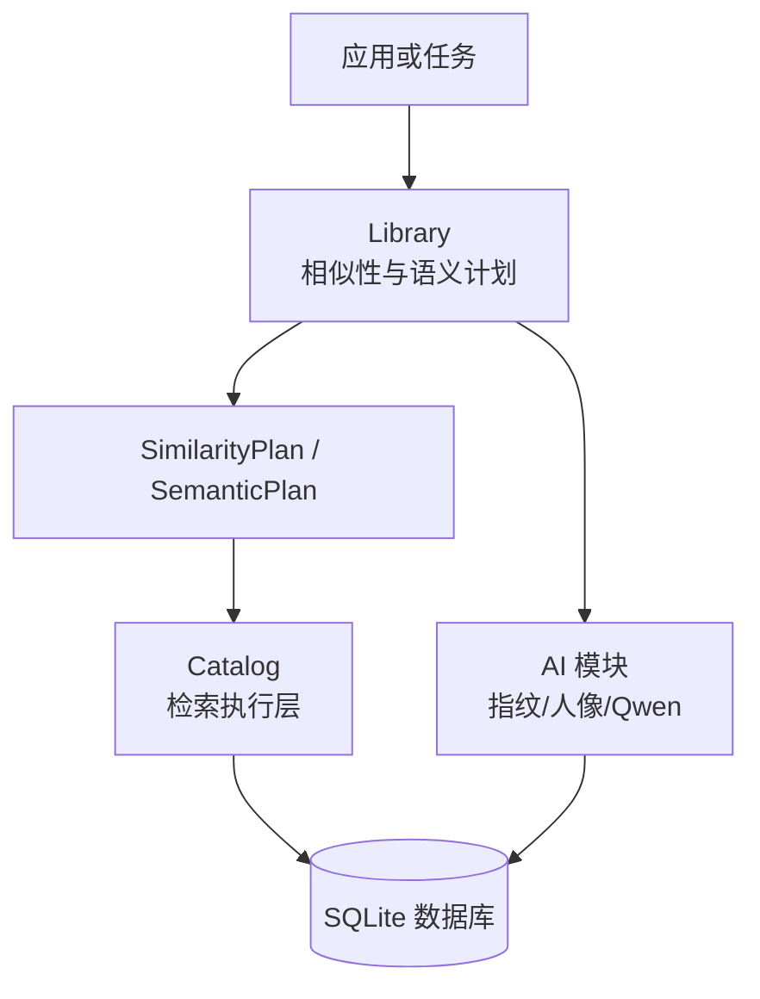
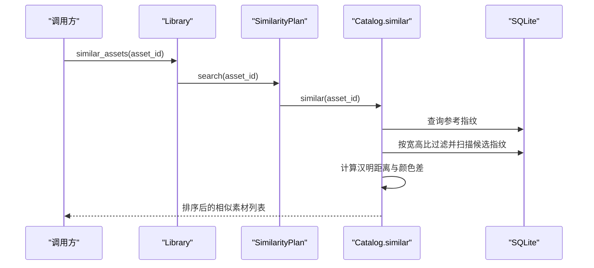
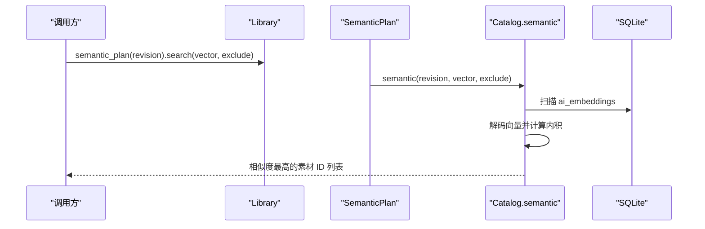
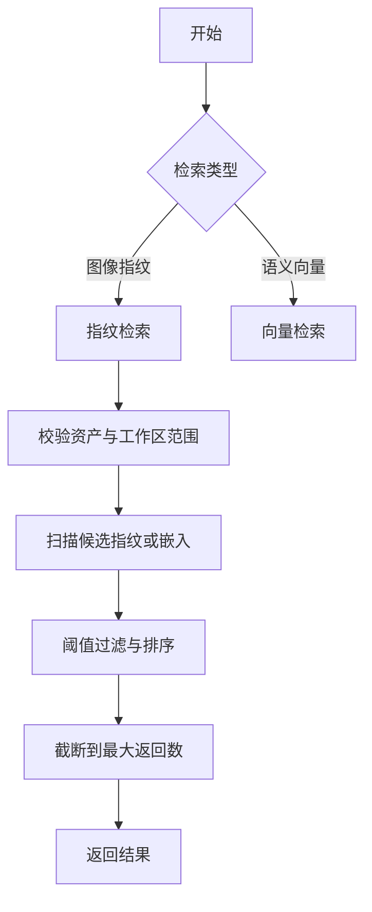
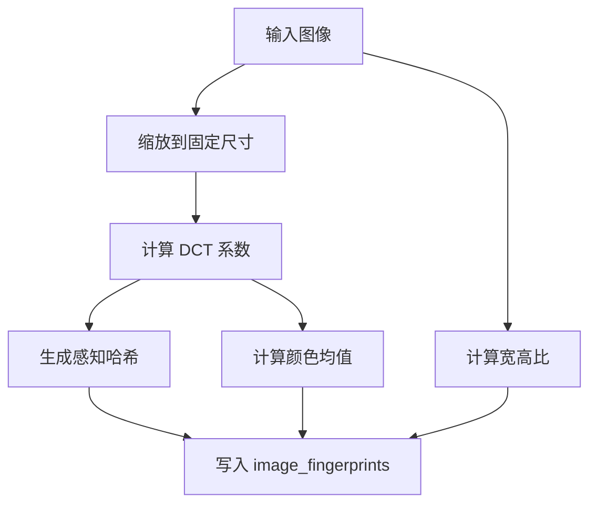
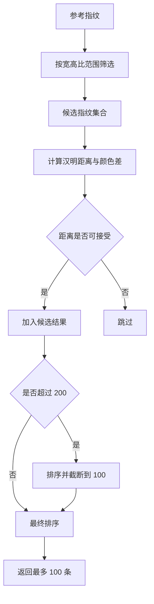
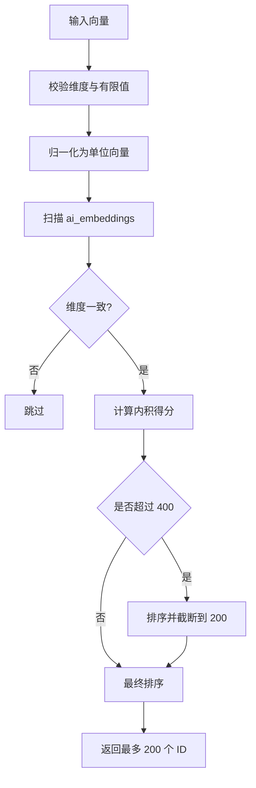
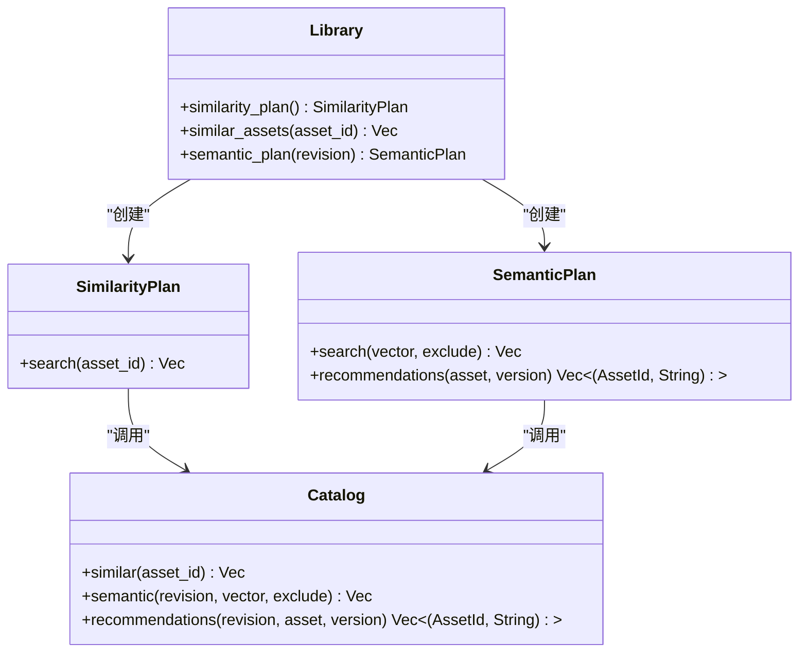
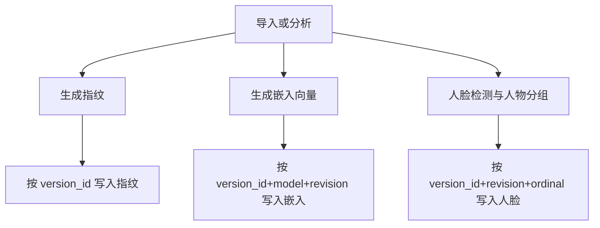
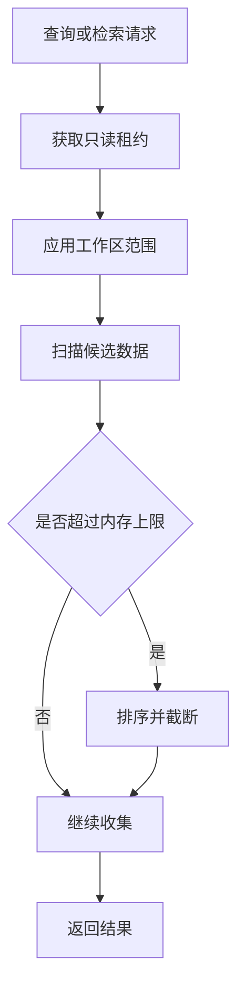

# 相似性搜索 API

> Repo Wiki 节点 `similarity-search-api`
> 导出自 Qoder 知识库快照 `8fbe02f6-57c2-4874-b725-1a8130851fd9`，代码基线 `7a7a8e75e18bd90294e09cd422dd7ed5a04813a0`（分支 main，zh-CN）。

<cite>
**本文引用的文件**   
- [crates/moriq-library/src/ai/similarity.rs](../../../../crates/moriq-library/src/ai/similarity.rs)
- [crates/moriq-library/src/retrieval/mod.rs](../../../../crates/moriq-library/src/retrieval/mod.rs)
- [crates/moriq-retrieval/src/lib.rs](../../../../crates/moriq-retrieval/src/lib.rs)
- [crates/moriq-library/src/database/migrations/migration_14.sql](../../../../crates/moriq-library/src/database/migrations/migration_14.sql)
- [crates/moriq-library/src/database/migrations/migration_15.sql](../../../../crates/moriq-library/src/database/migrations/migration_15.sql)
- [crates/moriq-library/src/database/migrations/migration_21.sql](../../../../crates/moriq-library/src/database/migrations/migration_21.sql)
- [crates/moriq-library/src/catalog/query.rs](../../../../crates/moriq-library/src/catalog/query.rs)
- [crates/moriq-library/src/ai/analysis.rs](../../../../crates/moriq-library/src/ai/analysis.rs)
- [crates/moriq-library/src/ai/portraits.rs](../../../../crates/moriq-library/src/ai/portraits.rs)
- [crates/moriq-library/src/ai/qwen_faces.rs](../../../../crates/moriq-library/src/ai/qwen_faces.rs)
</cite>

## 目录
1. [引言](#引言)
2. [项目结构](#项目结构)
3. [核心组件](#核心组件)
4. [架构总览](#架构总览)
5. [详细组件分析](#详细组件分析)
6. [依赖关系分析](#依赖关系分析)
7. [性能与优化](#性能与优化)
8. [故障排查](#故障排查)
9. [结论](#结论)

## 引言
本文面向“相似性搜索 API”，覆盖以下能力：
- 图像感知指纹相似度检索：用于识别缩放、重压缩或近似相同的图片。
- 语义向量相似度检索：基于存储的向量进行内积排序，返回最相似的素材 ID。
- 多模态扩展点：人脸特征、人物分组、推荐与分类结果如何参与检索流程。
- 索引构建与更新策略：指纹、嵌入和人脸向量的写入、增量更新及版本约束。
- 参数配置：相似度阈值、返回数量、过滤条件、工作区范围等。
- 大规模检索优化：内存截断、只读租约、批量加载、快照与缓存策略。

该实现不包含外部 HTTP API；相似性搜索通过库对象暴露的方法调用完成，适合嵌入桌面应用、批处理任务或后台维护流程中。

## 项目结构
相似性搜索相关代码主要分布在以下模块：
- `moriq-library`：对外暴露 `Library::similarity_plan`、`Library::similar_assets`、`Library::semantic_plan` 等方法。
- `moriq-library/retrieval`：封装只读连接与工作区范围，转发到独立检索层。
- `moriq-retrieval`：纯数据访问层，负责指纹匹配、向量检索与推荐。
- `moriq-library/ai`：指纹生成、AI 预处理、Qwen 人脸与人像裁剪、分析结果持久化。
- `moriq-library/database/migrations`：指纹表、嵌入表、人脸表与人物向量表的迁移定义。

**图表来源**
- [crates/moriq-library/src/ai/similarity.rs:76-90](../../../../crates/moriq-library/src/ai/similarity.rs#L76-L90)
- [crates/moriq-library/src/retrieval/mod.rs:1-58](../../../../crates/moriq-library/src/retrieval/mod.rs#L1-L58)
- [crates/moriq-retrieval/src/lib.rs:1-200](../../../../crates/moriq-retrieval/src/lib.rs#L1-L200)

**章节来源**
- [crates/moriq-library/src/ai/similarity.rs:76-90](../../../../crates/moriq-library/src/ai/similarity.rs#L76-L90)
- [crates/moriq-library/src/retrieval/mod.rs:1-58](../../../../crates/moriq-library/src/retrieval/mod.rs#L1-L58)
- [crates/moriq-retrieval/src/lib.rs:1-200](../../../../crates/moriq-retrieval/src/lib.rs#L1-L200)

## 核心组件
### 图像感知指纹相似检索
- 入口：`Library::similar_assets(asset_id)`。
- 内部：创建 `SimilarityPlan`，使用只读连接与工作区范围执行指纹检索。
- 计算方式：
  - 将参考图缩放到固定尺寸后计算 DCT 系数，生成感知哈希、颜色均值与宽高比。
  - 候选集按宽高比区间筛选。
  - 距离用哈希异或后的二进制位计数衡量。
  - 额外用 RGB 三色绝对差之和做二次过滤。
- 返回结果：按距离升序排序，最多保留 100 个结果。

**图表来源**
- [crates/moriq-library/src/ai/similarity.rs:76-90](../../../../crates/moriq-library/src/ai/similarity.rs#L76-L90)
- [crates/moriq-library/src/retrieval/mod.rs:10-20](../../../../crates/moriq-library/src/retrieval/mod.rs#L10-L20)
- [crates/moriq-retrieval/src/lib.rs:50-120](../../../../crates/moriq-retrieval/src/lib.rs#L50-L120)

**章节来源**
- [crates/moriq-library/src/ai/similarity.rs:1-90](../../../../crates/moriq-library/src/ai/similarity.rs#L1-L90)
- [crates/moriq-library/src/retrieval/mod.rs:1-20](../../../../crates/moriq-library/src/retrieval/mod.rs#L1-L20)
- [crates/moriq-retrieval/src/lib.rs:50-120](../../../../crates/moriq-retrieval/src/lib.rs#L50-L120)

### 语义向量相似检索
- 入口：`Library::semantic_plan(revision).search(query_vector, exclude)`。
- 内部：创建 `SemanticPlan`，使用只读连接与工作区范围执行向量检索。
- 计算方式：
  - 从 `ai_embeddings` 表中读取指定模型与修订版本的向量。
  - 对输入向量与存储向量执行逐元素相乘求和（余弦相似度等价于单位向量内积）。
  - 跳过维度不一致的向量。
- 返回结果：按分数降序排序，最多保留 200 个素材 ID。

**图表来源**
- [crates/moriq-library/src/ai/analysis.rs:1-60](../../../../crates/moriq-library/src/ai/analysis.rs#L1-L60)
- [crates/moriq-library/src/retrieval/mod.rs:20-58](../../../../crates/moriq-library/src/retrieval/mod.rs#L20-L58)
- [crates/moriq-retrieval/src/lib.rs:120-190](../../../../crates/moriq-retrieval/src/lib.rs#L120-L190)

**章节来源**
- [crates/moriq-library/src/ai/analysis.rs:1-60](../../../../crates/moriq-library/src/ai/analysis.rs#L1-L60)
- [crates/moriq-library/src/retrieval/mod.rs:20-58](../../../../crates/moriq-library/src/retrieval/mod.rs#L20-L58)
- [crates/moriq-retrieval/src/lib.rs:120-190](../../../../crates/moriq-retrieval/src/lib.rs#L120-L190)

### 多模态扩展：人脸与人物
- Qwen 人脸检测输出人脸框、人物 ID 与可选向量，但当前语义检索不依赖人脸向量。
- 系统会保存人脸检测结果、人物归属，并在需要时从真实头像裁剪参考图。
- 人物向量表用于聚合人物级表示，但检索接口目前直接基于素材嵌入。

**章节来源**
- [crates/moriq-library/src/ai/qwen_faces.rs:1-200](../../../../crates/moriq-library/src/ai/qwen_faces.rs#L1-L200)
- [crates/moriq-library/src/ai/portraits.rs:1-166](../../../../crates/moriq-library/src/ai/portraits.rs#L1-L166)
- [crates/moriq-library/src/database/migrations/migration_15.sql:12-16](../../../../crates/moriq-library/src/database/migrations/migration_15.sql#L12-L16)
- [crates/moriq-library/src/database/migrations/migration_21.sql:1-5](../../../../crates/moriq-library/src/database/migrations/migration_21.sql#L1-L5)

## 架构总览
相似性搜索分为两条路径：
1. **图像指纹路径**：感知哈希 + 颜色均值 + 宽高比过滤。
2. **语义向量路径**：预训练模型生成的向量嵌入，按内积排序。

两者都遵循相同的设计原则：
- 只读租约：避免持有写入端连接。
- 工作区范围：仅检索当前项目或未分配范围内的素材。
- 已删除素材排除：所有查询均要求 `deleted_at IS NULL`。
- 内存上限控制：检索过程中对中间结果做截断。

**图表来源**
- [crates/moriq-retrieval/src/lib.rs:50-190](../../../../crates/moriq-retrieval/src/lib.rs#L50-L190)

## 详细组件分析

### 图像感知指纹生成与存储
- 输入：有界图像。
- 步骤：
  - 缩放到固定尺寸。
  - 计算 DCT 系数。
  - 去除直流分量并按阈值比较生成感知哈希。
  - 统计 RGB 平均值作为颜色特征。
  - 记录宽高比。
- 存储：写入 `image_fingerprints` 表，算法标记为 1。

**图表来源**
- [crates/moriq-library/src/ai/similarity.rs:1-75](../../../../crates/moriq-library/src/ai/similarity.rs#L1-L75)
- [crates/moriq-library/src/database/migrations/migration_14.sql:11-11](../../../../crates/moriq-library/src/database/migrations/migration_14.sql#L11-L11)

**章节来源**
- [crates/moriq-library/src/ai/similarity.rs:1-75](../../../../crates/moriq-library/src/ai/similarity.rs#L1-L75)
- [crates/moriq-library/src/database/migrations/migration_14.sql:11-11](../../../../crates/moriq-library/src/database/migrations/migration_14.sql#L11-L11)

### 图像指纹相似度检索
- 参考指纹：从 `image_fingerprints` 中读取哈希、RGB 均值、宽高比。
- 候选过滤：
  - 宽高比在参考值的 ±5% 范围内。
  - 排除回收站素材。
  - 按工作区范围过滤。
- 距离计算：
  - 汉明距离 = 两个哈希异或后的 1 的数量。
  - 颜色距离 = RGB 三通道绝对差之和。
- 返回限制：
  - 超过 200 个候选时排序并截断到 100。
  - 最终再排序并截断到 100。

**图表来源**
- [crates/moriq-retrieval/src/lib.rs:50-120](../../../../crates/moriq-retrieval/src/lib.rs#L50-L120)

**章节来源**
- [crates/moriq-retrieval/src/lib.rs:50-120](../../../../crates/moriq-retrieval/src/lib.rs#L50-L120)

### 语义向量检索
- 输入向量校验：
  - 必须是非空数组。
  - 维度不超过 4096。
  - 每个值必须是有限浮点数。
  - 向量会被归一化为单位向量。
- 存储格式：
  - 向量以小端字节序列存储。
  - 模型 ID 固定为 `chinese-clip`。
  - 通过 revision 字段区分模型版本。
- 检索逻辑：
  - 按 revision 和工作区范围扫描 `ai_embeddings`。
  - 跳过维度不一致的向量。
  - 计算点积得分。
  - 超过 400 个候选时排序并截断到 200。
  - 最终返回最多 200 个素材 ID。

**图表来源**
- [crates/moriq-library/src/ai/analysis.rs:1-60](../../../../crates/moriq-library/src/ai/analysis.rs#L1-L60)
- [crates/moriq-retrieval/src/lib.rs:120-190](../../../../crates/moriq-retrieval/src/lib.rs#L120-L190)
- [crates/moriq-library/src/database/migrations/migration_15.sql:12-12](../../../../crates/moriq-library/src/database/migrations/migration_15.sql#L12-L12)

**章节来源**
- [crates/moriq-library/src/ai/analysis.rs:1-60](../../../../crates/moriq-library/src/ai/analysis.rs#L1-L60)
- [crates/moriq-retrieval/src/lib.rs:120-190](../../../../crates/moriq-retrieval/src/lib.rs#L120-L190)
- [crates/moriq-library/src/database/migrations/migration_15.sql:12-12](../../../../crates/moriq-library/src/database/migrations/migration_15.sql#L12-L12)

### 推荐与多模态关联
- 推荐接口：根据某个素材的嵌入向量，返回其他相似素材的名称，最多取 8 个。
- 人脸与人物：
  - Qwen 人脸检测保存人脸框、人物 ID，并可生成人物向量。
  - 代表头像从实际素材预览中裁剪，不合成虚假嵌入。
  - 人物向量表用于聚合人物级表示，但当前语义检索仍基于素材嵌入。

**章节来源**
- [crates/moriq-retrieval/src/lib.rs:160-200](../../../../crates/moriq-retrieval/src/lib.rs#L160-L200)
- [crates/moriq-library/src/ai/qwen_faces.rs:1-200](../../../../crates/moriq-library/src/ai/qwen_faces.rs#L1-L200)
- [crates/moriq-library/src/ai/portraits.rs:1-166](../../../../crates/moriq-library/src/ai/portraits.rs#L1-L166)
- [crates/moriq-library/src/database/migrations/migration_21.sql:1-5](../../../../crates/moriq-library/src/database/migrations/migration_21.sql#L1-L5)

## 依赖关系分析

**图表来源**
- [crates/moriq-library/src/ai/similarity.rs:76-90](../../../../crates/moriq-library/src/ai/similarity.rs#L76-L90)
- [crates/moriq-library/src/retrieval/mod.rs:1-58](../../../../crates/moriq-library/src/retrieval/mod.rs#L1-L58)
- [crates/moriq-retrieval/src/lib.rs:1-200](../../../../crates/moriq-retrieval/src/lib.rs#L1-L200)

**章节来源**
- [crates/moriq-library/src/ai/similarity.rs:76-90](../../../../crates/moriq-library/src/ai/similarity.rs#L76-L90)
- [crates/moriq-library/src/retrieval/mod.rs:1-58](../../../../crates/moriq-library/src/retrieval/mod.rs#L1-L58)
- [crates/moriq-retrieval/src/lib.rs:1-200](../../../../crates/moriq-retrieval/src/lib.rs#L1-L200)

## 性能与优化
### 索引构建与增量更新
- 图像指纹：
  - 每次导入或重新分析时生成并写入 `image_fingerprints`。
  - 使用 `version_id` 主键，重复写入会覆盖旧指纹。
- 语义嵌入：
  - 以 `version_id`、`model_id`、`revision` 组成主键。
  - 不同修订版本可共存，便于回滚或 A/B 模型。
- 人脸与人物：
  - 人脸结果按 `version_id`、`revision`、`ordinal` 唯一。
  - 人物向量表按 `person_id`、`revision` 聚合。
  - Qwen 人脸存储会清理无效或重复检测，并保留人工标注。

**图表来源**
- [crates/moriq-library/src/ai/similarity.rs:60-75](../../../../crates/moriq-library/src/ai/similarity.rs#L60-L75)
- [crates/moriq-library/src/database/migrations/migration_14.sql:11-11](../../../../crates/moriq-library/src/database/migrations/migration_14.sql#L11-L11)
- [crates/moriq-library/src/database/migrations/migration_15.sql:12-16](../../../../crates/moriq-library/src/database/migrations/migration_15.sql#L12-L16)
- [crates/moriq-library/src/ai/qwen_faces.rs:120-200](../../../../crates/moriq-library/src/ai/qwen_faces.rs#L120-L200)

**章节来源**
- [crates/moriq-library/src/ai/similarity.rs:60-75](../../../../crates/moriq-library/src/ai/similarity.rs#L60-L75)
- [crates/moriq-library/src/database/migrations/migration_14.sql:11-11](../../../../crates/moriq-library/src/database/migrations/migration_14.sql#L11-L11)
- [crates/moriq-library/src/database/migrations/migration_15.sql:12-16](../../../../crates/moriq-library/src/database/migrations/migration_15.sql#L12-L16)
- [crates/moriq-library/src/database/migrations/migration_21.sql:1-5](../../../../crates/moriq-library/src/database/migrations/migration_21.sql#L1-L5)
- [crates/moriq-library/src/ai/qwen_faces.rs:120-200](../../../../crates/moriq-library/src/ai/qwen_faces.rs#L120-L200)

### 大规模数据集下的检索优化
- 只读租约：相似性检索使用独立只读连接，避免阻塞写入。
- 工作区范围：通过 `QueryScope` 限定检索范围，减少无关数据扫描。
- 内存截断：
  - 指纹检索：候选超过 200 时排序并截断到 100。
  - 语义检索：候选超过 400 时排序并截断到 200。
- 页面查询缓存：普通页面查询使用临时快照表与顺序表，减少重复计算。
- 批量标签加载：分页后一次性加载标签，避免逐素材展开 AI 视图。

**图表来源**
- [crates/moriq-retrieval/src/lib.rs:50-190](../../../../crates/moriq-retrieval/src/lib.rs#L50-L190)
- [crates/moriq-library/src/catalog/query.rs:1-200](../../../../crates/moriq-library/src/catalog/query.rs#L1-L200)
- [crates/moriq-library/src/catalog/query.rs:201-284](../../../../crates/moriq-library/src/catalog/query.rs#L201-L284)

**章节来源**
- [crates/moriq-retrieval/src/lib.rs:50-190](../../../../crates/moriq-retrieval/src/lib.rs#L50-L190)
- [crates/moriq-library/src/catalog/query.rs:1-200](../../../../crates/moriq-library/src/catalog/query.rs#L1-L200)
- [crates/moriq-library/src/catalog/query.rs:201-284](../../../../crates/moriq-library/src/catalog/query.rs#L201-L284)

### 缓存策略
- 页面查询快照：
  - 对复杂查询构建临时快照表，避免重复排序与过滤。
  - 若查询完全默认，则直接复用 `asset_order`。
- 语句缓存：
  - 使用 `prepare_cached` 复用 SQL 语句。
- 标签批量加载：
  - 分页结果一次性加载标签，避免多次视图展开。

**章节来源**
- [crates/moriq-library/src/catalog/query.rs:1-200](../../../../crates/moriq-library/src/catalog/query.rs#L1-L200)
- [crates/moriq-library/src/catalog/query.rs:201-284](../../../../crates/moriq-library/src/catalog/query.rs#L201-L284)

## 故障排查
### 图像指纹相似检索失败
- 现象：返回错误提示所选图片还没有近似索引。
- 原因：
  - 参考素材没有对应的 `image_fingerprints` 记录。
  - 参考素材不在当前工作区范围。
  - 参考素材已被移入回收站。
- 处理：
  - 先执行导入或分析任务以生成指纹。
  - 检查工作区范围设置。
  - 确认素材未被删除。

**章节来源**
- [crates/moriq-retrieval/src/lib.rs:50-90](../../../../crates/moriq-retrieval/src/lib.rs#L50-L90)

### 语义向量检索失败
- 现象：向量维度无效、长度无效或找不到嵌入。
- 原因：
  - 输入向量维度为空、超过 4096 或非有限值。
  - 向量长度为 0 或非有限范数。
  - 目标素材没有对应模型的嵌入记录。
- 处理：
  - 校验输入向量后再调用检索。
  - 确保已执行 AI 分析并生成嵌入。
  - 检查 revision 是否与存储一致。

**章节来源**
- [crates/moriq-library/src/ai/analysis.rs:1-60](../../../../crates/moriq-library/src/ai/analysis.rs#L1-L60)
- [crates/moriq-retrieval/src/lib.rs:120-170](../../../../crates/moriq-retrieval/src/lib.rs#L120-L170)

### 多模态人脸相关错误
- 现象：人脸位置无效、预览像素不完整、人物代表头像缺失。
- 原因：
  - 人脸框坐标越界或非有限值。
  - 预览图像尺寸异常或像素数据不完整。
  - 人物关联的展示版本不存在或素材被删除。
- 处理：
  - 校验人脸框坐标。
  - 检查预览图像生成流程。
  - 确认人物对应的是有效且未删除的素材版本。

**章节来源**
- [crates/moriq-library/src/ai/qwen_faces.rs:120-200](../../../../crates/moriq-library/src/ai/qwen_faces.rs#L120-L200)
- [crates/moriq-library/src/ai/portraits.rs:60-166](../../../../crates/moriq-library/src/ai/portraits.rs#L60-L166)

## 结论
本项目的相似性搜索 API 提供两条明确路径：
- 图像感知指纹相似检索：适合快速发现缩放、重压缩或视觉近似的图片。
- 语义向量相似检索：适合基于预训练模型语义空间的检索与推荐。

系统通过只读租约、工作区范围、内存截断与快照缓存，兼顾正确性与性能。索引采用版本化与主键覆盖策略，支持增量更新和多模型修订。多模态扩展点包括人脸检测、人物分组与推荐，但这些扩展目前不改变语义检索的核心路径。

在实际使用中，建议：
- 先运行导入与分析任务，确保指纹与嵌入存在。
- 使用 `Library::similarity_plan` 和 `Library::semantic_plan` 显式管理只读连接与工作区范围。
- 对输入向量进行维度与有限值校验。
- 在大库场景下关注内存截断阈值，并根据业务需求调整返回数量。
- 将 UI 查询与相似性检索分离，避免相互阻塞。