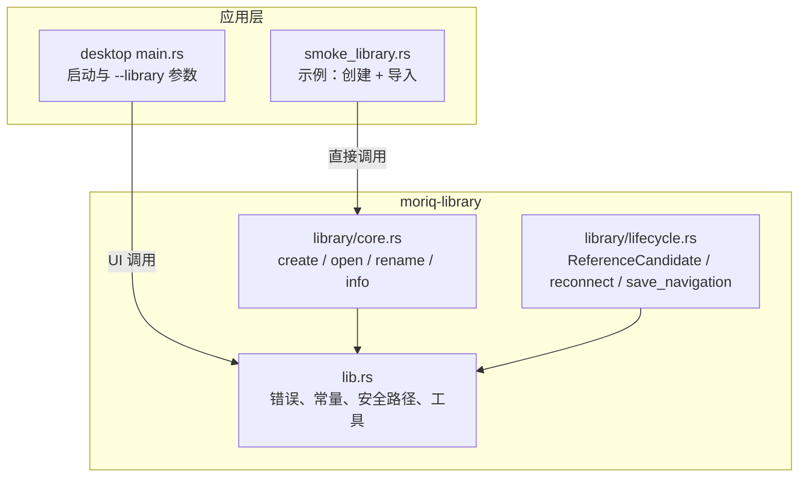
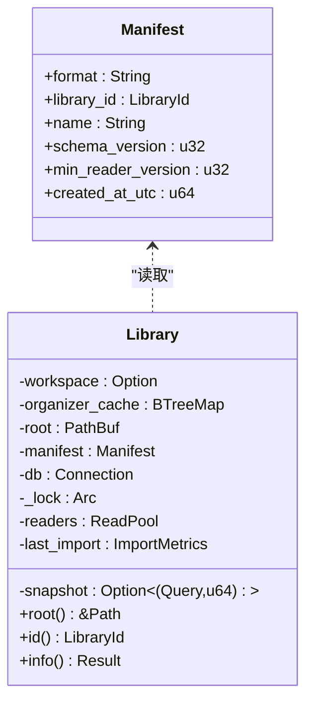
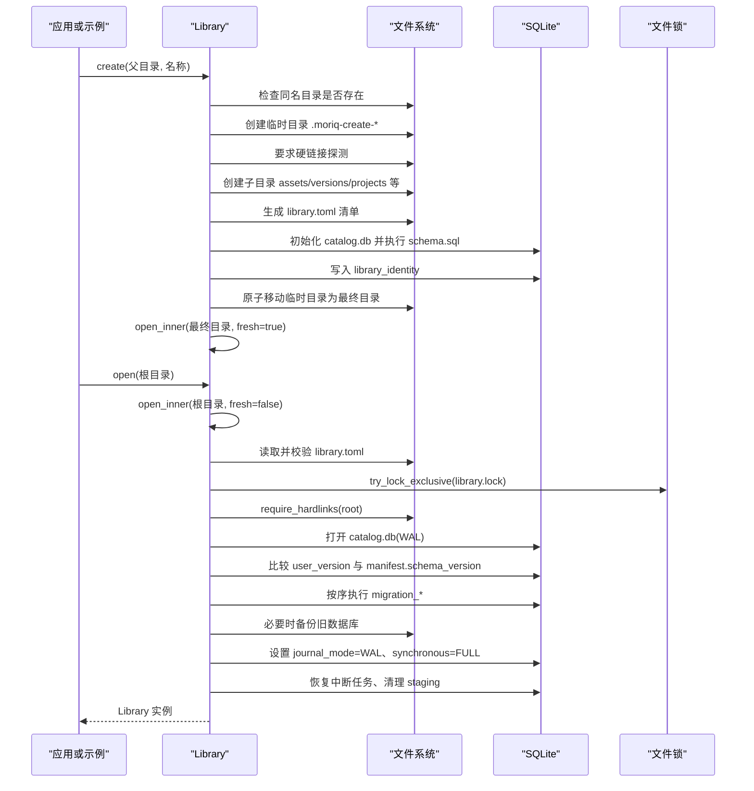
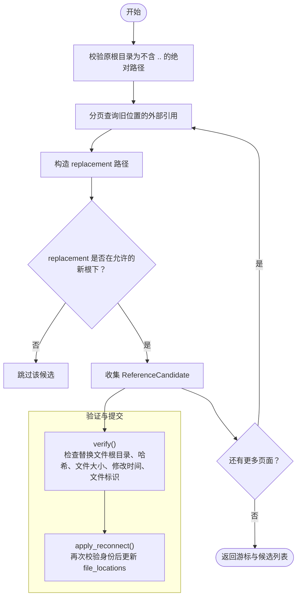
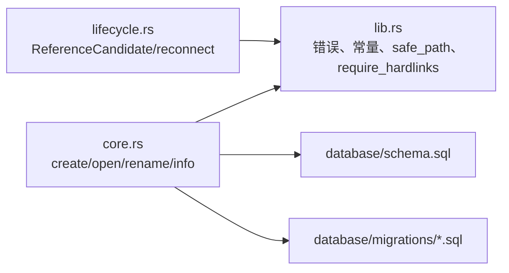
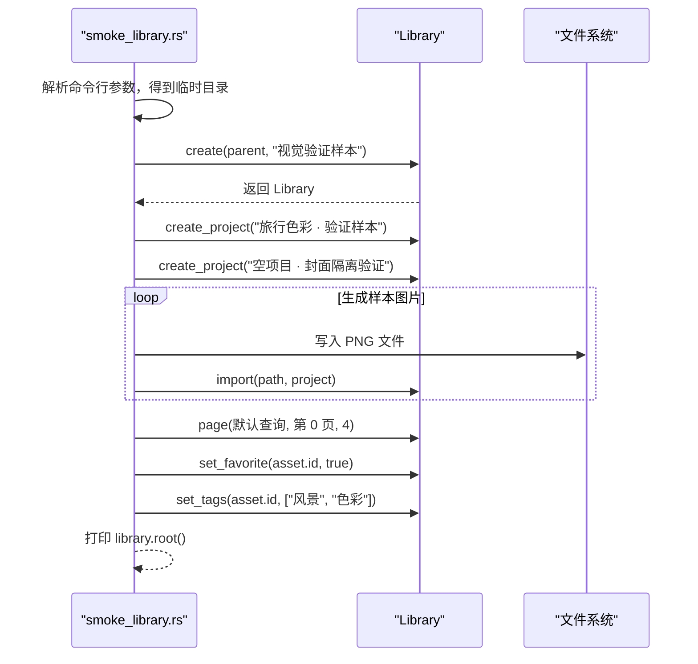
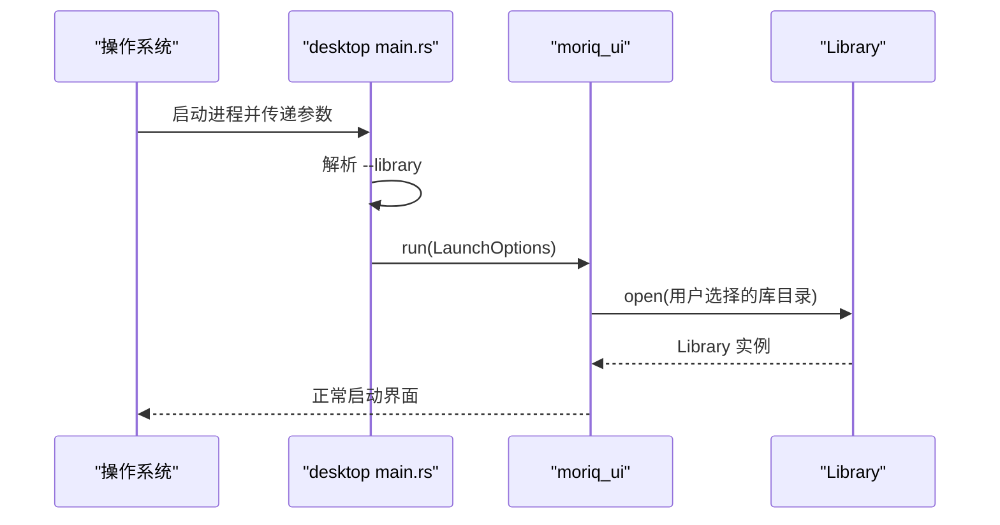

# Library 核心 API

> Repo Wiki 节点 `library-core-api`
> 导出自 Qoder 知识库快照 `8fbe02f6-57c2-4874-b725-1a8130851fd9`，代码基线 `7a7a8e75e18bd90294e09cd422dd7ed5a04813a0`（分支 main，zh-CN）。

<cite>
**本文引用的文件**   
- [crates/moriq-library/src/lib.rs](../../../crates/moriq-library/src/lib.rs)
- [crates/moriq-library/src/library/core.rs](../../../crates/moriq-library/src/library/core.rs)
- [crates/moriq-library/src/library/lifecycle.rs](../../../crates/moriq-library/src/library/lifecycle.rs)
- [crates/moriq-library/examples/smoke_library.rs](../../../crates/moriq-library/examples/smoke_library.rs)
- [apps/desktop/src/main.rs](../../../apps/desktop/src/main.rs)
</cite>

## 目录
1. [引言](#引言)
2. [项目结构](#项目结构)
3. [核心组件](#核心组件)
4. [架构总览](#架构总览)
5. [详细 API 分析](#详细-api-分析)
6. [依赖关系分析](#依赖关系分析)
7. [性能与并发特性](#性能与并发特性)
8. [故障排查指南](#故障排查指南)
9. [结论](#结论)

## 引言
本文面向 Moriq Space 的 Library 层，聚焦资源库的核心接口与生命周期：创建、打开、重命名、路径安全校验、硬链接要求、并发锁机制、数据库迁移以及 SQLite 单写者模式集成。文档同时给出使用示例和错误处理建议，帮助上层应用正确调用 Library API，并避免常见的路径、权限和锁冲突问题。

## 项目结构
Library 核心逻辑主要位于 `moriq-library` crate 中：
- 顶层模块定义公共类型、错误枚举、常量、路径安全函数和工具方法。
- `library/core.rs` 实现 `Library` 的创建、打开、重命名及基础信息访问。
- `library/lifecycle.rs` 提供外部引用重连、浏览历史等生命周期相关能力。
- `examples/smoke_library.rs` 演示如何创建视觉验收资源库并导入素材。
- 桌面入口负责解析命令行参数，将 `--library` 传给 UI 层，由 UI 层最终打开 Library。

**图表来源**
- [crates/moriq-library/src/lib.rs:1-120](../../../crates/moriq-library/src/lib.rs#L1-L120)
- [crates/moriq-library/src/library/core.rs:1-120](../../../crates/moriq-library/src/library/core.rs#L1-L120)
- [crates/moriq-library/src/library/lifecycle.rs:1-60](../../../crates/moriq-library/src/library/lifecycle.rs#L1-L60)
- [apps/desktop/src/main.rs:1-97](../../../apps/desktop/src/main.rs#L1-L97)
- [crates/moriq-library/examples/smoke_library.rs:1-65](../../../crates/moriq-library/examples/smoke_library.rs#L1-L65)

**章节来源**
- [crates/moriq-library/src/lib.rs:1-120](../../../crates/moriq-library/src/lib.rs#L1-L120)
- [apps/desktop/src/main.rs:1-97](../../../apps/desktop/src/main.rs#L1-L97)

## 核心组件
本节梳理 Library 相关的核心类型与方法职责。

- `Library`：封装资源库根目录、清单、SQLite 连接、独占锁、读池、工作区与导入指标等状态。
- `Manifest`：持久化清单，包含格式、库 ID、名称、模式版本、最小读者版本、创建时间。
- `Error`：统一错误类型，涵盖 IO、数据库、图像、颜色、无效输入、锁冲突等场景。
- `safe_path`：受管相对路径解析器，防止目录穿越和指向库外的符号链接。
- `require_hardlinks`：在目标卷上尝试创建临时硬链接，验证是否支持资源库所需的硬链接语义。
- `now_ms`：获取 UTC 毫秒时间戳，拒绝早于 Unix 纪元的系统时间。

**图表来源**
- [crates/moriq-library/src/lib.rs:201-260](../../../crates/moriq-library/src/lib.rs#L201-L260)

**章节来源**
- [crates/moriq-library/src/lib.rs:201-325](../../../crates/moriq-library/src/lib.rs#L201-L325)

## 架构总览
Library 的创建与打开流程围绕“清单 + 数据库 + 磁盘目录 + 独占锁”展开：

**图表来源**
- [crates/moriq-library/src/library/core.rs:1-120](../../../crates/moriq-library/src/library/core.rs#L1-L120)
- [crates/moriq-library/src/lib.rs:240-325](../../../crates/moriq-library/src/lib.rs#L240-L325)

## 详细 API 分析

### Library::create
- 作用：创建新资源库。
- 参数：
  - `parent`：资源库父目录。
  - `name`：资源库名称，会去掉末尾 `.moriq` 后再校验。
- 返回值：成功返回 `Library`；失败返回 `Error`。
- 行为摘要：
  1. 校验名称长度与非法字符。
  2. 构建 `name.moriq` 目标路径，拒绝已存在目录。
  3. 在父目录下创建以 `.moriq-create-` 开头的临时目录。
  4. 通过 `require_hardlinks` 探测目标卷是否支持硬链接。
  5. 创建固定子目录集合，包括 `assets`、`versions`、`projects`、`thumbnails/256`、`previews`、`indexes/search`、`indexes/layout`、`indexes/ai`、`metadata`、`interop/outgoing`、`staging`、`trash`、`recovery`、`backups` 等。
  6. 生成 `Manifest`，写入 `library.toml`。
  7. 创建 `catalog.db`，执行初始 schema，写入 `library_identity`。
  8. 将临时目录原子重命名为最终目录。
  9. 调用 `open_inner` 完成打开流程。
- 常见错误：
  - 名称为空、过长或包含非法字符。
  - 同名资源库已存在。
  - 无法创建硬链接，需换到支持硬链接的 NTFS、APFS 或 ext4 卷。
  - 清单序列化失败。
  - 数据库初始化失败。
  - 最终重命名失败。

**章节来源**
- [crates/moriq-library/src/library/core.rs:1-120](../../../crates/moriq-library/src/library/core.rs#L1-L120)
- [crates/moriq-library/src/lib.rs:280-325](../../../crates/moriq-library/src/lib.rs#L280-L325)

### Library::open
- 作用：打开已有资源库。
- 参数：`root`，资源库根目录。
- 返回值：成功返回 `Library`；失败返回 `Error`。
- 行为摘要：
  1. 调用 `open_inner(root, false)`。
  2. 规范化根路径。
  3. 读取并校验 `library.toml`，限制清单大小、格式、模式版本范围。
  4. 打开 `library.lock` 并尝试独占锁，若被占用则返回锁错误。
  5. 检查删除挂起标记，阻止正在删除或中断删除的资源库。
  6. 再次验证硬链接支持。
  7. 打开 `catalog.db`，启用外键约束，设置忙等待超时。
  8. 读取 `user_version` 与 `library_identity`，与清单对比。
  9. 若版本低于当前 SCHEMA，先备份旧数据库，再顺序执行迁移脚本。
  10. 升级后更新清单中的模式版本。
  11. 设置 WAL 模式和同步策略，恢复中断任务，清理暂存目录。
  12. 构造 `ReadPool` 并返回 `Library`。
- 常见错误：
  - 清单过大、损坏或不兼容。
  - 资源库被其他进程占用。
  - 资源库处于删除流程中。
  - 不支持硬链接。
  - 清单与数据库身份不一致。
  - 迁移失败。

**章节来源**
- [crates/moriq-library/src/library/core.rs:120-260](../../../crates/moriq-library/src/library/core.rs#L120-L260)
- [crates/moriq-library/src/lib.rs:240-325](../../../crates/moriq-library/src/lib.rs#L240-L325)

### Library::rename
- 作用：修改资源库显示名称，不移动目录。
- 参数：`name`，显示名称。
- 返回值：成功返回 `()`；失败返回 `Error`。
- 行为摘要：
  1. 去除首尾空白与末尾 `.moriq`。
  2. 调用组件校验。
  3. 检查空值、长度上限、非法字符。
  4. 写入 `library_preferences.display_name`。
- 常见错误：
  - 名称为空、过长或包含 `/`、`\`、`:`、`*`、`?`、`"`、`<`、`>`、`|` 等字符。

**章节来源**
- [crates/moriq-library/src/library/core.rs:1-20](../../../crates/moriq-library/src/library/core.rs#L1-L20)

### safe_path
- 作用：将受管相对路径解析到资源库内，禁止目录穿越、绝对路径和指向库外的符号链接。
- 参数：
  - `root`：资源库根目录。
  - `relative`：内部相对路径。
- 返回值：规范化后的 `PathBuf` 或 `Error`。
- 关键规则：
  - 不允许空路径。
  - 不允许反斜杠与冒号。
  - 每个路径组件必须是普通组件，不允许 `..` 或根组件。
  - 对符号链接进行逐段 canonicalize 检查，确保结果仍在 `canonical_root` 下。
- 典型用途：数据库生成的 `native_path`、索引路径、元数据路径等内部路径解析。

**章节来源**
- [crates/moriq-library/src/lib.rs:260-300](../../../crates/moriq-library/src/lib.rs#L260-L300)

### require_hardlinks
- 作用：在目标目录中创建临时硬链接，验证卷是否支持资源库所需硬链接语义。
- 参数：`root`，目标目录。
- 返回值：成功返回 `()`；失败返回 `Error`。
- 失败含义：通常表示当前卷不支持硬链接，应提示用户更换到 NTFS、APFS 或 ext4。

**章节来源**
- [crates/moriq-library/src/lib.rs:300-325](../../../crates/moriq-library/src/lib.rs#L300-L325)

### ReferenceCandidate 与重连流程
`ReferenceCandidate` 用于将旧磁盘根目录下的外部引用重新映射到新根目录，并在提交前严格校验内容一致性。

**图表来源**
- [crates/moriq-library/src/library/lifecycle.rs:1-177](../../../crates/moriq-library/src/library/lifecycle.rs#L1-L177)

- `ReferenceCandidate::verify`：
  - 规范化替换路径，拒绝不在允许根下的路径。
  - 计算 SHA256 并与原始 hash 对比。
  - 比较文件大小、修改时间和文件标识，防止校验期间文件被替换。
  - 成功后记录已验证身份、字节数与修改时间。
- `Library::reconnect_page`：
  - 校验原根目录合法性。
  - 分页查询 `file_locations` 与 `asset_versions`。
  - 解码原生路径，仅保留位于旧根下的条目。
  - 构造新路径并通过 canonicalize 检查，防止目录逃逸。
- `Library::apply_reconnect`：
  - 要求候选已通过 `verify`。
  - 再次 canonicalize 并校验路径、大小、修改时间、文件标识。
  - 从数据库核对当前记录的哈希与原路径是否与候选一致。
  - 编码新路径并更新 `file_locations`。
  - 清除快照缓存。

**章节来源**
- [crates/moriq-library/src/library/lifecycle.rs:1-177](../../../crates/moriq-library/src/library/lifecycle.rs#L1-L177)

### 浏览历史保存
- `saved_navigation`：读取 `navigation_v1` 偏好项，限制大小，反序列化为 `SavedNavigation`。
- `save_navigation`：校验历史条目数量、滚动位置、卡片宽度、语义 ID 数量等，再写入数据库。
- 目的：防止恶意或异常数据导致偏好项过大或结构不稳定。

**章节来源**
- [crates/moriq-library/src/library/lifecycle.rs:1-80](../../../crates/moriq-library/src/library/lifecycle.rs#L1-L80)

## 依赖关系分析

**图表来源**
- [crates/moriq-library/src/lib.rs:1-120](../../../crates/moriq-library/src/lib.rs#L1-L120)
- [crates/moriq-library/src/library/core.rs:1-120](../../../crates/moriq-library/src/library/core.rs#L1-L120)
- [crates/moriq-library/src/library/lifecycle.rs:1-60](../../../crates/moriq-library/src/library/lifecycle.rs#L1-L60)

**章节来源**
- [crates/moriq-library/src/lib.rs:1-120](../../../crates/moriq-library/src/lib.rs#L1-L120)
- [crates/moriq-library/src/library/core.rs:1-120](../../../crates/moriq-library/src/library/core.rs#L1-L120)

## 性能与并发特性

### SQLite 单写者模式
- 写入端：
  - 通过 `library.lock` 的独占锁保证同一时刻只有一个进程能写入。
  - `try_lock_exclusive` 失败时返回 `Error::Locked`，避免并发写破坏数据。
- 读取端：
  - 数据库使用 WAL 模式，提高并发读取性能。
  - 通过 `read_pool::ReadPool` 管理共享读连接，配合独占锁实现“单写多读”。
- 稳定性：
  - `busy_timeout` 降低短时间忙等待的错误率。
  - 迁移前自动备份旧数据库，失败时保留备份路径并提示用户。

### 关键性能点
- 创建流程先在临时目录构建完整资源库，再原子重命名，减少半初始化资源库暴露风险。
- 迁移按版本顺序执行，旧版本数据库会先备份，便于回滚诊断。
- 扫描外部引用时使用分页查询，避免一次性加载大量历史位置。
- 导入指标通过 `ImportMetrics` 累积最近一次导入各阶段耗时，供上层监控。

**章节来源**
- [crates/moriq-library/src/library/core.rs:120-260](../../../crates/moriq-library/src/library/core.rs#L120-L260)
- [crates/moriq-library/src/lib.rs:240-325](../../../crates/moriq-library/src/lib.rs#L240-L325)

## 故障排查指南

### 常见问题与对策

| 现象 | 可能原因 | 处理建议 |
|---|---|---|
| 创建资源库时报错无法创建硬链接 | 目标卷不支持硬链接 | 将资源库放在 NTFS、APFS 或 ext4 卷上 |
| 打开资源库报锁错误 | 另一个窗口或进程仍持有 `library.lock` | 关闭其他 Moriq Space 实例，确认无残留进程 |
| 打开时报清单损坏或格式不兼容 | `library.toml` 损坏或来自未来版本 | 从备份恢复，或使用对应版本的 Moriq Space |
| 打开时报删除中断 | `metadata/library-deletion.pending` 存在 | 进入资源库管理界面检查删除状态并重试 |
| 打开时报清单与数据库身份不一致 | 清单与 `library_identity` 不匹配 | 不要强行修复，优先从备份恢复 |
| 迁移失败 | 数据库升级过程中出错 | 查看报错中提供的备份路径，保留备份并联系支持 |
| 重连外部引用失败 | 替换文件哈希、大小、修改时间或标识不符 | 重新选择源文件并再次调用 `verify` |
| 重连提交返回失败 | 当前数据库记录与候选不一致 | 说明文件已被其他操作修改，需重新扫描或重建候选 |

### 路径与安全校验要点
- 所有内部路径都应通过 `safe_path` 解析。
- 禁止接受用户直接提供的绝对路径或含 `..` 的路径作为内容路径。
- 对符号链接进行逐段 canonicalize 检查，确保最终路径仍在资源库根下。
- 名称校验需同时考虑业务字段长度、系统保留字符和路径分隔符。

**章节来源**
- [crates/moriq-library/src/lib.rs:240-325](../../../crates/moriq-library/src/lib.rs#L240-L325)
- [crates/moriq-library/src/library/core.rs:1-20](../../../crates/moriq-library/src/library/core.rs#L1-L20)
- [crates/moriq-library/src/library/lifecycle.rs:1-177](../../../crates/moriq-library/src/library/lifecycle.rs#L1-L177)

## 使用示例

### 示例一：创建新资源库并导入素材
该示例展示如何通过示例程序创建视觉验收资源库，并导入一组样本图片。

**图表来源**
- [crates/moriq-library/examples/smoke_library.rs:1-65](../../../crates/moriq-library/examples/smoke_library.rs#L1-L65)

**章节来源**
- [crates/moriq-library/examples/smoke_library.rs:1-65](../../../crates/moriq-library/examples/smoke_library.rs#L1-L65)

### 示例二：桌面应用打开指定资源库
桌面入口接收 `--library PATH` 参数，将其传入 UI 启动选项；UI 层随后调用 Library 打开资源库。

**图表来源**
- [apps/desktop/src/main.rs:1-97](../../../apps/desktop/src/main.rs#L1-L97)

**章节来源**
- [apps/desktop/src/main.rs:1-97](../../../apps/desktop/src/main.rs#L1-L97)

### 示例三：处理各种错误场景
推荐调用方按以下策略处理：
- 捕获 `Error::Invalid`：通常是输入校验失败，例如名称非法、清单损坏、路径不安全、身份不一致。
- 捕获 `Error::Locked`：提示用户关闭其他 Moriq Space 实例，稍后重试。
- 捕获 `Error::Io`：检查目录权限、剩余空间、符号链接和目标卷类型。
- 捕获 `Error::Db`：结合日志和迁移备份路径判断是否为升级失败。
- 对于重连失败：重新执行 `ReferenceCandidate::verify`，确保替换文件未被篡改。

**章节来源**
- [crates/moriq-library/src/lib.rs:201-325](../../../crates/moriq-library/src/lib.rs#L201-L325)
- [crates/moriq-library/src/library/lifecycle.rs:1-177](../../../crates/moriq-library/src/library/lifecycle.rs#L1-L177)

## 结论
Library 核心 API 围绕“安全路径、硬链接、清单校验、独占锁、WAL 单写和多读、渐进式迁移”构建。`create` 保证原子性和完整性，`open` 保证一致性、可恢复性与向后兼容，`rename` 提供安全的显示名更新。对外部引用重连和浏览历史等扩展能力也通过严格的校验和边界控制保障数据安全。上层应用应始终遵循路径安全规范、正确处理锁冲突，并在迁移失败时保留备份以便诊断。