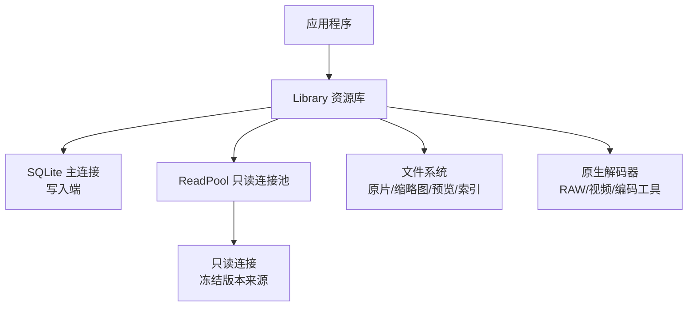
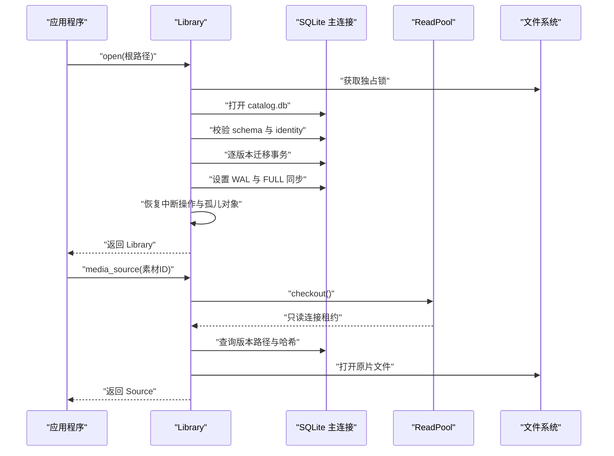
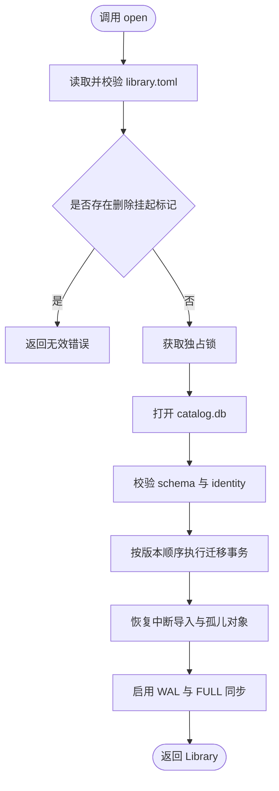
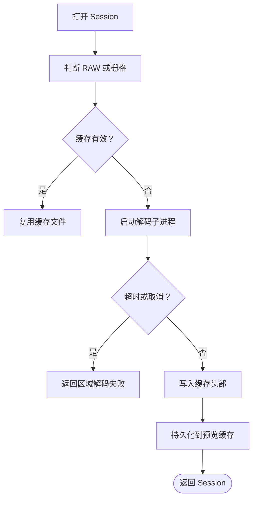
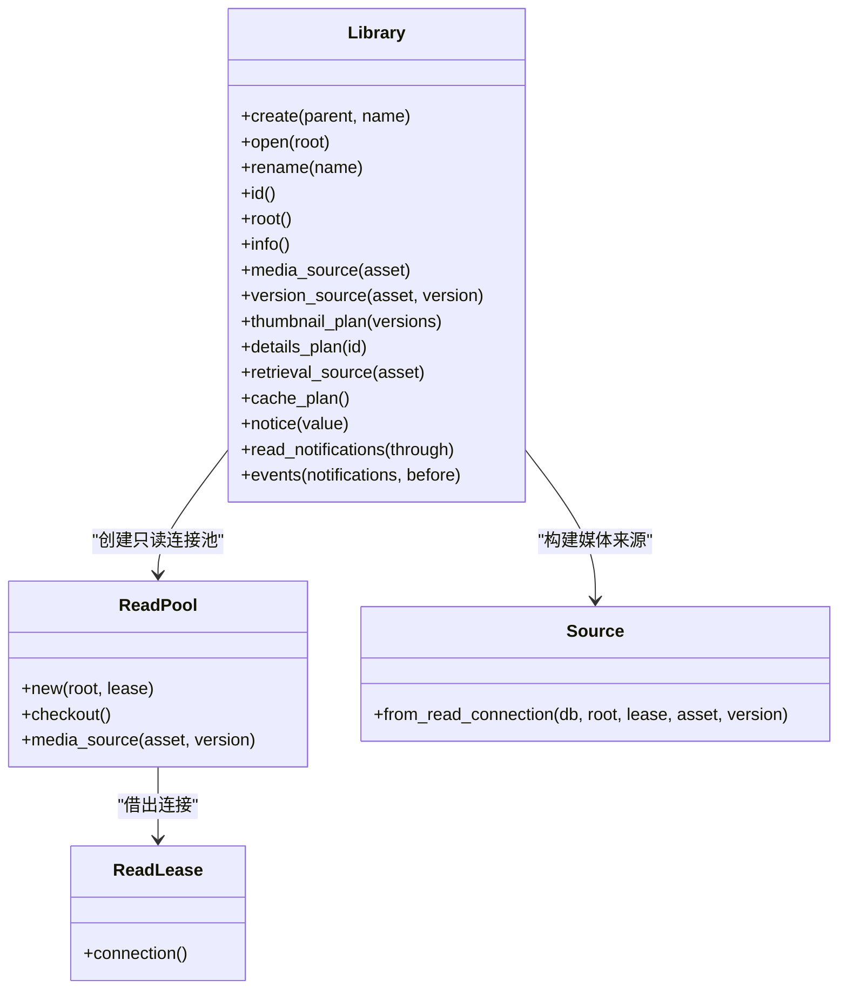
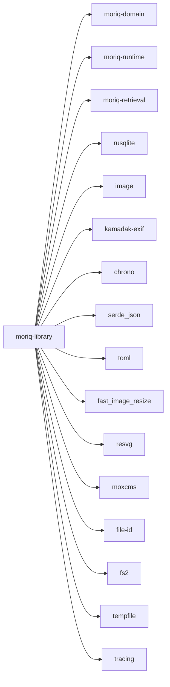

# Library 层 API

> Repo Wiki 节点 `library-layer-api`
> 导出自 Qoder 知识库快照 `8fbe02f6-57c2-4874-b725-1a8130851fd9`，代码基线 `7a7a8e75e18bd90294e09cd422dd7ed5a04813a0`（分支 main，zh-CN）。

<cite>
**本文引用的文件**   
- [lib.rs](../../../crates/moriq-library/src/lib.rs)
- [core.rs](../../../crates/moriq-library/src/library/core.rs)
- [lifecycle.rs](../../../crates/moriq-library/src/library/lifecycle.rs)
- [catalog.rs](../../../crates/moriq-library/src/catalog/catalog.rs)
- [journal.rs](../../../crates/moriq-library/src/database/journal.rs)
- [read_pool.rs](../../../crates/moriq-library/src/database/read_pool.rs)
- [cache.rs](../../../crates/moriq-library/src/media/cache.rs)
- [media.rs](../../../crates/moriq-library/src/media/media.rs)
- [region.rs](../../../crates/moriq-library/src/media/region.rs)
- [video.rs](../../../crates/moriq-library/src/media/video.rs)
</cite>

## 目录
1. [引言](#引言)
2. [项目结构](#项目结构)
3. [核心组件](#核心组件)
4. [架构总览](#架构总览)
5. [详细组件分析](#详细组件分析)
6. [依赖关系分析](#依赖关系分析)
7. [性能与并发特性](#性能与并发特性)
8. [使用示例与最佳实践](#使用示例与最佳实践)
9. [故障排查](#故障排查)
10. [结论](#结论)

## 引言
本文面向 Moriq Library 层的公共 API，重点说明 `Library` 结构体的资源库初始化、素材管理、目录组织、查询检索、媒体处理、导入导出等能力，并解释 SQLite 单写者模式、事务机制、错误类型、缓存接口、区域标注会话和视频播放接口的行为。文档同时给出增删改查、批量操作和性能优化的实践建议，帮助上层应用正确调用阻塞式数据库接口，避免并发锁冲突。

## 项目结构
`moriq-library` 是一个 Rust crate，提供资源库的完整生命周期和数据访问能力。其顶层模块按职责划分为：

- 资源库生命周期：创建、打开、重命名、删除、设置、信息汇总
- 目录与项目：项目树、标签、工作区、规则、概览
- 媒体访问：原片读取、缩略图、预览、元数据、色彩、区域、视频
- 导入导出：导入、提交、恢复、同步、导出
- 维护任务：备份、清理、孤儿对象、存储统计
- 数据库：WAL 模式、只读连接池、活动日志、迁移

**图表来源**
- [lib.rs:1-80](../../../crates/moriq-library/src/lib.rs#L1-L80)
- [core.rs:1-120](../../../crates/moriq-library/src/library/core.rs#L1-L120)
- [read_pool.rs:1-97](../../../crates/moriq-library/src/database/read_pool.rs#L1-L97)

**章节来源**
- [lib.rs:1-120](../../../crates/moriq-library/src/lib.rs#L1-L120)

## 核心组件
本节聚焦 `Library` 结构体对外暴露的关键方法及其语义。

| 类别 | 公共接口 | 主要职责 | 阻塞性质 | 典型返回或副作用 |
|---|---|---|---|---|
| 资源库生命周期 | `Library::create` | 在临时目录构建初始数据库和目录结构，再原子移动到目标路径 | 是 | 新建资源库实例 |
| 资源库生命周期 | `Library::open` | 校验清单、加独占锁、身份校验、执行迁移、恢复中断操作 | 是 | 已存在资源库实例 |
| 资源库生命周期 | `Library::rename` | 校验名称并更新显示名 | 是 | 更新偏好 |
| 资源库信息 | `Library::id` | 返回稳定资源库标识 | 否 | `LibraryId` |
| 资源库信息 | `Library::root` | 返回资源库根路径 | 否 | `PathBuf` 引用 |
| 资源库信息 | `Library::info` | 汇总素材数量、收藏数、字节数、项目和更新时间 | 是 | `LibraryInfo` |
| 浏览历史 | `Library::saved_navigation` | 读取持久化浏览状态 | 是 | 可选历史 |
| 浏览历史 | `Library::save_navigation` | 校验范围后保存浏览状态 | 是 | 无 |
| 外部引用 | `Library::reconnect_page` | 分页查找旧根下的外部引用 | 是 | 游标和候选项 |
| 外部引用 | `Library::apply_reconnect` | 提交已验证的新路径 | 是 | 是否成功 |
| 素材邻域 | `Library::neighborhood` | 按当前筛选排序返回锚点附近素材 | 是 | 邻域结果 |
| 选择范围 | `Library::selection_range` | 解析两个锚点之间的素材范围 | 是 | 素材 ID 列表 |
| 项目操作 | `Library::create_child_project` | 校验父项目并创建子项目 | 是 | 新项目 ID |
| 项目操作 | `Library::move_project` | 调整项目父级，拒绝循环 | 是 | 无 |
| 标签操作 | `Library::rename_tag` | 重命名或合并标签 | 是 | 无 |
| 标签操作 | `Library::delete_tag` | 删除标签及关联 | 是 | 无 |
| 外部引用校验 | `Library::reference_hash` | 读取外部引用版本的预期哈希 | 是 | 哈希字符串 |
| 外部引用移动 | `Library::relocate_reference` | 提交新路径并校验目标内容 | 是 | 无 |
| 媒体来源 | `Library::media_source` | 为当前展示版本建立媒体来源 | 是 | `Source` |
| 媒体来源 | `Library::version_source` | 为指定版本建立媒体来源 | 是 | `Source` |
| 缩略图计划 | `Library::thumbnail_plan` | 批量获取可重建缩略图来源 | 是 | `Thumbnails` |
| 详情计划 | `Library::details_plan` | 冻结详情所需字段与媒体来源 | 是 | `Details` |
| 检索来源 | `Library::retrieval_source` | 先校验检索范围再返回媒体来源 | 是 | `Source` |
| 缓存计划 | `Library::cache_plan` | 冻结缓存目录和租约供后台清理 | 否 | `Plan` |
| 通知和活动 | `Library::notice` | 写入带级别和重试标记的通知 | 是 | 无 |
| 通知消费 | `Library::read_notifications` | 标记通知已读 | 是 | 无 |
| 事件页 | `Library::events` | 按截止位置分页读取活动或通知 | 是 | `EventPage` |
| 库资料 | `Library::update_profile` | 更新库名和描述 | 是 | 无 |
| 项目访问 | `Library::visit_project` | 更新项目最近访问时间 | 是 | 无 |

**章节来源**
- [core.rs:1-200](../../../crates/moriq-library/src/library/core.rs#L1-L200)
- [core.rs:201-412](../../../crates/moriq-library/src/library/core.rs#L201-L412)
- [lifecycle.rs:1-177](../../../crates/moriq-library/src/library/lifecycle.rs#L1-L177)
- [catalog.rs:1-200](../../../crates/moriq-library/src/catalog/catalog.rs#L1-L200)
- [journal.rs:1-120](../../../crates/moriq-library/src/database/journal.rs#L1-L120)
- [media.rs:1-200](../../../crates/moriq-library/src/media/media.rs#L1-L200)
- [cache.rs:1-87](../../../crates/moriq-library/src/media/cache.rs#L1-L87)

## 架构总览
Library 层采用“单写者 + 多读者”的 SQLite 架构：

- 单个 `rusqlite::Connection` 负责所有写入操作，并通过 WAL 模式和忙超时控制锁竞争。
- 媒体线程通过 `ReadPool` 借用只读连接，避免阻塞写入端。
- 资源库根目录上的独占锁防止多个进程同时打开同一资源库。
- 所有写操作通过显式事务完成，失败时回滚；迁移也分阶段事务进行。
- 媒体文件通过冻结的文件句柄和资产身份校验保证一致性。

**图表来源**
- [core.rs:1-200](../../../crates/moriq-library/src/library/core.rs#L1-L200)
- [read_pool.rs:1-97](../../../crates/moriq-library/src/database/read_pool.rs#L1-L97)
- [media.rs:1-120](../../../crates/moriq-library/src/media/media.rs#L1-L120)

**章节来源**
- [core.rs:1-200](../../../crates/moriq-library/src/library/core.rs#L1-L200)
- [read_pool.rs:1-97](../../../crates/moriq-library/src/database/read_pool.rs#L1-L97)

## 详细组件分析

### 资源库初始化与生命周期
`Library::create` 先在临时目录创建清单、目录结构和初始数据库，然后原子重命名为目标 `.moriq` 目录；`Library::open` 则加载清单、校验格式与 schema、加独占锁、检查删除挂起状态、校验硬链接、执行迁移、恢复中断导入，并最终启用 WAL 和 FULL 同步。

关键行为：
- 清单大小限制为 64 KiB。
- 资源库名称需通过组件校验，长度限制为 120 字节。
- 打开前会检查 `metadata/library-deletion.pending`，若存在则拒绝打开。
- 迁移前对旧版本数据库生成快照到 `backups`。
- 迁移完成后重置后台任务状态，并对含外部引用的库暂停部分队列任务。

**图表来源**
- [core.rs:1-200](../../../crates/moriq-library/src/library/core.rs#L1-L200)
- [core.rs:201-412](../../../crates/moriq-library/src/library/core.rs#L201-L412)

**章节来源**
- [core.rs:1-200](../../../crates/moriq-library/src/library/core.rs#L1-L200)
- [core.rs:201-412](../../../crates/moriq-library/src/library/core.rs#L201-L412)

### 素材管理与目录组织
素材相关能力分布在目录、项目、标签、工作区和媒体模块中：

- 目录与项目：支持创建子项目、移动项目、检测循环。
- 标签：支持重命名或合并标签，删除标签时会记录被拒绝的 AI 标签，保持搜索结果一致。
- 工作区与规则：通过 `workspace_query` 将查询作用域绑定到项目。
- 概览：提供画廊排序和分页。

这些操作通常以数据库事务为单位执行，并在成功后清空内存中的查询快照，确保后续查询基于最新数据。

**章节来源**
- [catalog.rs:1-200](../../../crates/moriq-library/src/catalog/catalog.rs#L1-L200)

### 查询检索与邻域浏览
`Library::neighborhood` 根据当前查询与排序，返回锚点附近最多 7 条素材，并返回选中项位置和分页；`Library::selection_range` 返回两个锚点之间的素材 ID 序列，但限制最大跨度为 10000。

关键点：
- 未过滤查询走 `asset_order`，过滤查询走 `query_snapshot`。
- 方向参数限制为 -1、0、1。
- 选择范围校验位置差值，防止一次性选中过大区间。

**章节来源**
- [catalog.rs:1-200](../../../crates/moriq-library/src/catalog/catalog.rs#L1-L200)

### 媒体处理与缓存接口
#### MediaCache 缓存接口
`Library::cache_plan` 返回一个 `Plan`，用于冻结缓存目录和资源库租约。`Plan::trim` 按预算淘汰 `previews` 和 `thumbnails/256` 下可重建的 PNG 或 RGBA 平面缓存，跳过符号链接、非 UUID 文件名、隐藏文件和系统属性文件，并返回清理统计。

注意：
- 原始文件、AI 结果、恢复数据和互操作文件不会被缓存清理。
- 清理过程使用临时内存数据库统计文件大小，再按修改时间和路径顺序删除。

**章节来源**
- [cache.rs:1-87](../../../crates/moriq-library/src/media/cache.rs#L1-L87)

#### RegionSession 区域标注接口
`Session` 表示不可变的查看器会话，封装宽高、临时缓存路径、扩展名和租约。内部 `run` 函数调用隔离解码程序生成分块缓存，支持：

- RAW 或栅格图像的原尺寸解码。
- 可选区域裁剪。
- 120 秒超时。
- 取消信号检查。
- 输出头格式校验，限制像素缓冲不超过 512 MiB。

**图表来源**
- [region.rs:1-200](../../../crates/moriq-library/src/media/region.rs#L1-L200)

**章节来源**
- [region.rs:1-200](../../../crates/moriq-library/src/media/region.rs#L1-L200)

#### Video 播放接口
视频模块提供受支持扩展名识别、工具路径定位、运行时目录校验、视频播放工作程序定位，以及 `Playback` 流式帧读取。

关键约束：
- 工具路径固定为运行目录下的 `codecs`，不信任 PATH。
- 播放帧协议以魔数开头，宽度高度上限为 1920。
- 帧接收器只保留最新帧，避免渲染缓慢导致帧堆积。
- 调试构建允许从环境变量指定开发 codecs 根目录。

**章节来源**
- [video.rs:1-200](../../../crates/moriq-library/src/media/video.rs#L1-L200)

### 数据库操作的阻塞性质、事务机制与错误处理
#### 阻塞性质
- `Library::create`、`Library::open`、`Library::info`、`Library::events`、`Library::notice`、`Library::read_notifications`、素材增删改查、导入导出、维护任务等均为阻塞调用。
- 数据库 I/O 由 rusqlite 直接执行，不应在主 UI 线程长期持有。
- 只读操作可通过 `ReadPool` 借用只读连接，但仍应异步调度，避免阻塞。

#### 事务机制
- 所有写操作显式使用 `db.transaction()`。
- 迁移按版本分段执行，每个迁移在独立事务内提交。
- 标签重命名、删除、项目移动、外部引用提交等操作都在事务内完成。
- 只读连接在归还时自动回滚遗留事务，并清理临时表。

#### 错误处理
统一错误类型为 `Error`，包含：

| 错误类型 | 含义 |
|---|---|
| `Io` | 文件读写失败 |
| `Db` | SQLite 数据库操作失败 |
| `Image` | 图片无法解码 |
| `Color` | 色彩配置转换失败 |
| `Invalid` | 输入无效、校验失败、状态异常 |
| `Locked` | 资源库正被其他窗口或进程占用 |

常见错误场景：
- 同名资源库已存在。
- 清单损坏或不兼容。
- 资源库正在删除或曾中断删除。
- 外部引用路径离开允许根目录。
- 区域解码失败或超时。
- 一次选择范围超过 10000。
- 一次缩略图计划超过 128。

**章节来源**
- [lib.rs:1-120](../../../crates/moriq-library/src/lib.rs#L1-L120)
- [journal.rs:1-120](../../../crates/moriq-library/src/database/journal.rs#L1-L120)
- [read_pool.rs:1-97](../../../crates/moriq-library/src/database/read_pool.rs#L1-L97)

### 与 SQLite 单写者模式的集成
- 主连接以读写模式打开，并设置 `busy_timeout`。
- 迁移前对旧版本数据库生成备份快照。
- 打开成功后设置 `journal_mode=WAL` 和 `synchronous=FULL`。
- 资源库根目录下创建 `library.lock`，使用独占锁防止多进程打开。
- 只读连接池最多缓存 4 个空闲连接，并设置缓存大小和临时存储策略。
- 媒体源通过 `Source` 冻结文件句柄、资产版本、哈希和租约，避免读取期间资源库被移除。

**图表来源**
- [core.rs:1-200](../../../crates/moriq-library/src/library/core.rs#L1-L200)
- [read_pool.rs:1-97](../../../crates/moriq-library/src/database/read_pool.rs#L1-L97)
- [media.rs:1-120](../../../crates/moriq-library/src/media/media.rs#L1-L120)

**章节来源**
- [core.rs:1-200](../../../crates/moriq-library/src/library/core.rs#L1-L200)
- [read_pool.rs:1-97](../../../crates/moriq-library/src/database/read_pool.rs#L1-L97)
- [media.rs:1-120](../../../crates/moriq-library/src/media/media.rs#L1-L120)

## 依赖关系分析
Library 层依赖以下子系统：

- `moriq-domain`：领域模型，如 `AssetId`、`ProjectId`、`LibraryId`、`Query`、`Notice`。
- `moriq-runtime`：运行时组件校验，包括视频编解码工具。
- `moriq-retrieval`：检索作用域与查询校验。
- `rusqlite`：SQLite 客户端，启用 `backup` 功能。
- `image`：图片解码。
- `kamadak-exif`、`chrono`、`serde_json`、`toml`：元数据、时间、序列化。
- `fast_image_resize`、`resvg`、`moxcms`：图像处理与色彩。
- `file-id`：文件身份校验。
- `fs2`：文件锁。
- `tempfile`：临时文件与临时目录。
- `tracing`：日志追踪。

**图表来源**
- [Cargo.toml](../../../crates/moriq-library/Cargo.toml#L1-L35)

**章节来源**
- [Cargo.toml:1-35](../../../crates/moriq-library/Cargo.toml#L1-L35)

## 性能与并发特性
- **单写者模式**：所有写入共享同一个 SQLite 连接，适合集中式资源库管理，但不适合高并发写入。
- **WAL 模式**：提升读并发能力，减少读阻塞，但写仍串行。
- **只读连接池**：最多 4 个空闲连接，适合媒体线程并行读取。
- **批量限制**：缩略图计划最多 128 张，选择范围最多 10000，邻域浏览最多 7 条。
- **缓存清理**：按预算淘汰可重建缓存，避免磁盘膨胀。
- **视频帧丢弃**：只保留最新帧，避免渲染延迟导致内存增长。
- **区域解码超时**：120 秒超时，避免长时间阻塞。

优化建议：
- 将 `Library::open`、`Library::info`、导入导出、迁移等耗时操作放到专用工作线程。
- 使用 `ReadPool::media_source` 进行媒体读取，避免阻塞写入端。
- 批量操作前先计算预算，分批提交。
- 使用 `cache_plan().trim(budget)` 定期清理预览和缩略图。
- 对大体积视频预览优先使用区域解码，而非全图解码。

[本节为通用指导，不直接分析具体代码行]

## 使用示例与最佳实践

### 资源库初始化
推荐流程：
1. 调用 `Library::create` 创建新资源库。
2. 捕获 `Error::Invalid` 和 `Error::Io`，处理名称冲突、清单损坏和权限问题。
3. 对 `Error::Locked` 提示用户关闭其他窗口或进程。
4. 使用 `Library::info` 显示资源库基本信息。

注意事项：
- 不要在同一目录重复创建同名资源库。
- 清单超过 64 KiB 会被拒绝。
- 如果存在删除挂起标记，必须先完成删除流程。

**章节来源**
- [core.rs:1-120](../../../crates/moriq-library/src/library/core.rs#L1-L120)
- [core.rs:201-412](../../../crates/moriq-library/src/library/core.rs#L201-L412)

### 素材增删改查
推荐流程：
1. 使用 `Library::media_source` 或 `Library::version_source` 获取 `Source`。
2. 通过 `Source` 提供的路径、哈希、扩展名、宽高等信息进行媒体处理。
3. 对原片校验时使用 `expected` 与 `registered_hash` 对比。
4. 外部引用版本通过 `reference_hash` 和 `relocate_reference` 管理。

注意事项：
- `media_source` 基于当前展示版本。
- `version_source` 不会改变当前展示版本。
- 外部引用路径必须落在允许的根目录内。

**章节来源**
- [media.rs:1-200](../../../crates/moriq-library/src/media/media.rs#L1-L200)
- [catalog.rs:1-200](../../../crates/moriq-library/src/catalog/catalog.rs#L1-L200)

### 批量操作
推荐流程：
1. 对缩略图批量读取使用 `thumbnail_plan`，传入最多 128 个版本 ID。
2. 对选择范围使用 `selection_range`，并确保跨度不超过 10000。
3. 对标签重命名或删除，先确认标签在项目范围内存在。
4. 对导入、迁移、维护任务使用工作线程，避免 UI 卡顿。

**章节来源**
- [media.rs:120-200](../../../crates/moriq-library/src/media/media.rs#L120-L200)
- [catalog.rs:1-200](../../../crates/moriq-library/src/catalog/catalog.rs#L1-L200)

### 性能优化
推荐做法：
- 使用 `cache_plan().trim(budget)` 定期清理预览和缩略图。
- 使用 `ReadPool::media_source` 在媒体线程中读取原片。
- 对视频预览优先使用区域解码，避免全图解码。
- 对大查询先评估结果规模，必要时分页或限制范围。
- 避免在 UI 线程调用 `Library::open`、`Library::info`、导入导出。

**章节来源**
- [cache.rs:1-87](../../../crates/moriq-library/src/media/cache.rs#L1-L87)
- [read_pool.rs:1-97](../../../crates/moriq-library/src/database/read_pool.rs#L1-L97)
- [region.rs:1-200](../../../crates/moriq-library/src/media/region.rs#L1-L200)

## 故障排查
常见问题与定位方式：

| 现象 | 可能原因 | 处理建议 |
|---|---|---|
| 打开资源库时报 `Locked` | 其他窗口或进程持有独占锁 | 关闭其他 Moriq Space 实例或进程 |
| 打开资源库报清单损坏 | `library.toml` 损坏或格式不兼容 | 从备份恢复资源库 |
| 打开资源库报删除中断 | `metadata/library-deletion.pending` 存在 | 进入资源库管理完成删除 |
| 外部引用重连失败 | 新路径不在允许根目录或文件已变化 | 重新连接并再次验证 |
| 区域解码失败 | 解码子进程退出码非零或超时 | 检查原片是否损坏，重试或降级预览 |
| 视频播放失败 | 缺少视频工具或校验失败 | 检查发行包中的 codecs 目录 |
| 缩略图读取失败 | 缓存缺失且重建失败 | 检查媒体源路径和哈希 |
| 数据库升级失败 | 迁移脚本错误或备份不完整 | 查看 `backups` 中的预迁移快照，从备份恢复 |

**章节来源**
- [lib.rs:1-120](../../../crates/moriq-library/src/lib.rs#L1-L120)
- [core.rs:1-200](../../../crates/moriq-library/src/library/core.rs#L1-L200)
- [lifecycle.rs:1-177](../../../crates/moriq-library/src/library/lifecycle.rs#L1-L177)
- [region.rs:1-200](../../../crates/moriq-library/src/media/region.rs#L1-L200)
- [video.rs:1-200](../../../crates/moriq-library/src/media/video.rs#L1-L200)

## 结论
Moriq Library 层以 `Library` 为核心，围绕 SQLite 单写者模式提供资源库生命周期、素材管理、目录组织、查询检索、媒体处理和导入导出能力。其设计强调：

- 明确的阻塞边界：数据库和媒体处理应远离 UI 线程。
- 严格的事务语义：写操作全部走事务，迁移分阶段提交。
- 安全的资源库访问：独占锁、清单校验、身份校验、外部引用校验。
- 可控的媒体性能：只读连接池、缓存重建、区域解码、视频帧丢弃。
- 清晰的错误分类：IO、数据库、图片、色彩、无效输入、锁定。

上层应用应遵循批量限制、预算控制和异步调度原则，充分利用 `MediaCache`、`RegionSession` 和 `Video` 接口，以获得稳定且高性能的资源库体验。