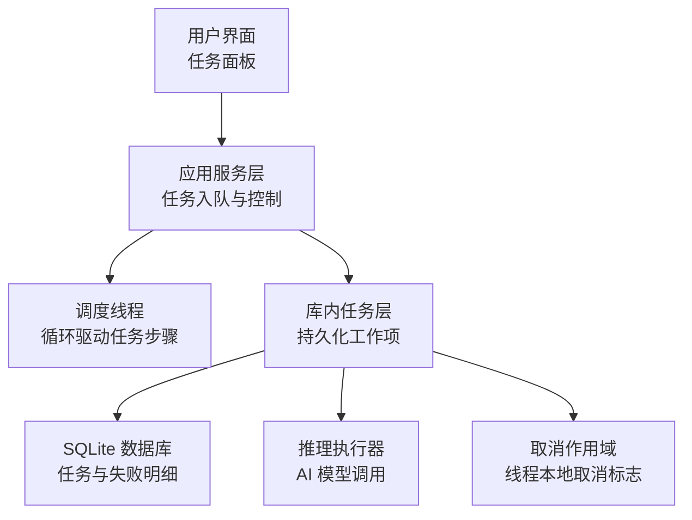
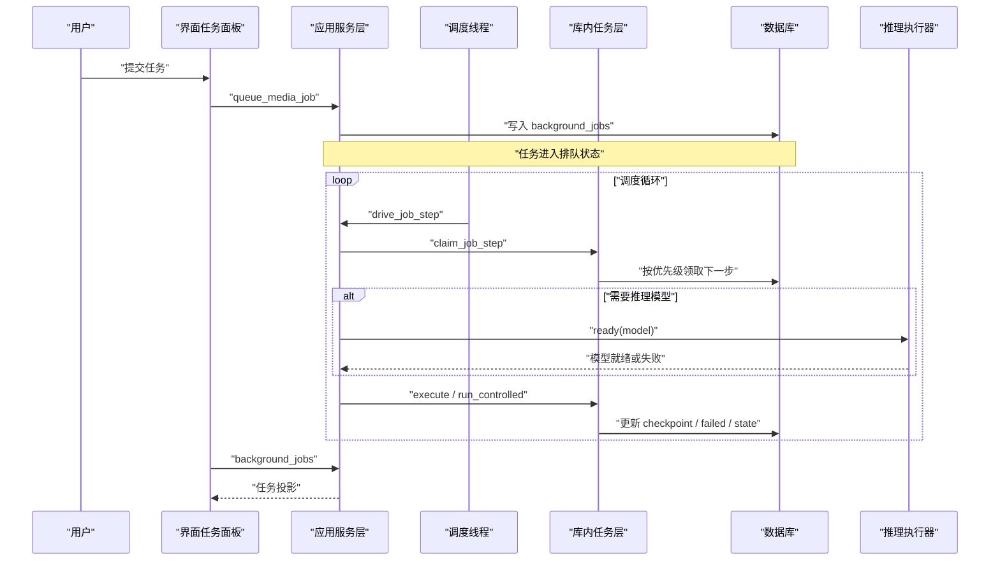
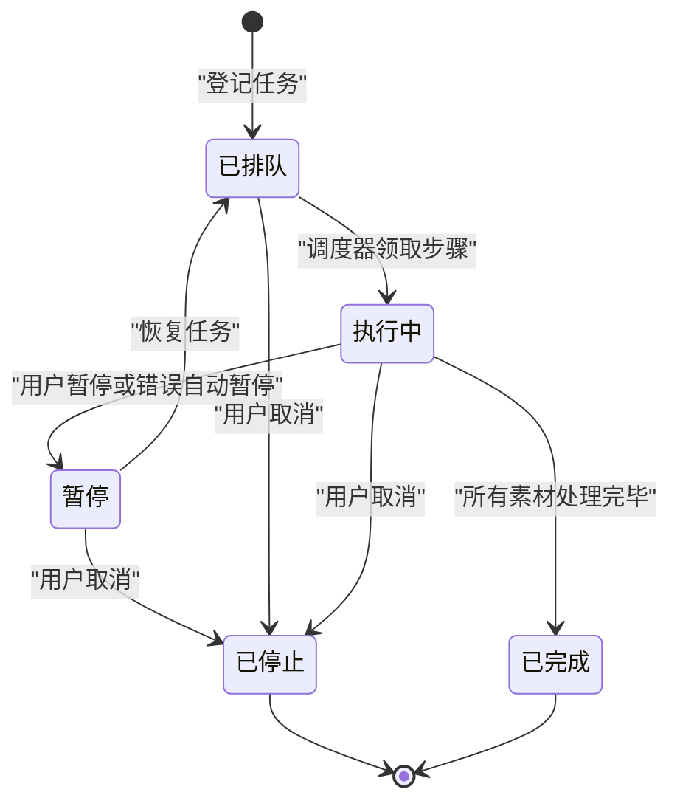
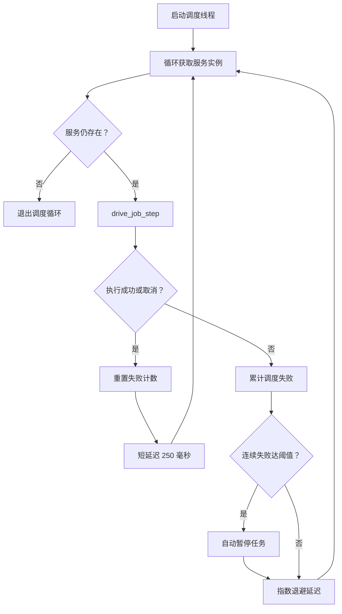
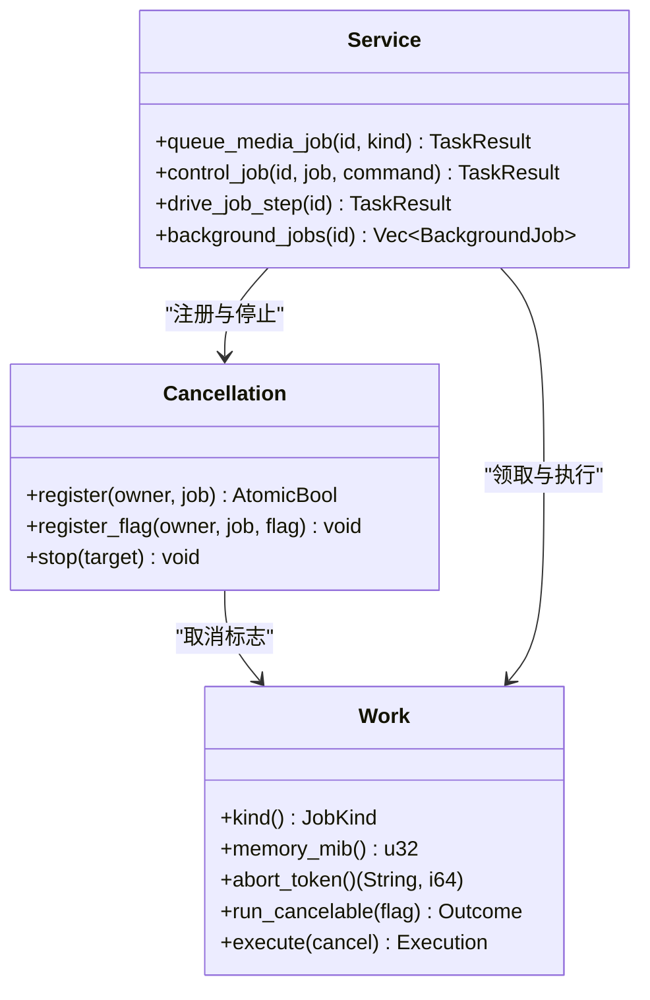
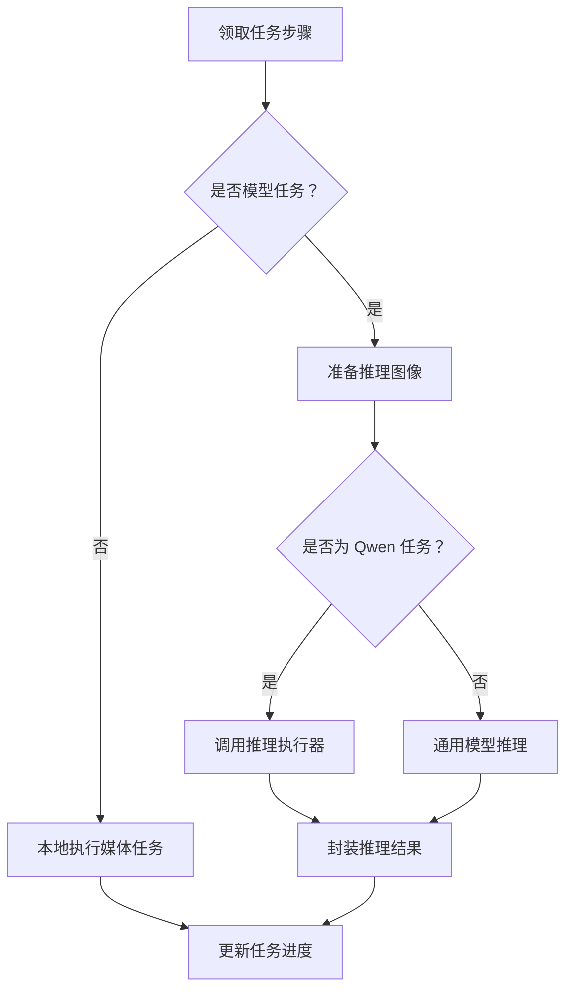
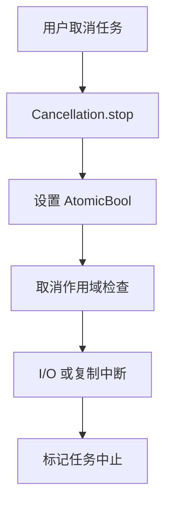
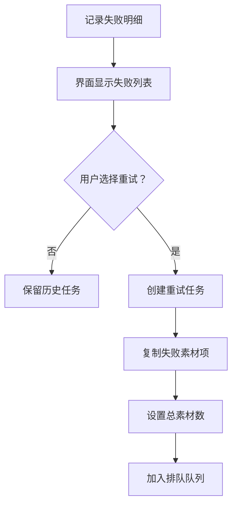
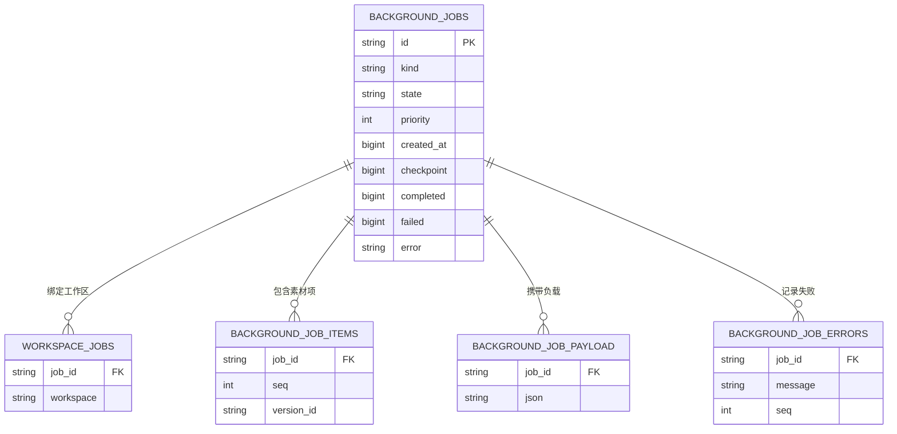

# 任务管理 API

> Repo Wiki 节点 `tasks-api`
> 导出自 Qoder 知识库快照 `8fbe02f6-57c2-4874-b725-1a8130851fd9`，代码基线 `7a7a8e75e18bd90294e09cd422dd7ed5a04813a0`（分支 main，zh-CN）。

<cite>
**本文引用的文件**   
- [jobs.rs（领域模型）](../../../crates/moriq-domain/src/jobs.rs)
- [jobs.rs（应用服务层）](../../../crates/moriq-app/src/jobs.rs)
- [scheduler.rs（调度器）](../../../crates/moriq-app/src/scheduler.rs)
- [jobs.rs（库内任务执行）](../../../crates/moriq-library/src/tasks/jobs.rs)
- [cancel.rs（取消作用域）](../../../crates/moriq-library/src/tasks/cancel.rs)
- [tasks.rs（用户界面任务面板）](../../../crates/moriq-ui/src/tasks.rs)
</cite>

## 目录
1. [引言](#引言)
2. [项目结构与职责划分](#项目结构与职责划分)
3. [核心类型与数据模型](#核心类型与数据模型)
4. [架构总览](#架构总览)
5. [任务生命周期与状态机](#任务生命周期与状态机)
6. [任务调度器与并发控制](#任务调度器与并发控制)
7. [任务执行与推理集成](#任务执行与推理集成)
8. [任务取消、进度回调与错误处理](#任务取消进度回调与错误处理)
9. [持久化、恢复与重试机制](#持久化恢复与重试机制)
10. [监控与使用示例](#监控与使用示例)
11. [性能优化建议](#性能优化建议)
12. [故障排查指南](#故障排查指南)
13. [结论](#结论)

## 引言
本文件系统性地记录 Moriq 的任务管理子系统，重点覆盖以下方面：
- `JobKind` 枚举定义的任务类型及其内存预算。
- `JobState` 状态机转换和任务生命周期。
- 应用级任务调度器、优先级队列和并发控制。
- 任务取消接口、进度展示和错误重试策略。
- 长时间运行任务的管理方式与监控接口。
- 任务的数据库持久化、断点恢复机制。
- 面向开发者的性能优化要点。

该子系统将“任务建模”“应用服务编排”“库内持久化执行”“界面监控”分层解耦，既支持短任务如缩略图重建，也支持长任务如 AI 分析、指纹索引和原文件完整性检查。

## 项目结构与职责划分
任务子系统横跨四个主要层级：
- 领域模型层：定义稳定协议值、任务种类、任务状态和错误类型。
- 应用服务层：对外暴露任务入队、控制、失败查询和执行驱动接口。
- 库内任务层：实现可持久化的任务步骤领取、执行结果封装和失败明细。
- 用户界面层：提供任务提交、暂停/继续/停止、优先级调整和失败明细查看。

**图表来源**
- [scheduler.rs:1-60](../../../crates/moriq-app/src/scheduler.rs#L1-L60)
- [jobs.rs（应用服务层）:1-175](../../../crates/moriq-app/src/jobs.rs#L1-L175)
- [jobs.rs（库内任务执行）:1-120](../../../crates/moriq-library/src/tasks/jobs.rs#L1-L120)
- [cancel.rs:1-85](../../../crates/moriq-library/src/tasks/cancel.rs#L1-L85)

**章节来源**
- [jobs.rs（领域模型）:1-229](../../../crates/moriq-domain/src/jobs.rs#L1-L229)
- [jobs.rs（应用服务层）:1-175](../../../crates/moriq-app/src/jobs.rs#L1-L175)
- [scheduler.rs:1-283](../../../crates/moriq-app/src/scheduler.rs#L1-L283)
- [jobs.rs（库内任务执行）:1-551](../../../crates/moriq-library/src/tasks/jobs.rs#L1-L551)
- [cancel.rs:1-85](../../../crates/moriq-library/src/tasks/cancel.rs#L1-L85)
- [tasks.rs:1-509](../../../crates/moriq-ui/src/tasks.rs#L1-L509)

## 核心类型与数据模型

### JobKind 任务种类
`JobKind` 是任务的核心分类，用于决定任务行为、是否需要推理执行器、以及共享内存预算。

| 任务种类 | 协议字符串 | 是否使用模型 | 内存预算 | 典型用途 |
|---|---|---:|---:|---|
| `Metadata` | `metadata` | 否 | 128 MiB | 元数据与 EXIF/GPS 索引 |
| `Integrity` | `integrity` | 否 | 128 MiB | 原文件完整性检查 |
| `Fingerprints` | `fingerprints` | 否 | 1024 MiB | 近似图片索引 |
| `Thumbnails` | `thumbnails` | 否 | 1024 MiB | 缩略图重建 |
| `Batch` | `batch` | 否 | 128 MiB | 批量字段编辑等参数化任务 |
| `Analysis(ModelId)` | `analysis:<model>` | 是 | 根据模型而定 | 通用图像分析任务 |
| `QwenClassification` | `analysis:qwen35-4b/classify` | 是 | 3072 MiB | Qwen 媒介与主题分类 |
| `QwenDescription` | `analysis:qwen35-4b/describe` | 是 | 3072 MiB | Qwen 中文标签与描述 |
| `QwenFaces` | `analysis:qwen35-4b/faces` | 是 | 3072 MiB | Qwen 人脸识别与人物分组 |

`JobKind::memory_mib` 为每种任务指定共享内存准入预算；模型类任务通常占用较大内存，而非模型任务则按 I/O 或轻量计算特征分配较小预算。

**章节来源**
- [jobs.rs（领域模型）:26-120](../../../crates/moriq-domain/src/jobs.rs#L26-L120)

### JobState 任务状态
`JobState` 表示任务的持久化状态：

| 状态 | 含义 | 活动性 | 完成性 |
|---|---|---:|---:|
| `Queued` | 已排队等待调度 | 是 | 否 |
| `Running` | 正在执行当前素材步骤 | 是 | 否 |
| `Paused` | 被暂停，保留检查点 | 是 | 否 |
| `Completed` | 已完成 | 否 | 是 |
| `Cancelled` | 已被完全停止 | 否 | 是 |

辅助方法：
- `is_active()`：判断任务是否处于排队、运行或暂停阶段。
- `is_finished()`：判断任务是否已完成或被取消。

**章节来源**
- [jobs.rs（领域模型）:121-190](../../../crates/moriq-domain/src/jobs.rs#L121-L190)

### TaskError 任务错误类型
`TaskError` 是跨层的任务错误抽象：

| 错误类型 | 含义 |
|---|---|
| `Cancelled` | 任务被用户或系统取消 |
| `StaleLibrary` | 任务所属资源库已切换，旧上下文失效 |
| `InvalidInput(String)` | 输入参数无效 |
| `Storage(String)` | 存储或数据库操作失败 |
| `Runtime(String)` | 运行时或外部依赖异常 |
| `Unavailable` | 后台服务不可用 |

**章节来源**
- [jobs.rs（领域模型）:191-229](../../../crates/moriq-domain/src/jobs.rs#L191-L229)

## 架构总览
任务子系统的运行路径如下：
1. 用户通过界面选择任务种类并提交。
2. 应用服务层校验模型就绪并登记任务到数据库。
3. 调度线程从数据库按优先级领取下一个任务步骤。
4. 执行前申请共享内存预算并注册取消标志。
5. 非模型任务由库内任务直接执行；模型任务交给推理执行器。
6. 执行完成后更新任务进度、失败计数和最终状态。
7. 界面轮询投影数据，展示进度、失败明细和控制按钮。

**图表来源**
- [jobs.rs（应用服务层）:1-175](../../../crates/moriq-app/src/jobs.rs#L1-L175)
- [scheduler.rs:1-120](../../../crates/moriq-app/src/scheduler.rs#L1-L120)
- [jobs.rs（库内任务执行）:200-551](../../../crates/moriq-library/src/tasks/jobs.rs#L200-L551)

## 任务生命周期与状态机

### 状态转换规则
任务的状态转换由应用服务和库内任务共同维护：

- **已排队 → 执行中**：调度器从 `background_jobs` 按优先级领取未完成的下一步。
- **执行中 → 暂停**：用户主动暂停、模型推理失败、连续调度错误或切库导致旧任务失效。
- **暂停 → 已排队**：用户恢复任务后重新排队。
- **执行中/已排队 → 已完成**：步骤全部处理成功。
- **任意活动状态 → 已停止**：用户取消后不再自动恢复。

**图表来源**
- [jobs.rs（库内任务执行）:200-551](../../../crates/moriq-library/src/tasks/jobs.rs#L200-L551)
- [scheduler.rs:60-180](../../../crates/moriq-app/src/scheduler.rs#L60-L180)

### 关键状态判定
- 活动状态包括：已排队、执行中、暂停。
- 完成状态包括：已完成、已停止。
- 界面和用户逻辑应优先使用这些语义，而不是直接比较字符串状态。

**章节来源**
- [jobs.rs（领域模型）:121-190](../../../crates/moriq-domain/src/jobs.rs#L121-L190)
- [jobs.rs（库内任务执行）:200-551](../../../crates/moriq-library/src/tasks/jobs.rs#L200-L551)

## 任务调度器与并发控制

### 调度线程
调度器在独立线程中运行，使用一个小型 Tokio 多核运行时，配置两个工作线程。其核心职责是：
- 弱引用持有应用服务实例，最后一个服务释放时自动退出。
- 循环调用 `drive_job_step` 驱动当前打开资源库的任务。
- 对调度失败进行指数退避，最多延迟至 30 秒。
- 连续失败达到阈值时，自动将活跃任务暂停并记录错误。

**图表来源**
- [scheduler.rs:1-120](../../../crates/moriq-app/src/scheduler.rs#L1-L120)

### 优先级队列
任务步骤的领取顺序基于：
1. `priority DESC`：优先级高的任务先执行。
2. `created_at`：同优先级下，较早创建的任务优先。
3. `id`：作为确定性排序兜底。
4. `checkpoint`：每个任务按 `background_job_items.seq` 逐步推进。

这意味着：
- 提高任务优先级可以加速后续素材的处理。
- 同一任务内部仍按素材顺序逐项处理，不会乱序。
- 暂停后恢复会保留 `checkpoint`，避免重复处理已完成素材。

**章节来源**
- [jobs.rs（库内任务执行）:400-551](../../../crates/moriq-library/src/tasks/jobs.rs#L400-L551)

### 并发控制机制
系统使用多种并发控制手段：
- `job_slot`：限制同时执行的后台任务数量。
- `import_memory`：基于内存大小的令牌池，任务需按 `JobKind::memory_mib` 申请令牌。
- `Cancellation`：按库 ID 和任务 ID 管理 `AtomicBool` 取消标志。
- 线程本地取消作用域：防止取消状态泄漏到下一项任务。

**图表来源**
- [scheduler.rs:1-60](../../../crates/moriq-app/src/scheduler.rs#L1-L60)
- [jobs.rs（应用服务层）:1-175](../../../crates/moriq-app/src/jobs.rs#L1-L175)
- [jobs.rs（库内任务执行）:1-120](../../../crates/moriq-library/src/tasks/jobs.rs#L1-L120)

**章节来源**
- [scheduler.rs:1-120](../../../crates/moriq-app/src/scheduler.rs#L1-L120)
- [jobs.rs（应用服务层）:1-175](../../../crates/moriq-app/src/jobs.rs#L1-L175)

## 任务执行与推理集成

### 普通任务执行
非模型任务由 `Work::run_controlled` 直接处理：
- `Integrity`：验证媒体完整性。
- `Metadata`：生成元数据记录。
- `Batch`：解析批量任务参数。
- 其他媒体任务：读取预览边缘像素并返回图像结果。

这类任务不依赖推理模型，但受取消标志、内存预算和调度器循环约束。

**章节来源**
- [jobs.rs（库内任务执行）:1-120](../../../crates/moriq-library/src/tasks/jobs.rs#L1-L120)

### 模型任务执行
模型任务分为三类：
1. 通用 `Analysis(ModelId)` 任务：准备图像后交由推理执行器。
2. `QwenClassification`：Qwen 分类任务。
3. `QwenDescription`：Qwen 描述任务。
4. `QwenFaces`：Qwen 人脸任务，支持人脸参考和人物聚类修正。

执行流程：
1. 应用层确认模型已就绪。
2. 库内任务准备图像并返回 `Execution` 类型。
3. 应用层调用推理执行器执行具体模型。
4. 推理结果封装为 `Outcome`，包含版本修订信息和可选的错误信息。

**图表来源**
- [jobs.rs（库内任务执行）:200-360](../../../crates/moriq-library/src/tasks/jobs.rs#L200-L360)
- [jobs.rs（应用服务层）:60-175](../../../crates/moriq-app/src/jobs.rs#L60-L175)

**章节来源**
- [jobs.rs（库内任务执行）:200-360](../../../crates/moriq-library/src/tasks/jobs.rs#L200-L360)
- [jobs.rs（应用服务层）:60-175](../../../crates/moriq-app/src/jobs.rs#L60-L175)

## 任务取消、进度回调与错误处理

### 任务取消接口
取消由两层组成：
1. 应用层 `Cancellation`：按库 ID 和任务 ID 登记 `AtomicBool`，支持单项取消和全局取消。
2. 库层取消作用域：通过线程本地变量传播取消状态，供阻塞式 I/O 和分块复制检查。

取消生效时机：
- 调度器检查取消标志后跳过执行。
- 任务执行过程中检查取消标志后立即返回错误。
- 分块复制会在每块之间检查取消，避免长时间无法中断。

**图表来源**
- [scheduler.rs:1-60](../../../crates/moriq-app/src/scheduler.rs#L1-L60)
- [cancel.rs:1-85](../../../crates/moriq-library/src/tasks/cancel.rs#L1-L85)

**章节来源**
- [scheduler.rs:1-60](../../../crates/moriq-app/src/scheduler.rs#L1-L60)
- [cancel.rs:1-85](../../../crates/moriq-library/src/tasks/cancel.rs#L1-L85)

### 进度回调
系统没有传统意义上的实时进度回调通道，而是通过以下方式表达进度：
- `completed`：已成功处理的素材数量。
- `failed`：失败素材数量。
- `total`：任务总素材数量。
- `state`：当前任务状态。
- 界面侧维护分析任务进度映射，用于刷新分类和布局。

这种方式适合批处理任务，但不适合细粒度的字节级进度推送。

**章节来源**
- [jobs.rs（库内任务执行）:360-551](../../../crates/moriq-library/src/tasks/jobs.rs#L360-L551)
- [tasks.rs:1-200](../../../crates/moriq-ui/src/tasks.rs#L1-L200)

### 错误重试策略
- 单次任务失败会记录到 `background_job_errors`。
- 用户可选择“仅重试失败素材”，系统会根据原任务的 `kind` 和 `priority` 创建新任务。
- 重试任务继承原任务的项目范围和工作区绑定。
- 如果原任务不存在、已结束且无可用失败素材，则拒绝重试。

**图表来源**
- [jobs.rs（库内任务执行）:300-450](../../../crates/moriq-library/src/tasks/jobs.rs#L300-L450)

**章节来源**
- [jobs.rs（库内任务执行）:300-450](../../../crates/moriq-library/src/tasks/jobs.rs#L300-L450)

## 持久化、恢复与恢复机制

### 数据库表关系概览
任务相关的主要数据分布在以下表中：
- `background_jobs`：任务元数据、状态、优先级、检查点、失败数和错误消息。
- `workspace_jobs`：任务与工作区绑定。
- `background_job_items`：任务待处理的素材序列。
- `background_job_payload`：批量任务和 AI 配置文件等附加数据。
- `background_job_errors`：逐项失败记录。

**图表来源**
- [jobs.rs（库内任务执行）:300-551](../../../crates/moriq-library/src/tasks/jobs.rs#L300-L551)

### 断点恢复
任务通过 `checkpoint` 字段保存已处理的素材序号。每次调度重新领取任务时：
1. 查找大于 `checkpoint` 的第一个素材。
2. 如果不存在未完成素材，则将任务标记为已完成。
3. 如果素材或资产不存在，可能将任务挂起并记录错误。
4. 重试任务会复制失败素材项，重新计算总数。

这种设计保证：
- 进程崩溃后可从上次检查点恢复。
- 暂停任务不会丢失已完成部分。
- 取消任务不会误恢复。

**章节来源**
- [jobs.rs（库内任务执行）:400-551](../../../crates/moriq-library/src/tasks/jobs.rs#L400-L551)

## 监控与使用示例

### 监控接口
应用服务层提供的监控接口：
- `background_jobs(LibraryId)`：读取当前工作区的任务投影。
- `job_failures(LibraryId, String)`：读取单个任务的失败明细。
- `control_job(LibraryId, String, JobCommand)`：对单个任务执行暂停、恢复、取消、优先级调整或重试失败。
- `control_model_jobs(LibraryId, JobCommand)`：批量控制模型任务。

界面侧通过轮询刷新任务列表，并根据分析任务进度决定是否刷新分类和画廊布局。

**章节来源**
- [jobs.rs（应用服务层）:1-175](../../../crates/moriq-app/src/jobs.rs#L1-L175)
- [tasks.rs:1-200](../../../crates/moriq-ui/src/tasks.rs#L1-L200)

### 长时间运行任务管理示例
以“原文件完整性检查”为例：
1. 用户点击“原文件完整性检查”。
2. 界面发送 `JobKind::Integrity` 入队请求。
3. 调度器领取任务并逐个验证素材。
4. 用户可随时暂停、继续或完全停止。
5. 完成后界面显示成功数量和失败数量。
6. 若失败，可查看失败明细并仅重试失败素材。

以“Qwen 图片内容分析”为例：
1. 用户提交 Qwen 分类、描述或人脸任务。
2. 应用层检查模型是否就绪。
3. 任务进入排队，调度器按优先级执行。
4. 推理执行期间可通过取消标志中断。
5. 结果写入分析数据，并附带版本修订信息。

**章节来源**
- [tasks.rs:200-509](../../../crates/moriq-ui/src/tasks.rs#L200-L509)
- [jobs.rs（应用服务层）:1-175](../../../crates/moriq-app/src/jobs.rs#L1-L175)

## 性能优化建议

### 调度层优化
- 保持调度循环短延迟，避免频繁唤醒造成 CPU 抖动。
- 对调度失败使用指数退避，防止错误风暴。
- 使用弱引用服务实例，确保服务释放后调度器自然退出。

**章节来源**
- [scheduler.rs:60-180](../../../crates/moriq-app/src/scheduler.rs#L60-L180)

### 内存与并发优化
- 根据 `JobKind::memory_mib` 申请共享内存令牌，避免大模型任务挤占小任务资源。
- 限制同时执行任务数，防止 UI 和未来任务饥饿。
- 在等待内存令牌时定期检查取消标志，避免阻塞取消。

**章节来源**
- [jobs.rs（应用服务层）:60-175](../../../crates/moriq-app/src/jobs.rs#L60-L175)

### 数据库查询优化
- 任务领取按 `(priority DESC, created_at, id)` 排序，避免全表扫描。
- 使用 `checkpoint` 快速跳过已完成素材。
- 限制投影查询返回数量，避免 UI 加载过多历史任务。

**章节来源**
- [jobs.rs（库内任务执行）:400-551](../../../crates/moriq-library/src/tasks/jobs.rs#L400-L551)

### 推理任务优化
- 模型就绪检查提前到入队和调度前，减少无效执行。
- Qwen 任务复用已准备的图像路径，避免重复编码。
- 人脸任务使用冻结的工作区版本，保证人物聚类一致性。

**章节来源**
- [jobs.rs（库内任务执行）:200-360](../../../crates/moriq-library/src/tasks/jobs.rs#L200-L360)

## 故障排查指南

### 常见问题
1. **任务一直排队不执行**
   - 检查是否有足够的 `job_slot` 和 `import_memory` 令牌。
   - 检查模型是否就绪。
   - 检查调度线程是否仍在运行。

2. **任务被自动暂停**
   - 查看 `background_jobs.error` 中的错误消息。
   - 检查是否出现连续调度失败。
   - 检查资源库是否被切换。

3. **取消无效**
   - 确认取消标志是否登记在当前任务上。
   - 检查任务是否在阻塞 I/O 或分块复制路径中。
   - 确认取消发生在执行前还是执行后。

4. **重试失败**
   - 确认原任务存在且处于已完成或已停止状态。
   - 确认仍有未被删除的失败素材。
   - 确认任务类型和优先级有效。

**章节来源**
- [scheduler.rs:120-283](../../../crates/moriq-app/src/scheduler.rs#L120-L283)
- [jobs.rs（库内任务执行）:300-551](../../../crates/moriq-library/src/tasks/jobs.rs#L300-L551)
- [cancel.rs:1-85](../../../crates/moriq-library/src/tasks/cancel.rs#L1-L85)

## 结论
Moriq 的任务管理子系统以稳定的领域模型为基础，将任务类型、状态、错误和内存预算明确分离；应用服务层负责协调调度、取消和资源预算；库内任务层负责持久化、断点恢复和失败明细；界面层提供直观的任务监控和操作入口。

该设计的关键优势在于：
- 任务类型和状态具有稳定协议值，便于数据库和消息传输。
- 优先级队列结合检查点机制，支持长时间运行任务的可靠恢复。
- 取消机制覆盖调度、执行和 I/O 多个层次。
- 错误重试策略允许用户仅重试失败素材，避免重复处理成功部分。
- 内存预算和并发限制保护系统整体稳定性。

对于扩展新任务类型，推荐遵循现有模式：新增 `JobKind`、定义内存预算、实现 `Work::execute` 或 `run_controlled` 分支，并在界面层补充对应入口和文案。