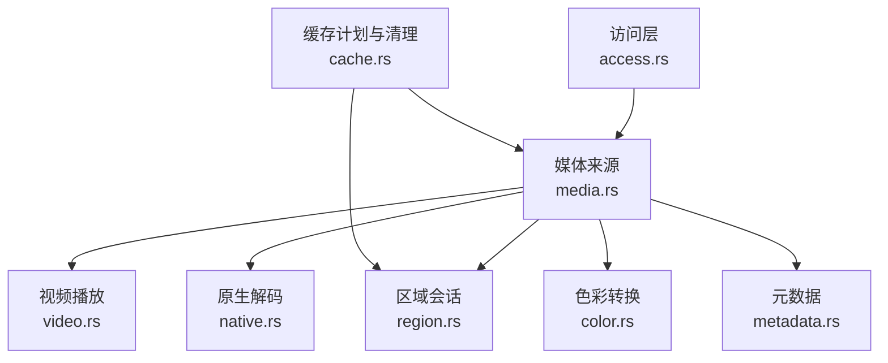
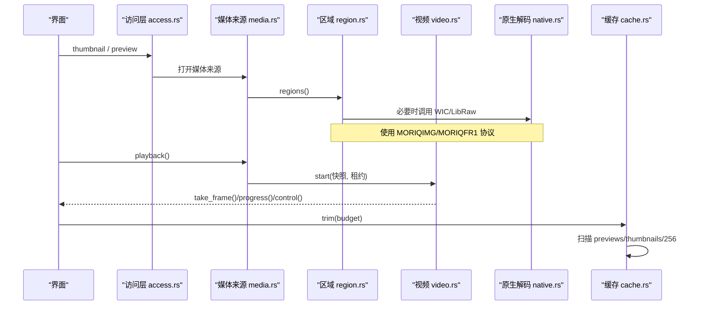
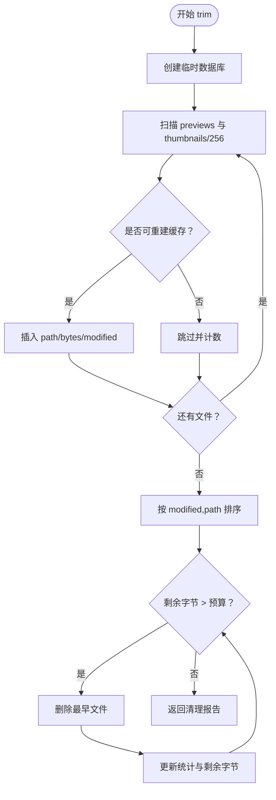
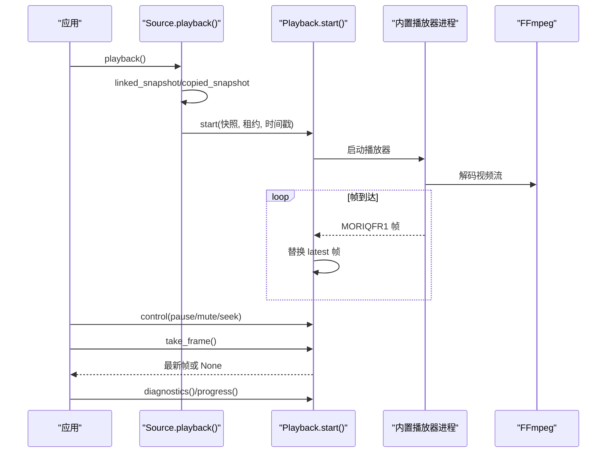
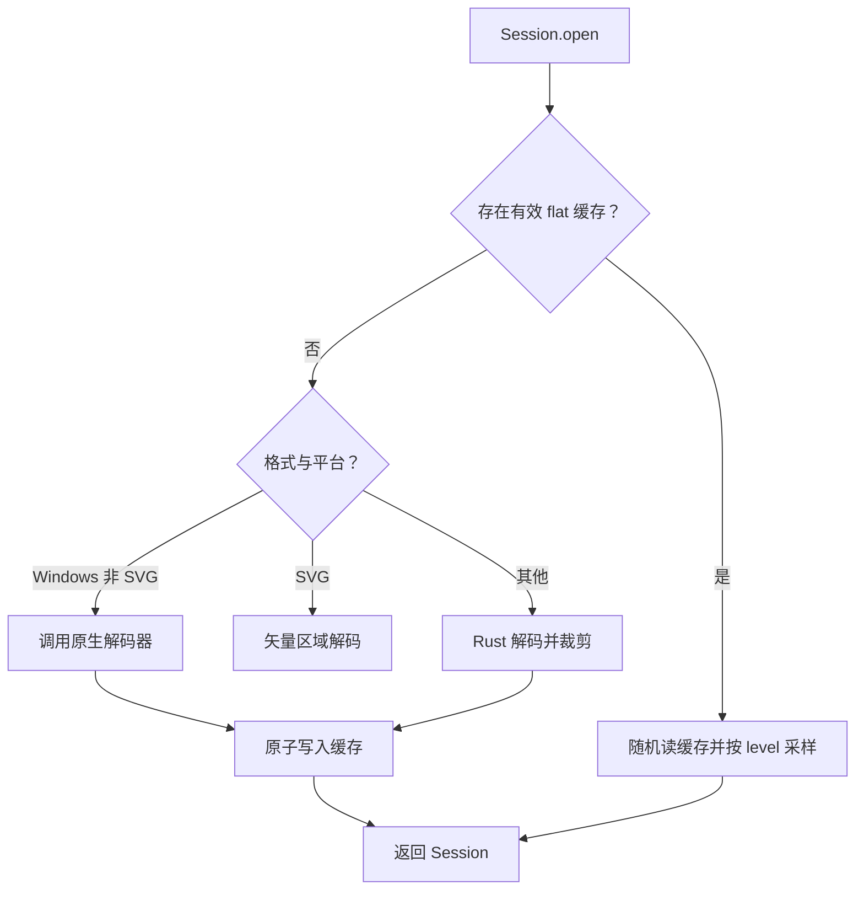
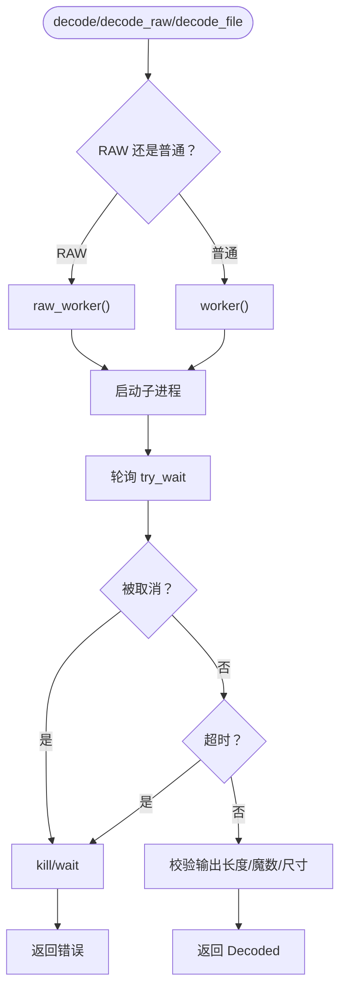
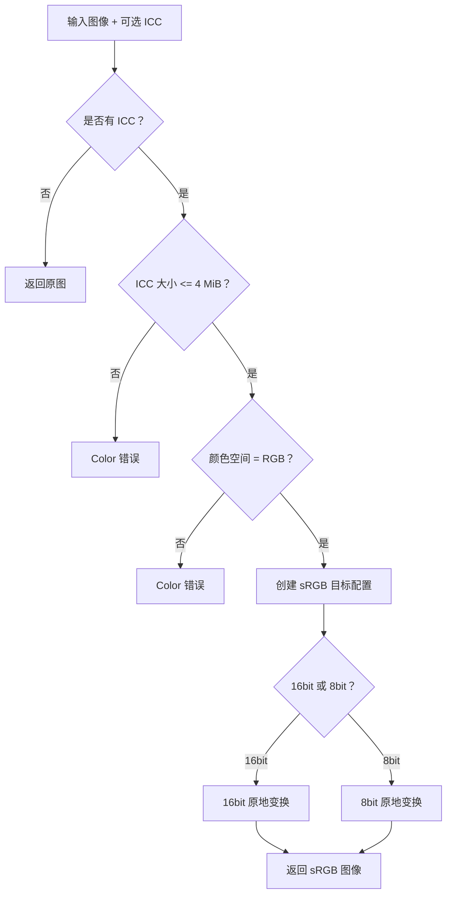
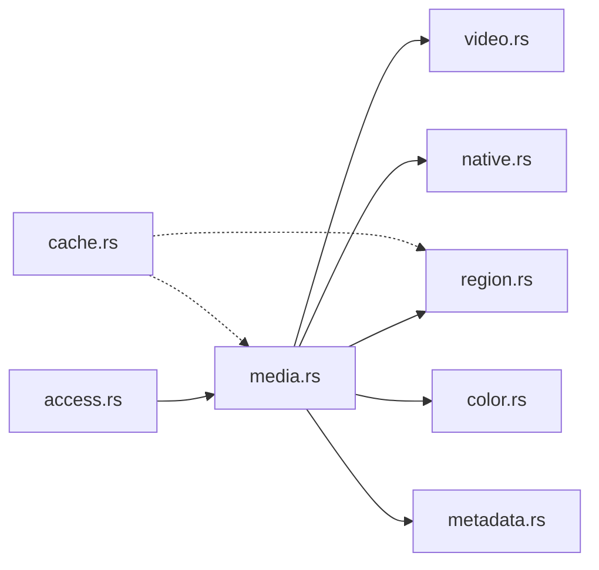

# 媒体处理 API

> Repo Wiki 节点 `media-api`
> 导出自 Qoder 知识库快照 `8fbe02f6-57c2-4874-b725-1a8130851fd9`，代码基线 `7a7a8e75e18bd90294e09cd422dd7ed5a04813a0`（分支 main，zh-CN）。

<cite>
**本文引用的文件**   
- [crates/moriq-library/src/media/cache.rs](../../../../crates/moriq-library/src/media/cache.rs)
- [crates/moriq-library/src/media/access.rs](../../../../crates/moriq-library/src/media/access.rs)
- [crates/moriq-library/src/media/media.rs](../../../../crates/moriq-library/src/media/media.rs)
- [crates/moriq-library/src/media/video.rs](../../../../crates/moriq-library/src/media/video.rs)
- [crates/moriq-library/src/media/region.rs](../../../../crates/moriq-library/src/media/region.rs)
- [crates/moriq-library/src/media/native.rs](../../../../crates/moriq-library/src/media/native.rs)
- [crates/moriq-library/src/media/color.rs](../../../../crates/moriq-library/src/media/color.rs)
- [crates/moriq-library/src/media/metadata.rs](../../../../crates/moriq-library/src/media/metadata.rs)
</cite>

## 目录
1. [引言](#引言)
2. [项目结构](#项目结构)
3. [核心组件](#核心组件)
4. [架构总览](#架构总览)
5. [详细组件分析](#详细组件分析)
6. [依赖关系分析](#依赖关系分析)
7. [性能考虑](#性能考虑)
8. [故障排查指南](#故障排查指南)
9. [结论](#结论)
10. [附录：实用示例索引](#附录实用示例索引)

## 引言
本文件面向需要集成或扩展媒体处理能力的开发者，聚焦以下能力：
- 媒体缓存与清理：缩略图、预览图、区域像素缓存的生成、读取、预算淘汰与原子更新。
- 视频播放接口：受支持的格式、帧管道、播放控制、诊断信息、内存与进程隔离策略。
- 区域标注会话：区域解码、分块读取、可取消操作和与原生解码器的协作。
- 元数据提取与色彩空间转换：EXIF 字段、ICC sRGB 转换及一致性保证。
- 原生解码器调用：WIC/LibRaw 工作进程的启动、校验、超时、尺寸与内存预算、错误分类。

## 项目结构
媒体子系统位于 `moriq-library` crate 的 `media` 模块中，按职责拆分：
- `access.rs`：对外暴露缩略图与预览读取。
- `media.rs`：媒体来源、版本来源、缩略图计划、预览与回放入口。
- `video.rs`：FFmpeg 工具定位、播放会话、帧管道与控制命令。
- `region.rs`：区域像素会话、分块缓存、Tile 解码流程。
- `native.rs`：Windows WIC / LibRaw 解码器封装、RAW 探测、导入支持列表。
- `color.rs`：ICC -> sRGB 色彩空间转换。
- `metadata.rs`：EXIF 读取、存储与查询编译。
- `cache.rs`：可重建缓存的扫描、字节预算淘汰与清理报告。

**图表来源**
- [crates/moriq-library/src/media/access.rs:1-23](../../../../crates/moriq-library/src/media/access.rs#L1-L23)
- [crates/moriq-library/src/media/media.rs:1-200](../../../../crates/moriq-library/src/media/media.rs#L1-L200)
- [crates/moriq-library/src/media/video.rs:1-120](../../../../crates/moriq-library/src/media/video.rs#L1-L120)
- [crates/moriq-library/src/media/region.rs:1-120](../../../../crates/moriq-library/src/media/region.rs#L1-L120)
- [crates/moriq-library/src/media/native.rs:1-80](../../../../crates/moriq-library/src/media/native.rs#L1-L80)
- [crates/moriq-library/src/media/color.rs:1-40](../../../../crates/moriq-library/src/media/color.rs#L1-L40)
- [crates/moriq-library/src/media/metadata.rs:1-40](../../../../crates/moriq-library/src/media/metadata.rs#L1-L40)
- [crates/moriq-library/src/media/cache.rs:1-40](../../../../crates/moriq-library/src/media/cache.rs#L1-L40)

**章节来源**
- [crates/moriq-library/src/media/access.rs:1-23](../../../../crates/moriq-library/src/media/access.rs#L1-L23)
- [crates/moriq-library/src/media/media.rs:1-120](../../../../crates/moriq-library/src/media/media.rs#L1-L120)

## 核心组件
- MediaCache（缓存计划与清理）
  - `Library::cache_plan` 返回一个带资源库租约的 Plan。
  - `Plan::trim(budget)` 扫描 `previews` 与 `thumbnails/256`，仅处理可重建缓存；按修改时间排序，逐步删除文件直到剩余字节数低于预算。
  - 只接受 PNG 以及 `-raw-flat1.rgba`、`-raster-flat1.rgba` 后缀，并要求文件名前 36 字符为 UUID。
  - Windows 下跳过系统隐藏属性文件；返回 `CacheReport`，包含已删除文件数、已删除字节数、剩余字节数和跳过数量。
- MediaAccess（缩略图与预览）
  - `Library::thumbnail(version)` 从 `thumbnails/256/{version}.png` 读取，并限制最大宽高与分配大小。
  - `Library::preview(id)` 通过 `Source::preview()` 获取当前展示版本的预览像素。
- Source（媒体来源）
  - `from_read_connection` / `media_source` / `version_source` 建立带租约的文件来源、身份、维度与哈希校验。
  - `regions()` / `regions_cancellable()` 建立区域会话；必要时创建硬链接快照或临时副本。
  - `playback()` 为视频建立播放快照并启动播放会话。
  - `cached_preview()` / `preview_edge(edge)` 优先读取 1600px sRGB 预览缓存，否则解码并写回。
  - `rebuild_thumbnail()` 重建缩略图到 `thumbnails/256/{version}.png`。
- Video Playback（视频播放）
  - 支持扩展名：mp4、mov、m4v、mkv、webm、avi、mts、m2ts。
  - `Playback::start(snapshot, lease, requested)` 启动隔离播放器子进程，接收 RGBA 帧管道。
  - `Playback::control(revision, paused, muted, seek)` 发送暂停、静音、跳转指令。
  - `Playback::take_frame()` 取走最新帧，`Playback::progress()` 读取位置与时长，`Playback::diagnostics()` 输出诊断文本。
- RegionSession（区域标注会话）
  - `Session::open(...)` 根据格式选择 RAW/Raster 缓存路径或即时解码。
  - `tile(region)` 从平坦缓存按 level 采样，或调用原生解码器/WIC，或 Rust 解码裁剪。
  - `tile_memory_mib()` 提供内存预算估算。
- Native Decoders（原生解码）
  - `decode(path, edge)`、`decode_raw(path, edge)`、`decode_file(file, extension, edge)`。
  - `worker()` 定位 WIC worker，`raw_worker()` 定位 LibRaw worker。
  - `raw_memory_mib(path)` 探测 RAW 传感器布局与内存预算。
- Color & Metadata（色彩与元数据）
  - `to_srgb(image, icc)` 将 ICC RGB 转为 sRGB，拒绝灰度/CMYK 与超大 ICC。
  - `metadata::read(file)` 提取常用 EXIF 字段与标签，`store` 持久化到数据库。

**章节来源**
- [crates/moriq-library/src/media/cache.rs:1-87](../../../../crates/moriq-library/src/media/cache.rs#L1-L87)
- [crates/moriq-library/src/media/access.rs:1-23](../../../../crates/moriq-library/src/media/access.rs#L1-L23)
- [crates/moriq-library/src/media/media.rs:1-200](../../../../crates/moriq-library/src/media/media.rs#L1-L200)
- [crates/moriq-library/src/media/media.rs:201-500](../../../../crates/moriq-library/src/media/media.rs#L201-L500)
- [crates/moriq-library/src/media/video.rs:1-200](../../../../crates/moriq-library/src/media/video.rs#L1-L200)
- [crates/moriq-library/src/media/video.rs:201-450](../../../../crates/moriq-library/src/media/video.rs#L201-L450)
- [crates/moriq-library/src/media/region.rs:1-200](../../../../crates/moriq-library/src/media/region.rs#L1-L200)
- [crates/moriq-library/src/media/region.rs:201-370](../../../../crates/moriq-library/src/media/region.rs#L201-L370)
- [crates/moriq-library/src/media/native.rs:1-200](../../../../crates/moriq-library/src/media/native.rs#L1-L200)
- [crates/moriq-library/src/media/native.rs:201-431](../../../../crates/moriq-library/src/media/native.rs#L201-L431)
- [crates/moriq-library/src/media/color.rs:1-191](../../../../crates/moriq-library/src/media/color.rs#L1-L191)
- [crates/moriq-library/src/media/metadata.rs:1-153](../../../../crates/moriq-library/src/media/metadata.rs#L1-L153)

## 架构总览
媒体处理以 `Source` 为中心，向上暴露缩略图、预览、区域与播放接口；向下统一调度 Rust 解码、原生解码器和外部工作进程。

**图表来源**
- [crates/moriq-library/src/media/access.rs:1-23](../../../../crates/moriq-library/src/media/access.rs#L1-L23)
- [crates/moriq-library/src/media/media.rs:1-200](../../../../crates/moriq-library/src/media/media.rs#L1-L200)
- [crates/moriq-library/src/media/media.rs:201-500](../../../../crates/moriq-library/src/media/media.rs#L201-L500)
- [crates/moriq-library/src/media/region.rs:1-200](../../../../crates/moriq-library/src/media/region.rs#L1-L200)
- [crates/moriq-library/src/media/video.rs:201-450](../../../../crates/moriq-library/src/media/video.rs#L201-L450)
- [crates/moriq-library/src/media/native.rs:201-431](../../../../crates/moriq-library/src/media/native.rs#L201-L431)
- [crates/moriq-library/src/media/cache.rs:1-87](../../../../crates/moriq-library/src/media/cache.rs#L1-L87)

## 详细组件分析

### MediaCache：缓存接口、策略与清理机制
- 缓存范围
  - 可重建缓存：`previews`、`thumbnails/256`。
  - 非缓存：原片、AI 结果、恢复文件、互操作产物。
- 清理算法
  - 遍历两个目录，筛选 PNG 与两类 `.rgba` 平面文件，且文件名前缀为有效 UUID。
  - 写入临时 SQLite 表，按 `modified,path` 排序，逐条删除直至剩余字节数低于预算。
  - 删除失败时记录跳过；找不到文件时仍扣除对应字节数。
- 安全与健壮性
  - 所有路径经 `safe_path` 校验。
  - Windows 隐藏文件跳过。
  - 临时数据库关闭 WAL 与同步，减少清理开销。

**图表来源**
- [crates/moriq-library/src/media/cache.rs:1-87](../../../../crates/moriq-library/src/media/cache.rs#L1-L87)

**章节来源**
- [crates/moriq-library/src/media/cache.rs:1-87](../../../../crates/moriq-library/src/media/cache.rs#L1-L87)

### MediaAccess：缩略图与预览 API
- `Library::thumbnail(version)`
  - 路径：`thumbnails/256/{version}.png`。
  - 限制：宽高上限 256，最大分配 1 MiB。
  - 不存在时返回空值。
- `Library::preview(id)`
  - 委托给 `Source::preview()`，返回当前展示版本预览像素。
- Source 预览
  - `cached_preview()` 直接读取 1600px sRGB PNG 预览，限制宽高 1600、分配 32 MiB。
  - `preview_edge(edge)` 优先命中缓存；未命中则解码并原子写回临时文件再持久化。
  - `rebuild_thumbnail()` 重建缩略图，失败时记录警告但不阻断读取。

**图表来源**
- [crates/moriq-library/src/media/access.rs:1-23](../../../../crates/moriq-library/src/media/access.rs#L1-L23)
- [crates/moriq-library/src/media/media.rs:201-500](../../../../crates/moriq-library/src/media/media.rs#L201-L500)

**章节来源**
- [crates/moriq-library/src/media/access.rs:1-23](../../../../crates/moriq-library/src/media/access.rs#L1-L23)
- [crates/moriq-library/src/media/media.rs:201-500](../../../../crates/moriq-library/src/media/media.rs#L201-L500)

### Video Playback：播放接口与性能优化
- 支持格式
  - 扩展名常量：mp4、mov、m4v、mkv、webm、avi、mts、m2ts。
- 启动流程
  - `linked_snapshot`：对受管视频创建硬链接快照，验证文件 ID 不变。
  - `copied_snapshot`：当无法硬链接时复制临时快照，限制最大 64 GiB。
  - `Playback::start`：启动内置播放器，设置 PATH 指向 bundled FFmpeg，并建立控制输入与画面输出通道。
- 帧管道
  - 协议头 `MORIQFR1`，携带宽高、播放时钟 position/duration。
  - 仅保留最新帧，避免渲染慢导致缓冲堆积。
  - 宽度/高度上限 1920，无效或损坏帧在分配前拒绝。
- 控制与状态
  - `control(revision, paused, muted, seek)`：防重复提交，顺序写入 PAUSE/MUTE/SEEK。
  - `take_frame()`：取走最新帧，同时消费错误标记。
  - `progress()`：返回 `(position_ms, duration_ms)`。
  - `running()`：检查子进程存活。
  - `diagnostics()`：汇总 Rust 侧准备耗时、接收帧数、位置、错误与子进程诊断。
- 生命周期
  - `Drop` 后台等待子进程退出，释放快照与租约，不阻塞界面线程。
  - `stop()` 显式停止，删除临时源文件。

**图表来源**
- [crates/moriq-library/src/media/video.rs:1-120](../../../../crates/moriq-library/src/media/video.rs#L1-L120)
- [crates/moriq-library/src/media/video.rs:201-450](../../../../crates/moriq-library/src/media/video.rs#L201-L450)
- [crates/moriq-library/src/media/media.rs:201-500](../../../../crates/moriq-library/src/media/media.rs#L201-L500)

**章节来源**
- [crates/moriq-library/src/media/video.rs:1-120](../../../../crates/moriq-library/src/media/video.rs#L1-L120)
- [crates/moriq-library/src/media/video.rs:201-450](../../../../crates/moriq-library/src/media/video.rs#L201-L450)
- [crates/moriq-library/src/media/media.rs:201-500](../../../../crates/moriq-library/src/media/media.rs#L201-L500)

### RegionSession：区域标注接口、类型与持久化
- 会话构建
  - `Session::open(root, version, dimensions, extension, cacheable, path, lease)`。
  - 若为 RAW 或栅格图像且体积不超过 64MP，优先尝试读取 `previews/{version}-{kind}-flat1.rgba`。
  - 缓存头部校验：魔数 `MORIQIMG`、宽高、块宽高、总长度必须一致。
- 区域类型
  - `ImageRegion` 包含 x、y、width、height、level。
  - 校验规则：宽高大于 0、level 为 2 的幂且不超过 64、每边不超过 `512*level`、不得越界。
- 解码路径
  - 已有平坦缓存：按 level 行内采样，随机读平面文件，得到 tile 像素。
  - Windows + 非 SVG：调用原生解码器生成 512px 以内区域缓存。
  - SVG：调用矢量区域解码。
  - 其他平台：Rust 解码原图后裁剪并缩放至 512。
- 持久化
  - 新建缓存先写入临时文件，再 `persist` 到目标路径。
  - 若不可缓存，保存临时路径到会话，随会话释放。
  - 清理时按 `cache.rs` 的策略删除可重建缓存，但会话句柄仍可继续读取。

**图表来源**
- [crates/moriq-library/src/media/region.rs:1-200](../../../../crates/moriq-library/src/media/region.rs#L1-L200)
- [crates/moriq-library/src/media/region.rs:201-370](../../../../crates/moriq-library/src/media/region.rs#L201-L370)
- [crates/moriq-library/src/media/cache.rs:1-87](../../../../crates/moriq-library/src/media/cache.rs#L1-L87)

**章节来源**
- [crates/moriq-library/src/media/region.rs:1-200](../../../../crates/moriq-library/src/media/region.rs#L1-L200)
- [crates/moriq-library/src/media/region.rs:201-370](../../../../crates/moriq-library/src/media/region.rs#L201-L370)

### 原生解码器：调用方式、内存管理与错误处理
- 调用入口
  - `decode(path, edge)`：普通图像解码。
  - `decode_raw(path, edge)`：RAW 解码。
  - `decode_file(file, extension, edge)`：从已打开文件复制到临时输入，再路由到 RAW 或普通解码。
- 工作进程
  - `worker()`：展开 WIC worker，SHA256 校验。
  - `raw_worker()`：组合内置 raw-worker.exe 与 libraw.dll，基于二者摘要固定部署目录。
  - 子进程参数包括输入路径、输出路径、edge、父进程 PID，环境变量 `OMP_NUM_THREADS=1`。
- 内存与尺寸
  - 最大输出边长 8192；RAW 探测返回预估内存 MiB，范围 128..=1600。
  - 输出文件长度必须在 24..=512MiB+24，魔数 `MORIQIMG`，宽高与声明一致。
  - 文件拷贝预算：视频 64 GiB、RAW 2 GiB、其他图片 MAX_BYTES。
- 错误处理
  - 取消信号立即终止子进程并重新检查取消。
  - 超时：RAW 探测 15s、RAW 解码 120s、普通解码 45s。
  - 非零退出码分类：无可用解码器、资源隔离失败、解码失败等。
  - 所有错误均保留原片，不静默降级。

**图表来源**
- [crates/moriq-library/src/media/native.rs:1-200](../../../../crates/moriq-library/src/media/native.rs#L1-L200)
- [crates/moriq-library/src/media/native.rs:201-431](../../../../crates/moriq-library/src/media/native.rs#L201-L431)

**章节来源**
- [crates/moriq-library/src/media/native.rs:1-200](../../../../crates/moriq-library/src/media/native.rs#L1-L200)
- [crates/moriq-library/src/media/native.rs:201-431](../../../../crates/moriq-library/src/media/native.rs#L201-L431)

### 元数据提取与色彩空间转换
- EXIF 元数据
  - `metadata::read(file)` 最多读取 32 MiB，解析常用字段：make、camera、lens、taken_at、iso、aperture_x100、exposure_us、focal_x100，并计算经纬度。
  - 额外标签最多收集 1024 项，每项值截断到 4096 字符。
  - `store(db, version, data)` 写入 `version_exif`，冲突时更新。
  - `compile(predicates, values)` 生成 SQL 条件，最多 32 个条件，限制文字长度与范围合法性。
- 色彩空间转换
  - `color::to_srgb(image, icc)`：
    - ICC 超过 4 MiB 报错。
    - 非 RGB ICC 报错，但原文件仍可导出。
    - 支持 8bit 与 16bit 原地变换，输出 sRGB DynamicImage。

**图表来源**
- [crates/moriq-library/src/media/color.rs:1-191](../../../../crates/moriq-library/src/media/color.rs#L1-L191)
- [crates/moriq-library/src/media/metadata.rs:1-153](../../../../crates/moriq-library/src/media/metadata.rs#L1-L153)

**章节来源**
- [crates/moriq-library/src/media/color.rs:1-191](../../../../crates/moriq-library/src/media/color.rs#L1-L191)
- [crates/moriq-library/src/media/metadata.rs:1-153](../../../../crates/moriq-library/src/media/metadata.rs#L1-L153)

## 依赖关系分析
- 模块耦合
  - `access.rs` 依赖 `media.rs` 提供的 Source 与预览流程。
  - `media.rs` 依赖 `video.rs`、`region.rs`、`native.rs`、`color.rs`、`metadata.rs`。
  - `region.rs` 依赖 `native.rs` 的 worker 与 `media.rs` 的 raster 解码。
  - `video.rs` 依赖运行时校验与 FFmpeg 工具链。
  - `cache.rs` 独立于解码器，仅依赖文件系统与 SQLite。
- 外部依赖
  - FFmpeg/FFprobe：通过 `video::tool` 从发行包 codecs 目录加载。
  - WIC/LibRaw：通过 worker 进程隔离调用，避免主进程崩溃扩散。
  - moxcms/exif/image：用于 ICC/sRGB 转换、EXIF 解析与通用图像处理。

**图表来源**
- [crates/moriq-library/src/media/access.rs:1-23](../../../../crates/moriq-library/src/media/access.rs#L1-L23)
- [crates/moriq-library/src/media/media.rs:1-200](../../../../crates/moriq-library/src/media/media.rs#L1-L200)
- [crates/moriq-library/src/media/video.rs:1-120](../../../../crates/moriq-library/src/media/video.rs#L1-L120)
- [crates/moriq-library/src/media/region.rs:1-120](../../../../crates/moriq-library/src/media/region.rs#L1-L120)
- [crates/moriq-library/src/media/native.rs:1-80](../../../../crates/moriq-library/src/media/native.rs#L1-L80)
- [crates/moriq-library/src/media/color.rs:1-40](../../../../crates/moriq-library/src/media/color.rs#L1-L40)
- [crates/moriq-library/src/media/metadata.rs:1-40](../../../../crates/moriq-library/src/media/metadata.rs#L1-L40)
- [crates/moriq-library/src/media/cache.rs:1-40](../../../../crates/moriq-library/src/media/cache.rs#L1-L40)

**章节来源**
- [crates/moriq-library/src/media/media.rs:1-200](../../../../crates/moriq-library/src/media/media.rs#L1-L200)
- [crates/moriq-library/src/media/video.rs:1-120](../../../../crates/moriq-library/src/media/video.rs#L1-L120)
- [crates/moriq-library/src/media/region.rs:1-120](../../../../crates/moriq-library/src/media/region.rs#L1-L120)
- [crates/moriq-library/src/media/native.rs:1-80](../../../../crates/moriq-library/src/media/native.rs#L1-L80)

## 性能考虑
- 缩略图与预览
  - 优先读取 PNG 缓存，限制最大宽高与分配大小，避免大图像爆炸。
  - 写回缓存采用临时文件 + 持久化的原子模式，失败仅记录警告。
- 视频播放
  - 帧管道只保留最新帧，防止渲染瓶颈积累内存。
  - 子进程隔离，控制命令顺序写入，避免锁竞争。
- 区域解码
  - 平坦缓存减少重复解码；随机读减少整图载入。
  - Windows 使用原生解码器，其他平台退化为 Rust 解码加裁剪。
- 原生解码
  - 输出边长、文件大小、像素长度均有严格上限。
  - 子进程超时与取消快速回收资源。
- 缓存清理
  - 使用临时数据库与批量排序，避免频繁磁盘 IO。
  - 仅删除可重建缓存，保护 AI 结果与原片。

[本节为通用指导，不直接分析具体代码片段]

## 故障排查指南
- 缩略图缺失或加载缓慢
  - 检查 `thumbnails/256/{version}.png` 是否存在。
  - 若缺失，确认 Source 是否允许重建；查看重建日志中的缓存写入警告。
- 预览异常或过大
  - 检查 `previews/{version}-srgb1-1600.png` 是否超过 32 MiB。
  - 确认 ICC 配置是否有效，避免色彩转换失败。
- 视频无法播放
  - 确认 FFmpeg 工具存在于 codecs 目录并通过运行组件校验。
  - 检查播放器诊断信息：收到帧数、位置、错误消息。
  - 检查临时目录空间是否足够完成快照或复制。
- 区域解码失败
  - 检查区域坐标是否越界、level 是否为 2 的幂。
  - 若使用原生解码器，检查 WIC/LibRaw worker 是否成功展开并校验。
  - 查看区域缓存是否损坏；必要时重建或执行 `trim` 清理。
- 原生解码报错
  - 区分“无可用解码器”“资源隔离失败”“解码失败”等错误类别。
  - 检查输出魔数、长度、宽高是否与声明一致。
  - 关注取消信号与超时，确保子进程被正确终止。

**章节来源**
- [crates/moriq-library/src/media/access.rs:1-23](../../../../crates/moriq-library/src/media/access.rs#L1-L23)
- [crates/moriq-library/src/media/media.rs:201-500](../../../../crates/moriq-library/src/media/media.rs#L201-L500)
- [crates/moriq-library/src/media/video.rs:201-450](../../../../crates/moriq-library/src/media/video.rs#L201-L450)
- [crates/moriq-library/src/media/region.rs:201-370](../../../../crates/moriq-library/src/media/region.rs#L201-L370)
- [crates/moriq-library/src/media/native.rs:201-431](../../../../crates/moriq-library/src/media/native.rs#L201-L431)

## 结论
该媒体子系统围绕 Source 抽象，将缩略图、预览、区域解码与视频播放统一到一致的租约、校验与预算框架下。它通过可重建缓存降低重复解码成本，通过原生工作进程隔离提升稳定性，并通过严格的尺寸、内存、时间与文件校验保障鲁棒性。扩展新格式或新增解码路径时，应遵循现有协议与错误分类，确保与原片保护策略保持一致。

[本节为总结性内容，不直接分析具体代码片段]

## 附录：实用示例索引
- 缩略图生成与重建
  - 路径参考：[crates/moriq-library/src/media/media.rs:201-500](../../../../crates/moriq-library/src/media/media.rs#L201-L500)
- 预览图管理与缓存策略
  - 路径参考：[crates/moriq-library/src/media/media.rs:201-500](../../../../crates/moriq-library/src/media/media.rs#L201-L500)
- 缓存清理与预算淘汰
  - 路径参考：[crates/moriq-library/src/media/cache.rs:1-87](../../../../crates/moriq-library/src/media/cache.rs#L1-L87)
- 视频播放控制与诊断
  - 路径参考：[crates/moriq-library/src/media/video.rs:201-450](../../../../crates/moriq-library/src/media/video.rs#L201-L450)
- 区域标注与 Tile 解码
  - 路径参考：[crates/moriq-library/src/media/region.rs:1-200](../../../../crates/moriq-library/src/media/region.rs#L1-L200)
  - 路径参考：[crates/moriq-library/src/media/region.rs:201-370](../../../../crates/moriq-library/src/media/region.rs#L201-L370)
- 元数据提取与存储
  - 路径参考：[crates/moriq-library/src/media/metadata.rs:1-153](../../../../crates/moriq-library/src/media/metadata.rs#L1-L153)
- 色彩空间转换
  - 路径参考：[crates/moriq-library/src/media/color.rs:1-191](../../../../crates/moriq-library/src/media/color.rs#L1-L191)
- 原生解码器调用与预算
  - 路径参考：[crates/moriq-library/src/media/native.rs:1-200](../../../../crates/moriq-library/src/media/native.rs#L1-L200)
  - 路径参考：[crates/moriq-library/src/media/native.rs:201-431](../../../../crates/moriq-library/src/media/native.rs#L201-L431)