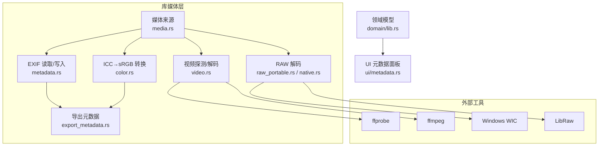
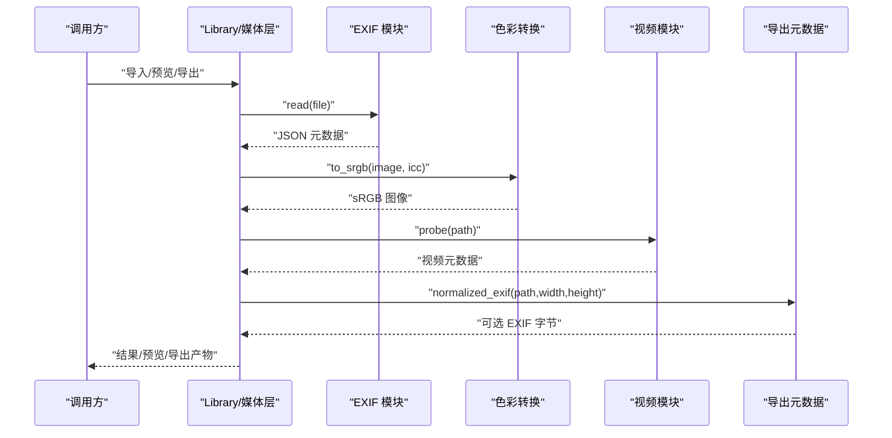
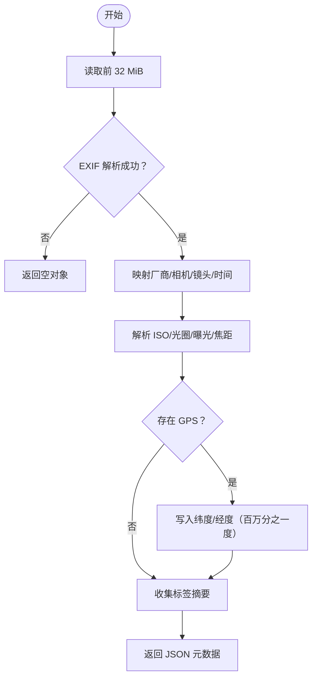
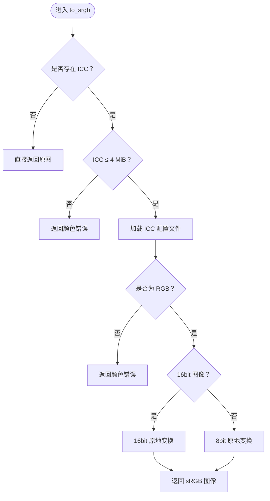
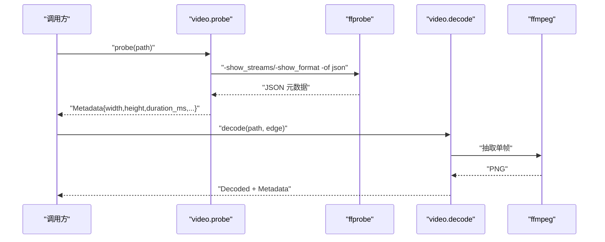
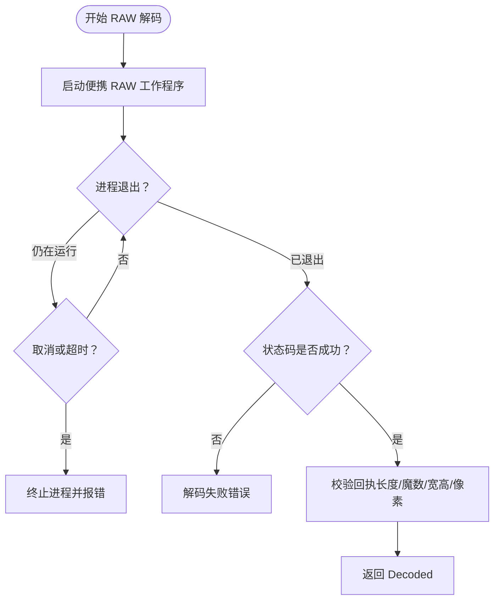
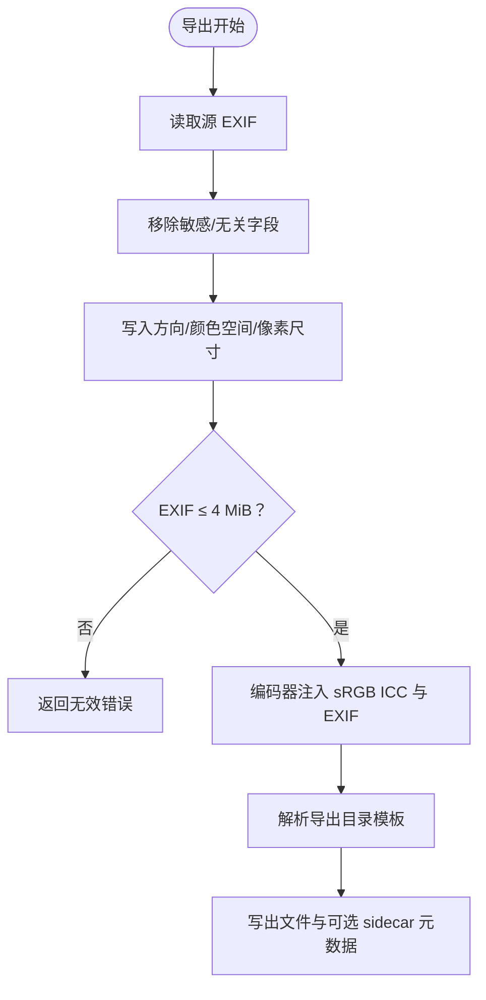
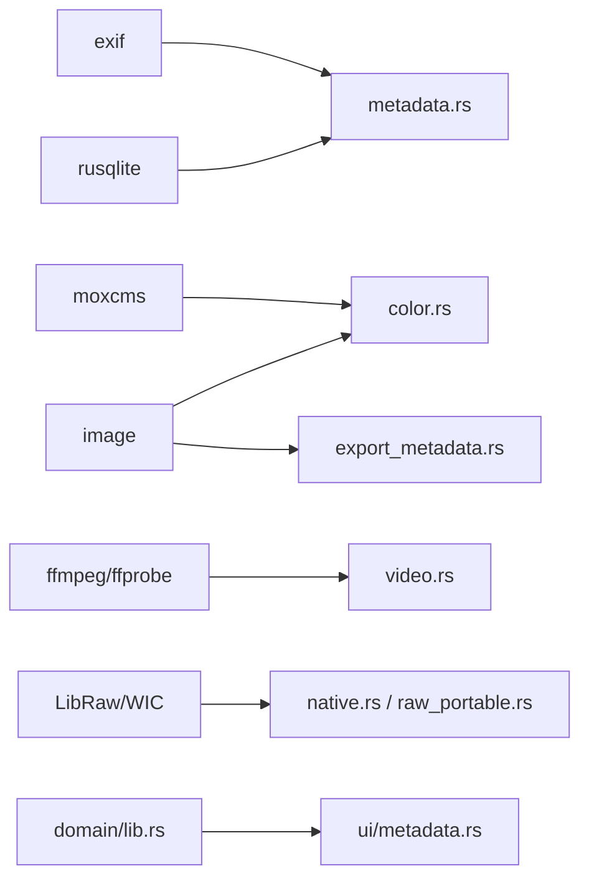

# 元数据处理 API

> Repo Wiki 节点 `metadata-processing-api`
> 导出自 Qoder 知识库快照 `8fbe02f6-57c2-4874-b725-1a8130851fd9`，代码基线 `7a7a8e75e18bd90294e09cd422dd7ed5a04813a0`（分支 main，zh-CN）。

<cite>
**本文引用的文件**   
- [metadata.rs](../../../../crates/moriq-library/src/media/metadata.rs)
- [color.rs](../../../../crates/moriq-library/src/media/color.rs)
- [video.rs](../../../../crates/moriq-library/src/media/video.rs)
- [raw_portable.rs](../../../../crates/moriq-library/src/media/raw_portable.rs)
- [native.rs](../../../../crates/moriq-library/src/media/native.rs)
- [media.rs](../../../../crates/moriq-library/src/media/media.rs)
- [export_metadata.rs](../../../../crates/moriq-library/src/transfer/export_metadata.rs)
- [lib.rs（领域模型）](../../../../crates/moriq-domain/src/lib.rs)
- [metadata.rs（界面层）](../../../../crates/moriq-ui/src/metadata.rs)
- [media_probe.rs（示例）](../../../../crates/moriq-library/examples/media_probe.rs)
- [video_probe.rs（示例）](../../../../crates/moriq-library/examples/video_probe.rs)
</cite>

## 目录
1. [简介](#简介)
2. [项目结构](#项目结构)
3. [核心组件](#核心组件)
4. [架构总览](#架构总览)
5. [详细组件分析](#详细组件分析)
6. [依赖关系分析](#依赖关系分析)
7. [性能与资源约束](#性能与资源约束)
8. [故障排查](#故障排查)
9. [结论](#结论)
10. [附录：Rust 使用模式与示例路径](#附录rust-使用模式与示例路径)

## 简介
本 API 文档聚焦媒体元数据处理的实现，覆盖以下能力：
- EXIF/GPS 元数据提取：相机厂商、型号、镜头、拍摄时间、ISO、光圈、曝光时间、焦距、经纬度等。
- 色彩空间转换：基于嵌入 ICC 的 sRGB 转换流程，包含 Adobe RGB、Display P3 等输入色彩空间的统一处理与质量控制。
- 媒体属性探测：视频分辨率、时长、帧率、像素格式、色彩空间、色彩传递函数、是否有音频流等。
- 元数据写入与导出：EXIF 重建、ICC 注入、字段清理与尺寸/方向规范化。
- Rust 代码示例：展示从原始素材到预览、探测、导出的完整实用模式。

## 项目结构
该功能主要分布在 `moriq-library` 的媒体子模块中，并与 UI 层和领域模型交互：
- `media/metadata.rs`：EXIF 读取、存储、SQL 条件编译。
- `media/color.rs`：ICC → sRGB 转换入口。
- `media/video.rs`：FFmpeg/ffprobe 封装、视频元数据探测、封面帧解码。
- `media/raw_portable.rs`：便携 RAW 解码器调用与校验。
- `media/native.rs`：系统 WIC/LibRaw 解码器封装与内存预算探测。
- `media/media.rs`：媒体来源、缩略图计划、详情计划。
- `transfer/export_metadata.rs`：导出时 EXIF 规范化与 ICC/EXIF 注入。
- `domain/lib.rs`：查询、规则、资产元数据结构。
- `ui/metadata.rs`：元数据筛选表单与数值解析。
- `examples/media_probe.rs`、`examples/video_probe.rs`：端到端示例。

**图表来源**
- [media.rs:1-120](../../../../crates/moriq-library/src/media/media.rs#L1-L120)
- [metadata.rs:1-153](../../../../crates/moriq-library/src/media/metadata.rs#L1-L153)
- [color.rs:1-191](../../../../crates/moriq-library/src/media/color.rs#L1-L191)
- [video.rs:520-676](../../../../crates/moriq-library/src/media/video.rs#L520-L676)
- [raw_portable.rs:1-120](../../../../crates/moriq-library/src/media/raw_portable.rs#L1-L120)
- [native.rs:1-120](../../../../crates/moriq-library/src/media/native.rs#L1-L120)
- [export_metadata.rs:1-142](../../../../crates/moriq-library/src/transfer/export_metadata.rs#L1-L142)
- [lib.rs（领域模型）:1-120](../../../../crates/moriq-domain/src/lib.rs#L1-L120)

**章节来源**
- [media.rs:1-120](../../../../crates/moriq-library/src/media/media.rs#L1-L120)
- [metadata.rs:1-153](../../../../crates/moriq-library/src/media/metadata.rs#L1-L153)
- [color.rs:1-191](../../../../crates/moriq-library/src/media/color.rs#L1-L191)
- [video.rs:520-676](../../../../crates/moriq-library/src/media/video.rs#L520-L676)
- [raw_portable.rs:1-120](../../../../crates/moriq-library/src/media/raw_portable.rs#L1-L120)
- [native.rs:1-120](../../../../crates/moriq-library/src/media/native.rs#L1-L120)
- [export_metadata.rs:1-142](../../../../crates/moriq-library/src/transfer/export_metadata.rs#L1-L142)
- [lib.rs（领域模型）:1-120](../../../../crates/moriq-domain/src/lib.rs#L1-L120)

## 核心组件
- EXIF/GPS 读取接口：按固定字段映射并返回 JSON；缺失或无法解析时返回空对象，避免中断导入流程。
- EXIF/GPS 存储接口：以版本为键写入数据库，防止后台重建已删除版本。
- SQL 条件编译：将用户提供的元数据谓词转换为 EXISTS 子句，限制字段白名单、长度和范围。
- 色彩空间转换：对有效 RGB ICC 执行 8bit/16bit in-place 转换，拒绝非 RGB 配置和大体积 ICC。
- 视频元数据探测：通过 ffprobe 获取分辨率、时长、帧率、像素格式、色彩空间、色彩传递函数、音频存在性。
- 视频封面解码：通过 ffmpeg 抽取单帧，输出有界 PNG，同时复用探测结果。
- RAW 解码与内存预算：调用便携 LibRaw 工作程序，严格校验回执头、尺寸与像素数据长度。
- 导出元数据：清理敏感/不相关 EXIF 字段，重写方向、颜色空间、像素尺寸，并注入 sRGB ICC。

**章节来源**
- [metadata.rs:1-153](../../../../crates/moriq-library/src/media/metadata.rs#L1-L153)
- [color.rs:1-191](../../../../crates/moriq-library/src/media/color.rs#L1-L191)
- [video.rs:520-676](../../../../crates/moriq-library/src/media/video.rs#L520-L676)
- [raw_portable.rs:1-120](../../../../crates/moriq-library/src/media/raw_portable.rs#L1-L120)
- [export_metadata.rs:1-142](../../../../crates/moriq-library/src/transfer/export_metadata.rs#L1-L142)

## 架构总览
媒体元数据处理的调用链通常如下：
1. 媒体源通过 `Source` 冻结版本、路径、哈希和扩展名。
2. 图像导入时读取 EXIF 并归一化常用字段；若需要，进行 ICC→sRGB 转换。
3. 视频导入时先通过 ffprobe 探测元数据，再按需抽取封面帧。
4. RAW 文件通过 LibRaw 工作程序解码，并进行尺寸和像素预算校验。
5. 导出时将 EXIF 规范化、注入 sRGB ICC，并保留受控的元数据字段。

**图表来源**
- [media.rs:1-120](../../../../crates/moriq-library/src/media/media.rs#L1-L120)
- [metadata.rs:1-153](../../../../crates/moriq-library/src/media/metadata.rs#L1-L153)
- [color.rs:1-191](../../../../crates/moriq-library/src/media/color.rs#L1-L191)
- [video.rs:520-676](../../../../crates/moriq-library/src/media/video.rs#L520-L676)
- [export_metadata.rs:1-142](../../../../crates/moriq-library/src/transfer/export_metadata.rs#L1-L142)

## 详细组件分析

### EXIF/GPS 元数据提取与查询
- 读取逻辑
  - 最多读取前 32 MiB，避免大文件阻塞。
  - 成功解析后映射厂商、相机型号、镜头、拍摄时间等关键字段。
  - ISO、光圈、曝光时间、焦距使用有理数或整数解析，并按缩放因子转换为整数存储值。
  - GPS 通过位置辅助函数读取，并以百万分之一度的整数形式存储。
  - 额外附加最多 1024 个标签的字符串摘要，每个标签值截取 4096 字符。
- 存储逻辑
  - 使用 `INSERT ... ON CONFLICT DO UPDATE` 更新 `version_exif` 表。
  - 写入失败会包装为无效错误，避免静默丢失。
- 查询编译
  - 仅允许白名单字段：厂商、相机、镜头、拍摄时间、ISO、光圈、曝光时间、焦距、纬度、经度。
  - 最多 32 个条件，每个 `contains` 不超过 1024 字符，起止范围必须合法。
  - `taken_at` 在 SQL 中去掉日期时间分隔符并转为整数比较。
  - 最终生成 `EXISTS(SELECT 1 FROM version_exif em WHERE em.version_id=v.id AND ...)` 条件。

**图表来源**
- [metadata.rs:1-153](../../../../crates/moriq-library/src/media/metadata.rs#L1-L153)

**章节来源**
- [metadata.rs:1-153](../../../../crates/moriq-library/src/media/metadata.rs#L1-L153)
- [lib.rs（领域模型）:100-160](../../../../crates/moriq-domain/src/lib.rs#L100-L160)
- [metadata.rs（界面层）:1-120](../../../../crates/moriq-ui/src/metadata.rs#L1-L120)

### 色彩空间转换与质量控制
- 支持范围
  - 仅支持 RGB ICC；灰度或 CMYK 直接报错，但不会静默丢弃原文件。
  - ICC 最大 4 MiB，超过则返回颜色错误。
- 转换算法
  - 使用 moxcms 的 `ColorProfile` 创建源配置文件和目标 sRGB 配置。
  - 16bit 图像走 `create_in_place_transform_16bit`，8bit 图像走 `create_in_place_transform_8bit`。
  - 逐行 transform，避免整图复制带来的额外开销。
- 质量控制
  - 测试验证 Windows 系统预览与原图区域均正确转换为 sRGB。
  - 测试验证预览、全分辨率图像与导出像素一致，且不修改原片。
  - 测试验证无效 ICC 不会被系统编解码器静默绕过。

**图表来源**
- [color.rs:1-191](../../../../crates/moriq-library/src/media/color.rs#L1-L191)

**章节来源**
- [color.rs:1-191](../../../../crates/moriq-library/src/media/color.rs#L1-L191)

### 视频媒体属性探测与封面解码
- 探测接口
  - 调用 ffprobe，限制协议、格式白名单，限制输出大小 2 MiB。
  - 解析视频流，过滤附属图片流。
  - 校验宽高乘积不超过约 536870912，避免超大分辨率导致解码预算溢出。
  - 根据旋转侧数据交换宽高。
  - 返回宽度、高度、时长毫秒、编码名称、像素格式、平均帧率、色彩空间、色彩传递函数、是否有音频。
- 封面解码
  - 通过 ffmpeg 抽取一帧，默认取视频时间的第 0～3 秒内。
  - 输出 PNG，限制最大边长不超过 16384。
  - 返回解码后的图像与视频元数据。

**图表来源**
- [video.rs:520-676](../../../../crates/moriq-library/src/media/video.rs#L520-L676)

**章节来源**
- [video.rs:520-676](../../../../crates/moriq-library/src/media/video.rs#L520-L676)

### RAW 元数据与解码
- 便携 RAW 工作程序
  - 在临时目录释放二进制，设置只可执行权限。
  - 计算 SHA256 并校验，防止被替换。
  - 调用参数包括源路径、输出像素文件、目标边长、进程 ID。
- 解码校验
  - 超时保护：最长 120 秒。
  - 回执长度检查：必须在 24 字节头到约 512 MiB 范围内。
  - 回执头标识校验：必须匹配魔数。
  - 宽高与像素数据长度一致性校验。
  - 可选边长限制：输出宽高不能超过请求边长。
- 内存预算探测
  - 通过 `raw_memory_mib` 调用工作程序探测模式，估算解码所需内存上限。

**图表来源**
- [raw_portable.rs:1-120](../../../../crates/moriq-library/src/media/raw_portable.rs#L1-L120)
- [native.rs:1-120](../../../../crates/moriq-library/src/media/native.rs#L1-L120)

**章节来源**
- [raw_portable.rs:1-120](../../../../crates/moriq-library/src/media/raw_portable.rs#L1-L120)
- [native.rs:1-120](../../../../crates/moriq-library/src/media/native.rs#L1-L120)

### 元数据写入、导出与备份策略
- EXIF 规范化
  - 读取源文件前 32 MiB。
  - 移除 MakerNote、Orientation、ImageWidth、ImageLength、PixelXDimension、PixelYDimension、ColorSpace 等字段。
  - 追加标准化 Orientation、ColorSpace、PixelXDimension、PixelYDimension。
  - 重建 EXIF 字节，限制不超过 4 MiB。
- 编码器注入
  - 始终注入 sRGB ICC。
  - 若存在规范化 EXIF，则一并写入。
- 导出目录模板
  - 支持 `{date}`、`{year}`、`{month}`、`{day}`、`{format}`、`{camera}`、`{project}`。
  - 限制模板长度、层级、非法字符和未知变量。
- 备份语义
  - 示例脚本在导入前后计算源文件 SHA256，确保原片未被修改。
  - 导入失败或重复导入会跳过，避免覆盖或重复索引。

**图表来源**
- [export_metadata.rs:1-142](../../../../crates/moriq-library/src/transfer/export_metadata.rs#L1-L142)

**章节来源**
- [export_metadata.rs:1-142](../../../../crates/moriq-library/src/transfer/export_metadata.rs#L1-L142)
- [media_probe.rs:1-101](../../../../crates/moriq-library/examples/media_probe.rs#L1-L101)
- [video_probe.rs:1-90](../../../../crates/moriq-library/examples/video_probe.rs#L1-L90)

## 依赖关系分析
- 外部依赖
  - exif：解析和重建 EXIF。
  - moxcms：ICC 配置与色彩变换。
  - image：图像读写与编码。
  - FFmpeg/ffprobe：视频探测与帧抽取。
  - LibRaw/WIC：RAW 与系统图像解码。
- 内部耦合
  - `media.rs` 提供 Source、Thumbnails、Details 等高层抽象。
  - `metadata.rs` 依赖数据库连接和 `location` 辅助。
  - `color.rs` 依赖 moxcms 与 image crate。
  - `video.rs` 依赖运行时工具定位与校验。
  - `raw_portable.rs` 与 `native.rs` 协同完成 RAW 解码与预算探测。
  - `export_metadata.rs` 与 `transfer/import.rs`、`organize.rs` 协作控制文件名与目录。

**图表来源**
- [metadata.rs:1-153](../../../../crates/moriq-library/src/media/metadata.rs#L1-L153)
- [color.rs:1-191](../../../../crates/moriq-library/src/media/color.rs#L1-L191)
- [video.rs:520-676](../../../../crates/moriq-library/src/media/video.rs#L520-L676)
- [native.rs:1-120](../../../../crates/moriq-library/src/media/native.rs#L1-L120)
- [raw_portable.rs:1-120](../../../../crates/moriq-library/src/media/raw_portable.rs#L1-L120)
- [export_metadata.rs:1-142](../../../../crates/moriq-library/src/transfer/export_metadata.rs#L1-L142)
- [lib.rs（领域模型）:1-120](../../../../crates/moriq-domain/src/lib.rs#L1-L120)

**章节来源**
- [metadata.rs:1-153](../../../../crates/moriq-library/src/media/metadata.rs#L1-L153)
- [color.rs:1-191](../../../../crates/moriq-library/src/media/color.rs#L1-L191)
- [video.rs:520-676](../../../../crates/moriq-library/src/media/video.rs#L520-L676)
- [native.rs:1-120](../../../../crates/moriq-library/src/media/native.rs#L1-L120)
- [raw_portable.rs:1-120](../../../../crates/moriq-library/src/media/raw_portable.rs#L1-L120)
- [export_metadata.rs:1-142](../../../../crates/moriq-library/src/transfer/export_metadata.rs#L1-L142)
- [lib.rs（领域模型）:1-120](../../../../crates/moriq-domain/src/lib.rs#L1-L120)

## 性能与资源约束
- 文件大小限制
  - EXIF 读取：32 MiB。
  - ICC 配置：4 MiB。
  - 导出 EXIF：4 MiB。
  - 视频探测输出：2 MiB。
  - 视频文件拷贝上限：64 GiB（用于 `decode_file`）。
- 解码预算
  - 视频宽高乘积限制约 536870912。
  - 视频封面最大边长 16384。
  - RAW 输出边长最大 65535。
  - 系统解码最大边长 8192。
- 时间与取消
  - RAW 解码超时 120 秒。
  - RAW 元数据探测超时 15 秒。
  - 视频探测超时 30 秒。
  - 视频封面解码超时 90 秒。
  - 所有长时间任务检查取消标志。

[本节为通用指导，不直接分析具体文件]

## 故障排查
- EXIF 读取为空
  - 可能原因：无 EXIF、损坏、解析失败。
  - 行为：返回空对象，不影响导入。
  - 建议：检查文件格式、重新导入、查看日志中的 EXIF 解析错误。
- ICC 转换失败
  - 可能原因：ICC 过大、非 RGB、ICC 损坏。
  - 行为：返回颜色错误，原图不被静默重解码。
  - 建议：修复 ICC、确认图像为 RGB、检查文件大小。
- RAW 解码失败
  - 可能原因：机型不支持、压缩不支持、文件损坏、超出预算、工作程序校验失败。
  - 行为：返回无效错误，原片保留。
  - 建议：更换发行包、检查 RAW 文件完整性、减少输出边长。
- 视频探测失败
  - 可能原因：缺少 ffprobe、没有可用视频流、文件损坏、元数据过大。
  - 行为：返回无效错误。
  - 建议：检查 codecs 目录、确认文件可被 ffprobe 读取、减小媒体复杂度。
- 导出 EXIF 异常
  - 可能原因：EXIF 重建失败、超出 4 MiB、编码器不支持 EXIF/ICC。
  - 行为：返回无效错误或颜色错误。
  - 建议：检查源 EXIF、控制导出尺寸与元数据量、确认输出格式支持。

**章节来源**
- [metadata.rs:1-153](../../../../crates/moriq-library/src/media/metadata.rs#L1-L153)
- [color.rs:1-191](../../../../crates/moriq-library/src/media/color.rs#L1-L191)
- [raw_portable.rs:1-120](../../../../crates/moriq-library/src/media/raw_portable.rs#L1-L120)
- [video.rs:520-676](../../../../crates/moriq-library/src/media/video.rs#L520-L676)
- [export_metadata.rs:1-142](../../../../crates/moriq-library/src/transfer/export_metadata.rs#L1-L142)

## 结论
该媒体元数据处理 API 以安全、可控的方式完成 EXIF/GPS 提取、ICC→sRGB 转换、视频属性探测、RAW 解码和导出元数据规范化。它通过严格的输入校验、预算限制、超时保护和哈希校验，确保原片不被意外修改，同时为上层应用提供稳定一致的元数据结构。对于批量处理场景，建议结合 Library 的导入、预览、导出与查询接口，配合示例脚本的校验逻辑，构建健壮的媒体流水线。

[本节为总结性内容，不直接分析具体文件]

## 附录：Rust 使用模式与示例路径
- 元数据提取与查询
  - 使用 `library.page` 与 `Query.metadata` 构造条件。
  - 使用 `library.details_plan(id).read()` 获取 EXIF 字段，例如“时长”等细节信息。
  - 参考路径：
    - [video_probe.rs:1-90](../../../../crates/moriq-library/examples/video_probe.rs#L1-L90)
    - [lib.rs（领域模型）:100-160](../../../../crates/moriq-domain/src/lib.rs#L100-L160)
- 色彩空间处理
  - 导入预览与导出共享 sRGB 转换逻辑。
  - 参考路径：
    - [color.rs:1-191](../../../../crates/moriq-library/src/media/color.rs#L1-L191)
- 视频探测与封面
  - 使用 `video::probe` 获取分辨率、时长、帧率、色彩信息等。
  - 使用 `video::decode` 或 `video::decode_file` 抽取封面帧。
  - 参考路径：
    - [video.rs:520-676](../../../../crates/moriq-library/src/media/video.rs#L520-L676)
- RAW 解码与预算
  - 使用 `raw_portable::decode` 或 `native::decode_raw` 解码 RAW。
  - 使用 `native::raw_memory_mib` 预估内存预算。
  - 参考路径：
    - [raw_portable.rs:1-120](../../../../crates/moriq-library/src/media/raw_portable.rs#L1-L120)
    - [native.rs:1-120](../../../../crates/moriq-library/src/media/native.rs#L1-L120)
- 导出与备份
  - 使用 `export::run` 导出媒体，并启用 `metadata_sidecar`。
  - 使用 SHA256 校验源文件是否变化。
  - 参考路径：
    - [export_metadata.rs:1-142](../../../../crates/moriq-library/src/transfer/export_metadata.rs#L1-L142)
    - [media_probe.rs:1-101](../../../../crates/moriq-library/examples/media_probe.rs#L1-L101)

**章节来源**
- [video_probe.rs:1-90](../../../../crates/moriq-library/examples/video_probe.rs#L1-L90)
- [media_probe.rs:1-101](../../../../crates/moriq-library/examples/media_probe.rs#L1-L101)
- [color.rs:1-191](../../../../crates/moriq-library/src/media/color.rs#L1-L191)
- [video.rs:520-676](../../../../crates/moriq-library/src/media/video.rs#L520-L676)
- [raw_portable.rs:1-120](../../../../crates/moriq-library/src/media/raw_portable.rs#L1-L120)
- [native.rs:1-120](../../../../crates/moriq-library/src/media/native.rs#L1-L120)
- [export_metadata.rs:1-142](../../../../crates/moriq-library/src/transfer/export_metadata.rs#L1-L142)
- [lib.rs（领域模型）:100-160](../../../../crates/moriq-domain/src/lib.rs#L100-L160)