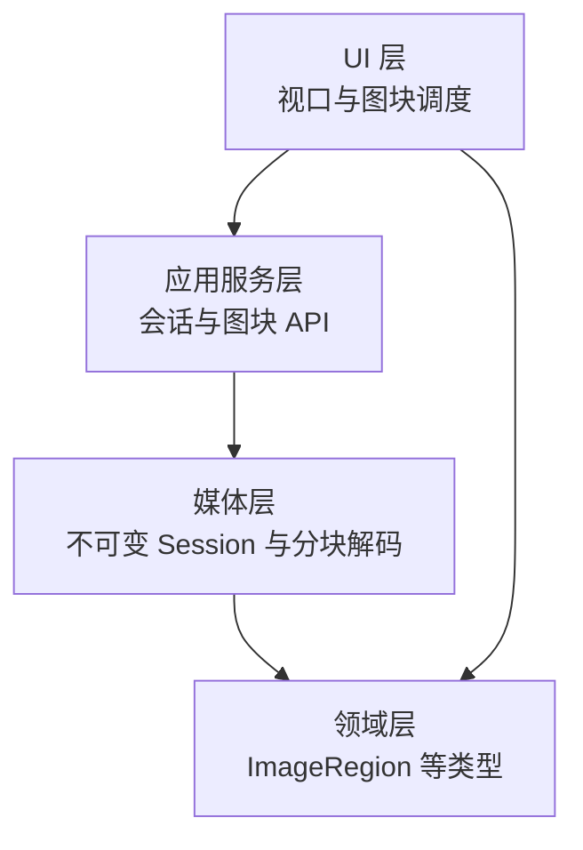
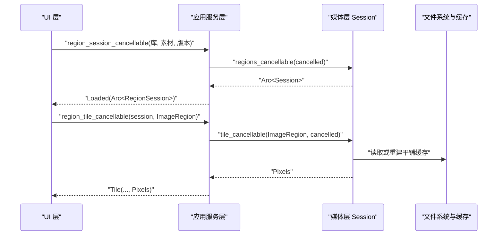
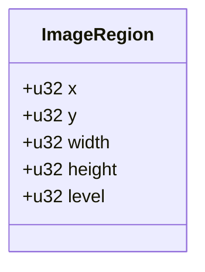
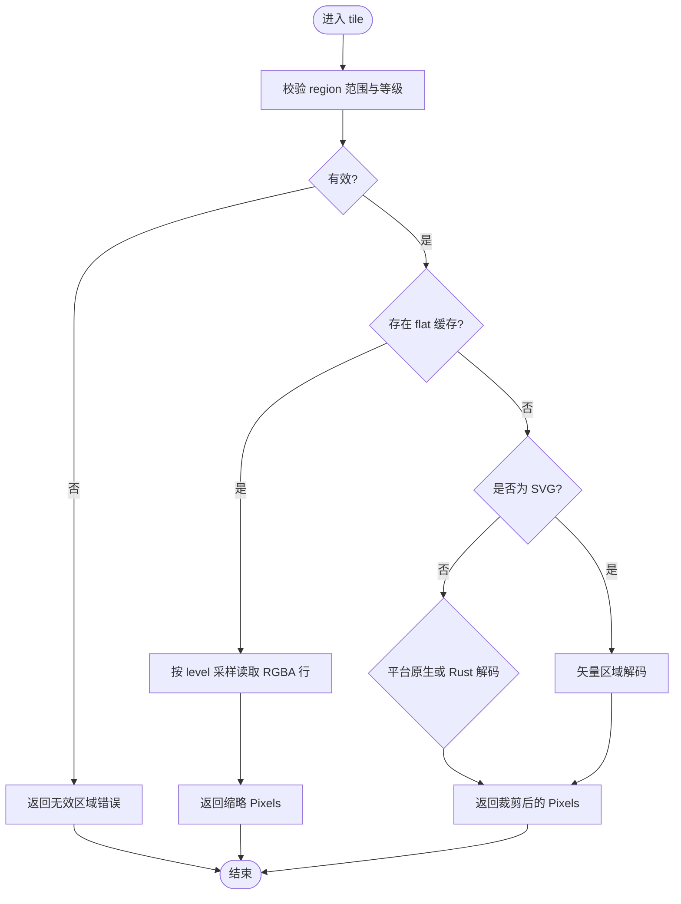
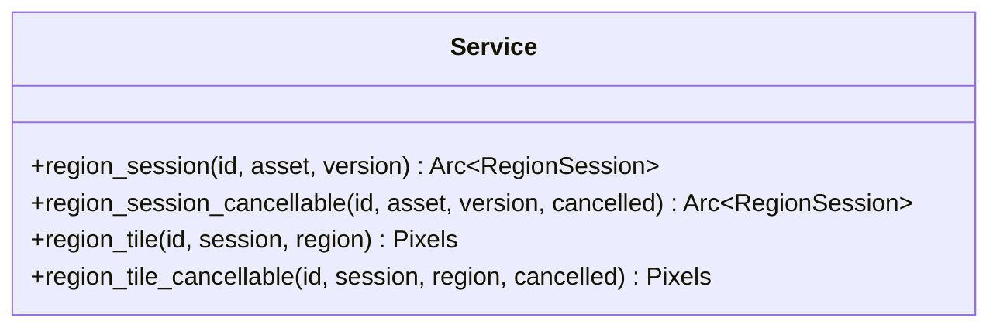
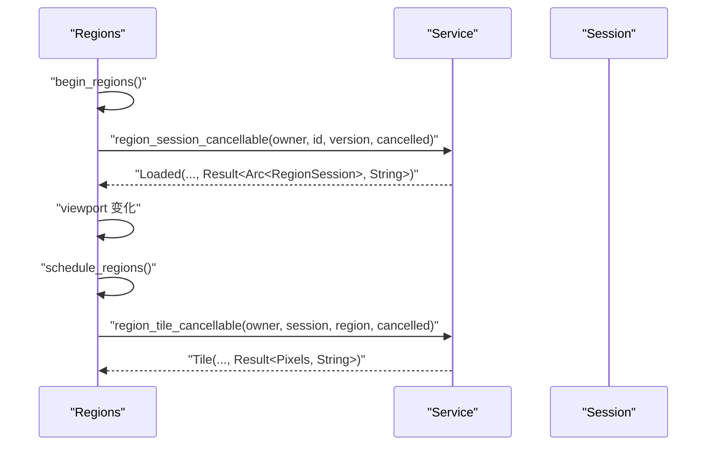
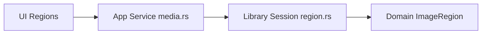

# 区域标注 API

> Repo Wiki 节点 `region-annotation-api`
> 导出自 Qoder 知识库快照 `8fbe02f6-57c2-4874-b725-1a8130851fd9`，代码基线 `7a7a8e75e18bd90294e09cd422dd7ed5a04813a0`（分支 main，zh-CN）。

<cite>
**本文引用的文件**
- [crates/moriq-library/src/media/region.rs](../../../../crates/moriq-library/src/media/region.rs)
- [crates/moriq-domain/src/lib.rs](../../../../crates/moriq-domain/src/lib.rs)
- [crates/moriq-app/src/media.rs](../../../../crates/moriq-app/src/media.rs)
- [crates/moriq-ui/src/regions.rs](../../../../crates/moriq-ui/src/regions.rs)
</cite>

## 目录
1. [简介](#简介)
2. [项目结构](#项目结构)
3. [核心组件](#核心组件)
4. [架构总览](#架构总览)
5. [详细组件分析](#详细组件分析)
6. [依赖关系分析](#依赖关系分析)
7. [性能与资源特性](#性能与资源特性)
8. [错误处理与故障排查](#错误处理与故障排查)
9. [序列化和持久化策略](#序列化和持久化策略)
10. [最佳实践与示例](#最佳实践与示例)
11. [结论](#结论)

## 简介
本文档聚焦“区域标注子系统”的 API，围绕原图查看器中的区域分块读取、会话生命周期、视口调度与图块缓存展开。需要特别说明的是：当前代码库中的“区域”主要用于高分辨率媒体预览的分块解码和渲染，而不是业务意义上的“矩形框、多边形、圆形等标注形状”。因此，本文会严格区分两类概念：
- 视图区域的几何描述：用于决定从原图中裁切哪一块像素，例如 `ImageRegion`。
- 用户标注的形状（矩形、多边形、圆形）：当前仓库未提供统一的数据模型；若需扩展，可基于现有会话机制叠加自定义元数据。

## 项目结构
区域标注相关能力分布在以下模块中：
- 领域层定义共享类型，包括资产身份、查询规则和图像区域描述。
- 应用服务封装异步接口，负责预算控制、来源冻结和取消传播。
- 媒体层实现不可变会话，负责原始像素读取、缓存重建和分块解码。
- UI 层负责视口变化、任务编排、图块加载和过期清理。

图表来源
- [crates/moriq-ui/src/regions.rs:1-200](../../../../crates/moriq-ui/src/regions.rs#L1-L200)
- [crates/moriq-app/src/media.rs:1-60](../../../../crates/moriq-app/src/media.rs#L1-L60)
- [crates/moriq-library/src/media/region.rs:1-120](../../../../crates/moriq-library/src/media/region.rs#L1-L120)
- [crates/moriq-domain/src/lib.rs:493-500](../../../../crates/moriq-domain/src/lib.rs#L493-L500)

章节来源
- [crates/moriq-ui/src/regions.rs:1-200](../../../../crates/moriq-ui/src/regions.rs#L1-L200)
- [crates/moriq-app/src/media.rs:1-60](../../../../crates/moriq-app/src/media.rs#L1-L60)
- [crates/moriq-library/src/media/region.rs:1-120](../../../../crates/moriq-library/src/media/region.rs#L1-L120)
- [crates/moriq-domain/src/lib.rs:493-500](../../../../crates/moriq-domain/src/lib.rs#L493-L500)

## 核心组件
本节列出与区域标注直接相关的核心类型与接口。

- ImageRegion：表示一个带缩放等级的二维矩形区域，是区域请求的最小单位。
- Session：媒体层不可变会话，封装原图路径、尺寸、格式、平铺缓存和单次解码逻辑。
- Service 区域 API：应用层暴露的异步接口，负责创建可取消的 RegionSession 并调度图块读取。
- UI Regions：视图层状态机，负责视口事件、任务编排、图块缓存和失败重试。

章节来源
- [crates/moriq-domain/src/lib.rs:493-500](../../../../crates/moriq-domain/src/lib.rs#L493-L500)
- [crates/moriq-library/src/media/region.rs:1-120](../../../../crates/moriq-library/src/media/region.rs#L1-L120)
- [crates/moriq-app/src/media.rs:1-60](../../../../crates/moriq-app/src/media.rs#L1-L60)
- [crates/moriq-ui/src/regions.rs:1-120](../../../../crates/moriq-ui/src/regions.rs#L1-L120)

## 架构总览
区域标注系统采用分层设计：UI 层只关心视口变化和图块句柄；应用层负责异步执行、内存预算和取消；媒体层负责像素读取、缓存校验与重建；领域层提供稳定类型。

图表来源
- [crates/moriq-ui/src/regions.rs:120-200](../../../../crates/moriq-ui/src/regions.rs#L120-L200)
- [crates/moriq-app/src/media.rs:1-60](../../../../crates/moriq-app/src/media.rs#L1-L60)
- [crates/moriq-library/src/media/region.rs:120-240](../../../../crates/moriq-library/src/media/region.rs#L120-L240)

## 详细组件分析

### 区域描述类型：ImageRegion
`ImageRegion` 是区域标注的最小几何单元，它描述原图坐标系下的矩形区域及缩放等级。该类型用于限制解码边界、计算子块大小和判断越界。

字段说明：
- x、y：区域左上角坐标。
- width、height：区域宽高。
- level：缩放等级，必须是 2 的幂且不超过实现允许的上限。

图表来源
- [crates/moriq-domain/src/lib.rs:493-500](../../../../crates/moriq-domain/src/lib.rs#L493-L500)

章节来源
- [crates/moriq-domain/src/lib.rs:493-500](../../../../crates/moriq-domain/src/lib.rs#L493-L500)

### 媒体层会话：Session
Session 是不可变的区域读取会话，核心职责包括：
- 打开并冻结原图来源。
- 选择是否使用预生成的全量平铺缓存。
- 校验缓存头部、尺寸和字节数。
- 按视口和缩放等级生成 ImageRegion。
- 对 SVG、原始文件和栅格文件采用不同解码路径。
- 提供单图块内存预算和可取消读取。

关键行为：
- open：建立会话，根据扩展名和分辨率决定是否生成 flat 缓存。
- tile_memory_mib：返回单图块内存预算，有 flat 缓存时较低，否则较高。
- tile：校验 region 后返回 Pixels，优先复用 flat 缓存，否则按需解码。
- tile_cancellable：在取消作用域内调用 tile。

图表来源
- [crates/moriq-library/src/media/region.rs:201-316](../../../../crates/moriq-library/src/media/region.rs#L201-L316)

章节来源
- [crates/moriq-library/src/media/region.rs:1-120](../../../../crates/moriq-library/src/media/region.rs#L1-L120)
- [crates/moriq-library/src/media/region.rs:201-316](../../../../crates/moriq-library/src/media/region.rs#L201-L316)

### 应用服务 API：RegionSession 相关接口
应用层通过 Service 暴露区域会话和图块读取接口。这些接口面向上层调用者，屏蔽底层取消、预算控制和来源验证。

主要接口：
- region_session：创建默认不可取消的区域会话。
- region_session_cancellable：创建可取消的区域会话，适合 UI 长任务。
- region_tile：读取指定区域的像素。
- region_tile_cancellable：带取消标志的图块读取，受内存预算控制。

图表来源
- [crates/moriq-app/src/media.rs:1-60](../../../../crates/moriq-app/src/media.rs#L1-L60)

章节来源
- [crates/moriq-app/src/media.rs:1-60](../../../../crates/moriq-app/src/media.rs#L1-L60)

### UI 层区域调度：Regions 与 RegionMessage
UI 层维护 Regions 状态，负责：
- 启动或复用 Session。
- 监听视口变化。
- 将视口划分为若干 ImageRegion。
- 并发发起图块请求。
- 管理图块缓存、可见区域、失败集合和任务句柄。
- 在窗口关闭或切换素材时重置状态并取消任务。

关键状态与方法：
- Viewport：视口坐标、宽高、缩放。
- reset：取消任务、清空图块、推进请求世代。
- images：返回当前可见图块句柄。
- begin_regions：为当前素材版本启动 Session。
- region_message：处理 Loaded、Viewport、Tile 回执。
- schedule_regions：计算 visible regions、排序、限制并发与缓存数量。

图表来源
- [crates/moriq-ui/src/regions.rs:1-200](../../../../crates/moriq-ui/src/regions.rs#L1-L200)
- [crates/moriq-ui/src/regions.rs:201-367](../../../../crates/moriq-ui/src/regions.rs#L201-L367)

章节来源
- [crates/moriq-ui/src/regions.rs:1-200](../../../../crates/moriq-ui/src/regions.rs#L1-L200)
- [crates/moriq-ui/src/regions.rs:201-367](../../../../crates/moriq-ui/src/regions.rs#L201-L367)

## 依赖关系分析
区域标注系统的依赖关系清晰分层，耦合点主要集中在三个方向：
- UI 依赖应用服务的异步 API。
- 应用服务依赖媒体层的 Session 和 domain 层类型。
- Session 依赖文件系统和解码器，但不直接持有 UI 状态。

图表来源
- [crates/moriq-ui/src/regions.rs:1-367](../../../../crates/moriq-ui/src/regions.rs#L1-L367)
- [crates/moriq-app/src/media.rs:1-60](../../../../crates/moriq-app/src/media.rs#L1-L60)
- [crates/moriq-library/src/media/region.rs:1-316](../../../../crates/moriq-library/src/media/region.rs#L1-L316)
- [crates/moriq-domain/src/lib.rs:493-500](../../../../crates/moriq-domain/src/lib.rs#L493-L500)

章节来源
- [crates/moriq-ui/src/regions.rs:1-367](../../../../crates/moriq-ui/src/regions.rs#L1-L367)
- [crates/moriq-app/src/media.rs:1-60](../../../../crates/moriq-app/src/media.rs#L1-L60)
- [crates/moriq-library/src/media/region.rs:1-316](../../../../crates/moriq-library/src/media/region.rs#L1-L316)
- [crates/moriq-domain/src/lib.rs:493-500](../../../../crates/moriq-domain/src/lib.rs#L493-L500)

## 性能与资源特性
- 分块解码：通过 ImageRegion 和 level 控制每次解码的像素规模，避免一次性加载整张大图。
- 平铺缓存：当支持时可生成 flat RGBA 缓存，显著降低重复解码成本。
- 内存预算：Session.tile_memory_mib 提供单图块内存估算，应用层据此进行 admission control。
- 取消传播：UI 层可通过 AtomicBool 取消会话与图块任务，防止长时间阻塞。
- 图块缓存上限：UI 层限制可见图块数量，并按年龄淘汰不可见图块。
- 平台差异：Windows 下可使用原生 worker，其他平台回退到 Rust 解码或构建期检查。

章节来源
- [crates/moriq-library/src/media/region.rs:201-316](../../../../crates/moriq-library/src/media/region.rs#L201-L316)
- [crates/moriq-ui/src/regions.rs:201-367](../../../../crates/moriq-ui/src/regions.rs#L201-L367)

## 错误处理与故障排查
常见错误场景与定位建议：
- 区域范围无效：x、y、width、height、level 不满足约束，应检查视口换算逻辑。
- 缓存标识无效或尺寸不一致：flat 缓存损坏或被截断，应触发重建或删除缓存。
- 原片尺寸已变化：文件被外部修改导致尺寸不一致，应刷新 Source 并重建会话。
- 区域解码超时或进程失败：原生解码器异常或超时，应记录日志并重试。
- 会话失败：UI 层设置 session_failed 并展示错误，避免无限重试。

章节来源
- [crates/moriq-library/src/media/region.rs:28-120](../../../../crates/moriq-library/src/media/region.rs#L28-L120)
- [crates/moriq-library/src/media/region.rs:201-316](../../../../crates/moriq-library/src/media/region.rs#L201-L316)
- [crates/moriq-ui/src/regions.rs:120-200](../../../../crates/moriq-ui/src/regions.rs#L120-L200)

## 序列化和持久化策略
当前代码库中的“区域”API 主要用于运行时像素读取，并不直接提供用户标注形状的序列化接口。与之相关的持久化集中在两个层面：
- 领域层类型：ImageRegion 是简单结构体，但当前用途是内部视图区域，不是持久化的标注对象。
- 媒体缓存：Session.open 可能生成 previews/{version}-raster-flat1.rgba 或 raw 对应缓存，由媒体层自动读写和重建。

如果目标是持久化“用户标注”，需要在领域层新增标注类型，并在数据库迁移和导入导出流程中增加对应字段。当前仓库并未提供该模型。

章节来源
- [crates/moriq-domain/src/lib.rs:493-500](../../../../crates/moriq-domain/src/lib.rs#L493-L500)
- [crates/moriq-library/src/media/region.rs:120-200](../../../../crates/moriq-library/src/media/region.rs#L120-L200)

## 最佳实践与示例
以下示例以步骤形式给出，不直接粘贴代码内容，引用对应源码位置以便对照实现。

- 创建区域标注会话
  - 在 UI 层调用应用服务接口创建可取消会话。
  - 参考：[crates/moriq-ui/src/regions.rs:120-200](../../../../crates/moriq-ui/src/regions.rs#L120-L200)
  - 应用层接口参考：[crates/moriq-app/src/media.rs:1-30](../../../../crates/moriq-app/src/media.rs#L1-L30)

- 处理视口变化并调度图块
  - 更新 Viewport，判断是否需要启动 Session。
  - 计算 visible regions 并限制并发和缓存数量。
  - 参考：[crates/moriq-ui/src/regions.rs:201-367](../../../../crates/moriq-ui/src/regions.rs#L201-L367)

- 读取图块像素
  - 调用 region_tile_cancellable，传入 ImageRegion 和取消标志。
  - 参考：[crates/moriq-app/src/media.rs:40-60](../../../../crates/moriq-app/src/media.rs#L40-L60)
  - 媒体层解码逻辑参考：[crates/moriq-library/src/media/region.rs:201-316](../../../../crates/moriq-library/src/media/region.rs#L201-L316)

- 数据验证
  - 确保 ImageRegion.level 是 2 的幂且不超限。
  - 确保 x+width、y+height 不超过 Session.width/height。
  - 参考：[crates/moriq-library/src/media/region.rs:224-240](../../../../crates/moriq-library/src/media/region.rs#L224-L240)

- 错误处理
  - 捕获 Invalid 错误并提示用户。
  - 在 UI 层设置 session_failed 或 failed 集合，避免反复失败请求。
  - 参考：[crates/moriq-library/src/media/region.rs:28-120](../../../../crates/moriq-library/src/media/region.rs#L28-L120)
  - 参考：[crates/moriq-ui/src/regions.rs:120-200](../../../../crates/moriq-ui/src/regions.rs#L120-L200)

- 资源清理
  - 在窗口关闭或切换素材时调用 reset，取消所有任务并释放图块。
  - 参考：[crates/moriq-ui/src/regions.rs:1-120](../../../../crates/moriq-ui/src/regions.rs#L1-L120)

## 结论
区域标注子系统在当前仓库中主要承担高分辨率媒体的分块读取与渲染任务。其核心是 Session 的不可变设计、ImageRegion 的有界描述、应用层的预算与取消控制，以及 UI 层的视口调度和图块缓存。虽然名称包含“区域标注”，但它并不等同于业务标注形状；如需扩展矩形、多边形、圆形等标注类型，应在领域层引入新的标注模型，并与数据库、导入导出和 UI 编辑器集成。对于现有 API，推荐遵循本指南的验证、取消、缓存和错误处理最佳实践，以保证稳定性与性能。