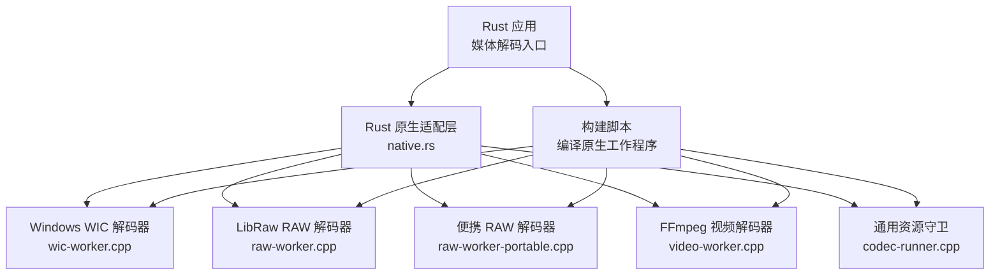
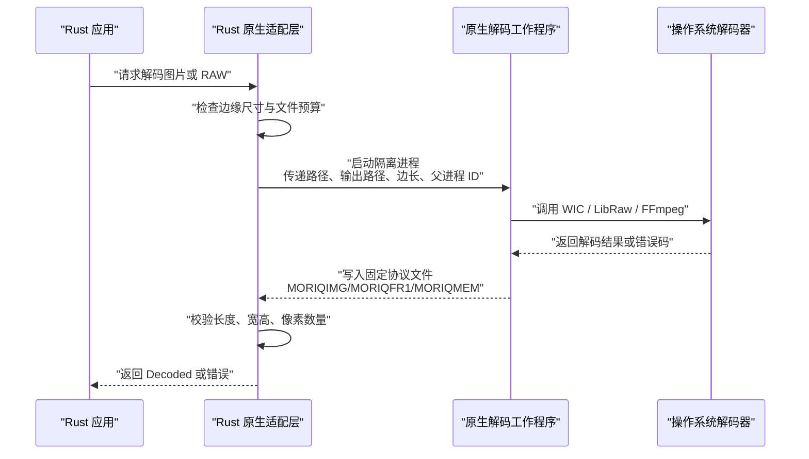
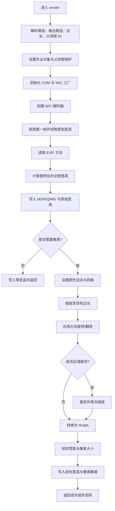
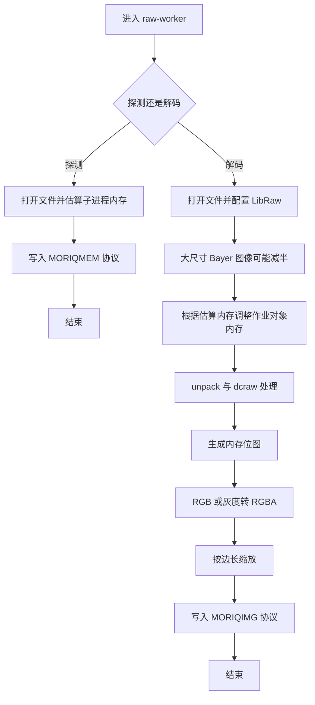
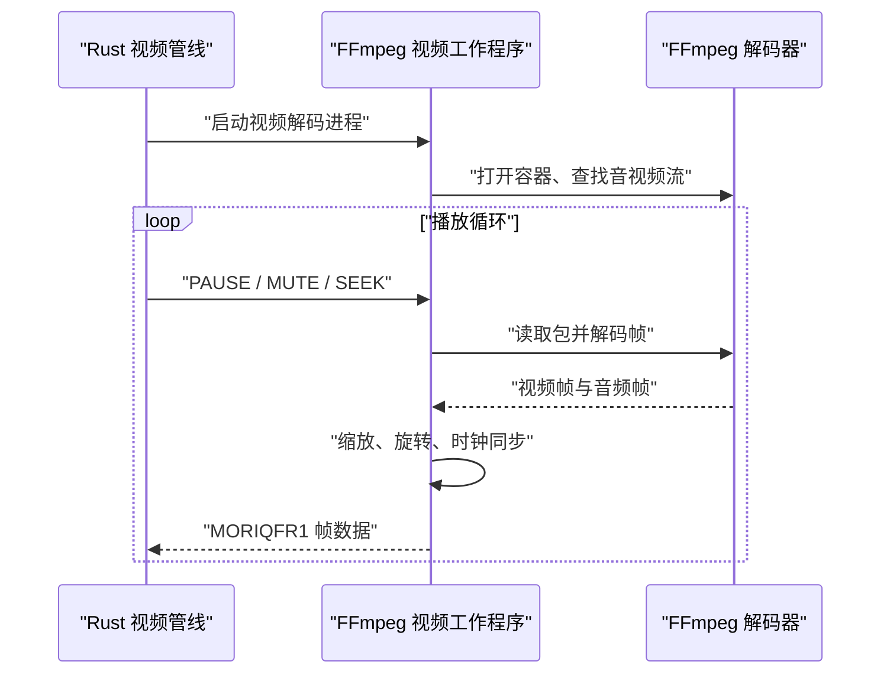
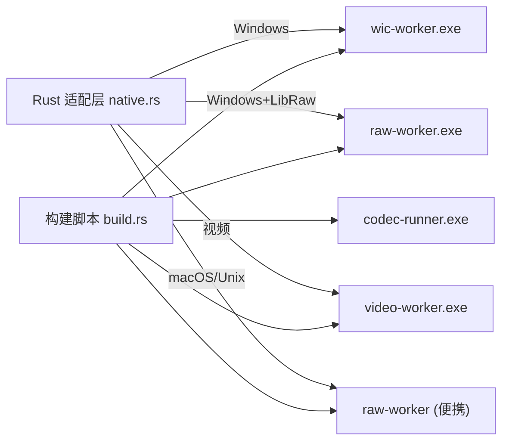
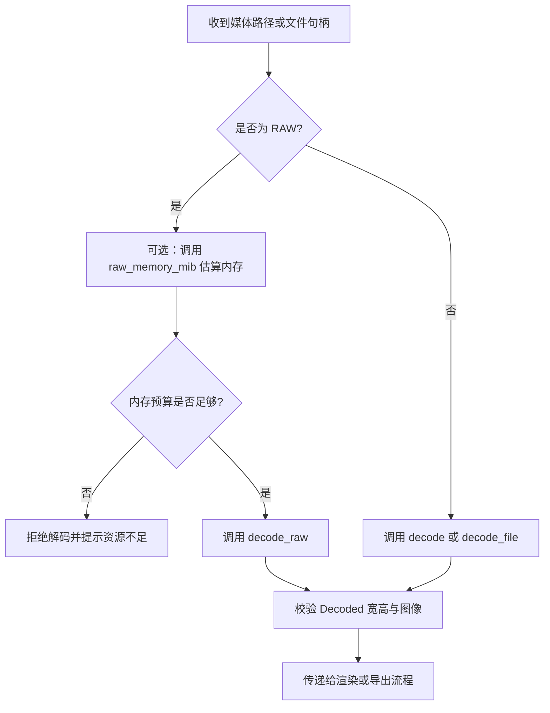

# 原生解码器 API

> Repo Wiki 节点 `native-decoder-api`
> 导出自 Qoder 知识库快照 `8fbe02f6-57c2-4874-b725-1a8130851fd9`，代码基线 `7a7a8e75e18bd90294e09cd422dd7ed5a04813a0`（分支 main，zh-CN）。

<cite>
**本文引用的文件**   
- [native.rs](../../../../crates/moriq-library/src/media/native.rs)
- [build.rs](../../../../crates/moriq-library/build.rs)
- [wic-worker.cpp](../../../../crates/moriq-library/native/wic-worker.cpp)
- [raw-worker.cpp](../../../../crates/moriq-library/native/raw-worker.cpp)
- [raw-budget.h](../../../../crates/moriq-library/native/raw-budget.h)
- [codec-runner.cpp](../../../../crates/moriq-library/native/codec-runner.cpp)
- [video-worker.cpp](../../../../crates/moriq-library/native/video-worker.cpp)
- [raw-worker-portable.cpp](../../../../crates/moriq-library/native/raw-worker-portable.cpp)
</cite>

## 目录
1. [简介](#简介)
2. [项目结构](#项目结构)
3. [核心组件](#核心组件)
4. [架构总览](#架构总览)
5. [详细组件分析](#详细组件分析)
6. [依赖关系分析](#依赖关系分析)
7. [性能与内存模型](#性能与内存模型)
8. [错误处理模型](#错误处理模型)
9. [Rust 集成指南](#rust-集成指南)
10. [故障排查](#故障排查)
11. [结论](#结论)

## 简介
本文件面向需要在 Rust 中安全调用原生图像、RAW 和视频解码能力的开发者，完整说明该仓库中的“原生解码器接口”。项目采用“隔离进程 + 二进制协议”的方式，将 Windows WIC、LibRaw（含便携式实现）和 FFmpeg 等系统级解码能力封装为短生命周期子进程；Rust 侧通过构建脚本编译并缓存这些可执行体，再以命令参数、临时文件和标准输出进行数据交换。文档覆盖库加载机制、函数调用契约、跨平台实现差异、内存与资源管理、错误模型以及实际集成优化建议。

## 项目结构
该项目在 `moriq-library` crate 中同时维护 Rust 适配层与原生解码工作程序：

- Rust 适配层：负责定位工作程序、启动隔离进程、校验输出、限制输入尺寸、映射到内部图像类型。
- 原生工作程序：
  - Windows WIC 图片解码器：使用 Windows Imaging Component 解码位图、处理方向、颜色空间、缩放和裁剪。
  - LibRaw RAW 解码器：负责传感器数据解码，支持预算探测与实际解码，并在 Windows 上借助 WIC 完成最终 RGBA 输出。
  - 便携 RAW 解码器：Linux/macOS 等平台下不依赖系统图像库，直接输出受限 RGBA。
  - FFmpeg 视频解码器：按固定帧协议通过标准输出推送 RGBA 帧，并支持暂停、静音、跳转等控制。
  - 通用资源守卫：在作业对象中启动工具，统一回收句柄并保证父进程退出时子进程终止。
- 构建脚本：根据目标平台和可用依赖编译不同工作程序，并将运行库或静态库打包进产物。

**图表来源**
- [build.rs:1-157](../../../../crates/moriq-library/build.rs#L1-L157)
- [native.rs:1-431](../../../../crates/moriq-library/src/media/native.rs#L1-L431)
- [wic-worker.cpp:1-113](../../../../crates/moriq-library/native/wic-worker.cpp#L1-L113)
- [raw-worker.cpp:1-102](../../../../crates/moriq-library/native/raw-worker.cpp#L1-L102)
- [raw-worker-portable.cpp:1-59](../../../../crates/moriq-library/native/raw-worker-portable.cpp#L1-L59)
- [video-worker.cpp:1-203](../../../../crates/moriq-library/native/video-worker.cpp#L1-L203)
- [codec-runner.cpp:1-32](../../../../crates/moriq-library/native/codec-runner.cpp#L1-L32)

**章节来源**
- [build.rs:1-157](../../../../crates/moriq-library/build.rs#L1-L157)
- [native.rs:1-431](../../../../crates/moriq-library/src/media/native.rs#L1-L431)

## 核心组件
本节从 Rust 侧的对外能力出发，解释如何发起解码、如何处理 RAW 元数据探测、如何把打开的文件交给解码流程，以及如何判断导入格式。

### Rust 侧解码入口
- `decode(path, edge)`：对普通图片调用系统解码器，返回宽度、高度及可选 RGBA 图像。当 `edge` 非零时，输出边不超过 `edge`；当 `edge` 为零且不是 RAW 路径时，仅返回尺寸而不返回像素数据。
- `decode_raw(path, edge)`：强制走 RAW 解码路径，避免系统解码器误判相机原始格式。
- `raw_memory_mib(path)`：在 Windows 或 macOS 上探测 RAW 解码所需内存（以 MiB 为单位），用于准入控制和资源分配。
- `decode_file(file, extension, edge)`：把已打开的文件复制到带后缀的临时文件中，依据扩展名选择 RAW 或普通解码路径，并先做文件大小限制。
- `supported_path(path)`：判断路径是否属于支持的普通图片、RAW 或视频格式。
- `file_limit(path)`：根据媒体类型返回允许读取的最大字节数，视频最大可达 64 GiB，RAW 最大 2 GiB，普通图片受 `MAX_BYTES` 限制。

数据结构：
- `Decoded`：包含宽度、高度和可选的 `image::DynamicImage`。

关键常量：
- `MAX_OUTPUT_EDGE = 8192`：系统图片解码输出的最大边长。
- `RAW_EXTENSIONS`：受支持的相机 RAW 扩展名集合。
- `IMPORT_EXTENSIONS`：支持导入的图片、RAW 和视频扩展名集合。

**章节来源**
- [native.rs:1-200](../../../../crates/moriq-library/src/media/native.rs#L1-L200)
- [native.rs:201-431](../../../../crates/moriq-library/src/media/native.rs#L201-L431)

## 架构总览
Rust 不会直接在主进程中加载系统编解码库，而是启动隔离的短生命周期进程。这种设计带来以下优势：
- 系统解码失败、崩溃或内存超限不会影响主应用。
- 可通过作业对象、CPU 时间上限和内存上限限制解码器资源。
- 父进程退出后，子进程会被自动终止，减少僵尸进程风险。
- 通过固定前缀的二进制协议校验返回值，降低恶意或损坏数据的危害。

**图表来源**
- [native.rs:201-431](../../../../crates/moriq-library/src/media/native.rs#L201-L431)
- [wic-worker.cpp:1-113](../../../../crates/moriq-library/native/wic-worker.cpp#L1-L113)
- [raw-worker.cpp:1-102](../../../../crates/moriq-library/native/raw-worker.cpp#L1-L102)
- [video-worker.cpp:1-203](../../../../crates/moriq-library/native/video-worker.cpp#L1-L203)

## 详细组件分析

### Windows WIC 图片解码器
WIC 工作程序是 Windows 平台上普通图片和部分系统支持的相机格式的解码后端。它承担以下职责：
- 初始化 COM 和多线程上下文。
- 从文件名创建解码器，获取第一帧。
- 读取 EXIF 方向标签，计算旋转后的全图尺寸。
- 根据是否需要区域裁剪决定是否启用裁剪器。
- 使用缩放器和翻转旋转器生成目标宽高的源。
- 转换为 32 位 RGBA 像素。
- 写出固定协议头 `MORIQIMG`，随后是原始宽高、目标宽高和目标像素。

关键行为：
- 如果 `edge == 0`，只写宽高并把像素宽高设为零，表示不需要像素数据。
- 若请求区域，则额外传入左上角坐标和宽高，并进行边界校验。
- 输出像素大小被限制为不超过 256 MiB。
- 通过 Windows Job Object 限制进程内存和用户态 CPU 时间，并监视父进程退出。

**图表来源**
- [wic-worker.cpp:1-113](../../../../crates/moriq-library/native/wic-worker.cpp#L1-L113)

**章节来源**
- [wic-worker.cpp:1-113](../../../../crates/moriq-library/native/wic-worker.cpp#L1-L113)

### LibRaw RAW 解码器（Windows）
Windows 上的 RAW 解码器基于 LibRaw，负责从相机传感器数据生成 RGB/RGBA 预览。它与 WIC 协作：LibRaw 解码传感器数据，WIC 负责最终的缩放和像素拷贝。

关键流程：
- 解析参数，区分“预算探测模式”和“实际解码模式”。
- 设置 LibRaw 参数，包括白平衡、输出色彩、位深和质量。
- 打开文件；探测模式下估算子进程内存并通过固定协议 `MORIQMEM` 返回。
- 实际解码模式下，对大尺寸 Bayer 图像可选择半尺寸处理以减少解马赛克成本。
- 根据估算内存动态调整作业对象内存上限。
- 执行 unpack 和 dcraw 处理，生成内存位图。
- 将 RGB 或灰度图转换为 RGBA，并按边长缩放。
- 通过 WIC 输出 `MORIQIMG` 协议。

内存估算：
- `raw_child_mib` 根据原始分辨率、传感器类型、输出边长估算子进程内存，并限制在 1536 MiB 以内。
- 探测模式返回的 `MORIQMEM` 加上父端缓冲区开销，构成整体预算。

**图表来源**
- [raw-worker.cpp:1-102](../../../../crates/moriq-library/native/raw-worker.cpp#L1-L102)
- [raw-budget.h:1-24](../../../../crates/moriq-library/native/raw-budget.h#L1-L24)

**章节来源**
- [raw-worker.cpp:1-102](../../../../crates/moriq-library/native/raw-worker.cpp#L1-L102)
- [raw-budget.h:1-24](../../../../crates/moriq-library/native/raw-budget.h#L1-L24)
- [native.rs:1-200](../../../../crates/moriq-library/src/media/native.rs#L1-L200)

### 便携 RAW 解码器（macOS 与非 Windows 平台）
在非 Windows 平台，特别是 macOS，Rust 构建脚本会尝试编译便携版 RAW 工作程序。它不依赖系统图像库，直接调用 LibRaw 并输出受限 RGBA。

特点：
- 使用 `setrlimit` 限制数据段内存，并使用监控线程检测父进程退出。
- macOS 上通过 Mach 任务信息检测驻留内存是否超过预算。
- 探测模式与 Windows 版本保持一致，返回 `MORIQMEM`。
- 实际解码时进行传感器解码、灰度转 RGB、简单缩放，然后写出 `MORIQIMG`。

**章节来源**
- [raw-worker-portable.cpp:1-59](../../../../crates/moriq-library/native/raw-worker-portable.cpp#L1-L59)
- [build.rs:1-157](../../../../crates/moriq-library/build.rs#L1-L157)
- [native.rs:1-200](../../../../crates/moriq-library/src/media/native.rs#L1-L200)

### FFmpeg 视频解码器
视频解码器是一个独立的 C++ 程序，使用 FFmpeg 解码音视频流，并通过标准输出发送固定帧协议给 Rust 侧渲染管线。

协议字段：
- 前缀：`MORIQFR1`
- 宽度、高度：各 4 字节小端整数。
- 位置、时长：各 8 字节小端整数，单位为毫秒。
- 像素：连续 RGBA 字节。

控制通道：
- 通过标准输入接收 `PAUSE`、`MUTE`、`SEEK` 指令。
- 解码线程维护播放时钟，并与音频时钟对齐。
- 视频帧最多每秒上传约 30 帧，避免界面卡顿。
- 高比特率片段会在落后时跳过昂贵的像素转换。

资源与限制：
- 每个视频工作进程有内存上限。
- 解码线程数根据 CPU 核数限制在 2 到 8 之间。
- 输出帧尺寸被限制，防止过大帧导致内存爆炸。
- 音频通过 Windows 旧式波形音频 API 输出，支持静音和缓冲队列限制。

**图表来源**
- [video-worker.cpp:1-203](../../../../crates/moriq-library/native/video-worker.cpp#L1-L203)

**章节来源**
- [video-worker.cpp:1-203](../../../../crates/moriq-library/native/video-worker.cpp#L1-L203)

### 通用资源守卫
`codec-runner` 提供统一的作业对象启动方式：
- 接收父进程 ID 和被启动工具的路径。
- 为 AI 相关工具和应用工具设置不同的内存上限。
- 使用 `CREATE_SUSPENDED` 创建进程后再加入作业对象。
- 等待父进程或子进程结束；若父进程先退出，则终止整个作业组。
- 清理进程句柄和作业对象句柄，避免泄漏。

**章节来源**
- [codec-runner.cpp:1-32](../../../../crates/moriq-library/native/codec-runner.cpp#L1-L32)

## 依赖关系分析
构建脚本决定哪些原生组件会被编译和打包：

- Windows：
  - 默认编译 WIC 工作程序。
  - 若存在 LibRaw，则编译 LibRaw 工作程序，并复制 `libraw.dll`。
  - 若存在 FFmpeg，则编译视频工作程序，链接 `avcodec`、`avformat`、`avutil`、`swscale`、`swresample`。
- macOS：
  - 若存在 `libraw.a`，则编译便携 RAW 工作程序，并标记 `bundled_libraw`。
- Rust 侧：
  - 通过条件编译选择 Windows WIC 路径或非 Windows 的便携 RAW 路径。
  - 通过 `bundle_video` 和 `bundled_libraw` 特性影响运行时行为。

**图表来源**
- [build.rs:1-157](../../../../crates/moriq-library/build.rs#L1-L157)
- [native.rs:1-200](../../../../crates/moriq-library/src/media/native.rs#L1-L200)

**章节来源**
- [build.rs:1-157](../../../../crates/moriq-library/build.rs#L1-L157)
- [native.rs:1-200](../../../../crates/moriq-library/src/media/native.rs#L1-L200)

## 性能与内存模型
### 输入预算
- 普通图片和 RAW 文件在进入解码流程前会复制到临时文件，并受 `file_limit` 限制。
- 视频允许更大的输入体积，但解码输出帧仍然受严格限制。

### 输出尺寸预算
- 系统图片解码输出边长最大为 8192。
- RAW 解码输出边长最大为 65535。
- 输出像素总量被限制，例如 WIC 路径限制为 256 MiB，便携 RAW 路径限制为 512 MiB。

### 子进程资源限制
- Windows 使用 Job Object 限制进程内存和用户态 CPU 时间。
- macOS/Linux 使用 `setrlimit` 和监控线程限制数据段内存和驻留内存。
- 父进程退出时，子进程会被强制终止。

### 解码线程数
- FFmpeg 视频解码器根据活跃处理器核数限制解码线程，范围 2 到 8。
- RAW 探测和系统解码均设置环境变量减少并行度，避免竞争。

### 缓存与重建
- 构建脚本根据 `codecs-checksums.json` 和源码变更触发重建。
- Rust 侧对内置工作程序和 DLL 做哈希校验，并写入临时目录，避免重复解压。

**章节来源**
- [native.rs:1-431](../../../../crates/moriq-library/src/media/native.rs#L1-L431)
- [wic-worker.cpp:1-113](../../../../crates/moriq-library/native/wic-worker.cpp#L1-L113)
- [raw-worker.cpp:1-102](../../../../crates/moriq-library/native/raw-worker.cpp#L1-L102)
- [raw-worker-portable.cpp:1-59](../../../../crates/moriq-library/native/raw-worker-portable.cpp#L1-L59)
- [video-worker.cpp:1-203](../../../../crates/moriq-library/native/video-worker.cpp#L1-L203)
- [build.rs:1-157](../../../../crates/moriq-library/build.rs#L1-L157)

## 错误处理模型
系统解码失败时，Rust 侧主要返回 `Error::Invalid` 或 `Error::Io`。常见语义如下：

| 场景 | 典型表现 | Rust 侧处理方式 |
|---|---|---|
| 系统没有可用的此格式解码器 | WIC 无法创建解码器 | 返回明确的“系统没有可用的此格式/相机解码器”错误 |
| 无法建立解码资源隔离 | Job Object 或进程保护失败 | 返回“无法建立媒体解码资源隔离” |
| 解码超时 | 超过 45 秒或 RAW 120 秒 | 杀死子进程并返回超时错误 |
| 输出协议无效 | 缺少 `MORIQIMG` 前缀或长度异常 | 返回“回执无效” |
| 宽高或像素数量不一致 | 声明宽高与像素大小不匹配 | 返回“尺寸声明无效” |
| 像素数据解析失败 | 无法创建 `RgbaImage` | 返回“像素无效” |
| RAW 元数据探测失败 | LibRaw 打开失败或回执无效 | 返回“RAW 元数据探测失败”，原片保留 |
| 文件超出预算 | 临时复制阶段超过 `file_limit` | 返回“媒体文件超出大小预算” |
| 构建未包含必要组件 | 缺少 LibRaw 或 FFmpeg | 构建阶段或运行阶段返回明确缺失错误 |

子进程退出码约定：
- `2`：参数错误。
- `3`：资源隔离或进程保护失败。
- `4`：打开文件或解码器不可用。
- `5`：解码过程失败。
- `6`：尺寸或像素大小非法。
- `7`：写入输出失败。
- `9`：父进程退出或作业对象被终止。

**章节来源**
- [native.rs:201-431](../../../../crates/moriq-library/src/media/native.rs#L201-L431)
- [wic-worker.cpp:1-113](../../../../crates/moriq-library/native/wic-worker.cpp#L1-L113)
- [raw-worker.cpp:1-102](../../../../crates/moriq-library/native/raw-worker.cpp#L1-L102)
- [raw-worker-portable.cpp:1-59](../../../../crates/moriq-library/native/raw-worker-portable.cpp#L1-L59)
- [video-worker.cpp:1-203](../../../../crates/moriq-library/native/video-worker.cpp#L1-L203)

## Rust 集成指南
### 安全调用要点
1. **始终使用 `decode_file` 而不是直接传入任意文件路径。**  
   它会先复制文件、限制大小、识别扩展名，再选择 RAW 或系统解码路径，从而避免直接暴露敏感路径和超大文件。
2. **合理设置 `edge`。**  
   预览时建议使用较小边长，避免产生巨大像素数组；导出或查看大图时可提高边长，但仍受 8192 或 65535 限制。
3. **优先使用 RAW 专用路径。**  
   对相机原始格式调用 `decode_raw`，避免系统解码器误判格式。
4. **利用 `raw_memory_mib` 做准入控制。**  
   在并发解码前先估算内存，避免同时启动过多 RAW 解码进程。
5. **关注取消信号。**  
   解码循环会定期检查取消标志，必要时杀掉子进程；上层应配合任务取消逻辑。
6. **不要假设 `image` 字段一定存在。**  
   当 `edge == 0` 且不是 RAW 时，Rust 侧可能只返回宽高而不返回像素数据。

### 推荐集成流程

[本图为概念流程，不对应具体代码行]

### 性能优化建议
- **批量预览时复用边长策略：** 同一批缩略图使用相同 `edge`，减少频繁切换解码参数。
- **避免无意义像素传输：** 列表页只显示尺寸时，使用 `edge == 0`，让原生解码器只返回宽高。
- **控制并发：** 结合 `raw_memory_mib` 和系统负载限制同时运行的 RAW 解码进程数量。
- **视频播放降采样：** 视频解码器已经按屏幕宽度比例缩放，UI 层应避免再次放大高分辨率帧。
- **利用临时目录缓存：** 构建脚本和 Rust 侧都会把工作程序放到临时目录并做哈希校验，部署时应确保临时目录可写且磁盘空间充足。

**章节来源**
- [native.rs:1-431](../../../../crates/moriq-library/src/media/native.rs#L1-L431)
- [wic-worker.cpp:1-113](../../../../crates/moriq-library/native/wic-worker.cpp#L1-L113)
- [raw-worker.cpp:1-102](../../../../crates/moriq-library/native/raw-worker.cpp#L1-L102)
- [video-worker.cpp:1-203](../../../../crates/moriq-library/native/video-worker.cpp#L1-L203)

## 故障排查
| 现象 | 可能原因 | 排查步骤 |
|---|---|---|
| 图片解码报错“系统没有可用的此格式/相机解码器” | WIC 不支持该格式 | 确认文件格式和扩展名；对相机 RAW 改用 `decode_raw` |
| 解码超时 | 文件过大、解码器卡住、资源受限 | 检查文件大小、`edge` 是否过大、是否有大量并发解码 |
| “系统解码回执长度无效”或“尺寸声明无效” | 子进程输出损坏或被截断 | 检查磁盘空间、临时目录权限、杀毒软件拦截 |
| RAW 探测失败 | LibRaw 无法打开文件或元数据损坏 | 检查 RAW 文件完整性；确认已准备 LibRaw 组件 |
| 视频无法播放或帧停滞 | FFmpeg 解码失败、时钟不同步、输出帧过大 | 查看视频工作程序诊断输出；检查容器和编码格式 |
| 构建时报缺少 LibRaw 或 FFmpeg | 未运行准备脚本 | Windows 运行 `scripts/prepare-codecs.ps1`；macOS 运行 `scripts/prepare-raw-macos.sh` |
| 应用退出后仍有解码进程残留 | 作业对象或父进程保护未生效 | 检查权限和系统策略；确认子进程使用 `CREATE_NO_WINDOW` 和 Job Object |

**章节来源**
- [native.rs:201-431](../../../../crates/moriq-library/src/media/native.rs#L201-L431)
- [build.rs:1-157](../../../../crates/moriq-library/build.rs#L1-L157)
- [video-worker.cpp:1-203](../../../../crates/moriq-library/native/video-worker.cpp#L1-L203)

## 结论
该项目的原生解码器接口以“Rust 编排 + 隔离进程解码”为核心，把 Windows WIC、LibRaw 和 FFmpeg 的能力封装成稳定、可限制、可校验的子进程。Rust 侧负责输入预算、输出校验、取消控制和业务集成；原生侧负责具体解码、缩放、颜色空间和播放时序。对于开发者而言，最安全的实践是：通过 `decode_file` 和 `decode_raw` 调用解码、合理设置 `edge`、在 RAW 场景中使用内存探测、并在 UI 层配合取消信号与并发限制。这样既能获得系统级解码器的性能，又能保持主应用的健壮性和可观测性。