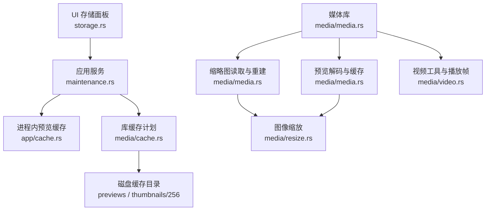
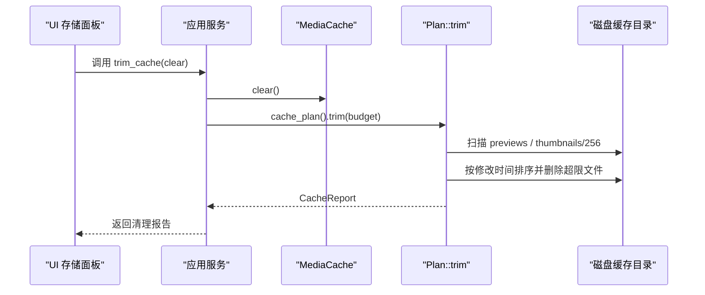
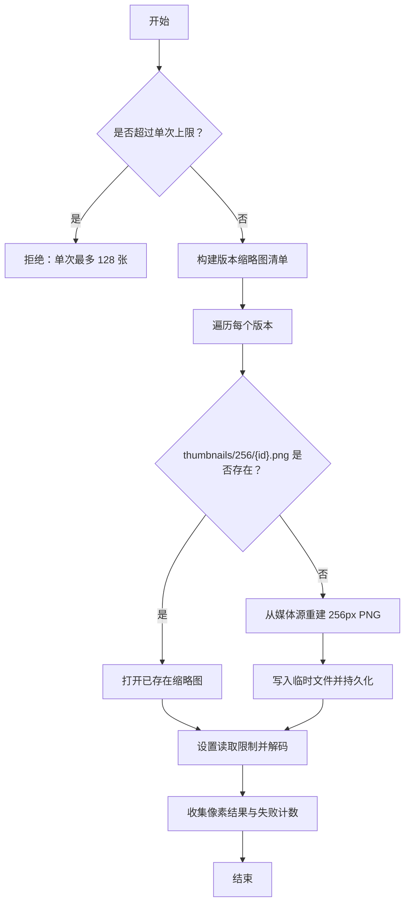
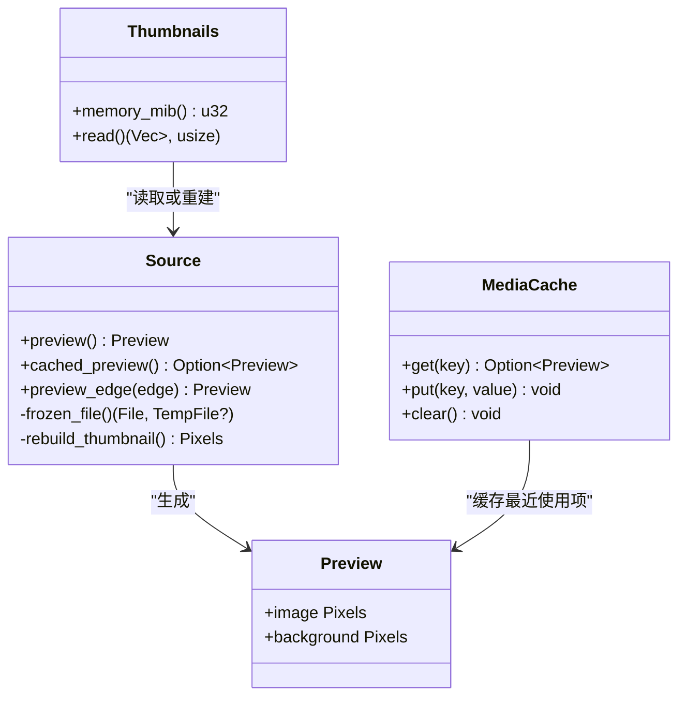
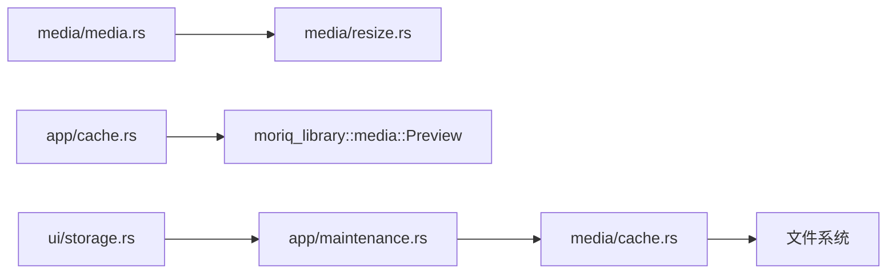
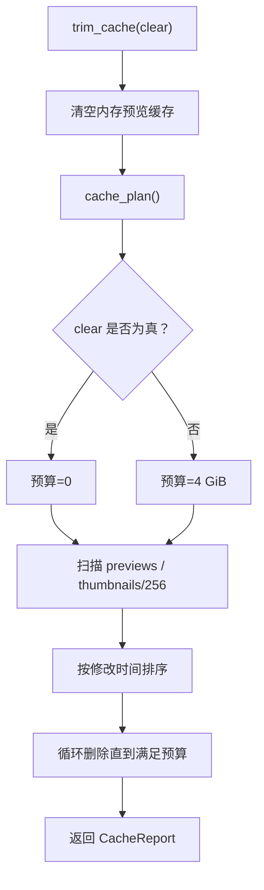

# 媒体缓存 API

> Repo Wiki 节点 `media-cache-api`
> 导出自 Qoder 知识库快照 `8fbe02f6-57c2-4874-b725-1a8130851fd9`，代码基线 `7a7a8e75e18bd90294e09cd422dd7ed5a04813a0`（分支 main，zh-CN）。

<cite>
**本文引用的文件**   
- [crates/moriq-library/src/media/cache.rs](../../../../crates/moriq-library/src/media/cache.rs)
- [crates/moriq-library/src/media/media.rs](../../../../crates/moriq-library/src/media/media.rs)
- [crates/moriq-library/src/media/access.rs](../../../../crates/moriq-library/src/media/access.rs)
- [crates/moriq-library/src/media/resize.rs](../../../../crates/moriq-library/src/media/resize.rs)
- [crates/moriq-library/src/media/video.rs](../../../../crates/moriq-library/src/media/video.rs)
- [crates/moriq-app/src/cache.rs](../../../../crates/moriq-app/src/cache.rs)
- [crates/moriq-app/src/maintenance.rs](../../../../crates/moriq-app/src/maintenance.rs)
- [crates/moriq-ui/src/storage.rs](../../../../crates/moriq-ui/src/storage.rs)
</cite>

## 目录
1. [简介](#简介)
2. [项目结构](#项目结构)
3. [核心组件](#核心组件)
4. [架构总览](#架构总览)
5. [详细组件分析](#详细组件分析)
6. [依赖关系分析](#依赖关系分析)
7. [性能与并发特性](#性能与并发特性)
8. [缓存清理机制](#缓存清理机制)
9. [故障排查指南](#故障排查指南)
10. [结论](#结论)
11. [附录：Rust 使用示例路径](#附录rust-使用示例路径)

## 简介
本文件围绕 MediaCache 及其相关媒体缓存子系统，提供面向 Rust 开发者的 API 文档。内容涵盖缩略图生成、预览图管理、视频帧提取、内存与磁盘缓存策略、异步清理流程，以及性能优化建议。所有说明均基于仓库中实际实现，不引入未暴露的外部假设。

## 项目结构
媒体缓存能力横跨库层与应用层：
- 库层负责媒体来源、缩略图与预览的解码、尺寸控制、PNG 缓存写入及磁盘缓存扫描清理。
- 应用层提供进程内内存预览缓存、维护任务入口和 UI 触发器。
- UI 层通过存储面板触发缓存清理任务并展示结果。

**图示来源**
- [crates/moriq-ui/src/storage.rs:40-85](../../../../crates/moriq-ui/src/storage.rs#L40-L85)
- [crates/moriq-app/src/maintenance.rs:69-77](../../../../crates/moriq-app/src/maintenance.rs#L69-L77)
- [crates/moriq-library/src/media/cache.rs:9-86](../../../../crates/moriq-library/src/media/cache.rs#L9-L86)
- [crates/moriq-library/src/media/media.rs:126-167](../../../../crates/moriq-library/src/media/media.rs#L126-L167)
- [crates/moriq-library/src/media/media.rs:349-505](../../../../crates/moriq-library/src/media/media.rs#L349-L505)
- [crates/moriq-library/src/media/resize.rs:1-52](../../../../crates/moriq-library/src/media/resize.rs#L1-L52)
- [crates/moriq-library/src/media/video.rs:1-120](../../../../crates/moriq-library/src/media/video.rs#L1-L120)

**章节来源**
- [crates/moriq-ui/src/storage.rs:40-85](../../../../crates/moriq-ui/src/storage.rs#L40-L85)
- [crates/moriq-app/src/maintenance.rs:69-77](../../../../crates/moriq-app/src/maintenance.rs#L69-L77)
- [crates/moriq-library/src/media/cache.rs:9-86](../../../../crates/moriq-library/src/media/cache.rs#L9-L86)
- [crates/moriq-library/src/media/media.rs:126-167](../../../../crates/moriq-library/src/media/media.rs#L126-L167)
- [crates/moriq-library/src/media/media.rs:349-505](../../../../crates/moriq-library/src/media/media.rs#L349-L505)
- [crates/moriq-library/src/media/resize.rs:1-52](../../../../crates/moriq-library/src/media/resize.rs#L1-L52)
- [crates/moriq-library/src/media/video.rs:1-120](../../../../crates/moriq-library/src/media/video.rs#L1-L120)

## 核心组件
- 媒体预览与缩略图：由 `Source`、`Thumbnails`、`Preview` 等类型在库层提供统一接口。
- 内存预览缓存：`MediaCache` 提供最近使用淘汰的进程内预览缓存。
- 磁盘缓存清理：`Plan::trim` 扫描可重建缓存并按预算删除。
- 维护服务：`Service::trim_cache` 将 UI 请求转为后台清理任务。
- 视频帧提取：`video.rs` 定义受支持格式、编解码工具定位与播放帧协议。
- 图像缩放：`resize.rs` 提供等比缩放、抗锯齿算法选择与透明通道保护。

**章节来源**
- [crates/moriq-library/src/media/media.rs:74-167](../../../../crates/moriq-library/src/media/media.rs#L74-L167)
- [crates/moriq-library/src/media/media.rs:349-505](../../../../crates/moriq-library/src/media/media.rs#L349-L505)
- [crates/moriq-app/src/cache.rs:1-65](../../../../crates/moriq-app/src/cache.rs#L1-L65)
- [crates/moriq-library/src/media/cache.rs:9-86](../../../../crates/moriq-library/src/media/cache.rs#L9-L86)
- [crates/moriq-app/src/maintenance.rs:69-77](../../../../crates/moriq-app/src/maintenance.rs#L69-L77)
- [crates/moriq-library/src/media/video.rs:1-120](../../../../crates/moriq-library/src/media/video.rs#L1-L120)
- [crates/moriq-library/src/media/resize.rs:1-52](../../../../crates/moriq-library/src/media/resize.rs#L1-L52)

## 架构总览
媒体缓存系统采用分层设计：
- UI 层只发起清理任务，不直接操作磁盘。
- 应用服务层协调内存缓存清理、库锁与后台工作线程。
- 库层提供安全的资源库访问、媒体解码、缩略图/预览生成和缓存扫描。
- 文件系统层仅包含可重建产物；原片、AI 结果、恢复与互操作数据不属于缓存范围。

**图示来源**
- [crates/moriq-ui/src/storage.rs:40-85](../../../../crates/moriq-ui/src/storage.rs#L40-L85)
- [crates/moriq-app/src/maintenance.rs:69-77](../../../../crates/moriq-app/src/maintenance.rs#L69-L77)
- [crates/moriq-library/src/media/cache.rs:9-86](../../../../crates/moriq-library/src/media/cache.rs#L9-L86)

## 详细组件分析

### 缩略图生成接口
缩略图以固定尺寸生成与读取：
- 目标尺寸：最长边为 256 像素。
- 文件格式：PNG。
- 缓存路径：`thumbnails/256/{version_id}.png`。
- 批量读取：最多一次处理 128 个版本，缺失时按需重建。
- 解码限制：缩略图读取最大宽高为 512，最大分配为 4 MiB，防止异常图片导致内存膨胀。

关键行为：
- `Library::thumbnail_plan` 构建受限版本的缩略图来源列表，优先打开已有 PNG，否则回退到媒体源重建。
- `Thumbnails::read` 逐个读取或重建缩略图，失败项以警告记录，不影响其他条目。
- `Library::thumbnail` 提供单张缩略图的只读访问，不存在则返回空值。

**图示来源**
- [crates/moriq-library/src/media/media.rs:126-167](../../../../crates/moriq-library/src/media/media.rs#L126-L167)
- [crates/moriq-library/src/media/media.rs:438-505](../../../../crates/moriq-library/src/media/media.rs#L438-L505)
- [crates/moriq-library/src/media/access.rs:5-22](../../../../crates/moriq-library/src/media/access.rs#L5-L22)

**章节来源**
- [crates/moriq-library/src/media/media.rs:126-167](../../../../crates/moriq-library/src/media/media.rs#L126-L167)
- [crates/moriq-library/src/media/media.rs:438-505](../../../../crates/moriq-library/src/media/media.rs#L438-L505)
- [crates/moriq-library/src/media/access.rs:5-22](../../../../crates/moriq-library/src/media/access.rs#L5-L22)

### 预览图管理功能
预览图用于主视图显示，具有两级缓存：
- 磁盘预览缓存：`previews/{version}-srgb1-{edge}.png`，默认 edge 为 1600。
- 内存预览缓存：`MediaCache` 中按库、版本、尺寸键保存最近使用的预览。

尺寸规格与格式：
- 默认预览边长：1600 像素。
- 小预览与背景：内部会生成 128px 预览并模糊作为背景。
- 文件格式：PNG，压缩类型为快速模式，过滤器为自适应。
- 缓存大小限制：单个预览文件大小超过 32 MiB 会被忽略。

异步与线程安全：
- 预览解码持有资源库租约，确保解码与衍生生成期间资源不被移动或删除。
- 磁盘写入先写入临时文件，再同步并持久化，避免半份缓存。

**图示来源**
- [crates/moriq-library/src/media/media.rs:349-505](../../../../crates/moriq-library/src/media/media.rs#L349-L505)
- [crates/moriq-app/src/cache.rs:1-65](../../../../crates/moriq-app/src/cache.rs#L1-L65)

**章节来源**
- [crates/moriq-library/src/media/media.rs:349-505](../../../../crates/moriq-library/src/media/media.rs#L349-L505)
- [crates/moriq-app/src/cache.rs:1-65](../../../../crates/moriq-app/src/cache.rs#L1-L65)

### 视频帧提取与播放
视频模块提供：
- 受支持扩展名：mp4、mov、m4v、mkv、webm、avi、mts、m2ts。
- 编解码工具定位：ffmpeg、ffprobe，位于运行目录下的 codecs 子目录。
- 播放帧协议：二进制帧包包含尺寸、播放位置与时长，最新帧替换旧缓冲，不排队积压。
- 尺寸校验：帧宽高必须非零且不超过 1920，损坏或超预算帧在分配前被拒绝。

该模块主要服务于视频播放与帧提取，而不是静态缩略图生成。

**章节来源**
- [crates/moriq-library/src/media/video.rs:1-120](../../../../crates/moriq-library/src/media/video.rs#L1-L120)

### 图像缩放与格式选项
缩放逻辑由 `resize.rs` 实现：
- 输入：任意动态图像。
- 输出：保持宽高比，不放大已经足够小的图像。
- 滤镜选项：Area、Lanczos3、Bicubic、Nearest。
- 像素类型与预乘透明度：保留原始颜色模型与透明信息。
- 错误处理：无效尺寸返回无效参数错误；缩放失败包装为无效错误。

该缩放函数被预览和缩略图生成复用，保证一致的质量与性能。

**章节来源**
- [crates/moriq-library/src/media/resize.rs:1-52](../../../../crates/moriq-library/src/media/resize.rs#L1-L52)

## 依赖关系分析
- `media/media.rs` 依赖 `media/resize.rs` 进行图像缩放。
- `media/cache.rs` 依赖数据库连接与文件系统，扫描 `previews` 与 `thumbnails/256`。
- `app/cache.rs` 依赖 `moriq_library::media::Preview`，提供进程内最近使用淘汰。
- `app/maintenance.rs` 依赖 `library.cache_plan()` 与 `Plan::trim`，封装异步清理。
- `ui/storage.rs` 依赖 `service.trim_cache`，驱动 UI 状态更新。

**图示来源**
- [crates/moriq-library/src/media/media.rs:349-505](../../../../crates/moriq-library/src/media/media.rs#L349-L505)
- [crates/moriq-library/src/media/resize.rs:1-52](../../../../crates/moriq-library/src/media/resize.rs#L1-L52)
- [crates/moriq-library/src/media/cache.rs:9-86](../../../../crates/moriq-library/src/media/cache.rs#L9-L86)
- [crates/moriq-app/src/cache.rs:1-65](../../../../crates/moriq-app/src/cache.rs#L1-L65)
- [crates/moriq-app/src/maintenance.rs:69-77](../../../../crates/moriq-app/src/maintenance.rs#L69-L77)
- [crates/moriq-ui/src/storage.rs:40-85](../../../../crates/moriq-ui/src/storage.rs#L40-L85)

**章节来源**
- [crates/moriq-library/src/media/media.rs:349-505](../../../../crates/moriq-library/src/media/media.rs#L349-L505)
- [crates/moriq-library/src/media/resize.rs:1-52](../../../../crates/moriq-library/src/media/resize.rs#L1-L52)
- [crates/moriq-library/src/media/cache.rs:9-86](../../../../crates/moriq-library/src/media/cache.rs#L9-L86)
- [crates/moriq-app/src/cache.rs:1-65](../../../../crates/moriq-app/src/cache.rs#L1-L65)
- [crates/moriq-app/src/maintenance.rs:69-77](../../../../crates/moriq-app/src/maintenance.rs#L69-L77)
- [crates/moriq-ui/src/storage.rs:40-85](../../../../crates/moriq-ui/src/storage.rs#L40-L85)

## 性能与并发特性
- 内存预算与条目数限制：
  - 单条预览大于 128 MiB 直接被丢弃。
  - 总内存预算为 256 MiB，最大条目数为 48。
  - 淘汰策略按最近使用时间戳移除最旧项。
- 缩略图批量内存估算：
  - 若任何缩略图需要重建，估计内存为 1024 MiB；否则为 128 MiB。
- 并发访问：
  - `MediaCache` 使用互斥锁保护状态，读写都需获取锁。
  - 库级缓存清理通过资源库租约与后台任务串行执行，避免与媒体解码竞争。
- 磁盘 I/O：
  - 预览与缩略图均先写临时文件，再同步并持久化，降低半写风险。
  - 缩略图读取限制宽高与最大分配，防止恶意或损坏图片造成内存峰值。

**章节来源**
- [crates/moriq-app/src/cache.rs:1-65](../../../../crates/moriq-app/src/cache.rs#L1-L65)
- [crates/moriq-library/src/media/media.rs:470-505](../../../../crates/moriq-library/src/media/media.rs#L470-L505)
- [crates/moriq-library/src/media/media.rs:438-470](../../../../crates/moriq-library/src/media/media.rs#L438-L470)

## 缓存清理机制
清理入口与策略：
- UI 触发：`StorageMessage::Trim(clear)` 启动清理任务。
- 应用服务：`Service::trim_cache(id, clear)` 清空内存预览缓存，并在后台执行磁盘清理。
- 预算策略：
  - 若 `clear=true`，预算为 0，即尽可能清理更多可重建缓存。
  - 若 `clear=false`，预算为 4 GiB，仅删除超出预算的可重建缓存。
- 扫描范围：
  - 仅扫描 `previews` 与 `thumbnails/256`。
  - 仅接受 PNG 或特定 RGBA 平面文件，文件名前 36 位须为有效 UUID。
  - Windows 下跳过隐藏属性文件。
- 清理顺序：
  - 按文件修改时间与路径排序，从最旧文件开始删除。
  - 统计删除文件数、删除字节数、剩余字节数与被跳过项数。

**图示来源**
- [crates/moriq-ui/src/storage.rs:40-85](../../../../crates/moriq-ui/src/storage.rs#L40-L85)
- [crates/moriq-app/src/maintenance.rs:69-77](../../../../crates/moriq-app/src/maintenance.rs#L69-L77)
- [crates/moriq-library/src/media/cache.rs:9-86](../../../../crates/moriq-library/src/media/cache.rs#L9-L86)

**章节来源**
- [crates/moriq-ui/src/storage.rs:40-85](../../../../crates/moriq-ui/src/storage.rs#L40-L85)
- [crates/moriq-app/src/maintenance.rs:69-77](../../../../crates/moriq-app/src/maintenance.rs#L69-L77)
- [crates/moriq-library/src/media/cache.rs:9-86](../../../../crates/moriq-library/src/media/cache.rs#L9-L86)

## 故障排查指南
常见问题与定位方式：
- 缩略图读取失败：
  - 现象：批量缩略图读取出现警告日志。
  - 原因：文件损坏、格式不支持、或解码失败。
  - 定位：检查 `Thumbnails::read` 中的失败计数与警告日志。
- 预览缓存未命中：
  - 现象：`cached_preview` 返回空值。
  - 可能原因：文件不存在、文件大小超过 32 MiB、或解码失败。
  - 定位：检查 `previews/{version}-srgb1-1600.png` 是否存在与大小。
- 清理无效果：
  - 现象：调用 `trim_cache` 后磁盘空间未减少。
  - 可能原因：没有可重建缓存、预算设置过高、或文件被跳过。
  - 定位：查看 `CacheReport` 的跳过数与删除字节数。
- 视频帧解析失败：
  - 现象：帧协议头非法、尺寸为零或超过 1920。
  - 原因：数据包损坏或播放器输出异常。
  - 定位：检查视频帧接收逻辑中的协议校验与尺寸限制。

**章节来源**
- [crates/moriq-library/src/media/media.rs:470-505](../../../../crates/moriq-library/src/media/media.rs#L470-L505)
- [crates/moriq-library/src/media/media.rs:355-378](../../../../crates/moriq-library/src/media/media.rs#L355-L378)
- [crates/moriq-library/src/media/cache.rs:9-86](../../../../crates/moriq-library/src/media/cache.rs#L9-L86)
- [crates/moriq-library/src/media/video.rs:1-120](../../../../crates/moriq-library/src/media/video.rs#L1-L120)

## 结论
MediaCache 及相关媒体缓存子系统通过明确的尺寸规范、严格的解码限制、原子化的缓存写入与基于预算的清理策略，实现了稳定高效的缩略图与预览缓存。进程内内存缓存提供最近使用淘汰，磁盘缓存聚焦可重建产物，维护服务将 UI 操作转化为可靠的后台任务。视频帧模块则独立承担视频播放与帧提取职责，避免与静态媒体缓存混淆。

## 附录：Rust 使用示例路径
以下示例路径展示缓存初始化、操作与配置的最佳实践。为避免泄露具体代码内容，请参考对应文件中的实现段落。

- 初始化资源库与创建媒体来源：
  - [crates/moriq-library/src/media/media.rs:90-125](../../../../crates/moriq-library/src/media/media.rs#L90-L125)
- 构建缩略图计划并批量读取：
  - [crates/moriq-library/src/media/media.rs:126-167](../../../../crates/moriq-library/src/media/media.rs#L126-L167)
  - [crates/moriq-library/src/media/media.rs:470-505](../../../../crates/moriq-library/src/media/media.rs#L470-L505)
- 读取单张缩略图：
  - [crates/moriq-library/src/media/access.rs:5-22](../../../../crates/moriq-library/src/media/access.rs#L5-L22)
- 生成预览与缓存：
  - [crates/moriq-library/src/media/media.rs:349-427](../../../../crates/moriq-library/src/media/media.rs#L349-L427)
- 使用内存预览缓存：
  - [crates/moriq-app/src/cache.rs:1-65](../../../../crates/moriq-app/src/cache.rs#L1-L65)
- 触发缓存清理：
  - [crates/moriq-ui/src/storage.rs:40-85](../../../../crates/moriq-ui/src/storage.rs#L40-L85)
  - [crates/moriq-app/src/maintenance.rs:69-77](../../../../crates/moriq-app/src/maintenance.rs#L69-L77)
- 调整缩略图缩放算法：
  - [crates/moriq-library/src/media/resize.rs:1-52](../../../../crates/moriq-library/src/media/resize.rs#L1-L52)
- 视频工具与帧提取基础：
  - [crates/moriq-library/src/media/video.rs:1-120](../../../../crates/moriq-library/src/media/video.rs#L1-L120)