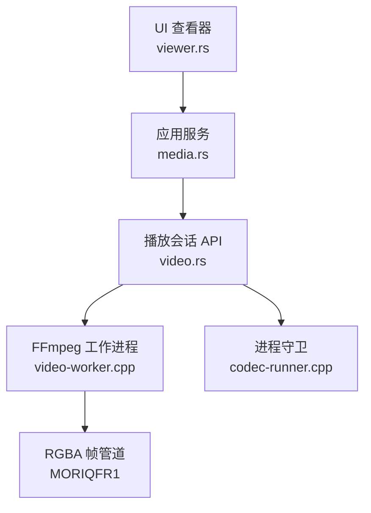
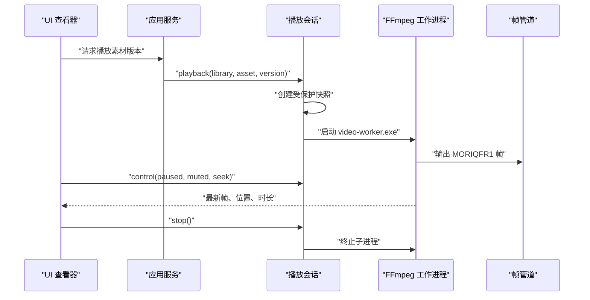
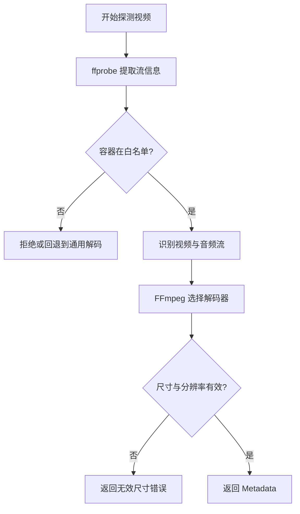
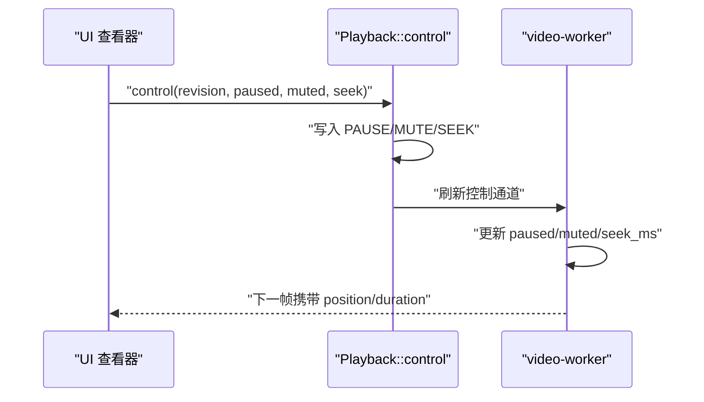
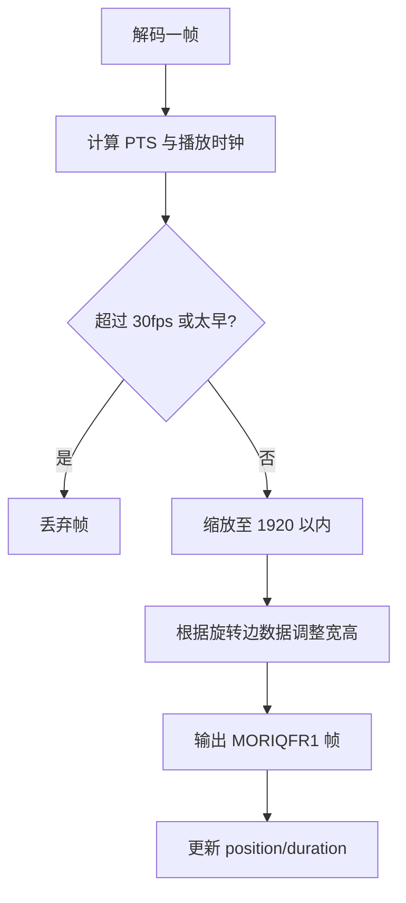
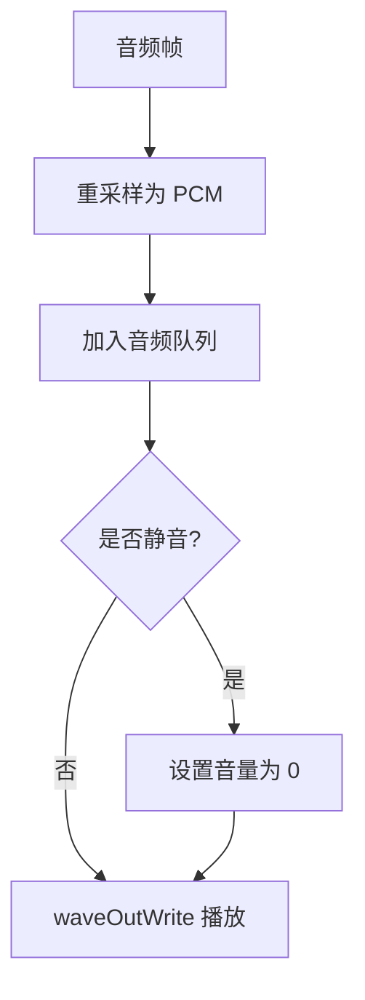
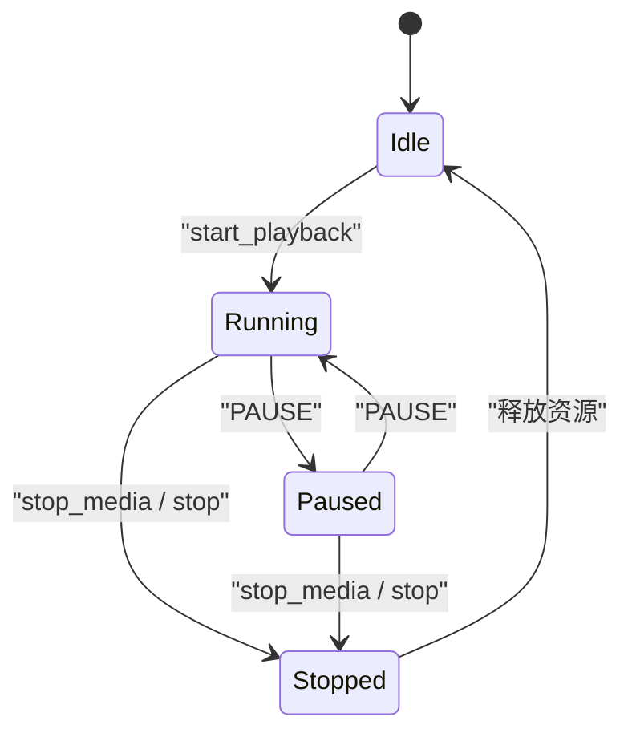
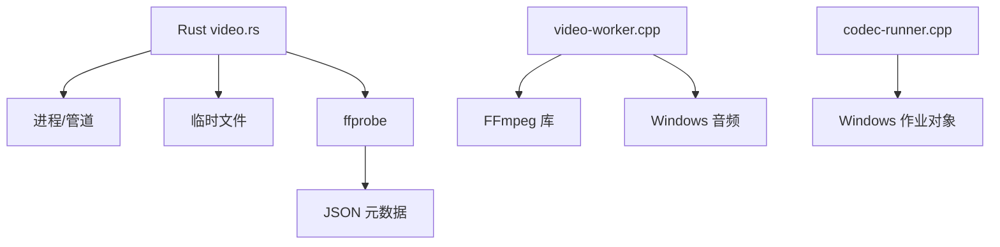

# 视频播放 API

> Repo Wiki 节点 `video-playback-api`
> 导出自 Qoder 知识库快照 `8fbe02f6-57c2-4874-b725-1a8130851fd9`，代码基线 `7a7a8e75e18bd90294e09cd422dd7ed5a04813a0`（分支 main，zh-CN）。

<cite>
**本文引用的文件**   
- [video.rs](../../../../crates/moriq-library/src/media/video.rs)
- [media.rs](../../../../crates/moriq-app/src/media.rs)
- [viewer.rs](../../../../crates/moriq-ui/src/viewer.rs)
- [video-worker.cpp](../../../../crates/moriq-library/native/video-worker.cpp)
- [codec-runner.cpp](../../../../crates/moriq-library/native/codec-runner.cpp)
- [raw-worker.cpp](../../../../crates/moriq-library/native/raw-worker.cpp)
</cite>

## 目录
1. [简介](#简介)
2. [项目结构](#项目结构)
3. [核心组件](#核心组件)
4. [架构总览](#架构总览)
5. [详细组件分析](#详细组件分析)
6. [依赖关系分析](#依赖关系分析)
7. [性能与优化指南](#性能与优化指南)
8. [故障排查](#故障排查)
9. [结论](#结论)

## 简介
本文件为视频播放子系统的 API 与实现文档，面向希望集成或扩展该能力的开发者。视频子系统采用“Rust 控制层 + Windows 原生解码工作进程”的架构：Rust 端负责资源管理、控制命令、帧缓冲和生命周期；原生 FFmpeg 工作进程负责解复用、解码、音频重采样和画面输出。本文覆盖以下内容：
- 支持的媒体格式列表（容器格式与编码）
- 播放控制接口（播放/暂停、进度跳转、音量静音、帧读取）
- 视频解码器管理（FFmpeg、线程数限制、错误恢复）
- 播放性能优化（预缓冲、内存预算、渲染节流）
- 使用示例（初始化播放器、处理事件、管理生命周期）

## 项目结构
视频播放能力主要分布在以下模块：
- Rust 库层：`moriq-library/src/media/video.rs` 提供播放会话、控制接口、元数据探测和临时快照。
- 应用服务层：`moriq-app/src/media.rs` 暴露异步 `playback` 方法，封装库调用与权限校验。
- UI 状态层：`moriq-ui/src/viewer.rs` 维护查看器状态、播放会话引用以及播放/暂停/静音等界面状态。
- 原生解码层：`video-worker.cpp` 是 FFmpeg 驱动的视频解码工作进程，负责音视频流处理、时间同步和 RGBA 帧输出。
- 进程守卫层：`codec-runner.cpp` 在 Windows 上以作业对象约束外部工具的资源使用。
- RAW 解码辅助：`raw-worker.cpp` 说明同仓库内其他解码器的资源限制模式，可类比理解视频解码的安全边界。

**图表来源**
- [video.rs:304-430](../../../../crates/moriq-library/src/media/video.rs#L304-L430)
- [media.rs:200-230](../../../../crates/moriq-app/src/media.rs#L200-L230)
- [viewer.rs:1-50](../../../../crates/moriq-ui/src/viewer.rs#L1-L50)
- [video-worker.cpp:1-120](../../../../crates/moriq-library/native/video-worker.cpp#L1-L120)
- [codec-runner.cpp:1-32](../../../../crates/moriq-library/native/codec-runner.cpp#L1-L32)

**章节来源**
- [video.rs:1-120](../../../../crates/moriq-library/src/media/video.rs#L1-L120)
- [media.rs:200-277](../../../../crates/moriq-app/src/media.rs#L200-L277)
- [viewer.rs:1-108](../../../../crates/moriq-ui/src/viewer.rs#L1-L108)

## 核心组件
- `Playback`：播放会话对象，持有子进程、输入控制通道、帧缓冲、诊断文件和临时源文件。对外暴露：
  - `elapsed_ms()`：返回会话启动以来的毫秒数。
  - `take_frame()`：取走最新 RGBA 帧；无新帧时返回空值。
  - `progress()`：返回当前播放位置与总时长。
  - `control(revision, paused, muted, seek)`：发送播放/暂停、静音、跳转控制。
  - `stop()`：显式停止并清理资源。
  - `running()`：检查子进程是否仍在运行。
  - `diagnostics()`：收集 Rust 侧与原生侧诊断信息。
- 帧协议：原生进程通过标准输出输出固定二进制帧包，Rust 端按 `MORIQFR1` 协议解析宽高、位置、时长和 RGBA 像素。
- 元数据探测：`probe(path)` 使用内置 `ffprobe` 提取尺寸、方向、时长、编码、像素格式、帧率、色彩空间及是否有音轨。
- 预览解码：`decode(path, edge)` 使用 FFmpeg 或系统解码路径生成封面图，同时返回元数据。

**章节来源**
- [video.rs:304-430](../../../../crates/moriq-library/src/media/video.rs#L304-L430)
- [video.rs:524-623](../../../../crates/moriq-library/src/media/video.rs#L524-L623)

## 架构总览
视频播放的整体流程如下：

**图表来源**
- [media.rs:200-230](../../../../crates/moriq-app/src/media.rs#L200-L230)
- [video.rs:386-430](../../../../crates/moriq-library/src/media/video.rs#L386-L430)
- [video-worker.cpp:180-210](../../../../crates/moriq-library/native/video-worker.cpp#L180-L210)

## 详细组件分析

### 支持媒体格式
- 容器扩展名：MP4、MOV、M4V、MKV、WEBM、AVI、MTS、M2TS。
- 运行时 FFmpeg 白名单：MOV、Matroska、WebM、AVI、MPEG-TS。
- 解码能力由 FFmpeg 决定；代码未硬编码具体视频编码名称，而是根据 `codec_name` 字段输出实际编码。
- 音频轨道检测：当存在音频流时，工作进程会进行重采样并通过系统音频输出；若静音则关闭音量。

**图表来源**
- [video.rs:536-596](../../../../crates/moriq-library/src/media/video.rs#L536-L596)
- [video-worker.cpp:60-110](../../../../crates/moriq-library/native/video-worker.cpp#L60-L110)

**章节来源**
- [video.rs:1-30](../../../../crates/moriq-library/src/media/video.rs#L1-L30)
- [video.rs:536-596](../../../../crates/moriq-library/src/media/video.rs#L536-L596)
- [video-worker.cpp:60-110](../../../../crates/moriq-library/native/video-worker.cpp#L60-L110)

### 播放控制接口
播放控制通过 `Playback::control` 发送三类指令：
- 播放/暂停：`PAUSE 0/1`
- 静音：`MUTE 0/1`
- 进度跳转：`SEEK <毫秒>`

这些命令被写入工作进程的 stdin，原生侧解析后更新内部状态。Rust 侧通过 revision 防止旧控制覆盖新控制。

**图表来源**
- [video.rs:304-380](../../../../crates/moriq-library/src/media/video.rs#L304-L380)
- [video-worker.cpp:190-200](../../../../crates/moriq-library/native/video-worker.cpp#L190-L200)

**章节来源**
- [video.rs:304-380](../../../../crates/moriq-library/src/media/video.rs#L304-L380)
- [video-worker.cpp:190-200](../../../../crates/moriq-library/native/video-worker.cpp#L190-L200)

### 帧读取与渲染
- `take_frame()` 只返回最新帧，不会排队历史帧，避免慢渲染堆积解码内容。
- 原生侧限制最大输出宽高为 1920，并在必要时缩放以避免过大内存分配。
- 旋转信息从编解码参数中提取，按 90° 倍数调整宽高顺序并复制像素完成旋转。
- 渲染频率上限约为每秒 30 帧，以减少高频上传开销。

**图表来源**
- [video-worker.cpp:130-180](../../../../crates/moriq-library/native/video-worker.cpp#L130-L180)
- [video.rs:120-170](../../../../crates/moriq-library/src/media/video.rs#L120-L170)

**章节来源**
- [video.rs:120-170](../../../../crates/moriq-library/src/media/video.rs#L120-L170)
- [video-worker.cpp:130-180](../../../../crates/moriq-library/native/video-worker.cpp#L130-L180)

### 音频与音量
- 工作进程将音频重采样为双声道、48kHz、16bit PCM，并通过系统音频输出。
- 静音通过设置系统音量实现；播放/暂停通过系统音频回放控制。
- 音频缓冲有大小限制，避免阻塞解码主循环。

**图表来源**
- [video-worker.cpp:110-170](../../../../crates/moriq-library/native/video-worker.cpp#L110-L170)

**章节来源**
- [video-worker.cpp:110-170](../../../../crates/moriq-library/native/video-worker.cpp#L110-L170)

### 解码器管理与硬件加速
- 解码器由 FFmpeg 自动选择；线程数根据 CPU 核心数限制，视频解码线程数在 2 到 8 之间。
- 代码未启用 FFmpeg 硬件加速上下文，也未配置 hwaccel 选项；因此默认走软件解码路径。
- 错误恢复机制包括：
  - 停止标志中断阻塞读取。
  - 跳转时刷新解码缓冲区、重置音频缓冲与重采样器。
  - 帧尺寸与分辨率预算检查，超出即停止解码。
  - 诊断日志记录首帧时间、帧计数、结束位置与耗时。

**章节来源**
- [video-worker.cpp:40-70](../../../../crates/moriq-library/native/video-worker.cpp#L40-L70)
- [video-worker.cpp:100-140](../../../../crates/moriq-library/native/video-worker.cpp#L100-L140)

### 生命周期管理
- UI 查看器维护 `playback` 引用、暂停状态、静音状态、已展示帧数和首次就绪时间。
- `stop_media()` 停止播放、释放帧句柄、重置控制序列号。
- `start_playback()` 绑定新的播放会话并重置播放状态。
- `Playback::drop` 后台等待子进程退出后再释放快照与租约，避免 UI 线程阻塞。

**图表来源**
- [viewer.rs:1-50](../../../../crates/moriq-ui/src/viewer.rs#L1-L50)
- [video.rs:230-280](../../../../crates/moriq-library/src/media/video.rs#L230-L280)

**章节来源**
- [viewer.rs:1-108](../../../../crates/moriq-ui/src/viewer.rs#L1-L108)
- [video.rs:230-280](../../../../crates/moriq-library/src/media/video.rs#L230-L280)

## 依赖关系分析
- Rust 层依赖：
  - 进程管理：`std::process::{Child, Command, Stdio}`
  - 临时文件：`tempfile`
  - 序列化：`serde_json`
  - 取消与任务：`crate::cancel`
  - 运行时校验：`moriq-runtime::verify_runtime`
- 原生层依赖：
  - FFmpeg：`libavformat`、`libavcodec`、`libswscale`、`libswresample`
  - Windows 音频：`MMSystem`
  - 进程与作业对象：Windows API

**图表来源**
- [video.rs:386-430](../../../../crates/moriq-library/src/media/video.rs#L386-L430)
- [video-worker.cpp:1-40](../../../../crates/moriq-library/native/video-worker.cpp#L1-L40)
- [codec-runner.cpp:1-32](../../../../crates/moriq-library/native/codec-runner.cpp#L1-L32)

**章节来源**
- [video.rs:386-430](../../../../crates/moriq-library/src/media/video.rs#L386-L430)
- [video-worker.cpp:1-40](../../../../crates/moriq-library/native/video-worker.cpp#L1-L40)
- [codec-runner.cpp:1-32](../../../../crates/moriq-library/native/codec-runner.cpp#L1-L32)

## 性能与优化指南
- 预缓冲策略：
  - 原生侧在解码前尝试跳过过于提前的帧，减少首帧延迟。
  - 音频队列有字节与数量限制，避免解码主循环长时间等待音频。
- 内存管理：
  - 播放会话使用硬链接或拷贝方式创建临时快照，限制文件大小为 64 GiB。
  - 帧尺寸上限为 1920，避免超大帧分配。
  - 原生进程通过作业对象限制内存与用户态 CPU 时间。
- 渲染优化：
  - 帧上传上限约每秒 30 帧。
  - 解码参考帧可能继续解码，但仅对需要显示的帧执行缩放和旋转。
  - 使用最近一帧替换旧帧，不保留历史帧缓冲。
- 推荐实践：
  - 在 UI 层轮询 `take_frame()`，仅在有新帧时提交 GPU 纹理。
  - 使用 `progress()` 更新进度条，不依赖精确 FPS。
  - 控制命令批量合并，避免频繁写入控制通道。
  - 切换媒体时调用 `stop_media()`，确保旧会话释放。

[本节为通用指导，不直接分析具体源码行]

## 故障排查
常见问题与定位方式：
- 播放器无法启动：
  - 检查 `Playback::start` 返回的错误消息。
  - 确认内置播放器与工作程序已通过哈希校验。
- 帧管道关闭：
  - Rust 侧会在接收线程捕获管道关闭错误，并写入 `frames.error`。
  - 通过 `diagnostics()` 获取原生侧诊断日志。
- 解码失败或超时：
  - `run` 函数监控 ffprobe/解码命令的输出长度与耗时，超限时返回错误。
  - 日志包含 FFmpeg 错误片段，便于定位容器或编码问题。
- 原片路径变化：
  - 播放前快照会校验文件标识，如不一致则拒绝播放。
- 临时磁盘不足：
  - 若可用空间小于视频大小，`copied_snapshot` 会返回明确错误。

**章节来源**
- [video.rs:230-280](../../../../crates/moriq-library/src/media/video.rs#L230-L280)
- [video.rs:304-430](../../../../crates/moriq-library/src/media/video.rs#L304-L430)
- [video.rs:500-520](../../../../crates/moriq-library/src/media/video.rs#L500-L520)

## 结论
视频播放子系统通过 Rust 控制层与 FFmpeg 原生工作进程协作，提供了稳定的播放控制、帧读取、元数据探测与资源管理能力。其设计强调安全边界：有限帧尺寸、有限输出带宽、有限音频缓冲、有限进程资源。对于上层应用，建议遵循以下原则：
- 使用 `playback` 初始化播放会话，并使用 `control` 统一变更播放状态。
- 使用 `take_frame` 拉取最新帧，避免构建自己的帧队列。
- 使用 `progress` 更新进度，结合 UI 动画提升体验。
- 在切换或关闭查看器时调用 `stop_media`，保证资源及时释放。
- 遇到解码异常时，优先检查 `diagnostics` 与 FFmpeg 错误日志。

[本节为总结性内容，不直接分析具体源码行]