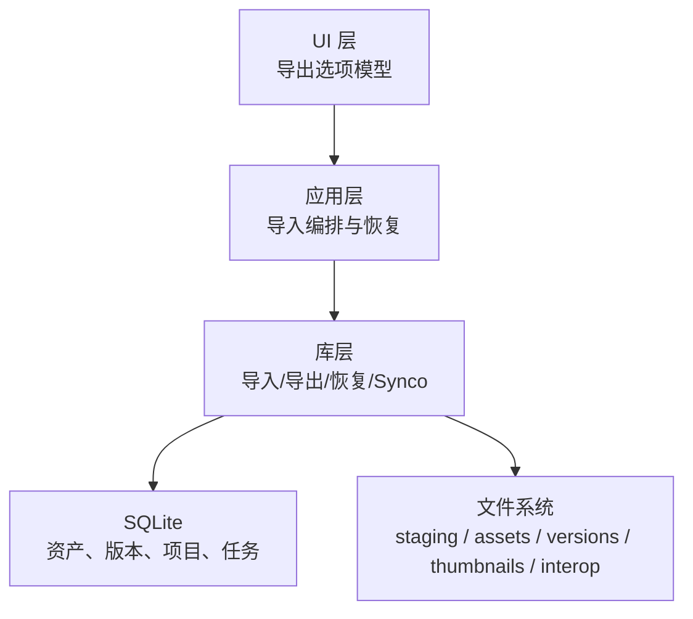
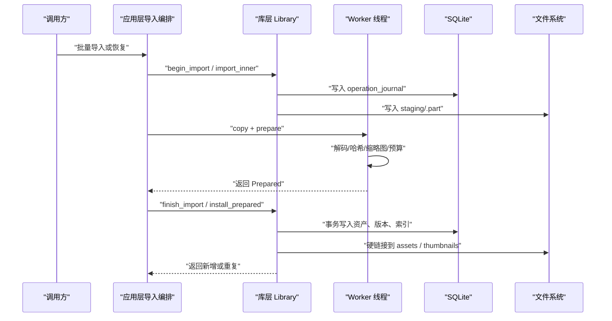
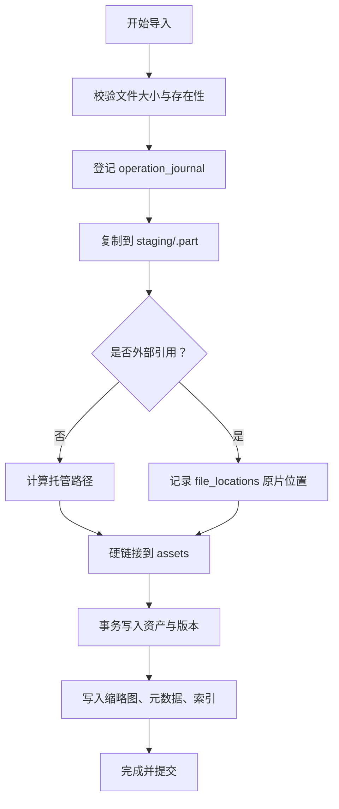
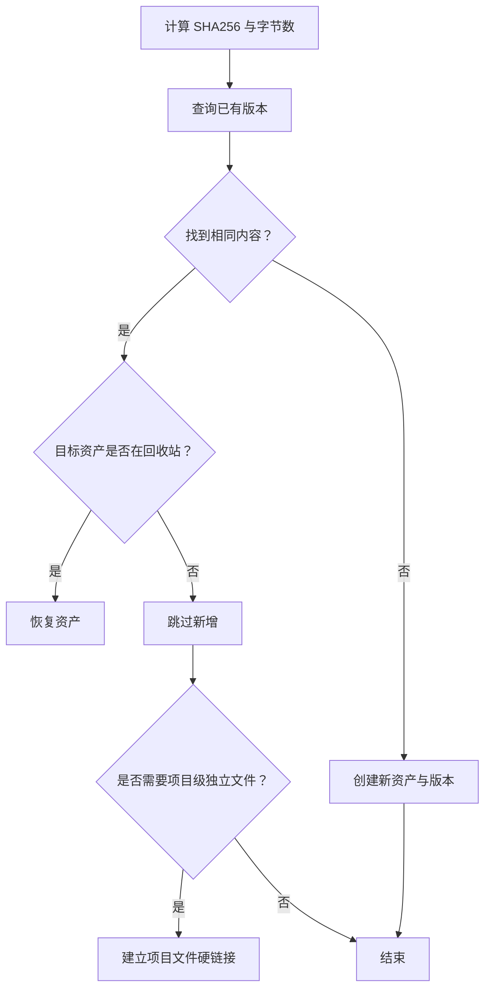
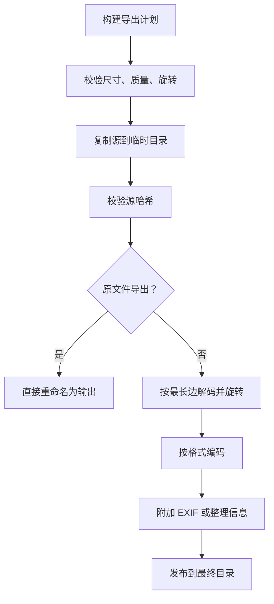
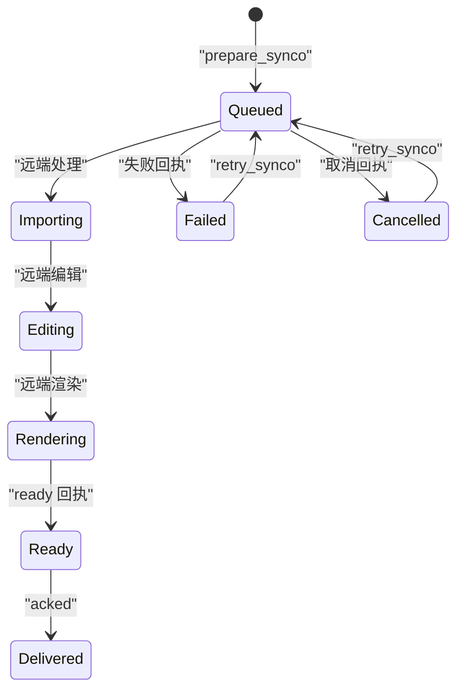
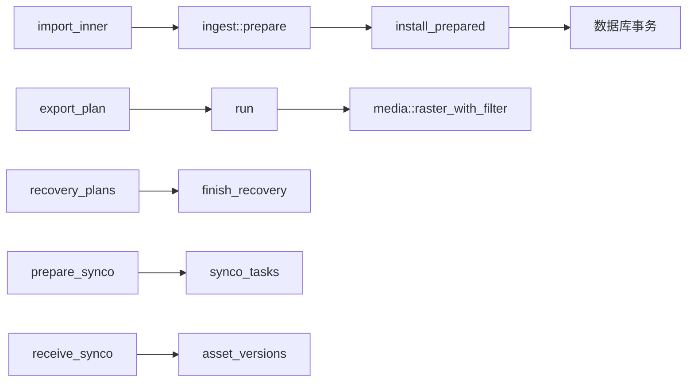
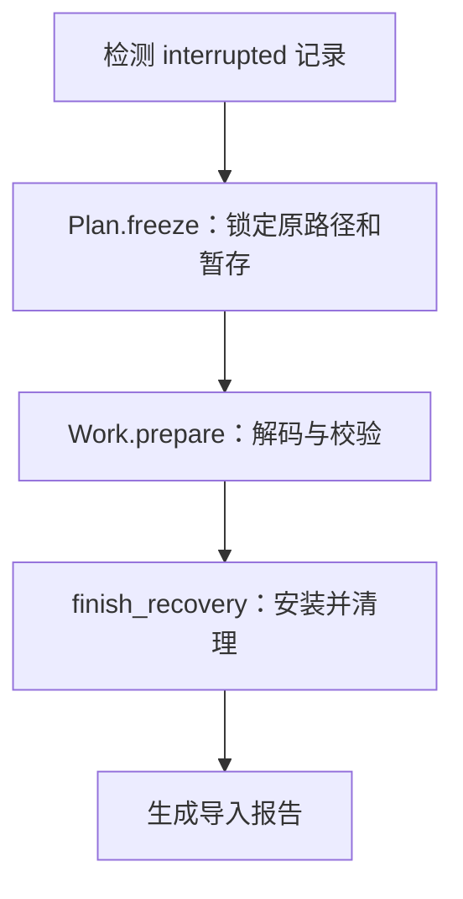

# 导入导出 API

> Repo Wiki 节点 `transfer-api`
> 导出自 Qoder 知识库快照 `8fbe02f6-57c2-4874-b725-1a8130851fd9`，代码基线 `7a7a8e75e18bd90294e09cd422dd7ed5a04813a0`（分支 main，zh-CN）。

<cite>
**本文引用的文件**   
- [import.rs](../../../crates/moriq-library/src/transfer/import.rs)
- [export.rs](../../../crates/moriq-library/src/transfer/export.rs)
- [recovery.rs](../../../crates/moriq-library/src/transfer/recovery.rs)
- [synco.rs](../../../crates/moriq-library/src/transfer/synco.rs)
- [ingest.rs](../../../crates/moriq-library/src/transfer/ingest.rs)
- [commit.rs](../../../crates/moriq-library/src/transfer/commit.rs)
- [import.rs](../../../crates/moriq-app/src/import.rs)
- [export.rs](../../../crates/moriq-ui/src/export.rs)
</cite>

## 目录
1. [简介](#简介)
2. [项目结构](#项目结构)
3. [核心组件](#核心组件)
4. [架构总览](#架构总览)
5. [详细组件分析](#详细组件分析)
6. [依赖关系分析](#依赖关系分析)
7. [性能与容量限制](#性能与容量限制)
8. [故障恢复与中断处理](#故障恢复与中断处理)
9. [使用示例](#使用示例)
10. [结论](#结论)

## 简介
本 API 文档面向导入导出子系统，覆盖以下能力：
- 导入流程：托管模式、外部引用模式、文件验证、去重算法、版本创建、索引建立、进度回调与取消。
- 导出接口：JPEG、PNG、WebP、TIFF、BMP 及原文件导出；质量设置、尺寸调整、旋转、重采样、元数据侧车与 EXIF 保留。
- 恢复机制：操作日志驱动的恢复、中断点保护、引用源校验与失败重试。
- 同步与增量：Synco v1 任务准备、回执接收、状态流转与结果版本管理。
- 批量与选择性：扫描流式导入、并发控制、内存准入、按项目或条件导出的实现要点。

该子系统以 SQLite 为元数据主存储，以库根目录下的 staging、assets、versions、thumbnails、interop 等子目录承载暂存、受管媒体、可切换版本和跨进程交接文件。

## 项目结构
导入导出相关代码分布在三个层级：
- 库层：moriq-library/transfer，负责文件与元数据的持久化、去重、索引、恢复与同步协议。
- 应用层：moriq-app/import，负责扫描、并发调度、资源限额、恢复编排与报告汇总。
- UI 层：moriq-ui/export，负责导出选项建模、表单渲染与用户交互标签。

图表来源
- [import.rs:1-200](../../../crates/moriq-library/src/transfer/import.rs#L1-L200)
- [export.rs:1-200](../../../crates/moriq-library/src/transfer/export.rs#L1-L200)
- [recovery.rs:1-200](../../../crates/moriq-library/src/transfer/recovery.rs#L1-L200)
- [synco.rs:1-200](../../../crates/moriq-library/src/transfer/synco.rs#L1-L200)
- [ingest.rs:1-200](../../../crates/moriq-library/src/transfer/ingest.rs#L1-L200)
- [commit.rs:1-200](../../../crates/moriq-library/src/transfer/commit.rs#L1-L200)
- [import.rs:1-200](../../../crates/moriq-app/src/import.rs#L1-L200)
- [export.rs:1-125](../../../crates/moriq-ui/src/export.rs#L1-L125)

章节来源
- [import.rs:1-200](../../../crates/moriq-library/src/transfer/import.rs#L1-L200)
- [export.rs:1-125](../../../crates/moriq-ui/src/export.rs#L1-L125)

## 核心组件
- 导入票据与预处理器：`Ticket`、`Prepared`，负责拷贝、哈希、解码、缩略图、相似性签名、元数据读取和内存预算估算。
- 安装与提交：`install`、`install_prepared`，负责去重判断、硬链接安装、资产与版本记录、视频元数据和索引写入。
- 托管路径生成：`managed_location`、`validate_component`，负责安全路径计算、命名冲突处理和平台保留名过滤。
- 导出计划与执行器：`export_plan`、`run`，负责冻结素材、构建导出元数据、复制/转码、布局输出。
- 恢复流水线：`Plan`、`Work`、`Ready`、`finish_recovery`，负责从操作日志重建工作、校验副本、完成安装。
- Synco 同步：`prepare_synco`、`receive_synco`、`retry_synco`，负责发送任务、回执校验、结果入库和状态机推进。
- 应用编排：`import_sources`、`import_stream`、`recover_controlled`，负责扫描、并发限制、内存准入、取消和报告。
- UI 选项：`ExportState`、`ExportChange`、`rows`，封装导出格式、质量、尺寸、旋转、重采样、布局和元数据开关。

章节来源
- [ingest.rs:1-200](../../../crates/moriq-library/src/transfer/ingest.rs#L1-L200)
- [commit.rs:1-200](../../../crates/moriq-library/src/transfer/commit.rs#L1-L200)
- [import.rs:1-200](../../../crates/moriq-library/src/transfer/import.rs#L1-L200)
- [export.rs:1-200](../../../crates/moriq-library/src/transfer/export.rs#L1-L200)
- [recovery.rs:1-200](../../../crates/moriq-library/src/transfer/recovery.rs#L1-L200)
- [synco.rs:1-200](../../../crates/moriq-library/src/transfer/synco.rs#L1-L200)
- [import.rs:1-200](../../../crates/moriq-app/src/import.rs#L1-L200)
- [export.rs:1-125](../../../crates/moriq-ui/src/export.rs#L1-L125)

## 架构总览
导入导出子系统采用“计划—准备—提交”三段式结构：
- 计划阶段：解析来源、校验大小、记录操作日志、分配操作 ID。
- 准备阶段：在 worker 线程中完成拷贝、解码、缩略图、哈希、元数据与内存预算评估。
- 提交阶段：回到 writer 线程进行去重、硬链接安装、事务写入、索引更新与清理。

图表来源
- [import.rs:1-200](../../../crates/moriq-library/src/transfer/import.rs#L1-L200)
- [ingest.rs:1-200](../../../crates/moriq-library/src/transfer/ingest.rs#L1-L200)
- [commit.rs:1-200](../../../crates/moriq-library/src/transfer/commit.rs#L1-L200)
- [import.rs:201-478](../../../crates/moriq-app/src/import.rs#L201-L478)

## 详细组件分析

### 导入流程：托管模式与外部引用模式
托管模式将源文件复制到库内 `assets` 目录，并通过硬链接复用内容；外部引用模式不复制媒体，而是记录原片位置并做哈希一致性检查。

关键点：
- 文件大小限制：空文件或超过平台限制的源会被拒绝。
- 操作日志：每次导入先写入 `operation_journal`，失败时标记为 `interrupted`，成功时标记为 `committed`。
- 托管路径：通过 `managed_location` 计算安全路径，避免危险字符、相对路径逃逸、平台保留名和重复覆盖。
- 引用校验：外部引用会在准备阶段重新比对源文件哈希，变化则报错。
- 版本创建：成功后写入 `assets`、`asset_versions`、缩略图和可选的视频元数据、相似性签名。
- 项目关联：根据项目 ID 插入 `project_assets`，并在需要时为同名内容建立独立项目文件关联。

图表来源
- [commit.rs:1-200](../../../crates/moriq-library/src/transfer/commit.rs#L1-L200)
- [commit.rs:201-293](../../../crates/moriq-library/src/transfer/commit.rs#L201-L293)
- [import.rs:1-200](../../../crates/moriq-library/src/transfer/import.rs#L1-L200)

章节来源
- [commit.rs:1-200](../../../crates/moriq-library/src/transfer/commit.rs#L1-L200)
- [commit.rs:201-293](../../../crates/moriq-library/src/transfer/commit.rs#L201-L293)
- [import.rs:1-200](../../../crates/moriq-library/src/transfer/import.rs#L1-L200)

### 文件验证与去重算法
- 文件验证包括：
  - 空文件和超大文件检查。
  - 解码尺寸合法性检查。
  - 像素乘积预算检查。
  - 扩展名识别：JPEG、PNG、WebP、GIF、BMP、SVG、TIFF、AVIF、HEIC、HEIF、视频格式等。
  - 外部引用网络路径拒绝。
- 去重策略：
  - 基于 SHA256 和字节数查找已有版本。
  - 若属于已删除素材，可能将其恢复。
  - 非引用模式下，同名内容会创建独立项目文件关联，避免不同项目互相覆盖。
  - 同一项目内同名文件通过序列号区分。

图表来源
- [commit.rs:1-200](../../../crates/moriq-library/src/transfer/commit.rs#L1-L200)
- [ingest.rs:201-442](../../../crates/moriq-library/src/transfer/ingest.rs#L201-L442)
- [import.rs:1-200](../../../crates/moriq-library/src/transfer/import.rs#L1-L200)

章节来源
- [commit.rs:1-200](../../../crates/moriq-library/src/transfer/commit.rs#L1-L200)
- [ingest.rs:201-442](../../../crates/moriq-library/src/transfer/ingest.rs#L201-L442)
- [import.rs:1-200](../../../crates/moriq-library/src/transfer/import.rs#L1-L200)

### 版本创建与索引建立
- 资产表写入 `display_version_id`、名称、导入时间。
- 版本表写入 origin、path、sha256、format、width、height、bytes。
- 视频元数据写入 `video_metadata`。
- 相似性签名写入相似度索引表。
- 常规元数据写入元数据表。
- 缩略图写入 `thumbnails/256/{version}.png`。
- 外部引用写入 `file_locations` 的 platform 与 path。
- 项目关联写入 `project_assets`。

章节来源
- [commit.rs:201-293](../../../crates/moriq-library/src/transfer/commit.rs#L201-L293)
- [ingest.rs:201-442](../../../crates/moriq-library/src/transfer/ingest.rs#L201-L442)

### 导出接口与元数据处理
支持的导出格式：
- 原文件：当未启用转换且无旋转时直接复制。
- JPEG：支持质量参数，透明通道会进行 Alpha 合成。
- PNG：无损编码，保留颜色空间。
- WebP：当前使用无损编码器。
- TIFF：无损编码。
- BMP：也作为内部支持的图片格式之一。

导出选项：
- 最长边：限制解码尺寸，防止过大图像导致内存爆炸。
- 质量：仅对 JPEG 有效。
- 旋转：允许 0、90、180、270 度。
- 重采样：面积平均、Lanczos3、双三次、最近邻。
- 布局：平铺、按格式、按导入日期。
- 目录模板：基于导入时间和元数据生成目录。
- 整理信息：导出 `.metadata.json`。
- 保留 EXIF：对 JPEG/PNG/WebP 附加 EXIF，对其他格式写出 `.exif` 侧车文件。

导出安全性：
- 禁止导出到 `.moriq` 库目录内部。
- 源文件在导出过程中再次校验哈希，发生变化则中止发布。
- 视频仅在原文件导出模式下支持，不能与图片转换选项混用。

图表来源
- [export.rs:1-200](../../../crates/moriq-library/src/transfer/export.rs#L1-L200)
- [export.rs:201-422](../../../crates/moriq-library/src/transfer/export.rs#L201-L422)
- [export.rs:1-125](../../../crates/moriq-ui/src/export.rs#L1-L125)

章节来源
- [export.rs:1-200](../../../crates/moriq-library/src/transfer/export.rs#L1-L200)
- [export.rs:201-422](../../../crates/moriq-library/src/transfer/export.rs#L201-L422)
- [export.rs:1-125](../../../crates/moriq-ui/src/export.rs#L1-L125)

### 进度回调、取消机制与性能监控
- 取消机制：
  - 导入票据拷贝和解码过程持续检查 `AtomicBool` 取消标志。
  - 应用层通过 `ImportControl.cancel` 控制扫描、导入和恢复流程。
  - 恢复流程在冻结和准备阶段同样响应取消。
- 进度统计：
  - `ImportReport` 包含新增、重复、失败数量和失败详情。
  - `largest_mib`、`waiting_memory`、`active`、`peak` 暴露内存与并发峰值。
  - `ImportMetrics` 记录哈希耗时、解码耗时、缩略图耗时和复制耗时。
- 并发控制：
  - 扫描流通过有界 channel 传递。
  - 导入工作通过 `buffer_unordered` 限制并发数量。
  - 内存通过两个信号量限制：批次内存与全局导入内存。
  - 单任务最大并发数在应用层限制为 1～32。

章节来源
- [ingest.rs:1-200](../../../crates/moriq-library/src/transfer/ingest.rs#L1-L200)
- [ingest.rs:201-442](../../../crates/moriq-library/src/transfer/ingest.rs#L201-L442)
- [import.rs:201-478](../../../crates/moriq-app/src/import.rs#L201-L478)

### 同步与增量：Synco v1
Synco 用于在两个库之间发送和接收编辑结果：
- 发送端：
  - 限制每批 1～100 张素材。
  - 只允许 JPEG、PNG、WebP、BMP。
  - 在 `interop/outgoing` 下创建不可变传输副本。
  - 写入 `synco_tasks` 请求 JSON，包含任务 ID、客户端 ID、源项目、源图像 ID、输入路径和哈希。
- 接收端：
  - 校验回执字段、状态、格式、哈希、尺寸和路径。
  - 将结果文件复制到 `interop/returns`，再硬链接到 `versions`。
  - 生成缩略图、记录版本和父版本关系。
  - 返回 ACK，供协调方确认交付。
- 重试与清理：
  - 失败或取消任务可重建新任务 ID 并重试。
  - 已交付、失败或取消的任务可清理传输副本。

图表来源
- [synco.rs:1-200](../../../crates/moriq-library/src/transfer/synco.rs#L1-L200)
- [synco.rs:201-554](../../../crates/moriq-library/src/transfer/synco.rs#L201-L554)

章节来源
- [synco.rs:1-200](../../../crates/moriq-library/src/transfer/synco.rs#L1-L200)
- [synco.rs:201-554](../../../crates/moriq-library/src/transfer/synco.rs#L201-L554)

## 依赖关系分析
- 导入管线依赖：
  - `Library.import_inner` → `ingest::prepare` → `install_prepared` → 数据库事务。
  - 托管路径依赖 `validate_component` 和 `reserved_component`。
  - 外部引用依赖 `organize::reject_network_reference` 和 `organize::hash_file`。
- 导出管线依赖：
  - `Library.export_plan` → `run` → `media::raster_with_filter` → 编码器。
  - 元数据依赖 `export_metadata::normalized_exif` 和 `attach`。
- 恢复管线依赖：
  - `recovery_plans` → `Plan.freeze` → `Work.prepare` → `finish_recovery`。
- 同步管线依赖：
  - `prepare_synco` → 写入 `synco_tasks`。
  - `receive_synco` → 写入 `asset_versions` 和任务状态。

图表来源
- [import.rs:1-200](../../../crates/moriq-library/src/transfer/import.rs#L1-L200)
- [ingest.rs:1-200](../../../crates/moriq-library/src/transfer/ingest.rs#L1-L200)
- [commit.rs:1-200](../../../crates/moriq-library/src/transfer/commit.rs#L1-L200)
- [export.rs:1-200](../../../crates/moriq-library/src/transfer/export.rs#L1-L200)
- [recovery.rs:1-200](../../../crates/moriq-library/src/transfer/recovery.rs#L1-L200)
- [synco.rs:1-200](../../../crates/moriq-library/src/transfer/synco.rs#L1-L200)

章节来源
- [import.rs:1-200](../../../crates/moriq-library/src/transfer/import.rs#L1-L200)
- [ingest.rs:1-200](../../../crates/moriq-library/src/transfer/ingest.rs#L1-L200)
- [commit.rs:1-200](../../../crates/moriq-library/src/transfer/commit.rs#L1-L200)
- [export.rs:1-200](../../../crates/moriq-library/src/transfer/export.rs#L1-L200)
- [recovery.rs:1-200](../../../crates/moriq-library/src/transfer/recovery.rs#L1-L200)
- [synco.rs:1-200](../../../crates/moriq-library/src/transfer/synco.rs#L1-L200)

## 性能与容量限制
- 文件大小：由平台限制决定，空文件和大文件都会被拒绝。
- 解码内存估算：
  - 原始 RAW 和视频走固定预算或原生估算。
  - 普通图片按宽度、高度、色彩类型和压缩输入估算，上限回退到 1024 MiB。
  - 像素乘积超过一定阈值时走保守预算。
- 导出尺寸：最长边限制在 0～8192 像素；质量限制在 1～100；旋转仅支持 0/90/180/270。
- 导出批量：一次最多 10000 张素材。
- 导入并发：应用层限制 1～32 个并发导入任务。
- 内存限制：导入内存控制在 256～4096 MiB 范围内，超出则拒绝。
- Synco 批量：每批 1～100 张素材。
- 文件名与路径：组件长度 UTF-16 不超过 255，拒绝危险字符和平台保留名。

章节来源
- [ingest.rs:1-200](../../../crates/moriq-library/src/transfer/ingest.rs#L1-L200)
- [ingest.rs:201-442](../../../crates/moriq-library/src/transfer/ingest.rs#L201-L442)
- [export.rs:1-200](../../../crates/moriq-library/src/transfer/export.rs#L1-L200)
- [import.rs:201-478](../../../crates/moriq-app/src/import.rs#L201-L478)
- [synco.rs:1-200](../../../crates/moriq-library/src/transfer/synco.rs#L1-L200)
- [import.rs:201-352](../../../crates/moriq-library/src/transfer/import.rs#L201-L352)

## 故障恢复与中断处理
恢复机制围绕操作日志和暂存文件：
- 导入失败时，`operation_journal` 被标记为 `interrupted`，保留 `staging` 中的部分副本。
- 恢复流程读取中断记录，重建 `Plan`，冻结原路径和平台编码。
- 外部引用在恢复时重新校验哈希，变化则拒绝恢复。
- 恢复完成后将 journal 改为 `committed`，清理 staging 残留，并刷新查询快照。
- 同步恢复提供同步工具 `recover_imports`，以及异步编排 `recover_controlled`。

图表来源
- [recovery.rs:1-200](../../../crates/moriq-library/src/transfer/recovery.rs#L1-L200)
- [recovery.rs:201-229](../../../crates/moriq-library/src/transfer/recovery.rs#L201-L229)
- [import.rs:1-200](../../../crates/moriq-app/src/import.rs#L1-L200)
- [import.rs:201-478](../../../crates/moriq-app/src/import.rs#L201-L478)

章节来源
- [recovery.rs:1-200](../../../crates/moriq-library/src/transfer/recovery.rs#L1-L200)
- [recovery.rs:201-229](../../../crates/moriq-library/src/transfer/recovery.rs#L201-L229)
- [import.rs:1-200](../../../crates/moriq-app/src/import.rs#L1-L200)
- [import.rs:201-478](../../../crates/moriq-app/src/import.rs#L201-L478)

## 使用示例

### 批量导入
应用层提供 `import_sources` 和 `import_stream`，可将多个来源路径扫描成流，并交给统一导入流程处理。

典型步骤：
1. 调用 `scan` 或自定义扫描函数获取 `ImportFile` 列表。
2. 调用 `import_sources` 或 `import`，传入库 ID、文件列表、目标项目和 `ImportControl`。
3. 监听 `ImportReport` 中的新增、重复、失败数量和失败详情。
4. 通过 `control.cancel` 停止扫描和导入。
5. 通过 `control.largest_mib`、`control.active`、`control.peak` 观察内存和并发峰值。

章节来源
- [import.rs:201-478](../../../crates/moriq-app/src/import.rs#L201-L478)

### 增量同步（Synco）
Synco 适合在两个库之间增量交换编辑结果。

发送端步骤：
1. 选择 1～100 张素材。
2. 调用 `prepare_synco`，指定可选项目。
3. 读取 `synco_pending`，获取任务请求和输入路径。
4. 远端处理后返回 `ready` 或失败状态。
5. 调用 `receive_synco` 接收回执，得到 ACK。
6. 调用 `synco_acked` 确认交付并清理副本。

接收端步骤：
1. 收到远端文件后，调用 `receive_synco`。
2. 系统校验哈希、尺寸、格式和路径。
3. 写入新版本并生成缩略图。
4. 返回 ACK，协调方可幂等重试。

章节来源
- [synco.rs:1-200](../../../crates/moriq-library/src/transfer/synco.rs#L1-L200)
- [synco.rs:201-554](../../../crates/moriq-library/src/transfer/synco.rs#L201-L554)

### 选择性导出
导出支持按素材 ID 列表冻结有效版本，并输出到独立目录。

典型步骤：
1. 选择 1～10000 张素材。
2. 调用 `export_plan` 获取 `Item` 列表。
3. 设置 `ExportOptions`：格式、最长边、质量、旋转、重采样、布局、目录模板、元数据开关。
4. 调用 `run` 执行导出。
5. 如需保留 EXIF，开启 `preserve_exif`；如需附带整理信息，开启 `metadata_sidecar`。

章节来源
- [export.rs:1-200](../../../crates/moriq-library/src/transfer/export.rs#L1-L200)
- [export.rs:201-422](../../../crates/moriq-library/src/transfer/export.rs#L201-L422)
- [export.rs:1-125](../../../crates/moriq-ui/src/export.rs#L1-L125)

## 结论
导入导出子系统以操作日志和暂存文件为核心，实现了可靠的托管导入、外部引用导入、去重与索引、多格式导出、恢复与中断处理，以及 Synco v1 增量同步。其设计强调：
- 分阶段执行：计划、准备、提交分离，worker 与 writer 职责清晰。
- 安全优先：路径校验、哈希校验、网络引用拒绝、导出目录保护。
- 可恢复：中断后保留 staging，恢复流程可重建工作。
- 可观测：导入报告、内存与并发指标、失败详情。
- 可扩展：支持多种媒体格式、视频元数据、相似性签名和同步协议。

在实际使用中，应结合应用层的并发与内存限制、UI 层的导出选项建模，以及库层的底层校验与持久化逻辑，共同保证导入导出的正确性、性能和可恢复性。