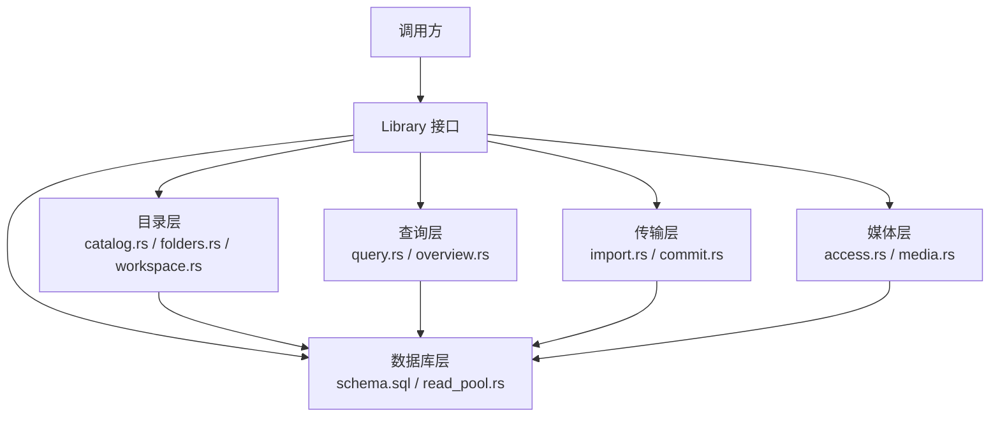
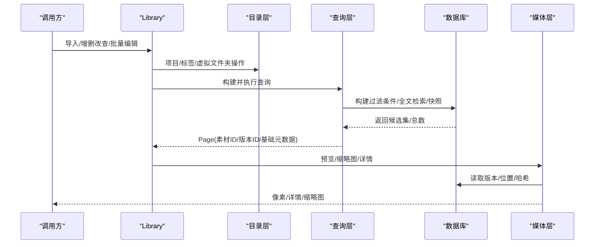
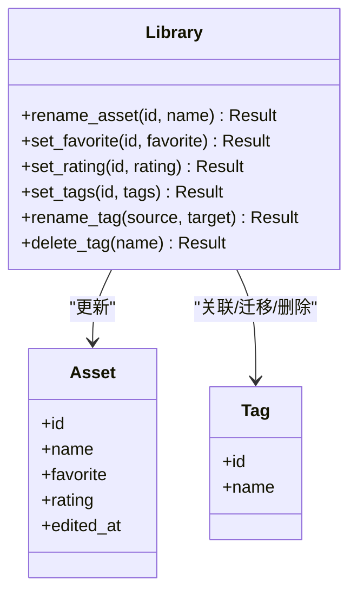
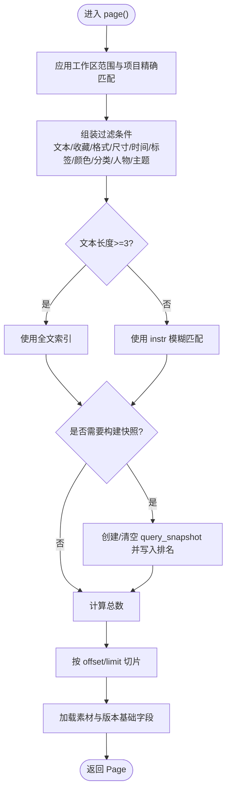
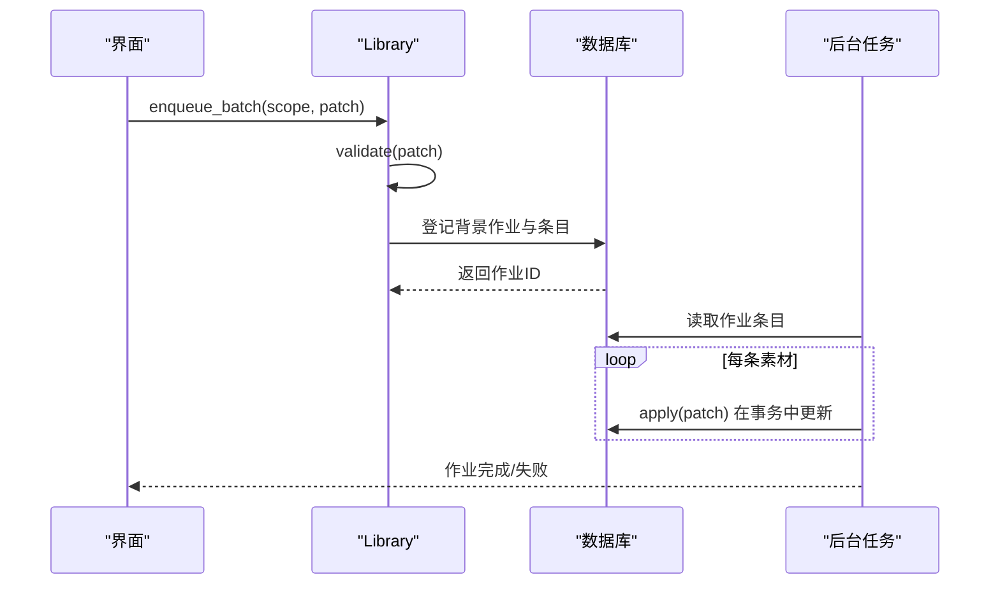
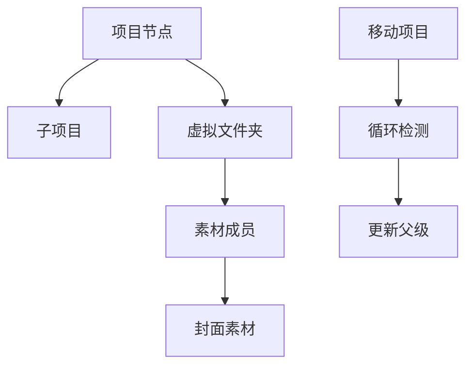
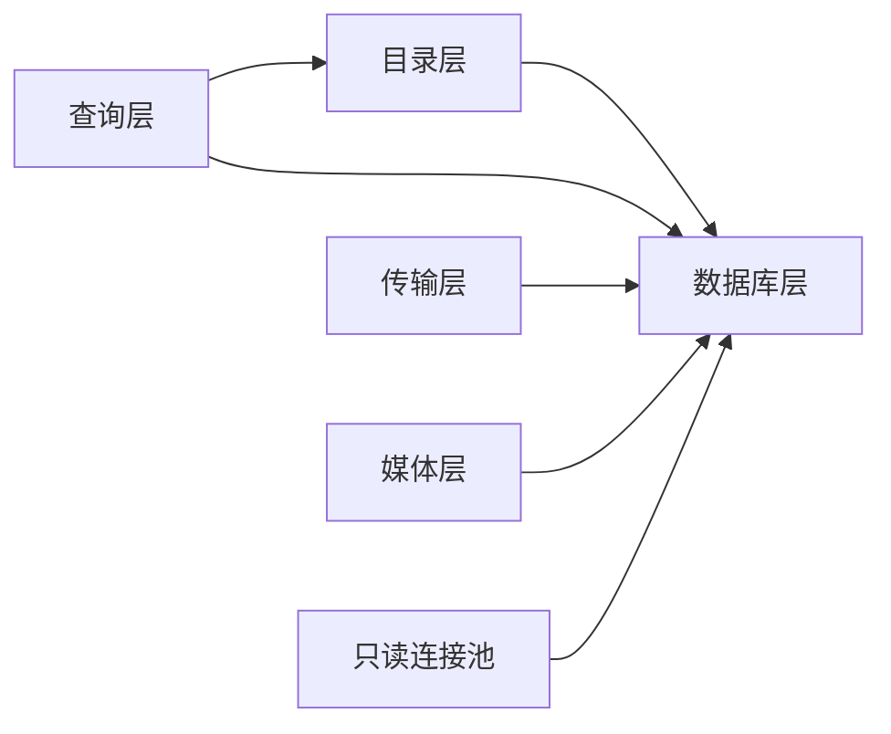

# 目录与素材管理 API

> Repo Wiki 节点 `catalog-api`
> 导出自 Qoder 知识库快照 `8fbe02f6-57c2-4874-b725-1a8130851fd9`，代码基线 `7a7a8e75e18bd90294e09cd422dd7ed5a04813a0`（分支 main，zh-CN）。

<cite>
**本文引用的文件**   
- [catalog.rs](../../../../crates/moriq-library/src/catalog/catalog.rs)
- [folders.rs](../../../../crates/moriq-library/src/catalog/folders.rs)
- [query.rs](../../../../crates/moriq-library/src/catalog/query.rs)
- [overview.rs](../../../../crates/moriq-library/src/catalog/overview.rs)
- [edits.rs](../../../../crates/moriq-library/src/catalog/edits.rs)
- [batch.rs](../../../../crates/moriq-library/src/catalog/batch.rs)
- [workspace.rs](../../../../crates/moriq-library/src/catalog/workspace.rs)
- [import.rs](../../../../crates/moriq-library/src/transfer/import.rs)
- [commit.rs](../../../../crates/moriq-library/src/transfer/commit.rs)
- [schema.sql](../../../../crates/moriq-library/src/database/schema.sql)
- [read_pool.rs](../../../../crates/moriq-library/src/database/read_pool.rs)
- [access.rs](../../../../crates/moriq-library/src/media/access.rs)
- [media.rs](../../../../crates/moriq-library/src/media/media.rs)
</cite>

## 目录
1. [简介](#简介)
2. [项目结构](#项目结构)
3. [核心组件](#核心组件)
4. [架构总览](#架构总览)
5. [详细接口说明](#详细接口说明)
6. [依赖关系分析](#依赖关系分析)
7. [性能与优化](#性能与优化)
8. [故障排查](#故障排查)
9. [结论](#结论)

## 简介
本文件面向目录与素材管理子系统，聚焦以下能力：
- 素材的导入、删除、重命名、评分、收藏、标签与分类更新。
- 版本管理与外部引用校验、路径重定位。
- 项目组织、虚拟文件夹与成员管理、封面设置。
- 高级查询筛选、全文搜索、分页、排序、范围选择与邻近浏览。
- 批量编辑的原子性、后台任务化执行及错误恢复。
- 项目隔离、移动与循环检测。
- 查询快照、全文索引、只读连接池和缩略图缓存等性能机制。

## 项目结构
该子系统位于 `moriq-library` 库中，按职责划分为目录、数据库、传输、媒体等模块：
- 目录层负责项目、标签、虚拟文件夹、查询与概览。
- 传输层负责导入、提交、重复检测与恢复。
- 数据库层提供模式、事务、只读连接池。
- 媒体层负责版本来源、预览、缩略图与详情装配。



**图示来源**
- [catalog.rs:1-200](../../../../crates/moriq-library/src/catalog/catalog.rs#L1-L200)
- [folders.rs:1-200](../../../../crates/moriq-library/src/catalog/folders.rs#L1-L200)
- [query.rs:1-200](../../../../crates/moriq-library/src/catalog/query.rs#L1-L200)
- [import.rs:1-200](../../../../crates/moriq-library/src/transfer/import.rs#L1-L200)
- [commit.rs:1-200](../../../../crates/moriq-library/src/transfer/commit.rs#L1-L200)
- [schema.sql:1-42](../../../../crates/moriq-library/src/database/schema.sql#L1-L42)
- [read_pool.rs:1-97](../../../../crates/moriq-library/src/database/read_pool.rs#L1-L97)
- [access.rs:1-23](../../../../crates/moriq-library/src/media/access.rs#L1-L23)
- [media.rs:1-200](../../../../crates/moriq-library/src/media/media.rs#L1-L200)

**章节来源**
- [catalog.rs:1-200](../../../../crates/moriq-library/src/catalog/catalog.rs#L1-L200)
- [query.rs:1-200](../../../../crates/moriq-library/src/catalog/query.rs#L1-L200)
- [import.rs:1-200](../../../../crates/moriq-library/src/transfer/import.rs#L1-L200)
- [commit.rs:1-200](../../../../crates/moriq-library/src/transfer/commit.rs#L1-L200)
- [schema.sql:1-42](../../../../crates/moriq-library/src/database/schema.sql#L1-L42)
- [read_pool.rs:1-97](../../../../crates/moriq-library/src/database/read_pool.rs#L1-L97)
- [access.rs:1-23](../../../../crates/moriq-library/src/media/access.rs#L1-L23)
- [media.rs:1-200](../../../../crates/moriq-library/src/media/media.rs#L1-L200)

## 核心组件
- Library：资源库入口，聚合目录、查询、传输、媒体与数据库访问能力。
- Catalog：项目树、标签、虚拟文件夹、邻居浏览、范围选择与外部引用处理。
- Query：构建过滤条件、全文检索、分页与查询快照。
- Import/Commit：导入流程、重复检测、暂存与操作日志恢复。
- Workspace：项目范围冻结、对象归属校验、复制与隔离。
- Media/Access：版本来源、预览、缩略图读取与详情装配。
- ReadPool：只读连接池，保护读取并发与临时表清理。

**章节来源**
- [library/core.rs:1-200](../../../../crates/moriq-library/src/library/core.rs#L1-L200)
- [catalog.rs:1-200](../../../../crates/moriq-library/src/catalog/catalog.rs#L1-L200)
- [query.rs:1-200](../../../../crates/moriq-library/src/catalog/query.rs#L1-L200)
- [workspace.rs:1-200](../../../../crates/moriq-library/src/catalog/workspace.rs#L1-L200)
- [import.rs:1-200](../../../../crates/moriq-library/src/transfer/import.rs#L1-L200)
- [commit.rs:1-200](../../../../crates/moriq-library/src/transfer/commit.rs#L1-L200)
- [media.rs:1-200](../../../../crates/moriq-library/src/media/media.rs#L1-L200)
- [read_pool.rs:1-97](../../../../crates/moriq-library/src/database/read_pool.rs#L1-L97)

## 架构总览
目录与素材管理的典型请求路径如下：



**图示来源**
- [catalog.rs:1-200](../../../../crates/moriq-library/src/catalog/catalog.rs#L1-L200)
- [query.rs:1-200](../../../../crates/moriq-library/src/catalog/query.rs#L1-L200)
- [media.rs:1-200](../../../../crates/moriq-library/src/media/media.rs#L1-L200)
- [read_pool.rs:1-97](../../../../crates/moriq-library/src/database/read_pool.rs#L1-L97)

## 详细接口说明

### 素材导入与版本管理
- 单文件导入：
  - 入口方法：`Library::import`。
  - 内部流程：文件大小预算校验、写入暂存文件、记录操作日志、解析媒体信息、重复检测、安装版本、提交或恢复。
  - 关键约束：空文件或超出预算拒绝；重复内容可复用现有资产；项目内同名副本使用硬链接或冲突检测。
- 受管路径与项目归属：
  - 根据项目配置生成安全路径，避免覆盖已有内容；支持相对路径保留。
  - 若目标项目已存在相同内容，会建立项目级文件关联。
- 外部引用：
  - 可读取预期哈希用于校验；可提交新路径并在重定位前验证一致性。

```mermaid
flowchart TD
    Start(["开始导入"]) --> ValidateSize["校验文件大小与空文件"]
    ValidateSize --> Stage["写入暂存文件并记录操作日志"]
    Stage --> Prepare["解析媒体信息/计算哈希"]
    Prepare --> Duplicate{"是否重复内容?"}
    Duplicate -->|是| Reuse["复用现有资产或创建项目关联"]
    Duplicate -->|否| Install["安装新版本/缩略图/元数据"]
    Reuse --> Commit["提交操作日志/清理暂存"]
    Install --> Commit
    Commit --> End(["结束"])
    Note over Duplicate: 重复检测基于哈希与字节数，同时考虑项目归属
```

**图示来源**
- [commit.rs:1-200](../../../../crates/moriq-library/src/transfer/commit.rs#L1-L200)
- [import.rs:1-200](../../../../crates/moriq-library/src/transfer/import.rs#L1-L200)

**章节来源**
- [commit.rs:1-200](../../../../crates/moriq-library/src/transfer/commit.rs#L1-L200)
- [import.rs:1-200](../../../../crates/moriq-library/src/transfer/import.rs#L1-L200)
- [schema.sql:1-42](../../../../crates/moriq-library/src/database/schema.sql#L1-L42)

### 素材增删改查
- 新增：通过导入流程完成。
- 删除：通过批量编辑中的“回收站”标记实现；删除不直接移除文件，而是设置删除时间戳。
- 重命名：
  - 接口：`rename_asset`。
  - 校验名称长度与空值；更新编辑时间；失效旧查询快照。
- 评分与收藏：
  - 接口：`set_rating`、`set_favorite`。
  - 评分范围 0～5；收藏状态即时生效；均更新编辑时间并失效快照。
- 标签管理：
  - 接口：`set_tags`。
  - 限制最多 64 个标签，每个不超过 128 字节；保留 AI 可见标签与人工覆盖语义；自动标签被移除时记录拒绝信息。
  - 重命名与删除标签：
    - `rename_tag`：在作用域内迁移成员，保留未被人工覆盖的 AI 拒绝记录。
    - `delete_tag`：删除标签及其关联，同步维护拒绝记录与统计一致性。



**图示来源**
- [edits.rs:1-106](../../../../crates/moriq-library/src/catalog/edits.rs#L1-L106)
- [catalog.rs:1-200](../../../../crates/moriq-library/src/catalog/catalog.rs#L1-L200)

**章节来源**
- [edits.rs:1-106](../../../../crates/moriq-library/src/catalog/edits.rs#L1-L106)
- [catalog.rs:1-200](../../../../crates/moriq-library/src/catalog/catalog.rs#L1-L200)

### 查询系统与高级筛选
- 分页查询：
  - 接口：`page(query, offset, limit)`。
  - 默认最大页大小 128；未过滤时使用 `asset_order` 倒序；过滤时创建或复用 `query_snapshot`。
  - 返回 `Page{total, offset, assets}`，包含素材 ID、版本 ID、名称、格式、尺寸、字节数、收藏、评分、导入时间。
- 排序：
  - 支持最新、最旧、名称、体积、评分排序；语义活跃排序时可保持用户选择顺序。
- 筛选条件（部分）：
  - 文本搜索：优先走全文索引，否则回退到名称、备注、AI 搜索源与标签的模糊匹配。
  - 收藏、回收站、格式、评分区间、字节区间、导入时间区间、宽度下限、方向、无标签、未分配、颜色、编辑时间、存储状态、分类、人物、语义 ID、主题、传统分类等。
  - 精确项目匹配与非精确后代项目匹配。
- 全文搜索：
  - 短文本（少于 3 字符）回退到 `instr` 模糊匹配；长文本使用 FTS 表进行全文检索。
- 范围选择与邻近浏览：
  - `selection_range`：支持两个锚点之间的选择，限制最大跨度 10000。
  - `neighborhood`：以锚点为中心返回少量素材，支持跨分页切换。



**图示来源**
- [query.rs:1-200](../../../../crates/moriq-library/src/catalog/query.rs#L1-L200)

**章节来源**
- [query.rs:1-200](../../../../crates/moriq-library/src/catalog/query.rs#L1-L200)
- [catalog.rs:1-200](../../../../crates/moriq-library/src/catalog/catalog.rs#L1-L200)

### 批量操作与原子性
- 批量编辑登记：
  - 接口：`enqueue_batch(scope, patch)`。
  - 支持按查询结果或指定素材集合批量修改。
  - 冻结选择范围后，将批量任务登记为后台作业，持久化负载与条目计数。
- 批量字段校验：
  - 限制评分、备注、分类、标签数量与长度；拒绝无实际变更的请求。
- 批量执行：
  - 后台任务逐条应用 `apply`，在事务中更新收藏、评分、备注、分类、标签与项目归属。
  - 移动到不同项目时可能触发素材克隆以维持项目隔离。
- 原子性与一致性：
  - 批量条目在事务中写入；失败时不会部分提交。
  - 标签删除先记录拒绝，再移除关联，确保 AI 语义一致。



**图示来源**
- [batch.rs:1-159](../../../../crates/moriq-library/src/catalog/batch.rs#L1-L159)

**章节来源**
- [batch.rs:1-159](../../../../crates/moriq-library/src/catalog/batch.rs#L1-L159)

### 项目组织与文件夹管理
- 项目创建与层级：
  - `create_project`：校验名称与长度，插入项目并初始化独立 AI 配置。
  - `create_child_project`：校验父项目并创建子项目，保留树关系。
  - `move_project`：调整父级关系，递归检测循环，防止移入自身或后代。
- 虚拟文件夹与收藏分组：
  - `virtual_folders`：列出当前项目的虚拟文件夹及其封面与成员计数。
  - `create_virtual_folder`：创建分组并登记项目归属。
  - `rename_virtual_folder` / `delete_virtual_folder`：重命名或删除分组。
  - `virtual_folder_members`：批量添加/移除成员，限制 1～10000，校验素材属于当前项目且作用域一致。
  - `virtual_folder_cover`：设置封面，需为有效成员；封面失效时按稳定规则回退。



**图示来源**
- [catalog.rs:1-200](../../../../crates/moriq-library/src/catalog/catalog.rs#L1-L200)
- [folders.rs:1-200](../../../../crates/moriq-library/src/catalog/folders.rs#L1-L200)

**章节来源**
- [catalog.rs:1-200](../../../../crates/moriq-library/src/catalog/catalog.rs#L1-L200)
- [folders.rs:1-200](../../../../crates/moriq-library/src/catalog/folders.rs#L1-L200)

### 素材移动与项目隔离
- 复制到项目：
  - 接口：`copy_to_project(ids, project, annotations)`。
  - 限制 1～10000 个素材；跳过已在目标项目中存在的素材。
  - 可选保留注释与分类；若不保留则清除收藏、评分、备注、标签、分类与 AI 相关数据。
- 项目隔离：
  - 批量编辑移动到不同项目时，可能克隆素材以维持隔离。
  - 工作区范围冻结，防止跨项目误操作。

**章节来源**
- [workspace.rs:1-200](../../../../crates/moriq-library/src/catalog/workspace.rs#L1-L200)
- [batch.rs:1-159](../../../../crates/moriq-library/src/catalog/batch.rs#L1-L159)

### 预览与缩略图
- 缩略图读取：
  - 接口：`thumbnail(version)`。
  - 固定 256×256 上限，限制解码内存；不存在则返回空。
- 预览读取：
  - 接口：`preview(id)`。
  - 通过统一媒体来源获取当前展示版本的像素。
- 批量缩略图计划：
  - 接口：`thumbnail_plan(versions)`。
  - 一次最多 128 张；缓存命中则直接打开，否则重建。

**章节来源**
- [access.rs:1-23](../../../../crates/moriq-library/src/media/access.rs#L1-L23)
- [media.rs:1-200](../../../../crates/moriq-library/src/media/media.rs#L1-L200)

## 依赖关系分析
- 目录层依赖数据库层进行事务与模式操作。
- 查询层依赖目录层的工作区范围与过滤编译。
- 传输层依赖导入准备、哈希计算与操作日志。
- 媒体层依赖数据库版本信息与文件路径，支持外部引用路径。
- 只读连接池保护并发读取并清理临时表，避免影响写入端。



**图示来源**
- [catalog.rs:1-200](../../../../crates/moriq-library/src/catalog/catalog.rs#L1-L200)
- [query.rs:1-200](../../../../crates/moriq-library/src/catalog/query.rs#L1-L200)
- [import.rs:1-200](../../../../crates/moriq-library/src/transfer/import.rs#L1-L200)
- [media.rs:1-200](../../../../crates/moriq-library/src/media/media.rs#L1-L200)
- [read_pool.rs:1-97](../../../../crates/moriq-library/src/database/read_pool.rs#L1-L97)

**章节来源**
- [catalog.rs:1-200](../../../../crates/moriq-library/src/catalog/catalog.rs#L1-L200)
- [query.rs:1-200](../../../../crates/moriq-library/src/catalog/query.rs#L1-L200)
- [import.rs:1-200](../../../../crates/moriq-library/src/transfer/import.rs#L1-L200)
- [media.rs:1-200](../../../../crates/moriq-library/src/media/media.rs#L1-L200)
- [read_pool.rs:1-97](../../../../crates/moriq-library/src/database/read_pool.rs#L1-L97)

## 性能与优化
- 查询快照与排名表：
  - 未过滤查询直接使用 `asset_order`，避免全表扫描。
  - 过滤查询创建 `query_snapshot` 并建唯一索引，后续分页按 position 读取，降低 OFFSET 开销。
- 全文索引：
  - 长文本使用 FTS 加速；短文本回退 `instr`，保证参数化与安全性。
- 只读连接池：
  - 复用连接、设置缓存与临时存储，批量读取时避免锁竞争。
  - Drop 时回滚遗留事务并清理临时表，保障稳定性。
- 缩略图缓存：
  - 固定尺寸与内存限制，减少大图解码成本。
- 大数据集处理：
  - 分页上限 128；批量操作限制 10000；范围选择限制 10000。
  - 背景作业异步执行批量编辑，避免阻塞主流程。

**章节来源**
- [query.rs:1-200](../../../../crates/moriq-library/src/catalog/query.rs#L1-L200)
- [read_pool.rs:1-97](../../../../crates/moriq-library/src/database/read_pool.rs#L1-L97)
- [access.rs:1-23](../../../../crates/moriq-library/src/media/access.rs#L1-L23)
- [batch.rs:1-159](../../../../crates/moriq-library/src/catalog/batch.rs#L1-L159)

## 故障排查
- 导入失败：
  - 检查文件大小预算与空文件；查看操作日志阶段是否为 `interrupted`。
  - 暂存文件保留以便恢复；确认重复内容是否被正确复用。
- 查询异常：
  - 检查工作区范围是否与查询项目一致；避免跨项目查询。
  - 确认全文索引是否存在；短文本回退逻辑是否生效。
- 标签不一致：
  - 检查 AI 拒绝标签记录；确认人工标签与自动标签覆盖关系。
- 批量任务失败：
  - 检查批量载荷 JSON 与字段合法性；确认目标项目存在且作用域正确。
- 媒体读取错误：
  - 检查版本路径与外部引用路径；确认缩略图缓存是否存在。

**章节来源**
- [commit.rs:1-200](../../../../crates/moriq-library/src/transfer/commit.rs#L1-L200)
- [query.rs:1-200](../../../../crates/moriq-library/src/catalog/query.rs#L1-L200)
- [edits.rs:1-106](../../../../crates/moriq-library/src/catalog/edits.rs#L1-L106)
- [batch.rs:1-159](../../../../crates/moriq-library/src/catalog/batch.rs#L1-L159)
- [media.rs:1-200](../../../../crates/moriq-library/src/media/media.rs#L1-L200)

## 结论
目录与素材管理子系统围绕 Library 接口组织，提供从导入、版本管理到查询、批量编辑与项目隔离的完整能力。其设计强调：
- 参数化与安全检查，避免注入与越权。
- 事务与操作日志，确保导入与批量操作的原子性与可恢复性。
- 查询快照与全文索引，提升大数据集下的分页与检索性能。
- 工作区范围冻结与项目隔离，防止跨项目误操作。
- 只读连接池与缩略图缓存，优化并发读取与媒体渲染。

这些机制共同构成一个稳健、可扩展的素材管理平台，适用于桌面应用与后端服务场景。