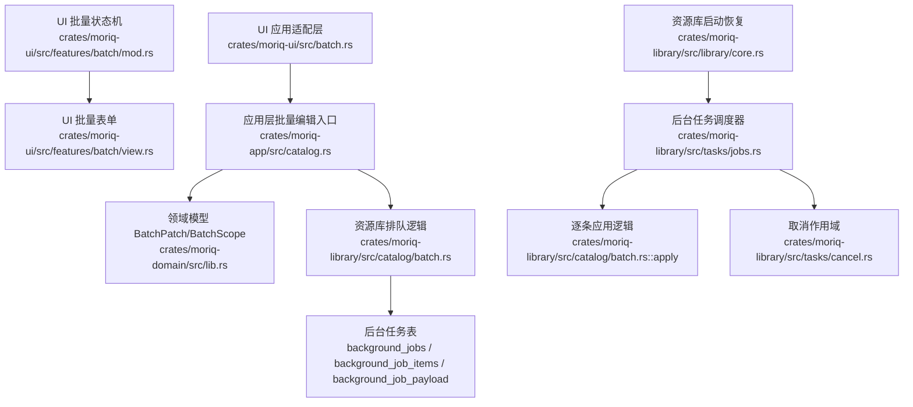
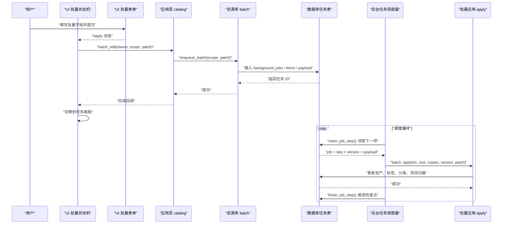
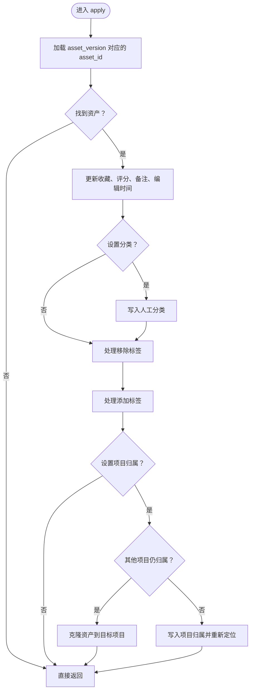
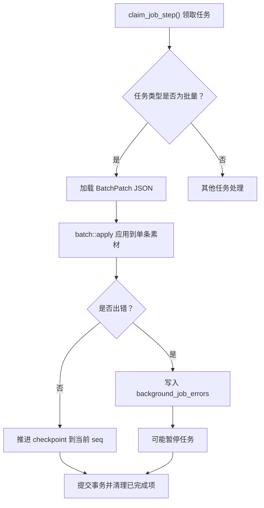
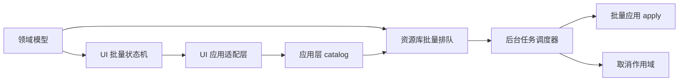

# 批量操作 API

> Repo Wiki 节点 `batch-operations-api`
> 导出自 Qoder 知识库快照 `8fbe02f6-57c2-4874-b725-1a8130851fd9`，代码基线 `7a7a8e75e18bd90294e09cd422dd7ed5a04813a0`（分支 main，zh-CN）。

<cite>
**本文引用的文件**   
- [批量编辑实现](../../../../crates/moriq-library/src/catalog/batch.rs)
- [领域模型与批量补丁](../../../../crates/moriq-domain/src/lib.rs)
- [应用层批量编辑入口](../../../../crates/moriq-app/src/catalog.rs)
- [后台任务调度与执行](../../../../crates/moriq-library/src/tasks/jobs.rs)
- [取消作用域与中断机制](../../../../crates/moriq-library/src/tasks/cancel.rs)
- [资源库启动期任务恢复](../../../../crates/moriq-library/src/library/core.rs)
- [UI 批量状态机](../../../../crates/moriq-ui/src/features/batch/mod.rs)
- [UI 批量表单视图](../../../../crates/moriq-ui/src/features/batch/view.rs)
- [UI 应用适配层](../../../../crates/moriq-ui/src/batch.rs)
</cite>

## 目录
1. [引言](#引言)
2. [项目结构](#项目结构)
3. [核心组件](#核心组件)
4. [架构总览](#架构总览)
5. [详细组件分析](#详细组件分析)
6. [依赖关系分析](#依赖关系分析)
7. [性能与配置](#性能与配置)
8. [故障排查指南](#故障排查指南)
9. [结论](#结论)

## 引言
本文件面向需要理解并集成“批量标签更新、批量移动（项目归属调整）、批量删除等”能力的开发者，聚焦仓库中已实现的批量字段编辑能力。当前代码中的批量操作以“批量字段编辑”为主：支持批量设置收藏、评分、备注、人工分类、添加或移除标签，以及将素材移动到目标项目；尚未直接暴露独立的批量删除接口。所有批量操作均通过后台任务队列持久化，具备检查点、原子性、可暂停/恢复和可取消等特性。

## 项目结构
批量操作跨越 UI 层、应用服务层、领域模型层、数据库与后台任务子系统：

**图表来源**
- [UI 批量状态机:1-153](../../../../crates/moriq-ui/src/features/batch/mod.rs#L1-L153)
- [UI 批量表单视图:1-85](../../../../crates/moriq-ui/src/features/batch/view.rs#L1-L85)
- [UI 应用适配层:1-76](../../../../crates/moriq-ui/src/batch.rs#L1-L76)
- [应用层批量编辑入口:70-120](../../../../crates/moriq-app/src/catalog.rs#L70-L120)
- [领域模型与批量补丁:450-490](../../../../crates/moriq-domain/src/lib.rs#L450-L490)
- [批量编辑实现:1-159](../../../../crates/moriq-library/src/catalog/batch.rs#L1-L159)
- [后台任务调度与执行:436-740](../../../../crates/moriq-library/src/tasks/jobs.rs#L436-L740)
- [取消作用域与中断机制:1-85](../../../../crates/moriq-library/src/tasks/cancel.rs#L1-L85)
- [资源库启动期任务恢复:260-280](../../../../crates/moriq-library/src/library/core.rs#L260-L280)

**章节来源**
- [UI 批量状态机:1-153](../../../../crates/moriq-ui/src/features/batch/mod.rs#L1-L153)
- [UI 批量表单视图:1-85](../../../../crates/moriq-ui/src/features/batch/view.rs#L1-L85)
- [UI 应用适配层:1-76](../../../../crates/moriq-ui/src/batch.rs#L1-L76)
- [应用层批量编辑入口:70-120](../../../../crates/moriq-app/src/catalog.rs#L70-L120)
- [领域模型与批量补丁:450-490](../../../../crates/moriq-domain/src/lib.rs#L450-L490)
- [批量编辑实现:1-159](../../../../crates/moriq-library/src/catalog/batch.rs#L1-L159)
- [后台任务调度与执行:436-740](../../../../crates/moriq-library/src/tasks/jobs.rs#L436-L740)
- [取消作用域与中断机制:1-85](../../../../crates/moriq-library/src/tasks/cancel.rs#L1-L85)
- [资源库启动期任务恢复:260-280](../../../../crates/moriq-library/src/library/core.rs#L260-L280)

## 核心组件
- 领域模型
  - `BatchPatch`：描述一次批量修改的字段，包括收藏、评分、备注、人工分类、新增标签、移除标签和目标项目。
  - `BatchScope`：定义批量范围，支持按选定素材集合或查询结果快照。
- UI 批量状态机
  - 维护用户输入、是否选择全部查询结果、提交标识、请求序号，防止重复提交并处理完成回调。
- UI 表单视图
  - 提供项目归属选择、收藏/评分选择、标签输入、分类输入、备注替换开关和提交按钮。
- 应用层适配
  - 将 UI 提交的 `BatchScope` 与 `BatchPatch` 封装为异步服务调用，并在完成后切换面板到任务列表。
- 资源库批量排队
  - 校验参数、冻结选择范围、写入后台任务、初始化进度项、计算总量。
- 后台任务调度
  - 读取下一个待处理项、加载 payload、执行 `batch::apply`、推进检查点、记录错误、完成清理。
- 取消机制
  - 基于线程局部作用域的取消标志，长耗时 I/O 可在块间检查取消。
- 资源库启动恢复
  - 启动时把运行中任务重置为可继续状态，并对含外部引用的非批量任务挂起。

**章节来源**
- [领域模型与批量补丁:450-490](../../../../crates/moriq-domain/src/lib.rs#L450-L490)
- [UI 批量状态机:1-153](../../../../crates/moriq-ui/src/features/batch/mod.rs#L1-L153)
- [UI 批量表单视图:1-85](../../../../crates/moriq-ui/src/features/batch/view.rs#L1-L85)
- [UI 应用适配层:1-76](../../../../crates/moriq-ui/src/batch.rs#L1-L76)
- [批量编辑实现:1-159](../../../../crates/moriq-library/src/catalog/batch.rs#L1-L159)
- [后台任务调度与执行:436-740](../../../../crates/moriq-library/src/tasks/jobs.rs#L436-L740)
- [取消作用域与中断机制:1-85](../../../../crates/moriq-library/src/tasks/cancel.rs#L1-L85)
- [资源库启动期任务恢复:260-280](../../../../crates/moriq-library/src/library/core.rs#L260-L280)

## 架构总览
批量操作的完整流程从 UI 开始，经过应用服务进入资源库，最终由后台任务调度器逐项执行。

**图表来源**
- [UI 批量状态机:60-153](../../../../crates/moriq-ui/src/features/batch/mod.rs#L60-L153)
- [UI 应用适配层:20-76](../../../../crates/moriq-ui/src/batch.rs#L20-L76)
- [应用层批量编辑入口:84-112](../../../../crates/moriq-app/src/catalog.rs#L84-L112)
- [批量编辑实现:33-159](../../../../crates/moriq-library/src/catalog/batch.rs#L33-L159)
- [后台任务调度与执行:436-740](../../../../crates/moriq-library/src/tasks/jobs.rs#L436-L740)

## 详细组件分析

### 领域模型：批量补丁与范围
`BatchPatch` 是批量操作的数据契约，包含以下字段：
- `favorite`：可选布尔值，表示统一设置收藏状态。
- `rating`：可选 0～5 评分。
- `notes`：可选备注；在 UI 中可选择“替换备注”，否则保留原值。
- `category`：可选人工分类字符串。
- `add_tags`：待添加标签列表。
- `remove_tags`：待移除标签列表。
- `project`：可选目标项目 ID，用于批量移动。

`BatchScope` 支持两种范围：
- `Assets(Vec<AssetId>)`：显式选择的素材集合。
- `Query(Box<Query>)`：基于查询的快照范围。

**章节来源**
- [领域模型与批量补丁:450-490](../../../../crates/moriq-domain/src/lib.rs#L450-L490)

### UI 批量状态机与表单
UI 层不直接持有全局服务，而是通过显式上下文驱动：
- `Context` 携带资源库身份、当前查询、选中素材、总数量、语言和可用项目。
- `BatchState` 保存用户输入、是否全选、保存中状态和请求序号。
- `Effect` 区分打开表单、提交、完成和失败。
- `Submission` 是提交给后端的最小负载，包含所有者、请求号、范围和补丁。

表单视图提供：
- 项目归属选择，默认“保持项目归属”。
- “选择全部查询结果”复选框，用于将范围转为查询快照。
- 收藏、评分、标签、分类、备注输入控件。
- 提示文案说明：字段一起保存，每个素材的修改在单个事务内完成。

**章节来源**
- [UI 批量状态机:1-153](../../../../crates/moriq-ui/src/features/batch/mod.rs#L1-L153)
- [UI 批量表单视图:1-85](../../../../crates/moriq-ui/src/features/batch/view.rs#L1-L85)

### 应用层批量编辑入口
应用层 `catalog` 模块暴露 `batch_edit` 方法：
- 接收 `LibraryId`、`BatchScope`、`BatchPatch`。
- 通过线程安全的 active 锁调用资源库 `enqueue_batch`。
- 将资源库错误转换为字符串错误，供 UI 展示。

UI 适配层在收到 `Completed` 后自动跳转到任务面板，并显示“批量修改已加入后台任务，可暂停并在重启后继续”的状态提示。

**章节来源**
- [应用层批量编辑入口:84-112](../../../../crates/moriq-app/src/catalog.rs#L84-L112)
- [UI 应用适配层:20-76](../../../../crates/moriq-ui/src/batch.rs#L20-L76)

### 资源库批量排队与范围冻结
`enqueue_batch` 负责创建可跟踪的后台任务：
1. 校验补丁内容。
2. 根据范围类型准备数据源：
   - 查询范围：先执行 `page(query, 0, 0)`，然后使用 `query_snapshot`；若查询为空且不在工作区，则回退到 `asset_order`。
   - 素材集合范围：要求属于当前工作区，限制数量在 1～10000，并将 ID 写入临时表 `batch_selection`。
3. 校验目标项目是否存在。
4. 写入 `background_jobs`、`workspace_jobs`、`background_job_payload`。
5. 将范围映射到 `background_job_items`，并按顺序编号。
6. 统计总量并持久化任务。

该设计保证了批量操作的范围在任务创建时被冻结，后续新增素材不会自动加入已有任务。

**章节来源**
- [批量编辑实现:1-159](../../../../crates/moriq-library/src/catalog/batch.rs#L1-L159)

### 批量应用逻辑：标签更新、项目归属与约束
`batch::apply` 在每个素材版本上应用一个补丁，并在单个数据库事务中完成：
- 通过 `asset_versions.id` 反查 `asset_id`。
- 更新 `assets.favorite`、`rating`、`notes`、`edited_at`。
- 若设置了分类，写入 `asset_classification` 并标记为手动分类。
- 对移除标签，先从 `asset_tags` 删除，同时记录被拒绝标签到 `ai_rejected_tags`。
- 对添加标签，先确保 `tags` 存在，再写入 `asset_tags`。
- 若指定项目归属：
  - 如果素材在其他项目中仍有归属，则通过 `project_isolation::clone_asset` 克隆素材到目标项目。
  - 否则仅写入 `project_assets` 并通过 `workspace::rehome_asset` 重新定位。

这意味着“批量移动”在当前实现中等价于批量设置项目归属，并根据项目隔离策略决定是否复制素材。

**图表来源**
- [批量编辑实现:97-159](../../../../crates/moriq-library/src/catalog/batch.rs#L97-L159)

**章节来源**
- [批量编辑实现:97-159](../../../../crates/moriq-library/src/catalog/batch.rs#L97-L159)

### 后台任务调度、原子性与错误恢复
后台任务调度器维护任务的完整生命周期：
- `background_jobs()` 列出最近 100 个任务，过滤当前工作区。
- `control_job()` 支持暂停、恢复、取消、重试失败任务和优先级调整。
- `claim_job_step()` 按优先级、创建时间和任务 ID 领取下一个待处理项，并锁定 `inflight=1`。
- `finish_job_step()` 在事务中复核任务世代、项目和分类配置，然后执行实际写入。

对于批量任务：
- payload 中包含 `BatchPatch` JSON。
- `Work.run_controlled` 对 `JobKind::Batch` 直接返回 payload，再由调度器调用 `batch::apply`。
- 每个素材对应 `background_job_items` 中的一行，按 `seq` 推进 `checkpoint`。
- 若某一项出错，错误信息写入 `background_job_errors`，任务状态可能变为暂停，但已完成的检查点得以保留。

**图表来源**
- [后台任务调度与执行:436-740](../../../../crates/moriq-library/src/tasks/jobs.rs#L436-L740)
- [批量编辑实现:97-159](../../../../crates/moriq-library/src/catalog/batch.rs#L97-L159)

**章节来源**
- [后台任务调度与执行:436-740](../../../../crates/moriq-library/src/tasks/jobs.rs#L436-L740)

### 取消机制与中断语义
取消采用线程局部作用域：
- `Scope::enter` 安装当前线程的取消标志。
- `stopped()` 读取当前作用域是否被取消。
- `check()` 将取消转换为资源库错误。
- `copy()` 在分块复制中定期检查取消，避免长时间 I/O 无法中断。

后台任务在执行前会检查取消状态，批量任务也受此作用域保护。取消不会泄漏到下一个任务。

**章节来源**
- [取消作用域与中断机制:1-85](../../../../crates/moriq-library/src/tasks/cancel.rs#L1-L85)

### 资源库启动期恢复
资源库启动时会：
- 将所有仍在运行的任务重置为非 inflight 状态。
- 若数据库中存在外部引用，则将非批量任务挂起，并要求用户核对来源后再继续。
- 迁移未完成时抛出明确错误。

这保证了批量任务可以在进程重启后继续执行。

**章节来源**
- [资源库启动期任务恢复:260-280](../../../../crates/moriq-library/src/library/core.rs#L260-L280)

## 依赖关系分析
- UI 层依赖领域模型中的 `BatchPatch` 和 `BatchScope`。
- UI 通过应用层服务调用资源库 `enqueue_batch`。
- 资源库批量逻辑依赖数据库任务表和资产、标签、分类、项目关联表。
- 后台任务调度器依赖资源库的 `library`、`database`、`workspace`、`project_isolation` 等模块。
- 取消机制与媒体 I/O 解耦，通过线程局部作用域传播取消信号。

**图表来源**
- [领域模型与批量补丁:450-490](../../../../crates/moriq-domain/src/lib.rs#L450-L490)
- [UI 批量状态机:1-153](../../../../crates/moriq-ui/src/features/batch/mod.rs#L1-L153)
- [UI 应用适配层:1-76](../../../../crates/moriq-ui/src/batch.rs#L1-L76)
- [应用层批量编辑入口:84-112](../../../../crates/moriq-app/src/catalog.rs#L84-L112)
- [批量编辑实现:33-159](../../../../crates/moriq-library/src/catalog/batch.rs#L33-L159)
- [后台任务调度与执行:436-740](../../../../crates/moriq-library/src/tasks/jobs.rs#L436-L740)
- [取消作用域与中断机制:1-85](../../../../crates/moriq-library/src/tasks/cancel.rs#L1-L85)

**章节来源**
- [领域模型与批量补丁:450-490](../../../../crates/moriq-domain/src/lib.rs#L450-L490)
- [UI 批量状态机:1-153](../../../../crates/moriq-ui/src/features/batch/mod.rs#L1-L153)
- [UI 应用适配层:1-76](../../../../crates/moriq-ui/src/batch.rs#L1-L76)
- [应用层批量编辑入口:84-112](../../../../crates/moriq-app/src/catalog.rs#L84-L112)
- [批量编辑实现:33-159](../../../../crates/moriq-library/src/catalog/batch.rs#L33-L159)
- [后台任务调度与执行:436-740](../../../../crates/moriq-library/src/tasks/jobs.rs#L436-L740)
- [取消作用域与中断机制:1-85](../../../../crates/moriq-library/src/tasks/cancel.rs#L1-L85)

## 性能与配置
### 批量操作配置选项
- 范围控制
  - 按选中素材：限制 1～10000 项，超出范围会拒绝。
  - 按查询范围：任务创建时保存图片范围快照，之后新增素材不会自动加入。
- 字段限制
  - 评分必须 ≤5。
  - 备注长度 ≤65536。
  - 分类不能为空且长度 ≤128。
  - 新增标签与移除标签总数 ≤64。
  - 单个标签长度 ≤128。
  - 至少修改一个字段。
- 任务行为
  - 批量任务优先级固定为 20。
  - 任务可暂停、恢复、取消。
  - 失败任务可重试。
  - 任务按优先级、创建时间和任务 ID 排序。

### 进度回调、取消机制与监控
- 进度回调
  - 当前实现没有前端驱动的进度回调函数；进度通过后台任务查询接口反映 `completed`、`total`、`checkpoint`、`error`。
- 取消机制
  - 后台任务在执行前检查取消标志；长耗时 I/O 使用分块复制并在块间检查取消。
- 性能监控
  - 可通过后台任务列表观察任务状态、检查点、失败次数和错误信息。
  - 批量任务本身没有细粒度指标收集；建议在上层应用扩展日志或指标钩子。

### 分批处理、内存管理与并发控制最佳实践
- 分批处理
  - 当需要一次性处理超过 10000 项时，应拆分为多个任务，分别使用不同的 `BatchScope::Assets`。
- 内存管理
  - 批量应用逐素材执行，避免一次性加载大量媒体数据；媒体读取预算由任务系统管理。
- 并发控制
  - 后台任务通过 `inflight` 和 `state` 控制并发；同一时刻只允许一个活跃步骤。
  - 若需更高吞吐，应在应用层拆分任务而不是自行并发执行批量应用。

**章节来源**
- [批量编辑实现:3-96](../../../../crates/moriq-library/src/catalog/batch.rs#L3-L96)
- [后台任务调度与执行:436-740](../../../../crates/moriq-library/src/tasks/jobs.rs#L436-L740)
- [取消作用域与中断机制:1-85](../../../../crates/moriq-library/src/tasks/cancel.rs#L1-L85)

## 故障排查指南
### 常见错误与恢复
- “请选择素材或使用完整查询范围”
  - 原因：批量素材为空或超过 10000。
  - 解决：缩小选择范围或改用查询范围。
- “请至少修改一个字段”
  - 原因：补丁未包含任何有效变更。
  - 解决：设置收藏、评分、备注、分类、标签或项目归属之一。
- “目标项目已不存在”
  - 原因：批量移动的目标项目 ID 无效。
  - 解决：确认项目仍存在后再提交。
- “后台任务已停止”
  - 原因：用户取消或资源库检测到外部引用导致非批量任务挂起。
  - 解决：查看任务状态，必要时恢复或重新提交。
- “任务状态已改变，请刷新后重试”
  - 原因：用户对任务执行了暂停、恢复或取消，但客户端状态过期。
  - 解决：刷新任务列表后再操作。

### 状态跟踪、日志记录与审计追踪
- 状态跟踪
  - 后台任务表包含 `id`、`kind`、`state`、`priority`、`checkpoint`、`total`、`failed`、`error`。
  - UI 通过 `background_jobs()` 获取任务列表并显示状态。
- 日志记录
  - 单项失败的错误消息会被截断并写入 `background_job_errors`。
  - 资源库启动期对迁移失败和外部引用有明确错误信息。
- 审计追踪
  - 当前实现没有独立的审计事件表；变更记录体现在资产字段、标签、分类和项目归属表中。
  - 如需审计，可在上层应用增加日志或审计表，将批量任务 ID、操作者、时间戳和变更摘要持久化。

**章节来源**
- [批量编辑实现:3-96](../../../../crates/moriq-library/src/catalog/batch.rs#L3-L96)
- [后台任务调度与执行:436-740](../../../../crates/moriq-library/src/tasks/jobs.rs#L436-L740)
- [资源库启动期任务恢复:260-280](../../../../crates/moriq-library/src/library/core.rs#L260-L280)

## 结论
当前仓库实现了完整的批量字段编辑能力，涵盖批量标签更新、批量项目归属调整和与之相关的约束、事务和后台任务机制。批量操作通过查询快照或素材集合冻结范围，使用后台任务表持久化，并在逐素材级别保证原子性。取消机制基于线程局部作用域，适合长耗时 I/O。虽然未直接暴露批量删除接口，但可通过扩展 `BatchPatch` 和 `batch::apply` 实现。生产环境建议使用小批量任务、结合任务列表进行进度监控，并在需要时在上层补充进度回调、性能指标和审计日志。