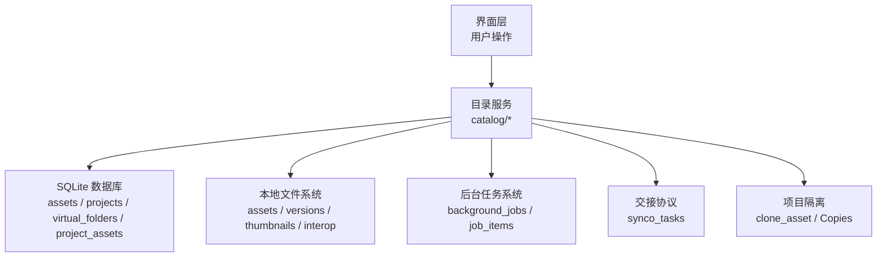
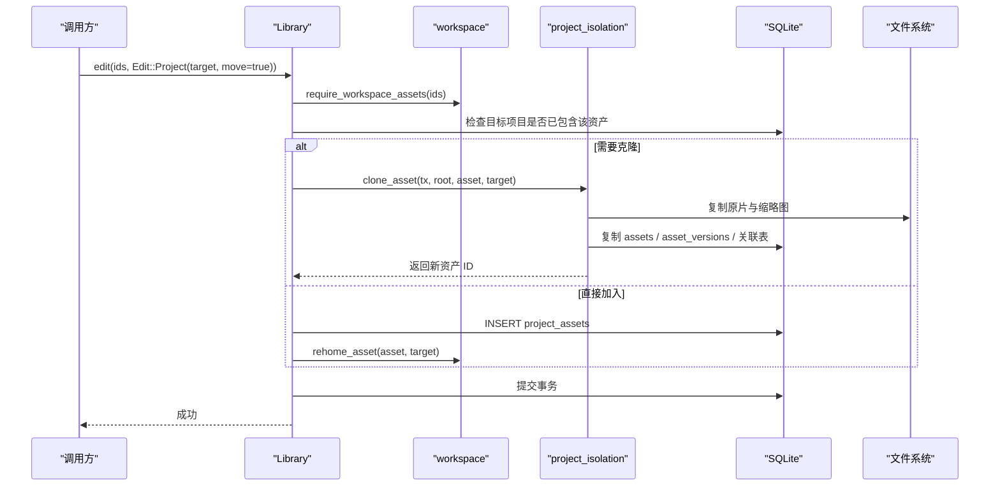
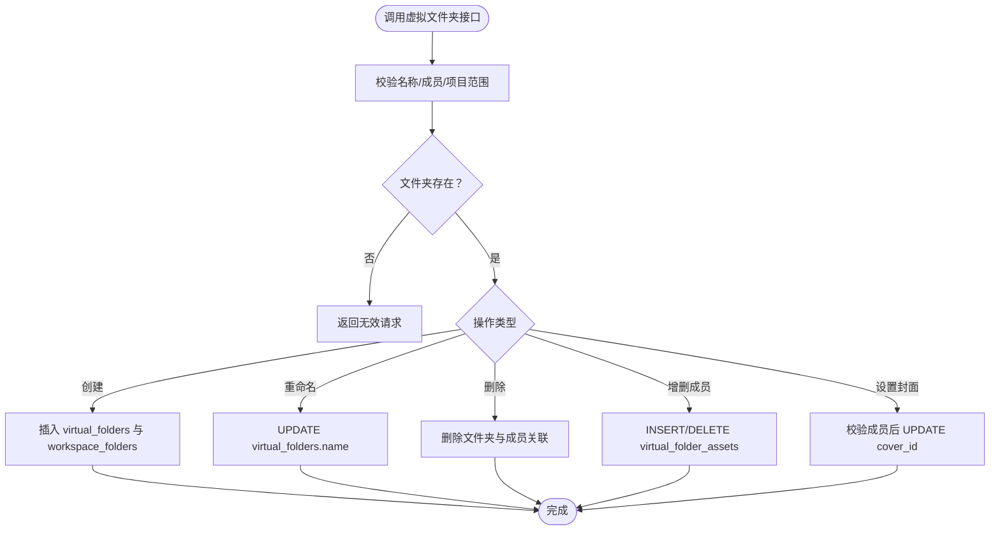
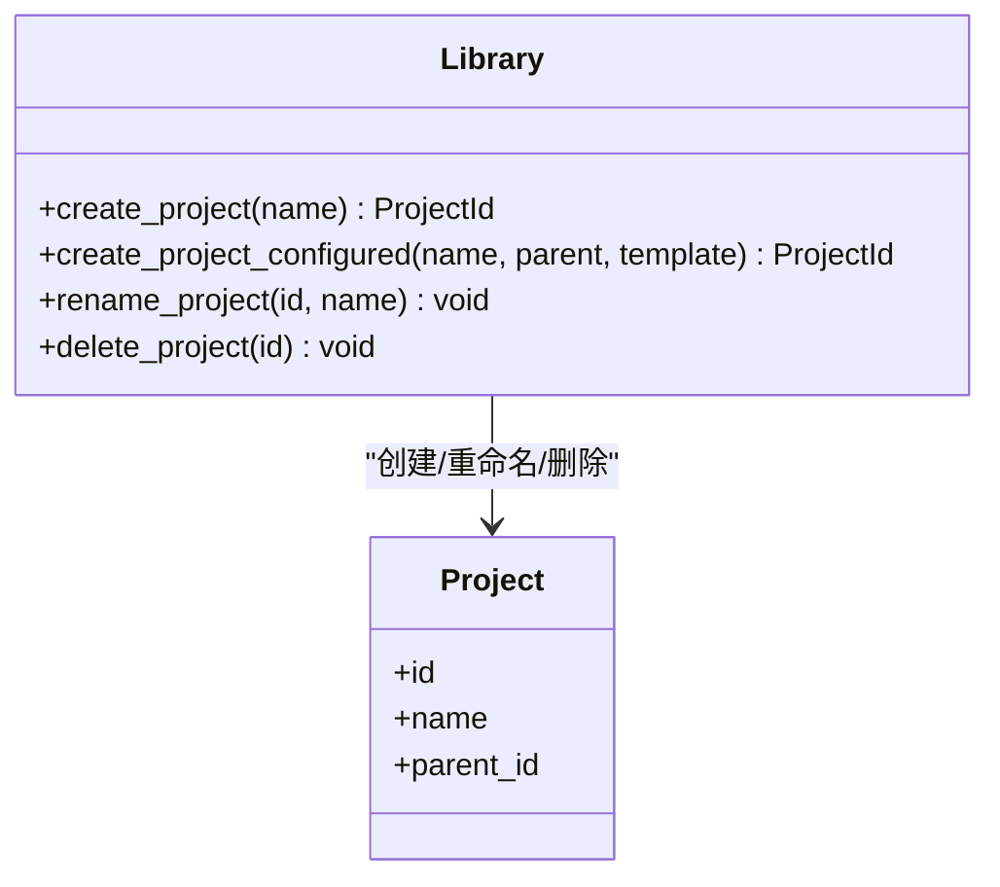
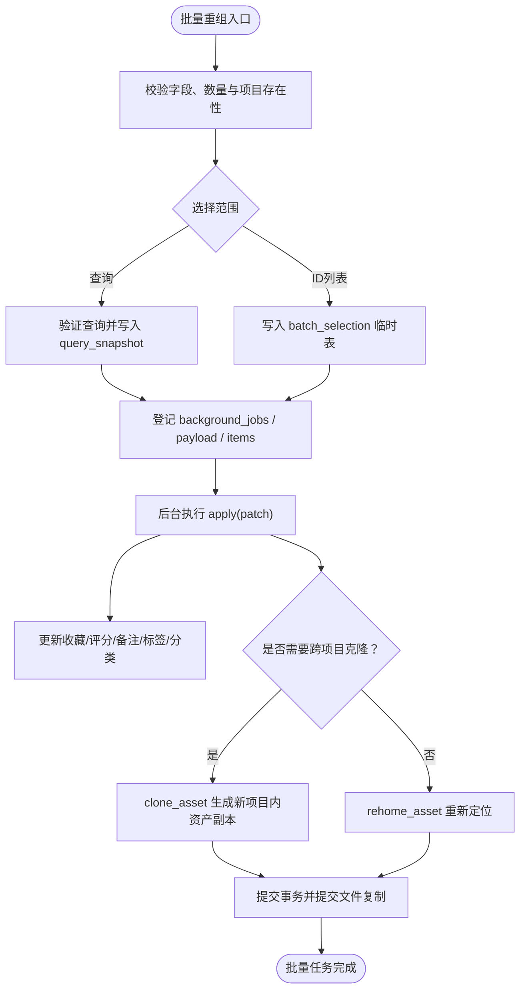
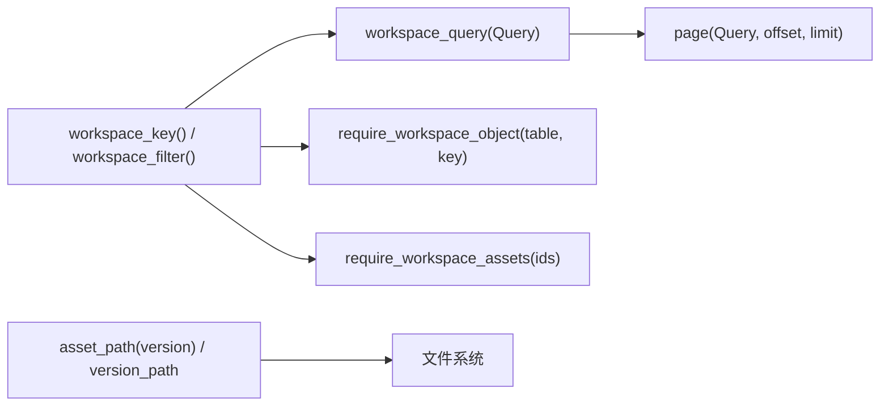
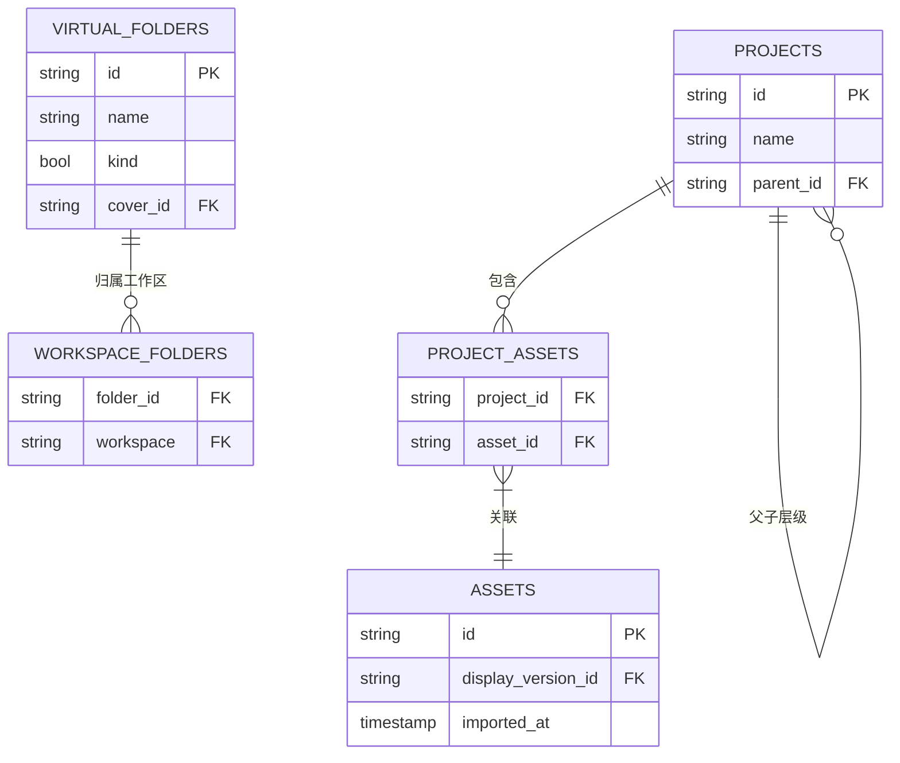
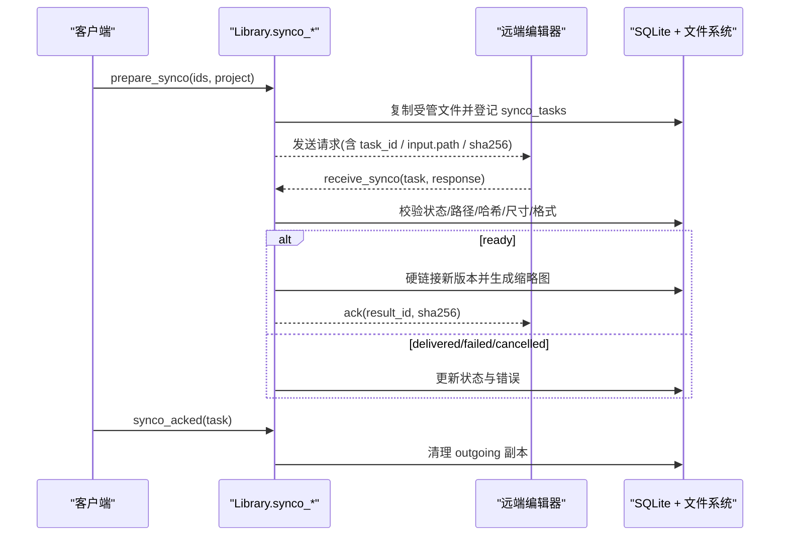
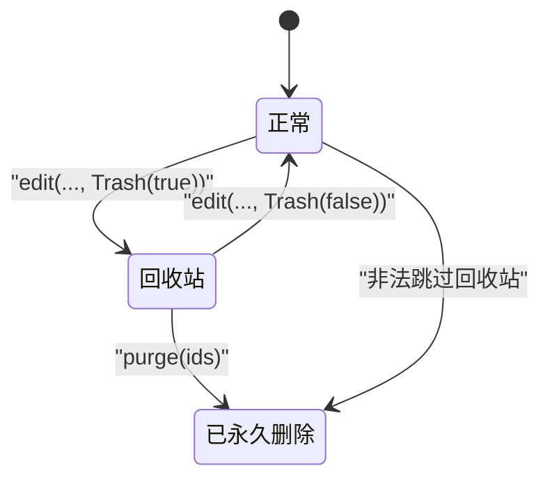
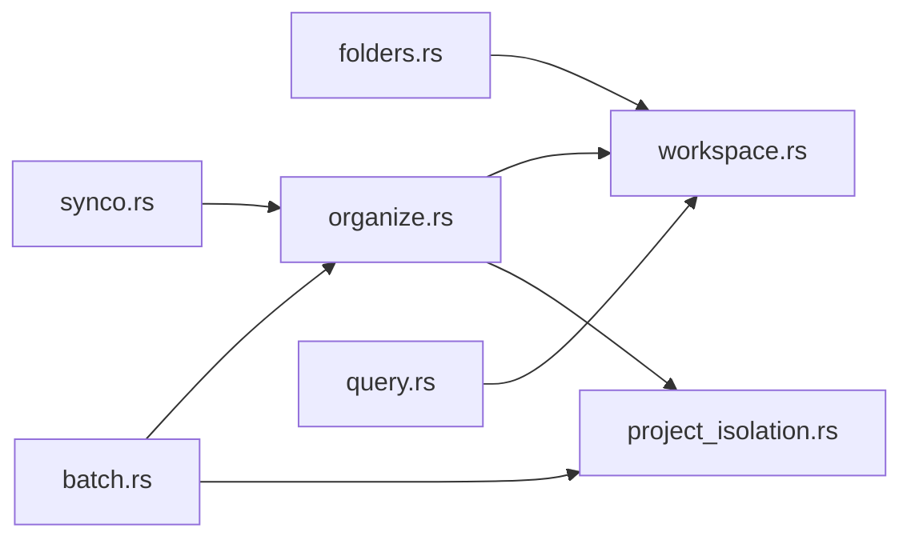

# 文件夹与项目 API

> Repo Wiki 节点 `folder-project-api`
> 导出自 Qoder 知识库快照 `8fbe02f6-57c2-4874-b725-1a8130851fd9`，代码基线 `7a7a8e75e18bd90294e09cd422dd7ed5a04813a0`（分支 main，zh-CN）。

<cite>
**本文引用的文件**   
- [folders.rs](../../../../crates/moriq-library/src/catalog/folders.rs)
- [organize.rs](../../../../crates/moriq-library/src/catalog/organize.rs)
- [workspace.rs](../../../../crates/moriq-library/src/catalog/workspace.rs)
- [project_isolation.rs](../../../../crates/moriq-library/src/catalog/project_isolation.rs)
- [query.rs](../../../../crates/moriq-library/src/catalog/query.rs)
- [location.rs](../../../../crates/moriq-library/src/catalog/location.rs)
- [batch.rs](../../../../crates/moriq-library/src/catalog/batch.rs)
- [synco.rs](../../../../crates/moriq-library/src/transfer/synco.rs)
- [edits.rs](../../../../crates/moriq-library/src/catalog/edits.rs)
- [purge.rs](../../../../crates/moriq-library/src/maintenance/purge.rs)
</cite>

## 目录
1. [引言](#引言)
2. [项目结构](#项目结构)
3. [核心组件](#核心组件)
4. [架构总览](#架构总览)
5. [详细组件分析](#详细组件分析)
6. [依赖关系分析](#依赖关系分析)
7. [性能与一致性特性](#性能与一致性特性)
8. [故障排查指南](#故障排查指南)
9. [结论](#结论)
10. [附录：组织场景示例](#附录组织场景示例)

## 引言
本文件聚焦资源库中的“文件夹”与“项目”相关 API，覆盖以下能力：
- 虚拟文件夹的创建、重命名、删除、成员管理与封面设置。
- 素材在文件夹间的移动、复制及批量组织结构变更。
- 项目的创建、重命名、删除、配置模板与隔离策略。
- 工作区范围控制、层级遍历、路径解析与权限校验。
- 同步机制（Synco）与冲突解决、数据一致性保证。
- 面向大量素材的高效整理流程。

这些能力由 `moriq-library` 中的 `catalog` 与 `transfer` 模块实现，并通过 SQLite 事务、快照缓存、异步任务队列以及项目身份克隆机制保证一致性与可恢复性。

## 项目结构
与本主题直接相关的代码主要位于 `crates/moriq-library/src/catalog` 与 `crates/moriq-library/src/transfer`：
- `catalog/folders.rs`：虚拟文件夹生命周期与成员管理。
- `catalog/organize.rs`：通用编排、编辑、项目重命名/删除、智能集合等。
- `catalog/workspace.rs`：工作区范围、对象归属校验、资产重定位与迁移。
- `catalog/project_isolation.rs`：项目级资产/版本身份克隆与旧模型升级。
- `catalog/query.rs`：分页查询、过滤条件、排序、布局尺寸读取。
- `catalog/location.rs`：人工地点保存与 EXIF GPS 解析。
- `catalog/batch.rs`：批量修改与后台任务登记。
- `transfer/synco.rs`：跨端交接任务准备、回执接收、清理与重试。
- `catalog/edits.rs`：素材名称、收藏、评分、标签与项目创建。
- `maintenance/purge.rs`：回收站资产的永久删除。

**图表来源**
- [folders.rs:1-120](../../../../crates/moriq-library/src/catalog/folders.rs#L1-L120)
- [organize.rs:1-120](../../../../crates/moriq-library/src/catalog/organize.rs#L1-L120)
- [workspace.rs:1-120](../../../../crates/moriq-library/src/catalog/workspace.rs#L1-L120)
- [project_isolation.rs:1-120](../../../../crates/moriq-library/src/catalog/project_isolation.rs#L1-L120)
- [query.rs:1-120](../../../../crates/moriq-library/src/catalog/query.rs#L1-L120)
- [synco.rs:1-120](../../../../crates/moriq-library/src/transfer/synco.rs#L1-L120)

**章节来源**
- [folders.rs:1-120](../../../../crates/moriq-library/src/catalog/folders.rs#L1-L120)
- [organize.rs:1-120](../../../../crates/moriq-library/src/catalog/organize.rs#L1-L120)
- [workspace.rs:1-120](../../../../crates/moriq-library/src/catalog/workspace.rs#L1-L120)
- [project_isolation.rs:1-120](../../../../crates/moriq-library/src/catalog/project_isolation.rs#L1-L120)
- [query.rs:1-120](../../../../crates/moriq-library/src/catalog/query.rs#L1-L120)
- [synco.rs:1-120](../../../../crates/moriq-library/src/transfer/synco.rs#L1-L120)

## 核心组件
- 虚拟文件夹组件：提供创建、重命名、删除、成员增减与封面选择。所有操作均要求对象属于当前工作区项目。
- 项目与资产隔离组件：通过 `clone_asset` 为不同项目维护独立资产和版本身份，避免可变状态共享。
- 工作区范围组件：统一注入 `project` 与 `project_exact` 条件，防止跨项目误操作。
- 查询与分页组件：支持复杂筛选、排序、FTS 搜索、AI 分类过滤，并提供页面布局尺寸。
- 批量编辑组件：将批量修改转为后台任务，按选择范围或查询快照执行。
- 交接同步组件：负责发送、接收、确认、清理与重试跨端处理结果，确保版本链完整。

**章节来源**
- [folders.rs:1-120](../../../../crates/moriq-library/src/catalog/folders.rs#L1-L120)
- [workspace.rs:1-120](../../../../crates/moriq-library/src/catalog/workspace.rs#L1-L120)
- [project_isolation.rs:1-120](../../../../crates/moriq-library/src/catalog/project_isolation.rs#L1-L120)
- [query.rs:1-120](../../../../crates/moriq-library/src/catalog/query.rs#L1-L120)
- [batch.rs:1-120](../../../../crates/moriq-library/src/catalog/batch.rs#L1-L120)
- [synco.rs:1-120](../../../../crates/moriq-library/src/transfer/synco.rs#L1-L120)

## 架构总览
下面的序列图展示“将素材移动到目标项目”的典型调用链，包括权限校验、项目隔离、文件复制与元数据映射。

**图表来源**
- [organize.rs:201-400](../../../../crates/moriq-library/src/catalog/organize.rs#L201-L400)
- [workspace.rs:201-300](../../../../crates/moriq-library/src/catalog/workspace.rs#L201-L300)
- [project_isolation.rs:1-200](../../../../crates/moriq-library/src/catalog/project_isolation.rs#L1-L200)

**章节来源**
- [organize.rs:201-400](../../../../crates/moriq-library/src/catalog/organize.rs#L201-L400)
- [workspace.rs:201-300](../../../../crates/moriq-library/src/catalog/workspace.rs#L201-L300)
- [project_isolation.rs:1-200](../../../../crates/moriq-library/src/catalog/project_isolation.rs#L1-L200)

## 详细组件分析

### 虚拟文件夹 API
- 查询虚拟文件夹：返回文件夹 ID、名称、收藏分组、封面与有效成员数量。
- 创建虚拟文件夹：校验名称长度并登记到 `virtual_folders` 与 `workspace_folders`。
- 重命名虚拟文件夹：要求对象属于当前工作区项目，校验名称后更新。
- 删除虚拟文件夹：仅删除文件夹及其成员关联，不删除素材本体。
- 调整成员：支持添加或删除最多 10000 个素材；要求每个素材都属于当前工作区。
- 设置封面：封面必须是当前文件夹的成员；若失效则回退到稳定规则选出的封面。

**图表来源**
- [folders.rs:1-120](../../../../crates/moriq-library/src/catalog/folders.rs#L1-L120)
- [folders.rs:201-246](../../../../crates/moriq-library/src/catalog/folders.rs#L201-L246)

**章节来源**
- [folders.rs:1-120](../../../../crates/moriq-library/src/catalog/folders.rs#L1-L120)
- [folders.rs:201-246](../../../../crates/moriq-library/src/catalog/folders.rs#L201-L246)

### 项目创建、重命名与删除
- 创建项目：校验名称，初始化 AI 分类配置；也可基于模板扩展主题分类。
- 重命名项目：校验名称后更新显示名，保留身份与成员关系。
- 删除项目：删除项目结构与 `project_assets` 关联，不影响素材本体。

**图表来源**
- [edits.rs:60-106](../../../../crates/moriq-library/src/catalog/edits.rs#L60-L106)
- [organize.rs:400-557](../../../../crates/moriq-library/src/catalog/organize.rs#L400-L557)
- [workspace.rs:1-120](../../../../crates/moriq-library/src/catalog/workspace.rs#L1-L120)

**章节来源**
- [edits.rs:60-106](../../../../crates/moriq-library/src/catalog/edits.rs#L60-L106)
- [organize.rs:400-557](../../../../crates/moriq-library/src/catalog/organize.rs#L400-L557)
- [workspace.rs:1-120](../../../../crates/moriq-library/src/catalog/workspace.rs#L1-L120)

### 素材在项目间移动、复制与批量重组
- 单个素材移动：通过 `edit(ids, Edit::Project(target, true))`。若目标项目已有其他归属，则克隆资产到新身份；否则直接加入并重新定位。
- 复制到项目：通过 `copy_to_project(ids, project, annotations)`，可选择是否复制标注与 AI 结果。
- 批量重组：通过 `enqueue_batch(scope, patch)` 将批量修改登记为后台任务，支持按查询快照或显式 ID 列表；可在批次中调整收藏、评分、备注、标签、分类与项目归属。

**图表来源**
- [batch.rs:1-159](../../../../crates/moriq-library/src/catalog/batch.rs#L1-L159)
- [organize.rs:201-400](../../../../crates/moriq-library/src/catalog/organize.rs#L201-L400)
- [project_isolation.rs:1-200](../../../../crates/moriq-library/src/catalog/project_isolation.rs#L1-L200)

**章节来源**
- [batch.rs:1-159](../../../../crates/moriq-library/src/catalog/batch.rs#L1-L159)
- [organize.rs:201-400](../../../../crates/moriq-library/src/catalog/organize.rs#L201-L400)
- [project_isolation.rs:1-200](../../../../crates/moriq-library/src/catalog/project_isolation.rs#L1-L200)

### 工作区范围、路径解析与权限控制
- 工作区范围：通过 `set_workspace(project)` 设定当前读写作用域；空值表示整个资源库聚合视图。
- 查询注入：`workspace_query` 强制注入 `project` 与 `project_exact`，拒绝与当前会话冲突的项目参数。
- 对象归属校验：`require_workspace_object` 对人物、文件夹、任务进行项目归属检查。
- 资产归属校验：`require_workspace_assets` 逐项检查资产所属项目；`require_exact_workspace_assets` 用于精确归属场景。
- 路径解析：`asset_path` 与 `version_path` 从 `display_version_id` 推导实际文件位置；Synco 接收时对路径做严格白名单与越界检查。

**图表来源**
- [workspace.rs:1-200](../../../../crates/moriq-library/src/catalog/workspace.rs#L1-L200)
- [query.rs:1-120](../../../../crates/moriq-library/src/catalog/query.rs#L1-L120)
- [synco.rs:201-350](../../../../crates/moriq-library/src/transfer/synco.rs#L201-L350)

**章节来源**
- [workspace.rs:1-200](../../../../crates/moriq-library/src/catalog/workspace.rs#L1-L200)
- [query.rs:1-120](../../../../crates/moriq-library/src/catalog/query.rs#L1-L120)
- [synco.rs:201-350](../../../../crates/moriq-library/src/transfer/synco.rs#L201-L350)

### 层级结构遍历与智能集合
- 项目层级：查询使用递归 CTE 获取子项目集合，从而支持“项目及其子项目”范围的筛选。
- 智能集合：支持保存基于 `Query` 的规则；工作区级集合与全局智能集合分开存储。
- 组织视图：`organizer()` 汇总文件夹、任务、人群、AI 分类、统计指标等，并对各面板错误进行隔离记录。

**图表来源**
- [query.rs:1-120](../../../../crates/moriq-library/src/catalog/query.rs#L1-L120)
- [organize.rs:201-350](../../../../crates/moriq-library/src/catalog/organize.rs#L201-L350)
- [workspace.rs:201-439](../../../../crates/moriq-library/src/catalog/workspace.rs#L201-L439)

**章节来源**
- [query.rs:1-120](../../../../crates/moriq-library/src/catalog/query.rs#L1-L120)
- [organize.rs:201-350](../../../../crates/moriq-library/src/catalog/organize.rs#L201-L350)
- [workspace.rs:201-439](../../../../crates/moriq-library/src/catalog/workspace.rs#L201-L439)

### 同步机制、冲突解决与数据一致性
- 发送阶段：`prepare_synco` 冻结版本信息，复制受管文件，校验哈希，登记 `synco_tasks`。
- 接收阶段：`receive_synco` 校验回执字段、状态、格式、大小、尺寸与哈希，必要时拒绝网络路径并限制在白名单目录。
- 幂等与冲突：同一任务重复回执会被识别；若已存在结果且结果 ID 不一致则报错；确认后不再复活已删除任务。
- 清理与重试：`cleanup_synco_copy` 与 `cleanup_synco_copies` 安全清理已完成任务的传输副本；`retry_synco` 基于旧任务重建新任务。

**图表来源**
- [synco.rs:1-200](../../../../crates/moriq-library/src/transfer/synco.rs#L1-L200)
- [synco.rs:201-554](../../../../crates/moriq-library/src/transfer/synco.rs#L201-L554)

**章节来源**
- [synco.rs:1-200](../../../../crates/moriq-library/src/transfer/synco.rs#L1-L200)
- [synco.rs:201-554](../../../../crates/moriq-library/src/transfer/synco.rs#L201-L554)

### 删除与回收站
- 软删除：`edit(ids, Edit::Trash(true))` 标记 `deleted_at`，保持查询快照顺序稳定。
- 恢复：`Edit::Trash(false)` 清除删除时间戳。
- 永久删除：`purge(ids)` 仅接受已在回收站中的素材，并按工作区范围逐项校验后删除。

**图表来源**
- [organize.rs:201-400](../../../../crates/moriq-library/src/catalog/organize.rs#L201-L400)
- [purge.rs:74-120](../../../../crates/moriq-library/src/maintenance/purge.rs#L74-L120)

**章节来源**
- [organize.rs:201-400](../../../../crates/moriq-library/src/catalog/organize.rs#L201-L400)
- [purge.rs:74-120](../../../../crates/moriq-library/src/maintenance/purge.rs#L74-L120)

## 依赖关系分析
- `folders.rs` 依赖 `workspace.rs` 的 `require_workspace_object` 与 `workspace_filter`。
- `organize.rs` 调用 `project_isolation.rs` 的 `clone_asset` 与 `Copies`，并在项目变更时调用 `workspace::rehome_asset`。
- `batch.rs` 复用 `project_isolation::apply` 与 `Copies`，并将批量操作持久化到 `background_jobs`。
- `synco.rs` 依赖 `organize` 中的文件哈希、网络路径拒绝与图片解码限制。
- `query.rs` 使用 `workspace_query` 注入项目范围，并复用 FTS/AI 视图进行高效检索。

**图表来源**
- [folders.rs:1-120](../../../../crates/moriq-library/src/catalog/folders.rs#L1-L120)
- [organize.rs:1-120](../../../../crates/moriq-library/src/catalog/organize.rs#L1-L120)
- [batch.rs:1-159](../../../../crates/moriq-library/src/catalog/batch.rs#L1-L159)
- [synco.rs:1-120](../../../../crates/moriq-library/src/transfer/synco.rs#L1-L120)
- [query.rs:1-120](../../../../crates/moriq-library/src/catalog/query.rs#L1-L120)

**章节来源**
- [folders.rs:1-120](../../../../crates/moriq-library/src/catalog/folders.rs#L1-L120)
- [organize.rs:1-120](../../../../crates/moriq-library/src/catalog/organize.rs#L1-L120)
- [batch.rs:1-159](../../../../crates/moriq-library/src/catalog/batch.rs#L1-L159)
- [synco.rs:1-120](../../../../crates/moriq-library/src/transfer/synco.rs#L1-L120)
- [query.rs:1-120](../../../../crates/moriq-library/src/catalog/query.rs#L1-L120)

## 性能与一致性特性
- 查询快照：`page` 在未过滤或项目页场景下构建 `query_snapshot` 临时表，避免重复展开 AI/FTS 视图。
- 批量标签加载：`load_page_tags` 一次性加载当前页标签，减少逐条视图展开。
- 项目隔离复制：`Copies` 在事务提交前延迟清理未提交副本，失败时留下诊断日志以便恢复。
- 事务约束：多处使用 `PRAGMA defer_foreign_keys=ON` 降低外键检查开销，最终在事务提交时保持一致性。
- 限制与边界：批量操作上限通常为 10000；Synco 单次发送上限为 100；封面/缩略图解码有宽高与内存限制。

[本节为通用性能说明，不直接分析具体文件]

## 故障排查指南
- 文件夹或集合读取失败不会隐藏其他管理摘要：`organizer()` 对每个面板错误进行隔离记录，便于定位损坏的视图。
- 封面回退逻辑：当封面成员被删除或移除时，封面会按稳定规则回退到下一个有效成员。
- 地点保存失败：经纬度范围校验失败或版本不匹配时会拒绝保存；EXIF GPS 解析需有理数与方向字段合法。
- Synco 回执冲突：同一任务返回不同 `result_id` 会报错；交付状态但缺少回传版本也会报错。
- 路径越界：Synco 接收拒绝网络路径、根路径越界、指向资源库或其父目录中包含 `.moriq` 后缀的目录。

**章节来源**
- [organize.rs:201-350](../../../../crates/moriq-library/src/catalog/organize.rs#L201-L350)
- [folders.rs:201-246](../../../../crates/moriq-library/src/catalog/folders.rs#L201-L246)
- [location.rs:1-120](../../../../crates/moriq-library/src/catalog/location.rs#L1-L120)
- [synco.rs:201-554](../../../../crates/moriq-library/src/transfer/synco.rs#L201-L554)

## 结论
该 API 体系围绕“虚拟文件夹”和“项目隔离”两个核心概念构建：
- 虚拟文件夹用于灵活组织素材，但不拥有素材本体；其成员关系与工作区绑定。
- 项目通过资产与版本身份克隆实现真正的隔离，避免可变状态在不同项目间共享。
- 工作区范围贯穿查询、编辑与批量任务，确保权限边界清晰。
- 同步机制以哈希、路径白名单与事务保障数据一致性，并提供幂等与冲突处理能力。

对于大规模素材管理，推荐优先使用批量任务与查询快照，结合项目克隆与重定位机制，既能保持数据一致性，又能获得良好性能。

[本节为总结性内容，不直接分析具体文件]

## 附录：组织场景示例

### 场景一：将一批素材移动到另一个项目
- 步骤：
  1. 校验选择素材属于当前工作区。
  2. 检查目标项目是否已包含这些素材。
  3. 若目标项目已有其他归属，调用 `clone_asset` 生成新项目内的独立资产副本。
  4. 否则直接将资产加入目标项目，并调用 `rehome_asset` 更新人物、分类与全文索引。
- 参考路径：
  - [organize.rs:201-400](../../../../crates/moriq-library/src/catalog/organize.rs#L201-L400)
  - [project_isolation.rs:1-200](../../../../crates/moriq-library/src/catalog/project_isolation.rs#L1-L200)
  - [workspace.rs:201-300](../../../../crates/moriq-library/src/catalog/workspace.rs#L201-L300)

### 场景二：批量重命名、打标签与归类到多个项目
- 步骤：
  1. 构造 `BatchPatch`，指定收藏、评分、备注、标签、分类与项目变更。
  2. 调用 `enqueue_batch`，根据查询快照或显式 ID 列表登记后台任务。
  3. 后台执行 `apply`，按需克隆资产并更新标签、分类与项目归属。
- 参考路径：
  - [batch.rs:1-159](../../../../crates/moriq-library/src/catalog/batch.rs#L1-L159)
  - [organize.rs:201-400](../../../../crates/moriq-library/src/catalog/organize.rs#L201-L400)

### 场景三：将素材加入虚拟文件夹并设置封面
- 步骤：
  1. 创建虚拟文件夹并登记工作区归属。
  2. 向文件夹添加素材成员。
  3. 设置封面；若封面成员失效，封面会自动回退到下一个有效成员。
- 参考路径：
  - [folders.rs:1-120](../../../../crates/moriq-library/src/catalog/folders.rs#L1-L120)
  - [folders.rs:201-246](../../../../crates/moriq-library/src/catalog/folders.rs#L201-L246)

### 场景四：跨端协作并接收成图
- 步骤：
  1. 调用 `prepare_synco` 冻结版本并发送任务。
  2. 远端处理后回调 `receive_synco`，服务端校验哈希、格式与路径。
  3. 成功后硬链接新版本并生成缩略图；之后调用 `synco_acked` 清理临时副本。
- 参考路径：
  - [synco.rs:1-200](../../../../crates/moriq-library/src/transfer/synco.rs#L1-L200)
  - [synco.rs:201-554](../../../../crates/moriq-library/src/transfer/synco.rs#L201-L554)