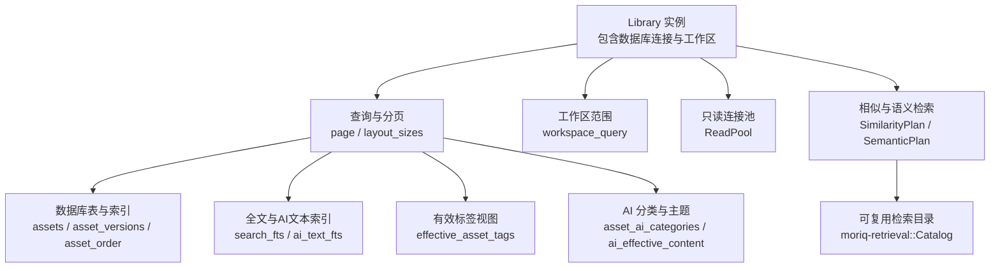
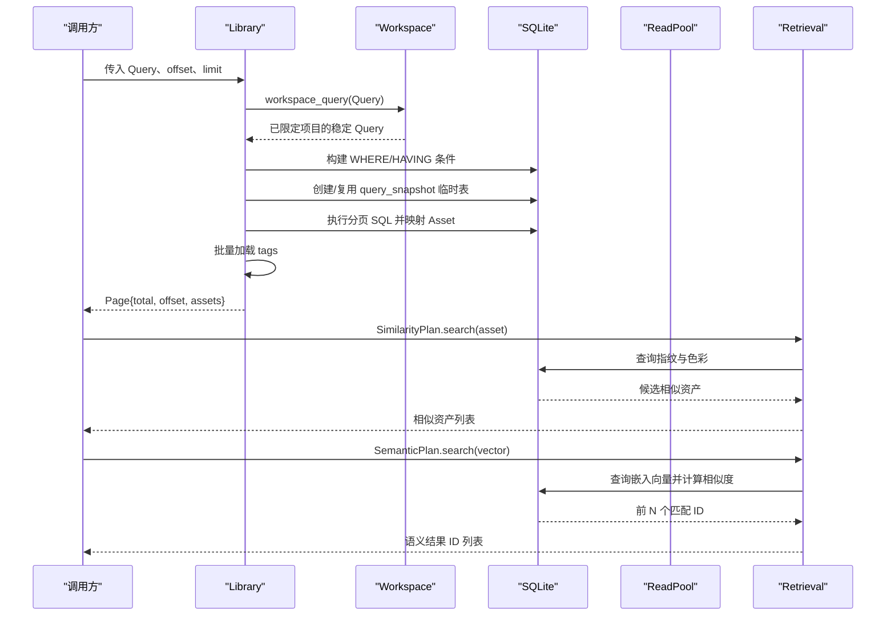
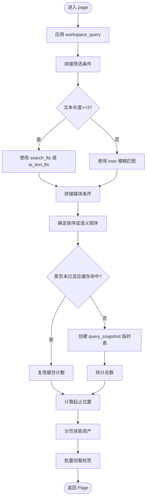
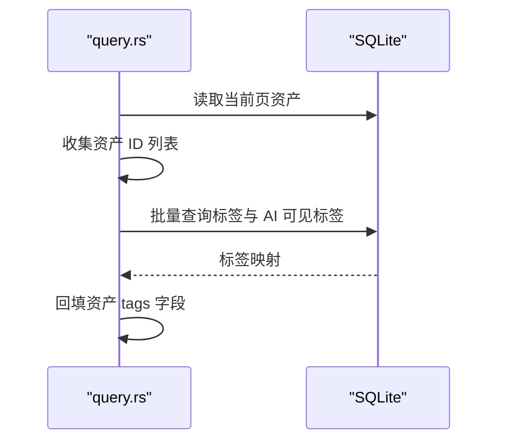
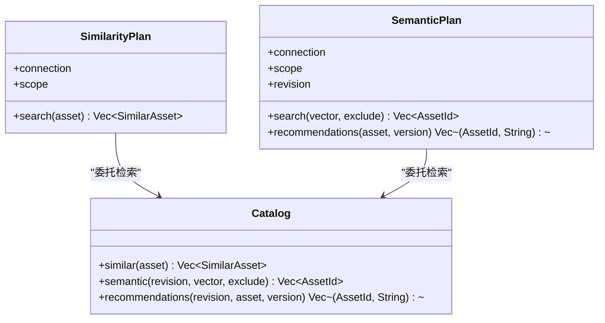
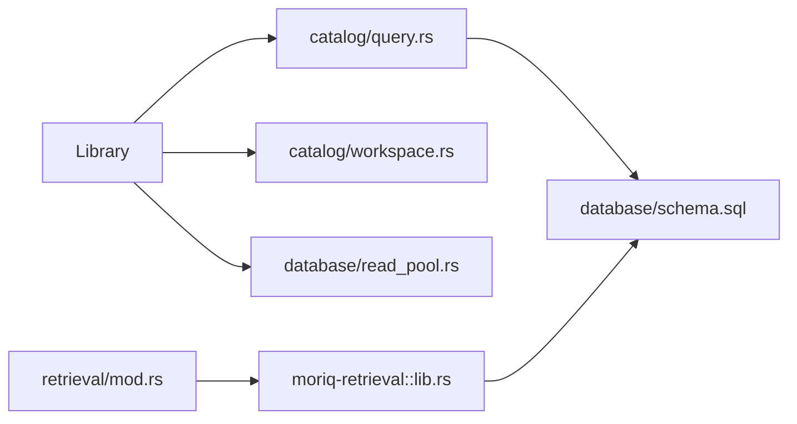
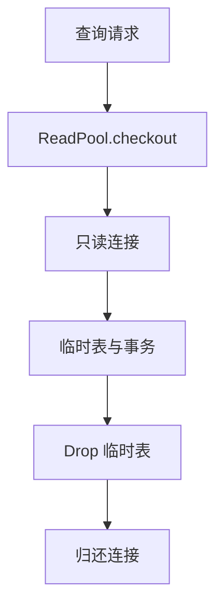

# 查询与搜索 API

> Repo Wiki 节点 `query-search-api`
> 导出自 Qoder 知识库快照 `8fbe02f6-57c2-4874-b725-1a8130851fd9`，代码基线 `7a7a8e75e18bd90294e09cd422dd7ed5a04813a0`（分支 main，zh-CN）。

<cite>
**本文引用的文件**   
- [lib.rs](../../../../crates/moriq-library/src/lib.rs)
- [query.rs](../../../../crates/moriq-library/src/catalog/query.rs)
- [workspace.rs](../../../../crates/moriq-library/src/catalog/workspace.rs)
- [schema.sql](../../../../crates/moriq-library/src/database/schema.sql)
- [read_pool.rs](../../../../crates/moriq-library/src/database/read_pool.rs)
- [mod.rs](../../../../crates/moriq-library/src/retrieval/mod.rs)
- [lib.rs](../../../../crates/moriq-retrieval/src/lib.rs)
</cite>

## 目录
1. [引言](#引言)
2. [项目结构](#项目结构)
3. [核心组件](#核心组件)
4. [架构总览](#架构总览)
5. [详细组件分析](#详细组件分析)
6. [依赖关系分析](#依赖关系分析)
7. [性能与优化](#性能与优化)
8. [复杂查询场景](#复杂查询场景)
9. [结果结构与字段投影](#结果结构与字段投影)
10. [并发与安全机制](#并发与安全机制)
11. [故障排查](#故障排查)
12. [结论](#结论)

## 引言
本文面向查询与搜索能力，重点说明以下内容：
- 素材分页查询入口、筛选条件构建器、排序选项与分页语义。
- 全文检索、AI 语义检索、相似素材检索的调用路径与数据模型。
- 数据库索引、临时快照缓存、连接池和读取范围控制等查询优化策略。
- 多条件组合、时间范围、格式过滤、标签与分类、虚拟文件夹等复杂查询模式。
- 结果结构、批量标签加载、布局尺寸获取及关联数据加载策略。
- 大数据集处理方案与并发查询安全机制。

该文档不直接粘贴源码，而是通过文件路径与行号定位实现细节，帮助读者快速定位代码。

## 项目结构
查询与搜索相关代码主要分布在以下模块：
- 资源库顶层接口与数据结构定义位于 `moriq-library` 的根模块。
- 查询构建与分页执行位于 `catalog/query.rs`。
- 工作区/项目范围约束位于 `catalog/workspace.rs`。
- 数据库基础表与索引位于 `database/schema.sql`。
- 只读连接池与临时对象清理位于 `database/read_pool.rs`。
- AI 语义与相似度检索封装位于 `retrieval/mod.rs`。
- 无 Library 依赖的可复用检索逻辑位于 `moriq-retrieval/src/lib.rs`。

**图表来源**
- [lib.rs:120-180](../../../../crates/moriq-library/src/lib.rs#L120-L180)
- [query.rs:1-120](../../../../crates/moriq-library/src/catalog/query.rs#L1-L120)
- [workspace.rs:140-170](../../../../crates/moriq-library/src/catalog/workspace.rs#L140-L170)
- [schema.sql:1-42](../../../../crates/moriq-library/src/database/schema.sql#L1-L42)
- [read_pool.rs:1-97](../../../../crates/moriq-library/src/database/read_pool.rs#L1-L97)
- [mod.rs:1-58](../../../../crates/moriq-library/src/retrieval/mod.rs#L1-L58)
- [lib.rs](../../../../crates/moriq-retrieval/src/lib.rs)

**章节来源**
- [lib.rs:120-180](../../../../crates/moriq-library/src/lib.rs#L120-L180)
- [query.rs:1-120](../../../../crates/moriq-library/src/catalog/query.rs#L1-L120)
- [workspace.rs:140-170](../../../../crates/moriq-library/src/catalog/workspace.rs#L140-L170)
- [schema.sql:1-42](../../../../crates/moriq-library/src/database/schema.sql#L1-L42)
- [read_pool.rs:1-97](../../../../crates/moriq-library/src/database/read_pool.rs#L1-L97)
- [mod.rs:1-58](../../../../crates/moriq-library/src/retrieval/mod.rs#L1-L58)
- [lib.rs](../../../../crates/moriq-retrieval/src/lib.rs)

## 核心组件
- 资源库实例负责持有数据库连接、只读连接池、查询快照和工作区信息。
- 查询对象描述文本、收藏、项目、回收站、格式、评分、大小、时间、方向、标签、颜色、存储状态、类别、人物、语义 ID、虚拟文件夹、媒体类型、主题等筛选条件，以及排序方式。
- 分页接口返回总数、偏移量与当前页资产列表；同时提供按查询顺序计算布局尺寸的接口。
- 检索计划封装相似素材与语义检索，复用只读连接与工作区范围，避免直接访问写入端。

关键职责划分：
- `Library::page`：组装筛选条件、创建或复用查询快照、执行分页查询并装配资产。
- `Library::layout_sizes`：基于查询顺序返回宽高序列，用于界面布局而不解码原图。
- `SimilarityPlan::search`：根据指纹与色彩近似查找相似素材。
- `SemanticPlan::search` 与 `recommendations`：基于向量嵌入进行语义检索与推荐。

**章节来源**
- [lib.rs:120-180](../../../../crates/moriq-library/src/lib.rs#L120-L180)
- [query.rs:1-284](../../../../crates/moriq-library/src/catalog/query.rs#L1-L284)
- [mod.rs:1-58](../../../../crates/moriq-library/src/retrieval/mod.rs#L1-L58)

## 架构总览
查询与搜索的整体流程如下：

**图表来源**
- [query.rs:1-200](../../../../crates/moriq-library/src/catalog/query.rs#L1-L200)
- [workspace.rs:158-170](../../../../crates/moriq-library/src/catalog/workspace.rs#L158-L170)
- [mod.rs:1-58](../../../../crates/moriq-library/src/retrieval/mod.rs#L1-L58)
- [lib.rs](../../../../crates/moriq-retrieval/src/lib.rs)

## 详细组件分析

### 分页查询与高级筛选条件构建器
`Library::page` 是核心查询入口，它完成以下任务：
- 使用工作区将用户 Query 转换为稳定查询：若处于某个项目中，则强制精确匹配该项目，并拒绝不一致的项目参数。
- 将文本、收藏、项目、回收站、格式、评分、字节数、时间、宽高方向、标签、颜色、编辑时间、存储状态、媒体类型（RAW/视频）、AI 分类、人物、语义 ID 列表、主题、虚拟文件夹、媒体内容类型、历史分类等条件拼接到最终 SQL。
- 对长文本启用全文检索或 AI 文本检索，短文本回退到名称、备注、AI 正文与有效标签的模糊匹配。
- 支持是否精确匹配项目、是否未标记、是否未分配、是否存在/不存在文件位置等扩展条件。
- 根据排序策略生成 `order_by`，并在语义活跃时优先保持语义 ID 列表顺序。
- 使用临时表 `query_snapshot` 保存带序号的结果集，避免深层 OFFSET 扫描。
- 返回 `Page`，其中包含总数、偏移量和资产列表。

**图表来源**
- [query.rs:1-200](../../../../crates/moriq-library/src/catalog/query.rs#L1-L200)
- [workspace.rs:158-170](../../../../crates/moriq-library/src/catalog/workspace.rs#L158-L170)

**章节来源**
- [query.rs:1-200](../../../../crates/moriq-library/src/catalog/query.rs#L1-L200)
- [workspace.rs:158-170](../../../../crates/moriq-library/src/catalog/workspace.rs#L158-L170)

### 布局尺寸与页面标签加载
- `layout_sizes`：先执行一次查询以建立查询快照或直接使用资产顺序表，然后按相同顺序返回每个资产的宽高，供界面提前计算布局。
- `load_page_tags`：对当前页资产一次性加载所有标签，包括传统标签表和 AI 可见标签视图，避免逐条展开 AI 数据视图带来的开销。

**图表来源**
- [query.rs:201-284](../../../../crates/moriq-library/src/catalog/query.rs#L201-L284)

**章节来源**
- [query.rs:201-284](../../../../crates/moriq-library/src/catalog/query.rs#L201-L284)

### 相似素材与语义检索
- `SimilarityPlan::search`：通过只读连接与工作区范围，查询参考资产的图像指纹、颜色和宽高比，再在数据库中找出宽高比相近且汉明距离较小、颜色差异较小的候选，限制返回数量并排序。
- `SemanticPlan::search`：查询指定模型与版本的嵌入向量，按点积分数取 Top N，排除指定资产后返回 ID 列表。
- `SemanticPlan::recommendations`：从某资产版本获取嵌入向量，再次执行语义检索并附带名称。

**图表来源**
- [mod.rs:1-58](../../../../crates/moriq-library/src/retrieval/mod.rs#L1-L58)
- [lib.rs](../../../../crates/moriq-retrieval/src/lib.rs)

**章节来源**
- [mod.rs:1-58](../../../../crates/moriq-library/src/retrieval/mod.rs#L1-L58)
- [lib.rs](../../../../crates/moriq-retrieval/src/lib.rs)

## 依赖关系分析
- `Library` 依赖 SQLite 连接、工作区、只读连接池和各类辅助模块。
- `query.rs` 依赖工作区范围、SQL 模板、规则编译器和元数据编译器。
- `retrieval/mod.rs` 仅持有只读连接与工作区范围，不能访问 Library 写入端。
- `moriq-retrieval` 不依赖 UI、解码器或模型运行时，仅依赖数据库连接与工作区范围。

**图表来源**
- [lib.rs:120-180](../../../../crates/moriq-library/src/lib.rs#L120-L180)
- [query.rs:1-284](../../../../crates/moriq-library/src/catalog/query.rs#L1-L284)
- [workspace.rs:140-170](../../../../crates/moriq-library/src/catalog/workspace.rs#L140-L170)
- [read_pool.rs:1-97](../../../../crates/moriq-library/src/database/read_pool.rs#L1-L97)
- [mod.rs:1-58](../../../../crates/moriq-library/src/retrieval/mod.rs#L1-L58)
- [lib.rs](../../../../crates/moriq-retrieval/src/lib.rs)

**章节来源**
- [lib.rs:120-180](../../../../crates/moriq-library/src/lib.rs#L120-L180)
- [query.rs:1-284](../../../../crates/moriq-library/src/catalog/query.rs#L1-L284)
- [workspace.rs:140-170](../../../../crates/moriq-library/src/catalog/workspace.rs#L140-L170)
- [read_pool.rs:1-97](../../../../crates/moriq-library/src/database/read_pool.rs#L1-L97)
- [mod.rs:1-58](../../../../crates/moriq-library/src/retrieval/mod.rs#L1-L58)
- [lib.rs](../../../../crates/moriq-retrieval/src/lib.rs)

## 性能与优化

### 索引与查询计划
- 基础索引：
  - `assets(imported_at DESC,id DESC)`：默认排序与追加顺序。
  - `assets(favorite,imported_at DESC,id DESC)`：收藏优先场景。
  - `asset_versions(sha256)`、`asset_versions(asset_id)`、`asset_versions(parent_version_id)`：去重与版本链查询。
  - `asset_tags(tag_id,asset_id)`：反向标签查询。
  - `asset_order(position INTEGER PRIMARY KEY UNIQUE)`：稠密排名，避免深 OFFSET。
- 全文检索：
  - 长文本使用 `search_fts` 与 `ai_text_fts`，短文本使用 `instr` 模糊匹配。
- 临时快照：
  - `query_snapshot` 临时表缓存带序号的资产 ID，后续分页按 position 范围读取，降低重复规划成本。

建议关注以下查询计划要点：
- 优先使用带索引的条件，如 `favorite`、`imported_at`、`format`、`width`、`bytes`。
- 尽量缩小项目范围，使用 `project_exact=true` 减少递归 descendants 扫描。
- 使用语义 ID 列表时，注意排序由 JSON 值决定，避免额外排序开销。
- 对大量可选条件，优先选择选择性高的字段，例如时间范围、格式、大小、标签。

**章节来源**
- [schema.sql:26-40](../../../../crates/moriq-library/src/database/schema.sql#L26-L40)
- [query.rs:1-200](../../../../crates/moriq-library/src/catalog/query.rs#L1-L200)

### 缓存机制
- 查询快照缓存：同一 `Query` 对象会复用上一次计算的总数，避免重复执行完整过滤 SQL。
- 只读连接池：
  - 空闲连接复用，最多保留固定数量。
  - 新连接设置 SQLite 缓存参数，提升查询性能。
  - 自动清理临时表，避免跨请求污染。
- 批量标签加载：对一页资产统一加载标签，减少多次视图展开。

**图表来源**
- [read_pool.rs:1-97](../../../../crates/moriq-library/src/database/read_pool.rs#L1-L97)

**章节来源**
- [query.rs:120-200](../../../../crates/moriq-library/src/catalog/query.rs#L120-L200)
- [read_pool.rs:1-97](../../../../crates/moriq-library/src/database/read_pool.rs#L1-L97)
- [query.rs:201-284](../../../../crates/moriq-library/src/catalog/query.rs#L201-L284)

## 复杂查询场景

### 多条件组合
常见组合包括：
- 项目 + 回收站状态 + 收藏 + 评分下限。
- 格式 + RAW/视频 + 最小/最大字节数 + 宽高方向。
- 标签 + 颜色 + 存储状态 + 最近编辑时间。
- 虚拟文件夹 + 媒体内容类型 + 主题列表。
- 人物识别 + AI 分类 + 历史分类。

这些条件均被拼接到统一的 WHERE 子句中，并通过参数化绑定避免注入风险。

**章节来源**
- [query.rs:1-120](../../../../crates/moriq-library/src/catalog/query.rs#L1-L120)

### 时间范围筛选
- `since`：自指定时间之后导入。
- `before`：早于指定时间的导入。
- `edited_since`：自指定时间之后编辑。

结合 `imported_at`、`edited_at` 与 `deleted_at IS NOT NULL` 判断回收站状态，可实现“最近一周新增且未被删除”的查询。

**章节来源**
- [query.rs:1-120](../../../../crates/moriq-library/src/catalog/query.rs#L1-L120)

### 格式过滤
- 支持通用格式与视频格式集合。
- 支持 RAW 与视频两类媒体类型枚举。
- 可结合文件大小与宽高方向进一步筛选。

**章节来源**
- [query.rs:1-120](../../../../crates/moriq-library/src/catalog/query.rs#L1-L120)

### 地理位置与人脸识别
- 当前公开查询条件中未出现地理坐标字段；若未来引入，应放在元数据或专用空间索引表中，并与工作区范围一起参与过滤。
- 人脸识别通过人物 ID 与 `detected_faces` 表进行过滤，适合“某人出现在某项目中”的组合查询。

**章节来源**
- [query.rs:1-120](../../../../crates/moriq-library/src/catalog/query.rs#L1-L120)

### 语义与相似检索
- 语义检索：输入向量与模型版本，返回 Top N 资产 ID。
- 相似检索：基于图像指纹、颜色差与宽高比，返回相似资产。
- 推荐：基于某资产版本嵌入向量，返回少量推荐资产及其名称。

**章节来源**
- [mod.rs:1-58](../../../../crates/moriq-library/src/retrieval/mod.rs#L1-L58)
- [lib.rs](../../../../crates/moriq-retrieval/src/lib.rs)

## 结果结构与字段投影

### 分页结果 Page
分页结果至少包含：
- `total`：满足条件的总数。
- `offset`：当前页偏移量。
- `assets`：当前页资产列表。

每页最大限制为 128，超出部分会被截断以保证响应体积可控。

**章节来源**
- [query.rs:120-200](../../../../crates/moriq-library/src/catalog/query.rs#L120-L200)

### 资产字段投影
当前分页查询投影的资产字段包括：
- 资产 ID、版本 ID、名称、格式、宽度、高度、字节数。
- 收藏标志、评分、导入时间。
- 标签：通过批量加载填充。

未投影的字段（如完整路径、EXIF 详情、缩略图）应在需要时另行加载，避免默认返回过大负载。

**章节来源**
- [query.rs:201-284](../../../../crates/moriq-library/src/catalog/query.rs#L201-L284)

### 关联数据加载策略
- 标签：对当前页资产一次性加载，合并普通标签与 AI 可见标签。
- 版本信息：通过 `display_version_id` 关联主版本，避免全表扫描。
- 项目成员关系：通过 `project_assets` 与工作区范围共同过滤。

**章节来源**
- [query.rs:201-284](../../../../crates/moriq-library/src/catalog/query.rs#L201-L284)
- [schema.sql:36-40](../../../../crates/moriq-library/src/database/schema.sql#L36-L40)

## 并发与安全机制

### 只读连接池
- 读取连接池维护空闲连接，必要时新建只读连接。
- 设置忙超时与缓存参数，提高并发稳定性。
- Drop 时自动回滚未提交事务并清理临时表，防止连接泄漏。

**章节来源**
- [read_pool.rs:1-97](../../../../crates/moriq-library/src/database/read_pool.rs#L1-L97)

### 工作区隔离
- 工作区会将查询中的项目参数强制设置为当前会话项目，并启用精确匹配。
- 若传入项目与会话不一致，直接报错，避免跨项目误查。
- 检索模块同样要求资产属于当前查询范围或工作区。

**章节来源**
- [workspace.rs:158-170](../../../../crates/moriq-library/src/catalog/workspace.rs#L158-L170)
- [lib.rs](../../../../crates/moriq-retrieval/src/lib.rs)

### 参数化与输入校验
- 全文检索使用参数化查询，特殊字符通过转义处理。
- 语义 ID 与主题列表通过 JSON 序列化后作为参数传递。
- UUID 解析失败会转换为无效资源库错误，便于诊断备份损坏问题。

**章节来源**
- [query.rs:1-120](../../../../crates/moriq-library/src/catalog/query.rs#L1-L120)
- [lib.rs:300-325](../../../../crates/moriq-library/src/lib.rs#L300-L325)

## 故障排查

常见问题与定位建议：
- 查询缓慢：检查是否使用了低选择性条件，是否启用了全文检索，是否命中 `query_snapshot` 缓存。
- 结果不一致：确认工作区项目是否变化，避免跨项目查询。
- 临时表残留：检查只读连接是否正确归还，确保 Drop 清理逻辑生效。
- 语义检索为空：确认向量维度与模型版本一致，且目标资产已生成嵌入。
- 相似检索为空：确认图像指纹已建立，且资产不在回收站。
- 标签缺失：确认当前页资产 ID 列表正确，且 AI 可见标签视图已更新。

**章节来源**
- [query.rs:1-284](../../../../crates/moriq-library/src/catalog/query.rs#L1-L284)
- [read_pool.rs:1-97](../../../../crates/moriq-library/src/database/read_pool.rs#L1-L97)
- [mod.rs:1-58](../../../../crates/moriq-library/src/retrieval/mod.rs#L1-L58)
- [lib.rs](../../../../crates/moriq-retrieval/src/lib.rs)

## 结论
该查询与搜索 API 围绕 `Library::page` 构建，采用工作区隔离、参数化条件、全文与 AI 文本索引、稠密排名与临时快照缓存等技术，兼顾功能完整性与性能。相似与语义检索通过独立的只读连接与工作区范围封装，避免侵入写入端。对于大规模数据集，建议优先使用高选择性条件、精确项目范围、合理分页大小，并结合布局尺寸接口优化前端渲染。未来若引入地理位置检索，应沿用现有工作区与索引设计原则，确保查询安全与可扩展性。