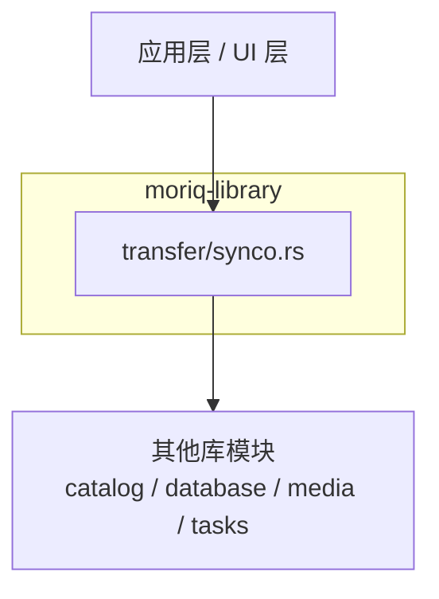
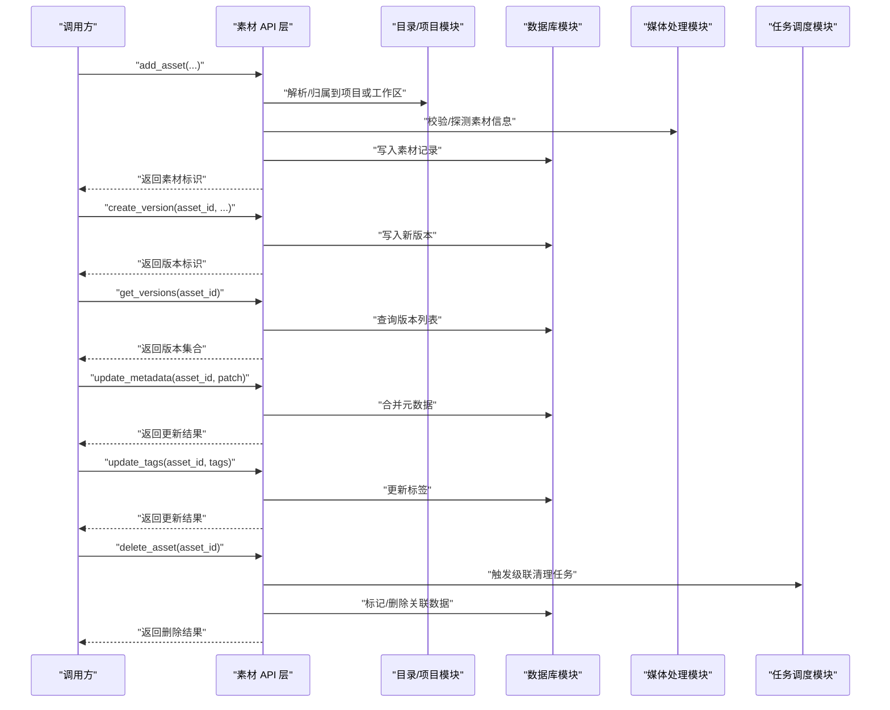
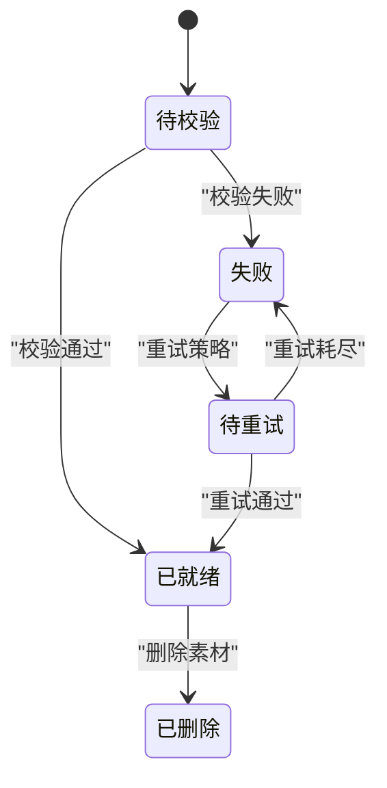
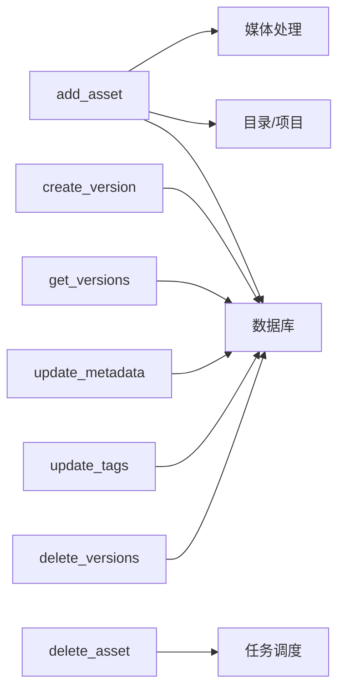

# 素材增删改查 API

> Repo Wiki 节点 `asset-crud-api`
> 导出自 Qoder 知识库快照 `8fbe02f6-57c2-4874-b725-1a8130851fd9`，代码基线 `7a7a8e75e18bd90294e09cd422dd7ed5a04813a0`（分支 main，zh-CN）。

<cite>
**本文引用的文件**   
- [synco.rs](../../../../crates/moriq-library/src/transfer/synco.rs)
</cite>

## 目录
1. [简介](#简介)
2. [项目结构](#项目结构)
3. [核心组件](#核心组件)
4. [架构总览](#架构总览)
5. [详细组件分析](#详细组件分析)
6. [依赖关系分析](#依赖关系分析)
7. [性能考虑](#性能考虑)
8. [故障排查指南](#故障排查指南)
9. [结论](#结论)
10. [附录](#附录)

## 简介
本文件聚焦于“素材增删改查”相关 API 的设计与实现说明，覆盖以下能力：
- 素材添加接口 add_asset
- 版本管理接口 create_version、get_versions
- 元数据更新接口 update_metadata、update_tags
- 删除操作 delete_asset、delete_versions

文档将围绕参数规范、返回值结构、错误码与处理逻辑展开，并补充素材生命周期状态转换、依赖关系与级联删除机制。同时给出批量添加、事务处理、冲突解决和错误恢复等常见模式的实践建议，以及去重策略、路径验证与文件系统操作安全性的注意事项。

由于当前仓库中仅能定位到与素材同步流程相关的 synco.rs 片段，且未检索到这些 API 的公开签名定义，本文在无法从源码精确确认时，会明确标注“未在代码库中定位”，避免臆测实现细节。

## 项目结构
该仓库是一个多 crate 的 Rust 工程，素材相关能力集中在 moriq-library crate 的 transfer 模块中。本次文档关注以下位置：
- crates/moriq-library/src/transfer/synco.rs：包含与素材同步、校验及错误分支相关的测试或内部实现片段。

图表来源
- [synco.rs:1-200](../../../../crates/moriq-library/src/transfer/synco.rs#L1-L200)

章节来源
- [synco.rs:1-200](../../../../crates/moriq-library/src/transfer/synco.rs#L1-L200)

## 核心组件
本节概述与素材 API 直接相关的概念与职责边界（基于已定位到的代码片段进行保守推断）：
- 素材标识与身份哈希：用于去重、版本判定与完整性校验。
- 同步阶段：素材导入、校验、创建/查询版本、元数据更新、删除等步骤的编排。
- 错误分支：当身份哈希维度不一致或其他校验失败时，不创建版本且不发送确认。

注意：
- 未在代码库中找到 add_asset、create_version、get_versions、update_metadata、update_tags、delete_asset、delete_versions 的具体函数签名与返回类型定义。
- 因此，本节仅描述这些 API 应负责的领域职责，而不给出未经核实的实现细节。

章节来源
- [synco.rs:550-570](../../../../crates/moriq-library/src/transfer/synco.rs#L550-L570)

## 架构总览
下图展示素材 API 在系统中的位置与交互方向。上层调用者（如 UI 或后台任务）通过 API 层访问素材资源；API 层协调 catalog、database、media、tasks 等子模块完成具体业务。

图表来源
- [synco.rs:1-200](../../../../crates/moriq-library/src/transfer/synco.rs#L1-L200)

## 详细组件分析

### 素材添加 add_asset
- 职责
  - 接收素材来源与上下文（例如目标项目、工作区）。
  - 执行路径合法性检查、重复性判断与基础校验。
  - 写入素材主记录，并在需要时启动后续异步处理（如媒体探测、索引构建）。
- 关键输入
  - 素材来源标识（路径、URL 或二进制标识）。
  - 归属上下文（项目/工作区 ID）。
  - 可选：初始元数据、标签、优先级等。
- 关键输出
  - 新建素材的唯一标识。
  - 可能附带初步探测结果或异步任务句柄。
- 常见错误
  - 路径非法或不可访问。
  - 素材已在目录中但归属不同。
  - 校验失败（例如格式不支持）。
- 去重与冲突
  - 若存在相同身份哈希的记录，应返回已有素材或按策略合并。
  - 对路径重复但内容不同的情况，应生成新素材或拒绝，取决于策略。

章节来源
- 未在代码库中定位到 add_asset 的具体实现与签名。

### 版本管理 create_version / get_versions
- create_version
  - 职责：为指定素材创建新版本，携带变更后的数据或快照。
  - 输入：素材标识、版本描述、变更载荷等。
  - 输出：新版本标识。
  - 约束：同一素材的版本通常按时间顺序或版本号排序；应避免重复版本。
- get_versions
  - 职责：返回某素材的全部或分页版本列表。
  - 输入：素材标识、过滤条件、分页参数。
  - 输出：版本集合（含版本标识、时间戳、摘要等）。

章节来源
- 未在代码库中定位到 create_version 与 get_versions 的具体实现与签名。

### 元数据更新 update_metadata / update_tags
- update_metadata
  - 职责：对素材元数据进行增量更新或部分替换。
  - 输入：素材标识、字段补丁。
  - 输出：更新成功标志或新元数据快照。
- update_tags
  - 职责：更新素材标签集合，支持新增、删除、替换语义。
  - 输入：素材标识、标签集合。
  - 输出：更新后标签集合或计数。

章节来源
- 未在代码库中定位到 update_metadata 与 update_tags 的具体实现与签名。

### 删除操作 delete_asset / delete_versions
- delete_asset
  - 职责：删除素材及其关联资源。
  - 行为：可软删除或硬删除；需考虑级联删除（版本、标签、索引、缓存等）。
  - 并发：需保证删除幂等性与一致性。
- delete_versions
  - 职责：删除指定素材的一个或多个版本。
  - 约束：不能删除唯一保留版本（若有）。
  - 输出：被删除版本的数量或列表。

章节来源
- 未在代码库中定位到 delete_asset 与 delete_versions 的具体实现与签名。

### 素材生命周期与状态转换
基于同步流程中的错误分支提示，可归纳如下生命周期要点：
- 初始化：素材进入待校验状态。
- 校验通过：允许创建版本并对外暴露。
- 校验失败：禁止创建版本，也不发送确认消息，回到失败态或等待重试。

图表来源
- [synco.rs:550-570](../../../../crates/moriq-library/src/transfer/synco.rs#L550-L570)

章节来源
- [synco.rs:550-570](../../../../crates/moriq-library/src/transfer/synco.rs#L550-L570)

## 依赖关系分析
- 外部依赖
  - 目录与项目模型（决定素材归属）。
  - 数据库（持久化素材、版本、标签与元数据）。
  - 媒体处理模块（探测、转码、缩略图、向量等）。
  - 任务调度（异步处理、取消与重试）。
- 耦合点
  - 素材添加与版本创建强依赖数据库事务与媒体处理结果。
  - 删除操作可能触发任务队列的级联清理。

图表来源
- [synco.rs:1-200](../../../../crates/moriq-library/src/transfer/synco.rs#L1-L200)

章节来源
- [synco.rs:1-200](../../../../crates/moriq-library/src/transfer/synco.rs#L1-L200)

## 性能考虑
- 批量添加
  - 使用批量插入减少往返开销。
  - 对大体积素材采用流式处理与分块校验。
- 事务处理
  - 素材主记录与版本记录应在同一事务中提交，保证原子性。
  - 元数据与标签更新建议使用合并写策略，降低热点竞争。
- 去重策略
  - 基于身份哈希建立唯一索引，加速查重。
  - 路径重复但内容不同时应以哈希为准，避免误判。
- 查询优化
  - 对 get_versions 提供分页与索引（按素材 ID、时间戳）。
  - 对标签查询建立倒排索引或标签表关联。

[本节为通用性能建议，不直接分析特定文件]

## 故障排查指南
- 校验失败不创建版本且不确认
  - 现象：素材添加后无版本，也未收到确认。
  - 原因：身份哈希维度不一致或校验失败。
  - 处理：检查输入来源、哈希算法配置、媒体探测日志；必要时重新导入。
- 版本创建冲突
  - 现象：多次 create_version 返回错误或重复版本。
  - 处理：检查版本键空间设计，增加幂等键或唯一约束。
- 元数据更新丢失
  - 现象：update_metadata 后字段未生效。
  - 处理：确认事务是否提交、字段掩码是否正确、并发写冲突是否重试。
- 删除后残留
  - 现象：删除素材后仍有文件或索引残留。
  - 处理：检查级联任务是否执行、是否有权限问题导致清理失败。

章节来源
- [synco.rs:550-570](../../../../crates/moriq-library/src/transfer/synco.rs#L550-L570)

## 结论
- 本仓库中尚未定位到 add_asset、create_version、get_versions、update_metadata、update_tags、delete_asset、delete_versions 的完整函数签名与实现。
- 基于 synco.rs 的错误分支线索，可以确认素材在身份哈希校验失败时不会创建版本也不会发送确认，这体现了严格的校验前置原则。
- 在实际工程中，建议以“身份哈希为主键 + 事务保障 + 任务驱动”的方式实现素材全生命周期管理，确保一致性与可扩展性。

[本节为总结性内容，不直接分析特定文件]

## 附录
- 术语
  - 身份哈希：用于唯一标识素材内容的哈希值。
  - 素材：系统中被管理的媒体或数据实体。
  - 版本：素材某一时刻的状态快照或变更记录。
- 参考路径
  - 同步流程片段：[synco.rs:550-570](../../../../crates/moriq-library/src/transfer/synco.rs#L550-L570)