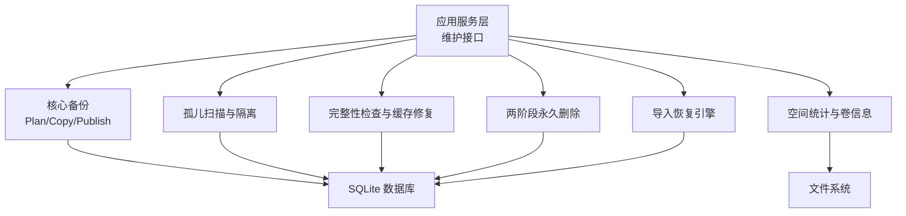
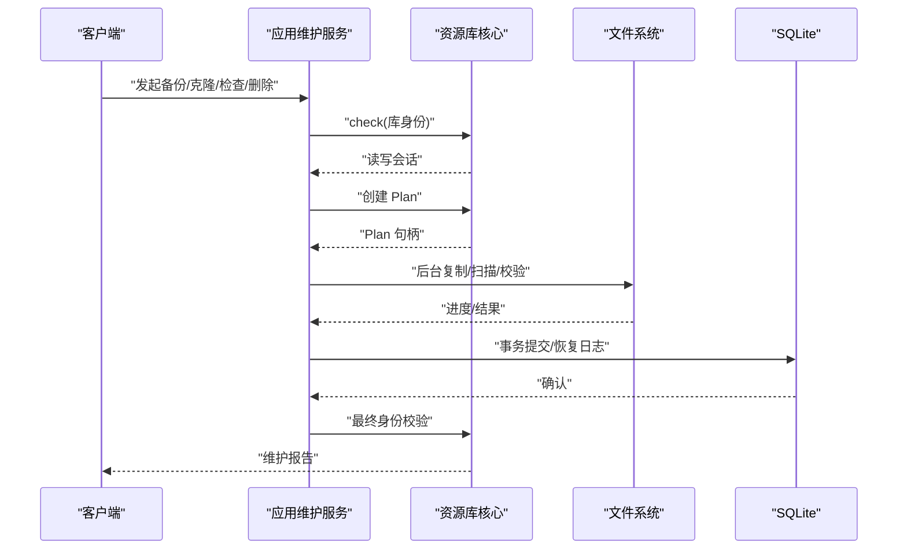
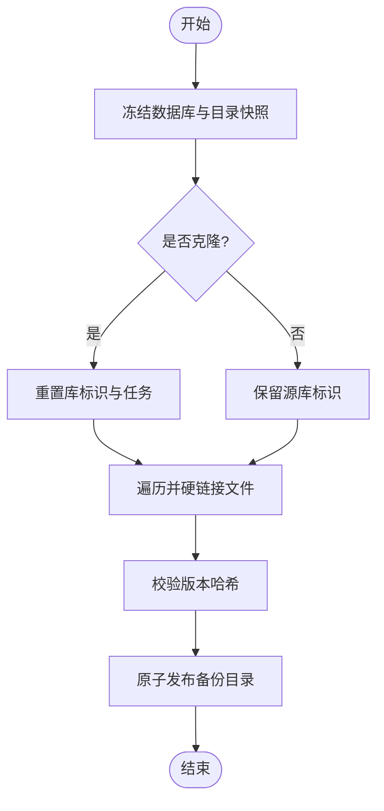
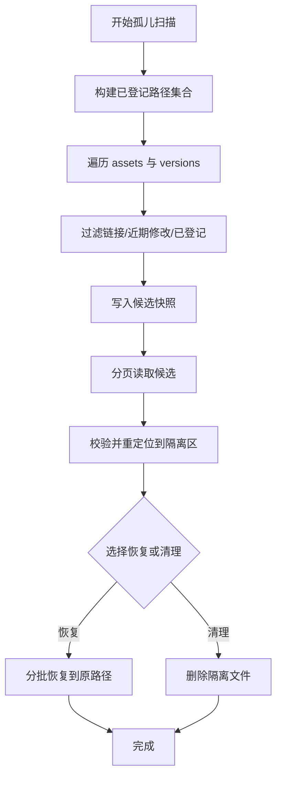
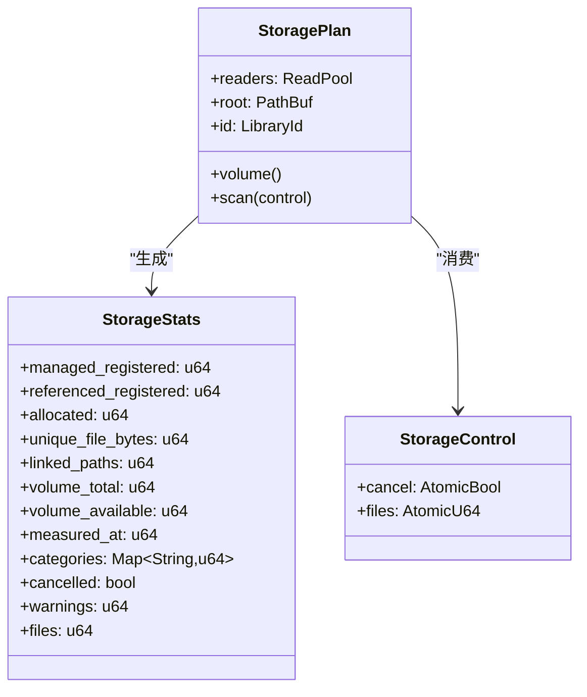
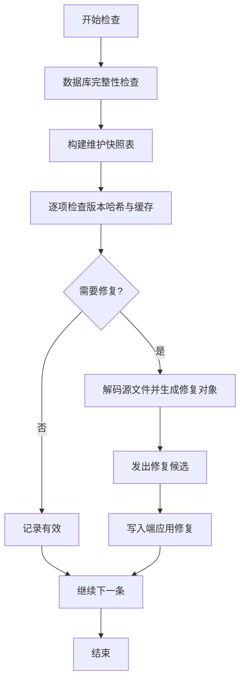
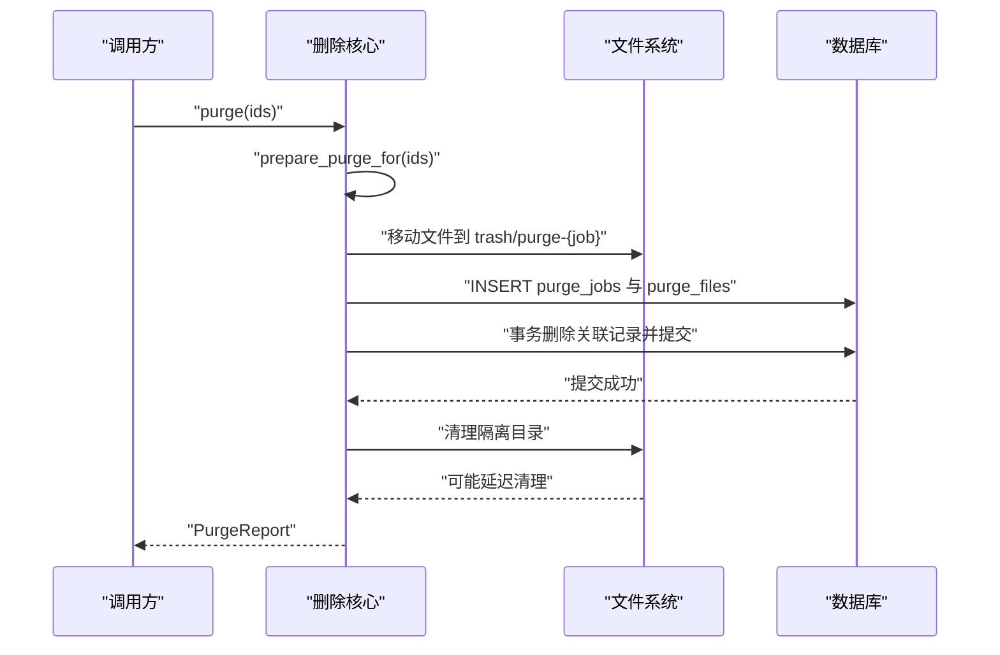
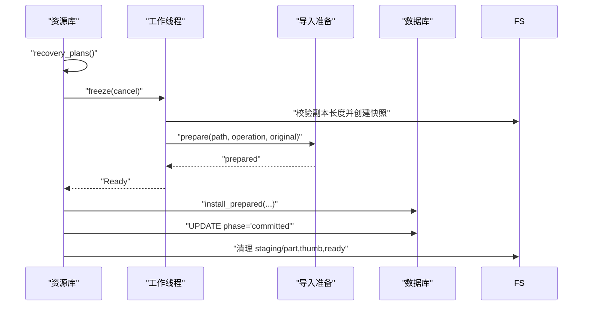
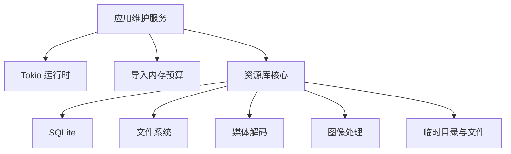

# 维护工具 API

> Repo Wiki 节点 `maintenance-api`
> 导出自 Qoder 知识库快照 `8fbe02f6-57c2-4874-b725-1a8130851fd9`，代码基线 `7a7a8e75e18bd90294e09cd422dd7ed5a04813a0`（分支 main，zh-CN）。

<cite>
**本文引用的文件**   
- [backup.rs](../../../crates/moriq-library/src/maintenance/backup.rs)
- [orphans.rs](../../../crates/moriq-library/src/maintenance/orphans.rs)
- [storage.rs](../../../crates/moriq-library/src/maintenance/storage.rs)
- [purge.rs](../../../crates/moriq-library/src/maintenance/purge.rs)
- [maintenance.rs](../../../crates/moriq-library/src/maintenance/maintenance.rs)
- [maintenance.rs（应用层）](../../../crates/moriq-app/src/maintenance.rs)
- [recovery.rs](../../../crates/moriq-library/src/transfer/recovery.rs)
</cite>

## 目录
1. [引言](#引言)
2. [项目结构](#项目结构)
3. [核心组件](#核心组件)
4. [架构总览](#架构总览)
5. [详细组件分析](#详细组件分析)
6. [依赖关系分析](#依赖关系分析)
7. [性能与容量优化](#性能与容量优化)
8. [事务、进度与异常处理](#事务进度与异常处理)
9. [定期维护自动化配置示例](#定期维护自动化配置示例)
10. [故障排除指南](#故障排除指南)
11. [结论](#结论)

## 引言
本文件是 Moriq Space 维护工具子系统的 API 与技术实现文档，面向需要管理备份恢复、孤儿文件检测、存储空间统计、完整性检查、修复工具和任务调用的使用者。系统采用“计划-执行”分离的设计：先在资源库写入端冻结一致性视图，再在独立线程或工作线程中执行复制、扫描、校验和修复；所有变更通过数据库事务和恢复日志保证可回滚，并通过取消标志提供可中断操作能力。

## 项目结构
维护相关代码分布在两个层次：
- 资源库核心层：位于 `moriq-library` 的 `maintenance` 与 `transfer/recovery` 模块，负责一致性快照、隔离恢复、存储统计、清理与完整性检查。
- 应用服务层：位于 `moriq-app` 的维护适配层，将核心 API 暴露为异步服务调用，并协调并发、预算与进度。

**图表来源**
- [maintenance.rs（应用层）:1-244](../../../crates/moriq-app/src/maintenance.rs#L1-L244)
- [backup.rs:1-426](../../../crates/moriq-library/src/maintenance/backup.rs#L1-L426)
- [orphans.rs:1-355](../../../crates/moriq-library/src/maintenance/orphans.rs#L1-L355)
- [storage.rs:1-261](../../../crates/moriq-library/src/maintenance/storage.rs#L1-L261)
- [maintenance.rs:1-412](../../../crates/moriq-library/src/maintenance/maintenance.rs#L1-L412)
- [purge.rs:1-1041](../../../crates/moriq-library/src/maintenance/purge.rs#L1-L1041)
- [recovery.rs:1-229](../../../crates/moriq-library/src/transfer/recovery.rs#L1-L229)

**章节来源**
- [maintenance.rs（应用层）:1-244](../../../crates/moriq-app/src/maintenance.rs#L1-L244)
- [backup.rs:1-426](../../../crates/moriq-library/src/maintenance/backup.rs#L1-L426)
- [orphans.rs:1-355](../../../crates/moriq-library/src/maintenance/orphans.rs#L1-L355)
- [storage.rs:1-261](../../../crates/moriq-library/src/maintenance/storage.rs#L1-L261)
- [maintenance.rs:1-412](../../../crates/moriq-library/src/maintenance/maintenance.rs#L1-L412)
- [purge.rs:1-1041](../../../crates/moriq-library/src/maintenance/purge.rs#L1-L1041)
- [recovery.rs:1-229](../../../crates/moriq-library/src/transfer/recovery.rs#L1-L229)

## 核心组件
- 备份与克隆：生成一致性快照、硬链接不可变副本、可选克隆新库身份、发布前内容校验。
- 孤儿文件检测：基于已登记路径集合过滤候选文件，分页复核后移入隔离区，支持恢复或清理。
- 存储空间统计：按目录分类统计占用，去重硬链接，读取卷总容量与可用空间。
- 完整性检查与修复：数据库完整性检查、外键检查、版本哈希校验、缩略图与主色重建。
- 两阶段删除：移动受管文件到隔离暂存区、提交元数据、失败时自动恢复原位置。
- 导入恢复：对中断导入进行一致性预检、重新准备媒体、提交最终导入记录。

**章节来源**
- [backup.rs:1-426](../../../crates/moriq-library/src/maintenance/backup.rs#L1-L426)
- [orphans.rs:1-355](../../../crates/moriq-library/src/maintenance/orphans.rs#L1-L355)
- [storage.rs:1-261](../../../crates/moriq-library/src/maintenance/storage.rs#L1-L261)
- [maintenance.rs:1-412](../../../crates/moriq-library/src/maintenance/maintenance.rs#L1-L412)
- [purge.rs:1-1041](../../../crates/moriq-library/src/maintenance/purge.rs#L1-L1041)
- [recovery.rs:1-229](../../../crates/moriq-library/src/transfer/recovery.rs#L1-L229)

## 架构总览
维护子系统遵循以下模式：
1. 应用层接收请求，锁定资源库身份并获取只读连接。
2. 核心层创建 Plan，冻结必要状态。
3. 后台线程执行耗时 I/O，通过 Control 暴露取消与进度。
4. 变更写回数据库事务，必要时使用恢复日志。
5. 应用层最终校验库身份并返回报告。

**图表来源**
- [maintenance.rs（应用层）:1-244](../../../crates/moriq-app/src/maintenance.rs#L1-L244)
- [backup.rs:1-426](../../../crates/moriq-library/src/maintenance/backup.rs#L1-L426)
- [maintenance.rs:1-412](../../../crates/moriq-library/src/maintenance/maintenance.rs#L1-L412)

## 详细组件分析

### 备份与克隆 API
- 备份计划：冻结数据库 WAL、清理未完成导入上下文、导出 library.toml、遍历目录建立硬链接快照。
- 克隆：独立副本会重置库标识、清空同步任务与导入上下文，并暂停运行中的后台任务。
- 复制与发布：计数与拷贝过程中响应取消；发布前校验版本哈希；最终原子重命名发布。
- 安全约束：禁止备份到库根内部；拒绝符号链接；限制目录深度；排除缩略图、预览、索引、暂存等目录。

**图表来源**
- [backup.rs:1-426](../../../crates/moriq-library/src/maintenance/backup.rs#L1-L426)

API 要点
- 创建备份计划：`Library::backup_plan(parent, independent)`
- 可取消备份计划：`Library::backup_plan_controlled(parent, independent, control)`
- 复制快照：`Plan::copy(control)` / `Plan::copy_with_progress(control, progress)`
- 发布备份：`Prepared::publish()`
- 应用层封装：`Service::clone_library(id, parent)`、`Service::backup(id, parent)`、`Service::copy_library(id, parent, independent, control)`

错误与边界
- 备份目标必须在库根之外。
- 发现符号链接立即停止。
- 目录层级过深报错。
- 校验不符不发布半成品。
- 克隆后目标库具有新标识。

**章节来源**
- [backup.rs:1-426](../../../crates/moriq-library/src/maintenance/backup.rs#L1-L426)
- [maintenance.rs（应用层）:1-244](../../../crates/moriq-app/src/maintenance.rs#L1-L244)

### 孤儿文件检测与隔离
- 扫描输入：冻结库身份、打开只读连接，构建已登记路径临时表，包括资产版本、项目文件、操作日志与待删除文件。
- 候选收集：遍历 `assets` 与 `versions`，跳过符号链接与平台重解析点、跳过最近修改的文件、跳过已登记路径，计算文件身份指纹。
- 分页复核：从临时快照分页读取候选，避免重复扫描。
- 隔离恢复：将候选移动到 `recovery/orphans`，记录隔离日志；支持恢复未完成的隔离或删除。
- 恢复流程：分批从隔离区恢复到原始路径，若目标已被登记则跳过；可选择直接清理隔离文件。

**图表来源**
- [orphans.rs:1-355](../../../crates/moriq-library/src/maintenance/orphans.rs#L1-L355)

API 要点
- 创建扫描：`Library::orphan_scan()`
- 执行扫描：`Scan::run()`
- 分页候选：`Plan::page(after)`
- 隔离候选：`Library::quarantine_orphans(plan, candidates)`
- 恢复隔离：`Library::recover_orphans()`
- 分页恢复：`Library::restore_orphans_page(purge, after)`
- 应用层封装：`Service::orphan_plan`、`Service::quarantine_orphans`、`Service::restore_orphans`

**章节来源**
- [orphans.rs:1-355](../../../crates/moriq-library/src/maintenance/orphans.rs#L1-L355)
- [maintenance.rs（应用层）:1-244](../../../crates/moriq-app/src/maintenance.rs#L1-L244)

### 存储空间统计
- 分类统计：根据相对路径首级目录划分为托管原片、追加版本、图片缓存、索引、交接副本、恢复与暂存、备份、数据库与元数据等类别。
- 去重逻辑：使用平台文件身份编码键，对硬链接路径去重，仅统计唯一文件字节数，同时累计链接路径数量。
- 分配空间：优先使用底层分配的块大小，若不可用则回退到文件大小。
- 卷信息：读取总空间与可用空间。
- 取消支持：扫描过程中检查取消标志，部分失败计入警告。

**图表来源**
- [storage.rs:1-261](../../../crates/moriq-library/src/maintenance/storage.rs#L1-L261)

API 要点
- 创建计划：`Library::storage_plan()`
- 卷信息：`Plan::volume()`
- 扫描统计：`Plan::scan(control)`
- 应用层封装：`Service::storage(id, control)`、`Service::volume(id)`

**章节来源**
- [storage.rs:1-261](../../../crates/moriq-library/src/maintenance/storage.rs#L1-L261)
- [maintenance.rs（应用层）:201-244](../../../crates/moriq-app/src/maintenance.rs#L201-L244)

### 完整性检查与缓存修复
- 数据库健康：执行 `PRAGMA integrity_check` 与 `PRAGMA foreign_key_check`，失败即中止。
- 快照检查：构建临时快照表，逐项验证版本哈希、缩略图可读性与主色存在性。
- 修复策略：仅在必要时解码源文件以重建缩略图或主色，并先检查剩余磁盘空间。
- 修复提交：修复由写入端复核后再持久化，过期或路径变化则拒绝覆盖。
- 进度与取消：逐条输出检查结果，支持取消并在取消时丢弃待提交修复。

**图表来源**
- [maintenance.rs:1-412](../../../crates/moriq-library/src/maintenance/maintenance.rs#L1-L412)

API 要点
- 创建计划：`Library::maintenance_plan()`
- 执行检查：`Plan::run(repair, control, emit)`
- 应用修复：`Library::apply_cache_repair(repair)`
- 应用层封装：`Service::maintenance(id, repair)`、`Service::maintenance_controlled(id, repair, control)`

**章节来源**
- [maintenance.rs:1-412](../../../crates/moriq-library/src/maintenance/maintenance.rs#L1-L412)
- [maintenance.rs（应用层）:1-244](../../../crates/moriq-app/src/maintenance.rs#L1-L244)

### 两阶段永久删除
- 路径白名单：仅允许删除素材区域与特定缓存路径，拒绝库外位置与包含符号链接的路径。
- 隔离暂存：先将受管文件移动到 `trash/purge-{job}` 下的编号 `.part` 文件。
- 提交元数据：在事务中删除关联记录，标记删除作业已提交。
- 失败恢复：若提交失败，尝试把暂存文件恢复至原位置；若原位置已有文件则保持双方并阻止后续删除。
- 收尾清理：提交后删除隔离目录；未知文件保留但不再阻塞后续操作。

**图表来源**
- [purge.rs:1-1041](../../../crates/moriq-library/src/maintenance/purge.rs#L1-L1041)

API 要点
- 回收站快照：`Library::trash_snapshot()`
- 批量删除：`Library::purge_trash_chunk(ids)`
- 核心删除：`Library::purge(ids)`
- 应用层封装：`Service::trash_snapshot(id)`、`Service::empty_trash(id, assets)`、`Service::purge(id, ids)`

**章节来源**
- [purge.rs:1-1041](../../../crates/moriq-library/src/maintenance/purge.rs#L1-L1041)
- [maintenance.rs（应用层）:1-244](../../../crates/moriq-app/src/maintenance.rs#L1-L244)

### 导入恢复流程
- 恢复计划：查询中断导入的日志记录，解码源路径并拒绝网络引用。
- 一致性预检：核对恢复副本长度、读取 .ready 回执、在同一卷内建立硬链接快照。
- 媒体准备：在工作线程中探测媒体、计算内存预算，校验引用原片哈希。
- 最终安装：在写入端安装媒体、更新导入上下文、清理 staging 文件。

**图表来源**
- [recovery.rs:1-229](../../../crates/moriq-library/src/transfer/recovery.rs#L1-L229)

API 要点
- 列出恢复计划：`Library::recovery_plans()`
- 冻结工作：`Plan::freeze(cancel)`
- 准备媒体：`Work::prepare(cancel)`
- 完成恢复：`Library::finish_recovery(ready)`
- 批量恢复：`Library::recover_imports()`

**章节来源**
- [recovery.rs:1-229](../../../crates/moriq-library/src/transfer/recovery.rs#L1-L229)

## 依赖关系分析
- 资源库核心层依赖 SQLite 数据库、文件系统、媒体解码与图像库、临时目录与文件 ID 识别。
- 应用层依赖 Tokio 异步运行时、通道、任务调度与内存预算控制。
- 各维护任务共享资源库租约与读写池，避免长时间持有写锁。

**图表来源**
- [maintenance.rs（应用层）:1-244](../../../crates/moriq-app/src/maintenance.rs#L1-L244)
- [maintenance.rs:1-412](../../../crates/moriq-library/src/maintenance/maintenance.rs#L1-L412)

**章节来源**
- [maintenance.rs（应用层）:1-244](../../../crates/moriq-app/src/maintenance.rs#L1-L244)
- [maintenance.rs:1-412](../../../crates/moriq-library/src/maintenance/maintenance.rs#L1-L412)

## 性能与容量优化
- 备份复制：使用深度受限遍历与按需硬链接，避免一次性加载整个文件列表；发布前校验哈希减少无效副本。
- 孤儿扫描：临时 SQLite 快照关闭日志与同步开关，提高扫描吞吐；分页读取候选降低内存压力。
- 存储统计：使用 BTreeMap 分类累加，按文件身份去重硬链接；栈式目录遍历避免递归过深。
- 完整性检查：仅对需要修复的版本解码源文件；限制缩略图最大尺寸与分配上限；增量更新缓存而非全量重建。
- 删除操作：一次枚举预览与 Synco 输出文件，避免每版本多次遍历；隔离目录允许未知文件存活但不阻塞后续作业。

建议
- 大库备份建议在空闲时段执行，并确保备份目标位于独立磁盘。
- 孤儿扫描与存储扫描可并行执行，但需关注 I/O 争用。
- 完整性修复建议分批次执行，避免长时间占用媒体解码预算。
- 删除操作应分批次，每批不超过一万项，应用层默认按一千项切分。

[本节为通用性能建议，不直接分析具体文件]

## 事务、进度与异常处理
- 事务安全性：
  - 备份：数据库 WAL 清理与导入上下文清理在事务中完成；发布前再次校验。
  - 孤儿隔离：隔离日志状态机 `prepared → quarantined → restoring/purging`，失败回写状态。
  - 删除：两阶段协议，文件移动后提交事务；失败时恢复原位置。
  - 恢复：仅在校验成功后安装媒体并更新日志。
- 进度报告：
  - 备份：`Control.finished` 与 `Control.total`，支持回调进度。
  - 存储：`Control.files` 递增，`StorageStats.files` 统计。
  - 维护：`Control.finished` 与 `Control.total`，逐项输出 `Outcome`。
- 异常处理：
  - 统一通过 `Error::Invalid` 表达业务无效参数或一致性问题。
  - IO 错误与权限问题转换为警告或跳过条目，不影响整体流程。
  - 取消信号在各遍历循环中检查，确保及时释放临时文件与租约。

**章节来源**
- [backup.rs:1-426](../../../crates/moriq-library/src/maintenance/backup.rs#L1-L426)
- [orphans.rs:1-355](../../../crates/moriq-library/src/maintenance/orphans.rs#L1-L355)
- [purge.rs:1-1041](../../../crates/moriq-library/src/maintenance/purge.rs#L1-L1041)
- [maintenance.rs:1-412](../../../crates/moriq-library/src/maintenance/maintenance.rs#L1-L412)
- [maintenance.rs（应用层）:1-244](../../../crates/moriq-app/src/maintenance.rs#L1-L244)

## 定期维护自动化配置示例
以下为面向运维与脚本的参考配置思路，可根据部署环境调整调度频率与阈值。

- 每日任务
  - 孤儿扫描：执行 `orphan_plan`，当候选数量超过阈值时触发 `quarantine_orphans`。
  - 存储统计：执行 `storage`，当可用空间低于阈值时告警。
- 每周任务
  - 完整性检查：执行 `maintenance(false)` 生成报告，出现损坏或缺失时安排修复。
  - 缓存修剪：执行 `trim_cache`，按预算清理可重建缓存。
- 每月任务
  - 一致性备份：执行 `backup`，目标路径位于独立磁盘。
  - 克隆审计：执行 `clone_library`，用于离线审计或迁移演练。
- 删除流水线
  - 回收站快照：执行 `trash_snapshot`。
  - 分批删除：每次调用 `empty_trash`，每批不超过一千项。
  - 恢复检查：启动后执行 `recover_imports`，处理中断导入。

调度伪配置
- Cron 或系统任务管理器
  - `0 2 * * *` 执行孤儿扫描与存储统计。
  - `0 3 * * 0` 执行完整性检查与缓存修剪。
  - `0 4 1 * *` 执行一致性备份。
- 条件分支
  - 若 `StorageStats.volume_available < threshold`，暂停非关键导入并通知管理员。
  - 若 `MaintenanceReport.damaged > 0`，自动安排修复任务。
  - 若 `PurgeReport.cleanup_pending == true`，重试清理并记录日志。

[本节为概念性配置说明，不直接分析具体文件]

## 故障排除指南
常见问题与处理步骤
- 备份失败
  - 检查备份目标是否在库根之外。
  - 检查是否存在符号链接或目录层级过深。
  - 查看校验不符错误，确认原片未被外部编辑。
- 孤儿文件误判
  - 确认扫描期间库身份未切换。
  - 检查候选文件的修改时间、大小与文件身份是否与快照一致。
  - 若恢复失败，检查隔离日志状态并重新执行恢复分页。
- 存储统计不准确
  - 确认没有外部硬链接目标被纳入统计。
  - 检查扫描是否被取消，查看 `cancelled` 与 `warnings`。
- 完整性检查失败
  - 数据库完整性检查失败：保留原库并从备份恢复。
  - 外键检查失败：不要手动修复数据库，应从备份恢复。
  - 修复失败：检查剩余空间与源文件路径有效性。
- 删除卡住或残留
  - 查看 `purge_jobs` 是否仍有未完成作业。
  - 若原位置与暂存位置均缺失，请从备份恢复。
  - 未知文件保留在隔离目录中不会阻止后续删除。
- 导入恢复失败
  - 检查恢复副本长度与 `.ready` 回执。
  - 对于引用原片，确认原片未被更改。
  - 若恢复记录已改变，放弃旧结果并重新创建恢复计划。

**章节来源**
- [backup.rs:1-426](../../../crates/moriq-library/src/maintenance/backup.rs#L1-L426)
- [orphans.rs:1-355](../../../crates/moriq-library/src/maintenance/orphans.rs#L1-L355)
- [storage.rs:1-261](../../../crates/moriq-library/src/maintenance/storage.rs#L1-L261)
- [maintenance.rs:1-412](../../../crates/moriq-library/src/maintenance/maintenance.rs#L1-L412)
- [purge.rs:1-1041](../../../crates/moriq-library/src/maintenance/purge.rs#L1-L1041)
- [recovery.rs:1-229](../../../crates/moriq-library/src/transfer/recovery.rs#L1-L229)

## 结论
维护工具子系统以一致性快照、事务恢复日志与可取消任务为核心机制，提供安全的备份克隆、孤儿检测、存储统计、完整性检查和两阶段删除能力。应用层通过异步编排将核心 API 暴露为易用的服务接口，既保证高吞吐又避免阻塞写入端。推荐在生产环境中结合定时任务与阈值告警，定期执行孤儿扫描、存储统计、完整性检查与一致性备份，并在导入中断时启用恢复流程，从而维持资源库的健康与可恢复性。