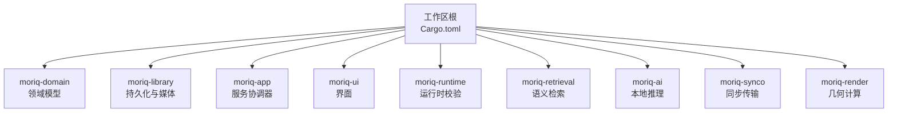
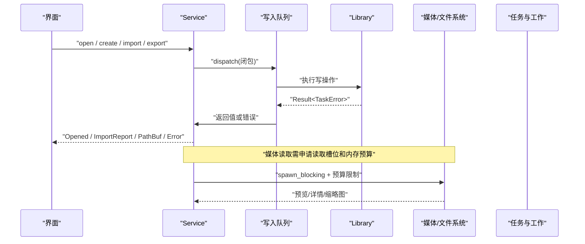
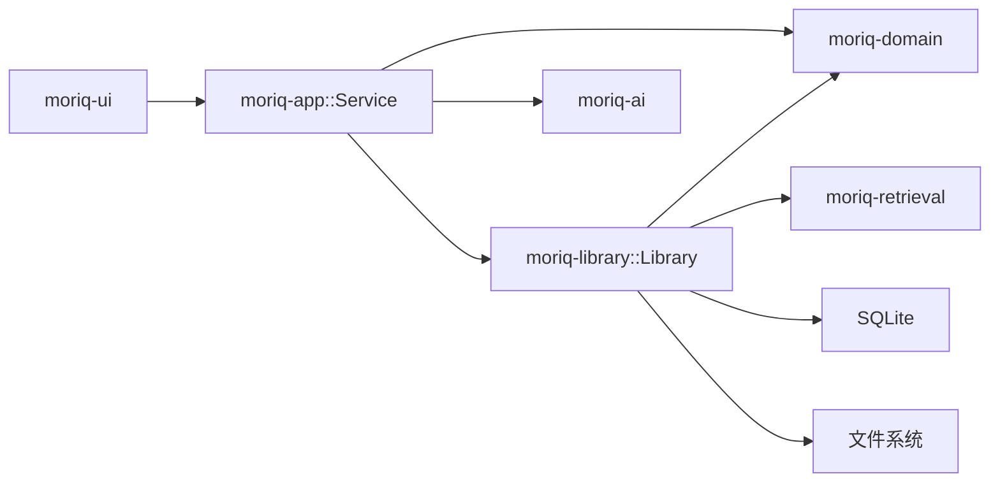
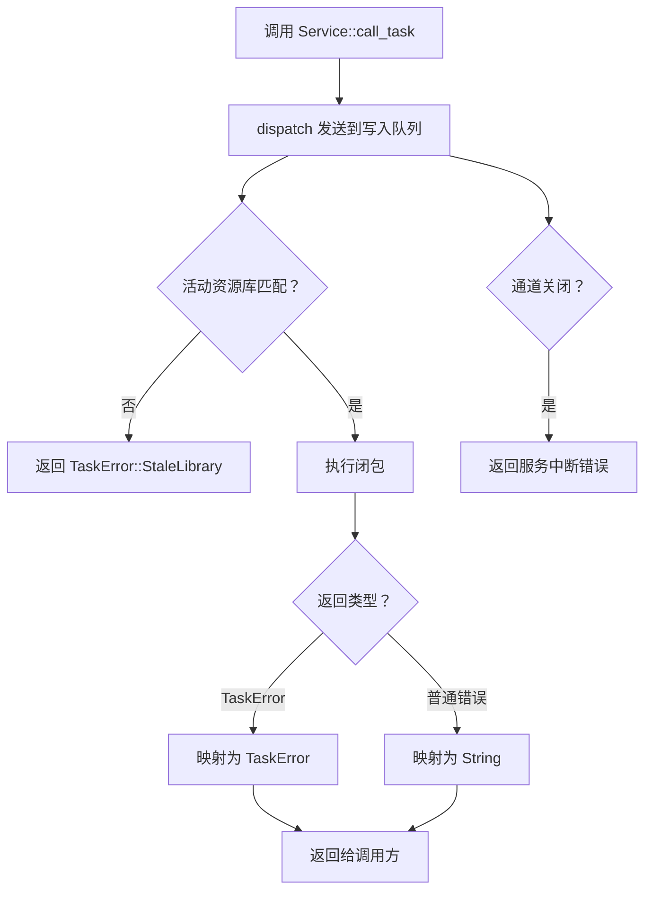
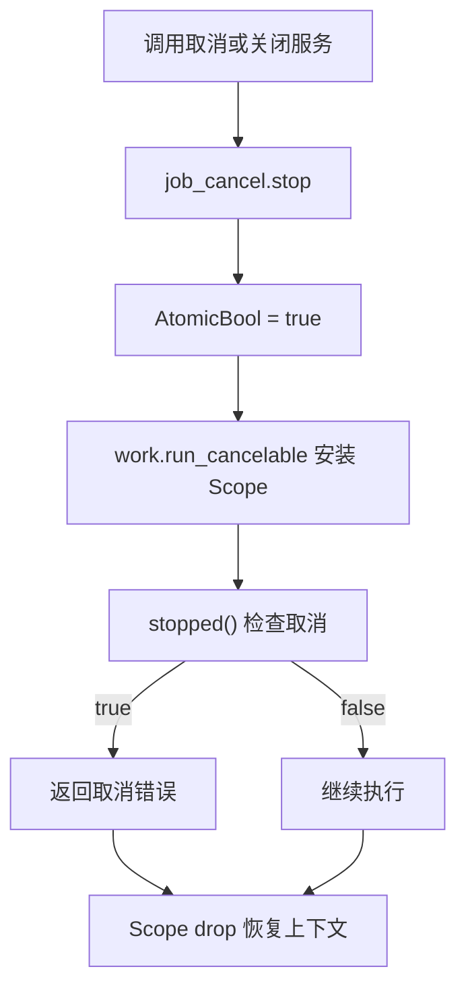

# API 参考文档

> Repo Wiki 节点 `api-reference`
> 导出自 Qoder 知识库快照 `8fbe02f6-57c2-4874-b725-1a8130851fd9`，代码基线 `7a7a8e75e18bd90294e09cd422dd7ed5a04813a0`（分支 main，zh-CN）。

<cite>
**本文引用的文件**   
- [ARCHITECTURE.md](../../ARCHITECTURE.md)
- [Cargo.toml](../../Cargo.toml)
- [moriq-domain/lib.rs](../../crates/moriq-domain/src/lib.rs)
- [moriq-library/lib.rs](../../crates/moriq-library/src/lib.rs)
- [moriq-library/library/core.rs](../../crates/moriq-library/src/library/core.rs)
- [moriq-library/library/lifecycle.rs](../../crates/moriq-library/src/library/lifecycle.rs)
- [moriq-library/media/media.rs](../../crates/moriq-library/src/media/media.rs)
- [moriq-library/transfer/import.rs](../../crates/moriq-library/src/transfer/import.rs)
- [moriq-library/transfer/export.rs](../../crates/moriq-library/src/transfer/export.rs)
- [moriq-library/tasks/jobs.rs](../../crates/moriq-library/src/tasks/jobs.rs)
- [moriq-library/tasks/cancel.rs](../../crates/moriq-library/src/tasks/cancel.rs)
- [moriq-app/lib.rs](../../crates/moriq-app/src/lib.rs)
- [moriq-app/launch.rs](../../crates/moriq-app/src/launch.rs)
</cite>

## 目录
1. [简介](#简介)
2. [项目结构](#项目结构)
3. [核心组件](#核心组件)
4. [架构总览](#架构总览)
5. [详细接口说明](#详细接口说明)
6. [依赖关系分析](#依赖关系分析)
7. [性能与并发模型](#性能与并发模型)
8. [异步、取消与错误处理](#异步取消与错误处理)
9. [使用示例](#使用示例)
10. [故障排查](#故障排查)
11. [结论](#结论)

## 简介
本 API 参考文档面向 Moriq Space 的内部使用者，聚焦 Service 层公共接口、Library 层持久化接口、Domain 层模型定义，以及异步调用模式、错误处理策略、取消机制和线程安全约束。文档不直接粘贴源代码内容，而是通过“代码片段路径”定位实现位置，帮助读者快速阅读源码并理解接口契约。

Moriq Space 采用分层 Rust crate 组织：
- `moriq-domain`：领域身份、查询条件、任务模型等无 I/O 的可序列化类型。
- `moriq-library`：阻塞式持久化、媒体计划、不可变源版本、恢复日志和文件归属；SQLite 写入端唯一。
- `moriq-app`：服务协调器、调度、共享内存预算、取消控制和平台集成；对外暴露 `Service`。
- UI 层通过 `Service` 访问 Library，UI 不直接持有数据库连接或执行媒体 I/O。

**章节来源**
- [ARCHITECTURE.md:1-155](../../ARCHITECTURE.md#L1-L155)

## 项目结构
仓库是 Rust workspace，Workspace 根配置了版本号、Rust 版本、crate 成员及工作区依赖。关键 crate 包括桌面入口、应用服务、领域模型、资源库、检索、AI、渲染、UI 等。

**图表来源**
- [Cargo.toml:1-80](../../Cargo.toml#L1-L80)

**章节来源**
- [Cargo.toml:1-80](../../Cargo.toml#L1-L80)

## 核心组件
本节概述三个关键层次提供的公共能力边界：

| 层次 | 主要职责 | 典型公开能力 | 线程边界 |
|---|---|---|---|
| `moriq-domain` | 可序列化身份、查询、任务、设置等纯数据 | 资产、项目、查询规则、任务状态、导入导出选项等 | 无 I/O，可在任意线程复制、比较、序列化 |
| `moriq-library` | 资源库生命周期、目录、媒体、AI、传输、任务、维护、数据库 | `Library::open`、`create`、`import_file`、`export_plan`、媒体 Source、任务 Work 等 | 阻塞持久化；写操作经单写者队列；读可通过只读池 |
| `moriq-app` | 应用级服务、调度、并发预算、取消控制、系统打开等 | `Service::start`、`open`、`create`、`close`、`for_project`、`call_task` 等 | 提供异步 `Service`；内部把调用派发到专用写入线程 |

**章节来源**
- [ARCHITECTURE.md:10-40](../../ARCHITECTURE.md#L10-L40)
- [moriq-library/lib.rs:1-120](../../crates/moriq-library/src/lib.rs#L1-L120)
- [moriq-app/lib.rs:1-60](../../crates/moriq-app/src/lib.rs#L1-L60)

## 架构总览
Moriq Space 的运行时由 UI 发起请求，进入 `Service`，再由 `Service` 将请求发送到唯一的后台写入线程；必要时再申请读取许可、媒体内存预算，并在阻塞线程执行媒体或分析任务。任务完成后返回结果或错误，UI 根据类型化错误进行展示。

**图表来源**
- [moriq-app/lib.rs:200-446](../../crates/moriq-app/src/lib.rs#L200-L446)
- [moriq-library/tasks/jobs.rs:1-200](../../crates/moriq-library/src/tasks/jobs.rs#L1-L200)

## 详细接口说明

### Service 层公共接口（moriq-app）

`Service` 是 UI 的唯一入口，负责启动后台写入线程、管理资源库生命周期、限流导入和维护任务、执行受控读取计划，并提供取消控制。

| 接口 | 参数 | 返回值 | 行为与约束 |
|---|---|---|---|
| `Service::start()` | 无 | `std::io::Result<Self>` | 创建默认本地推理执行器的服务；内部建立写入通道和调度器。 |
| `Service::start_with_inference(inference)` | 推理执行器句柄 | `std::io::Result<Self>` | 注入推理执行器，便于测试或替换实现。 |
| `Service::for_project(project)` | 可选项目 ID | `Self` | 返回绑定项目范围的 Service 副本，后续请求不会因 UI 切换而重新定向。 |
| `Service::workspace_project()` | 无 | `Option<ProjectId>` | 返回当前绑定的工作区项目。 |
| `Service::open(path)` | 资源库路径 | `async Result<Opened>` | 尝试打开候选资源库；成功则替换当前库并停止旧任务。对锁定状态重试。 |
| `Service::create(parent, name)` | 父目录、名称 | `async Result<Opened>` | 创建资源库，可选应用分类模板，成功后切换当前库。 |
| `Service::close()` | 无 | `async Result<()>` | 取消进行中任务、清空媒体缓存、关闭当前库，并等待推理进程释放。 |
| `Service::call(f)` | 闭包，接收可变 Library 引用 | `async Result<T>` | 在写入队列中执行普通写操作。 |
| `Service::call_task(f)` | 闭包，返回 `TaskResult<T>` | `async TaskResult<T>` | 在写入队列中执行带类型化任务错误的操作。 |
| `Service::read_plan(memory_mib, prepare, work)` | 固定内存预算、准备函数、工作函数 | `async Result<T>` | 先申请读取槽位，冻结计划，再按预算在阻塞线程执行媒体工作。 |
| `Service::read_plan_sized(budget, prepare, work)` | 动态预算函数、准备函数、工作函数 | `async Result<T>` | 支持按计划估算内存的更灵活读取流程。 |

#### 关键数据结构

| 名称 | 字段 | 用途 |
|---|---|---|
| `Opened` | `info: LibraryInfo`、`root: PathBuf` | 打开成功的资源库信息与根路径。 |
| `Tile` | `asset: Asset`、`thumbnail: Option<Pixels>` | 画廊卡片数据。 |
| `LoadedPage` | `total`、`offset`、`tiles`、`warnings` | 分页加载结果。 |
| `LoadedNeighborhood` | `selected`、`position`、`page` | 当前选中资产及其邻域页。 |
| `LoadedOverview` | `categories`、`favorites`、`projects` | 概览页分类、收藏和项目缩略图。 |
| `ImportControl` | `cancel`、`finished`、`total`、`workers`、`memory_mib`、进度原子计数 | 导入任务的共享控制与进度状态。 |

#### 错误语义

- `Service::open` 失败时可能返回“资源库仍在使用中”，表示锁竞争或后台收尾尚未完成。
- `Service::close` 可能返回“模型仍在停止”，需要稍后重试。
- 普通调用错误为字符串，任务调用错误为 `TaskError`，用于区分无效输入、存储错误、取消、旧库、运行时不可用等。

**章节来源**
- [moriq-app/lib.rs:1-200](../../crates/moriq-app/src/lib.rs#L1-L200)
- [moriq-app/lib.rs:200-446](../../crates/moriq-app/src/lib.rs#L200-L446)

### Library 层持久化接口（moriq-library）

`Library` 是资源库的阻塞式持久化对象。它封装 SQLite 连接、资源库根目录、快照、工作区范围以及文件锁。其注释明确声明：**只能在应用的专用 worker 上调用**。

#### 生命周期接口

| 接口 | 参数 | 返回值 | 说明 |
|---|---|---|---|
| `Library::create(parent, name)` | 父目录、名称 | `Result<Library>` | 在临时目录构建清单、目录结构和初始数据库，然后发布为目标 `.moriq` 目录并打开。 |
| `Library::open(root)` | 根路径 | `Result<Library>` | 打开已有资源库，校验清单、数据库身份、执行迁移和恢复。 |
| `Library::rename(name)` | 显示名 | `Result<()>` | 校验并保存资源库显示名，不移动目录。 |

#### 浏览历史与外部引用

| 接口 | 参数 | 返回值 | 说明 |
|---|---|---|---|
| `Library::saved_navigation()` | 无 | `Result<Option<SavedNavigation>>` | 读取持久化浏览历史，限制大小。 |
| `Library::save_navigation(value)` | 浏览状态 | `Result<()>` | 校验条目数量、滚动位置和查询预算后保存。 |
| `Library::reconnect_page(old_root, new_root, after)` | 旧根、新根、游标 | `Result<(String, Vec<ReferenceCandidate>)>` | 分页查找旧磁盘根下的外部引用，生成新根候选。 |
| `Library::apply_reconnect(candidate)` | 已验证候选 | `Result<bool>` | 提交已验证的新位置，保留原素材与版本身份。 |

#### 媒体接口

| 接口 | 参数 | 返回值 | 说明 |
|---|---|---|---|
| `Library::retrieval_source(asset)` | 资产 ID | `Result<Source>` | 结合显式检索作用域，返回媒体读取来源。 |
| `Library::media_source(asset)` | 资产 ID | `Result<Source>` | 为当前展示版本建立媒体来源。 |
| `Library::version_source(asset, version)` | 资产 ID、版本 ID | `Result<Source>` | 校验版本归属后建立来源。 |
| `Library::thumbnail_plan(versions)` | 版本 ID 列表 | `Result<Thumbnails>` | 批量冻结缩略图来源，最多 128 张。 |
| `Library::details_plan(id)` | 资产 ID | `Result
` | 冻结详情所需元数据和媒体来源。 |

#### 导入与导出

| 接口 | 参数 | 返回值 | 说明 |
|---|---|---|---|
| `Library::import_file(file, project, referenced)` | 导入文件、项目、是否外部引用 | `Result<bool>` | 扫描结果导入，保留相对路径和项目归属。 |
| `Library::managed_location(source, project, relative, existing)` | 源路径、项目、相对路径、已有版本 | `Result<String>` | 选择安全且不覆盖的目标位置。 |
| `Library::duplicate_project_file(source, staged, project, relative, version)` | 源、暂存、项目、相对路径、版本 | `Result<()>` | 为重复内容建立独立项目关联。 |
| `Library::export_plan(ids)` | 资产 ID 列表 | `Result<Vec<Item>>` | 冻结导出项，包含版本、哈希、元数据。 |
| `run(items, parent, options)` | 导出项、目标目录、导出选项 | `Result<PathBuf>` | 按选项复制原片或转换图像，最终发布输出目录。 |

#### 任务与工作

| 接口 | 参数 | 返回值 | 说明 |
|---|---|---|---|
| `Work::run_cancelable(flag)` | 取消标志 | `Outcome` | 安装取消作用域后运行冻结任务。 |
| `Work::abort_token()` | 无 | `(job_id, generation)` | 返回任务身份和世代号，用于拒绝过期回执。 |
| `Work::memory_mib()` | 无 | `u32` | 返回任务所需的媒体内存预算。 |
| `Work::run()` | 无 | `Outcome` | 使用默认取消控制执行。 |
| `Work::run_controlled(cancel)` | 取消标志引用 | `Outcome` | 执行媒体读取或分析准备，定期检查取消。 |

**章节来源**
- [moriq-library/lib.rs:1-120](../../crates/moriq-library/src/lib.rs#L1-L120)
- [moriq-library/library/core.rs:1-200](../../crates/moriq-library/src/library/core.rs#L1-L200)
- [moriq-library/library/lifecycle.rs:1-177](../../crates/moriq-library/src/library/lifecycle.rs#L1-L177)
- [moriq-library/media/media.rs:1-200](../../crates/moriq-library/src/media/media.rs#L1-L200)
- [moriq-library/transfer/import.rs:1-200](../../crates/moriq-library/src/transfer/import.rs#L1-L200)
- [moriq-library/transfer/export.rs:1-200](../../crates/moriq-library/src/transfer/export.rs#L1-L200)
- [moriq-library/tasks/jobs.rs:1-200](../../crates/moriq-library/src/tasks/jobs.rs#L1-L200)

### Domain 层模型定义（moriq-domain）

Domain 层提供可序列化、可比较的身份和数据结构，不包含 I/O 或 UI 依赖。

#### 身份与基础模型

| 类型 | 关键字段 | 说明 |
|---|---|---|
| `LibraryId` | UUID | 资源库身份。 |
| `AssetId` | UUID | 资产身份。 |
| `AssetVersionId` | UUID | 资产版本身份。 |
| `ProjectId` | UUID | 项目身份。 |
| `LibraryInfo` | `id`、`name`、`count`、`bytes`、`created_at`、`updated_at`、`projects` | 资源库概览信息。 |
| `Project` | `id`、`parent`、`name`、`count`、`visited_at` | 项目信息。 |
| `Asset` | `id`、`version_id`、`name`、`format`、尺寸、字节数、收藏、评分、标签、导入时间 | 资产视图。 |
| `AssetVersion` | `id`、`origin`、`parent` | 版本信息。 |
| `AssetDetails` | 项目拷贝、主题、AI 标签、手动标签、描述、OCR、人脸、EXIF、版本列表等 | 详情投影。 |

#### 查询与规则

| 类型 | 说明 |
|---|---|
| `Query` | 有界查询条件，包括媒介、主题、文件夹、类别、人物、语义 ID、文本、收藏、项目、格式、存储、评分、时间、尺寸、方向、标签、颜色、排序等。 |
| `MetadataPredicate` | 有界元数据谓词，含字段、包含值、最小值和最大值。 |
| `Rule` | 组合规则树，支持全部、任意、否定、名称、备注、标签、格式、评分、收藏、RAW、有位置等；提供 `validate()` 限制深度、节点数和字符串长度。 |
| `MediaKind` | 全部、RAW、视频。 |
| `SortOrder` | 最新、最早、名称、最大、评分。 |

#### 任务、设置与维护

| 类型 | 说明 |
|---|---|
| `JobKind` | 任务种类，例如完整性检查、批量任务、元数据分析、模型推理等。 |
| `JobState` | 任务状态。 |
| `ModelId` | 模型身份。 |
| `BackgroundJob` | 后台任务报告，含优先级、完成数、失败数、错误消息。 |
| `UserSettings` | 用户设置，包括 AI、Synco、最近库、导入偏好、诊断日志、动画、语言、外观。 |
| `ImportPreferences` | 导入并发和内存预算，自动逻辑会保留 CPU 余量。 |
| `ExportOptions` | 导出格式、质量、旋转、重采样、布局、EXIF、子文件等。 |
| `MaintenanceReport` | 维护报告，含检查数、缺失数、损坏数、修复数、警告、取消标记。 |
| `StorageStats` | 存储统计，含分配空间、唯一文件大小、分类、卷容量、链接数、警告等。 |

**章节来源**
- [moriq-domain/lib.rs:1-200](../../crates/moriq-domain/src/lib.rs#L1-L200)
- [moriq-domain/lib.rs:200-711](../../crates/moriq-domain/src/lib.rs#L200-L711)

## 依赖关系分析

- `moriq-app` 依赖 `moriq-domain`、`moriq-library`、`moriq-ai`。
- `moriq-library` 依赖 `moriq-domain`、`moriq-retrieval`、SQLite 和文件系统。
- `moriq-domain` 不依赖其他业务 crate，保证纯领域模型。

**图表来源**
- [Cargo.toml:1-80](../../Cargo.toml#L1-L80)
- [ARCHITECTURE.md:10-40](../../ARCHITECTURE.md#L10-L40)

**章节来源**
- [Cargo.toml:1-80](../../Cargo.toml#L1-L80)
- [ARCHITECTURE.md:10-40](../../ARCHITECTURE.md#L10-L40)

## 性能与并发模型

### 并发与限流

- `Service::start_with_inference` 创建容量为 16 的写入通道，并在命名线程 `moriq-library-writer` 中消费。
- 导入并发、媒体内存、维护任务、读取槽位、任务槽位分别由 Semaphore 控制：
  - 导入槽位：32
  - 媒体内存预算：4096 MiB
  - 维护任务：1
  - 读取槽位：4
  - 任务槽位：1
- 媒体读取通过 `read_plan` 或 `read_plan_sized` 申请读取许可和内存预算，然后在阻塞线程执行，避免阻塞异步运行时。

### 复杂度与边界

- `thumbnail_plan` 限制一次最多 128 张缩略图。
- `export_plan` 限制导出数量为 1～10000。
- `Rule::validate` 限制规则树深度不超过 8、节点总数不超过 64，字符串长度不超过 1024。
- `ImportPreferences::effective_workers` 自动并发默认为逻辑 CPU 的一半，范围 2～16；用户显式值范围 1～32。
- `ImportPreferences::validated` 要求 workers ≤ 32 且 memory_mib ∈ [256, 4096]。

### 线程安全建议

- 不要直接从 UI 线程调用 `Library`；始终通过 `Service`。
- `Service` 是可克隆的共享句柄，但 `for_project` 创建的副本会冻结项目范围。
- `Source` 携带文件租约，跨线程传递时需要确保底层 `File` 和数据库连接的生命周期正确。
- 取消标志使用线程局部作用域，不会泄漏到下一项任务。

**章节来源**
- [moriq-app/lib.rs:200-446](../../crates/moriq-app/src/lib.rs#L200-L446)
- [moriq-library/media/media.rs:1-200](../../crates/moriq-library/src/media/media.rs#L1-L200)
- [moriq-library/transfer/export.rs:1-200](../../crates/moriq-library/src/transfer/export.rs#L1-L200)
- [moriq-domain/lib.rs:200-711](../../crates/moriq-domain/src/lib.rs#L200-L711)

## 异步、取消与错误处理

### 异步调用模式

`Service` 提供两类异步入口：
- `call`：普通异步调用，返回 `Result<T>`。
- `call_task`：任务异步调用，返回 `TaskResult<T>`，可区分取消、旧库、无效输入、存储、运行时不可用等错误。

内部通过 `dispatch` 把闭包发送到写入队列，并在接收端返回结果。若发送方丢弃通道或调用方不再监听，会返回中断或关闭错误。

**图表来源**
- [moriq-app/lib.rs:200-446](../../crates/moriq-app/src/lib.rs#L200-L446)

### 取消机制

取消分为两层：
1. **Service 级取消**：`Service::close` 调用 `job_cancel.stop(None)`，停止后台调度器中的任务。
2. **任务级取消**：`Work::run_cancelable` 安装 `Scope`，内部 `stopped()` 检查当前线程作用域中的取消标志；`tasks/cancel::copy` 在分块复制时检查取消，返回 `Interrupted`。

取消不会污染下一项任务，因为 `Scope::drop` 会恢复之前的线程局部状态。

**图表来源**
- [moriq-library/tasks/cancel.rs:1-85](../../crates/moriq-library/src/tasks/cancel.rs#L1-L85)
- [moriq-library/tasks/jobs.rs:1-200](../../crates/moriq-library/src/tasks/jobs.rs#L1-L200)
- [moriq-app/lib.rs:200-446](../../crates/moriq-app/src/lib.rs#L200-L446)

### 错误处理策略

| 错误来源 | 类型 | 处理建议 |
|---|---|---|
| 服务关闭或调度中断 | `DispatchError` → `String` 或 `TaskError::Unavailable` | 提示用户重新打开服务。 |
| 资源库切换导致旧请求 | `check_task` → `TaskError::StaleLibrary` | 忽略旧回执，刷新当前库上下文。 |
| 无效输入 | `TaskError::InvalidInput` | 提示用户修正名称、路径、查询或导出选项。 |
| 存储或数据库错误 | `TaskError::Storage` | 记录日志、提示备份恢复或检查权限。 |
| 文件被占用 | `Error::Locked` | 提示关闭其他窗口或进程。 |
| 取消 | IO `Interrupted` 或任务错误 | 停止 UI 轮询，释放资源，不视为调度失败。 |

**章节来源**
- [moriq-app/lib.rs:200-446](../../crates/moriq-app/src/lib.rs#L200-L446)
- [moriq-library/tasks/cancel.rs:1-85](../../crates/moriq-library/src/tasks/cancel.rs#L1-L85)
- [moriq-library/lib.rs:120-200](../../crates/moriq-library/src/lib.rs#L120-L200)

## 使用示例

以下示例以“代码片段路径”形式给出，读者可根据路径查看具体实现和错误分支。

### 示例一：启动服务并打开资源库

- 启动服务：[moriq-app/lib.rs:200-300](../../crates/moriq-app/src/lib.rs#L200-L300)
- 打开资源库：[moriq-app/lib.rs:300-380](../../crates/moriq-app/src/lib.rs#L300-L380)
- 资源库打开实现：[moriq-library/library/core.rs:1-200](../../crates/moriq-library/src/library/core.rs#L1-L200)

步骤说明：
1. 调用 `Service::start` 或 `Service::start_with_inference`。
2. 调用 `Service::open(PathBuf)`。
3. 若返回 `Opened`，则获得 `LibraryInfo` 和根路径。
4. 若返回锁定错误，应提示用户关闭其他窗口或等待后台收尾。

### 示例二：创建资源库

- Service 层创建：[moriq-app/lib.rs:300-360](../../crates/moriq-app/src/lib.rs#L300-L360)
- Library 层创建：[moriq-library/library/core.rs:1-120](../../crates/moriq-library/src/library/core.rs#L1-L120)

步骤说明：
1. 调用 `Service::create(parent, name)`。
2. Library 层校验名称、创建临时目录、初始化清单和数据库。
3. 成功后切换当前库并返回 `Opened`。

### 示例三：导入文件

- Service 层导入调度：[moriq-app/lib.rs:1-200](../../crates/moriq-app/src/lib.rs#L1-L200)
- Library 层导入入口：[moriq-library/transfer/import.rs:1-200](../../crates/moriq-library/src/transfer/import.rs#L1-L200)
- 项目存储位置选择：[moriq-library/transfer/import.rs:1-200](../../crates/moriq-library/src/transfer/import.rs#L1-L200)

步骤说明：
1. 构造 `ImportFile`，包含源路径、相对路径和目标项目名称。
2. 调用 `Library::import_file`。
3. 若存在同名冲突，Library 层生成带序号的名称。
4. 若为外部引用，需先完成引用路径校验。

### 示例四：导出素材

- Library 层导出计划：[moriq-library/transfer/export.rs:1-200](../../crates/moriq-library/src/transfer/export.rs#L1-L200)
- 导出执行函数：[moriq-library/transfer/export.rs:1-200](../../crates/moriq-library/src/transfer/export.rs#L1-L200)

步骤说明：
1. 调用 `Library::export_plan(ids)` 冻结导出项。
2. 构造 `ExportOptions`，指定格式、质量、旋转、布局等。
3. 调用 `run(items, parent, options)` 生成输出目录。
4. 若导出期间源文件变化，返回无效输入错误。

### 示例五：取消后台任务

- 取消作用域：[moriq-library/tasks/cancel.rs:1-85](../../crates/moriq-library/src/tasks/cancel.rs#L1-L85)
- 任务取消执行：[moriq-library/tasks/jobs.rs:1-200](../../crates/moriq-library/src/tasks/jobs.rs#L1-L200)
- Service 关闭取消：[moriq-app/lib.rs:200-260](../../crates/moriq-app/src/lib.rs#L200-L260)

步骤说明：
1. 在长耗时任务中使用 `Work::run_cancelable` 传入取消标志。
2. 内部通过 `stopped()` 检查取消。
3. 调用 `Service::close` 或上层调度器取消时会停止任务。

### 示例六：读取媒体详情

- Service 层读取计划：[moriq-app/lib.rs:360-446](../../crates/moriq-app/src/lib.rs#L360-L446)
- Library 层媒体 Source：[moriq-library/media/media.rs:1-200](../../crates/moriq-library/src/media/media.rs#L1-L200)
- Library 层详情计划：[moriq-library/media/media.rs:1-200](../../crates/moriq-library/src/media/media.rs#L1-L200)

步骤说明：
1. 调用 `Service::read_plan` 或 `read_plan_sized`。
2. 准备阶段冻结 `Details` 或 `Source`。
3. 在工作阶段解码预览或获取详情。
4. 结果返回 UI，UI 不直接访问文件。

**章节来源**
- [moriq-app/lib.rs:1-446](../../crates/moriq-app/src/lib.rs#L1-L446)
- [moriq-library/transfer/import.rs:1-200](../../crates/moriq-library/src/transfer/import.rs#L1-L200)
- [moriq-library/transfer/export.rs:1-200](../../crates/moriq-library/src/transfer/export.rs#L1-L200)
- [moriq-library/media/media.rs:1-200](../../crates/moriq-library/src/media/media.rs#L1-L200)
- [moriq-library/tasks/cancel.rs:1-85](../../crates/moriq-library/src/tasks/cancel.rs#L1-L85)
- [moriq-library/tasks/jobs.rs:1-200](../../crates/moriq-library/src/tasks/jobs.rs#L1-L200)

## 故障排查

| 现象 | 可能原因 | 排查建议 |
|---|---|---|
| 打开资源库失败并提示锁定 | 其他窗口或进程持有独占锁 | 关闭其他 Moriq Space 实例，检查 `library.lock`。 |
| 打开资源库提示清单与数据库不一致 | 清单版本或身份不匹配 | 从备份恢复，或使用对应版本客户端。 |
| 删除或迁移过程中出现 pending 删除标记 | 删除曾中断 | 在资源库管理中检查并重试删除。 |
| 导入时报“同名文件过多” | 大量重复文件名 | 拆分到不同子目录或修改文件名。 |
| 导出时报“导出期间源文件发生变化” | 源文件被替换或删除 | 重新生成导出计划。 |
| 任务返回“后台任务已停止” | 用户取消或服务关闭 | 忽略该任务回执，不计入调度失败。 |
| 调用返回“后台服务已关闭” | Service 已关闭或通道断开 | 重新创建 Service 并打开资源库。 |
| 系统打开模型目录失败 | 路径无法规范化或平台命令失败 | 检查模型目录权限和操作系统 shell 命令。 |

**章节来源**
- [moriq-library/library/core.rs:1-200](../../crates/moriq-library/src/library/core.rs#L1-L200)
- [moriq-library/transfer/export.rs:1-200](../../crates/moriq-library/src/transfer/export.rs#L1-L200)
- [moriq-library/tasks/cancel.rs:1-85](../../crates/moriq-library/src/tasks/cancel.rs#L1-L85)
- [moriq-app/launch.rs:1-79](../../crates/moriq-app/src/launch.rs#L1-L79)

## 结论
Moriq Space 的内部 API 以 `Service` 为统一入口，以 `Library` 为持久化核心，以 `moriq-domain` 为稳定领域模型。设计强调：
- 单写者 SQLite 写入。
- UI 不直接访问数据库和媒体。
- 异步 Service 通过队列派发到阻塞 worker。
- 媒体读取通过读取槽位和内存预算限制并发。
- 取消基于线程局部作用域，避免跨任务泄漏。
- 错误类型化区分取消、旧库、无效输入、存储和运行时问题。

使用这些 API 时，应优先通过 `Service` 发起请求，正确处理 `TaskError`，避免绕过写入队列直接操作 `Library`，并在长耗时任务中正确使用取消机制。