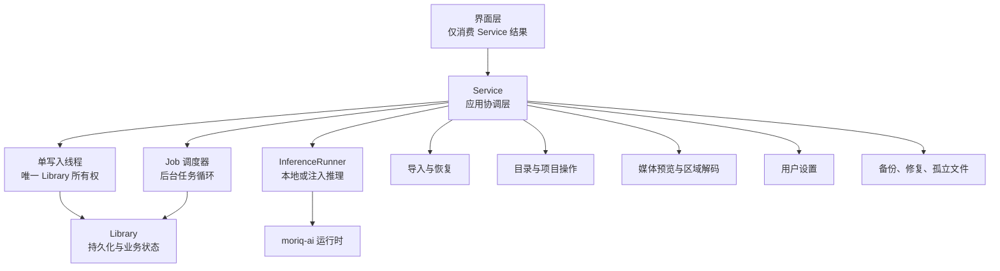
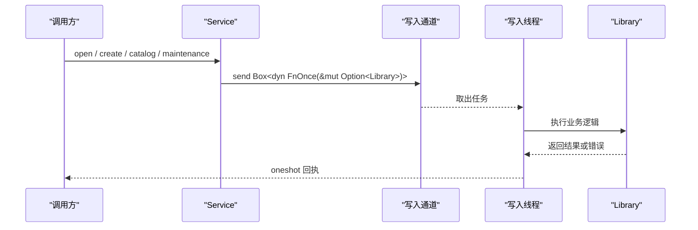
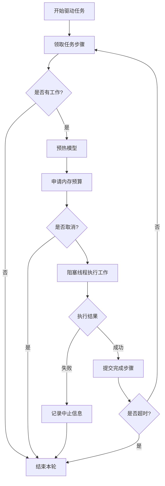
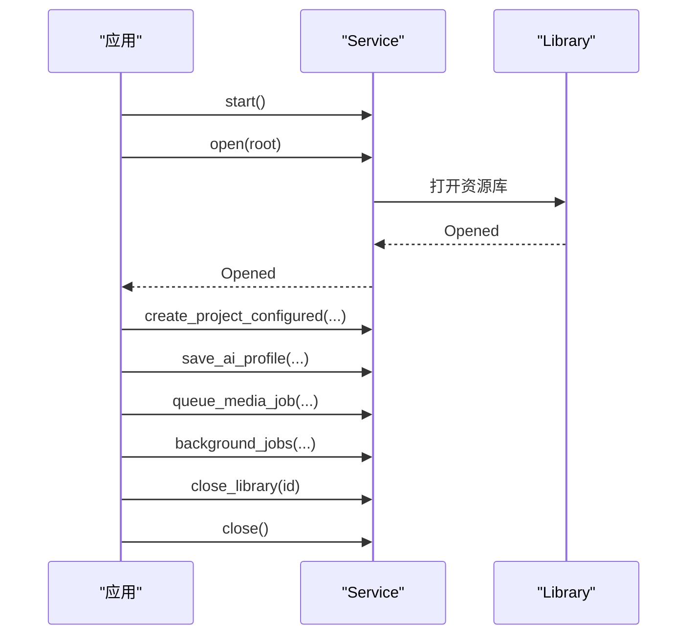

# Service 层 API

> Repo Wiki 节点 `service-layer-api`
> 导出自 Qoder 知识库快照 `8fbe02f6-57c2-4874-b725-1a8130851fd9`，代码基线 `7a7a8e75e18bd90294e09cd422dd7ed5a04813a0`（分支 main，zh-CN）。

<cite>
**本文引用的文件**   
- [lib.rs](../../crates/moriq-app/src/lib.rs)
- [jobs.rs](../../crates/moriq-app/src/jobs.rs)
- [scheduler.rs](../../crates/moriq-app/src/scheduler.rs)
- [import.rs](../../crates/moriq-app/src/import.rs)
- [inference.rs](../../crates/moriq-app/src/inference.rs)
- [settings.rs](../../crates/moriq-app/src/settings.rs)
- [cache.rs](../../crates/moriq-app/src/cache.rs)
- [catalog.rs](../../crates/moriq-app/src/catalog.rs)
- [media.rs](../../crates/moriq-app/src/media.rs)
- [interop.rs](../../crates/moriq-app/src/interop.rs)
- [maintenance.rs](../../crates/moriq-app/src/maintenance.rs)
- [scan.rs](../../crates/moriq-app/src/scan.rs)
</cite>

## 目录
1. [引言](#引言)
2. [项目结构与服务边界](#项目结构与服务边界)
3. [Service 核心结构与线程模型](#service-核心结构与线程模型)
4. [资源库生命周期管理](#资源库生命周期管理)
5. [导入、恢复与扫描接口](#导入恢复与扫描接口)
6. [AI 推理与语义检索](#ai-推理与语义检索)
7. [任务调度与工作队列](#任务调度与工作队列)
8. [设置、缓存与系统交互](#设置缓存与系统交互)
9. [目录、媒体与维护接口](#目录媒体与维护接口)
10. [错误处理、取消机制与内存预算](#错误处理取消机制与内存预算)
11. [使用示例与最佳实践](#使用示例与最佳实践)
12. [故障排查](#故障排查)
13. [结论](#结论)

## 引言
本文件是 Moriq App Service 层的详细 API 文档，聚焦 `moriq-app` 中对外暴露的 `Service` 类型。该服务承担应用层协调职责：UI 不直接持有数据库连接或执行媒体 I/O；所有写操作统一进入单写入线程，读操作通过有界读取槽位和阻塞工作线程执行，AI 推理由可替换的执行器完成，后台任务由独立调度器驱动。

本文按以下维度组织：
- 公共方法契约：参数、返回值、异步语义。
- 错误分类：用户输入错误、存储错误、运行时错误、取消错误、旧库错误。
- 并发控制：单写入、共享信号量、内存预算、取消令牌。
- Job 队列模式：提交、领取、执行、失败回退与暂停策略。
- 内存预算控制：导入、预览、维护、AI 推理各自的预算来源。
- 完整调用流程：从创建 Service 到打开资源库、导入、推理、清理和关闭。

## 项目结构与服务边界
`moriq-app` 将 UI 与底层 `moriq-library` 解耦，并通过 `Service` 暴露统一入口。关键模块如下：

**图表来源**
- [lib.rs:47-118](../../crates/moriq-app/src/lib.rs#L47-L118)
- [scheduler.rs:1-120](../../crates/moriq-app/src/scheduler.rs#L1-L120)
- [inference.rs:1-60](../../crates/moriq-app/src/inference.rs#L1-L60)

**章节来源**
- [lib.rs:1-118](../../crates/moriq-app/src/lib.rs#L1-L118)

## Service 核心结构与线程模型

### Service 结构体
`Service` 是一个可克隆的应用级句柄，内部持有：
- 可选的项目工作区范围。
- 媒体预览缓存。
- 推理执行器。
- 写入消息通道。
- 多组信号量，用于限制并发和内存占用。
- 取消登记中心。

| 字段 | 类型 | 作用 | 线程含义 |
|---|---|---|---|
| `workspace` | `Option<ProjectId>` | 临时绑定批量编辑等操作的上下文 | 随请求在写入线程设置并清除 |
| `media_cache` | `Arc<MediaCache>` | 预览像素缓存，带字节和数量上限 | 多线程只读访问，内部加锁 |
| `inference` | `Arc<dyn InferenceRunner>` | AI 推理执行器 | 共享引用，支持注入测试实现 |
| `queue` | `mpsc::Sender<Job>` | 单写入任务通道 | 所有写操作必须经此发送 |
| `import_slots` | `Semaphore` | 导入/恢复并发许可 | 默认 32 |
| `import_memory` | `Semaphore` | 全局媒体内存预算 | 默认 4096 MiB |
| `maintenance_slot` | `Semaphore` | 检查/修复互斥 | 默认 1 |
| `read_slots` | `Semaphore` | 读取计划并发 | 默认 4 |
| `job_slot` | `Semaphore` | 后台任务执行并发 | 默认 1 |
| `job_cancel` | `Cancellation` | 任务取消登记表 | 全局取消标志管理 |

**章节来源**
- [lib.rs:47-118](../../crates/moriq-app/src/lib.rs#L47-L118)

### 线程模型总览
- **单写入线程**：名称为 `moriq-library-writer`，顺序执行闭包，持有当前 `Library`。
- **调度线程**：名称为 `moriq-job-scheduler`，使用 2 个工作线程的多线程 Tokio runtime 轮询任务。
- **阻塞工作线程**：媒体解码、AI 推理、文件系统 I/O 通过 `spawn_blocking` 离开异步线程。
- **取消机制**：通过 `Cancellation` 登记 `(LibraryId, job, Arc<AtomicBool>)`，可按任务或全部任务取消。

**图表来源**
- [lib.rs:220-305](../../crates/moriq-app/src/lib.rs#L220-L305)

**章节来源**
- [lib.rs:119-305](../../crates/moriq-app/src/lib.rs#L119-L305)
- [scheduler.rs:1-120](../../crates/moriq-app/src/scheduler.rs#L1-L120)

## 资源库生命周期管理

### 创建 Service
| 方法 | 返回值 | 行为 |
|---|---|---|
| `start()` | `std::io::Result<Self>` | 使用本地推理执行器启动服务，创建写入线程、调度器和共享信号量。 |
| `start_with_inference(inference)` | `std::io::Result<Self>` | 使用注入推理执行器启动服务，便于测试或替换后端。 |

构造后不会立即打开任何资源库；需要显式调用 `open` 或 `create`。

**章节来源**
- [lib.rs:234-269](../../crates/moriq-app/src/lib.rs#L234-L269)

### 打开资源库
| 方法 | 参数 | 返回值 | 说明 |
|---|---|---|---|
| `open(path)` | `PathBuf` | `Result<Opened>` | 尝试打开候选资源库；若被锁定则重试最多 20 次，间隔 100 毫秒。 |

- 成功打开后会停止旧库的在途工作，并替换当前 `Library`。
- 如果候选路径与当前库根相同，会直接返回已打开信息。
- 检测到同身份副本时会拒绝，避免误打开迁移后的重复库。
- 仍在使用中的资源库会返回字符串错误。

`Opened` 包含：
- `info`: 资源库信息。
- `root`: 根目录路径。

**章节来源**
- [lib.rs:283-319](../../crates/moriq-app/src/lib.rs#L283-L319)

### 创建资源库
| 方法 | 参数 | 返回值 | 说明 |
|---|---|---|---|
| `create(parent, name)` | `PathBuf`, `String` | `Result<Opened>` | 创建新资源库，并按用户分类模板保存 AI 分类配置。 |

成功后会停止旧库工作并切换当前库。

**章节来源**
- [lib.rs:320-341](../../crates/moriq-app/src/lib.rs#L320-L341)

### 关闭资源库
| 方法 | 参数 | 返回值 | 说明 |
|---|---|---|---|
| `close_library(id)` | `LibraryId` | `Result<()>` | 校验库身份、停止全部任务、清空媒体缓存、释放当前库。 |
| `close_library_at(path, allow_close)` | `PathBuf`, `bool` | `Result<Option<LibraryId>>` | 按路径匹配关闭，未允许时若有未保存修改会报错。 |
| `remove_library(path, plan)` | `PathBuf`, `Option<LibraryRemovalPlan>` | `Result<UserSettings>` | 从最近列表移除或按确认计划删除，保护仍打开的库与外部原片。 |

**章节来源**
- [settings.rs:133-252](../../crates/moriq-app/src/settings.rs#L133-L252)

### 整体关闭
| 方法 | 参数 | 返回值 | 说明 |
|---|---|---|---|
| `close()` | 无 | `Result<()>` | 停止在途工作、清空媒体缓存、关闭当前库，并等待本地推理进程卸载。 |

关闭过程中会多次尝试卸载 Llama 模型，若长时间无法释放会返回错误提示。

**章节来源**
- [lib.rs:201-233](../../crates/moriq-app/src/lib.rs#L201-L233)

## 导入、恢复与扫描接口

### 导入控制对象
`ImportControl` 描述一次导入或恢复的可观察状态：
- `cancel`: 取消标志。
- `finished`: 已完成计数。
- `total`: 总计划数。
- `workers`: 工作线程数。
- `memory_mib`: 每任务内存预算。
- `discovered`: 已发现计划数。
- `scanning`: 是否仍在扫描。
- `active`: 活跃任务数。
- `peak`: 峰值活跃数。
- `waiting_memory`: 等待内存预算的任务数。
- `largest_mib`: 最大预估内存。

可通过 `ImportControl::default()` 或 `with_preferences(ImportPreferences)` 构造。

**章节来源**
- [lib.rs:119-199](../../crates/moriq-app/src/lib.rs#L119-L199)

### 恢复接口
| 方法 | 参数 | 返回值 | 说明 |
|---|---|---|---|
| `recover(id)` | `LibraryId` | `Result<ImportReport>` | 执行资源库恢复，使用默认控制对象。 |
| `recover_controlled(id, control)` | `LibraryId`, `ImportControl` | `Result<ImportReport>` | 可控恢复，支持取消、进度统计和内存预算校验。 |

恢复流程：
1. 注册恢复取消令牌。
2. 读取恢复计划。
3. 对每个计划申请并发许可和初始内存。
4. 冻结计划并估算内存权重。
5. 申请实际内存预算。
6. 准备恢复工作并提交结果。
7. 汇总成功、重复、失败和取消状态。

**章节来源**
- [import.rs:1-140](../../crates/moriq-app/src/import.rs#L1-L140)

### 重连旧根目录
| 方法 | 参数 | 返回值 | 说明 |
|---|---|---|---|
| `reconnect_root(id, old, new)` | `LibraryId`, `PathBuf`, `PathBuf` | `Result<(u64, u64)>` | 分页查找旧根引用，验证新位置后提交重连结果。 |

返回 `(connected, skipped)`。

**章节来源**
- [import.rs:7-45](../../crates/moriq-app/src/import.rs#L7-L45)

### 迁移外部原片
| 方法 | 参数 | 返回值 | 说明 |
|---|---|---|---|
| `relocate_reference(id, asset, version, path)` | `LibraryId`, `AssetId`, `AssetVersionId`, `PathBuf` | `Result<()>` | 计算期望哈希，在文件线程验证目标文件内容，再提交新位置。 |

**章节来源**
- [import.rs:141-175](../../crates/moriq-app/src/import.rs#L141-L175)

### 扫描来源
| 方法 | 参数 | 返回值 | 说明 |
|---|---|---|---|
| `scan(id, paths)` | `LibraryId`, `Vec<PathBuf>` | `Result<Vec<ImportFile>>` | 建立有界文件扫描流，输出文件及相对目录信息。 |

扫描规则：
- 跳过符号链接。
- 跳过资源库内部路径。
- 跳过不支持的文件类型。
- 跳过名为 `moriq` 的子目录。
- 保留深度遍历目录游标，不一次性加载整个目录树。

**章节来源**
- [import.rs:176-200](../../crates/moriq-app/src/import.rs#L176-L200)
- [scan.rs:1-137](../../crates/moriq-app/src/scan.rs#L1-L137)

## AI 推理与语义检索

### 推理执行器接口
`InferenceRunner` 是推理抽象：
| 方法 | 参数 | 返回值 | 说明 |
|---|---|---|---|
| `qwen_faces(image, references, cancel)` | 图片路径、参考列表、取消标志 | `TaskResult<InferenceResult>` | 人脸推理，默认未配置时返回不可用错误。 |
| `qwen_infer(task, image, profile, cancel)` | 任务名、图片路径、AI 配置、取消标志 | `TaskResult<InferenceResult>` | Qwen 分类或描述推理。 |
| `revision(model)` | `ModelId` | `TaskResult<String>` | 查询模型修订。 |
| `ready(model)` | `ModelId` | `TaskResult<()>` | 检查模型是否安装可用。 |
| `infer(model, input, cancel)` | `ModelId`, JSON 输入、取消标志 | `TaskResult<InferenceResult>` | 通用模型推理接口。 |

`LocalInference` 提供本地实现：
- 校验模型安装状态。
- 调用 `moriq-ai` 执行具体推理。
- 在关键步骤检查取消标志。
- 返回包含模型 ID 和修订的分析结果。

**章节来源**
- [inference.rs:1-120](../../crates/moriq-app/src/inference.rs#L1-L120)

### 语义搜索
| 方法 | 参数 | 返回值 | 说明 |
|---|---|---|---|
| `semantic_search(id, text)` | `LibraryId`, `String` | `Result<Vec<AssetId>>` | 文本语义检索，返回匹配的素材 ID。 |

约束：
- 文本不能为空且长度不超过 4096 字节。
- 使用 `ChineseClip` 模型对应的内存预算。
- 使用交互式取消令牌，切库或请求销毁时可停止。

**章节来源**
- [inference.rs:121-200](../../crates/moriq-app/src/inference.rs#L121-L200)

### 推理执行分发
内部 `execute` 根据工作种类分派：
- 普通完成工作。
- Qwen 人脸推理。
- 通用模型推理。
- Qwen 分类。
- Qwen 描述。

**章节来源**
- [inference.rs:200-339](../../crates/moriq-app/src/inference.rs#L200-L339)

## 任务调度与工作队列

### 任务相关公共方法
| 方法 | 参数 | 返回值 | 说明 |
|---|---|---|---|
| `queue_media_job(id, kind)` | `LibraryId`, `JobKind` | `TaskResult<()>` | 登记媒体后台任务；如需模型则先预热推理执行器。 |
| `control_job(id, job, command)` | `LibraryId`, `String`, `JobCommand` | `TaskResult<()>` | 控制单个任务：暂停或取消。 |
| `control_model_jobs(id, command)` | `LibraryId`, `JobCommand` | `TaskResult<()>` | 批量控制模型任务，同时向受影响的执行发出取消信号。 |
| `job_failures(id, job)` | `LibraryId`, `String` | `Result<Vec<JobFailure>>` | 读取任务逐项失败信息。 |
| `background_jobs(id)` | `LibraryId` | `Result<Vec<BackgroundJob>>` | 读取后台任务状态投影，供界面展示。 |

**章节来源**
- [jobs.rs:1-175](../../crates/moriq-app/src/jobs.rs#L1-L175)

### 任务驱动循环
`drive_job_step` 是后台任务执行核心：
1. 获取 `job_slot` 许可，限制同时执行的任务数。
2. 最多循环 64 次领取任务步骤。
3. 如需模型，先调用推理执行器的 `ready`。
4. 按工作内存预算申请 `import_memory`。
5. 在阻塞线程执行推理或媒体工作。
6. 记录成功、中止或失败状态。
7. 若超过 250 毫秒，停止继续领取，避免单次调度过长。

**图表来源**
- [jobs.rs:60-160](../../crates/moriq-app/src/jobs.rs#L60-L160)

### 调度器循环
调度器以弱引用持有写入通道；当最后一个公开 `Service` 被释放时，调度循环退出。
- 每次循环获取当前库 ID。
- 调用 `drive_job_step`。
- 根据错误类型调整延迟。
- 连续失败达阈值时暂停任务。
- 正常或可恢复错误使用较短延迟。

**章节来源**
- [scheduler.rs:1-120](../../crates/moriq-app/src/scheduler.rs#L1-L120)

## 设置、缓存与系统交互

### 设置接口
| 方法 | 参数 | 返回值 | 说明 |
|---|---|---|---|
| `settings()` | 无 | `Result<UserSettings>` | 读取用户设置。 |
| `interface_preferences(language, appearance)` | `Language`, `Appearance` | `Result<()>` | 保存界面语言与外观。 |
| `reduced_motion(enabled)` | `bool` | `Result<UserSettings>` | 保存减少动态效果偏好。 |
| `diagnostic_logging(enabled)` | `bool` | `Result<UserSettings>` | 保存诊断日志开关。 |
| `synco_preferences(value)` | `SyncoPreferences` | `Result<UserSettings>` | 保存 Synco 程序与连接偏好。 |
| `ai_preferences(value)` | `AiPreferences` | `Result<UserSettings>` | 保存模型下载来源和加载策略。 |
| `ai_policy(value)` | `AiPreferences` | `Result<()>` | 更新实际模型加载策略。 |
| `import_preferences(value)` | `ImportPreferences` | `Result<UserSettings>` | 保存导入并发和内存偏好。 |
| `remember(name, path)` | `String`, `PathBuf` | `Result<UserSettings>` | 登记最近资源库。 |
| `save_category_template(profile)` | `AiProfile` | `Result<AiProfile>` | 保存可复用分类模板。 |
| `library_card_details(paths)` | `Vec<PathBuf>` | `Result<Vec<LibraryCard>>` | 读取封面和摘要。 |
| `library_cards(paths)` | `Vec<PathBuf>` | `Result<Vec<(PathBuf, Option<Pixels>)>>` | 生成展示用卡片资料。 |
| `library_removal_plan(path)` | `PathBuf` | `Result<LibraryRemovalPlan>` | 生成资源库移除计划。 |

**章节来源**
- [settings.rs:1-132](../../crates/moriq-app/src/settings.rs#L1-L132)

### 媒体预览缓存
`MediaCache` 使用键 `(LibraryId, AssetVersionId, u32)` 存储预览及其背景像素：
- 单条预览超过 128 MiB 会被丢弃。
- 总字节预算约 256 MiB。
- 条目数上限约 48。
- 淘汰最近最少使用的项。
- 提供 `get`、`put`、`clear`。

**章节来源**
- [cache.rs:1-65](../../crates/moriq-app/src/cache.rs#L1-L65)

### 系统交互
| 方法 | 参数 | 返回值 | 说明 |
|---|---|---|---|
| `model_directory()` | 无 | `Result<PathBuf>` | 返回用户模型存储目录。 |
| `open_models_directory()` | 无 | `Result<()>` | 创建模型目录并通过系统文件管理器打开。 |
| `open_source_repository()` | 无 | `Result<()>` | 打开项目源码仓库地址。 |

底层 `launch::open` 在不同平台调用 `explorer.exe`、`open` 或 `xdg-open`。

**章节来源**
- [lib.rs:28-46](../../crates/moriq-app/src/lib.rs#L28-L46)
- [launch.rs:1-79](../../crates/moriq-app/src/launch.rs#L1-L79)

## 目录、媒体与维护接口

### 目录与项目管理
| 方法 | 参数 | 返回值 | 说明 |
|---|---|---|---|
| `copy_to_project(id, assets, project, annotations)` | `LibraryId`, `Vec<AssetId>`, `ProjectId`, `bool` | `Result<()>` | 复制素材到项目。 |
| `create_project_configured(id, name, parent, template)` | `LibraryId`, `String`, `Option<ProjectId>`, `ProjectTemplate` | `Result<()>` | 创建带独立配置的项目。 |
| `save_ai_profile(id, profile)` | `LibraryId`, `AiProfile` | `Result<AiProfile>` | 保存分类配置，协调受影响任务取消。 |
| `edit_ai_content(id, asset, version, edit)` | `LibraryId`, `AssetId`, `AssetVersionId`, `AiEdit` | `Result<()>` | 提交人工 AI 内容修改。 |
| `saved_navigation(id)` | `LibraryId` | `Result<Option<SavedNavigation>>` | 读取浏览历史。 |
| `save_navigation(id, value)` | `LibraryId`, `SavedNavigation` | `Result<()>` | 保存浏览历史。 |
| `batch_edit(id, scope, patch)` | `LibraryId`, `BatchScope`, `BatchPatch` | `Result<()>` | 提交批量编辑任务。 |
| `folder_edit(id, edit)` | `LibraryId`, `FolderEdit` | `Result<()>` | 虚拟文件夹增删改成员。 |
| `set_category(id, assets, category)` | `LibraryId`, `Vec<AssetId>`, `String` | `Result<()>` | 设置素材分类。 |
| `rename_person(id, person, name)` | `LibraryId`, `String`, `String` | `Result<()>` | 修改人物名称。 |
| `merge_people(id, source, target)` | `LibraryId`, `String`, `String` | `Result<()>` | 合并人物分组。 |
| `faces(id, asset)` | `LibraryId`, `AssetId` | `Result<Vec<Face>>` | 读取人脸与人物归属。 |
| `assign_face(id, face, person)` | `LibraryId`, `String`, `Option<String>` | `Result<()>` | 保存人工人脸归属。 |
| `clear_ai_indexes(id, model)` | `LibraryId`, `String` | `Result<()>` | 清理 AI 索引并协调任务。 |
| `similar_assets(id, asset)` | `LibraryId`, `AssetId` | `Result<Vec<SimilarAsset>>` | 相似素材比较，使用固定内存预算。 |
| `overview(id)` | `LibraryId` | `Result<LoadedOverview>` | 首页概览数据。 |

**章节来源**
- [catalog.rs:1-200](../../crates/moriq-app/src/catalog.rs#L1-L200)

### 媒体区域与预览
| 方法 | 参数 | 返回值 | 说明 |
|---|---|---|---|
| `region_session(id, asset, version)` | `LibraryId`, `AssetId`, `AssetVersionId` | `Result<Arc<RegionSession>>` | 建立原图分块会话。 |
| `region_session_cancellable(id, asset, version, cancelled)` | 同上 + 取消标志 | `Result<Arc<RegionSession>>` | 可取消分块会话。 |
| `region_tile(id, session, region)` | `LibraryId`, `Arc<RegionSession>`, `ImageRegion` | `Result<Pixels>` | 读取指定区域像素。 |
| `region_tile_cancellable(id, session, region, cancelled)` | 同上 + 取消标志 | `Result<Pixels>` | 等待内存预算后读取图块。 |
| `person_portrait(library, person)` | `LibraryId`, `String` | `Result<Option<Pixels>>` | 裁出人物头像。 |
| `preview_full(library, asset)` | `LibraryId`, `AssetId` | `Result<moriq_library::media::Preview>` | 较大尺寸预览。 |
| `preview_version(library, asset, version)` | `LibraryId`, `AssetId`, `AssetVersionId` | `Result<moriq_library::media::Preview>` | 指定版本预览。 |
| `preview(library, asset)` | `LibraryId`, `AssetId` | `Result<Pixels>` | 标准预览像素。 |
| `preview_original(library, asset, version)` | `LibraryId`, `AssetId`, `AssetVersionId` | `Result<Pixels>` | 原图查看预览。 |

**章节来源**
- [media.rs:1-200](../../crates/moriq-app/src/media.rs#L1-L200)

### 同步接口
| 方法 | 参数 | 返回值 | 说明 |
|---|---|---|---|
| `retry_synco(id, task)` | `LibraryId`, `String` | `Result<()>` | 重试失败的 Synco 任务。 |
| `prepare_synco(id, assets, project)` | `LibraryId`, `Vec<AssetId>`, `Option<ProjectId>` | `Result<()>` | 冻结素材任务并准备发送。 |
| `synco_poll(id)` | `LibraryId` | `Result<usize>` | 轮询待处理任务，幂等发送与确认。 |

**章节来源**
- [interop.rs:1-131](../../crates/moriq-app/src/interop.rs#L1-L131)

### 维护与备份
| 方法 | 参数 | 返回值 | 说明 |
|---|---|---|---|
| `orphan_plan(id)` | `LibraryId` | `Result<Arc<OrphanPlan>>` | 生成孤立文件扫描计划。 |
| `quarantine_orphans(id, plan)` | `LibraryId`, `Arc<OrphanPlan>` | `Result<OrphanReport>` | 隔离孤立文件。 |
| `restore_orphans(id, purge)` | `LibraryId`, `bool` | `Result<OrphanReport>` | 分批恢复隔离文件。 |
| `trim_cache(id, clear)` | `LibraryId`, `bool` | `Result<CacheReport>` | 清理可重建缓存。 |
| `trash_snapshot(id)` | `LibraryId` | `Result<Vec<AssetId>>` | 读取回收站快照。 |
| `empty_trash(id, assets)` | `LibraryId`, `Vec<AssetId>` | `Result<PurgeReport>` | 永久删除回收站素材。 |
| `clone_library(id, parent)` | `LibraryId`, `PathBuf` | `Result<PathBuf>` | 创建独立副本。 |
| `backup(id, parent)` | `LibraryId`, `PathBuf` | `Result<PathBuf>` | 创建保留源库身份的备份。 |
| `copy_library(id, parent, independent, control)` | `LibraryId`, `PathBuf`, `bool`, `BackupControl` | `Result<PathBuf>` | 冻结后复制并发布。 |
| `maintenance(id, repair)` | `LibraryId`, `bool` | `Result<MaintenanceReport>` | 检查或修复。 |
| `purge(id, ids)` | `LibraryId`, `Vec<AssetId>` | `Result<PurgeReport>` | 永久删除素材。 |
| `maintenance_controlled(id, repair, control)` | `LibraryId`, `bool`, `MaintenanceControl` | `Result<MaintenanceReport>` | 可取消检查，串行执行。 |

**章节来源**
- [maintenance.rs:1-244](../../crates/moriq-app/src/maintenance.rs#L1-L244)

## 错误处理、取消机制与内存预算

### 错误分类
| 类别 | 来源 | 含义 |
|---|---|---|
| `String` | 大多数 `Service` 方法 | 面向用户的可读错误，例如“请先创建或打开资源库”。 |
| `TaskError` | 任务相关方法 | 类型化任务错误，包括无效输入、存储错误、运行时错误、取消错误、旧库错误、不可用错误。 |
| `DispatchError` | 内部调度 | 表示写入队列关闭或被中断。 |

调度失败会转换为：
- 用户错误：`Closed` 或 `Interrupted`。
- 任务错误：`Unavailable`。

**章节来源**
- [lib.rs:342-446](../../crates/moriq-app/src/lib.rs#L342-L446)

### 取消机制
取消通过 `Cancellation` 管理：
- `register(owner, job)`：登记任务取消标志。
- `register_flag(owner, job, flag)`：登记已有标志。
- `stop(target)`：取消目标任务或全部任务。

取消影响：
- 资源库关闭。
- 任务暂停或取消。
- 批量模型任务控制。
- 交互式推理。
- 恢复流程。
- 维护流程。

**章节来源**
- [scheduler.rs:1-60](../../crates/moriq-app/src/scheduler.rs#L1-L60)
- [jobs.rs:1-60](../../crates/moriq-app/src/jobs.rs#L1-L60)
- [inference.rs:260-339](../../crates/moriq-app/src/inference.rs#L260-L339)

### 内存预算控制
| 场景 | 预算来源 | 典型值 |
|---|---|---|
| 读取计划 | `read_slots` + `import_memory` | 动态估算 |
| 导入恢复 | `import_slots` + `import_memory` | 默认 4096 MiB |
| 媒体预览 | `read_slots` + `import_memory` | 64 MiB 或 1024 MiB |
| 区域解码 | `read_slots` + `import_memory` | 2048 MiB |
| 相似素材 | `read_slots` + `import_memory` | 64 MiB |
| 维护检查 | `maintenance_slot` + `import_memory` | 1024 MiB 步进 |
| 语义搜索 | `import_memory` | 使用 `ChineseClip` 模型预算 |
| 媒体缓存 | `MediaCache` 内部 | 约 256 MiB，最多约 48 项 |

`read_plan_sized` 的关键顺序：
1. 先获取读取槽位。
2. 在写入线程冻结计划。
3. 根据计划估算内存。
4. 申请全局内存许可。
5. 在阻塞线程执行工作。

这保证高成本媒体操作不会无限抢占 UI 响应资源。

**章节来源**
- [lib.rs:342-386](../../crates/moriq-app/src/lib.rs#L342-L386)
- [cache.rs:1-65](../../crates/moriq-app/src/cache.rs#L1-L65)
- [maintenance.rs:120-244](../../crates/moriq-app/src/maintenance.rs#L120-L244)

## 使用示例与最佳实践

### 正确创建 Service 实例
推荐流程：
1. 调用 `Service::start()` 或 `Service::start_with_inference(...)`。
2. 使用返回的 `Service` 打开或创建资源库。
3. 通过 `for_project(project)` 绑定项目上下文。
4. 操作完成后调用 `close_library` 或最终 `close()`。

注意事项：
- 不要跨线程共享可变 `Library`；`Service` 已通过单写入线程封装。
- 不要直接调用底层 `Library` 写方法；应走 `Service`。
- 长时间运行应用应捕获 `close()` 的错误，尤其是推理模型卸载失败。

**章节来源**
- [lib.rs:234-269](../../crates/moriq-app/src/lib.rs#L234-L269)
- [lib.rs:283-341](../../crates/moriq-app/src/lib.rs#L283-L341)

### 执行资源库操作
典型序列：

**图表来源**
- [lib.rs:234-341](../../crates/moriq-app/src/lib.rs#L234-L341)
- [catalog.rs:1-60](../../crates/moriq-app/src/catalog.rs#L1-L60)
- [jobs.rs:1-40](../../crates/moriq-app/src/jobs.rs#L1-L40)

### 处理异步结果
- 对于 `Result<T>` 方法，直接使用 `?` 或 `match` 处理用户错误。
- 对于 `TaskResult<T>` 方法，区分：
  - 输入错误：可提示用户修正。
  - 存储错误：可能是数据库或文件系统问题。
  - 运行时错误：推理、调度或 I/O 失败。
  - 取消错误：用户主动取消。
  - 旧库错误：库已切换，需重新打开。
  - 不可用错误：服务已关闭。

**章节来源**
- [lib.rs:342-446](../../crates/moriq-app/src/lib.rs#L342-L446)

### 正确使用取消
- 长耗时 UI 操作应创建 `AtomicBool` 作为取消标志。
- 传入 `region_session_cancellable`、`region_tile_cancellable` 等方法。
- 对任务类操作使用 `control_job` 或 `control_model_jobs`。
- 对交互式推理使用 `inference_cancel` 管理的取消令牌。
- 对恢复和维护流程，优先使用带 `ImportControl` 或 `MaintenanceControl` 的版本。

**章节来源**
- [media.rs:1-60](../../crates/moriq-app/src/media.rs#L1-L60)
- [jobs.rs:20-60](../../crates/moriq-app/src/jobs.rs#L20-L60)
- [inference.rs:260-339](../../crates/moriq-app/src/inference.rs#L260-L339)

## 故障排查

### 打开资源库失败
可能原因：
- 资源库被其他窗口锁定。
- 路径不是有效资源库根。
- 检测到重复库身份。

建议：
- 等待后台任务收尾后再试。
- 关闭其他打开该库的窗口。
- 对迁移后的重复库，先关闭应用再选择独立克隆。

**章节来源**
- [lib.rs:283-319](../../crates/moriq-app/src/lib.rs#L283-L319)

### 任务连续失败
调度器会在连续失败后暂停任务，并逐步增加重试延迟。

建议：
- 检查 `background_jobs` 状态。
- 查看 `job_failures` 获取任务细节。
- 确认模型已安装且推理执行器可用。
- 检查内存预算是否足够。

**章节来源**
- [scheduler.rs:60-120](../../crates/moriq-app/src/scheduler.rs#L60-L120)
- [jobs.rs:60-175](../../crates/moriq-app/src/jobs.rs#L60-L175)

### 内存不足或导入卡顿
可能原因：
- `import_memory` 被大预览、导入任务或维护任务占用。
- 单任务预估内存超过 `memory_mib`。
- 媒体缓存积压。

建议：
- 提高 `ImportPreferences.memory_mib`。
- 降低 `ImportPreferences.workers`。
- 调用 `trim_cache` 清理缓存。
- 避免同时执行大规模导入、维护和预览操作。

**章节来源**
- [import.rs:60-140](../../crates/moriq-app/src/import.rs#L60-L140)
- [cache.rs:1-65](../../crates/moriq-app/src/cache.rs#L1-L65)
- [maintenance.rs:120-200](../../crates/moriq-app/src/maintenance.rs#L120-L200)

### 关闭应用时推理模型未释放
现象：
- `close()` 返回“模型仍在停止”类错误。

建议：
- 确保没有仍在运行的推理任务。
- 等待 UI 完全关闭。
- 检查是否有未完成的后台任务。

**章节来源**
- [lib.rs:201-233](../../crates/moriq-app/src/lib.rs#L201-L233)

## 结论
`Service` 是 Moriq 应用的核心协调层，它通过单写入线程、有界读取槽位、全局内存信号量和任务取消登记，把资源库操作、导入导出、AI 推理、任务调度和设置管理统一到一致的 API 中。

设计要点总结：
- 所有写操作必须经过写入队列，避免 UI 直接持有数据库连接。
- 媒体和推理操作通过阻塞线程和有界预算执行，防止阻塞主循环。
- 任务调度器负责领取、执行、失败回退和错误暂停。
- 取消机制贯穿资源库切换、任务控制和推理流程。
- 内存预算由多个信号量共同控制，避免导入、预览和维护互相抢占。
- 对外 API 以 `Result` 和 `TaskResult` 分层表达用户错误与任务错误。

正确使用时应遵循：
- 始终通过 `Service::start` 创建实例。
- 通过 `open` 或 `create` 管理资源库。
- 使用 `control_job`、`control_model_jobs` 控制任务。
- 对长耗时操作传递取消标志。
- 在合适时机调用 `close_library` 和 `close`。