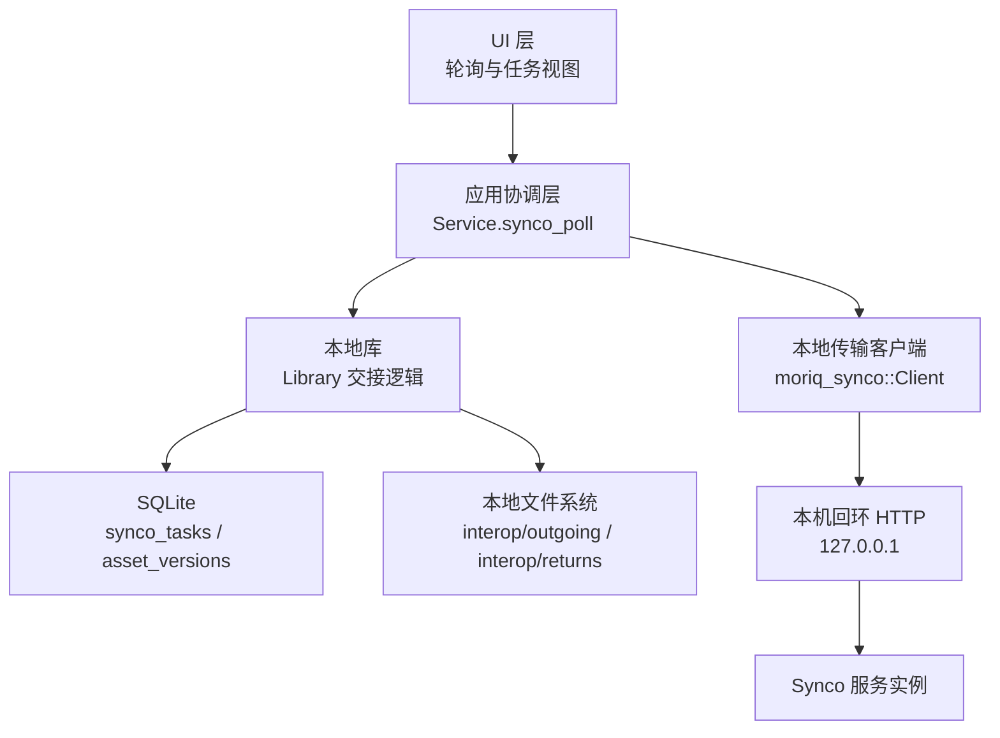
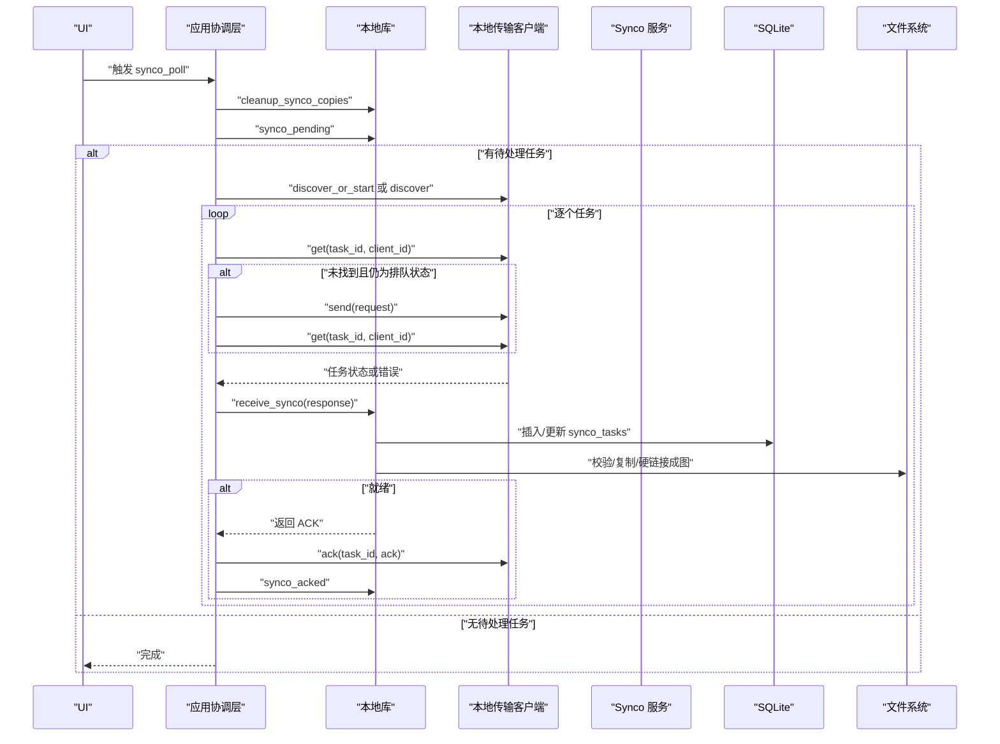
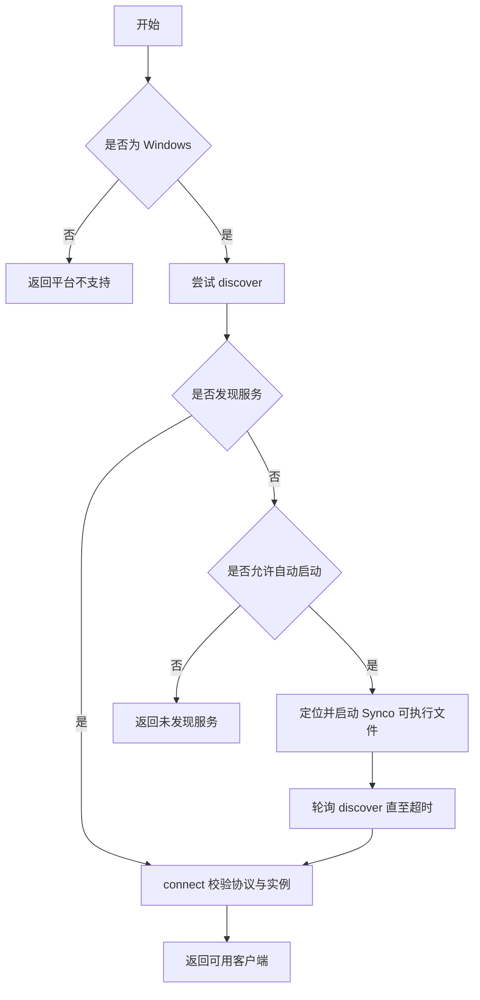
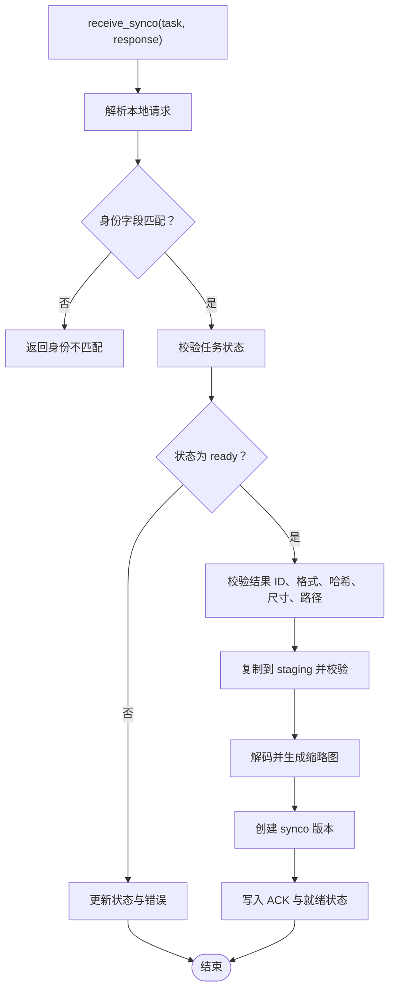
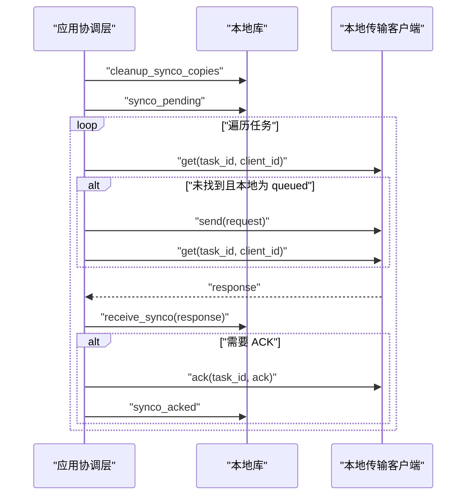
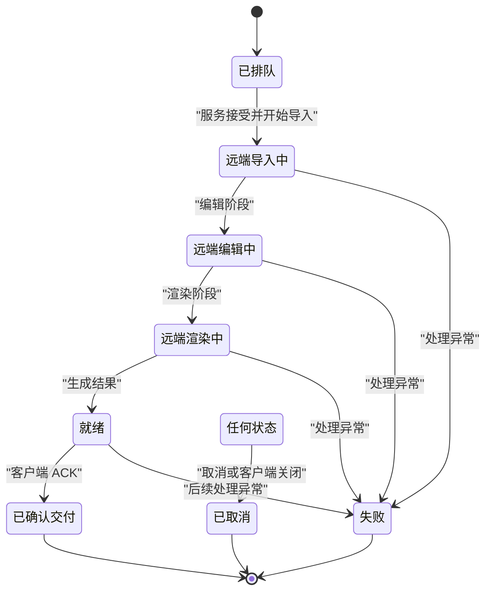
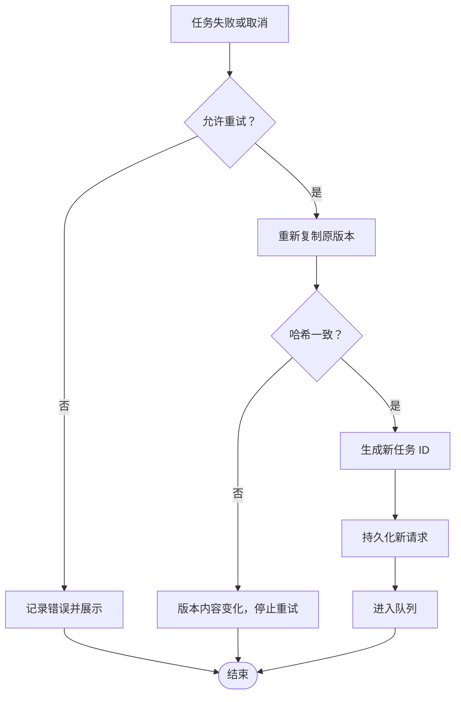

# Synco 服务集成

> Repo Wiki 节点 `synco-integration`
> 导出自 Qoder 知识库快照 `8fbe02f6-57c2-4874-b725-1a8130851fd9`，代码基线 `7a7a8e75e18bd90294e09cd422dd7ed5a04813a0`（分支 main，zh-CN）。

<cite>
**本文引用的文件**   
- [moriq-library/transfer/synco.rs](../crates/moriq-library/src/transfer/synco.rs)
- [moriq-synco/lib.rs](../crates/moriq-synco/src/lib.rs)
- [moriq-app/interop.rs](../crates/moriq-app/src/interop.rs)
- [ARCHITECTURE.md](../ARCHITECTURE.md)
- [schema.sql](../crates/moriq-library/src/database/schema.sql)
- [migration_5.sql](../crates/moriq-library/src/database/migrations/migration_5.sql)
- [migration_19.sql](../crates/moriq-library/src/database/migrations/migration_19.sql)
- [polling.rs](../crates/moriq-ui/src/polling.rs)
- [manage.rs](../crates/moriq-ui/src/manage.rs)
</cite>

## 目录
1. [简介](#简介)
2. [项目结构与职责边界](#项目结构与职责边界)
3. [核心组件](#核心组件)
4. [架构总览](#架构总览)
5. [详细组件分析](#详细组件分析)
6. [通信协议与消息格式](#通信协议与消息格式)
7. [任务生命周期管理](#任务生命周期管理)
8. [错误处理与重试机制](#错误处理与重试机制)
9. [配置指南](#配置指南)
10. [分布式部署注意事项](#分布式部署注意事项)
11. [故障排除](#故障排除)
12. [结论](#结论)

## 简介
本文件说明 Moriq Space 中的 Synco 精修服务集成实现。重点覆盖以下方面：
- 本机回环 HTTP 协议的发现、启动、校验与调用方式。
- 本地 Library 如何准备发送任务、持久化请求、接收远端回执并创建新版本。
- App 层调度器如何轮询任务状态、发送幂等请求和确认结果。
- UI 层何时触发轮询以及任务列表展示所需的状态字段。
- 失败重试、副本清理、版本不可变性和路径安全约束。
- 在 Windows 上的默认行为，以及在非目标平台或远程环境下的限制。

Synco v1 的当前实现是“同用户本机协议”，由 `moriq-synco` 提供轻量传输客户端，`moriq-library` 负责本地资源冻结、版本管理和回执验证，`moriq-app` 负责跨线程调度和错误上报。

**章节来源**
- [ARCHITECTURE.md:1-35](../ARCHITECTURE.md#L1-L35)

## 项目结构与职责边界
- `moriq-synco`：仅承担同一用户的本地回环 HTTP 传输。不包含数据库、库所有权或业务逻辑；它只解析发现信息、建立 HTTP 连接、发送任务、查询状态、确认结果和取消任务。
- `moriq-library`：持有 Library 身份、素材版本、SQLite 写入和文件系统操作。负责将素材冻结为受管副本、构造 Synco 请求、记录任务、接收回执、创建新版本、生成 ACK 并清理不再需要的副本。
- `moriq-app`：作为协调层，封装 Library 调用、设置读取、错误持久化和异步轮询。它决定是否需要自动启动 Synco 程序，并在每个任务上执行“获取状态 → 必要时发送请求 → 持久化回执 → 幂等确认”的流程。
- UI 层通过轮询策略判断是否发起 `synco_poll`，并把任务状态、ACK 标记和错误信息暴露给界面。

**图表来源**
- [moriq-app/interop.rs:1-131](../crates/moriq-app/src/interop.rs#L1-L131)
- [moriq-library/transfer/synco.rs:1-554](../crates/moriq-library/src/transfer/synco.rs#L1-L554)
- [moriq-synco/lib.rs:1-310](../crates/moriq-synco/src/lib.rs#L1-L310)

**章节来源**
- [ARCHITECTURE.md:1-35](../ARCHITECTURE.md#L1-L35)

## 核心组件
- **本地传输客户端**：负责发现 Synco 安装、读取发现文件、校验协议版本与实例 ID、访问 `http://127.0.0.1` 上的 `/api/interop/v1/*` 接口，并对响应进行有界 JSON 解析。
- **本地库交接模块**：负责准备发送、重试、接收回执、登记新版本、生成 ACK、清理副本、维护任务状态和错误信息。
- **应用协调器**：读取 Synco 偏好、决定是否自动启动、遍历待处理任务、调用传输客户端、持久化错误或成功状态。
- **UI 轮询控制器**：根据是否有待处理的 Synco 任务触发后台轮询，并将结果更新到管理器中。

**章节来源**
- [moriq-synco/lib.rs:1-310](../crates/moriq-synco/src/lib.rs#L1-L310)
- [moriq-library/transfer/synco.rs:1-554](../crates/moriq-library/src/transfer/synco.rs#L1-L554)
- [moriq-app/interop.rs:1-131](../crates/moriq-app/src/interop.rs#L1-L131)
- [polling.rs:50-60](../crates/moriq-ui/src/polling.rs#L50-L60)

## 架构总览
Synco 集成采用“本地持久 + 异步轮询 + 本机回环 HTTP”的分层设计。数据流从 UI 开始，经过 App 调度进入 Library 持久层，再通过 Synco 客户端访问本机服务。

**图表来源**
- [moriq-app/interop.rs:33-131](../crates/moriq-app/src/interop.rs#L33-L131)
- [moriq-library/transfer/synco.rs:1-554](../crates/moriq-library/src/transfer/synco.rs#L1-L554)
- [moriq-synco/lib.rs:1-310](../crates/moriq-synco/src/lib.rs#L1-L310)

## 详细组件分析

### 本地传输客户端：同用户回环协议
该客户端的核心职责是保证与 Synco 服务的连接满足以下安全约束：
- 仅支持协议版本 1。
- 仅允许 `http` 方案。
- 主机必须为 `127.0.0.1`。
- 不允许用户名、密码、查询参数、片段或非根路径。
- 禁止代理和重定向。
- 对响应体大小限制为 1 MiB，并按 HTTP 状态码返回结构化错误。

服务发现流程：
1. 优先使用环境变量 `SYNCO_INTEROP_DISCOVERY` 指向的发现文件。
2. 否则尝试 `%LOCALAPPDATA%\Synco\interop.json`。
3. 若未发现且启用自动启动，则按 `SYNCO_EXECUTABLE`、`%LOCALAPPDATA%\Programs\Synco\Synco.exe`、`%ProgramFiles%\Synco\Synco.exe` 顺序查找可执行文件。
4. 启动进程后轮询发现接口，最多等待 30 秒。
5. 连接成功后再次校验协议版本与实例 ID，防止重启后实例变化。

关键 API：
- `discover_or_start`：发现或启动服务。
- `discover`：读取并解析发现文件。
- `connect`：校验地址并验证 `/api/interop/v1/info`。
- `get`：查询任务状态，不存在时返回空值。
- `send`：发送任务请求。
- `ack`：确认已接收结果。
- `cancel`：取消任务。

**图表来源**
- [moriq-synco/lib.rs:1-190](../crates/moriq-synco/src/lib.rs#L1-L190)

**章节来源**
- [moriq-synco/lib.rs:1-310](../crates/moriq-synco/src/lib.rs#L1-L310)

### 本地库交接模块：发送、接收与版本管理
本地库是 Synco 集成的核心持久化与验证层。主要能力如下：

#### 准备发送
- 每批最多 100 张素材，最少 1 张。
- 仅允许 JPEG、PNG、WebP、BMP 输入格式。
- 从当前展示版本读取 `id`、`format`、`sha256`。
- 将源文件复制到 `interop/outgoing/{task_id}.{format}`。
- 校验副本哈希与原始版本一致。
- 构建包含任务 ID、客户端 ID、源项目、源图片 ID、输入输出参数的 JSON 请求。
- 向 `synco_tasks` 插入 `queued` 状态任务。

#### 接收回执
- 校验回执中的 `task_id`、`client_id`、`source_project_id`、`source_image_id` 是否与本地请求一致。
- 校验任务状态是否属于已知集合。
- 若状态为 `ready`：
  - 校验结果 ID 长度和唯一性。
  - 校验输出格式、SHA-256、字节数、宽高。
  - 拒绝网络路径、资源库路径和非绝对路径。
  - 将远端文件复制到 staging，计算哈希，解码图像并生成缩略图。
  - 以 `origin=synco` 创建新的 `asset_versions` 记录。
  - 更新 `synco_tasks` 状态为 `ready`，并写入 `result_id`、`returned_version_id`、`ack`。
- 若状态为 `failed` 或 `cancelled`，生成仅含客户端身份的 ACK。
- 其他中间状态仅更新状态和错误信息，不生成 ACK。

#### 重试
- 仅允许对 `failed` 或 `cancelled` 的任务重试。
- 重新复制原版本到新的 `interop/outgoing` 路径。
- 校验哈希一致性。
- 生成新任务 ID，避免复用已结束任务身份。
- 更新请求中的 `task_id`、`input.path`、`input.sha256`。

#### 副本清理
- 针对 `delivered`、`failed`、`cancelled` 且尚未清理的已完成任务。
- 从 `request.input.path` 推导副本路径。
- 删除副本并标记 `copy_removed=1`。
- 批量清理方法每次最多处理 100 条，失败时记录警告并继续。

**图表来源**
- [moriq-library/transfer/synco.rs:201-554](../crates/moriq-library/src/transfer/synco.rs#L201-L554)

**章节来源**
- [moriq-library/transfer/synco.rs:1-554](../crates/moriq-library/src/transfer/synco.rs#L1-L554)

### 应用协调层：轮询与幂等控制
App 层将 Library 的阻塞 I/O 放入串行调用上下文，并通过 `synco_poll` 统一编排任务：

1. 先执行副本清理。
2. 读取待处理任务。
3. 如果为空，直接返回。
4. 根据设置选择自动启动或直接发现 Synco 客户端。
5. 对每个任务：
   - 解析本地请求中的 `client_id`。
   - 若已有 ACK，则直接发送 ACK 并标记完成。
   - 否则调用 `get` 查询任务状态。
   - 若任务不存在且本地状态仍为 `queued`，则发送请求后再查询。
   - 将远端响应交给 `receive_synco` 持久化。
   - 若收到 ACK，则调用 `ack` 并调用 `synco_acked` 清理副本。
6. 单个任务失败会持久化错误；所有任务完成后，若存在任一失败，则返回第一个错误。

**图表来源**
- [moriq-app/interop.rs:33-131](../crates/moriq-app/src/interop.rs#L33-L131)

**章节来源**
- [moriq-app/interop.rs:1-131](../crates/moriq-app/src/interop.rs#L1-L131)

### UI 轮询与任务展示
UI 层不直接持有 Synco 协议细节，而是依据管理器中的任务状态决定是否轮询：
- 当轮询到期且存在待处理任务时，触发 `ManageMessage::SyncoPoll(false)`。
- 任务模型包含 `id`、`name`、`state`、`error`、`request`、`ack`。
- 界面通常显示 `queued`、`importing`、`editing`、`rendering`、`ready` 等状态，并根据是否存在 `ack` 判断是否已确认交付。

**章节来源**
- [polling.rs:50-60](../crates/moriq-ui/src/polling.rs#L50-L60)
- [manage.rs:762-762](../crates/moriq-ui/src/manage.rs#L762-L762)
- [moriq-domain/src/lib.rs:217-224](../crates/moriq-domain/src/lib.rs#L217-L224)

## 通信协议与消息格式

### 协议与安全约束
- 协议版本固定为 `1`。
- 仅允许 `http://127.0.0.1/` 作为基础地址。
- 客户端禁止代理、禁止重定向。
- 连接时会调用 `/api/interop/v1/info` 校验协议版本与实例 ID。
- 所有响应体最大 1 MiB。
- 非成功 HTTP 状态会被转换为带错误消息的字符串错误。

### 服务发现
发现文件结构：
- `protocol`：协议版本号。
- `base_url`：服务基础 URL。
- `instance_id`：Synco 实例标识。

客户端发现优先级：
1. 环境变量 `SYNCO_INTEROP_DISCOVERY`。
2. `%LOCALAPPDATA%\Synco\interop.json`。

### HTTP 接口
| 接口 | 方法 | 用途 | 重要约束 |
|---|---|---|---|
| `/api/interop/v1/info` | GET | 校验协议版本与实例 ID | 连接阶段必调 |
| `/api/interop/v1/tasks/{task}` | GET | 查询任务状态 | 查询参数 `client_id` |
| `/api/interop/v1/tasks` | POST | 发送任务请求 | 请求体为 JSON |
| `/api/interop/v1/tasks/{task}/ack` | POST | 确认已接收结果 | 请求体为 ACK |
| `/api/interop/v1/tasks/{task}/cancel` | POST | 取消任务 | 请求体包含 `client_id` |

### 请求与响应字段
发送请求至少包含：
- `task_id`：任务唯一标识。
- `client_id`：本地客户端标识。
- `source_project_id`：源项目标识。
- `project_name`：项目名称。
- `source_image_id`：源图片标识。
- `input.path`：本地受管副本路径。
- `input.sha256`：输入文件哈希。
- `output.format`：期望输出格式。
- `output.quality`：输出质量。
- `open_in_editor`：是否在编辑器中打开。

任务状态包括：
- `queued`：本地排队。
- `importing`：远端导入中。
- `editing`：远端编辑中。
- `rendering`：远端渲染中。
- `ready`：结果就绪。
- `delivered`：结果已确认。
- `failed`：失败。
- `cancelled`：已取消。

ACK 示例语义：
- 就绪时 ACK 包含客户端 ID、结果 ID 和结果哈希。
- 失败或取消时 ACK 仅包含客户端 ID。

**章节来源**
- [moriq-synco/lib.rs:1-310](../crates/moriq-synco/src/lib.rs#L1-L310)
- [moriq-library/transfer/synco.rs:1-200](../crates/moriq-library/src/transfer/synco.rs#L1-L200)

## 任务生命周期管理

### 生命周期阶段

**图表来源**
- [moriq-library/transfer/synco.rs:1-554](../crates/moriq-library/src/transfer/synco.rs#L1-L554)

### 本地状态与远端状态的同步
- 本地 `queued` 表示已持久化请求但未确认远端接受。
- 中间状态由远端状态驱动，本地仅记录状态、错误和可选 ACK。
- `ready` 表示本地已持久化新版本并准备好 ACK。
- `delivered` 表示本地已发送 ACK 并清理副本。
- `failed` 和 `cancelled` 允许重试。

### 版本关系
- 每个 Synco 结果都会创建新的 `asset_versions`。
- 新版本的 `origin` 为 `synco`。
- 新版本通过 `parent_version_id` 关联上一版本。
- 用户可通过 `display_version` 切换展示版本。

**章节来源**
- [moriq-library/transfer/synco.rs:1-554](../crates/moriq-library/src/transfer/synco.rs#L1-L554)

## 错误处理与重试机制

### 错误分类
- **输入校验错误**：素材数量、格式、路径、哈希、文件大小、宽高不一致、魔数不符。
- **路径安全错误**：网络路径、资源库路径、非绝对路径、越界路径。
- **协议错误**：协议版本不符、实例 ID 不匹配、地址非法、响应过大、JSON 解析失败。
- **任务状态错误**：未知状态、重复结果 ID、缺失必要字段。
- **IO 错误**：复制失败、哈希变化、文件缺失、权限问题。
- **协调层错误**：任务不存在、服务未就绪、服务实例变化。

### 重试策略
- 仅允许对 `failed` 或 `cancelled` 的任务重试。
- 重试会生成新任务 ID，不会复用旧任务。
- 重试前重新复制原版本并校验哈希。
- 如果插入任务失败，会回滚已创建的临时副本。
- UI 和应用层可将错误展示给用户，并由用户决定是否重试。

### 幂等性与一致性
- `receive_synco` 对相同任务 ID 和相同结果 ID 返回相同 ACK，避免重复创建版本。
- 已确认交付的任务不会被再次处理。
- 冲突结果 ID 会直接报错。
- 副本清理基于 `copy_removed` 标志，避免重复删除。

**图表来源**
- [moriq-library/transfer/synco.rs:201-300](../crates/moriq-library/src/transfer/synco.rs#L201-L300)

**章节来源**
- [moriq-library/transfer/synco.rs:201-554](../crates/moriq-library/src/transfer/synco.rs#L201-L554)
- [moriq-app/interop.rs:33-131](../crates/moriq-app/src/interop.rs#L33-L131)

## 配置指南

### Synco 程序位置
客户端按以下顺序查找 Synco 可执行文件：
1. `SYNCO_EXECUTABLE` 环境变量。
2. `%LOCALAPPDATA%\Programs\Synco\Synco.exe`。
3. `%ProgramFiles%\Synco\Synco.exe`。

### 服务发现文件位置
客户端按以下顺序查找发现文件：
1. `SYNCO_INTEROP_DISCOVERY` 环境变量。
2. `%LOCALAPPDATA%\Synco\interop.json`。

### 自动启动开关
- 当设置启用自动启动时，`synco_poll` 会通过 `discover_or_start` 启动 Synco。
- 禁用自动启动时，仅尝试发现已有服务。
- 非 Windows 平台会直接返回错误，因为当前 v1 协议仅限 Windows。

### 推荐配置
- 确保 Synco 安装在默认路径，或通过环境变量显式指定。
- 确保 Synco 运行后会生成有效的 `interop.json`。
- 确保 `SYNCO_INTEROP_DISCOVERY` 指向有效 JSON。
- 保持 Synco 版本不低于实现要求的最低版本。
- 不要手动修改 `interop/outgoing`、`interop/returns`、`versions`、`thumbnails` 目录。

**章节来源**
- [moriq-synco/lib.rs:1-190](../crates/moriq-synco/src/lib.rs#L1-L190)
- [moriq-app/interop.rs:1-32](../crates/moriq-app/src/interop.rs#L1-L32)

## 分布式部署注意事项
当前 Synco 集成的设计不是通用分布式系统：
- 传输层强制要求 `127.0.0.1`，不允许普通域名、公网 IP、用户名、密码、查询参数和片段。
- 协议仅支持 v1。
- 实例 ID 通过发现文件绑定，重启后实例变化会导致连接失败。
- 文件路径是本地绝对路径，且被严格限制在本地库之外、不在资源库内、不接受网络路径。
- 当前实现明确声明 macOS 尚未定义交接协议。

因此：
- 不能将 Synco 视为跨机器远程服务。
- 多实例场景下，每个 Moriq Space 实例应连接各自本地的 Synco 进程。
- 容器化或云部署不应假设共享文件或共享数据库；实际文件交换依赖本地路径。
- 如果需要跨机协作，应在应用层额外设计消息队列、对象存储和任务分发机制，而不是依赖当前回环协议。

**章节来源**
- [moriq-synco/lib.rs:120-190](../crates/moriq-synco/src/lib.rs#L120-L190)
- [moriq-library/transfer/synco.rs:300-554](../crates/moriq-library/src/transfer/synco.rs#L300-L554)

## 故障排除

### 无法发现 Synco
- 检查是否安装了 Synco。
- 检查 `%LOCALAPPDATA%\Synco\interop.json` 是否存在且小于 64 KiB。
- 检查 `SYNCO_INTEROP_DISCOVERY` 是否指向有效文件。
- 检查发现文件中 `protocol` 是否为 1。
- 检查 `base_url` 是否为 `http://127.0.0.1/`。
- 检查 `instance_id` 是否与 `/api/interop/v1/info` 返回的一致。

### 连接被拒绝或服务未就绪
- 如果是自动启动模式，等待最长 30 秒。
- 检查 Synco 进程是否成功启动。
- 检查端口监听是否在本机回环地址。
- 检查防火墙或安全软件是否阻止本机 HTTP。

### 任务发送后立即失败
- 检查输入文件格式是否为 JPEG、PNG、WebP、BMP。
- 检查源文件是否在发送过程中被修改。
- 检查 `interop/outgoing` 是否可写。
- 检查本地磁盘空间。

### 接收回执失败
- 检查结果 ID 是否重复。
- 检查输出格式是否为 JPEG 或 PNG。
- 检查结果路径是否为绝对路径。
- 检查结果路径是否位于远端的 `interop/returns`。
- 检查文件大小、哈希、宽高是否与响应一致。
- 检查文件魔数是否与声明格式一致。

### 副本未清理
- 检查任务状态是否为 `delivered`、`failed` 或 `cancelled`。
- 检查 `copy_removed` 是否仍为未清理。
- 检查 `ack` 是否仍存在。
- 检查 `request.input.path` 是否可解析。
- 手动运行副本清理逻辑或重启应用以触发清理。

### 非 Windows 平台
- 当前实现仅在 Windows 上支持 Synco v1。
- 在非 Windows 平台上，客户端会直接返回平台不支持错误。

**章节来源**
- [moriq-synco/lib.rs:1-310](../crates/moriq-synco/src/lib.rs#L1-L310)
- [moriq-library/transfer/synco.rs:1-554](../crates/moriq-library/src/transfer/synco.rs#L1-L554)
- [moriq-app/interop.rs:1-131](../crates/moriq-app/src/interop.rs#L1-L131)

## 结论
Synco 服务集成在当前仓库中是一个面向 Windows 的同用户本机协议实现。它以严格的本地回环约束、明确的协议版本、可审计的 SQLite 任务记录和不可变的资产版本为基础，构建了从本地素材到远端精修结果的可靠通道。其可靠性来自多个层面：
- 传输层的地址、协议、实例和响应大小校验。
- 本地库层的输入校验、路径安全、哈希校验和版本不可变性。
- 应用层的幂等 ACK、错误持久化和有序轮询。
- UI 层的按需轮询和任务状态反馈。

未来若扩展为分布式系统，需要重新设计服务发现、身份认证、路径抽象、对象存储和任务路由，而不能直接复用当前的 `127.0.0.1` 回环假设。