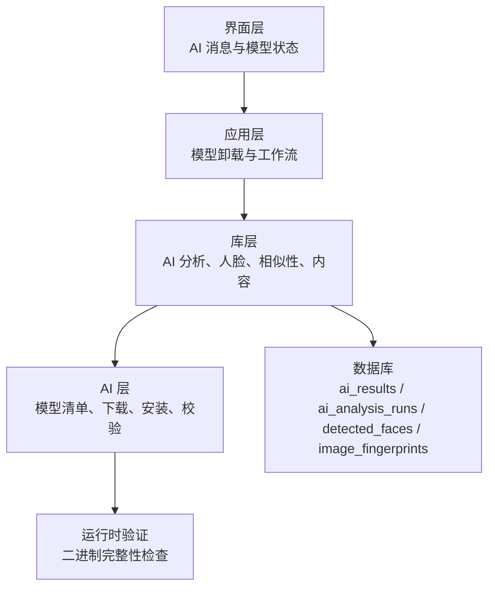
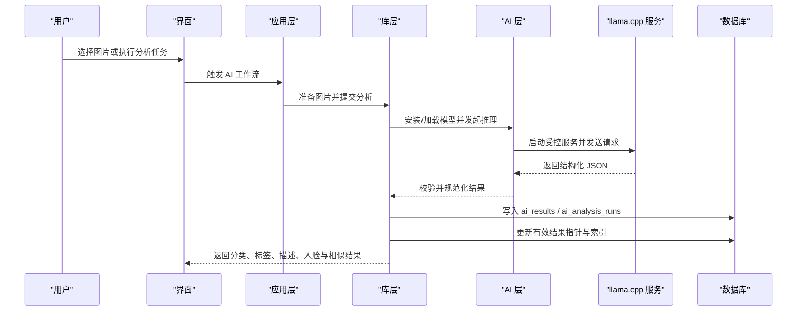
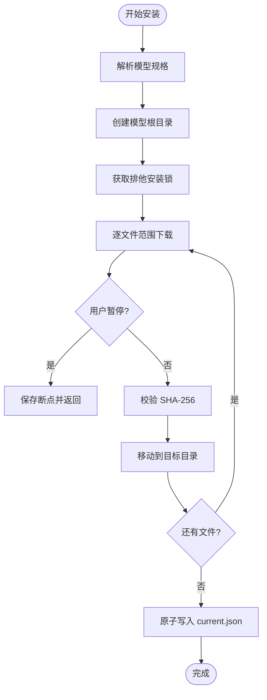
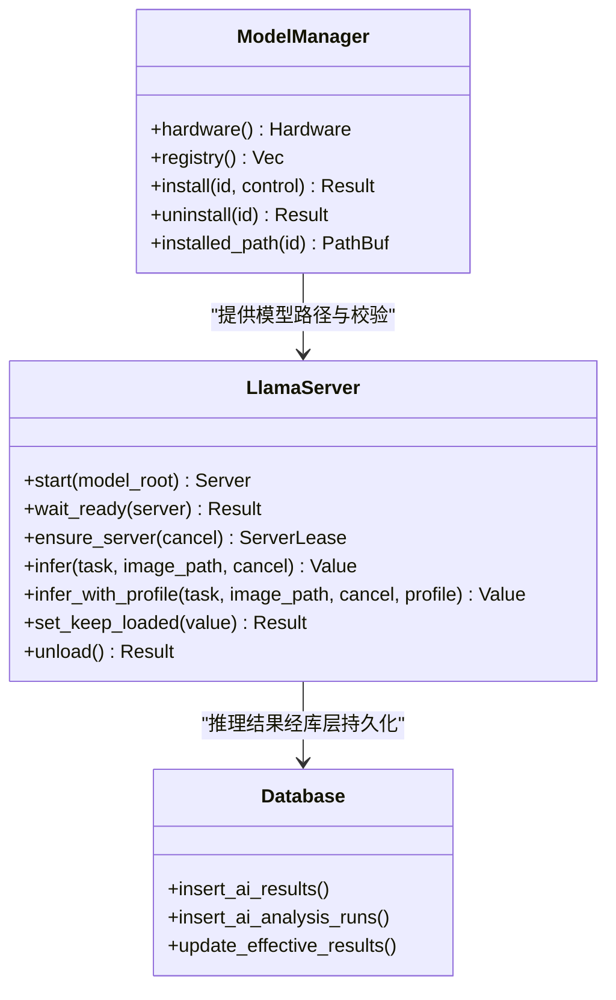
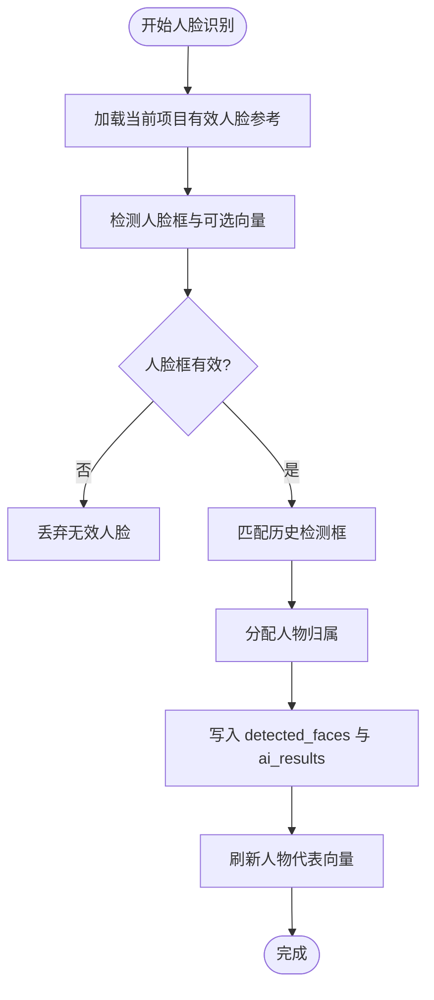
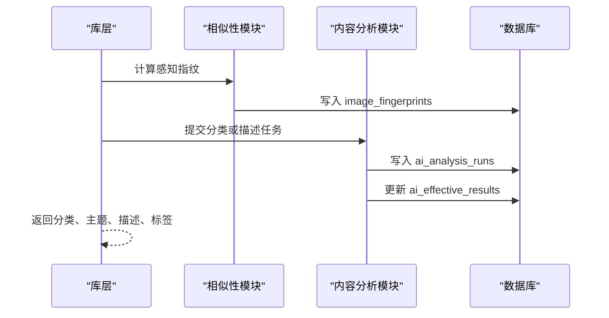
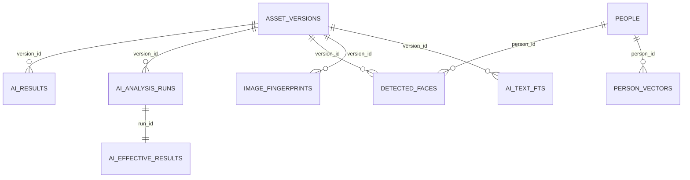

# AI能力

> Repo Wiki 节点 `ai-capabilities`
> 导出自 Qoder 知识库快照 `8fbe02f6-57c2-4874-b725-1a8130851fd9`，代码基线 `7a7a8e75e18bd90294e09cd422dd7ed5a04813a0`（分支 main，zh-CN）。

<cite>
**本文引用的文件**   
- [moriq-ai/lib.rs](../../crates/moriq-ai/src/lib.rs)
- [moriq-ai/models.rs](../../crates/moriq-ai/src/models.rs)
- [moriq-ai/llama.rs](../../crates/moriq-ai/src/llama.rs)
- [moriq-library/ai/analysis.rs](../../crates/moriq-library/src/ai/analysis.rs)
- [moriq-library/ai/similarity.rs](../../crates/moriq-library/src/ai/similarity.rs)
- [moriq-library/ai/qwen_faces.rs](../../crates/moriq-library/src/ai/qwen_faces.rs)
- [moriq-library/ai/portraits.rs](../../crates/moriq-library/src/ai/portraits.rs)
- [moriq-library/ai/ai_content.rs](../../crates/moriq-library/src/ai/ai_content.rs)
- [moriq-library/ai/ai_profile.rs](../../crates/moriq-library/src/ai/ai_profile.rs)
- [moriq-app/inference.rs](../../crates/moriq-app/src/inference.rs)
- [moriq-ui/ai.rs](../../crates/moriq-ui/src/ai.rs)
</cite>

## 目录
1. [引言](#引言)
2. [项目结构](#项目结构)
3. [核心组件](#核心组件)
4. [架构总览](#架构总览)
5. [详细组件分析](#详细组件分析)
6. [依赖关系分析](#依赖关系分析)
7. [性能与资源管理](#性能与资源管理)
8. [AI功能使用指南](#ai功能使用指南)
9. [常见问题排查](#常见问题排查)
10. [结论](#结论)

## 引言
本文件面向希望理解和使用本项目 AI 能力的用户与开发者。内容覆盖模型管理系统、Qwen 模型集成、llama.cpp 推理引擎配置、人脸识别与人物分组、相似性搜索、内容分析与分类、结果存储与索引机制，以及硬件检测、性能调优和资源管理的最佳实践。目标是帮助你在本地完成从模型安装到识别分析的全流程，并给出内存不足、推理慢等常见问题的解决思路。

## 项目结构
AI 相关代码主要分布在以下模块：
- `moriq-ai`：模型清单、下载与安装、本机 llama.cpp 服务控制、Qwen 推理入口。
- `moriq-library`：AI 结果持久化、人脸处理、相似性指纹、内容与分类管理、人物分组。
- `moriq-app`：应用层调用卸载等模型操作。
- `moriq-ui`：UI 侧的 AI 消息类型与交互入口。

图表来源
- [moriq-ui/ai.rs:70-80](../../crates/moriq-ui/src/ai.rs#L70-L80)
- [moriq-app/inference.rs:330-340](../../crates/moriq-app/src/inference.rs#L330-L340)
- [moriq-library/ai/analysis.rs:1-60](../../crates/moriq-library/src/ai/analysis.rs#L1-L60)
- [moriq-library/ai/similarity.rs:1-40](../../crates/moriq-library/src/ai/similarity.rs#L1-L40)
- [moriq-ai/lib.rs:1-15](../../crates/moriq-ai/src/lib.rs#L1-L15)

章节来源
- [moriq-ai/lib.rs:1-15](../../crates/moriq-ai/src/lib.rs#L1-L15)
- [moriq-library/ai/analysis.rs:1-60](../../crates/moriq-library/src/ai/analysis.rs#L1-L60)
- [moriq-library/ai/similarity.rs:1-40](../../crates/moriq-library/src/ai/similarity.rs#L1-L40)

## 核心组件
- 模型清单与硬件检测：读取内置模型规格、计算可用内存和线程数、定位模型根目录。
- 模型安装与卸载：支持断点续传、镜像切换、SHA-256 校验、并发锁保护、版本发布。
- Qwen 推理与 llama.cpp：启动受控本地服务、参数注入、健康检查、请求超时与响应大小限制。
- 内容分析与分类：根据项目词表构造提示词与输出 JSON Schema，校验并持久化分类、主题、描述和标签。
- 人脸识别与人物分组：检测人脸框、生成或复用向量、匹配已有人员、保存检测结果与代表头像。
- 相似性搜索：计算感知指纹、颜色均值与宽高比，用于查找缩放或重压缩的图片变体。
- 结果存储与索引：将 AI 回执写入 `ai_results`、`ai_analysis_runs`、`ai_effective_results`；人脸结果写入 `detected_faces`；相似性指纹写入 `image_fingerprints`。

章节来源
- [moriq-ai/models.rs:1-120](../../crates/moriq-ai/src/models.rs#L1-L120)
- [moriq-ai/llama.rs:100-170](../../crates/moriq-ai/src/llama.rs#L100-L170)
- [moriq-library/ai/analysis.rs:200-300](../../crates/moriq-library/src/ai/analysis.rs#L200-L300)
- [moriq-library/ai/qwen_faces.rs:1-120](../../crates/moriq-library/src/ai/qwen_faces.rs#L1-L120)
- [moriq-library/ai/similarity.rs:1-80](../../crates/moriq-library/src/ai/similarity.rs#L1-L80)

## 架构总览
AI 能力采用“应用层调度 + 库层业务逻辑 + AI 层模型管理 + 本地推理进程”的分层架构。

图表来源
- [moriq-app/inference.rs:330-340](../../crates/moriq-app/src/inference.rs#L330-L340)
- [moriq-library/ai/analysis.rs:200-300](../../crates/moriq-library/src/ai/analysis.rs#L200-L300)
- [moriq-ai/llama.rs:200-280](../../crates/moriq-ai/src/llama.rs#L200-L280)

## 详细组件分析

### 模型管理系统：安装、卸载、暂停、更新
- 模型清单与路径
  - 通过内置清单解析模型规格，包含模型 ID、名称、修订、许可证、最小内存要求与文件列表。
  - 模型根目录按平台确定，最终落到用户数据目录下的 `MORIQ/models`。
  - 每个模型以 ID 为根，再按修订摘要建立隔离子目录，避免多版本冲突。
- 硬件检测
  - 读取系统总内存、可用内存、逻辑 CPU 数量，并在硬件信息中标注当前默认提供者与模型名。
- 安装流程
  - 下载使用分块范围请求，支持暂停、续传与重试。
  - 服务端 429 或服务器错误时按 `Retry-After` 或指数退避重试。
  - 每个文件在写入前进行 SHA-256 校验，成功后移动到目标目录，最后原子更新 `current.json`。
  - 安装过程中持有排他锁，防止重复安装或卸载。
- 卸载流程
  - 先尝试释放已加载的模型服务，再取得排他锁。
  - 删除非活跃模型版本目录，保留 `current.json` 外的临时下载目录。
- 更新与状态查询
  - `inventory` 汇总安装状态、文件大小、是否可续传。
  - `installed_path` 校验 `current.json` 与实际权重一致，缺失或损坏会提示重新安装或更新。

图表来源
- [moriq-ai/models.rs:250-420](../../crates/moriq-ai/src/models.rs#L250-L420)
- [moriq-ai/models.rs:420-589](../../crates/moriq-ai/src/models.rs#L420-L589)

章节来源
- [moriq-ai/models.rs:1-120](../../crates/moriq-ai/src/models.rs#L1-L120)
- [moriq-ai/models.rs:200-420](../../crates/moriq-ai/src/models.rs#L200-L420)
- [moriq-ai/models.rs:480-589](../../crates/moriq-ai/src/models.rs#L480-L589)

### Qwen 模型集成与 llama.cpp 推理引擎
- 集成方式
  - 通过 `moriq-ai` 暴露 `infer`、`infer_with_profile`、`set_keep_loaded`、`unload` 等方法。
  - 推理过程启动本机 `llama-server.exe`，并通过 HTTP `/v1/chat/completions` 调用。
- 模型与服务位置
  - 推理目录位于程序目录下的 `ai/llama`。
  - 模型权重路径由已安装的 Qwen 模型规格决定，包括主模型文件和视觉投影文件。
- 关键运行参数
  - `-ngl 99`：尽量将语言模型层放入 GPU。
  - `-c 4096`：上下文长度。
  - `--parallel 1`：单并行推理，降低竞争。
  - `--no-mmproj-offload`：关闭视觉投影 offload，减少可变尺寸人脸导致的分配器耗尽。
  - `--image-max-tokens 1024`：限制图像阶段 token 上限。
  - `--cache-ram 256`：限制缓存 RAM。
  - `--threads`：自动取逻辑 CPU 的一半，限制在 1~8。
  - `--jinja --reasoning off --no-warmup`：禁用思考模式、关闭推理增强、跳过预热。
  - `--api-key`：随机密钥，仅本机访问。
- 生命周期与资源保护
  - 使用一次性全局守护进程对象，支持常驻策略 `set_keep_loaded`。
  - 启动前检查可用内存，低于阈值直接拒绝。
  - 健康检查失败、子进程退出、请求超时、响应过大都会导致服务实例被清理。
  - 每次推理结束若未启用常驻，则释放服务实例。

图表来源
- [moriq-ai/lib.rs:1-15](../../crates/moriq-ai/src/lib.rs#L1-L15)
- [moriq-ai/models.rs:1-120](../../crates/moriq-ai/src/models.rs#L1-L120)
- [moriq-ai/llama.rs:100-170](../../crates/moriq-ai/src/llama.rs#L100-L170)
- [moriq-ai/llama.rs:200-360](../../crates/moriq-ai/src/llama.rs#L200-L360)

章节来源
- [moriq-ai/llama.rs:100-170](../../crates/moriq-ai/src/llama.rs#L100-L170)
- [moriq-ai/llama.rs:200-360](../../crates/moriq-ai/src/llama.rs#L200-L360)
- [moriq-ai/llama.rs:360-579](../../crates/moriq-ai/src/llama.rs#L360-L579)

### 人脸识别与人物分组
- 参考人脸构建
  - 从当前项目的已检测人脸中选择代表性样本，裁剪出固定尺寸的 PNG 作为参考。
  - 参考来自真实素材的显示版本，排除回收站和旧版本。
- 人脸存储
  - Qwen 人脸模式不合成嵌入向量，而是比较实际人脸裁剪图。
  - 普通人脸模式会将检测向量存入数据库，并按人物聚合代表向量。
- 人物归属
  - 优先保留人工标注的人脸归属。
  - 基于人脸框重叠度和向量余弦相似度合并历史检测。
  - 若候选人物不在当前项目空间，则忽略；否则新建或复用人物记录。
- 代表头像
  - 从当前显示版本中选取面积最大且有效的人脸框，裁剪为固定尺寸头像。

图表来源
- [moriq-library/ai/qwen_faces.rs:1-120](../../crates/moriq-library/src/ai/qwen_faces.rs#L1-L120)
- [moriq-library/ai/analysis.rs:240-420](../../crates/moriq-library/src/ai/analysis.rs#L240-L420)
- [moriq-library/ai/portraits.rs:1-80](../../crates/moriq-library/src/ai/portraits.rs#L1-L80)

章节来源
- [moriq-library/ai/qwen_faces.rs:1-120](../../crates/moriq-library/src/ai/qwen_faces.rs#L1-L120)
- [moriq-library/ai/analysis.rs:240-420](../../crates/moriq-library/src/ai/analysis.rs#L240-L420)
- [moriq-library/ai/portraits.rs:1-80](../../crates/moriq-library/src/ai/portraits.rs#L1-L80)

### 相似性搜索与内容分析
- 相似性搜索
  - 将输入图像缩放到 32×32，计算 DCT 系数、中值阈值哈希、RGB 平均颜色和宽高比。
  - 指纹写入 `image_fingerprints`，用于查找缩放、重压缩但语义相近的图片。
  - 相似性查询使用独立读取租约，避免长时间持有写连接。
- 内容分析
  - 根据项目 AI 分类配置生成分类提示词和 JSON Schema，约束媒介、主题、不确定项。
  - 描述任务生成中文描述和检索标签，限制长度并去重。
  - 所有结果写入 `ai_analysis_runs`，并更新 `ai_effective_results` 指向最新有效分析。
  - 人工分类和标签具有优先级，并可拒绝某些自动标签。

图表来源
- [moriq-library/ai/similarity.rs:1-80](../../crates/moriq-library/src/ai/similarity.rs#L1-L80)
- [moriq-library/ai/analysis.rs:200-300](../../crates/moriq-library/src/ai/analysis.rs#L200-L300)
- [moriq-library/ai/ai_content.rs:1-60](../../crates/moriq-library/src/ai/ai_content.rs#L1-L60)

章节来源
- [moriq-library/ai/similarity.rs:1-131](../../crates/moriq-library/src/ai/similarity.rs#L1-L131)
- [moriq-library/ai/analysis.rs:200-300](../../crates/moriq-library/src/ai/analysis.rs#L200-L300)
- [moriq-library/ai/ai_content.rs:1-60](../../crates/moriq-library/src/ai/ai_content.rs#L1-L60)

### AI 结果的存储结构与索引机制
- AI 结果
  - `ai_results`：按素材版本、模型 ID、修订、预处理方式存储原始回执。
  - `ai_analysis_runs`：记录每次任务的修订、预处理和数据。
  - `ai_effective_results`：指向当前有效的分析任务行，用于快速读取当前分类、描述等。
- 人脸结果
  - `detected_faces`：保存人脸框、人物归属、向量、版本、修订和顺序。
  - `people`：人物记录，包含名称、来源修订和时间戳。
  - `person_vectors`：按人物和修订聚合的代表向量。
- 相似性索引
  - `image_fingerprints`：保存感知哈希、颜色均值和宽高比。
- 文本检索
  - `ai_text_fts`：按项目和版本重建全文索引，随分类词表变化而重建。
- 人工覆盖
  - `ai_overrides`：保存人工分类、主题、描述覆盖。
  - `ai_rejected_tags`：拒绝自动标签，防止再次出现。
  - `asset_classification`：记录人工分类及来源。

图表来源
- [moriq-library/ai/analysis.rs:200-300](../../crates/moriq-library/src/ai/analysis.rs#L200-L300)
- [moriq-library/ai/qwen_faces.rs:120-200](../../crates/moriq-library/src/ai/qwen_faces.rs#L120-L200)
- [moriq-library/ai/similarity.rs:60-131](../../crates/moriq-library/src/ai/similarity.rs#L60-L131)
- [moriq-library/ai/ai_content.rs:1-60](../../crates/moriq-library/src/ai/ai_content.rs#L1-L60)

章节来源
- [moriq-library/ai/analysis.rs:200-300](../../crates/moriq-library/src/ai/analysis.rs#L200-L300)
- [moriq-library/ai/qwen_faces.rs:120-200](../../crates/moriq-library/src/ai/qwen_faces.rs#L120-L200)
- [moriq-library/ai/similarity.rs:60-131](../../crates/moriq-library/src/ai/similarity.rs#L60-L131)
- [moriq-library/ai/ai_content.rs:1-60](../../crates/moriq-library/src/ai/ai_content.rs#L1-L60)

## 依赖关系分析
- `moriq-ui` 定义 AI 消息类型，例如卸载模型。
- `moriq-app` 调用 `moriq_ai::uninstall`，在工作流中触发模型卸载。
- `moriq-library` 依赖 AI 层进行模型安装、推理、结果存储和索引重建。
- `moriq-ai` 依赖运行时校验模块验证 llama.cpp 和本地 AI 工具链完整性。

图表来源
- [moriq-ui/ai.rs:70-80](../../crates/moriq-ui/src/ai.rs#L70-L80)
- [moriq-app/inference.rs:330-340](../../crates/moriq-app/src/inference.rs#L330-L340)
- [moriq-ai/lib.rs:1-15](../../crates/moriq-ai/src/lib.rs#L1-L15)

章节来源
- [moriq-ui/ai.rs:70-80](../../crates/moriq-ui/src/ai.rs#L70-L80)
- [moriq-app/inference.rs:330-340](../../crates/moriq-app/src/inference.rs#L330-L340)
- [moriq-ai/lib.rs:1-15](../../crates/moriq-ai/src/lib.rs#L1-L15)

## 性能与资源管理
- 硬件检测
  - 使用系统 API 获取总内存、可用内存和逻辑 CPU。
  - 推理前检查可用内存是否满足最低阈值，否则直接拒绝启动。
- llama.cpp 优化参数
  - 将语言模型层尽量放入 GPU，限制视觉阶段 token 和缓存内存。
  - 关闭推理增强和预热，降低首次推理开销。
  - 线程数自动取逻辑 CPU 的一半，并限制在合理范围。
- 常驻策略
  - 启用常驻可减少频繁启动服务的开销，适合批量任务。
  - 关闭常驻会在推理结束后释放服务，节省内存。
- 下载与安装
  - 使用分块范围请求和断点续传，避免大模型反复从头下载。
  - 安装完成后原子更新 `current.json`，提升一致性。
- 索引重建
  - 分类词表变化时，只重建当前项目或全局的 `ai_text_fts`，避免全库扫描。
- 建议
  - 批量分析时开启常驻，并预留足够可用内存。
  - 单次分析可关闭常驻，减少长驻进程占用。
  - 若 GPU 显存有限，保持 `--no-mmproj-offload`，避免视觉投影分配器崩溃。
  - 若推理速度慢，可适当增加线程数，但需平衡 CPU 负载。

[本节为通用性能指导，不直接分析具体文件]

## AI功能使用指南

### 准备工作
- 确认硬件可用内存充足，逻辑 CPU 正常。
- 确认程序目录存在 `ai/llama` 子目录，其中包含 llama.cpp 运行程序和已安装模型。
- 如需使用 Qwen 分类、标签、描述或人脸能力，请先安装对应模型。

### 安装模型
- 调用安装接口并传入模型 ID。
- 可选择是否使用镜像源，系统会自动处理重定向和限流。
- 支持暂停和继续：暂停后断点保存在 `.download-*` 目录。
- 安装完成后会写入 `current.json`，表示该修订已激活。

### 卸载模型
- 调用卸载接口，系统会尝试释放已加载的模型服务。
- 卸载过程持有排他锁，防止与其他安装任务冲突。
- 只删除非活跃模型版本目录，不会误删其他模型。

### 执行 Qwen 分类与描述
- 准备一张 PNG 预览图。
- 根据任务类型选择分类或描述。
- 分类任务会根据项目词表生成提示词和 JSON Schema。
- 描述任务生成中文描述和标签，并进行长度和去重校验。
- 结果经库层校验后写入 `ai_analysis_runs` 并更新有效结果。

### 执行人脸识别与人物分组
- 普通人脸模式：生成向量并存入数据库，用于后续人物匹配。
- Qwen 人脸模式：使用真实人脸裁剪进行比较，不合成嵌入向量。
- 系统会合并历史检测，保留人工标注，并创建新项目人物。
- 代表头像从当前显示版本中选择面积最大的人脸框。

### 执行相似性搜索
- 导入图片后，系统自动生成感知指纹。
- 对指定素材执行相似性查询，返回缩放或重压缩的近似图片。
- 相似性查询使用独立读取连接，不影响写入事务。

### 管理与编辑 AI 内容
- 查看当前版本的分类、主题、描述和标签。
- 人工分类和标签具有更高优先级。
- 可拒绝自动标签，或将标签提升为正式标签。
- 修改分类词表后，系统会取消相关分析任务并重建索引。

章节来源
- [moriq-ai/models.rs:250-589](../../crates/moriq-ai/src/models.rs#L250-L589)
- [moriq-ai/llama.rs:200-579](../../crates/moriq-ai/src/llama.rs#L200-L579)
- [moriq-library/ai/analysis.rs:200-420](../../crates/moriq-library/src/ai/analysis.rs#L200-L420)
- [moriq-library/ai/qwen_faces.rs:1-200](../../crates/moriq-library/src/ai/qwen_faces.rs#L1-L200)
- [moriq-library/ai/similarity.rs:1-131](../../crates/moriq-library/src/ai/similarity.rs#L1-L131)
- [moriq-library/ai/ai_content.rs:1-169](../../crates/moriq-library/src/ai/ai_content.rs#L1-L169)
- [moriq-library/ai/ai_profile.rs:1-200](../../crates/moriq-library/src/ai/ai_profile.rs#L1-L200)

## 常见问题排查

### 内存不足
- 现象：Qwen 服务启动失败或健康检查超时。
- 原因：可用内存低于最低阈值，或 GPU 分配器被可变尺寸人脸耗尽。
- 解决：
  - 关闭常驻推理，减少长驻进程占用。
  - 保持 `--no-mmproj-offload`，避免视觉投影分配器问题。
  - 关闭无关程序，释放系统内存。
  - 调整线程数，避免过度占用 CPU。

章节来源
- [moriq-ai/llama.rs:240-280](../../crates/moriq-ai/src/llama.rs#L240-L280)

### 推理速度慢
- 现象：分类、描述或人脸识别耗时较长。
- 原因：CPU 线程不足、上下文过长、视觉阶段 token 过多。
- 解决：
  - 开启常驻推理，减少服务启动开销。
  - 适当增加线程数，但不超过逻辑 CPU 一半。
  - 使用较小预览图，避免超大图片输入。
  - 关闭推理增强和预热，减少首次延迟。

章节来源
- [moriq-ai/llama.rs:130-170](../../crates/moriq-ai/src/llama.rs#L130-L170)
- [moriq-ai/llama.rs:200-240](../../crates/moriq-ai/src/llama.rs#L200-L240)

### 模型下载失败或中断
- 现象：下载报错、进度卡住、断点无法恢复。
- 原因：网络限流、服务器返回错误范围、重定向不可信。
- 解决：
  - 切换到镜像源继续下载。
  - 检查断点文件是否存在。
  - 等待重试退避后再继续。
  - 确保重定向目标可信。

章节来源
- [moriq-ai/models.rs:300-480](../../crates/moriq-ai/src/models.rs#L300-L480)

### 模型版本不一致或损坏
- 现象：提示需要更新或文件缺失损坏。
- 原因：`current.json` 与实际权重不一致，或 SHA-256 校验失败。
- 解决：
  - 执行更新或重新安装。
  - 删除损坏的临时目录后重试。
  - 不要手动修改模型目录结构。

章节来源
- [moriq-ai/models.rs:120-200](../../crates/moriq-ai/src/models.rs#L120-L200)
- [moriq-ai/models.rs:200-250](../../crates/moriq-ai/src/models.rs#L200-L250)

### 人脸归属不正确
- 现象：同一人被打散成多人，或不同人被合并。
- 原因：人脸框重叠度低、向量相似度不足、历史检测缺失。
- 解决：
  - 人工修正人脸归属。
  - 合并重复人物。
  - 重新分析或使用更清晰的人脸参考。

章节来源
- [moriq-library/ai/analysis.rs:240-420](../../crates/moriq-library/src/ai/analysis.rs#L240-L420)
- [moriq-library/ai/qwen_faces.rs:120-200](../../crates/moriq-library/src/ai/qwen_faces.rs#L120-L200)

### 分类结果不符合预期
- 现象：分类为空、主题过多或标签不规范。
- 原因：项目词表未启用、模型输出未通过校验、自动标签被拒绝。
- 解决：
  - 检查并启用需要的媒介和主题。
  - 调整主题数量限制。
  - 使用人工分类覆盖自动结果。
  - 重建分类索引。

章节来源
- [moriq-library/ai/analysis.rs:200-300](../../crates/moriq-library/src/ai/analysis.rs#L200-L300)
- [moriq-library/ai/ai_content.rs:60-169](../../crates/moriq-library/src/ai/ai_content.rs#L60-L169)
- [moriq-library/ai/ai_profile.rs:200-279](../../crates/moriq-library/src/ai/ai_profile.rs#L200-L279)

## 结论
本项目的 AI 能力围绕 Qwen 模型与 llama.cpp 推理引擎构建，提供完整的模型管理、内容分析、人脸识别和相似性搜索能力。系统通过严格的清单校验、断点续传、进程控制和结果校验，保障本地 AI 运行的稳定性和可追溯性。对于内存不足、推理慢、下载中断、模型损坏、人脸归属异常等问题，都有明确的检测和修复路径。建议在生产使用中结合硬件条件选择合适的常驻策略、线程数和预览图大小，并根据项目词表持续维护分类质量。