# 功能特性指南

> Repo Wiki 节点 `feature-guide`
> 导出自 Qoder 知识库快照 `8fbe02f6-57c2-4874-b725-1a8130851fd9`，代码基线 `7a7a8e75e18bd90294e09cd422dd7ed5a04813a0`（分支 main，zh-CN）。

<cite>
**本文引用的文件**   
- [ARCHITECTURE.md](../../ARCHITECTURE.md)
- [main.rs](../../apps/desktop/src/main.rs)
- [lib.rs（应用服务）](../../crates/moriq-app/src/lib.rs)
- [launch.rs](../../crates/moriq-app/src/launch.rs)
- [settings.rs（应用设置）](../../crates/moriq-app/src/settings.rs)
- [lib.rs（库核心）](../../crates/moriq-library/src/lib.rs)
- [lifecycle.rs（生命周期与重连）](../../crates/moriq-library/src/library/lifecycle.rs)
- [workspace.rs（项目工作区）](../../crates/moriq-library/src/catalog/workspace.rs)
- [overview.rs（首页概览）](../../crates/moriq-library/src/catalog/overview.rs)
- [query.rs（查询与筛选）](../../crates/moriq-library/src/catalog/query.rs)
- [folders.rs（虚拟文件夹）](../../crates/moriq-library/src/catalog/folders.rs)
- [edits.rs（编辑与项目）](../../crates/moriq-library/src/catalog/edits.rs)
- [import.rs（导入）](../../crates/moriq-library/src/transfer/import.rs)
- [export.rs（导出）](../../crates/moriq-library/src/transfer/export.rs)
- [media.rs（媒体源与详情）](../../crates/moriq-library/src/media/media.rs)
- [similarity.rs（相似性）](../../crates/moriq-library/src/ai/similarity.rs)
- [qwen_faces.rs（人脸识别）](../../crates/moriq-library/src/ai/qwen_faces.rs)
- [backup.rs（备份）](../../crates/moriq-library/src/maintenance/backup.rs)
- [lib.rs（界面）](../../crates/moriq-ui/src/lib.rs)
- [browsing.rs（浏览流程）](../../crates/moriq-ui/src/browsing.rs)
</cite>

## 目录

1. [简介](#简介)
2. [项目结构](#项目结构)
3. [核心组件](#核心组件)
4. [架构总览](#架构总览)
5. [详细功能说明](#详细功能说明)
6. [依赖关系分析](#依赖关系分析)
7. [性能与容量建议](#性能与容量建议)
8. [故障排查指南](#故障排查指南)
9. [结论](#结论)

## 简介

Moriq Space 是一个面向桌面端的本地素材资源库工具。它围绕“受管原片、不可变版本、可恢复操作、按项目隔离”的设计，提供资源库管理、素材导入与组织、浏览查看、搜索筛选、AI 分析与人脸识别、批量编辑、导出、备份与维护等功能。

仓库采用多 crate 分层：

- `moriq-domain`：可序列化类型和输入校验，不含 I/O。
- `moriq-library`：阻塞式持久层，负责 SQLite 数据、媒体计划、不可变版本、恢复日志和文件包含关系。
- `moriq-app`：单写入者协调器，负责调度、共享内存预算、取消、系统集成和 Service 暴露的 API。
- `moriq-ui`：Iced 界面，只持有短暂视图状态；所有磁盘访问和媒体解码通过 Service。
- `moriq-ai`：本地模型下载与推理。
- `moriq-retrieval`：作用域受限的相似性与语义读取。
- `apps/desktop`：平台入口、图标资源和命令行参数解析。

本指南从用户视角出发，同时给出底层实现要点、配置项、最佳实践和常见问题解决方案，帮助新手快速上手，也为有经验用户提供深入参考。

**章节来源**
- [ARCHITECTURE.md:1-155](../../ARCHITECTURE.md#L1-L155)

## 项目结构

Moriq Space 的顶层由桌面入口、多个 Rust crate、构建脚本和文档组成。关键路径如下：

| 路径 | 职责 |
|---|---|
| `apps/desktop/src/main.rs` | 桌面程序入口、日志初始化、命令行参数解析、启动 UI |
| `crates/moriq-app/*` | 应用服务、设置、导入、维护、任务、推理等高层编排 |
| `crates/moriq-library/*` | 资源库核心、目录结构、数据库、媒体、传输、AI、任务、维护 |
| `crates/moriq-ui/*` | 界面模块，包括浏览、分类、收藏、规则、导出、模型、任务等 |
| `scripts/*` | 打包、源码风格检查、AI 运行时准备等辅助脚本 |

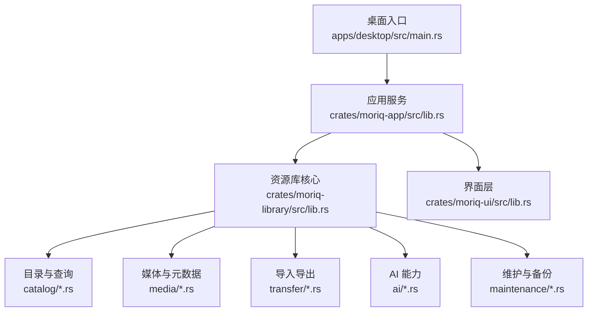

**图表来源**
- [main.rs:1-97](../../apps/desktop/src/main.rs#L1-L97)
- [lib.rs（应用服务）:1-200](../../crates/moriq-app/src/lib.rs#L1-L200)
- [lib.rs（库核心）:1-200](../../crates/moriq-library/src/lib.rs#L1-L200)

**章节来源**
- [main.rs:1-97](../../apps/desktop/src/main.rs#L1-L97)
- [lib.rs（应用服务）:1-200](../../crates/moriq-app/src/lib.rs#L1-L200)
- [lib.rs（库核心）:1-200](../../crates/moriq-library/src/lib.rs#L1-L200)

## 核心组件

### Service：统一应用服务

Service 是 UI 与资源库之间的唯一协调入口。它冻结项目上下文，使用共享缓存、推理运行器、消息队列和多个信号量限制导入、维护、读取和通用任务的并发。

关键点：

- 每个请求绑定一个项目范围，避免 UI 切换后误用旧上下文。
- 导入控制对象包含取消标志、进度计数、工作线程数、内存预算和活跃任务统计。
- 设置保存通过统一调用通道串行化，避免界面直接读写文件。
- 关闭资源库会停止在途任务、清理媒体缓存并释放当前库引用。

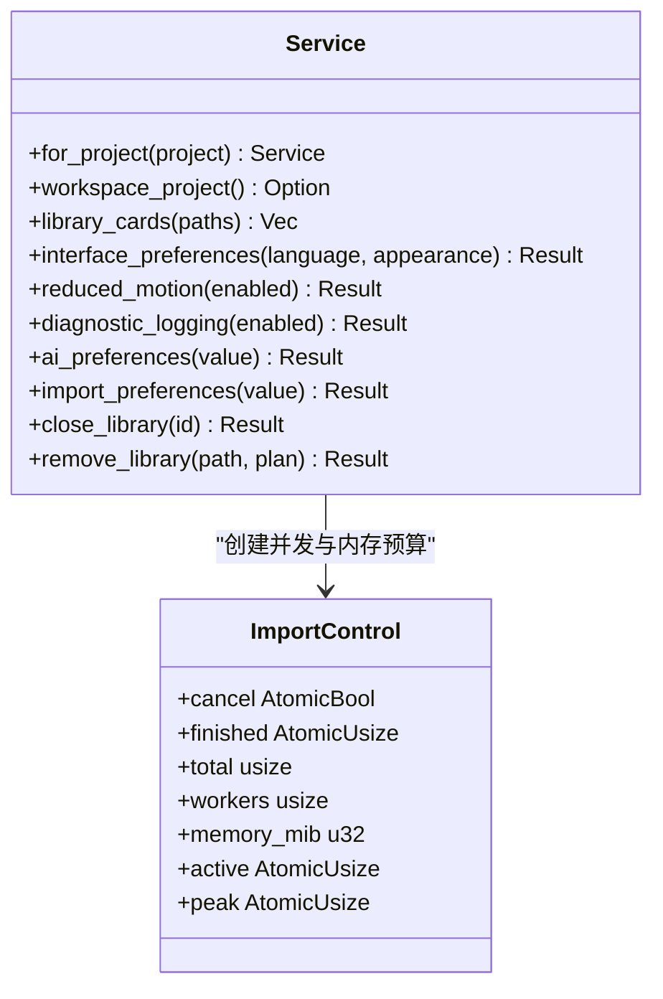

**图表来源**
- [lib.rs（应用服务）:1-200](../../crates/moriq-app/src/lib.rs#L1-L200)

**章节来源**
- [lib.rs（应用服务）:1-200](../../crates/moriq-app/src/lib.rs#L1-L200)

### Library：资源库核心

`Library` 是资源库的阻塞式核心对象。它维护 SQLite 连接、快照、工作区项目和目录结构常量，并暴露导入、导出、查询、AI、维护等能力。

关键职责：

- 定义资源库根目录下必须存在的目录，如 `assets`、`versions`、`projects`、`thumbnails`、`previews`、`indexes`、`metadata`、`staging`、`trash`、`recovery`、`backups`。
- 将外部错误转换为统一的 `Error`，包括 I/O、数据库、图片解码、颜色转换、无效输入和资源库锁定。
- 为不同功能划分子模块，保证查询、媒体、传输、AI、任务和维护彼此解耦但共享同一数据库。

**章节来源**
- [lib.rs（库核心）:1-200](../../crates/moriq-library/src/lib.rs#L1-L200)

## 架构总览

Moriq Space 的整体执行流程是：桌面入口解析参数并启动 UI；UI 通过 Service 发起请求；Service 调用 Library 完成持久化、媒体处理和 AI 推理；结果以类型化的回执返回界面，而不是让界面直接访问磁盘或数据库。

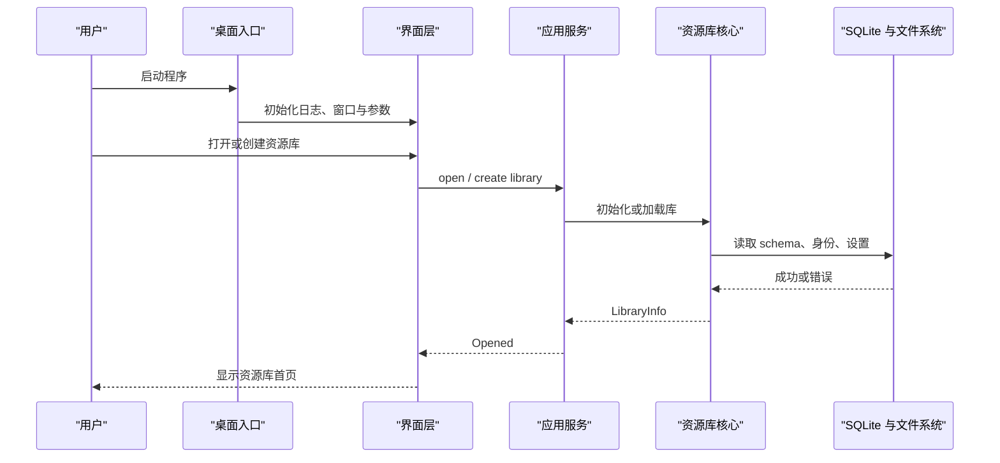

**图表来源**
- [main.rs:1-97](../../apps/desktop/src/main.rs#L1-L97)
- [lib.rs（应用服务）:1-200](../../crates/moriq-app/src/lib.rs#L1-L200)
- [lib.rs（库核心）:1-200](../../crates/moriq-library/src/lib.rs#L1-L200)

**章节来源**
- [main.rs:1-97](../../apps/desktop/src/main.rs#L1-L97)
- [ARCHITECTURE.md:1-155](../../ARCHITECTURE.md#L1-L155)

## 详细功能说明

### 一、资源库管理

#### 用户操作流程

1. 首次启动时进入欢迎页，选择“创建资源库”。
2. 指定资源库目录；Moriq Space 会在该目录下建立受管目录结构。
3. 打开已有资源库后，可在最近资源库列表中查看封面、摘要和路径。
4. 需要移除资源库时，先确认是否已关闭；支持生成移除计划，再决定是否删除。

#### 配置选项

- 语言与外观偏好保存在用户设置中。
- 最近资源库列表用于快速打开历史库。
- 诊断日志开关影响桌面日志输出位置和内容。
- 减少动态效果偏好会影响界面动画行为。

#### 最佳实践

- 把资源库放在本地磁盘，而不是网络驱动器。
- 不要把导出目标放在资源库内部。
- 定期备份到另一块磁盘。
- 不要手动修改 `assets`、`versions`、`projects`、`indexes`、`staging`、`trash`、`recovery`、`backups` 等目录。

#### 常见问题

| 问题 | 原因 | 解决方法 |
|---|---|---|
| 无法打开系统应用 | 平台命令失败 | 检查操作系统外壳程序是否正常 |
| 无法打开模型目录 | 模型根目录创建或规范化失败 | 检查权限、路径长度和网络盘 |
| 无法关闭资源库 | 仍有未保存修改 | 先保存修改或重新打开后再关闭 |
| 无法移除资源库 | 当前仍打开或不在最近列表 | 关闭库后刷新最近列表再操作 |

**章节来源**
- [settings.rs（应用设置）:1-200](../../crates/moriq-app/src/settings.rs#L1-L200)
- [lib.rs（库核心）:1-200](../../crates/moriq-library/src/lib.rs#L1-L200)

### 二、素材导入与管理

#### 用户操作流程

1. 通过拖放或导入对话框选择文件或文件夹。
2. 可选择导入到当前项目或自动根据相对路径创建项目。
3. 支持受管复制模式与外部引用模式。
4. 导入过程支持取消、并发控制和内存预算。

#### 导入逻辑要点

- 如果导入上下文指定了项目名称，则查找或创建对应项目。
- 受管模式下，文件会被放入资源库的 `assets` 目录，并按项目存储目录和相对路径组织。
- 重复文件名会追加序号，直到找到安全且不存在的目标路径。
- 外部引用不会移动原文件，而是记录平台与原始路径。

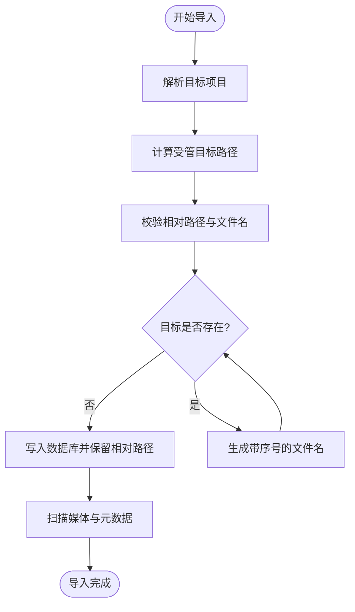

**图表来源**
- [import.rs:1-200](../../crates/moriq-library/src/transfer/import.rs#L1-L200)

#### 配置选项

- 导入工作线程数根据 CPU 核心数和用户偏好计算。
- 导入内存预算默认被限制在合理范围内。
- 是否仅引用外部原片，不复制文件。
- 是否保留注释、标签、评分和 AI 结果（复制到新项目时可控制）。

#### 最佳实践

- 大量素材优先分批导入，避免一次性占用过多内存。
- 对需要跨项目复用的原片使用受管复制，而不是手动复制。
- 对超大视频或 RAW 文件适当降低导入并发。
- 保持原片路径稳定，迁移时优先使用“重新连接”功能。

#### 常见问题

| 问题 | 原因 | 解决方法 |
|---|---|---|
| 同名文件过多 | 多个导入路径映射到相同目标名称 | 分目录导入或调整相对路径 |
| 项目目录名称冲突 | 多个项目生成相近名称 | 等待系统重试或使用不同项目名 |
| 外部原片找不到 | 磁盘卷标或路径改变 | 使用“重新连接”功能迁移到新根目录 |
| 导入期间取消 | 用户主动取消或切换库 | 恢复引擎会保留未完成阶段的恢复信息 |

**章节来源**
- [import.rs:1-200](../../crates/moriq-library/src/transfer/import.rs#L1-L200)
- [lifecycle.rs:1-177](../../crates/moriq-library/src/library/lifecycle.rs#L1-L177)

### 三、素材组织与分类

#### 用户操作流程

1. 在项目内给素材打标签。
2. 使用 AI 自动分类或人工分类。
3. 创建虚拟文件夹或收藏分组，并把素材加入其中。
4. 设置分组封面，并在首页或侧边栏查看分组摘要。

#### 分类与标签机制

- 标签最多 64 个，每个标签最多 128 字节。
- 人工标签会覆盖自动标签；未被人工保留的自动标签会被拒绝。
- 分类可区分人工分类与 AI 分类。
- 虚拟文件夹是逻辑分组，不移动原片。

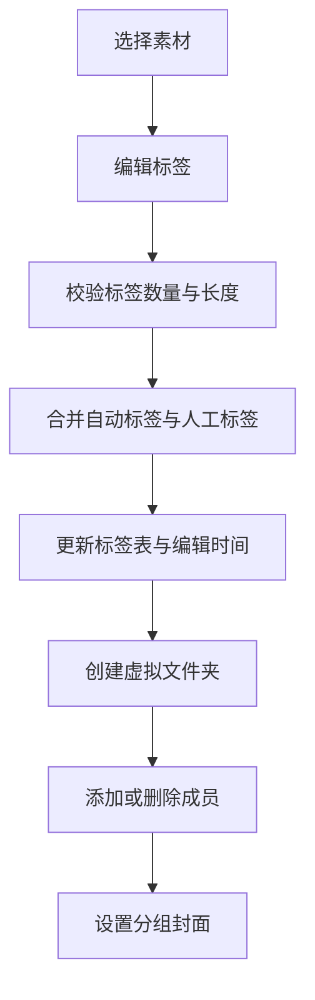

**图表来源**
- [edits.rs:1-106](../../crates/moriq-library/src/catalog/edits.rs#L1-L106)
- [folders.rs:1-200](../../crates/moriq-library/src/catalog/folders.rs#L1-L200)

#### 配置选项

- 虚拟文件夹名称最多 256 字节。
- 收藏分组与普通分组可分别创建。
- 分组封面必须是该分组内的有效素材。
- 删除虚拟文件夹只删除关联，不删除素材本体。

#### 最佳实践

- 先用 AI 分类打底，再用人工标签精修。
- 把常用组合做成虚拟文件夹，而不是复制素材。
- 为重要分组设置封面，提高浏览效率。
- 命名标签和分类时使用一致词汇表，避免同义分散。

#### 常见问题

| 问题 | 原因 | 解决方法 |
|---|---|---|
| 标签不生效 | 自动标签被人工覆盖策略忽略 | 检查是否重复存在或已被拒绝 |
| 分组不存在 | 分组已被删除或不属于当前项目 | 重新创建或切换到正确项目 |
| 封面无效 | 封面素材不是分组成员 | 先将素材加入分组再设置封面 |
| 无法跨项目操作 | 工作区隔离保护 | 进入目标项目后再操作 |

**章节来源**
- [edits.rs:1-106](../../crates/moriq-library/src/catalog/edits.rs#L1-L106)
- [folders.rs:1-200](../../crates/moriq-library/src/catalog/folders.rs#L1-L200)
- [workspace.rs:1-200](../../crates/moriq-library/src/catalog/workspace.rs#L1-L200)

### 四、浏览与查看

#### 用户操作流程

1. 在图库中点击缩略图打开预览。
2. 使用滚轮缩放、拖拽平移、实际尺寸和适配视图。
3. 前后浏览相邻素材，或双击打开大图。
4. 查看素材详情、元数据、人脸框、标签、分类和备注。

#### 浏览与预览机制

- 点击素材时会异步加载预览背景与原图预览。
- 同一资产同一版本的预览请求会被复用，避免重复解码。
- 相邻浏览会基于当前查询和锚点异步加载邻居页面。
- 视图状态管理缩放、裁剪、区域和媒体资源，并在离开时释放。

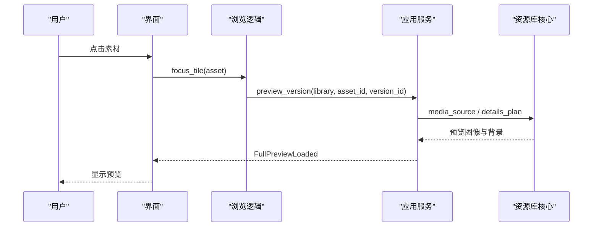

**图表来源**
- [browsing.rs:1-200](../../crates/moriq-ui/src/browsing.rs#L1-L200)
- [media.rs:1-200](../../crates/moriq-library/src/media/media.rs#L1-L200)

#### 配置选项

- 减少动态效果可关闭动画，立即提交导航。
- 视图会记住滚动位置、卡片宽度和屏幕状态。
- 历史记录有长度和字段预算，防止无限增长。

#### 最佳实践

- 大分辨率素材优先使用适配视图，避免频繁加载原图。
- 批量浏览前先完成必要筛选，减少无关素材解码。
- 注意视频和 RAW 格式可能需要额外解码开销。
- 切换资产或退出查看器时，确保相关任务被取消。

#### 常见问题

| 问题 | 原因 | 解决方法 |
|---|---|---|
| 预览卡顿 | 解码并发过高或内存不足 | 降低导入/预览并发，启用减少动态效果 |
| 相邻浏览无结果 | 查询或资源库已变化 | 重新打开页面 |
| 预览未刷新 | 版本未变化但 UI 状态复用 | 切换版本或关闭再打开 |
| 视频无法缩放 | 当前视频导出或解码不支持图片转换 | 使用原文件方式处理 |

**章节来源**
- [browsing.rs:1-200](../../crates/moriq-ui/src/browsing.rs#L1-L200)
- [media.rs:1-200](../../crates/moriq-library/src/media/media.rs#L1-L200)
- [lifecycle.rs:1-177](../../crates/moriq-library/src/library/lifecycle.rs#L1-L177)

### 五、搜索与筛选

#### 用户操作流程

1. 在搜索框输入关键词。
2. 筛选收藏、回收站、格式、评分、大小、方向、标签、颜色、日期、存储状态、人物、分类、主题、文件夹等。
3. 排序方式包括最新、最旧、名称、最大、评分。
4. 可使用语义 ID 进行相似内容检索。

#### 查询实现要点

- 短文本使用列匹配，长文本优先走全文索引。
- 查询结果可能写入临时 `query_snapshot`，避免重复计算。
- 项目工作区会注入项目过滤条件。
- 查询参数全部参数化，避免 SQL 注入。
- 最多一次读取 128 张素材。

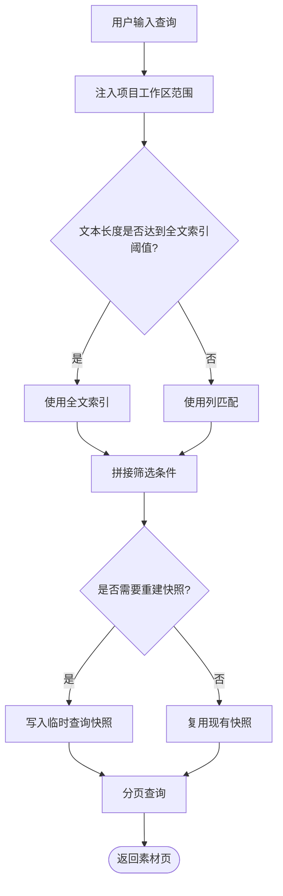

**图表来源**
- [query.rs:1-200](../../crates/moriq-library/src/catalog/query.rs#L1-L200)

#### 配置选项

- 收藏筛选只显示标记为收藏的素材。
- 回收站筛选可以查看已删除素材。
- 未标签筛选可找出尚未分类的素材。
- 语义检索需要 AI 嵌入或指纹数据。

#### 最佳实践

- 先做粗筛，再做细筛，减少全库扫描。
- 对大型资源库优先使用项目范围。
- 使用标签和分类替代模糊搜索。
- 避免频繁切换排序方式，以免重复重建快照。

#### 常见问题

| 问题 | 原因 | 解决方法 |
|---|---|---|
| 搜索结果不稳定 | 查询快照未更新 | 重新打开页面或刷新 |
| 搜索慢 | 全库扫描或索引未建立 | 缩小项目范围，增加索引 |
| 语义搜索无效 | 未执行 AI 分析或模型不可用 | 运行 AI 任务并等待完成 |
| 跨项目筛选异常 | 工作区隔离 | 进入目标项目后再筛选 |

**章节来源**
- [query.rs:1-200](../../crates/moriq-library/src/catalog/query.rs#L1-L200)
- [workspace.rs:1-200](../../crates/moriq-library/src/catalog/workspace.rs#L1-L200)

### 六、AI 功能

#### 用户操作流程

1. 安装或更新本地模型。
2. 对素材执行 AI 分析，生成标签、描述、主题和分类。
3. 执行人脸识别，自动识别人物并对齐已有人员。
4. 使用相似性检索查找压缩、缩放或重编码后的近似图片。
5. 将 AI 分类模板保存到设置，供新项目使用。

#### AI 能力矩阵

| 功能 | 输入 | 输出 | 注意事项 |
|---|---|---|---|
| AI 内容分析 | 素材版本 | 标签、描述、主题、媒介类型 | 结果与模型版本绑定 |
| 人脸识别 | 人像照片 | 人脸框、人物归属 | 人工修正不会被自动覆盖 |
| 相似性检测 | 图像缩略特征 | 相似素材列表 | 不合并素材，不修改原片 |
| 分类模板 | 类别定义 | 可复用分类配置 | 新项目可继承 |

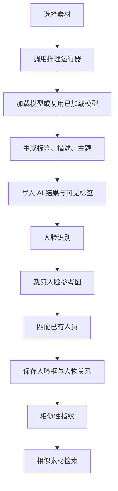

**图表来源**
- [qwen_faces.rs:1-200](../../crates/moriq-library/src/ai/qwen_faces.rs#L1-L200)
- [similarity.rs:1-131](../../crates/moriq-library/src/ai/similarity.rs#L1-L131)

#### 配置选项

- 模型下载来源和加载策略可配置。
- 按需加载可节省内存。
- 模型目录可通过应用服务打开。
- 分类模板可保存为全局模板。

#### 最佳实践

- 先在少量样本上验证分类模板，再应用到新项目。
- 人脸识别前尽量保证人物清晰、角度一致。
- 对相似素材使用“相似性检索”，而不是依赖文件名。
- 定期检查 AI 结果，因为模型升级可能改变输出。

#### 常见问题

| 问题 | 原因 | 解决方法 |
|---|---|---|
| AI 任务失败 | 模型缺失、内存不足或推理中断 | 检查模型目录、内存预算和取消状态 |
| 人脸未分组 | 人物标识不一致或参考图质量差 | 重新运行识别或修正人工标注 |
| 相似性结果不准 | 图片差异过大或指纹未生成 | 检查是否导入成功并完成分析 |
| 分类模板无效 | 模板校验失败或项目范围不同 | 重新保存模板并进入目标项目 |

**章节来源**
- [qwen_faces.rs:1-200](../../crates/moriq-library/src/ai/qwen_faces.rs#L1-L200)
- [similarity.rs:1-131](../../crates/moriq-library/src/ai/similarity.rs#L1-L131)
- [settings.rs（应用设置）:1-200](../../crates/moriq-app/src/settings.rs#L1-L200)

### 七、编辑与导出

#### 用户操作流程

1. 重命名素材、设置收藏、评分、标签和备注。
2. 复制素材到另一个项目，可选择是否保留注解。
3. 选择素材后执行导出，选择格式、尺寸、质量和布局。
4. 导出完成后在目标目录查看结果和可选元数据文件。

#### 导出流程

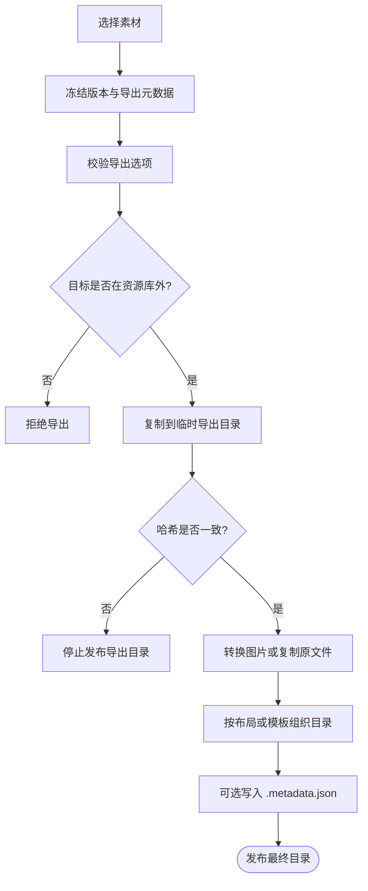

**图表来源**
- [export.rs:1-200](../../crates/moriq-library/src/transfer/export.rs#L1-L200)

#### 配置选项

- 导出格式：原文件、JPEG、PNG、WebP、TIFF、BMP。
- 最大边长：0 表示不缩放。
- 质量：1～100。
- 旋转：0、90、180、270 度。
- 布局：扁平、按格式、按导入日期或自定义目录模板。
- 是否写入侧车元数据文件。

#### 最佳实践

- 归档用途建议使用无损格式或原文件。
- 分享用途建议使用 JPEG 或 WebP 并控制尺寸。
- 大批量导出时避免同时运行高负载 AI 任务。
- 使用目录模板生成可追溯的文件结构。

#### 常见问题

| 问题 | 原因 | 解决方法 |
|---|---|---|
| 导出失败 | 目标在资源库内或哈希不一致 | 更换目标目录，重新选择素材 |
| 视频无法转换 | 视频当前只支持原文件导出 | 关闭图片转换选项 |
| 文件名冲突 | 多个素材同名 | 使用目录模板或允许自动编号 |
| 元数据丢失 | 未开启侧车元数据 | 重新导出并启用 `.metadata.json` |

**章节来源**
- [export.rs:1-200](../../crates/moriq-library/src/transfer/export.rs#L1-L200)
- [edits.rs:1-106](../../crates/moriq-library/src/catalog/edits.rs#L1-L106)

### 八、维护工具

#### 备份

- 备份会冻结数据库和不可变文件链接，然后在工作线程复制内容。
- 可选择独立克隆模式，分离库身份、同步任务和后台作业。
- 备份过程中排除部分缓存和暂存目录。
- 发布前会校验托管原片的哈希值。

#### 其他维护能力

- 孤儿文件检测。
- 垃圾回收与存储整理。
- 导入恢复与操作日志。
- 后台任务管理与取消。

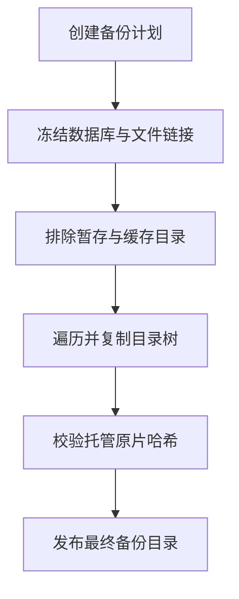

**图表来源**
- [backup.rs:1-200](../../crates/moriq-library/src/maintenance/backup.rs#L1-L200)

#### 配置选项

- 是否创建独立克隆。
- 备份目标必须在资源库外部。
- 可监控已完成数量和总数。
- 支持取消进行中备份。

#### 最佳实践

- 备份到物理隔离的另一块磁盘。
- 定期执行完整备份，增量或克隆视需求而定。
- 备份前关闭正在进行的导入。
- 恢复时先核对库身份和版本。

#### 常见问题

| 问题 | 原因 | 解决方法 |
|---|---|---|
| 备份目标无效 | 目标位于资源库内 | 选择外部磁盘或目录 |
| 备份不完整 | 中途取消或校验失败 | 检查取消状态并重新备份 |
| 原片校验不符 | 备份中的原片哈希不匹配 | 检查存储完整性并重新备份 |
| 无法克隆 | 资源库仍在活动状态 | 先关闭或确认不再使用 |

**章节来源**
- [backup.rs:1-200](../../crates/moriq-library/src/maintenance/backup.rs#L1-L200)
- [ARCHITECTURE.md:1-155](../../ARCHITECTURE.md#L1-L155)

## 依赖关系分析

Moriq Space 的模块依赖遵循“界面不直接访问存储、服务协调、库负责持久化”的原则。

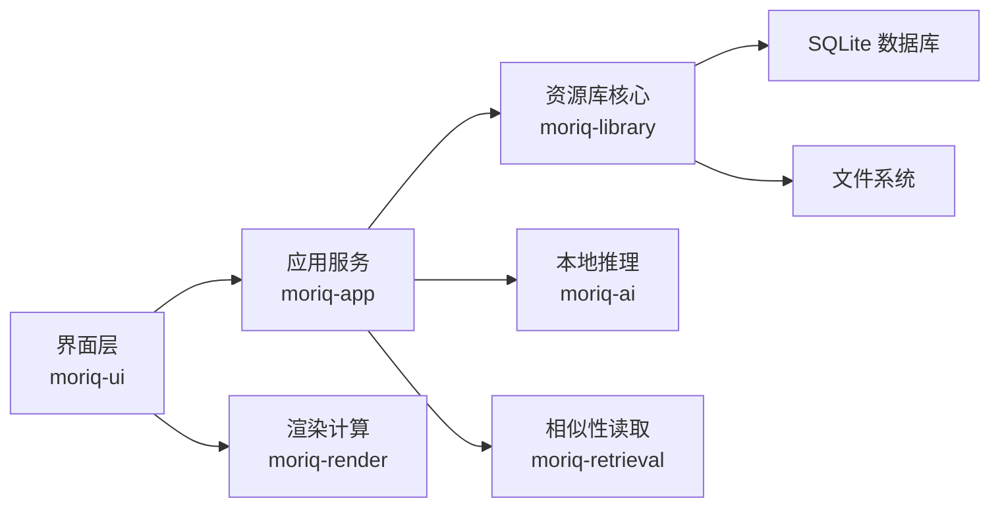

**图表来源**
- [ARCHITECTURE.md:1-155](../../ARCHITECTURE.md#L1-L155)

关键依赖约束：

- UI 不拥有数据库连接，也不执行媒体 I/O。
- Library 是唯一阻塞持久层。
- Retrieval 明确限定查询作用域，不能绕过 Library。
- AI 推理通过 Service 注入的 `InferenceRunner` 执行。
- 所有任务都有类型化错误，区分取消、陈旧库、无效输入、存储、运行时和不可用服务。

**章节来源**
- [ARCHITECTURE.md:1-155](../../ARCHITECTURE.md#L1-L155)

## 性能与容量建议

- 导入并发应结合 CPU 核心数和内存预算调优，RAW 和视频建议更低并发。
- 预览和缩略图会复用 GPU 图像，但解码仍受共享内存预算限制。
- 查询快照能避免重复计算，但频繁变更查询会导致重建。
- 首页收藏和分类摘要使用独立投影，不会替换图库查询快照。
- 相似性指纹基于 32×32 缩放图像和 DCT 系数，适合检测缩放与重压缩图片。
- 备份使用深度受限的文件遍历，避免一次性收集整个库的文件列表。

建议：

- 大库优先使用项目范围。
- 批量导入与导出错开运行。
- 对高频浏览的素材提前完成 AI 分析和缩略图重建。
- 监控导入活跃数、峰值任务数和等待内存数。
- 对长时间运行的 AI 或备份任务启用取消机制。

[本节为通用性能指导，不直接分析具体文件]

## 故障排查指南

### 日志与诊断

- Windows 下诊断日志默认位于 `%LOCALAPPDATA%\MORIQ\logs\desktop.log`。
- 非 Windows 下默认位于 `$HOME/.local/state/moriq/desktop.log`。
- 可通过设置启用诊断日志，或在命令行传入诊断参数。

### 常见错误分类

| 类别 | 典型表现 | 排查重点 |
|---|---|---|
| 输入无效 | 提示名称过长、路径非法、参数错误 | 检查素材名、标签、项目名、导出参数 |
| 存储错误 | 文件读写失败、权限不足、空间不足 | 检查目录权限和剩余磁盘空间 |
| 数据库错误 | 查询失败、事务失败、锁冲突 | 避免多个进程同时写入同一个资源库 |
| 运行时错误 | 模型缺失、推理失败、GPU 资源不足 | 检查模型目录、硬件能力和内存预算 |
| 服务不可用 | 库已关闭、任务已取消、库身份不匹配 | 确认当前活动库和任务状态 |

### 恢复策略

- 导入中断后，恢复引擎会保留未完成阶段的信息。
- 备份中的未知回收站文件会被保留，不会递归删除。
- 关闭资源库前会停止任务并清空媒体缓存。
- 若数据库损坏，优先尝试从备份恢复，而不是手动修复 SQLite。

**章节来源**
- [main.rs:1-97](../../apps/desktop/src/main.rs#L1-L97)
- [ARCHITECTURE.md:1-155](../../ARCHITECTURE.md#L1-L155)

## 结论

Moriq Space 以“受管原片、不可变版本、项目隔离、可恢复操作”为核心设计，将资源库管理、素材组织、浏览查看、搜索筛选、AI 分析、编辑导出和维护工具整合在一个一致的系统中。对用户而言，它提供了从基础导入到高级分类、相似检索和人脸识别的完整工作流；对开发者而言，它通过 Service、Library、UI 和 AI 的清晰边界，保证了安全性、可测试性和可扩展性。

推荐新用户从“创建资源库 → 导入素材 → 打标签 → 创建虚拟文件夹 → 查看与导出”开始；有经验用户可进一步使用项目模板、AI 分类、相似性检索、备份克隆和导入恢复等高级能力。

[本节为总结性内容，不直接分析具体文件]