# 搜索和筛选

> Repo Wiki 节点 `search-filtering`
> 导出自 Qoder 知识库快照 `8fbe02f6-57c2-4874-b725-1a8130851fd9`，代码基线 `7a7a8e75e18bd90294e09cd422dd7ed5a04813a0`（分支 main，zh-CN）。

<cite>
**本文引用的文件**
- [query.rs](../../crates/moriq-library/src/catalog/query.rs)
- [rules.rs](../../crates/moriq-library/src/catalog/rules.rs)
- [similarity.rs](../../crates/moriq-library/src/ai/similarity.rs)
- [lib.rs（检索库）](../../crates/moriq-retrieval/src/lib.rs)
- [filters.rs](../../crates/moriq-ui/src/filters.rs)
- [browsing.rs](../../crates/moriq-ui/src/browsing.rs)
- [metadata.rs](../../crates/moriq-library/src/media/metadata.rs)
- [color.rs](../../crates/moriq-library/src/media/color.rs)
- [schema.sql](../../crates/moriq-library/src/database/schema.sql)
- [migration_8.sql](../../crates/moriq-library/src/database/migrations/migration_8.sql)
- [migration_14.sql](../../crates/moriq-library/src/database/migrations/migration_14.sql)
- [migration_15.sql](../../crates/moriq-library/src/database/migrations/migration_15.sql)
- [migration_16.sql](../../crates/moriq-library/src/database/migrations/migration_16.sql)
- [migration_17.sql](../../crates/moriq-library/src/database/migrations/migration_17.sql)
- [migration_24.sql](../../crates/moriq-library/src/database/migrations/migration_24.sql)
- [analysis.rs](../../crates/moriq-library/src/ai/analysis.rs)
- [ARCHITECTURE.md](../../ARCHITECTURE.md)
</cite>

## 目录
1. [简介](#简介)
2. [项目结构](#项目结构)
3. [核心组件](#核心组件)
4. [架构总览](#架构总览)
5. [详细组件分析](#详细组件分析)
6. [依赖关系分析](#依赖关系分析)
7. [性能与分页策略](#性能与分页策略)
8. [查询语法与表达式指南](#查询语法与表达式指南)
9. [相似度检索与智能集合](#相似度检索与智能集合)
10. [筛选条件动态更新、预览与批量操作](#筛选条件动态更新预览与批量操作)
11. [故障排查](#故障排查)
12. [结论](#结论)

## 简介
本文档系统化说明素材库的搜索与筛选能力，包括全文搜索引擎、高级筛选条件、智能集合规则、AI 相似性检索、查询语法、索引机制、分页策略和性能优化。读者可据此编写从基础关键词到复杂多条件组合查询，并理解界面筛选如何映射到底层 SQL、FTS 全文索引、EXIF/GPS 元数据表、AI 分类与语义向量。

## 项目结构
搜索与筛选相关代码分布在以下模块：
- `moriq-library`：资源库持久化、查询构建、FTS 视图、AI 结果存储与相似性入口。
- `moriq-retrieval`：无外部 I/O 依赖的相似性与语义检索实现。
- `moriq-ui`：筛选器 UI、查询草稿、浏览导航与预览状态管理。
- 数据库迁移脚本：定义 FTS 虚拟表、指纹表、EXIF 表、虚拟文件夹、AI 分类视图等。

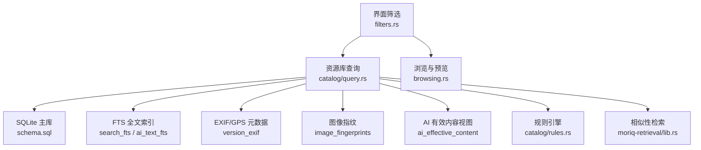

**图表来源**
- [query.rs:1-120](../../crates/moriq-library/src/catalog/query.rs#L1-L120)
- [filters.rs:1-80](../../crates/moriq-ui/src/filters.rs#L1-L80)
- [browsing.rs:1-80](../../crates/moriq-ui/src/browsing.rs#L1-L80)
- [schema.sql:1-42](../../crates/moriq-library/src/database/schema.sql#L1-L42)
- [migration_8.sql:8-29](../../crates/moriq-library/src/database/migrations/migration_8.sql#L8-L29)
- [migration_14.sql:11-11](../../crates/moriq-library/src/database/migrations/migration_14.sql#L11-L11)
- [migration_15.sql:13-28](../../crates/moriq-library/src/database/migrations/migration_15.sql#L13-L28)
- [migration_17.sql:2-6](../../crates/moriq-library/src/database/migrations/migration_17.sql#L2-L6)
- [migration_24.sql:24-28](../../crates/moriq-library/src/database/migrations/migration_24.sql#L24-L28)
- [rules.rs:1-53](../../crates/moriq-library/src/catalog/rules.rs#L1-L53)
- [lib.rs（检索库）:1-120](../../crates/moriq-retrieval/src/lib.rs#L1-L120)

**章节来源**
- [ARCHITECTURE.md:1-40](../../ARCHITECTURE.md#L1-L40)

## 核心组件
- **查询对象与页面读取**：资源库按当前工作区范围、项目和筛选条件计算一页素材，使用临时快照表避免重复规划昂贵查询。
- **全文搜索**：短文本走 `instr` 子串匹配；较长文本走 `search_fts` 与 `ai_text_fts` 双路 FTS5 匹配。
- **高级筛选**：日期、格式、尺寸、方向、收藏、评分、标签、颜色、存储位置、虚拟文件夹、AI 类别、人物、主题等条件统一拼接为参数化 SQL。
- **智能集合规则**：将树形规则编译为 SQL，支持逻辑与/或/非、收藏、原始格式、位置存在、名称/备注/标签/格式/评分等叶子节点。
- **EXIF/GPS 筛选**：解析并规范化常用 EXIF 字段，通过 JSON 提取生成范围与包含条件。
- **AI 相似性检索**：基于感知 DCT 指纹、RGB 色块均值与宽高比，结合相似度阈值与距离排序返回近似图片。
- **语义检索**：对嵌入向量进行点积打分，限制模型 ID、修订版本与工作区范围。

**章节来源**
- [query.rs:1-120](../../crates/moriq-library/src/catalog/query.rs#L1-L120)
- [rules.rs:1-53](../../crates/moriq-library/src/catalog/rules.rs#L1-L53)
- [metadata.rs:1-153](../../crates/moriq-library/src/media/metadata.rs#L1-L153)
- [similarity.rs:1-131](../../crates/moriq-library/src/ai/similarity.rs#L1-L131)
- [lib.rs（检索库）:1-200](../../crates/moriq-retrieval/src/lib.rs#L1-L200)

## 架构总览
下图展示一次典型“关键词 + 日期 + 格式 + 颜色”查询的生命周期：

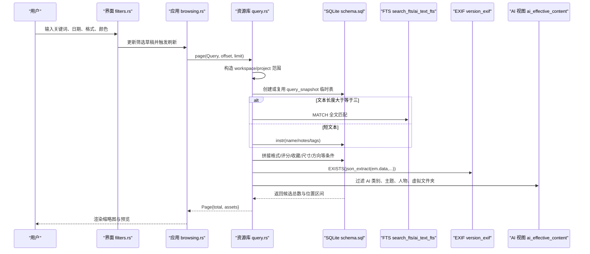

**图表来源**
- [filters.rs:1-120](../../crates/moriq-ui/src/filters.rs#L1-L120)
- [browsing.rs:1-120](../../crates/moriq-ui/src/browsing.rs#L1-L120)
- [query.rs:1-120](../../crates/moriq-library/src/catalog/query.rs#L1-L120)
- [migration_8.sql:8-29](../../crates/moriq-library/src/database/migrations/migration_8.sql#L8-L29)
- [migration_15.sql:13-28](../../crates/moriq-library/src/database/migrations/migration_15.sql#L13-L28)
- [migration_17.sql:2-6](../../crates/moriq-library/src/database/migrations/migration_17.sql#L2-L6)
- [migration_24.sql:24-28](../../crates/moriq-library/src/database/migrations/migration_24.sql#L24-L28)

## 详细组件分析

### 全文搜索引擎
系统采用两级全文搜索：
- 短文本：当搜索词字符数小于三时，使用 `instr(lower(...), lower(?))` 在素材名称、备注及有效标签中进行不区分大小写的子串匹配。
- 长文本：当搜索词字符数大于等于三时，同时扫描 `search_fts` 与 `ai_text_fts` 两个 FTS5 虚拟表。前者索引名称、备注与标签；后者聚合 AI 描述、OCR、对象标签与通用标签，并通过触发器维护。

关键实现要点：
- 所有用户输入均通过参数绑定，不会直接拼入 SQL。
- FTS 与常规条件合并后进入统一的 WHERE 子句。
- 搜索结果与常规筛选共享同一排序与分页流程。

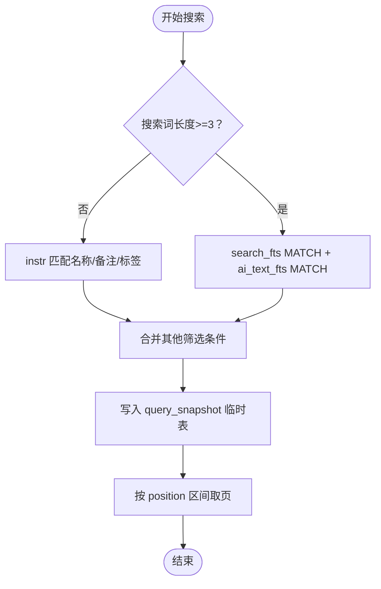

**图表来源**
- [query.rs:1-120](../../crates/moriq-library/src/catalog/query.rs#L1-L120)
- [migration_8.sql:8-29](../../crates/moriq-library/src/database/migrations/migration_8.sql#L8-L29)
- [migration_15.sql:13-28](../../crates/moriq-library/src/database/migrations/migration_15.sql#L13-L28)

**章节来源**
- [query.rs:1-120](../../crates/moriq-library/src/catalog/query.rs#L1-L120)
- [migration_8.sql:8-29](../../crates/moriq-library/src/database/migrations/migration_8.sql#L8-L29)
- [migration_15.sql:13-28](../../crates/moriq-library/src/database/migrations/migration_15.sql#L13-L28)

### 高级筛选条件
界面将用户选择转换为 `Query`，最终由资源库拼接为 SQL。支持的筛选维度包括：

| 筛选维度 | 对应字段 | 行为说明 |
|---|---|---|
| 收藏 | `favorites_only` | 仅显示收藏素材 |
| 回收站 | `trash` | 控制已删除资产可见性 |
| 项目范围 | `project` / `project_exact` | 递归项目或精确项目 |
| 时间范围 | `since` / `before` | 导入时间与上限 |
| 编辑时间 | `edited_since` | 最近编辑 |
| 媒体类型 | `media_kind` | 全部、原始、视频 |
| 文件格式 | `format` | 小写格式匹配 |
| 评分 | `min_rating` | 最小评分 |
| 文件大小 | `min_bytes` / `max_bytes` | 字节范围 |
| 宽度 | `min_width` | 最小像素宽度 |
| 方向 | `orientation` | 横屏、竖屏、方形 |
| 标签 | `tag` | 有效标签匹配 |
| 颜色 | `color` | 主色调匹配 |
| 存储位置 | `storage` | 托管、引用或未筛选 |
| 虚拟文件夹 | `folder` | 关联 `virtual_folder_assets` |
| AI 类别 | `category` | 来自 `asset_ai_categories` |
| 人物 | `person` | 人脸检测表中的人 |
| 主题 | `themes` | 排除不在列表中的主题 |
| 媒介 | `medium` | AI 分类中的媒介 |
| 历史分类 | `legacy_category` | 兼容旧分类 |
| 未标记 | `untagged` | 无有效标签 |
| 未分配 | `unassigned` | 不属于任何项目 |
| 元数据 | `metadata` | EXIF/GPS/相机/镜头/ISO/曝光/焦距/拍摄时间 |
| 规则 | `rule` | 结构化规则树 |

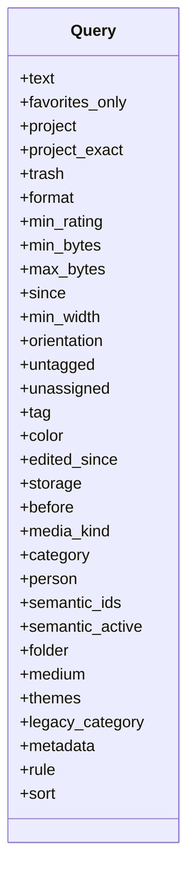

**图表来源**
- [query.rs:1-120](../../crates/moriq-library/src/catalog/query.rs#L1-L120)
- [filters.rs:1-120](../../crates/moriq-ui/src/filters.rs#L1-L120)

**章节来源**
- [query.rs:1-120](../../crates/moriq-library/src/catalog/query.rs#L1-L120)
- [filters.rs:1-120](../../crates/moriq-ui/src/filters.rs#L1-L120)

### 智能集合规则
规则引擎接收已校验的规则树，递归生成 SQL 条件，并在生成过程中追加绑定值。支持：
- `All`：所有子条件必须满足。
- `Any`：任一子条件满足。
- `Not`：否定子条件。
- 叶子节点：收藏、原始格式、存在位置、名称、备注、标签、格式、评分。

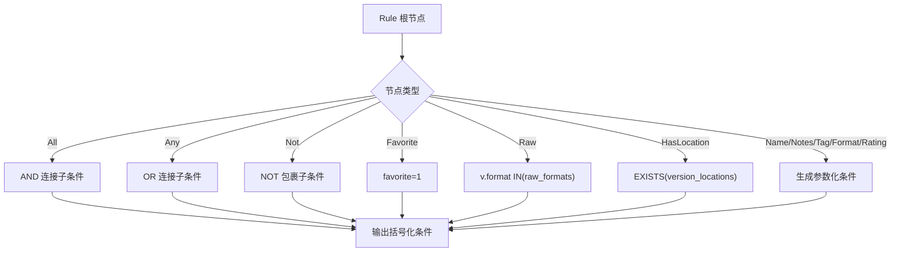

**图表来源**
- [rules.rs:1-53](../../crates/moriq-library/src/catalog/rules.rs#L1-L53)

**章节来源**
- [rules.rs:1-53](../../crates/moriq-library/src/catalog/rules.rs#L1-L53)

### EXIF 与 GPS 信息筛选
EXIF 读取过程有界处理最多 32 MiB 的原始字节，规范化常见字段并安全丢弃无效数值。GPS 坐标经单位换算后以微度整数形式存储。筛选编译器：
- 校验字段白名单。
- 限制最多 32 个元数据条件。
- 限制包含字符串长度。
- 校验范围上下界顺序。
- 针对拍摄时间做标准化解析。
- 通过 `json_extract` 与 `version_exif` 表生成 EXISTS 条件。

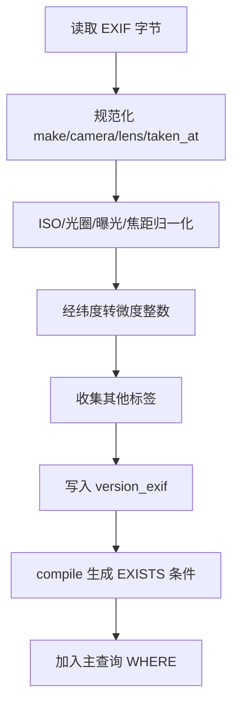

**图表来源**
- [metadata.rs:1-153](../../crates/moriq-library/src/media/metadata.rs#L1-L153)
- [migration_17.sql:2-6](../../crates/moriq-library/src/database/migrations/migration_17.sql#L2-L6)

**章节来源**
- [metadata.rs:1-153](../../crates/moriq-library/src/media/metadata.rs#L1-L153)
- [migration_17.sql:2-6](../../crates/moriq-library/src/database/migrations/migration_17.sql#L2-L6)

### 色彩与主色调筛选
色彩转换模块负责将嵌入 ICC 配置的安全转换为 sRGB，拒绝超大 ICC 或非 RGB 空间，避免静默改变色彩语义。主色调筛选则通过数据库中的 `dominant_color` 字段进行字符串匹配，界面提供黑、白、灰、红、橙、黄、绿、青、蓝、紫、粉等选项。

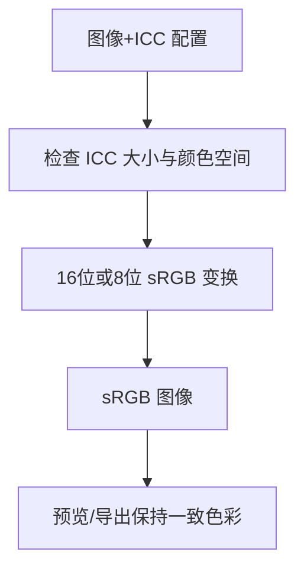

**图表来源**
- [color.rs:1-191](../../crates/moriq-library/src/media/color.rs#L1-L191)

**章节来源**
- [color.rs:1-191](../../crates/moriq-library/src/media/color.rs#L1-L191)

## 依赖关系分析
- UI 层只持有筛选草稿与消息，不直接访问数据库。
- 资源库承担查询计划、临时快照、FTS 与视图访问。
- 检索库独立于 Library、UI、解码器和模型运行时，仅依赖 SQLite 只读租约与工作区范围。
- AI 分析模块负责准备推理输入、校验 Qwen 输出、存储版本绑定的分类与描述，并为 FTS 文本索引提供数据源。
- 数据库迁移脚本维护 FTS、指纹、EXIF、虚拟文件夹、AI 分类与有效内容视图。

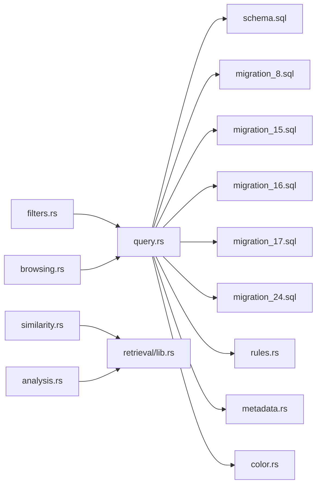

**图表来源**
- [filters.rs:1-120](../../crates/moriq-ui/src/filters.rs#L1-L120)
- [browsing.rs:1-120](../../crates/moriq-ui/src/browsing.rs#L1-L120)
- [query.rs:1-120](../../crates/moriq-library/src/catalog/query.rs#L1-L120)
- [schema.sql:1-42](../../crates/moriq-library/src/database/schema.sql#L1-L42)
- [rules.rs:1-53](../../crates/moriq-library/src/catalog/rules.rs#L1-L53)
- [metadata.rs:1-153](../../crates/moriq-library/src/media/metadata.rs#L1-L153)
- [color.rs:1-191](../../crates/moriq-library/src/media/color.rs#L1-L191)
- [similarity.rs:1-131](../../crates/moriq-library/src/ai/similarity.rs#L1-L131)
- [lib.rs（检索库）:1-200](../../crates/moriq-retrieval/src/lib.rs#L1-L200)
- [analysis.rs:1-120](../../crates/moriq-library/src/ai/analysis.rs#L1-L120)

**章节来源**
- [ARCHITECTURE.md:1-40](../../ARCHITECTURE.md#L1-L40)

## 性能与分页策略
- **密集排名替代 OFFSET**：`asset_order` 表维护插入顺序，避免深层 OFFSET 扫描。
- **查询快照**：复杂查询会创建临时表 `query_snapshot`，记录每行素材的 position 与 asset_id，并对后续相同查询缓存总数。
- **轻量项目页优化**：当仅按项目分页且未启用额外 AI/search 视图时，直接按项目成员与导入时间排序填充快照，减少视图展开成本。
- **固定页大小**：最大读取页大小被限制为 128，防止单次结果过大。
- **预取标签**：按当前页素材 ID 批量加载真实标签与 AI 可见标签，避免逐素材展开视图。
- **布局尺寸获取**：在不解码原图的情况下，按快照顺序读取宽高，用于网格布局。
- **并发隔离**：相似性检索使用独立读取租约，避免持有写入端连接。

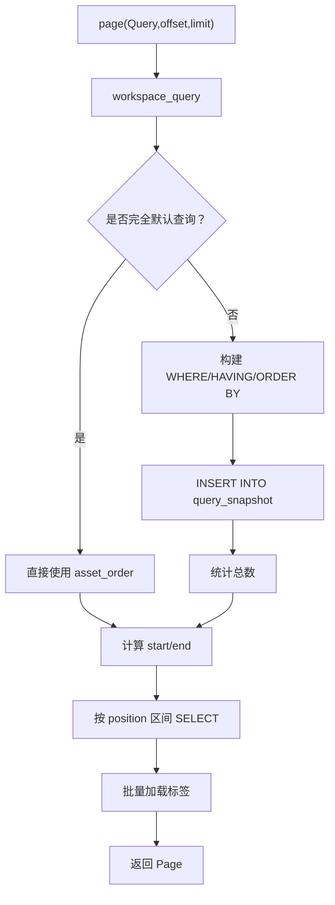

**图表来源**
- [query.rs:1-120](../../crates/moriq-library/src/catalog/query.rs#L1-L120)
- [query.rs:201-284](../../crates/moriq-library/src/catalog/query.rs#L201-L284)
- [schema.sql:1-42](../../crates/moriq-library/src/database/schema.sql#L1-L42)

**章节来源**
- [query.rs:1-120](../../crates/moriq-library/src/catalog/query.rs#L1-L120)
- [query.rs:201-284](../../crates/moriq-library/src/catalog/query.rs#L201-L284)
- [schema.sql:1-42](../../crates/moriq-library/src/database/schema.sql#L1-L42)

## 查询语法与表达式指南

### 基础关键词搜索
- 直接在搜索框输入中文或英文关键词。
- 短词自动退化为不区分大小写的子串匹配，覆盖名称、备注与有效标签。
- 较长词启用 FTS5，同时扫描素材自身文本与 AI 生成的描述、OCR、标签。

示例思路：
- 搜索“风景”：优先命中名称、备注与标签中包含该词的素材。
- 搜索长描述：命中 AI 描述或 OCR 中出现的词汇。

### 日期筛选
- “最近一周”“最近一个月”“不限”通过 `since` 控制。
- 也可通过“早于”字段设置 `before`。
- 元数据中的拍摄时间可通过 EXIF 筛选进一步限定。

示例思路：
- 筛选近一个月内导入的照片。
- 筛选 2024 年拍摄但近期才导入的图片。

### 格式与媒体类型
- 可选择全部、原始、视频，或直接指定具体格式。
- 格式值会被规范化为小写并与数据库格式比较。

示例思路：
- 仅查看 RAW 文件。
- 仅查看视频。
- 仅查看 PNG。

### 尺寸与分辨率
- 可按文件大小分为“大”“小”或不限。
- 可设置最小宽度。
- 可按方向筛选横屏、竖屏或方形。

示例思路：
- 查找超过 10 MB 的大图。
- 查找不超过 1 MB 的小图。
- 仅竖向构图。

### 颜色筛选
- 提供黑、白、灰、红、橙、黄、绿、青、蓝、紫、粉等主色调。
- 颜色值映射为中文颜色字符串并与 `dominant_color` 匹配。

示例思路：
- 查找红色为主的封面。
- 查找黑白照片。

### 标签、人物与虚拟文件夹
- 标签通过有效标签视图匹配。
- 人物通过人脸检测结果表匹配。
- 虚拟文件夹通过 `virtual_folder_assets` 关联。

示例思路：
- 筛选带有“人像”标签且属于某个虚拟文件夹的素材。
- 筛选某个人物出现在画面中的视频片段。

### AI 分类与主题
- 媒介与主题分别由 `medium` 与 `themes` 控制。
- 主题支持多选，并通过“排除不在列表中主题”的方式实现交集。
- 历史分类仍可通过 `legacy_category` 兼容。

示例思路：
- 仅查看“自然”媒介下的“森林”主题。
- 排除“室内”主题。

### 收藏、评分与项目归属
- 收藏开关快速聚焦常用素材。
- 评分下限用于过滤低质量素材。
- 项目范围支持递归子项目或精确项目。

示例思路：
- 只看收藏且评分不低于四星的项目内素材。

### 元数据与 EXIF/GPS
- 支持相机品牌、型号、镜头、拍摄时间、ISO、光圈、曝光时间、焦距。
- 支持经纬度范围筛选。
- 条件数量上限为 32，每个包含条件字符串长度有限制。

示例思路：
- 查找由某相机拍摄、ISO 在 100 至 400 之间、拍摄时间在指定区间内的图片。
- 查找拍摄地点位于某地理范围内的素材。

### 规则表达式
规则表达式适合需要嵌套逻辑的场景：
- 全部条件都满足：适用于“必须同时满足收藏、原始格式与特定标签”。
- 任一条件满足：适用于“名称包含 A 或备注包含 B”。
- 否定条件：适用于“不是视频且没有标签”。

示例思路：
- 收藏且为原始格式。
- 名称或备注包含关键词。
- 有位置信息但不是视频。

**章节来源**
- [query.rs:1-120](../../crates/moriq-library/src/catalog/query.rs#L1-L120)
- [filters.rs:1-200](../../crates/moriq-ui/src/filters.rs#L1-L200)
- [metadata.rs:1-153](../../crates/moriq-library/src/media/metadata.rs#L1-L153)
- [rules.rs:1-53](../../crates/moriq-library/src/catalog/rules.rs#L1-L53)

## 相似度检索与智能集合

### 感知指纹算法
相似性索引基于 32×32 缩放后的 RGBA 图像，计算：
- DCT 系数并按中位数阈值生成 64 位哈希。
- 三个通道平均亮度作为颜色特征。
- 原始宽高比作为形状约束。

指纹写入 `image_fingerprints` 表，供相似性检索使用。测试验证缩放与重压缩图片可被识别，且不合并素材或修改原始文件。

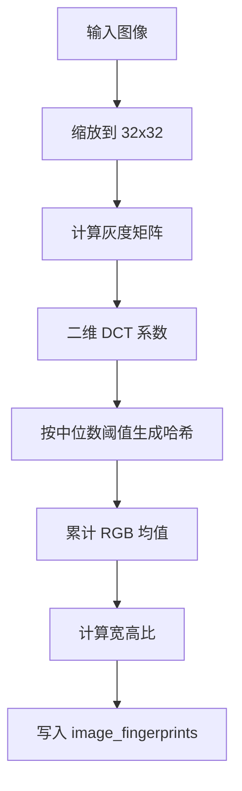

**图表来源**
- [similarity.rs:1-80](../../crates/moriq-library/src/ai/similarity.rs#L1-L80)
- [migration_14.sql:11-11](../../crates/moriq-library/src/database/migrations/migration_14.sql#L11-L11)

**章节来源**
- [similarity.rs:1-80](../../crates/moriq-library/src/ai/similarity.rs#L1-L80)
- [migration_14.sql:11-11](../../crates/moriq-library/src/database/migrations/migration_14.sql#L11-L11)

### 相似图片检索流程
1. 获取参考素材的指纹、颜色与宽高比。
2. 先按宽高比接近范围筛选候选。
3. 按汉明距离过滤哈希差异较小的素材。
4. 再按 RGB 颜色差总和过滤。
5. 按距离排序，截断到前 100 名。

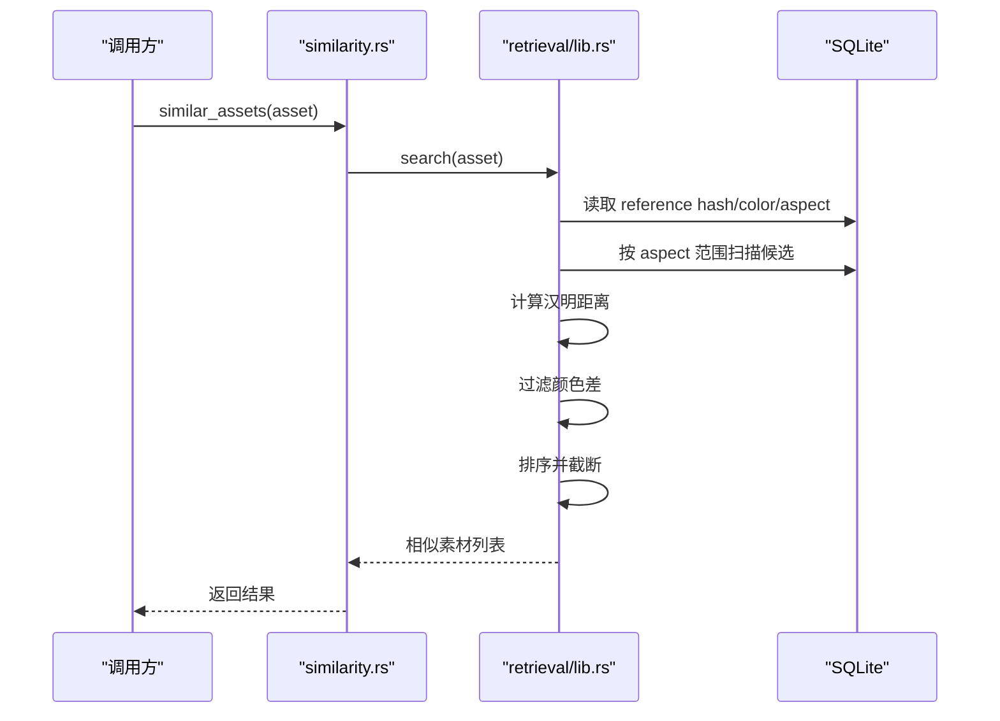

**图表来源**
- [similarity.rs:80-131](../../crates/moriq-library/src/ai/similarity.rs#L80-L131)
- [lib.rs（检索库）:60-160](../../crates/moriq-retrieval/src/lib.rs#L60-L160)

**章节来源**
- [similarity.rs:80-131](../../crates/moriq-library/src/ai/similarity.rs#L80-L131)
- [lib.rs（检索库）:60-160](../../crates/moriq-retrieval/src/lib.rs#L60-L160)

### 语义检索与推荐
语义检索基于 `chinese-clip` 模型的嵌入向量：
- 输入向量化查询。
- 与数据库中存储的单位向量进行点积打分。
- 限制模型 ID 与修订版本。
- 返回前 200 个最高分素材 ID。
- 推荐功能基于某素材的版本向量，返回与其最相似的少量素材名称。

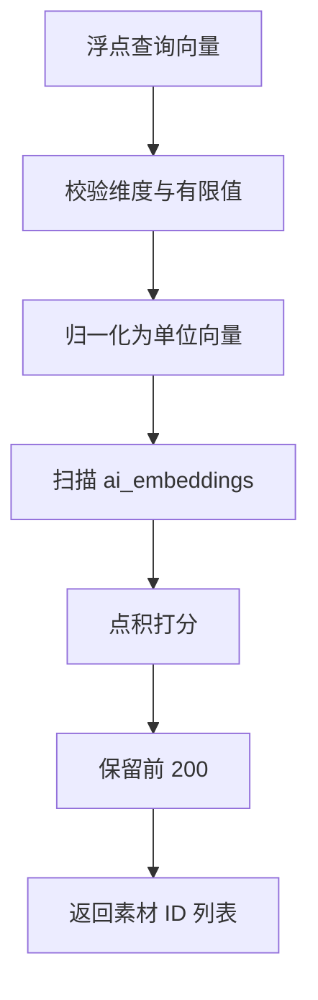

**图表来源**
- [analysis.rs:1-120](../../crates/moriq-library/src/ai/analysis.rs#L1-L120)
- [lib.rs（检索库）:120-200](../../crates/moriq-retrieval/src/lib.rs#L120-L200)

**章节来源**
- [analysis.rs:1-120](../../crates/moriq-library/src/ai/analysis.rs#L1-L120)
- [lib.rs（检索库）:120-200](../../crates/moriq-retrieval/src/lib.rs#L120-L200)

### 实际使用案例
- **发现重复或近似图片**：选择一张图片后运行相似性检索，系统返回缩放、重压缩或视觉相近的其他图片。
- **按风格或场景检索**：利用 AI 分类与主题，筛选“自然”“森林”等主题，再叠加收藏、评分与项目范围。
- **跨项目定位**：通过虚拟文件夹或人物筛选，找到分散在不同项目中但具有共同语义特征的素材。
- **地理定位**：用 EXIF GPS 筛选出某城市或景区拍摄的照片，再叠加时间与格式。

[本节为使用指导，不直接分析具体代码行]

## 筛选条件动态更新、预览与批量操作

### 筛选条件动态更新
界面使用 `FilterDraft` 保存查询草稿与日期起止字符串，`FilterChange` 提供类型化的筛选变更。每次选择都会调用 `apply` 更新 `Query`，并保留其他条件不变。内置快捷筛选如“最近”“未标记”“高评分”“回收站”“未分配”“已编辑”“原始”“视频”也直接映射为 `Query` 字段。

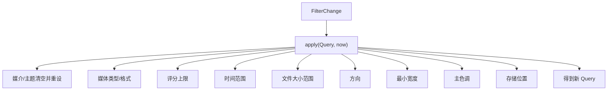

**图表来源**
- [filters.rs:1-200](../../crates/moriq-ui/src/filters.rs#L1-L200)

**章节来源**
- [filters.rs:1-200](../../crates/moriq-ui/src/filters.rs#L1-L200)

### 结果预览与相邻浏览
浏览模块负责取消相邻素材读取、清除浏览锚点、异步加载前后素材，并协调选中项、预览任务与全屏预览。选择同一素材的同一版本时会复用进行中或已完成的预览，避免重复解码。

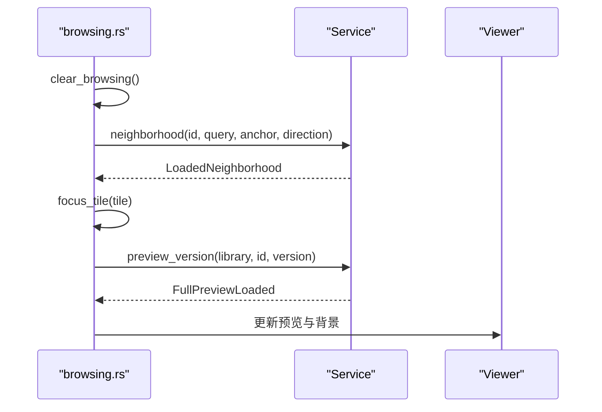

**图表来源**
- [browsing.rs:1-200](../../crates/moriq-ui/src/browsing.rs#L1-L200)

**章节来源**
- [browsing.rs:1-200](../../crates/moriq-ui/src/browsing.rs#L1-L200)

### 批量操作与素材组织集成
- 批量操作位于 UI 的 batch 特性模块，拥有自己的草稿、上下文与消息协议，符合架构文档中关于“批处理是首个位于 `moriq-ui/src/features/` 下的特性”的设计边界。
- 素材组织方面，虚拟文件夹、项目成员、标签与 AI 分类共同决定一个素材是否出现在搜索结果中。
- 有效标签视图与 AI 可见标签视图在页面加载时批量合并，减少视图展开开销。

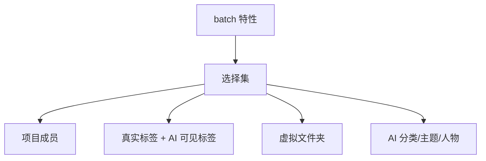

**图表来源**
- [ARCHITECTURE.md:100-155](../../ARCHITECTURE.md#L100-L155)
- [query.rs:201-284](../../crates/moriq-library/src/catalog/query.rs#L201-L284)

**章节来源**
- [ARCHITECTURE.md:100-155](../../ARCHITECTURE.md#L100-L155)
- [query.rs:201-284](../../crates/moriq-library/src/catalog/query.rs#L201-L284)

## 故障排查
- **关键词无结果**：确认是否为短词导致仅进行子串匹配；尝试更长描述或使用 AI 生成的描述类关键词。
- **FTS 未命中**：检查是否已完成 AI 文本索引；若 AI 结果尚未入库，`ai_text_fts` 可能为空。
- **EXIF 筛选失败**：确认元数据字段在白名单内，条件数量不超过 32，包含字符串长度合法，且范围下界不大于上界。
- **颜色筛选无效**：确认素材已计算主色调；部分格式或异常 ICC 配置可能导致颜色特征缺失。
- **相似性检索提示无索引**：说明所选图片尚未建立近似索引，需要先完成后台索引任务。
- **语义检索无结果**：检查模型 ID 是否为 `chinese-clip`，向量维度是否有效，以及修订版本是否与数据库一致。
- **分页异常**：确认查询快照是否成功创建；默认查询应走 `asset_order`，复杂查询应走 `query_snapshot`。

**章节来源**
- [metadata.rs:100-153](../../crates/moriq-library/src/media/metadata.rs#L100-L153)
- [similarity.rs:80-131](../../crates/moriq-library/src/ai/similarity.rs#L80-L131)
- [lib.rs（检索库）:120-200](../../crates/moriq-retrieval/src/lib.rs#L120-L200)
- [query.rs:120-284](../../crates/moriq-library/src/catalog/query.rs#L120-L284)

## 结论
本系统的搜索与筛选以参数化 SQL 为核心，结合 FTS5 全文索引、EXIF/GPS 元数据、AI 分类与语义向量，形成从基础关键词到复杂组合查询的完整能力。分页通过密集排名与临时快照优化，相似性检索通过感知指纹与几何/颜色约束保证效率与准确性。界面筛选与底层查询严格分离，便于扩展新的筛选维度、规则节点与 AI 能力。