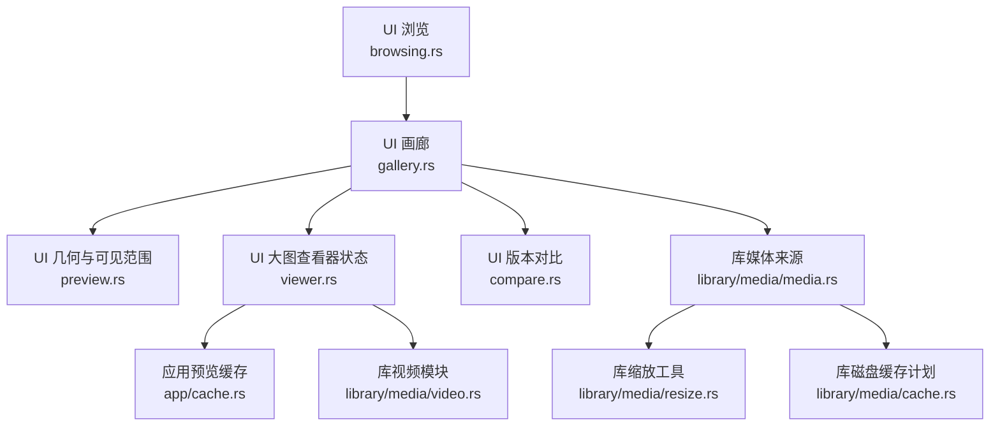
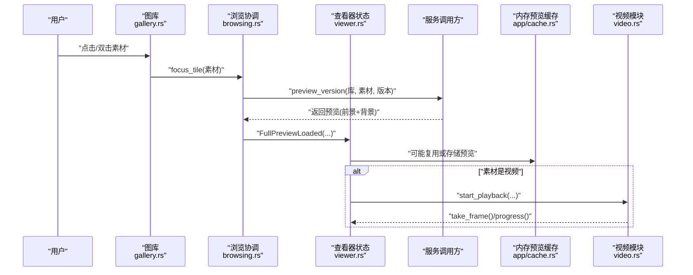
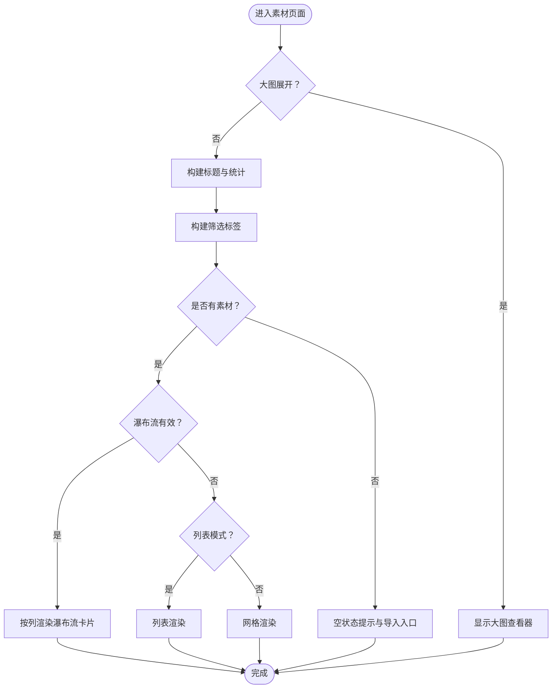
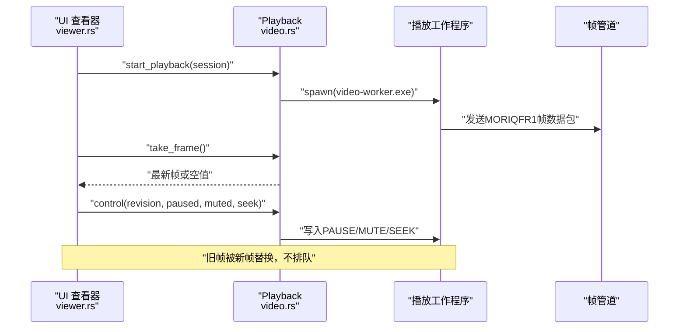
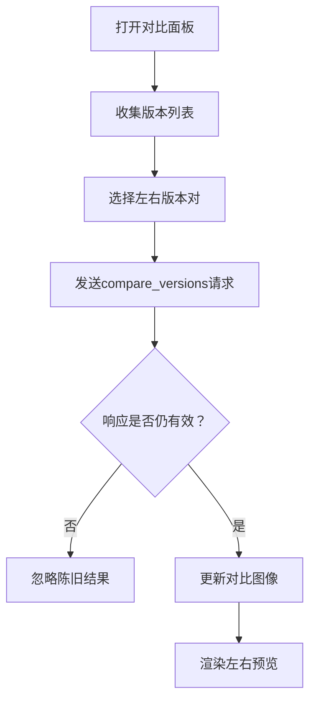
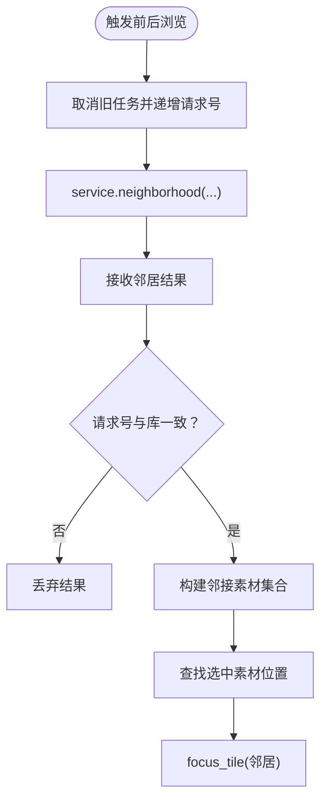
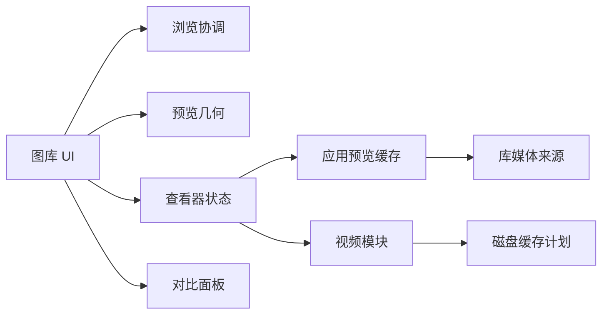

# 浏览和查看

> Repo Wiki 节点 `browsing-viewing`
> 导出自 Qoder 知识库快照 `8fbe02f6-57c2-4874-b725-1a8130851fd9`，代码基线 `7a7a8e75e18bd90294e09cd422dd7ed5a04813a0`（分支 main，zh-CN）。

<cite>
**本文引用的文件**   
- [browsing.rs](../../crates/moriq-ui/src/browsing.rs)
- [gallery.rs](../../crates/moriq-ui/src/gallery.rs)
- [preview.rs](../../crates/moriq-ui/src/preview.rs)
- [viewer.rs](../../crates/moriq-ui/src/viewer.rs)
- [compare.rs](../../crates/moriq-ui/src/compare.rs)
- [video.rs](../../crates/moriq-library/src/media/video.rs)
- [cache.rs](../../crates/moriq-app/src/cache.rs)
- [media_cache.rs](../../crates/moriq-library/src/media/cache.rs)
- [media.rs](../../crates/moriq-library/src/media/media.rs)
- [resize.rs](../../crates/moriq-library/src/media/resize.rs)
</cite>

## 目录
1. [引言](#引言)
2. [项目结构与职责划分](#项目结构与职责划分)
3. [核心浏览与查看组件](#核心浏览与查看组件)
4. [架构总览](#架构总览)
5. [详细组件分析](#详细组件分析)
6. [依赖关系分析](#依赖关系分析)
7. [性能优化与内存管理](#性能优化与内存管理)
8. [用户操作指南](#用户操作指南)
9. [界面定制、主题与响应式实践](#界面定制主题与响应式实践)
10. [故障排查](#故障排查)
11. [结论](#结论)

## 引言
本文件聚焦“浏览和查看”功能，覆盖以下关键能力：
- 画廊视图模式：瀑布流、网格、列表。
- 大图查看器：预览状态、展开查看、视频播放生命周期。
- 版本对比：左右双版本并排比较。
- 视频播放：解码探测、帧管道、控制接口、诊断信息。
- 配置项、交互行为、键盘与手势语义、性能策略、缓存与内存机制，以及大图片与大视频的加载优化建议。

该文档既面向普通用户，也面向需要理解渲染管线和缓存策略的开发者。

## 项目结构与职责划分
浏览与查看功能由 UI 层与应用/库层共同实现：
- UI 层负责视图模式切换、滚动与可见范围计算、卡片交互、大图查看器和对比面板。
- 应用层提供预览缓存、任务取消、邻居素材加载等能力。
- 库层负责媒体来源、缩略图重建、视频探测与播放、磁盘缓存清理。

**图表来源**
- [browsing.rs:1-214](../../crates/moriq-ui/src/browsing.rs#L1-L214)
- [gallery.rs:1-587](../../crates/moriq-ui/src/gallery.rs#L1-L587)
- [preview.rs:1-98](../../crates/moriq-ui/src/preview.rs#L1-L98)
- [viewer.rs:1-108](../../crates/moriq-ui/src/viewer.rs#L1-L108)
- [compare.rs:1-231](../../crates/moriq-ui/src/compare.rs#L1-L231)
- [video.rs:1-676](../../crates/moriq-library/src/media/video.rs#L1-L676)
- [cache.rs:1-65](../../crates/moriq-app/src/cache.rs#L1-L65)
- [media.rs:1-200](../../crates/moriq-library/src/media/media.rs#L1-L200)
- [resize.rs:1-72](../../crates/moriq-library/src/media/resize.rs#L1-L72)
- [media_cache.rs:1-87](../../crates/moriq-library/src/media/cache.rs#L1-L87)

**章节来源**
- [browsing.rs:1-214](../../crates/moriq-ui/src/browsing.rs#L1-L214)
- [gallery.rs:1-587](../../crates/moriq-ui/src/gallery.rs#L1-L587)
- [preview.rs:1-98](../../crates/moriq-ui/src/preview.rs#L1-L98)
- [viewer.rs:1-108](../../crates/moriq-ui/src/viewer.rs#L1-L108)
- [compare.rs:1-231](../../crates/moriq-ui/src/compare.rs#L1-L231)
- [video.rs:1-676](../../crates/moriq-library/src/media/video.rs#L1-L676)
- [cache.rs:1-65](../../crates/moriq-app/src/cache.rs#L1-L65)
- [media.rs:1-200](../../crates/moriq-library/src/media/media.rs#L1-L200)
- [resize.rs:1-72](../../crates/moriq-library/src/media/resize.rs#L1-L72)
- [media_cache.rs:1-87](../../crates/moriq-library/src/media/cache.rs#L1-L87)

## 核心浏览与查看组件
- 浏览协调器：负责取消相邻素材读取、清除浏览锚点、加载前后邻居、焦点转移、预览复用与背景清理。
- 图库构建器：根据当前查询生成标题、筛选条、主画廊区域，并在大图展开时切换到全屏预览。
- 预览几何与可见范围：计算可用宽度、列数、瀑布流索引有效性、滚动可见区间，以及异步重建瀑布流布局。
- 大图查看器状态：统一管理选中素材、预览图像、背景图像、展开状态、视频会话、播放控制与资源释放。
- 版本对比：打开对比面板、选择左右版本、并发或串行加载两张预览图，并使用请求序号防止陈旧结果覆盖。
- 视频模块：支持扩展名识别、编解码工具路径校验、工作程序启动、帧管道接收、控制命令、探测与解码预算。
- 缓存层：应用级内存预览缓存（最近使用淘汰）；库级磁盘缓存可重建条目裁剪。

**章节来源**
- [browsing.rs:1-214](../../crates/moriq-ui/src/browsing.rs#L1-L214)
- [gallery.rs:1-587](../../crates/moriq-ui/src/gallery.rs#L1-L587)
- [preview.rs:1-98](../../crates/moriq-ui/src/preview.rs#L1-L98)
- [viewer.rs:1-108](../../crates/moriq-ui/src/viewer.rs#L1-L108)
- [compare.rs:1-231](../../crates/moriq-ui/src/compare.rs#L1-L231)
- [video.rs:1-676](../../crates/moriq-library/src/media/video.rs#L1-L676)
- [cache.rs:1-65](../../crates/moriq-app/src/cache.rs#L1-L65)
- [media_cache.rs:1-87](../../crates/moriq-library/src/media/cache.rs#L1-L87)

## 架构总览
浏览与查看的核心流程如下：用户在画廊中点击或双击素材，UI 将焦点转移到目标素材，触发预览加载；若处于展开查看模式，则进入大图查看器；视频素材会启动独立播放子进程并通过帧管道更新界面；对比面板可并行比较两个版本的预览图；所有异步任务都具备请求编号和取消句柄，避免陈旧回执覆盖当前视图。

**图表来源**
- [gallery.rs:200-587](../../crates/moriq-ui/src/gallery.rs#L200-L587)
- [browsing.rs:1-214](../../crates/moriq-ui/src/browsing.rs#L1-L214)
- [viewer.rs:1-108](../../crates/moriq-ui/src/viewer.rs#L1-L108)
- [cache.rs:1-65](../../crates/moriq-app/src/cache.rs#L1-L65)
- [video.rs:200-623](../../crates/moriq-library/src/media/video.rs#L200-L623)

## 详细组件分析

### 图库与视图模式
图库负责三种显示模式：
- 瀑布流：通过 `active_masonry` 判断是否使用已计算的瀑布流索引；当列数和视口宽度匹配且分页范围合理时启用。
- 网格：默认按列数与行高排列卡片；当开启列表模式时，每行展示一张卡片，包含名称、格式、尺寸与大小。
- 列表：用于快速浏览元数据，适合宽屏或长列表场景。

交互要点：
- 顶部工具栏提供滑块调整卡片宽度、网格与列表切换按钮。
- 卡片支持悬停边框与阴影动画、右键上下文菜单、双击打开大图。
- 收藏图标在卡片上直接切换收藏状态。
- 视频卡片右下角显示视频图标，区分图片与视频类型。

**图表来源**
- [gallery.rs:1-587](../../crates/moriq-ui/src/gallery.rs#L1-L587)
- [preview.rs:1-98](../../crates/moriq-ui/src/preview.rs#L1-L98)

**章节来源**
- [gallery.rs:1-587](../../crates/moriq-ui/src/gallery.rs#L1-L587)
- [preview.rs:1-98](../../crates/moriq-ui/src/preview.rs#L1-L98)

### 大图查看器与视频播放
大图查看器维护一个统一的 `ViewerState`，其职责包括：
- 记录选中的素材、前景预览图、背景预览图。
- 管理展开状态、原始请求编号、原始尺寸。
- 管理视频播放会话、暂停与静音状态、已呈现帧计数、首次就绪时间戳。
- 提供停止媒体、取消预览、关闭展开、完全清空等方法。

视频播放流程：
- 启动时创建受保护的视频快照，校验临时空间与文件大小预算。
- 启动内置播放工作程序，建立标准输入控制通道与标准输出帧管道。
- 后台线程从管道读取帧，仅保留最新帧，避免渲染落后导致内存膨胀。
- 主循环通过 `take_frame` 取走待显示帧，通过 `progress` 获取当前位置与时长。
- 控制方法写入暂停、静音、跳转指令，并用版本号防重入。
- 销毁时杀死子进程，并在后台线程等待退出后释放快照与租约。

**图表来源**
- [viewer.rs:1-108](../../crates/moriq-ui/src/viewer.rs#L1-L108)
- [video.rs:200-623](../../crates/moriq-library/src/media/video.rs#L200-L623)

**章节来源**
- [viewer.rs:1-108](../../crates/moriq-ui/src/viewer.rs#L1-L108)
- [video.rs:1-676](../../crates/moriq-library/src/media/video.rs#L1-L676)

### 版本对比功能
对比面板允许在不改变当前展示版本的前提下，选择两个版本进行并排比较：
- 打开对比时，自动列出所有可用版本，左侧固定为第一个版本，右侧默认选中当前版本或最后一个版本。
- 用户可在左右两侧分别选择不同的版本。
- 对比请求带有请求编号、库标识、素材标识与版本对，确保只有当前面板与当前素材的响应才会更新图像。
- 对比图最大边长为 1600 像素，不包含 ICC/HDR 色彩校准。

**图表来源**
- [compare.rs:1-231](../../crates/moriq-ui/src/compare.rs#L1-L231)

**章节来源**
- [compare.rs:1-231](../../crates/moriq-ui/src/compare.rs#L1-L231)

### 邻居素材与前后续浏览
浏览协调器负责：
- 取消正在进行的前后浏览任务，递增请求编号，避免旧结果干扰。
- 根据当前查询与锚点素材向服务请求前后邻居素材。
- 收到有效邻居后，重建邻接素材集合，并根据选中素材定位位置。
- 如果邻居中包含当前选中素材，则重新执行焦点逻辑，复用预览任务或背景。

**图表来源**
- [browsing.rs:1-214](../../crates/moriq-ui/src/browsing.rs#L1-L214)

**章节来源**
- [browsing.rs:1-214](../../crates/moriq-ui/src/browsing.rs#L1-L214)

## 依赖关系分析
UI 层与底层模块的依赖关系清晰分层：
- UI 层只持有轻量状态与句柄，例如 `image::Handle`、任务句柄、视频会话引用。
- 应用层提供预览缓存，限制单条预览体积、总字节上限与条目数量。
- 库层负责安全访问文件、验证身份、执行有界解码与探测，并管理磁盘缓存。

**图表来源**
- [gallery.rs:1-587](../../crates/moriq-ui/src/gallery.rs#L1-L587)
- [browsing.rs:1-214](../../crates/moriq-ui/src/browsing.rs#L1-L214)
- [preview.rs:1-98](../../crates/moriq-ui/src/preview.rs#L1-L98)
- [viewer.rs:1-108](../../crates/moriq-ui/src/viewer.rs#L1-L108)
- [compare.rs:1-231](../../crates/moriq-ui/src/compare.rs#L1-L231)
- [cache.rs:1-65](../../crates/moriq-app/src/cache.rs#L1-L65)
- [video.rs:1-676](../../crates/moriq-library/src/media/video.rs#L1-L676)
- [media_cache.rs:1-87](../../crates/moriq-library/src/media/cache.rs#L1-L87)

**章节来源**
- [gallery.rs:1-587](../../crates/moriq-ui/src/gallery.rs#L1-L587)
- [browsing.rs:1-214](../../crates/moriq-ui/src/browsing.rs#L1-L214)
- [preview.rs:1-98](../../crates/moriq-ui/src/preview.rs#L1-L98)
- [viewer.rs:1-108](../../crates/moriq-ui/src/viewer.rs#L1-L108)
- [compare.rs:1-231](../../crates/moriq-ui/src/compare.rs#L1-L231)
- [cache.rs:1-65](../../crates/moriq-app/src/cache.rs#L1-L65)
- [video.rs:1-676](../../crates/moriq-library/src/media/video.rs#L1-L676)
- [media_cache.rs:1-87](../../crates/moriq-library/src/media/cache.rs#L1-L87)

## 性能优化与内存管理

### 预览缓存策略
应用级预览缓存以 `(库标识, 版本标识, 尺寸)` 作为键，使用最近使用顺序淘汰：
- 单条预览超过 128 MiB 直接丢弃。
- 总内存预算约 256 MiB，条目上限约 48 个。
- 读取时更新时间戳，写入时清理最久未使用的旧条目。
- 切换资源库时清空缓存，避免跨库像素残留。

**章节来源**
- [cache.rs:1-65](../../crates/moriq-app/src/cache.rs#L1-L65)

### 磁盘缓存清理
库级缓存计划冻结根目录与资源库租约，扫描 `previews` 与 `thumbnails/256` 下符合命名规则的 PNG 与 RGBA 文件，按修改时间排序，超出字节预算时删除最早文件。

**章节来源**
- [media_cache.rs:1-87](../../crates/moriq-library/src/media/cache.rs#L1-L87)

### 图像缩放与渲染
- 缩放算法优先按最长边等比缩小，不放大已经足够小的源图。
- 支持多种重采样滤镜，默认使用面积滤波，同时保留透明通道。
- 缩略图重建失败时会回退到源文件路径并重建。

**章节来源**
- [resize.rs:1-72](../../crates/moriq-library/src/media/resize.rs#L1-L72)
- [media.rs:1-200](../../crates/moriq-library/src/media/media.rs#L1-L200)

### 视频解码与帧缓冲
- 视频帧管道拒绝损坏包与超预算尺寸，分配前做严格校验。
- 帧缓冲区只保留最新一帧，避免慢渲染堆积历史帧。
- 探测与解码过程设置超时与输出大小预算，防止外部工具长时间占用资源。
- 播放子进程的生命周期由 `Drop` 与显式 `stop` 双重保障，避免阻塞界面线程。

**章节来源**
- [video.rs:1-676](../../crates/moriq-library/src/media/video.rs#L1-L676)

## 用户操作指南

### 基本素材浏览
- 打开应用后进入“全部素材”页面，顶部标题会根据当前筛选条件变化。
- 使用顶部滑块调整卡片大小，点击网格或列表按钮切换视图模式。
- 单击素材选中并显示详情；双击素材打开大图查看器。
- 鼠标悬停卡片时出现边框与阴影反馈；右键打开上下文菜单。
- 收藏图标可直接切换收藏状态。

### 瀑布流、网格与列表
- 瀑布流模式：适用于图片尺寸差异较大的场景，系统根据窗口宽度计算列数并懒加载可见区域。
- 网格模式：均匀排列卡片，适合整齐浏览。
- 列表模式：显示文件名、格式、分辨率与大小，便于快速比对元数据。

### 大图查看器
- 双击素材后进入大图查看器，支持查看前景预览与背景预览。
- 对于视频素材，可查看进度、暂停/继续、静音/恢复音量。
- 关闭大图查看器会保留适应窗口的预览，但会重置视频相关状态。
- 完全清除查看器会释放原图会话与视频资源。

### 版本对比
- 在素材详情或上下文中打开“对比”面板。
- 左侧和右侧分别选择不同版本，不改变当前展示版本。
- 对比图最大边长 1600 像素，适合快速视觉检查差异。
- 如果版本信息尚未加载，系统会提示稍后重试。

### 视频处理
- 支持常见视频扩展名，包括 MP4、MOV、MKV、WebM、AVI 等。
- 视频封面与预览通过 FFmpeg 探测与解码，输出受预算限制。
- 播放时使用内置工作程序，帧通过管道传输，界面仅消费最新帧。
- 如遇播放器无法启动或画面通道异常，可查看诊断信息并上报。

### 键盘与手势
仓库代码未定义专用全局快捷键映射，主要交互依赖鼠标与触摸事件：
- 单击：选中素材。
- 双击：打开大图查看器。
- 右键：打开上下文菜单。
- 悬停：增强边框与阴影反馈。
- 滚动：在画廊中滚动浏览，在详情栏中滚动查看详细信息。
- 拖拽与缩放手势未在浏览与查看核心文件中体现，通常由上层窗口框架或具体平台集成处理。

## 界面定制、主题与响应式实践

### 布局与响应式
- 侧栏宽度固定为 248 像素。
- 详情栏宽度根据窗口宽度动态选择：小于 1280 像素时为 270 像素，否则为 306 像素。
- 标题栏高度为 64 像素。
- 图库可用宽度扣除侧栏、详情栏与页边距后计算列数，列数限制在 1 到 8 列之间。
- 瀑布流布局仅在非导入状态、非列表模式、当前查询与几何参数一致时生效，且分页范围不超过 128 页。

### 主题与样式
- 使用统一主题颜色函数适配浅色与深色背景。
- 卡片选中状态使用蓝色边框；悬停时边框透明度与阴影随交互强度变化。
- 详情栏背景使用自适应浅色容器，边框颜色跟随主题。
- 搜索进行中或失败时显示半透明遮罩与操作提示。

### 最佳实践
- 在大图片场景中优先使用缩略图与渐进预览，避免一次性加载全尺寸像素。
- 在视频场景中优先使用低分辨率预览帧，减少首帧延迟。
- 在大量素材浏览时优先使用瀑布流与可视范围裁剪，减少不可见元素的绘制成本。
- 在切换库或资源时清空预览缓存，避免跨库像素污染。
- 在对比与邻居加载中使用请求编号与任务取消，保证结果时效性。

**章节来源**
- [preview.rs:1-98](../../crates/moriq-ui/src/preview.rs#L1-L98)
- [gallery.rs:200-587](../../crates/moriq-ui/src/gallery.rs#L200-L587)
- [viewer.rs:1-108](../../crates/moriq-ui/src/viewer.rs#L1-L108)

## 故障排查

### 预览加载问题
- 现象：打开大图后无图或反复刷新。
- 可能原因：预览任务被取消、原图会话失效、库切换后缓存未清理。
- 排查建议：
  - 确认 `focus_tile` 是否正确触发预览请求。
  - 检查 `ViewerState.stop_media` 与 `clear` 是否在适当时机调用。
  - 切换库后调用预览缓存清空。

**章节来源**
- [browsing.rs:1-214](../../crates/moriq-ui/src/browsing.rs#L1-L214)
- [viewer.rs:1-108](../../crates/moriq-ui/src/viewer.rs#L1-L108)
- [cache.rs:1-65](../../crates/moriq-app/src/cache.rs#L1-L65)

### 视频无法播放
- 现象：视频封面正常，但无法播放或黑屏。
- 可能原因：视频工作程序未启动、帧管道关闭、解码超时或输出预算超限。
- 排查建议：
  - 检查 `playback_worker` 与 `codec-runner` 是否完整。
  - 查看 `Playback.diagnostics` 输出的准备时间与帧错误。
  - 确认临时目录空间充足，文件大小未超过 64 GiB 预算。

**章节来源**
- [video.rs:1-676](../../crates/moriq-library/src/media/video.rs#L1-L676)

### 对比图像不更新
- 现象：切换版本后对比面板不显示新图。
- 可能原因：陈旧请求覆盖了新结果，或面板已关闭。
- 排查建议：
  - 确认 `compare.request` 与 `compare.pair` 与响应一致。
  - 关闭对比面板时调用 `clear` 以递增请求编号。

**章节来源**
- [compare.rs:1-231](../../crates/moriq-ui/src/compare.rs#L1-L231)

### 画廊卡顿或内存增长
- 现象：滚动画廊时明显卡顿，或内存持续增长。
- 可能原因：瀑布流重建频繁、可见范围过大、预览缓存未淘汰。
- 排查建议：
  - 限制瀑布流分页范围，避免一次加载过多页面。
  - 使用 `visible_range` 精确计算可视区间。
  - 监控应用预览缓存大小，必要时重启或切换库以清空缓存。

**章节来源**
- [preview.rs:1-98](../../crates/moriq-ui/src/preview.rs#L1-L98)
- [cache.rs:1-65](../../crates/moriq-app/src/cache.rs#L1-L65)

## 结论
浏览与查看功能通过清晰的 UI 状态管理与底层媒体能力协作，实现了从基础素材浏览到高级对比分析与视频处理的完整体验。其设计重点在于：
- 明确的视图模式边界与可见范围裁剪。
- 严格的异步任务生命周期与请求编号防抖。
- 精细的内存与磁盘缓存策略。
- 健壮的视频播放管道与资源回收机制。

在实际使用中，应优先利用缩略图与预览缓存提升首帧速度，合理使用瀑布流与可视范围降低渲染压力，并在视频场景中关注工作程序健康与诊断信息。对于大型素材库，定期执行磁盘缓存清理并保持预览缓存可控，是维持流畅浏览的关键。