# 素材组织和分类

> Repo Wiki 节点 `asset-organization`
> 导出自 Qoder 知识库快照 `8fbe02f6-57c2-4874-b725-1a8130851fd9`，代码基线 `7a7a8e75e18bd90294e09cd422dd7ed5a04813a0`（分支 main，zh-CN）。

<cite>
**本文引用的文件**
- [ARCHITECTURE.md](../../ARCHITECTURE.md)
- [lib.rs（领域模型）](../../crates/moriq-domain/src/lib.rs)
- [schema.sql（数据库模式）](../../crates/moriq-library/src/database/schema.sql)
- [organize.rs（组织视图）](../../crates/moriq-library/src/catalog/organize.rs)
- [query.rs（查询与分页）](../../crates/moriq-library/src/catalog/query.rs)
- [edits.rs（编辑操作）](../../crates/moriq-library/src/catalog/edits.rs)
- [project_isolation.rs（项目隔离）](../../crates/moriq-library/src/catalog/project_isolation.rs)
- [favorites.rs（收藏界面状态）](../../crates/moriq-ui/src/favorites.rs)
- [folders.rs（虚拟分组界面）](../../crates/moriq-ui/src/folders.rs)
- [categories.rs（AI 分类编辑器）](../../crates/moriq-ui/src/categories.rs)
</cite>

## 目录
1. [简介](#简介)
2. [项目结构](#项目结构)
3. [核心数据模型](#核心数据模型)
4. [系统架构总览](#系统架构总览)
5. [详细组件分析](#详细组件分析)
6. [依赖关系分析](#依赖关系分析)
7. [性能与扩展性](#性能与扩展性)
8. [使用指南](#使用指南)
9. [故障排查](#故障排查)
10. [结论](#结论)

## 简介
本文件面向“素材组织和分类”能力，覆盖以下目标：
- 解释项目管理系统、标签体系、评分机制、收藏功能和虚拟分组的实现原理。
- 说明素材的元数据结构、版本控制机制、属性继承规则和组织层次关系。
- 提供从基础操作到高级配置的操作指南，包括批量操作、智能分类规则和筛选集成。
- 展示组织结构如何与搜索、筛选功能联动，并说明可扩展设计。

整体设计上，领域模型位于 `moriq-domain`，持久化与媒体计划由 `moriq-library` 负责，用户交互在 `moriq-ui`；架构文档明确了各 crate 的职责边界、不可变版本、工作区隔离和 UI 协调方式。

**章节来源**
- [ARCHITECTURE.md:1-40](../../ARCHITECTURE.md#L1-L40)

## 项目结构
围绕素材组织的关键代码分布在三个层面：
- 领域层：资产、项目、查询、规则、虚拟文件夹等纯数据类型。
- 库层：SQLite 模式、查询构建、编辑事务、组织视图、工作区和项目隔离。
- 界面层：收藏反馈、虚拟文件夹管理、AI 分类编辑器、筛选与浏览。

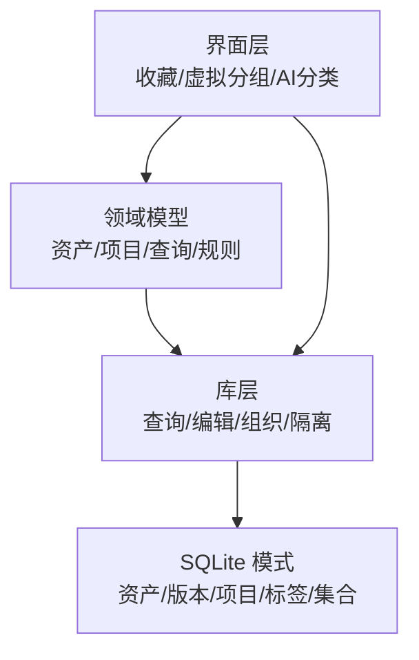

**图示来源**
- [lib.rs（领域模型）:54-351](../../crates/moriq-domain/src/lib.rs#L54-L351)
- [schema.sql（数据库模式）:1-42](../../crates/moriq-library/src/database/schema.sql#L1-L42)
- [organize.rs（组织视图）:140-360](../../crates/moriq-library/src/catalog/organize.rs#L140-L360)
- [favorites.rs（收藏界面状态）:1-180](../../crates/moriq-ui/src/favorites.rs#L1-L180)

**章节来源**
- [ARCHITECTURE.md:1-40](../../ARCHITECTURE.md#L1-L40)
- [lib.rs（领域模型）:54-351](../../crates/moriq-domain/src/lib.rs#L54-L351)
- [schema.sql（数据库模式）:1-42](../../crates/moriq-library/src/database/schema.sql#L1-L42)

## 核心数据模型
### 资产与版本
- 资产记录显示版本、名称、格式、尺寸、字节数、收藏、评分、标签、导入时间等。
- 版本表维护唯一路径、哈希、来源类型、父版本及宽高字节信息，支撑不可变源版本和回滚链。
- 资产通过外键指向当前显示版本；版本支持父子链，便于保留修改历史。

| 实体 | 关键字段 | 含义 |
|---|---|---|
| 资产 | id, display_version_id, name, favorite, rating, imported_at | 当前可见资产及其基本元数据 |
| 版本 | id, asset_id, parent_version_id, origin, path, sha256, format, width, height, bytes | 不可变源文件或导出产物 |
| 项目 | id, name | 素材组织容器 |
| 标签 | id, name | 全局标签字典 |
| 资产-标签 | asset_id, tag_id | 多对多关系 |
| 项目-资产 | project_id, asset_id | 多对多关系 |

**章节来源**
- [lib.rs（领域模型）:63-217](../../crates/moriq-domain/src/lib.rs#L63-L217)
- [schema.sql（数据库模式）:1-42](../../crates/moriq-library/src/database/schema.sql#L1-L42)

### 查询与规则
- 查询对象承载多种过滤条件：关键词、收藏、项目、格式、评分、尺寸、标签、颜色、人物、语义 ID、虚拟文件夹、媒介类型、主题、AI 分类、排序等。
- 规则树是类型安全的复合条件，支持 All、Any、Not、Name、Notes、Tag、Format、Rating、Favorite、Raw、HasLocation 等节点，并提供深度、数量和字段长度校验。

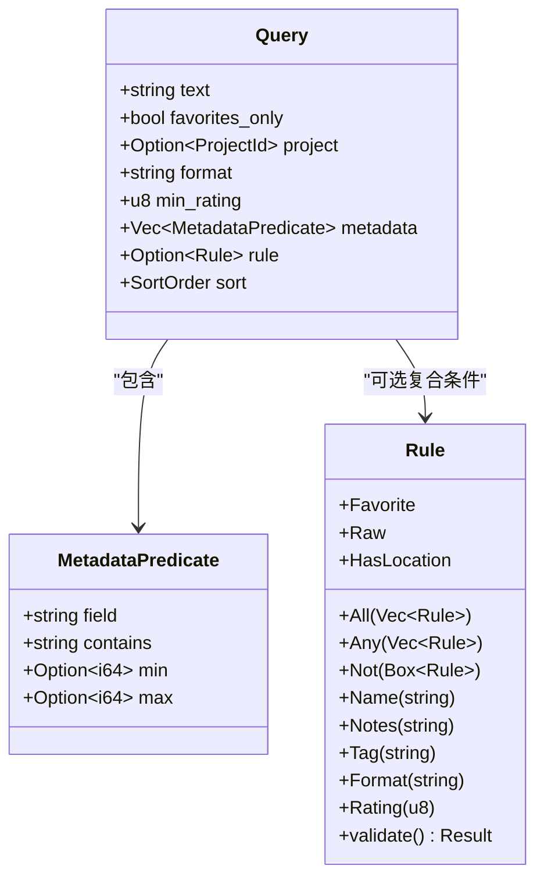

**图示来源**
- [lib.rs（领域模型）:79-172](../../crates/moriq-domain/src/lib.rs#L79-L172)

**章节来源**
- [lib.rs（领域模型）:79-172](../../crates/moriq-domain/src/lib.rs#L79-L172)

### 虚拟分组与集合
- 虚拟文件夹用于按引用组织素材，不复制原片；每个素材可加入多个分组。
- 智能集合保存名称和序列化的查询对象，可在不同工作区或全局范围列出。

**章节来源**
- [lib.rs（领域模型）:226-315](../../crates/moriq-domain/src/lib.rs#L226-L315)
- [organize.rs（组织视图）:312-360](../../crates/moriq-library/src/catalog/organize.rs#L312-L360)

## 系统架构总览
素材组织贯穿三层：
- 领域层定义不可变身份标识、资产、项目、查询、规则、虚拟文件夹等类型。
- 库层负责 SQLite 读写、查询快照、编辑事务、组织视图聚合、工作区隔离和项目删除计划。
- 界面层处理即时反馈、请求回执、草稿、错误提示和批量操作。

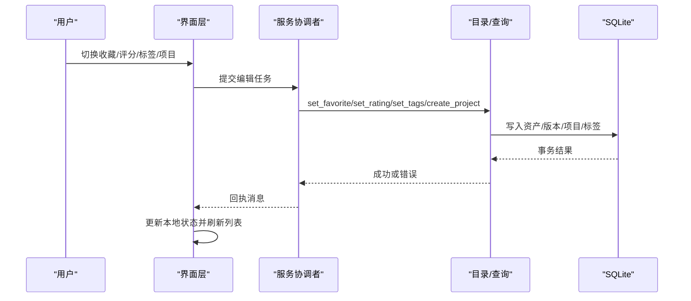

**图示来源**
- [favorites.rs（收藏界面状态）:75-180](../../crates/moriq-ui/src/favorites.rs#L75-L180)
- [edits.rs（编辑操作）:17-106](../../crates/moriq-library/src/catalog/edits.rs#L17-L106)
- [ARCHITECTURE.md:80-155](../../ARCHITECTURE.md#L80-L155)

**章节来源**
- [ARCHITECTURE.md:80-155](../../ARCHITECTURE.md#L80-L155)

## 详细组件分析

### 项目管理系统
项目是可命名的素材容器，支持重命名、删除、成员关系以及 AI 配置隔离。

- 项目创建会校验名称并初始化独立 AI 配置。
- 项目-资产是多对多关系，允许素材跨项目存在。
- 项目删除采用完整作用域计划，避免误删共享成员。
- 工作区支持项目级隔离，使查询、集合和 AI 配置限定在当前项目范围内。

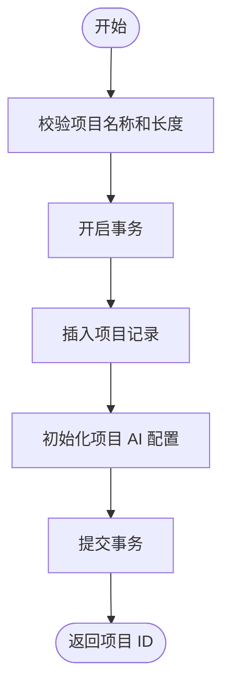

**图示来源**
- [edits.rs（编辑操作）:80-106](../../crates/moriq-library/src/catalog/edits.rs#L80-L106)
- [schema.sql（数据库模式）:36-37](../../crates/moriq-library/src/database/schema.sql#L36-L37)

**章节来源**
- [lib.rs（领域模型）:43-63](../../crates/moriq-domain/src/lib.rs#L43-L63)
- [schema.sql（数据库模式）:36-37](../../crates/moriq-library/src/database/schema.sql#L36-L37)
- [edits.rs（编辑操作）:80-106](../../crates/moriq-library/src/catalog/edits.rs#L80-L106)
- [ARCHITECTURE.md:24-40](../../ARCHITECTURE.md#L24-L40)

### 标签体系
标签分为人工标签和自动标签：
- 人工标签存储在 `tags` 与 `asset_tags` 中，去重且有序。
- 自动标签来自 AI 可视标签视图；当人工设置不包含某自动标签时，会自动拒绝该自动标签，从而形成“人工覆盖优先”的规则。
- 页面加载时批量读取有效标签，避免逐条展开 AI 视图。

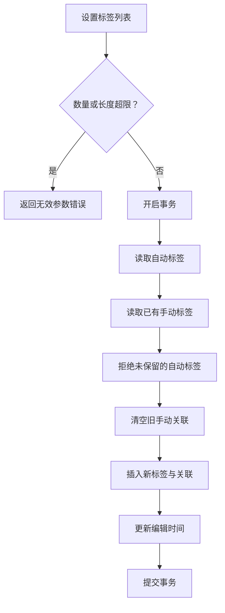

**图示来源**
- [edits.rs（编辑操作）:35-79](../../crates/moriq-library/src/catalog/edits.rs#L35-L79)
- [query.rs（查询与分页）:208-240](../../crates/moriq-library/src/catalog/query.rs#L208-L240)

**章节来源**
- [schema.sql（数据库模式）:38-40](../../crates/moriq-library/src/database/schema.sql#L38-L40)
- [edits.rs（编辑操作）:35-79](../../crates/moriq-library/src/catalog/edits.rs#L35-L79)
- [query.rs（查询与分页）:208-240](../../crates/moriq-library/src/catalog/query.rs#L208-L240)

### 评分机制
评分为 0～5 的整数，直接作用于资产行，影响排序和筛选。
- 评分写入前进行范围校验。
- 评分变更会更新时间戳，从而影响“最近编辑”统计和筛选。
- 排序支持按评分降序，与导入时间作为稳定键组合。

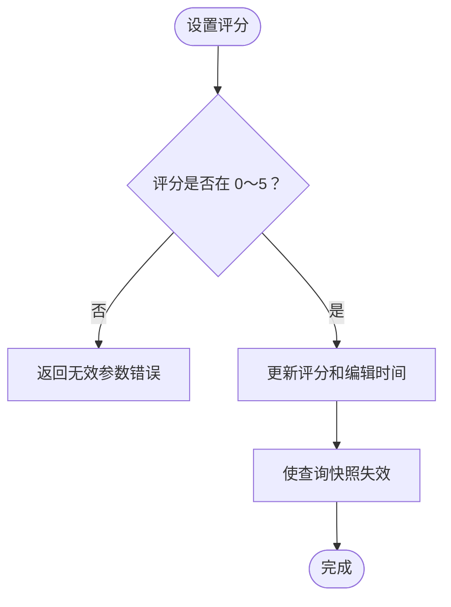

**图示来源**
- [edits.rs（编辑操作）:25-34](../../crates/moriq-library/src/catalog/edits.rs#L25-L34)
- [query.rs（查询与分页）:154-168](../../crates/moriq-library/src/catalog/query.rs#L154-L168)

**章节来源**
- [lib.rs（领域模型）:63-78](../../crates/moriq-domain/src/lib.rs#L63-L78)
- [edits.rs（编辑操作）:25-34](../../crates/moriq-library/src/catalog/edits.rs#L25-L34)
- [query.rs（查询与分页）:154-168](../../crates/moriq-library/src/catalog/query.rs#L154-L168)

### 收藏功能
收藏提供即时反馈和受控写入：
- 用户点击后立即更新界面，同时启动后台写入。
- 每次请求带递增编号，避免旧回执覆盖新状态。
- 失败时回退到上次已知值，并清除延迟导航。
- 已完成的收藏状态被缓存，直到页面生成号变化。

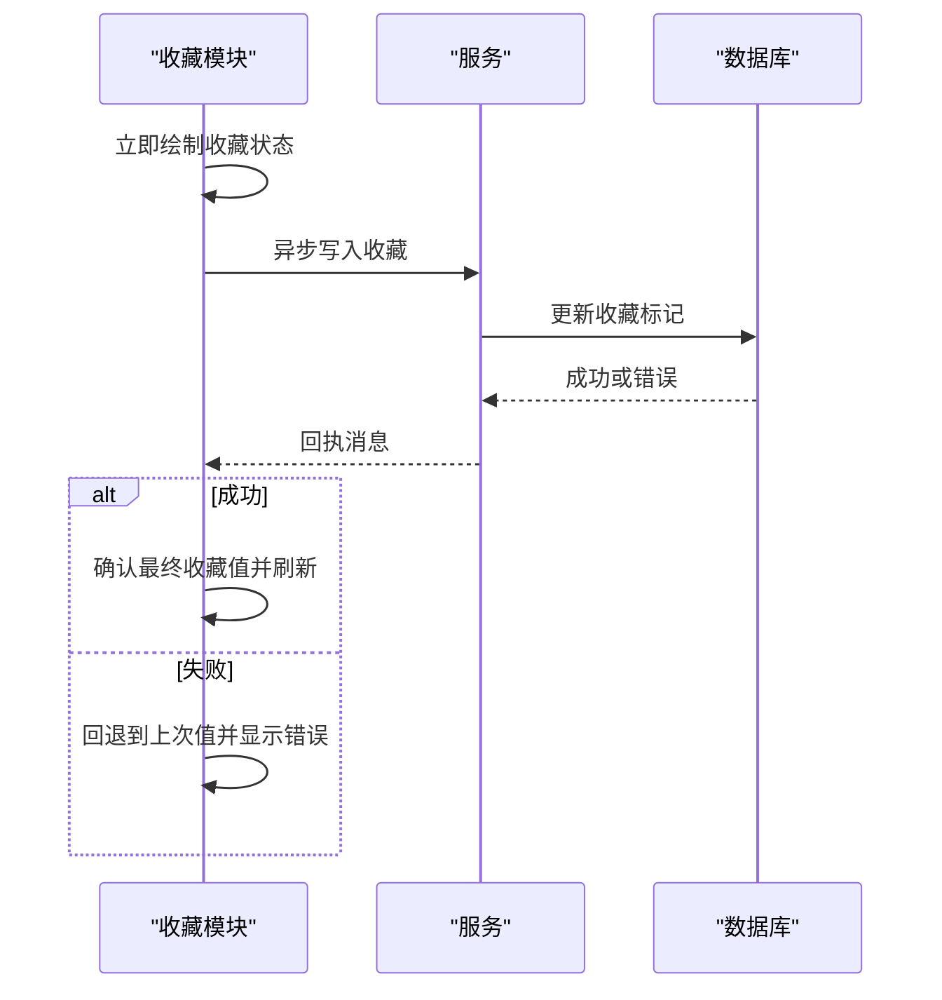

**图示来源**
- [favorites.rs（收藏界面状态）:75-180](../../crates/moriq-ui/src/favorites.rs#L75-L180)
- [edits.rs（编辑操作）:21-24](../../crates/moriq-library/src/catalog/edits.rs#L21-L24)

**章节来源**
- [favorites.rs（收藏界面状态）:1-180](../../crates/moriq-ui/src/favorites.rs#L1-L180)
- [edits.rs（编辑操作）:21-24](../../crates/moriq-library/src/catalog/edits.rs#L21-L24)

### 虚拟分组
虚拟分组分为收藏分组和普通文件夹：
- 创建、重命名、删除、添加成员、设置封面。
- 打开分组会设置查询中的 folder 字段，进入资产页。
- 封面预览按需加载，避免重复解码。

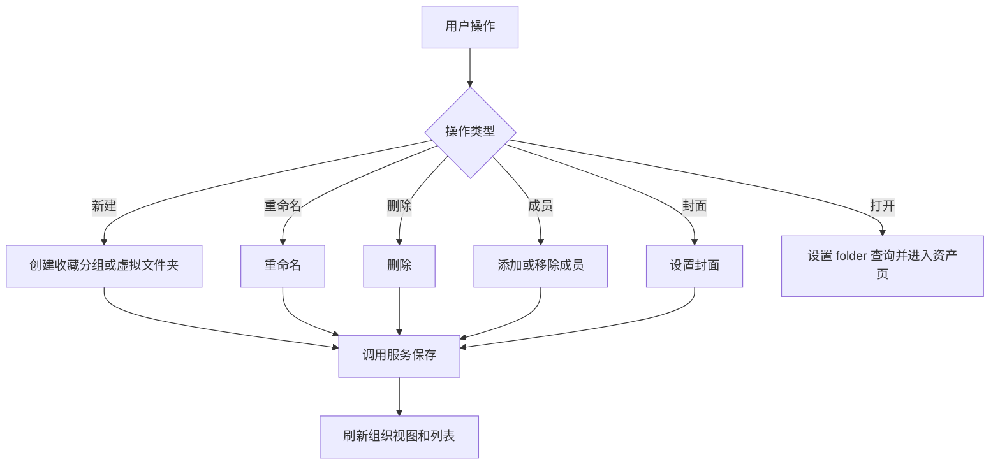

**图示来源**
- [folders.rs（虚拟分组界面）:24-120](../../crates/moriq-ui/src/folders.rs#L24-L120)

**章节来源**
- [folders.rs（虚拟分组界面）:1-180](../../crates/moriq-ui/src/folders.rs#L1-L180)
- [lib.rs（领域模型）:307-322](../../crates/moriq-domain/src/lib.rs#L307-L322)

### AI 分类与智能规则
AI 分类编辑器支持：
- 查看、启用/禁用、移动、重命名、编辑定义。
- 应用模板、保存模板、保存当前项目分类配置。
- 限制最多 64 个分类，并对分类定义和标签做前端校验。

智能规则支持组合条件，限制最大深度和节点数量，防止无界查询。

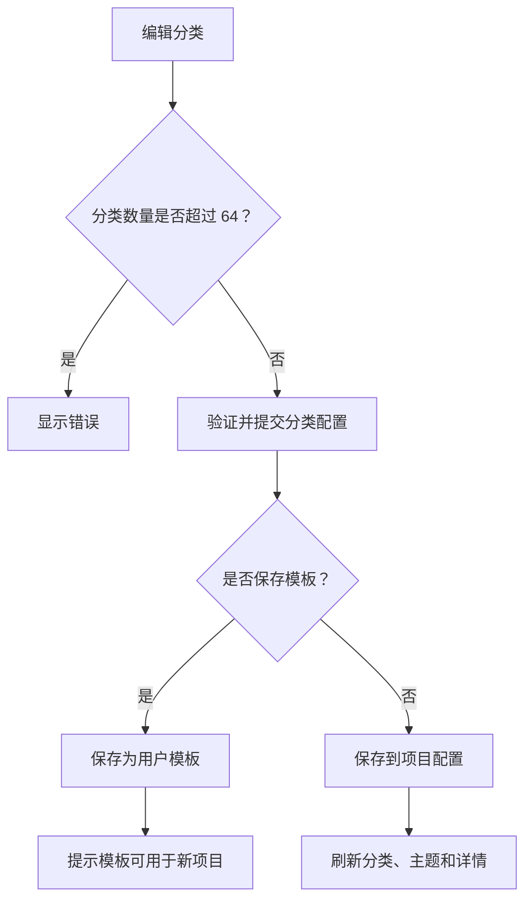

**图示来源**
- [categories.rs（AI 分类编辑器）:80-288](../../crates/moriq-ui/src/categories.rs#L80-L288)
- [lib.rs（领域模型）:125-172](../../crates/moriq-domain/src/lib.rs#L125-L172)

**章节来源**
- [categories.rs（AI 分类编辑器）:1-320](../../crates/moriq-ui/src/categories.rs#L1-L320)
- [lib.rs（领域模型）:125-172](../../crates/moriq-domain/src/lib.rs#L125-L172)

### 元数据结构与版本控制
- 资产元数据包括名称、格式、尺寸、字节数、收藏、评分、导入时间、编辑时间和备注。
- 版本表记录原始、同步、导入、导出等不同来源，并通过哈希保证内容不变性。
- 版本链通过父版本字段连接，便于恢复和审计。
- 资产与版本通过显示版本外键绑定，确保查询只看到当前可见版本。

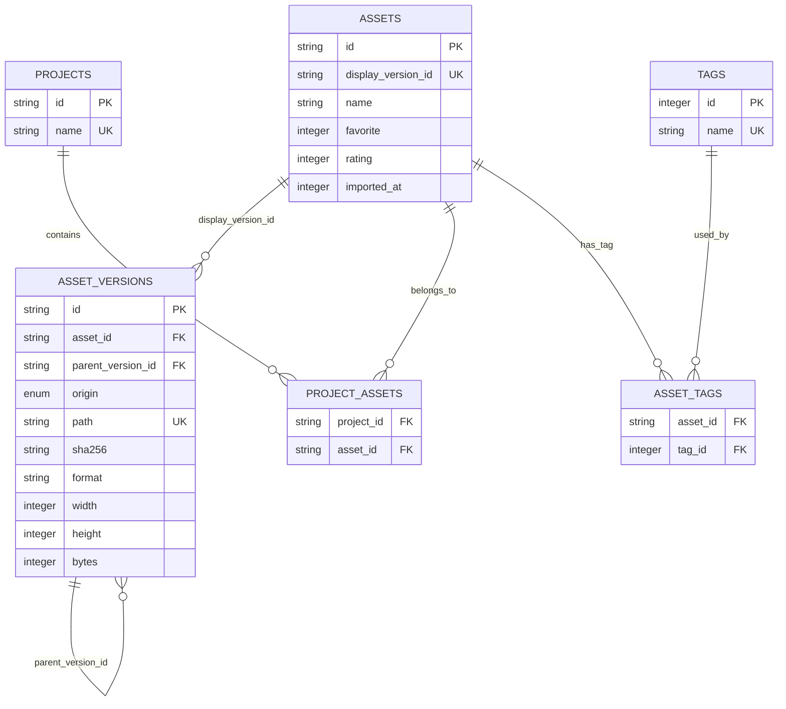

**图示来源**
- [schema.sql（数据库模式）:1-42](../../crates/moriq-library/src/database/schema.sql#L1-L42)
- [lib.rs（领域模型）:63-217](../../crates/moriq-domain/src/lib.rs#L63-L217)

**章节来源**
- [schema.sql（数据库模式）:1-42](../../crates/moriq-library/src/database/schema.sql#L1-L42)
- [lib.rs（领域模型）:63-217](../../crates/moriq-domain/src/lib.rs#L63-L217)

### 属性继承规则
- 项目拥有独立的 AI 分类配置；新建项目时会克隆默认配置。
- 工作区查询将项目范围注入 WHERE 条件，从而让标签、集合、统计和筛选都受项目上下文影响。
- 虚拟分组和收藏分组仅存储引用，不复制原片，因此一个素材可属于多个分组。

**章节来源**
- [edits.rs（编辑操作）:80-106](../../crates/moriq-library/src/catalog/edits.rs#L80-L106)
- [query.rs（查询与分页）:23-30](../../crates/moriq-library/src/catalog/query.rs#L23-L30)
- [folders.rs（虚拟分组界面）:100-180](../../crates/moriq-ui/src/folders.rs#L100-L180)

## 依赖关系分析
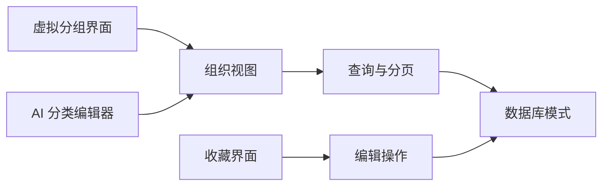

**图示来源**
- [favorites.rs（收藏界面状态）:75-180](../../crates/moriq-ui/src/favorites.rs#L75-L180)
- [folders.rs（虚拟分组界面）:24-120](../../crates/moriq-ui/src/folders.rs#L24-L120)
- [categories.rs（AI 分类编辑器）:80-288](../../crates/moriq-ui/src/categories.rs#L80-L288)
- [organize.rs（组织视图）:140-360](../../crates/moriq-library/src/catalog/organize.rs#L140-L360)
- [query.rs（查询与分页）:1-280](../../crates/moriq-library/src/catalog/query.rs#L1-L280)
- [schema.sql（数据库模式）:1-42](../../crates/moriq-library/src/database/schema.sql#L1-L42)

**章节来源**
- [ARCHITECTURE.md:1-40](../../ARCHITECTURE.md#L1-L40)

## 性能与扩展性
- 查询使用临时快照表和密集顺序表优化分页，避免深 OFFSET 扫描。
- 标签和 AI 分类在页面级别批量加载，减少逐条视图展开。
- 收藏和评分变更会使查询快照失效，保证后续筛选一致性。
- 规则树有深度和节点上限，防止复杂组合导致查询爆炸。
- 组织视图按工作区分片缓存，部分投影失败不影响其他面板。

建议：
- 合理拆分大项目，利用工作区隔离提高查询局部性。
- 使用虚拟分组和智能集合替代物理复制，减少冗余。
- 用规则组合表达复杂筛选，但保持节点数量可控。
- 在大批量操作中优先使用批量编辑接口，减少往返次数。

[本节为通用指导，不直接分析具体文件]

## 使用指南

### 基础操作
- 添加素材：通过导入流程注册原片或外部引用，系统生成资产和版本记录。
- 打标签：选择素材后设置标签列表；未被保留的自动标签会被拒绝。
- 评分：选择 0～5 的评分，评分会影响排序和筛选。
- 收藏：点击收藏按钮获得即时反馈，后台写入成功后刷新列表。

**章节来源**
- [edits.rs（编辑操作）:17-79](../../crates/moriq-library/src/catalog/edits.rs#L17-L79)
- [favorites.rs（收藏界面状态）:75-180](../../crates/moriq-ui/src/favorites.rs#L75-L180)

### 项目管理
- 新建项目：输入合法名称后创建项目并初始化 AI 配置。
- 分配素材：将素材加入项目；素材可同时属于多个项目。
- 删除项目：确认后执行完整删除计划，避免误删共享素材。

**章节来源**
- [edits.rs（编辑操作）:80-106](../../crates/moriq-library/src/catalog/edits.rs#L80-L106)
- [schema.sql（数据库模式）:36-37](../../crates/moriq-library/src/database/schema.sql#L36-L37)

### 虚拟分组
- 创建收藏分组：适合快速收藏常用素材集。
- 创建虚拟文件夹：适合按场景、客户、阶段等维度组织。
- 添加成员：从当前选择批量加入分组。
- 设置封面：从选中素材中选择封面图。
- 打开分组：进入该分组对应的筛选结果页。

**章节来源**
- [folders.rs（虚拟分组界面）:24-180](../../crates/moriq-ui/src/folders.rs#L24-L180)

### 智能分类与规则
- 分类编辑：新增、启用/禁用、移动、重命名、编辑定义。
- 模板：保存当前分类配置为用户模板，新建项目时可套用。
- 规则筛选：使用 Name、Notes、Tag、Format、Rating、Favorite 等节点组合查询。
- 批量操作：对选中资产或当前查询结果统一设置收藏、评分、标签、项目和备注。

**章节来源**
- [categories.rs（AI 分类编辑器）:80-288](../../crates/moriq-ui/src/categories.rs#L80-L288)
- [lib.rs（领域模型）:125-172](../../crates/moriq-domain/src/lib.rs#L125-L172)

### 与搜索和筛选的集成
- 文本搜索支持名称、备注和 AI 搜索源。
- 筛选支持收藏、项目、格式、评分、大小、导入时间、方向、标签、颜色、人物、语义 ID、虚拟文件夹、媒介类型、主题和 AI 分类。
- 排序支持最新、最旧、名称、最大、评分。
- 页面布局根据查询顺序返回尺寸，避免解码原图。

**章节来源**
- [query.rs（查询与分页）:1-280](../../crates/moriq-library/src/catalog/query.rs#L1-L280)

### 高级技巧
- 使用规则树表达“包含标签 A 且评分大于等于 3 且不是视频”的组合条件。
- 使用智能集合保存常用筛选，并在项目工作区内复用。
- 使用虚拟分组进行非破坏性重组，避免复制原片。
- 批量设置标签时，注意自动标签与手动标签的关系：未保留的自动标签将被拒绝。

[本节为通用指导，不直接分析具体文件]

## 故障排查
常见问题与定位方式：
- 收藏状态不一致：检查是否有待处理请求，确认回执编号和库 ID 匹配。
- 标签未生效：检查是否超过 64 个标签或单标签长度超限；确认自动标签是否被拒绝。
- 评分无效：确认评分是否在 0～5。
- 项目无法创建：检查项目名称是否为空或过长。
- 筛选结果异常：检查规则树是否超限或非法；确认项目工作区是否正确。

**章节来源**
- [favorites.rs（收藏界面状态）:180-240](../../crates/moriq-ui/src/favorites.rs#L180-L240)
- [edits.rs（编辑操作）:17-79](../../crates/moriq-library/src/catalog/edits.rs#L17-L79)
- [lib.rs（领域模型）:125-172](../../crates/moriq-domain/src/lib.rs#L125-L172)

## 结论
该素材组织和分类系统以领域模型为中心，通过库层实现严格的持久化和查询逻辑，并在界面层提供即时反馈和可操作的编辑体验。项目、标签、评分、收藏和虚拟分组共同构成一个灵活、可扩展的组织体系；AI 分类与规则进一步增强了智能管理能力。结合搜索、筛选和批量操作，用户可以在保持原片安全的前提下，高效地构建和维护大型素材库。

[本节为总结性内容，不直接分析具体文件]