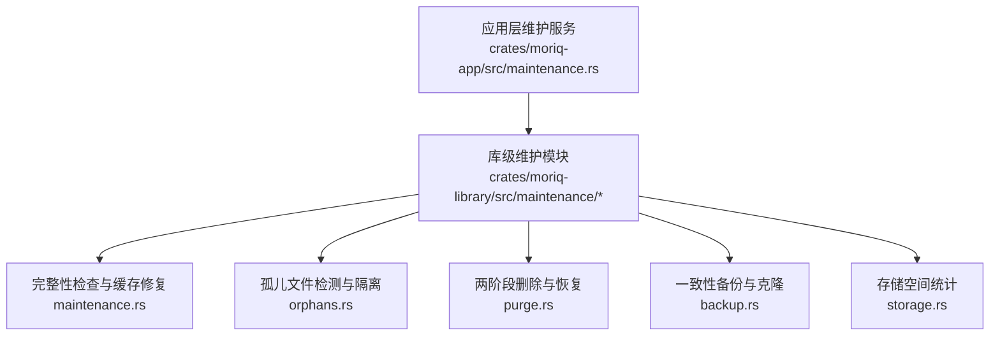
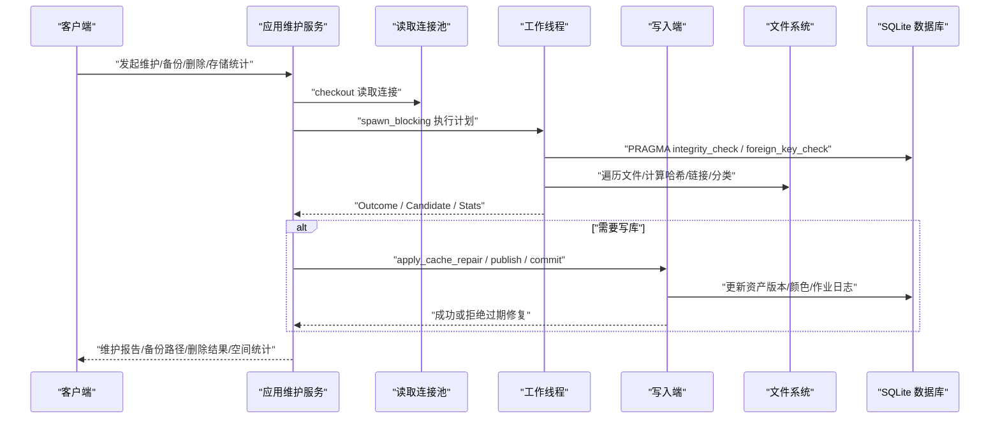
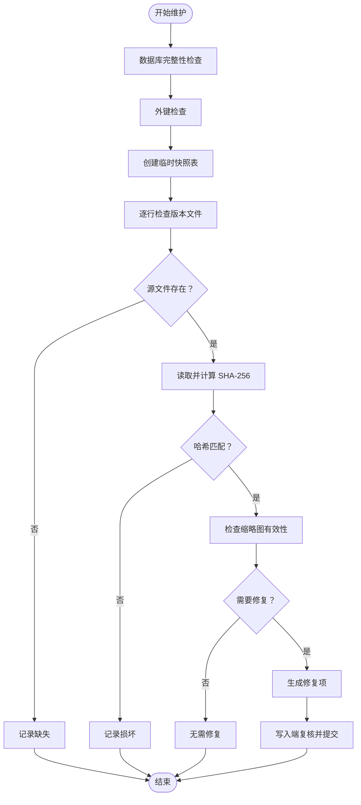
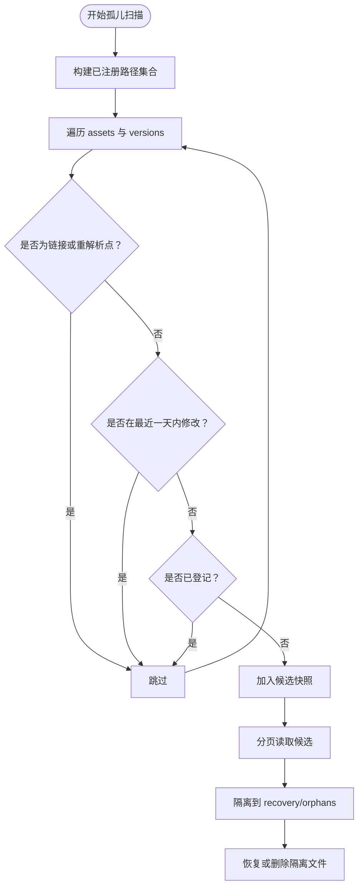
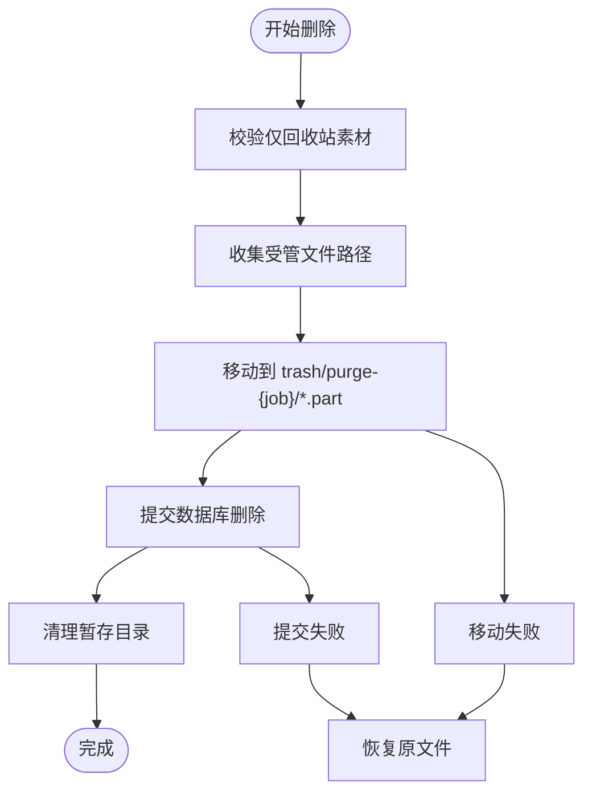
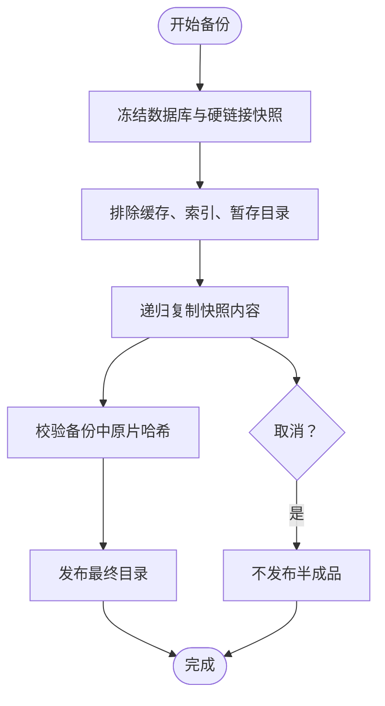
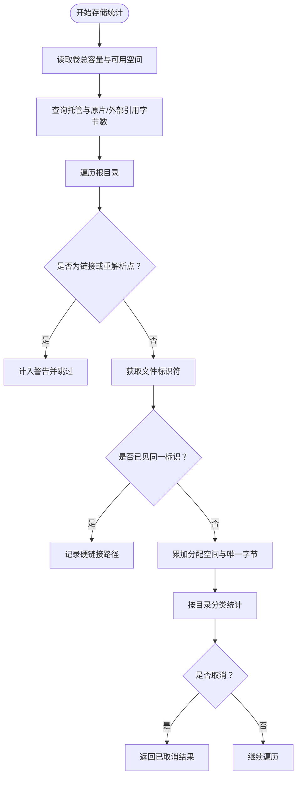
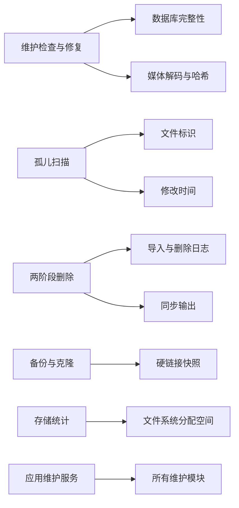

# 维护工具

> Repo Wiki 节点 `maintenance-tools`
> 导出自 Qoder 知识库快照 `8fbe02f6-57c2-4874-b725-1a8130851fd9`，代码基线 `7a7a8e75e18bd90294e09cd422dd7ed5a04813a0`（分支 main，zh-CN）。

<cite>
**本文引用的文件**   
- [crates/moriq-library/src/maintenance/maintenance.rs](../../crates/moriq-library/src/maintenance/maintenance.rs)
- [crates/moriq-library/src/maintenance/backup.rs](../../crates/moriq-library/src/maintenance/backup.rs)
- [crates/moriq-library/src/maintenance/orphans.rs](../../crates/moriq-library/src/maintenance/orphans.rs)
- [crates/moriq-library/src/maintenance/purge.rs](../../crates/moriq-library/src/maintenance/purge.rs)
- [crates/moriq-library/src/maintenance/storage.rs](../../crates/moriq-library/src/maintenance/storage.rs)
- [crates/moriq-app/src/maintenance.rs](../../crates/moriq-app/src/maintenance.rs)
</cite>

## 目录
1. [引言](#引言)
2. [项目结构](#项目结构)
3. [核心组件](#核心组件)
4. [架构总览](#架构总览)
5. [详细组件分析](#详细组件分析)
6. [依赖关系分析](#依赖关系分析)
7. [性能与资源特性](#性能与资源特性)
8. [维护操作指南](#维护操作指南)
9. [日志、诊断与故障恢复](#日志诊断与故障恢复)
10. [备份验证与数据一致性最佳实践](#备份验证与数据一致性最佳实践)
11. [自动化与维护计划建议](#自动化与维护计划建议)
12. [结论](#结论)

## 引言
本仓库的“维护工具”负责在媒体资源库生命周期内，对缓存、孤儿文件、完整性、存储空间和备份删除等关键场景提供一致、可恢复且安全的操作能力。其设计强调：
- 使用“冻结快照 + 独立工作线程”的模式，避免长时间阻塞写入端。
- 通过数据库事务、两阶段文件和恢复日志保证可回滚。
- 在扫描和修复过程中支持取消、进度汇报与身份校验。
- 将高风险操作（永久删除、隔离移动、发布备份）置于严格的白名单和安全检查之后。

## 项目结构
维护功能主要分布在两个层次：
- `crates/moriq-library/src/maintenance`：实现具体维护算法、数据一致性和文件系统安全逻辑。
- `crates/moriq-app/src/maintenance.rs`：暴露异步服务接口，处理并发控制、取消传播、批量分片、进度汇总和调用前的活动库身份校验。

**图示来源**
- [crates/moriq-app/src/maintenance.rs:1-120](../../crates/moriq-app/src/maintenance.rs#L1-L120)
- [crates/moriq-library/src/maintenance/maintenance.rs:1-120](../../crates/moriq-library/src/maintenance/maintenance.rs#L1-L120)
- [crates/moriq-library/src/maintenance/orphans.rs:1-80](../../crates/moriq-library/src/maintenance/orphans.rs#L1-L80)
- [crates/moriq-library/src/maintenance/purge.rs:1-60](../../crates/moriq-library/src/maintenance/purge.rs#L1-L60)
- [crates/moriq-library/src/maintenance/backup.rs:1-60](../../crates/moriq-library/src/maintenance/backup.rs#L1-L60)
- [crates/moriq-library/src/maintenance/storage.rs:1-60](../../crates/moriq-library/src/maintenance/storage.rs#L1-L60)

**章节来源**
- [crates/moriq-app/src/maintenance.rs:1-120](../../crates/moriq-app/src/maintenance.rs#L1-L120)
- [crates/moriq-library/src/maintenance/maintenance.rs:1-120](../../crates/moriq-library/src/maintenance/maintenance.rs#L1-L120)

## 核心组件
- 完整性检查与缓存修复：扫描 `asset_versions` 中版本文件的哈希、来源路径和缩略图状态；损坏或缺失时报告，并生成可在写入端复核后提交的修复项。
- 孤儿文件检测：扫描受管目录，排除已登记路径、符号链接、重解析点和近期修改文件，生成候选快照；后续支持分页确认、隔离和恢复。
- 两阶段删除：将待删文件移动到内部暂存目录，提交数据库变更，再清理暂存；失败时根据恢复日志回滚。
- 一致性备份：冻结数据库和不可变文件硬链接，排除进行中的导入暂存，可选克隆为独立库身份；复制前再次校验原片哈希。
- 存储空间统计：遍历根目录，按分类累计分配空间，去重硬链接，分别统计托管原片和外部引用大小。

**章节来源**
- [crates/moriq-library/src/maintenance/maintenance.rs:1-120](../../crates/moriq-library/src/maintenance/maintenance.rs#L1-L120)
- [crates/moriq-library/src/maintenance/orphans.rs:1-80](../../crates/moriq-library/src/maintenance/orphans.rs#L1-L80)
- [crates/moriq-library/src/maintenance/purge.rs:1-60](../../crates/moriq-library/src/maintenance/purge.rs#L1-L60)
- [crates/moriq-library/src/maintenance/backup.rs:1-60](../../crates/moriq-library/src/maintenance/backup.rs#L1-L60)
- [crates/moriq-library/src/maintenance/storage.rs:1-60](../../crates/moriq-library/src/maintenance/storage.rs#L1-L60)

## 架构总览
维护任务统一遵循以下流程：
1. 应用层接收请求，校验当前活动库身份。
2. 在读取连接池中创建只读快照或冻结计划。
3. 在独立工作线程执行扫描、复制或修复。
4. 通过共享原子计数器报告取消、完成数量和总量。
5. 对需要写库的修复或提交操作，回到写入端再次校验后再执行。
6. 返回结构化报告，包含计数、警告、错误、恢复标记等信息。

**图示来源**
- [crates/moriq-app/src/maintenance.rs:120-244](../../crates/moriq-app/src/maintenance.rs#L120-L244)
- [crates/moriq-library/src/maintenance/maintenance.rs:120-260](../../crates/moriq-library/src/maintenance/maintenance.rs#L120-L260)
- [crates/moriq-library/src/maintenance/backup.rs:180-260](../../crates/moriq-library/src/maintenance/backup.rs#L180-L260)
- [crates/moriq-library/src/maintenance/purge.rs:60-180](../../crates/moriq-library/src/maintenance/purge.rs#L60-L180)
- [crates/moriq-library/src/maintenance/storage.rs:60-160](../../crates/moriq-library/src/maintenance/storage.rs#L60-L160)

## 详细组件分析

### 完整性检查与缓存修复
完整性检查不是简单遍历，而是先建立临时快照表，把版本元数据与文件位置合并，然后在读取连接外逐项检查源文件哈希、缩略图有效性和主色字段。若发现损坏或缺失，会记录报告并在需要时生成修复项；修复必须在写入端重新校验版本哈希和来源路径后才可应用。

**图示来源**
- [crates/moriq-library/src/maintenance/maintenance.rs:60-180](../../crates/moriq-library/src/maintenance/maintenance.rs#L60-L180)
- [crates/moriq-library/src/maintenance/maintenance.rs:180-320](../../crates/moriq-library/src/maintenance/maintenance.rs#L180-L320)

关键点：
- 临时快照减少长事务锁。
- 大文件限制解码内存，超过阈值直接视为损坏。
- 修复只更新缩略图和主色，不随意覆盖外部引用缓存。
- 写入端二次校验防止过期修复污染重定位后的内容。

**章节来源**
- [crates/moriq-library/src/maintenance/maintenance.rs:1-200](../../crates/moriq-library/src/maintenance/maintenance.rs#L1-L200)
- [crates/moriq-library/src/maintenance/maintenance.rs:201-412](../../crates/moriq-library/src/maintenance/maintenance.rs#L201-L412)

### 孤儿文件检测与隔离
孤儿扫描会读取注册路径集合，包括素材版本、项目文件、操作日志和待删除文件，然后扫描 `assets` 和 `versions` 目录。它跳过符号链接、Windows 重解析点、近期修改文件以及未识别平台路径，并把候选写入本地临时数据库，供分页读取。

**图示来源**
- [crates/moriq-library/src/maintenance/orphans.rs:1-160](../../crates/moriq-library/src/maintenance/orphans.rs#L1-L160)
- [crates/moriq-library/src/maintenance/orphans.rs:160-355](../../crates/moriq-library/src/maintenance/orphans.rs#L160-L355)

关键点：
- 使用文件标识符、大小、修改时间和平台 ID 做保守校验，降低误判。
- 隔离操作记录状态机：prepared → quarantined → restoring/purging。
- 恢复过程拒绝覆盖现有文件或被其他记录占用的路径。
- 应用层以分页方式分批确认，避免一次性加载全部候选。

**章节来源**
- [crates/moriq-library/src/maintenance/orphans.rs:1-355](../../crates/moriq-library/src/maintenance/orphans.rs#L1-L355)
- [crates/moriq-app/src/maintenance.rs:1-120](../../crates/moriq-app/src/maintenance.rs#L1-L120)

### 两阶段删除与恢复
删除流程严格限定在受管路径前缀下，禁止链接绕过，并区分回收站素材与普通素材。第一阶段把文件移动到 `trash/purge-{job}/` 下的 `.part` 文件，第二阶段提交数据库关联删除并清理预览、同步输出等衍生内容。失败时会根据 `purge_jobs` 和 `purge_files` 恢复原位置。

**图示来源**
- [crates/moriq-library/src/maintenance/purge.rs:1-120](../../crates/moriq-library/src/maintenance/purge.rs#L1-L120)
- [crates/moriq-library/src/maintenance/purge.rs:120-300](../../crates/moriq-library/src/maintenance/purge.rs#L120-L300)
- [crates/moriq-library/src/maintenance/purge.rs:300-552](../../crates/moriq-library/src/maintenance/purge.rs#L300-L552)

关键点：
- 每批删除数量限制在 1～10000。
- 删除路径必须属于受管区域，不能包含符号链接。
- 恢复逻辑允许未知残留文件保留，但不阻止后续正常删除。
- 项目删除还会清理中断导入的相关暂存文件，但需保持非本项目导入安全。

**章节来源**
- [crates/moriq-library/src/maintenance/purge.rs:1-552](../../crates/moriq-library/src/maintenance/purge.rs#L1-L552)

### 一致性备份与克隆
备份先冻结数据库和不可变文件硬链接，排除 `thumbnails`、`previews`、`backups`、`indexes/search`、`indexes/layout`、`staging` 等目录；如果是克隆模式，则改写库身份、清空同步任务和后台任务，并生成新显示名。复制时使用深度限制和取消检查，发布前再次核对原片哈希。

**图示来源**
- [crates/moriq-library/src/maintenance/backup.rs:1-180](../../crates/moriq-library/src/maintenance/backup.rs#L1-L180)
- [crates/moriq-library/src/maintenance/backup.rs:180-320](../../crates/moriq-library/src/maintenance/backup.rs#L180-L320)

关键点：
- 禁止将备份放到资源库根目录之下。
- 进行中导入暂存被排除，已中断导入仍保留恢复信息。
- 克隆会生成新的库身份，适合分发或测试。
- 备份副本中的原片哈希不一致时直接拒绝发布。

**章节来源**
- [crates/moriq-library/src/maintenance/backup.rs:1-426](../../crates/moriq-library/src/maintenance/backup.rs#L1-L426)
- [crates/moriq-app/src/maintenance.rs:120-200](../../crates/moriq-app/src/maintenance.rs#L120-L200)

### 存储空间统计
存储统计先查询数据库中托管原片与外部引用的字节总数，再遍历磁盘统计分配空间和唯一文件大小，同时按目录类别归类。它会忽略符号链接和重解析点，并用文件标识符去重硬链接，避免重复计算。

**图示来源**
- [crates/moriq-library/src/maintenance/storage.rs:1-160](../../crates/moriq-library/src/maintenance/storage.rs#L1-L160)
- [crates/moriq-library/src/maintenance/storage.rs:160-261](../../crates/moriq-library/src/maintenance/storage.rs#L160-L261)

关键点：
- 分类包括托管原片、追加版本、可重建图片缓存、索引、交接副本、恢复与暂存、数据库升级备份、数据库与元数据。
- 支持取消并返回部分结果。
- 对外部引用只统计其注册大小，不重复统计目标盘占用。

**章节来源**
- [crates/moriq-library/src/maintenance/storage.rs:1-261](../../crates/moriq-library/src/maintenance/storage.rs#L1-L261)
- [crates/moriq-app/src/maintenance.rs:200-244](../../crates/moriq-app/src/maintenance.rs#L200-L244)

## 依赖关系分析
维护模块之间耦合较低，主要通过 `Library` 实例、读取连接池、临时文件和恢复日志协作：
- `maintenance.rs` 依赖数据库完整性、媒体解码、SHA-256 和临时文件。
- `orphans.rs` 依赖文件标识、时间戳、平台路径编码和解码。
- `purge.rs` 依赖 `project_deletion`、`synco` 相关表和导入恢复上下文。
- `backup.rs` 依赖硬链接、临时目录、目录遍历和数据库备份。
- `storage.rs` 依赖文件标识、分配空间查询和目录分类规则。
- 应用层 `maintenance.rs` 负责并发、取消、预算和身份校验。

**图示来源**
- [crates/moriq-library/src/maintenance/maintenance.rs:1-120](../../crates/moriq-library/src/maintenance/maintenance.rs#L1-L120)
- [crates/moriq-library/src/maintenance/orphans.rs:1-120](../../crates/moriq-library/src/maintenance/orphans.rs#L1-L120)
- [crates/moriq-library/src/maintenance/purge.rs:1-120](../../crates/moriq-library/src/maintenance/purge.rs#L1-L120)
- [crates/moriq-library/src/maintenance/backup.rs:1-120](../../crates/moriq-library/src/maintenance/backup.rs#L1-L120)
- [crates/moriq-library/src/maintenance/storage.rs:1-120](../../crates/moriq-library/src/maintenance/storage.rs#L1-L120)
- [crates/moriq-app/src/maintenance.rs:1-120](../../crates/moriq-app/src/maintenance.rs#L1-L120)

**章节来源**
- [crates/moriq-library/src/maintenance/maintenance.rs:1-120](../../crates/moriq-library/src/maintenance/maintenance.rs#L1-L120)
- [crates/moriq-library/src/maintenance/orphans.rs:1-120](../../crates/moriq-library/src/maintenance/orphans.rs#L1-L120)
- [crates/moriq-library/src/maintenance/purge.rs:1-120](../../crates/moriq-library/src/maintenance/purge.rs#L1-L120)
- [crates/moriq-library/src/maintenance/backup.rs:1-120](../../crates/moriq-library/src/maintenance/backup.rs#L1-L120)
- [crates/moriq-library/src/maintenance/storage.rs:1-120](../../crates/moriq-library/src/maintenance/storage.rs#L1-L120)
- [crates/moriq-app/src/maintenance.rs:1-120](../../crates/moriq-app/src/maintenance.rs#L1-L120)

## 性能与资源特性
- 完整性检查：
  - 通过临时快照表和只读连接降低长事务开销。
  - 单次解码最大图像尺寸限制为 256×256，分配上限约 1MB。
  - 单文件解码缓冲 64KB，累计超过 64GB 视为损坏。
  - 需要修复时会预留至少 64MB 临时空间，不足则停止。
- 孤儿扫描：
  - 使用临时 SQLite 文件缓存候选，避免在 Rust 侧积累大列表。
  - 分页读取，每页约 128 条。
  - 跳过符号链接、重解析点和近期修改文件，减少误判。
- 两阶段删除：
  - 批量限制 1～10000，应用层按 1000 分片调用。
  - 文件移动失败立即尝试恢复，数据库提交失败也触发恢复。
- 备份：
  - 使用硬链接快照，避免拷贝整个源库。
  - 复制阶段统计文件数量并按进度回调。
  - 目录层级限制 128，防止无限递归。
- 存储统计：
  - 使用栈式目录遍历，避免过深目录导致内存增长。
  - 去重硬链接，仅统计实际分配空间。
  - 支持取消并返回中间结果。

[本节为通用性能说明，不直接分析具体代码片段]

## 维护操作指南

### 常规缓存清理
适用场景：缩略图损坏、主色缺失、缓存占用过高。
步骤：
1. 确认当前活动库身份。
2. 执行缓存清理，默认保留约 4GB 预算；传入清除标志时可尽量释放。
3. 观察报告中的检查数量、修复数量、警告数量和取消状态。
4. 如需彻底清理，可传递清除参数；否则系统会优先重建必要缓存。

注意事项：
- 清理过程可能重建缩略图，耗时与媒体数量、解码速度相关。
- 清理不会删除用户原片，只会影响可重建缓存。
- 如果系统内存紧张，建议避开导入高峰期。

**章节来源**
- [crates/moriq-app/src/maintenance.rs:80-120](../../crates/moriq-app/src/maintenance.rs#L80-L120)
- [crates/moriq-library/src/maintenance/maintenance.rs:120-260](../../crates/moriq-library/src/maintenance/maintenance.rs#L120-L260)

### 孤儿文件检测与隔离
适用场景：旧受管文件未被登记、迁移后出现悬挂文件。
步骤：
1. 创建孤儿扫描计划。
2. 分页读取候选文件，查看路径、大小、修改时间和文件标识。
3. 确认后执行隔离，文件会被移到 `recovery/orphans`。
4. 如需恢复，分页恢复原路径；如需删除，选择清理模式。

安全检查：
- 仅处理旧受管文件，排除符号链接、重解析点和近期修改文件。
- 恢复时校验路径格式、UUID 和原始位置前缀。
- 若目标路径已被其他素材登记或已有同名文件，跳过该候选。

**章节来源**
- [crates/moriq-library/src/maintenance/orphans.rs:1-200](../../crates/moriq-library/src/maintenance/orphans.rs#L1-L200)
- [crates/moriq-library/src/maintenance/orphans.rs:200-355](../../crates/moriq-library/src/maintenance/orphans.rs#L200-L355)
- [crates/moriq-app/src/maintenance.rs:1-120](../../crates/moriq-app/src/maintenance.rs#L1-L120)

### 完整性检查与修复
适用场景：怀疑缩略图损坏、主色丢失、版本哈希异常。
步骤：
1. 调用维护检查，可选择修复模式。
2. 检查数据库完整性与外键。
3. 逐项检查版本文件哈希、来源路径和缩略图。
4. 对需要修复的项目生成修复候选。
5. 写入端复核版本哈希和来源路径后提交修复。

安全保护：
- 数据库不完整或外键失效时直接拒绝。
- 修复前检查剩余临时空间。
- 修复只更新缩略图和主色，不覆盖外部引用缓存。

**章节来源**
- [crates/moriq-library/src/maintenance/maintenance.rs:60-180](../../crates/moriq-library/src/maintenance/maintenance.rs#L60-L180)
- [crates/moriq-library/src/maintenance/maintenance.rs:180-320](../../crates/moriq-library/src/maintenance/maintenance.rs#L180-L320)
- [crates/moriq-app/src/maintenance.rs:160-244](../../crates/moriq-app/src/maintenance.rs#L160-L244)

### 两阶段永久删除
适用场景：清空回收站、清理项目归档、释放不再使用的素材。
步骤：
1. 先取回收站素材快照。
2. 按 1000 项分批执行永久删除。
3. 观察删除数量和是否有清理延迟。
4. 如发生恢复延迟，检查通知和备份。

安全保护：
- 仅允许删除回收站中的素材。
- 删除路径必须属于受管区域且不含链接。
- 删除失败时自动恢复原位置。
- 有未完成删除恢复任务时拒绝新删除。

**章节来源**
- [crates/moriq-library/src/maintenance/purge.rs:1-180](../../crates/moriq-library/src/maintenance/purge.rs#L1-L180)
- [crates/moriq-library/src/maintenance/purge.rs:180-552](../../crates/moriq-library/src/maintenance/purge.rs#L180-L552)
- [crates/moriq-app/src/maintenance.rs:100-160](../../crates/moriq-app/src/maintenance.rs#L100-L160)

### 一致性备份与克隆
适用场景：定期备份、跨机器迁移、测试克隆。
步骤：
1. 选择资源库外的备份目录。
2. 选择克隆模式或保留源库身份的备份模式。
3. 等待快照冻结和文件复制完成。
4. 打开备份库验证内容。

安全保护：
- 禁止备份到资源库根目录下。
- 排除进行中的导入暂存。
- 发布前校验原片哈希。
- 克隆会生成新库身份，避免与源库冲突。

**章节来源**
- [crates/moriq-library/src/maintenance/backup.rs:1-200](../../crates/moriq-library/src/maintenance/backup.rs#L1-L200)
- [crates/moriq-library/src/maintenance/backup.rs:200-426](../../crates/moriq-library/src/maintenance/backup.rs#L200-L426)
- [crates/moriq-app/src/maintenance.rs:120-200](../../crates/moriq-app/src/maintenance.rs#L120-L200)

### 存储空间统计
适用场景：评估磁盘占用、识别缓存膨胀、规划扩容。
步骤：
1. 执行存储扫描。
2. 查看总容量、可用空间、分配空间、唯一文件大小、硬链接路径数和分类统计。
3. 如需快速了解卷容量，可直接查询卷信息。

指标解释：
- 托管原片：由资源库管理的原片及项目归档。
- 外部引用：由资源库登记但物理文件位于其他位置的素材。
- 可重建图片缓存：缩略图和预览。
- 索引、交接副本、恢复与暂存、数据库升级备份、数据库与元数据。

**章节来源**
- [crates/moriq-library/src/maintenance/storage.rs:1-200](../../crates/moriq-library/src/maintenance/storage.rs#L1-L200)
- [crates/moriq-library/src/maintenance/storage.rs:200-261](../../crates/moriq-library/src/maintenance/storage.rs#L200-L261)
- [crates/moriq-app/src/maintenance.rs:200-244](../../crates/moriq-app/src/maintenance.rs#L200-L244)

## 日志、诊断与故障恢复

### 维护日志与报告字段
- 维护报告：
  - 已检查数量、缺失数量、损坏数量、警告数量、修复数量、是否取消。
  - 警告最多保留 50 条，避免报告过大。
- 孤儿报告：
  - 移动数量、字节数、跳过数量。
- 删除报告：
  - 删除数量、是否有清理延迟。
- 存储统计：
  - 分配空间、唯一文件大小、硬链接路径数、分类映射、测量时间、是否取消、警告数、文件数。

### 常见错误与诊断方法
- 数据库完整性检查失败：
  - 应停止维护，从备份恢复，不要强行继续修复。
- 外键失效：
  - 表明数据库引用不完整，应保留原库并从备份恢复。
- 删除路径包含链接：
  - 可能是注入攻击或配置错误，应立即中止。
- 备份发现符号链接：
  - 表示资源库完整性存在问题，应先运行完整性检查。
- 孤儿候选身份不一致：
  - 文件可能被替换、移动或删除，应跳过并继续处理其他候选。
- 删除恢复时发现原文件与暂存文件均缺失：
  - 需要从备份恢复，不应强制修复。

### 故障恢复策略
- 维护检查期间取消：
  - 丢弃待提交修复，释放读取租约，允许重新打开资源库。
- 删除操作失败：
  - 自动恢复已移动文件，清理未完成删除日志。
- 孤儿隔离失败：
  - 删除未完成的隔离记录，跳过该候选。
- 孤儿恢复失败：
  - 将状态恢复为隔离，避免丢失可恢复文件。
- 备份复制失败：
  - 不发布半成品副本，保留临时目录用于排查。

**章节来源**
- [crates/moriq-library/src/maintenance/maintenance.rs:1-120](../../crates/moriq-library/src/maintenance/maintenance.rs#L1-L120)
- [crates/moriq-library/src/maintenance/orphans.rs:200-355](../../crates/moriq-library/src/maintenance/orphans.rs#L200-L355)
- [crates/moriq-library/src/maintenance/purge.rs:300-552](../../crates/moriq-library/src/maintenance/purge.rs#L300-L552)
- [crates/moriq-library/src/maintenance/backup.rs:180-320](../../crates/moriq-library/src/maintenance/backup.rs#L180-L320)
- [crates/moriq-app/src/maintenance.rs:160-244](../../crates/moriq-app/src/maintenance.rs#L160-L244)

## 备份验证与数据一致性最佳实践
- 每次备份前先执行完整性检查，确保数据库健康。
- 备份完成后打开备份库，验证库身份、素材数量和缩略图可用性。
- 对比备份库与原库的维护结果，确认没有新增损坏。
- 对克隆库，确认库身份与源库不同，避免同步冲突。
- 定期检查孤儿隔离区，恢复合法文件或安全删除可疑文件。
- 对重要库保留多份异地备份，并定期演练恢复流程。
- 在执行大规模删除前，先导出元数据并验证导出结果。

[本节为通用最佳实践，不直接分析具体代码片段]

## 自动化与维护计划建议
推荐维护节奏：
- 日常：
  - 检查存储空间与可用空间。
  - 监控孤儿候选数量变化。
  - 检查是否有未完成的删除恢复任务。
- 每周：
  - 执行完整性检查与缓存修复。
  - 清理过期孤儿隔离文件。
  - 清理已完成且无异常的删除日志。
- 每月：
  - 执行一致性备份或克隆。
  - 验证备份可恢复。
  - 评估存储分类增长趋势，调整缓存预算。

自动化配置建议：
- 使用定时任务触发 `storage_plan().scan()` 和 `maintenance(false)`。
- 对 `orphan_scan()` 的结果设置告警阈值。
- 对 `trash_snapshot()` 与 `empty_trash()` 增加人工确认环节。
- 备份任务应在低负载时段执行，并记录开始、结束时间和进度。
- 所有维护操作都应记录：任务类型、库身份、开始时间、结束时间、成功与否、关键计数和错误消息。

**章节来源**
- [crates/moriq-app/src/maintenance.rs:1-244](../../crates/moriq-app/src/maintenance.rs#L1-L244)
- [crates/moriq-library/src/maintenance/storage.rs:1-261](../../crates/moriq-library/src/maintenance/storage.rs#L1-L261)
- [crates/moriq-library/src/maintenance/maintenance.rs:1-200](../../crates/moriq-library/src/maintenance/maintenance.rs#L1-L200)
- [crates/moriq-library/src/maintenance/orphans.rs:1-200](../../crates/moriq-library/src/maintenance/orphans.rs#L1-L200)
- [crates/moriq-library/src/maintenance/purge.rs:1-180](../../crates/moriq-library/src/maintenance/purge.rs#L1-L180)
- [crates/moriq-library/src/maintenance/backup.rs:1-200](../../crates/moriq-library/src/maintenance/backup.rs#L1-L200)

## 结论
该维护工具以“冻结快照 + 工作线程 + 恢复日志”为核心，实现了高安全性、可取消、可恢复的维护能力。它既适合常规缓存清理和空间统计，也能支撑深度数据修复、孤儿文件治理、一致性备份和两阶段删除。运维人员应将其作为资源库健康管理的标准流程，结合定期备份、日志审计和恢复演练，保障数据安全与系统性能。