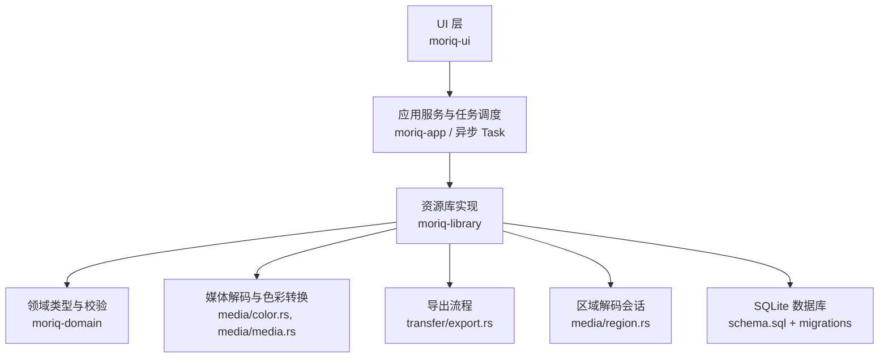
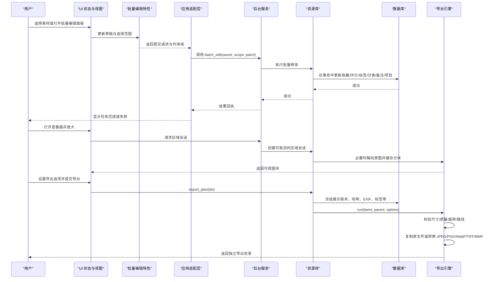
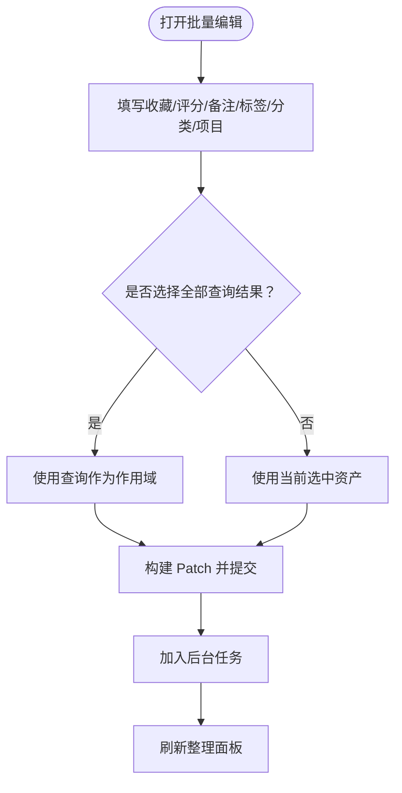
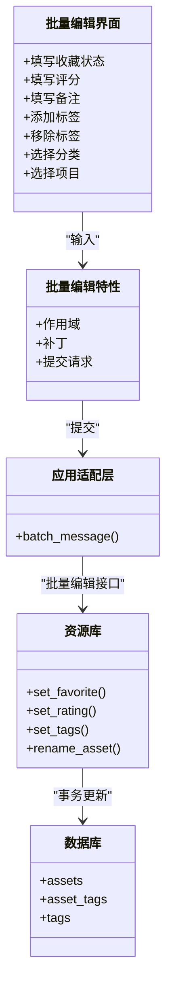
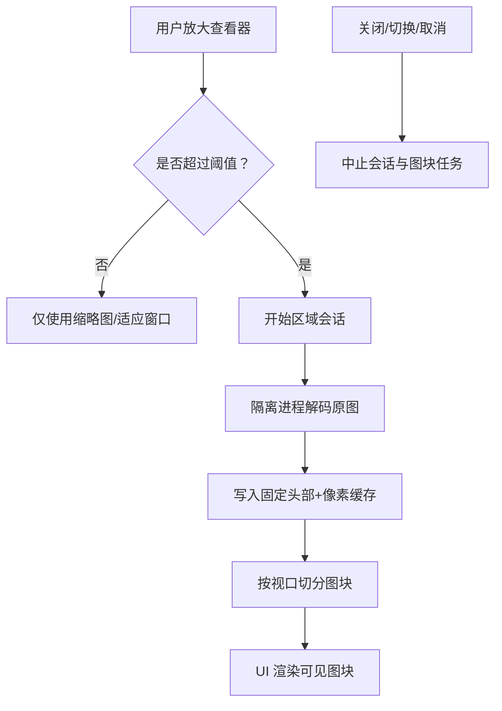
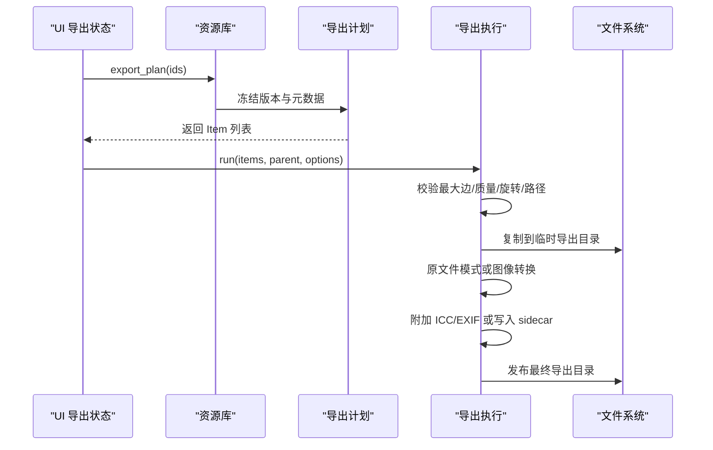
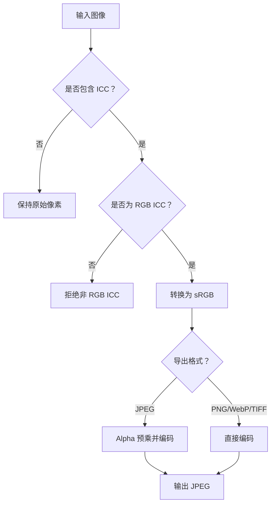
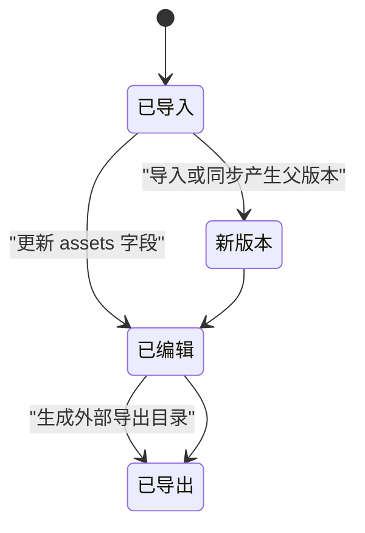
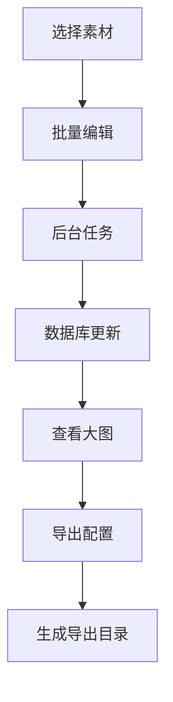
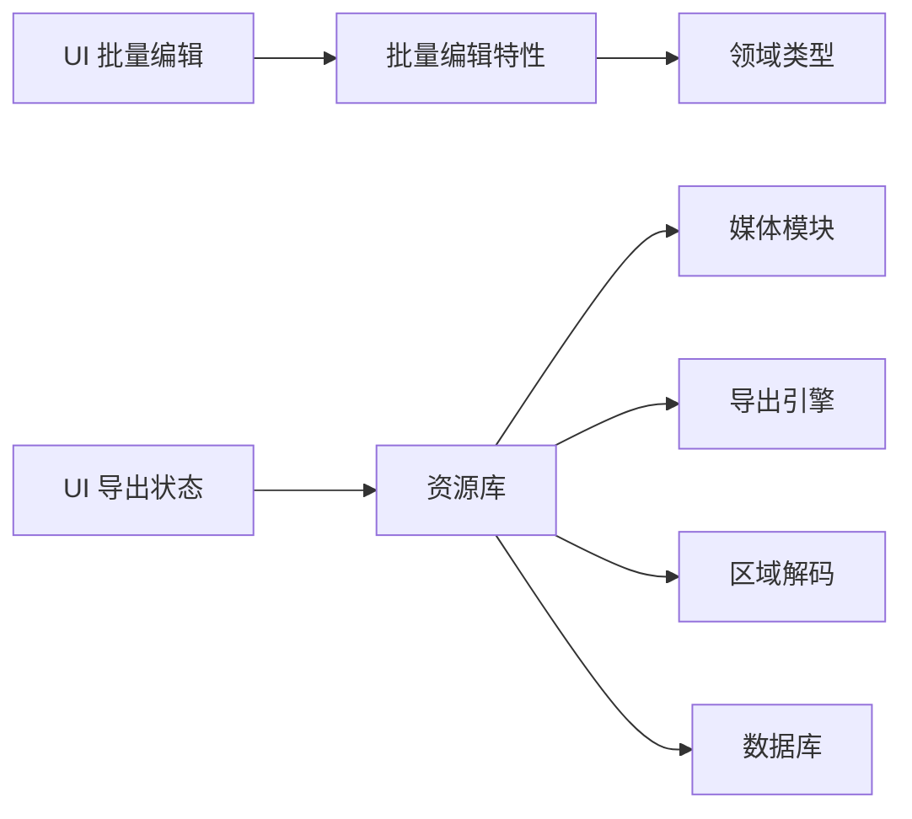

# 编辑和导出

> Repo Wiki 节点 `editing-exporting`
> 导出自 Qoder 知识库快照 `8fbe02f6-57c2-4874-b725-1a8130851fd9`，代码基线 `7a7a8e75e18bd90294e09cd422dd7ed5a04813a0`（分支 main，zh-CN）。

<cite>
**本文引用的文件**   
- [export.rs](../../crates/moriq-library/src/transfer/export.rs)
- [export_metadata.rs](../../crates/moriq-library/src/transfer/export_metadata.rs)
- [color.rs](../../crates/moriq-library/src/media/color.rs)
- [media.rs](../../crates/moriq-library/src/media/media.rs)
- [region.rs](../../crates/moriq-library/src/media/region.rs)
- [edits.rs](../../crates/moriq-library/src/catalog/edits.rs)
- [schema.sql](../../crates/moriq-library/src/database/schema.sql)
- [lib.rs（领域模型）](../../crates/moriq-domain/src/lib.rs)
- [batch.rs（应用适配层）](../../crates/moriq-ui/src/batch.rs)
- [mod.rs（批量编辑特性）](../../crates/moriq-ui/src/features/batch/mod.rs)
- [view.rs（批量编辑界面）](../../crates/moriq-ui/src/features/batch/view.rs)
- [export.rs（UI 导出状态）](../../crates/moriq-ui/src/export.rs)
- [regions.rs（区域视图）](../../crates/moriq-ui/src/regions.rs)
- [viewer.rs（查看器状态）](../../crates/moriq-ui/src/viewer.rs)
- [ARCHITECTURE.md](../../ARCHITECTURE.md)
</cite>

## 目录
1. [引言](#引言)
2. [项目结构](#项目结构)
3. [核心组件](#核心组件)
4. [架构总览](#架构总览)
5. [详细组件分析](#详细组件分析)
6. [依赖关系分析](#依赖关系分析)
7. [性能与并发](#性能与并发)
8. [故障排查](#故障排查)
9. [结论](#结论)
10. [附录：导出格式规格](#附录导出格式规格)

## 引言
本文件面向“编辑和导出”能力，覆盖以下范围：
- 批量编辑工具：选择范围、字段草稿、后台任务提交、事务一致性。
- 区域标注系统：大图分块读取、会话生命周期、取消与超时保护。
- 多格式导出支持：JPEG、PNG、WebP、TIFF（以及 BMP 与原文件模式）。
- 元数据记录、撤销重做机制说明、版本管理策略。
- 完整编辑工作流程：从素材选择到最终导出配置。
- 并行处理、进度监控、错误恢复策略。
- 与素材库的关系及编辑历史、回溯方式。

本项目采用分层设计：UI 层负责交互与状态，Service 层协调异步任务，Library 层负责数据库、媒体计划、导入导出；纯领域类型位于 `moriq-domain`，不依赖 I/O。

## 项目结构
与编辑和导出直接相关的代码分布在 UI、Library、Domain 三个层次：

**图表来源**
- [ARCHITECTURE.md:1-40](../../ARCHITECTURE.md#L1-L40)
- [export.rs:1-120](../../crates/moriq-library/src/transfer/export.rs#L1-L120)
- [media.rs:1-120](../../crates/moriq-library/src/media/media.rs#L1-L120)
- [region.rs:1-80](../../crates/moriq-library/src/media/region.rs#L1-L80)
- [schema.sql:1-42](../../crates/moriq-library/src/database/schema.sql#L1-L42)

**章节来源**
- [ARCHITECTURE.md:1-40](../../ARCHITECTURE.md#L1-L40)

## 核心组件
- **批量编辑**：`moriq-ui/src/features/batch` 提供草稿、作用域、补丁构建和后台任务提交；应用适配层将 UI 事件转为 Service 调用。
- **区域标注与大图预览**：`media/region.rs` 通过隔离进程解码像素缓存，`ui/regions.rs` 管理视口、图块和取消语义。
- **导出管线**：`transfer/export.rs` 冻结资产有效版本，生成导出计划，复制原文件或进行图像转换，并输出目标格式。
- **色彩空间处理**：`media/color.rs` 将嵌入 ICC 的 RGB 图像转换为 sRGB，拒绝无效或非 RGB 配置。
- **元数据与 EXIF**：`transfer/export_metadata.rs` 规范化 EXIF、附加 ICC 与 EXIF，或写入 sidecar JSON。
- **领域模型**：`moriq-domain/src/lib.rs` 定义资产、版本、查询、任务等不可变类型。
- **数据库与版本**：`database/schema.sql` 定义资产、版本、项目、标签、操作日志等基础结构。

**章节来源**
- [mod.rs（批量编辑特性）:1-153](../../crates/moriq-ui/src/features/batch/mod.rs#L1-L153)
- [region.rs:1-120](../../crates/moriq-library/src/media/region.rs#L1-L120)
- [export.rs:1-120](../../crates/moriq-library/src/transfer/export.rs#L1-L120)
- [color.rs:1-60](../../crates/moriq-library/src/media/color.rs#L1-L60)
- [export_metadata.rs:1-60](../../crates/moriq-library/src/transfer/export_metadata.rs#L1-L60)
- [lib.rs（领域模型）:1-120](../../crates/moriq-domain/src/lib.rs#L1-L120)
- [schema.sql:1-42](../../crates/moriq-library/src/database/schema.sql#L1-L42)

## 架构总览
编辑和导出的整体控制流如下：

**图表来源**
- [batch.rs（应用适配层）:1-76](../../crates/moriq-ui/src/batch.rs#L1-L76)
- [mod.rs（批量编辑特性）:60-153](../../crates/moriq-ui/src/features/batch/mod.rs#L60-L153)
- [regions.rs:120-260](../../crates/moriq-ui/src/regions.rs#L120-L260)
- [export.rs:1-200](../../crates/moriq-library/src/transfer/export.rs#L1-L200)
- [export.rs:201-422](../../crates/moriq-library/src/transfer/export.rs#L201-L422)
- [media.rs:1-120](../../crates/moriq-library/src/media/media.rs#L1-L120)

## 详细组件分析

### 批量编辑工具
批量编辑是一个独立特性模块，不直接持有应用根对象或服务实例，而是接收上下文并返回类型化效果：
- **作用域**：可以是当前选中的资产集合，也可以是整个查询结果快照。
- **补丁字段**：收藏状态、评分、备注替换、人工分类、追加标签、移除标签、项目归属。
- **提交流程**：UI 构造 `Submission`，应用适配层调用 `service.batch_edit`，后台任务完成后刷新整理面板。

**图表来源**
- [mod.rs（批量编辑特性）:1-153](../../crates/moriq-ui/src/features/batch/mod.rs#L1-L153)
- [view.rs（批量编辑界面）:1-85](../../crates/moriq-ui/src/features/batch/view.rs#L1-L85)
- [batch.rs（应用适配层）:1-76](../../crates/moriq-ui/src/batch.rs#L1-L76)

#### 批量编辑的数据变更与事务
批量编辑最终落在 Library 的单写者 SQLite 上。虽然批量编辑入口由 UI 触发，但单个资产的修改遵循 Library 层的原子性约定：
- 收藏、评分、名称等更新会写入 `assets` 表并更新 `edited_at`。
- 标签更新会删除旧关联，再插入新标签，同时处理自动标签与人工标签的关系。
- 每次修改都会清空查询快照，确保后续筛选看到最新状态。

**图表来源**
- [mod.rs（批量编辑特性）:1-153](../../crates/moriq-ui/src/features/batch/mod.rs#L1-L153)
- [edits.rs:1-106](../../crates/moriq-library/src/catalog/edits.rs#L1-L106)
- [schema.sql:1-42](../../crates/moriq-library/src/database/schema.sql#L1-L42)

**章节来源**
- [mod.rs（批量编辑特性）:1-153](../../crates/moriq-ui/src/features/batch/mod.rs#L1-L153)
- [view.rs（批量编辑界面）:1-85](../../crates/moriq-ui/src/features/batch/view.rs#L1-L85)
- [batch.rs（应用适配层）:1-76](../../crates/moriq-ui/src/batch.rs#L1-L76)
- [edits.rs:1-106](../../crates/moriq-library/src/catalog/edits.rs#L1-L106)
- [schema.sql:1-42](../../crates/moriq-library/src/database/schema.sql#L1-L42)

### 区域标注系统与大图预览
区域系统解决大图像在高倍缩放下的内存与解码压力：
- 当视口缩放超过阈值时，才启动原图解码会话。
- 解码过程通过隔离进程执行，限制线程数、超时、取消信号和输出大小。
- 解码后的 RGBA 像素被写入带头部的临时缓存，供视口按图块读取。
- UI 层维护会话所有权、版本、请求世代、可见图块、待处理图块和失败图块。

**图表来源**
- [regions.rs:120-260](../../crates/moriq-ui/src/regions.rs#L120-L260)
- [region.rs:1-120](../../crates/moriq-library/src/media/region.rs#L1-L120)
- [viewer.rs:1-108](../../crates/moriq-ui/src/viewer.rs#L1-L108)

**章节来源**
- [regions.rs:1-260](../../crates/moriq-ui/src/regions.rs#L1-L260)
- [region.rs:1-120](../../crates/moriq-library/src/media/region.rs#L1-L120)
- [viewer.rs:1-108](../../crates/moriq-ui/src/viewer.rs#L1-L108)

### 导出管线与多格式支持
导出分为两个阶段：
1. **导出计划**：冻结资产的有效版本、源哈希、名称、导入时间、标签、AI 标签、描述、EXIF、项目等信息。
2. **导出执行**：校验选项、复制原文件或转换图像、组织目录、附加元数据、清理临时文件、发布最终目录。

**图表来源**
- [export.rs:1-200](../../crates/moriq-library/src/transfer/export.rs#L1-L200)
- [export.rs:201-422](../../crates/moriq-library/src/transfer/export.rs#L201-L422)

#### 导出选项与行为
- **格式**：原文件、JPEG、PNG、WebP、TIFF、BMP。
- **最长边**：限制解码前尺寸，避免无界放大。
- **质量**：主要用于 JPEG；其他格式可能无损或按编码器默认策略。
- **旋转**：仅允许 0、90、180、270 度。
- **重采样**：面积平均、Lanczos3、双三次、最近邻。
- **布局**：平铺、按格式、按导入日期。
- **附带整理信息 JSON**：为每个导出文件生成 `.metadata.json`。
- **保留 EXIF**：对输出尺寸和方向相关字段进行规范化后附加。

**章节来源**
- [export.rs:1-200](../../crates/moriq-library/src/transfer/export.rs#L1-L200)
- [export.rs:201-422](../../crates/moriq-library/src/transfer/export.rs#L201-L422)
- [export_metadata.rs:1-142](../../crates/moriq-library/src/transfer/export_metadata.rs#L1-L142)

### 色彩空间转换与分辨率设置
- 如果图像包含 ICC 配置，系统将其转换为 sRGB；非 RGB ICC 会被拒绝，不会静默降级。
- 16 位与 8 位像素分别走不同变换路径，避免不必要的精度损失。
- 导出时对 JPEG 做 alpha 预乘处理，防止透明背景出现黑边。
- PNG、WebP、TIFF 直接使用转换后的像素数据；TIFF 不附带 EXIF，但可额外写出 `.exif` sidecar。

**图表来源**
- [color.rs:1-120](../../crates/moriq-library/src/media/color.rs#L1-L120)
- [export.rs:201-422](../../crates/moriq-library/src/transfer/export.rs#L201-L422)

**章节来源**
- [color.rs:1-191](../../crates/moriq-library/src/media/color.rs#L1-L191)
- [export.rs:201-422](../../crates/moriq-library/src/transfer/export.rs#L201-L422)

### 元数据处理与侧车文件
- 可选附带整理信息 JSON，包含资产 ID、版本 ID、源哈希、名称、备注、标签、AI 标签、描述、媒介、主题、EXIF、项目等。
- 可选保留 EXIF：系统会移除或规范化相机、方向、宽高、色彩空间等字段，重新写入 ICC 配置文件和 EXIF。
- 对于某些不支持内嵌 EXIF 的格式，系统会尝试写入同目录 `.exif` 侧车文件。
- 目录模板支持 `{date}`、`{year}`、`{month}`、`{day}`、`{format}`、`{camera}`、`{project}` 等变量，并进行安全清理。

**章节来源**
- [export.rs:1-200](../../crates/moriq-library/src/transfer/export.rs#L1-L200)
- [export_metadata.rs:1-142](../../crates/moriq-library/src/transfer/export_metadata.rs#L1-L142)

### 撤销、重做与版本管理策略
- **资产版本**：`asset_versions` 表记录 `origin`、`parent_version_id`、路径、哈希、格式、尺寸和字节数，支持版本链。
- **展示版本**：`assets.display_version_id` 指向当前展示版本，便于快速读取。
- **编辑历史**：普通编辑更新 `assets.edited_at`，并通过 `operation_journal` 记录准备、提交、中断等阶段。
- **导出**：导出不是回写素材库，而是在外部目录生成独立结果；若启用附带 JSON，则记录导出时的元数据快照。
- **撤销与重做**：仓库中没有显式的“撤销/重做栈”。可依赖版本链、数据库事务、导入恢复机制和导出侧车文件进行回溯。

**图表来源**
- [schema.sql:1-42](../../crates/moriq-library/src/database/schema.sql#L1-L42)
- [export.rs:1-120](../../crates/moriq-library/src/transfer/export.rs#L1-L120)
- [edits.rs:1-106](../../crates/moriq-library/src/catalog/edits.rs#L1-L106)

**章节来源**
- [schema.sql:1-42](../../crates/moriq-library/src/database/schema.sql#L1-L42)
- [export.rs:1-120](../../crates/moriq-library/src/transfer/export.rs#L1-L120)
- [edits.rs:1-106](../../crates/moriq-library/src/catalog/edits.rs#L1-L106)

### 完整编辑工作流程
一个典型工作流如下：
1. 用户在浏览或搜索中选择素材。
2. 打开批量编辑面板，设置收藏、评分、备注、标签、分类和项目。
3. 确认后将作用域和补丁提交到后台任务。
4. 资源库在事务中更新数据库，并清除查询快照。
5. 用户可在查看器中放大查看大图；系统按需启动区域会话。
6. 用户设置导出格式、尺寸、质量、旋转、重采样、布局和元数据选项。
7. 系统生成导出计划并执行导出，最终返回独立目录。

**图表来源**
- [batch.rs（应用适配层）:1-76](../../crates/moriq-ui/src/batch.rs#L1-L76)
- [regions.rs:120-260](../../crates/moriq-ui/src/regions.rs#L120-L260)
- [export.rs:1-200](../../crates/moriq-library/src/transfer/export.rs#L1-L200)

## 依赖关系分析
- UI 层只持有短暂状态和类型化选项，不直接访问数据库或文件系统。
- 批量编辑特性与界面解耦，仅依赖领域类型和上下文。
- Library 承担持久化、媒体计划和导出逻辑；Media 模块负责解码、色彩和区域缓存。
- 导出模块依赖 EXIF、ICC、目录模板、文件组织和临时目录。
- 区域解码通过隔离进程运行，避免 UI 主线程阻塞。

**图表来源**
- [mod.rs（批量编辑特性）:1-153](../../crates/moriq-ui/src/features/batch/mod.rs#L1-L153)
- [export.rs:1-120](../../crates/moriq-library/src/transfer/export.rs#L1-L120)
- [media.rs:1-120](../../crates/moriq-library/src/media/media.rs#L1-L120)
- [region.rs:1-120](../../crates/moriq-library/src/media/region.rs#L1-L120)

**章节来源**
- [ARCHITECTURE.md:1-40](../../ARCHITECTURE.md#L1-L40)

## 性能与并发
- **批量编辑**：每个资产的修改在单个事务内完成；批量提交通过后台任务排队，支持暂停、恢复和重启继续。
- **区域解码**：隔离进程单线程运行，限制 OMP 线程数；有 120 秒超时、取消信号和输出大小限制。
- **导出**：
  - 导出数量限制在 1～10000。
  - 最大边限制在 0～8192，质量限制在 1～100。
  - 视频目前仅支持原文件导出，不能使用图片转换选项。
  - 临时目录命名以 `.moriq-export-` 开头，最终发布为带 UUID 的独立目录。
- **进度监控**：UI 通过 `BackgroundJob` 展示任务状态、完成数、总数、失败数和错误消息。
- **错误恢复**：
  - 区域解码失败保留原片。
  - 导出过程中源文件哈希变化会停止发布。
  - 无效 ICC 不被静默绕过，而是返回色彩错误。
  - EXIF 重建失败或超出预算会返回无效输入错误。

**章节来源**
- [export.rs:1-200](../../crates/moriq-library/src/transfer/export.rs#L1-L200)
- [export.rs:201-422](../../crates/moriq-library/src/transfer/export.rs#L201-L422)
- [region.rs:1-120](../../crates/moriq-library/src/media/region.rs#L1-L120)
- [lib.rs（领域模型）:120-220](../../crates/moriq-domain/src/lib.rs#L120-L220)

## 故障排查
- **导出失败：尺寸或质量无效**  
  检查最长边是否在 0～8192，质量是否在 1～100，旋转是否为 0/90/180/270。
- **导出失败：源文件变化**  
  导出期间原文件内容发生变化会导致停止发布；请确保导出路径不在资源库内部。
- **视频导出报错**  
  视频当前仅支持原文件导出，不能同时使用图片转换选项。
- **颜色异常或 ICC 错误**  
  非 RGB ICC 或无效 ICC 会被拒绝；检查源图像色彩配置。
- **区域解码超时或失败**  
  大图解码可能因超时或进程退出失败；检查文件大小、磁盘空间和系统解码能力。
- **EXIF 丢失或过大**  
  如果启用保留 EXIF，需满足重建成功且不超过 4 MiB 预算。

**章节来源**
- [export.rs:1-200](../../crates/moriq-library/src/transfer/export.rs#L1-L200)
- [export.rs:201-422](../../crates/moriq-library/src/transfer/export.rs#L201-L422)
- [color.rs:1-120](../../crates/moriq-library/src/media/color.rs#L1-L120)
- [region.rs:1-120](../../crates/moriq-library/src/media/region.rs#L1-L120)
- [export_metadata.rs:1-142](../../crates/moriq-library/src/transfer/export_metadata.rs#L1-L142)

## 结论
该项目的编辑和导出能力建立在清晰的边界之上：UI 层负责交互与状态，Library 层负责数据与媒体，领域类型保证输入校验和类型安全。批量编辑通过后台任务和事务保证一致性；区域标注系统通过隔离进程和图块缓存降低大图压力；导出管线冻结版本、规范元数据、统一色彩空间，并输出多种格式。尽管没有显式撤销重做栈，但版本链、操作日志、导入恢复和导出侧车文件提供了可靠的回溯基础。

## 附录：导出格式规格

| 格式 | 色彩空间 | 压缩/质量 | 透明度 | EXIF/ICC | 说明 |
| --- | --- | --- | --- | --- | --- |
| 原文件 | 保持原格式 | 不转换 | 取决于原文件 | 通常不修改原文件 | 仅复制原文件；视频仅支持此模式 |
| JPEG | 转换为 sRGB | 可配置质量 1～100 | 无；透明通道会被混合为背景 | 可附加 ICC 和规范化 EXIF | 有透明像素时会进行预乘混合 |
| PNG | 转换为 sRGB | 通常无损 | 支持 | 可附加 ICC 和 EXIF | 适合需要透明度和无损的场景 |
| WebP | 转换为 sRGB | 当前使用无损编码器 | 支持 | 可附加 ICC 和 EXIF | 示例实现使用无损编码 |
| TIFF | 转换为 sRGB | 编码器默认策略 | 取决于像素布局 | 不内嵌 EXIF；可写入 `.exif` 侧车 | 适合归档和专业工作流 |
| BMP | 转换为 sRGB | 无压缩 | 通常不支持 | 一般不附加 EXIF | 兼容性广泛但体积较大 |

**章节来源**
- [export.rs:201-422](../../crates/moriq-library/src/transfer/export.rs#L201-L422)
- [export_metadata.rs:1-142](../../crates/moriq-library/src/transfer/export_metadata.rs#L1-L142)
- [color.rs:1-120](../../crates/moriq-library/src/media/color.rs#L1-L120)