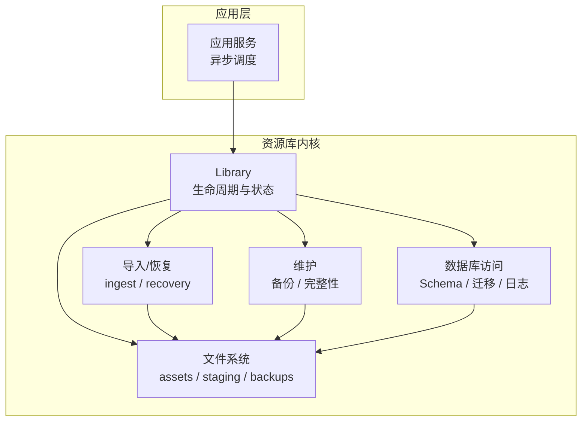
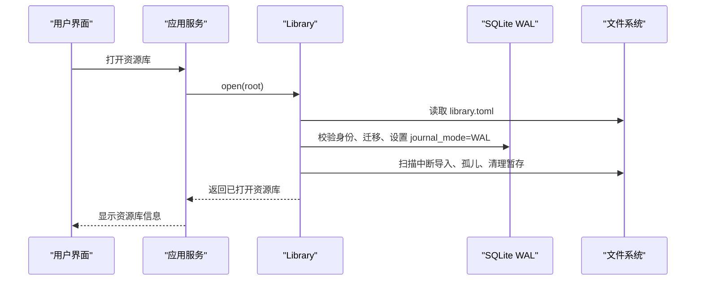
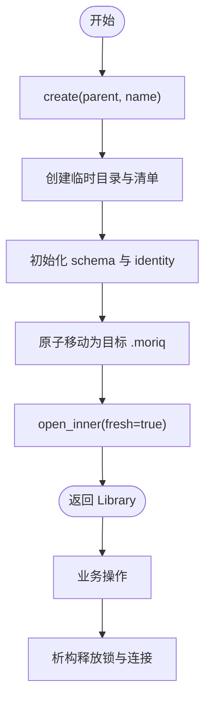
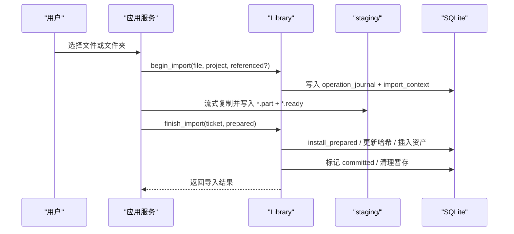
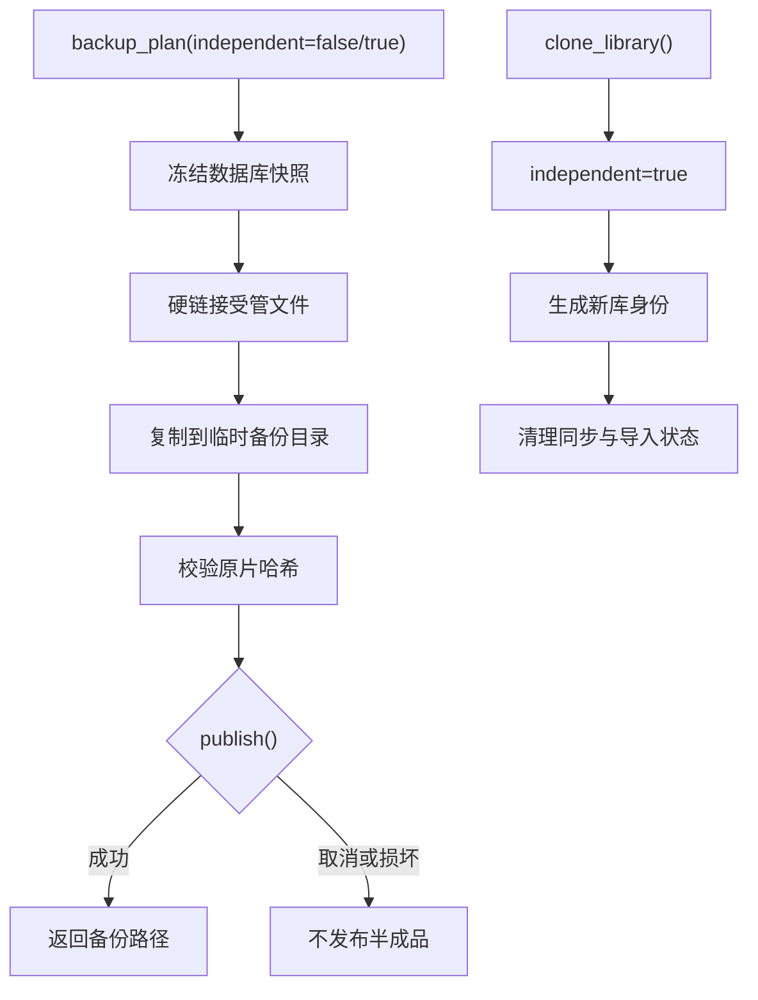
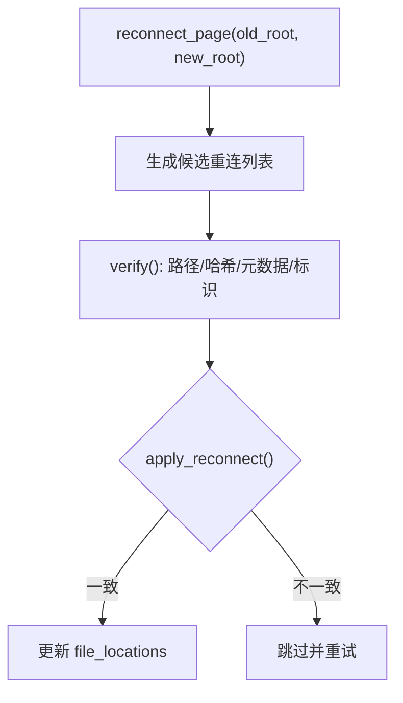
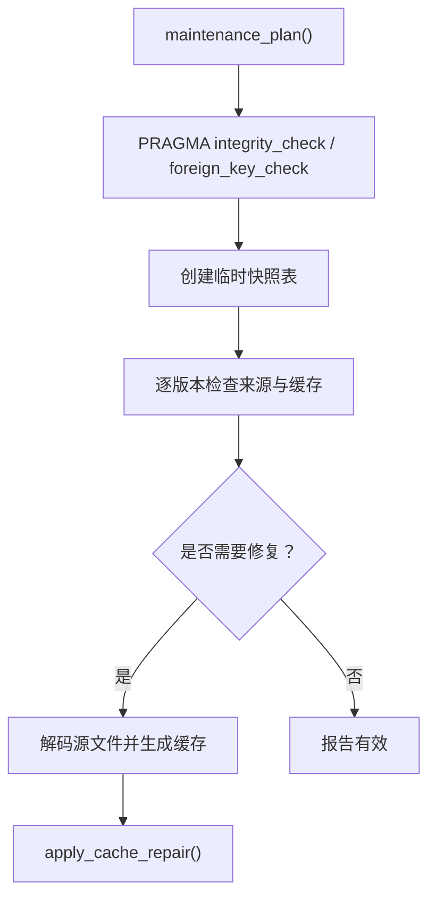
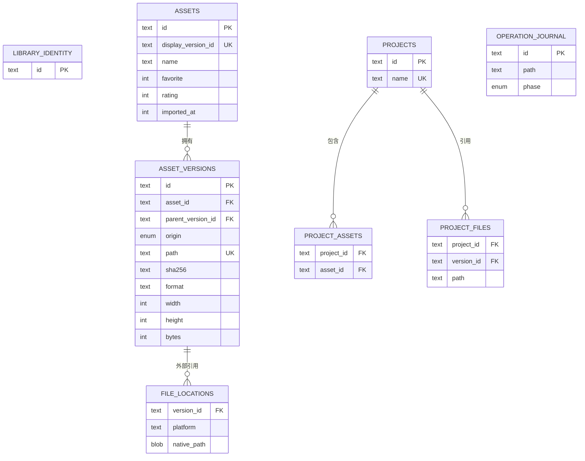
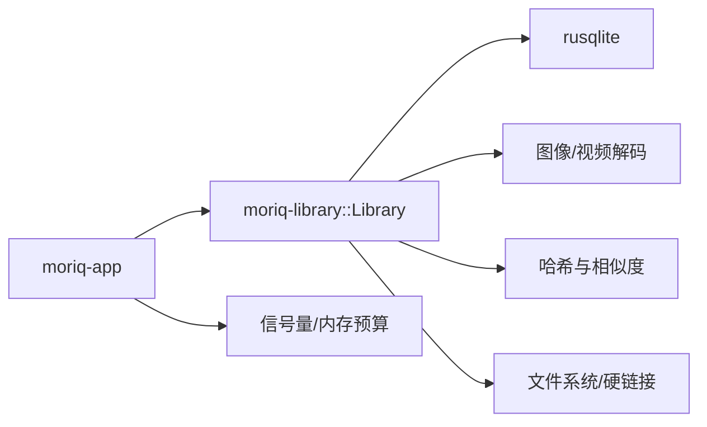

# 资源库管理

> Repo Wiki 节点 `library-management`
> 导出自 Qoder 知识库快照 `8fbe02f6-57c2-4874-b725-1a8130851fd9`，代码基线 `7a7a8e75e18bd90294e09cd422dd7ed5a04813a0`（分支 main，zh-CN）。

<cite>
**本文引用的文件**   
- [core.rs](../../crates/moriq-library/src/library/core.rs)
- [lifecycle.rs](../../crates/moriq-library/src/library/lifecycle.rs)
- [settings.rs](../../crates/moriq-library/src/library/settings.rs)
- [import.rs](../../crates/moriq-library/src/transfer/import.rs)
- [ingest.rs](../../crates/moriq-library/src/transfer/ingest.rs)
- [recovery.rs](../../crates/moriq-library/src/transfer/recovery.rs)
- [backup.rs](../../crates/moriq-library/src/maintenance/backup.rs)
- [maintenance.rs](../../crates/moriq-library/src/maintenance/maintenance.rs)
- [schema.sql](../../crates/moriq-library/src/database/schema.sql)
- [journal.rs](../../crates/moriq-library/src/database/journal.rs)
- [import.rs](../../crates/moriq-app/src/import.rs)
</cite>

## 目录
1. [简介](#简介)
2. [项目结构](#项目结构)
3. [核心组件](#核心组件)
4. [架构总览](#架构总览)
5. [详细组件分析](#详细组件分析)
6. [依赖关系分析](#依赖关系分析)
7. [性能与配置](#性能与配置)
8. [用户操作流程](#用户操作流程)
9. [故障排查指南](#故障排查指南)
10. [结论](#结论)

## 简介
本文面向 Moriq Space 的资源库管理功能，系统化说明资源库的生命周期、导入系统、备份恢复机制、资源配置、路径与存储策略、数据一致性保证及性能优化。文档以仓库源码为依据，重点覆盖：
- 资源库创建、打开、关闭、移除
- 托管导入、外部引用、去重与命名冲突处理
- 快照、克隆、迁移和中断恢复
- 路径安全、硬链接、WAL 数据库与外键约束
- 用户从首次创建到日常维护的完整流程

## 项目结构
资源库相关逻辑集中在 `moriq-library` 模块中，应用层在 `moriq-app` 提供异步入口。关键组织方式如下：
- `library/`：资源库生命周期、设置、浏览历史、外部引用重连
- `transfer/`：导入、摄取、恢复、导出等数据搬运流程
- `maintenance/`：备份、清理、完整性检查与缓存修复
- `database/`：SQLite 模式、迁移脚本、活动日志
- `apps/desktop` 与 `ui`：用户界面（不在本文代码级分析范围内）

**图表来源**
- [core.rs:1-200](../../crates/moriq-library/src/library/core.rs#L1-L200)
- [ingest.rs:1-120](../../crates/moriq-library/src/transfer/ingest.rs#L1-L120)
- [recovery.rs:1-120](../../crates/moriq-library/src/transfer/recovery.rs#L1-L120)
- [backup.rs:1-120](../../crates/moriq-library/src/maintenance/backup.rs#L1-L120)
- [maintenance.rs:1-120](../../crates/moriq-library/src/maintenance/maintenance.rs#L1-L120)
- [schema.sql:1-42](../../crates/moriq-library/src/database/schema.sql#L1-L42)

**章节来源**
- [core.rs:1-200](../../crates/moriq-library/src/library/core.rs#L1-L200)
- [schema.sql:1-42](../../crates/moriq-library/src/database/schema.sql#L1-L42)

## 核心组件
- Library：资源库运行时对象，持有根路径、清单、SQLite 连接、读连接池、锁和最近一次导入指标。
- 导入票据 Ticket：封装来源、相对路径、项目归属、预期大小、操作标识，并持有资源库锁租约。
- 备份计划 Plan：冻结数据库与文件链接，生成可离线复制的一致快照。
- 维护计划 Plan：在读取端检查版本来源、校验和、缩略图与主色，返回需写入端复核的修复项。
- 恢复计划 Plan：从中断的操作日志重建不可变输入，重新走导入管线。
- 用户设置 UserSettings：跨平台用户偏好位置，包含导入并发、内存预算、语言、主题、AI 模型来源等。

**章节来源**
- [core.rs:1-120](../../crates/moriq-library/src/library/core.rs#L1-L120)
- [ingest.rs:1-120](../../crates/moriq-library/src/transfer/ingest.rs#L1-L120)
- [backup.rs:1-80](../../crates/moriq-library/src/maintenance/backup.rs#L1-L80)
- [maintenance.rs:1-80](../../crates/moriq-library/src/maintenance/maintenance.rs#L1-L80)
- [settings.rs:1-120](../../crates/moriq-library/src/library/settings.rs#L1-L120)

## 架构总览
资源库采用“文件系统为主、SQLite 为索引”的双轨设计：
- 受管媒体存储在 `assets/` 下，按项目和相对路径组织；重复内容通过版本表和哈希去重。
- 元数据、资产版本、项目、标签、操作日志、通知、背景任务等持久化在 SQLite。
- 打开时执行清单校验、身份校验、迁移、WAL 设置、中断记录恢复与后台任务状态修正。
- 导入使用暂存区 `staging/` 和回执 `*.ready`，失败时保留中断记录以便恢复。
- 备份冻结数据库与不可变文件链接，排除进行中的暂存，但保留中断导入以便恢复。

**图表来源**
- [core.rs:60-200](../../crates/moriq-library/src/library/core.rs#L60-L200)
- [schema.sql:1-42](../../crates/moriq-library/src/database/schema.sql#L1-L42)

**章节来源**
- [core.rs:60-200](../../crates/moriq-library/src/library/core.rs#L60-L200)

## 详细组件分析

### 资源库生命周期：创建、打开、关闭、移除
- 创建
  - 在父目录下创建 `<name>.moriq` 临时工作区，初始化目录树、清单、SQLite 初始模式。
  - 写入 `library_identity` 表，随后原子移动到目标路径。
  - 调用内部打开流程完成数据库身份注册。
- 打开
  - 校验清单格式、版本范围、最小读者版本。
  - 获取独占锁，拒绝正在删除或损坏的资源库。
  - 要求硬链接支持；打开 SQLite 并启用外键。
  - 根据数据库版本执行迁移，并在升级前备份旧数据库。
  - 将未完成导入标记为“中断”，构建读连接池，发布升级通知。
- 关闭
  - 通过 Rust 对象生命周期释放 SQLite 连接和文件锁。
  - 若仍有 Ticket 持有锁，则新打开会报告锁定错误。
- 移除
  - 由 `library_removal` 模块负责；打开阶段会检测删除挂起标志并拒绝打开。

**图表来源**
- [core.rs:20-120](../../crates/moriq-library/src/library/core.rs#L20-L120)

**章节来源**
- [core.rs:20-200](../../crates/moriq-library/src/library/core.rs#L20-L200)

### 导入系统：托管导入、外部引用、去重策略
- 托管导入
  - 入口：`import_file`，解析或创建项目层级，计算安全目标路径。
  - 目标路径选择：基于项目存储目录、原始相对路径、文件名序列号，避免覆盖现有文件。
  - 同项目内同名不同内容：自动追加序号，确保不覆盖。
  - 不同项目可分别保存同名文件，体现“项目隔离”。
- 外部引用
  - 通过 `begin_import(..., referenced=true)` 登记，禁止网络来源。
  - 在拷贝、准备阶段对原始源进行哈希校验，防止源文件被替换。
  - 外部引用路径以平台编码保存在 `file_locations`，便于重定位。
- 去重与版本
  - `asset_versions.path` 唯一，哈希索引加速重复检测。
  - 同一素材多次导入可能产生多个版本，但路径在同一资源库内唯一；项目关联通过 `project_files` 建立。
- 中断恢复
  - 导入登记写入 `operation_journal` 与 `import_context`。
  - 恢复流程冻结输入、重新解码准备，最终提交安装并更新日志阶段。

**图表来源**
- [ingest.rs:120-280](../../crates/moriq-library/src/transfer/ingest.rs#L120-L280)
- [recovery.rs:120-229](../../crates/moriq-library/src/transfer/recovery.rs#L120-L229)
- [import.rs:1-120](../../crates/moriq-library/src/transfer/import.rs#L1-L120)

**章节来源**
- [import.rs:1-200](../../crates/moriq-library/src/transfer/import.rs#L1-L200)
- [ingest.rs:120-280](../../crates/moriq-library/src/transfer/ingest.rs#L120-L280)
- [schema.sql:1-42](../../crates/moriq-library/src/database/schema.sql#L1-L42)

### 备份与恢复：快照、克隆、迁移
- 快照备份
  - 冻结数据库副本，切换 journal_mode=DELETE，清除进行中导入上下文。
  - 通过硬链接复制受管目录，跳过缩略图、预览、搜索索引、备份目录和暂存。
  - 保留中断导入的暂存文件，使恢复可在副本上继续。
  - 复制后校验原片哈希，不一致则拒绝发布。
- 克隆
  - 独立副本会分配新的 `library_id`，改名并清理同步任务、导入上下文、操作日志、重试通知。
  - 背景任务重置为暂停状态。
- 迁移
  - 打开时根据 `user_version` 执行多步迁移脚本。
  - 升级前备份旧数据库，失败时提示备份路径。
  - 迁移完成后写回最新清单版本，设置 WAL 与 FULL 同步。
- 恢复
  - 查询中断操作，验证 `.ready` 回执长度，硬链接输入到临时快照。
  - 复用 `ingest::prepare` 解码缩略图、哈希、元数据。
  - 最终提交安装并清理恢复中间文件。

**图表来源**
- [backup.rs:60-200](../../crates/moriq-library/src/maintenance/backup.rs#L60-L200)
- [backup.rs:201-426](../../crates/moriq-library/src/maintenance/backup.rs#L201-L426)
- [core.rs:120-200](../../crates/moriq-library/src/library/core.rs#L120-L200)

**章节来源**
- [backup.rs:60-200](../../crates/moriq-library/src/maintenance/backup.rs#L60-L200)
- [backup.rs:201-426](../../crates/moriq-library/src/maintenance/backup.rs#L201-L426)
- [core.rs:120-200](../../crates/moriq-library/src/library/core.rs#L120-L200)

### 外部引用重连与路径安全
- 重连分页
  - 按旧根目录扫描存在外部引用的版本，构造候选重连路径。
  - 仅接受相对路径不含父目录跳转的安全组件。
- 候选验证
  - 校验新路径仍在新根下、内容与哈希一致、文件大小与修改时间未变、文件标识不变。
- 提交重连
  - 再次校验当前数据库状态与候选一致，更新 `file_locations`，清空缓存快照。

**图表来源**
- [lifecycle.rs:1-177](../../crates/moriq-library/src/library/lifecycle.rs#L1-L177)
- [import.rs:201-352](../../crates/moriq-library/src/transfer/import.rs#L201-L352)

**章节来源**
- [lifecycle.rs:1-177](../../crates/moriq-library/src/library/lifecycle.rs#L1-L177)

### 完整性检查与缓存修复
- 维护计划
  - 先运行数据库完整性检查与外键检查。
  - 建立临时快照表，遍历版本、路径、哈希、缩略图和主色。
  - 对于缺失或损坏的文件报告问题；对于需要修复的缓存，冻结源文件解码。
- 缓存修复
  - 按需重新生成缩略图和主色，提交前校验版本哈希与路径未变化。
  - 修复成功后更新缩略图文件和主色字段。

**图表来源**
- [maintenance.rs:120-280](../../crates/moriq-library/src/maintenance/maintenance.rs#L120-L280)
- [maintenance.rs:281-412](../../crates/moriq-library/src/maintenance/maintenance.rs#L281-L412)

**章节来源**
- [maintenance.rs:120-280](../../crates/moriq-library/src/maintenance/maintenance.rs#L120-L280)
- [maintenance.rs:281-412](../../crates/moriq-library/src/maintenance/maintenance.rs#L281-L412)

### 数据模型与一致性保障
- 核心表
  - `library_identity`：稳定库身份。
  - `assets` 与 `asset_versions`：资产与版本，含哈希、尺寸、字节数、来源类型。
  - `projects` 与 `project_assets`、`project_files`：项目与素材、项目内文件映射。
  - `file_locations`：外部引用路径与平台编码。
  - `operation_journal`、`import_context`：导入事务日志。
  - `library_preferences`、`library_state`、`notifications`、`background_jobs`：偏好、状态、通知与任务。
- 一致性机制
  - 外键约束、哈希长度与尺寸检查。
  - 打开时启用外键、迁移前备份、WAL 与 FULL 同步。
  - 导入分阶段：prepared → committed / interrupted。
  - 备份前清理进行中导入，保留中断导入。
  - 恢复时校验 `.ready` 回执长度与内容哈希。

**图表来源**
- [schema.sql:1-42](../../crates/moriq-library/src/database/schema.sql#L1-L42)

**章节来源**
- [schema.sql:1-42](../../crates/moriq-library/src/database/schema.sql#L1-L42)

## 依赖关系分析
- Library 依赖：
  - SQLite 连接与读连接池
  - 文件系统 API 与硬链接
  - 图像解码、视频探测、哈希计算、相似签名
  - 导入、恢复、备份、维护子系统
- 应用层依赖：
  - 异步任务调度、信号量限流、内存预算控制
  - 调用 Library 的同步 API 于线程池中执行

**图表来源**
- [ingest.rs:1-120](../../crates/moriq-library/src/transfer/ingest.rs#L1-L120)
- [import.rs:1-120](../../crates/moriq-app/src/import.rs#L1-L120)

**章节来源**
- [ingest.rs:1-120](../../crates/moriq-library/src/transfer/ingest.rs#L1-L120)
- [import.rs:1-120](../../crates/moriq-app/src/import.rs#L1-L120)

## 性能与配置
- 导入并发与内存
  - 用户设置中可配置导入工作线程数和内存预算；值域校验为自动或 1～32 线程，内存 256～4096 MiB。
  - 票据内存估算依据图片维度、颜色通道、压缩输入和工作空间，避免统一大预算导致内存峰值过高。
- 数据库性能
  - 打开后设置 `journal_mode=WAL` 与 `synchronous=FULL`，兼顾并发与一致性。
  - 维护任务使用临时表与只读连接池，减少阻塞写入端。
- 路径与存储
  - 所有库内路径经过组件校验，拒绝危险字符、保留名称和无效路径成分。
  - 受管媒体使用硬链接，减少重复存储；外部引用保持原文件位置。
- 备份与恢复
  - 备份排除缩略图、预览、搜索索引、备份目录和进行中的暂存，降低 IO 压力。
  - 恢复过程限制最大文件大小与回执有效性，避免恢复损坏或不完整媒体。

**章节来源**
- [settings.rs:120-220](../../crates/moriq-library/src/library/settings.rs#L120-L220)
- [ingest.rs:201-320](../../crates/moriq-library/src/transfer/ingest.rs#L201-L320)
- [core.rs:180-200](../../crates/moriq-library/src/library/core.rs#L180-L200)
- [backup.rs:120-200](../../crates/moriq-library/src/maintenance/backup.rs#L120-L200)

## 用户操作流程

### 首次创建资源库
1. 选择父目录与库名。
2. 系统创建 `<库名>.moriq` 目录，初始化清单与数据库。
3. 打开资源库，完成身份校验与迁移。
4. 查看资源库信息：资产数量、收藏数、字节数、项目列表。

参考实现位置：
- [core.rs:20-120](../../crates/moriq-library/src/library/core.rs#L20-L120)

### 导入受管文件
1. 选择本地文件或文件夹。
2. 可选指定项目名称；系统自动创建或复用顶级项目。
3. 系统计算安全目标路径，避免覆盖已有文件。
4. 流式复制到暂存区，解码缩略图与元数据。
5. 提交安装，更新资产与项目关联，清理暂存。

参考实现位置：
- [import.rs:1-120](../../crates/moriq-library/src/transfer/import.rs#L1-L120)
- [ingest.rs:120-280](../../crates/moriq-library/src/transfer/ingest.rs#L120-L280)

### 导入外部引用
1. 选择外部文件，开启“外部引用”模式。
2. 系统登记导入，禁止网络来源。
3. 导入期间校验原始源哈希，防止替换。
4. 完成后在外部引用模式下展示，支持后续重定位。

参考实现位置：
- [ingest.rs:120-200](../../crates/moriq-library/src/transfer/ingest.rs#L120-L200)
- [lifecycle.rs:1-177](../../crates/moriq-library/src/library/lifecycle.rs#L1-L177)

### 重连外部引用根目录
1. 提供旧根目录与新根目录。
2. 系统分页扫描外部引用，生成候选重连路径。
3. 逐个验证新路径的内容与元数据。
4. 提交更新后，外部引用恢复可用。

参考实现位置：
- [import.rs:1-120](../../crates/moriq-app/src/import.rs#L1-L120)
- [lifecycle.rs:60-177](../../crates/moriq-library/src/library/lifecycle.rs#L60-L177)

### 备份资源库
1. 选择备份目标目录，建议位于另一块磁盘。
2. 系统冻结数据库与文件链接，生成快照。
3. 复制受管文件，跳过不必要目录。
4. 校验原片哈希后发布备份。

参考实现位置：
- [backup.rs:60-200](../../crates/moriq-library/src/maintenance/backup.rs#L60-L200)
- [backup.rs:201-426](../../crates/moriq-library/src/maintenance/backup.rs#L201-L426)

### 克隆资源库
1. 选择目标父目录。
2. 系统生成新库身份、名称带“克隆”后缀。
3. 清理同步任务与导入上下文。
4. 打开克隆库，确认计数与资产一致。

参考实现位置：
- [backup.rs:120-200](../../crates/moriq-library/src/maintenance/backup.rs#L120-L200)

### 恢复中断导入
1. 打开资源库后，系统列出中断操作。
2. 对每个操作冻结输入并预估内存。
3. 解码媒体，校验哈希与来源。
4. 提交安装，更新日志并清理恢复中间文件。

参考实现位置：
- [recovery.rs:120-229](../../crates/moriq-library/src/transfer/recovery.rs#L120-L229)
- [import.rs:120-200](../../crates/moriq-app/src/import.rs#L120-L200)

### 日常维护
1. 运行完整性检查，查看缺失、损坏与警告。
2. 对需要修复的缩略图与主色进行缓存修复。
3. 提交修复，确认缓存重建成功。
4. 定期备份，确保数据安全。

参考实现位置：
- [maintenance.rs:120-280](../../crates/moriq-library/src/maintenance/maintenance.rs#L120-L280)
- [maintenance.rs:281-412](../../crates/moriq-library/src/maintenance/maintenance.rs#L281-L412)

## 故障排查指南
- 资源库无法打开
  - 清单过大或损坏：检查 `library.toml` 大小与内容。
  - 格式不兼容：使用对应版本的 Moriq Space。
  - 正在进行删除：等待或删除任务完成。
  - 数据库身份不一致：从备份恢复。
- 导入失败
  - 文件为空或超出预算：检查文件大小与限制。
  - 源文件在导入期间改变：重新导入。
  - 网络引用被拒绝：改用本地文件。
  - 暂存不完整：保留原片并重新导入。
- 备份失败
  - 备份目标位于资源库内：选择外部目录。
  - 发现符号链接：先检查资源库完整性。
  - 原片哈希不符：检查备份中文件是否被篡改。
- 恢复失败
  - 所属资源库已切换：在当前库中执行恢复。
  - 恢复记录已改变：重新列出中断操作。
  - 记忆体预算不足：提高恢复内存预算。

**章节来源**
- [core.rs:60-200](../../crates/moriq-library/src/library/core.rs#L60-L200)
- [ingest.rs:201-320](../../crates/moriq-library/src/transfer/ingest.rs#L201-L320)
- [backup.rs:201-426](../../crates/moriq-library/src/maintenance/backup.rs#L201-L426)
- [recovery.rs:120-229](../../crates/moriq-library/src/transfer/recovery.rs#L120-L229)

## 结论
该资源库管理系统以文件系统承载媒体、SQLite 承载元数据，并通过严格的清单校验、身份校验、迁移、外键约束、WAL 与 FULL 同步、操作日志与恢复机制保证数据一致性。导入系统在托管与外部引用两种模式下均具备去重、路径安全与中断恢复能力；备份与克隆提供一致的快照语义；维护流程支持完整性检查与缓存修复。用户可从首次创建到日常维护获得可靠、可审计且高性能的体验。