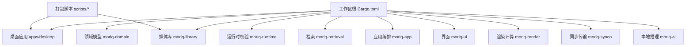
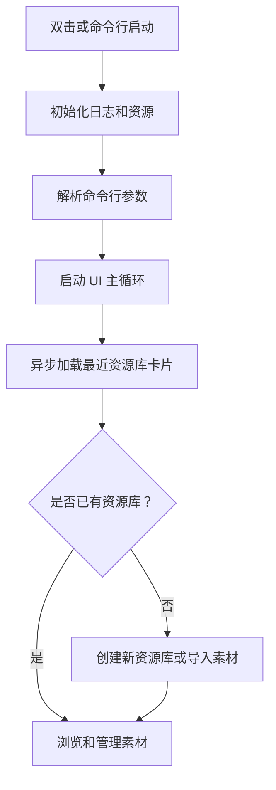

# 快速开始

> Repo Wiki 节点 `getting-started`
> 导出自 Qoder 知识库快照 `8fbe02f6-57c2-4874-b725-1a8130851fd9`，代码基线 `7a7a8e75e18bd90294e09cd422dd7ed5a04813a0`（分支 main，zh-CN）。

<cite>
**本文引用的文件**   
- [Cargo.toml](../Cargo.toml)
- [rust-toolchain.toml](../rust-toolchain.toml)
- [apps/desktop/Cargo.toml](../apps/desktop/Cargo.toml)
- [apps/desktop/build.rs](../apps/desktop/build.rs)
- [apps/desktop/src/main.rs](../apps/desktop/src/main.rs)
- [scripts/package.ps1](../scripts/package.ps1)
- [scripts/prepare-codecs.ps1](../scripts/prepare-codecs.ps1)
- [scripts/prepare-ai-runtime.ps1](../scripts/prepare-ai-runtime.ps1)
- [crates/moriq-library/Cargo.toml](../crates/moriq-library/Cargo.toml)
- [crates/moriq-library/build.rs](../crates/moriq-library/build.rs)
- [crates/moriq-app/Cargo.toml](../crates/moriq-app/Cargo.toml)
- [crates/moriq-ui/Cargo.toml](../crates/moriq-ui/Cargo.toml)
- [crates/moriq-app/src/launch.rs](../crates/moriq-app/src/launch.rs)
- [crates/moriq-ui/src/startup.rs](../crates/moriq-ui/src/startup.rs)
- [crates/moriq-library/src/library/core.rs](../crates/moriq-library/src/library/core.rs)
- [crates/moriq-library/src/transfer/import.rs](../crates/moriq-library/src/transfer/import.rs)
- [crates/moriq-library/src/transfer/ingest.rs](../crates/moriq-library/src/transfer/ingest.rs)
- [ARCHITECTURE.md](../ARCHITECTURE.md)
</cite>

## 目录
1. [简介](#简介)
2. [项目结构](#项目结构)
3. [开发环境搭建](#开发环境搭建)
4. [构建与运行](#构建与运行)
5. [首次启动流程](#首次启动流程)
6. [创建第一个资源库](#创建第一个资源库)
7. [导入素材](#导入素材)
8. [命令行参数](#命令行参数)
9. [常见问题排查](#常见问题排查)
10. [性能与注意事项](#性能与注意事项)
11. [结论](#结论)

## 简介
Moriq Space 是一个本地媒体资产管理桌面应用，核心由 Rust 工作区实现，包含领域模型、媒体库持久化、UI、AI 推理和运行时校验等模块。当前官方打包流程面向 Windows x86_64；macOS 与 Linux 源码分支仍属于开发目标，仓库未提供完整的可移植发行包。

初学者可以在 30 分钟内完成以下目标：
- 安装 Rust 工具链。
- 准备媒体编解码器和 AI 运行时。
- 构建并启动 Moriq Space。
- 创建一个 `.moriq` 资源库。
- 导入一组图片或视频素材。

## 项目结构
仓库采用 Rust 工作区组织代码，顶层 `Cargo.toml` 声明成员包、公共依赖和构建配置；桌面入口位于 `apps/desktop`，业务逻辑分布在 `crates` 下的多个 crate 中。



**图表来源**
- [Cargo.toml:1-80](../Cargo.toml#L1-L80)
- [apps/desktop/Cargo.toml:1-21](../apps/desktop/Cargo.toml#L1-L21)
- [crates/moriq-library/Cargo.toml:1-35](../crates/moriq-library/Cargo.toml#L1-L35)

**章节来源**
- [Cargo.toml:1-80](../Cargo.toml#L1-L80)
- [ARCHITECTURE.md:1-30](../ARCHITECTURE.md#L1-L30)

## 开发环境搭建

### 系统要求
- 操作系统：Windows x86_64 是完整打包目标；其他平台可用于源码开发与基础编译理解。
- 磁盘空间：建议预留至少 5 GB，用于 Rust 工具链、依赖缓存、原生编解码器、AI 运行时和临时构建产物。
- 权限：需要能写入用户主目录或指定目标目录，并能访问要导入的媒体文件。

### 安装 Rust 工具链
仓库通过 `rust-toolchain.toml` 固定了 Rust 版本、组件和最小化 profile。建议使用官方 `rustup` 安装，并切换到仓库指定的工具链。

关键信息：
- 工具链通道：`1.99.0`
- 启用组件：`rustfmt`、`clippy`
- Profile：`minimal`

执行步骤：
1. 安装 `rustup`。
2. 进入仓库根目录。
3. 使用 `rustup show` 确认当前工具链为 `1.99.0`。
4. 如需显式切换，使用 `rustup default 1.99.0`。
5. 确保已安装 `cargo`、`rustfmt` 和 `clippy`。

**章节来源**
- [rust-toolchain.toml:1-4](../rust-toolchain.toml#L1-L4)

### 安装构建依赖
仓库依赖 C/C++ 编译器来构建部分原生组件，例如 WIC worker、LibRaw worker、视频 worker 和 codec runner。若你只进行普通 Rust 构建测试，可以先跳过完整原生构建；但若要构建发布版或完整功能，需要准备好对应平台工具链。

Windows 相关依赖：
- Visual Studio C++ 生成工具或 MSVC 编译器。
- Python（用于打包脚本）。
- PowerShell（用于打包与运行时准备脚本）。

macOS 相关依赖：
- 可通过脚本准备 LibRaw 静态库，但仓库中 macOS 原生准备脚本不在本次分析范围内；如遇到 LibRaw 缺失警告，需按仓库提示准备静态库。

Linux 相关依赖：
- C/C++ 编译器及 Rust 目标支持。
- 当前仓库主要面向 Windows 打包流程，Linux 上原生构建细节需结合具体发行版工具链处理。

**章节来源**
- [crates/moriq-library/build.rs:1-157](../crates/moriq-library/build.rs#L1-L157)
- [ARCHITECTURE.md:1-30](../ARCHITECTURE.md#L1-L30)

### 准备媒体编解码器
Moriq Space 在构建和打包过程中会准备 FFmpeg 和 LibRaw 等媒体运行时。打包脚本会从固定地址下载压缩包，并通过 SHA-256 校验完整性，然后提取到 `target/codecs/runtime`。

关键行为：
- 离线模式：如果缺少预下载的归档，直接报错。
- 在线模式：下载后校验哈希，再解压。
- 允许的二进制：仅复制受控的 FFmpeg 工具和动态库，避免混入无关程序。
- 生成清单：输出 `checksums.json`，供后续构建和打包验证。

推荐操作：
1. 在仓库根目录执行打包脚本的准备阶段。
2. 若网络受限，先手动下载对应归档到 `target/downloads`，再使用离线参数。

常见命令：
- 在线准备：`powershell -ExecutionPolicy Bypass -File scripts/prepare-codecs.ps1`
- 离线准备：`powershell -ExecutionPolicy Bypass -File scripts/prepare-codecs.ps1 -Offline`

**章节来源**
- [scripts/prepare-codecs.ps1:1-60](../scripts/prepare-codecs.ps1#L1-L60)
- [crates/moriq-library/build.rs:1-157](../crates/moriq-library/build.rs#L1-L157)

### 准备 AI 运行时
AI 运行时脚本会获取固定的 llama.cpp 二进制包，并提取出 Qwen 推理所需的服务器程序和依赖 DLL，最终放到 `target/ai-runtime`。

关键行为：
- 校验 SHA-256。
- 清理生成的 `target/ai-runtime`。
- 提取必要 DLL，包括 Vulkan CPU/GPU 相关组件。
- 生成 `llama/checksums.json` 和 `ai-runtime/checksums.json`。
- 拷贝 `workers/ai/models.json` 作为模型清单。

推荐命令：
- 在线准备：`powershell -ExecutionPolicy Bypass -File scripts/prepare-ai-runtime.ps1`
- 离线准备：`powershell -ExecutionPolicy Bypass -File scripts/prepare-ai-runtime.ps1 -Offline`

**章节来源**
- [scripts/prepare-ai-runtime.ps1:1-62](../scripts/prepare-ai-runtime.ps1#L1-L62)

## 构建与运行

### 快速构建桌面应用
桌面应用名为 `moriq-desktop`，依赖 UI、iced、日志、资源对话框和图片库。构建过程会根据目标平台生成图标、资源文件和 Windows 版本信息。

常用命令：
- Debug 构建：`cargo build -p moriq-desktop`
- Release 构建：`cargo build -p moriq-desktop --release`
- 带捕获特性构建：`cargo build -p moriq-desktop --features capture`

注意：
- 如果原生编解码器未准备，Release 构建可能失败，并提示先运行 `scripts/prepare-codecs.ps1`。
- Windows 下构建脚本会生成 `moriq.ico`、`moriq.png` 和版本资源文件。

**章节来源**
- [apps/desktop/Cargo.toml:1-21](../apps/desktop/Cargo.toml#L1-L21)
- [apps/desktop/build.rs:1-58](../apps/desktop/build.rs#L1-L58)
- [crates/moriq-library/build.rs:100-157](../crates/moriq-library/build.rs#L100-L157)

### 启动应用
Debug 构建产物位于 `target/debug/moriq-desktop.exe`，Release 构建产物位于 `target/release/moriq-desktop.exe`。直接双击或通过命令行启动即可打开界面。

启动时行为：
- 初始化诊断日志。
- 解析命令行参数。
- 加载窗口图标。
- 调用 UI 启动函数。

日志位置：
- Windows：`%LOCALAPPDATA%\MORIQ\logs\desktop.log`
- 非 Windows：`$HOME/.local/state/moriq/desktop.log`

诊断日志开关：
- 通过 UI 提供的诊断选项启用，默认关闭。

**章节来源**
- [apps/desktop/src/main.rs:1-97](../apps/desktop/src/main.rs#L1-L97)

## 首次启动流程



**图表来源**
- [apps/desktop/src/main.rs:10-97](../apps/desktop/src/main.rs#L10-L97)
- [crates/moriq-ui/src/startup.rs:1-38](../crates/moriq-ui/src/startup.rs#L1-L38)

### 从零开始的第一次启动
1. 安装 Rust 工具链。
2. 可选：准备媒体编解码器和 AI 运行时。
3. 执行 `cargo build -p moriq-desktop`。
4. 启动 `target/debug/moriq-desktop.exe`。
5. 如果界面中没有可用资源库，点击“创建资源库”或“导入”。
6. 选择一个空目录存放 `.moriq` 资源库。
7. 导入图片、视频或其他受支持的媒体文件。
8. 等待扫描、缩略图生成和元数据提取完成。

**章节来源**
- [apps/desktop/src/main.rs:10-97](../apps/desktop/src/main.rs#L10-L97)
- [crates/moriq-ui/src/startup.rs:1-38](../crates/moriq-ui/src/startup.rs#L1-L38)

## 创建第一个资源库

### 资源库结构
Moriq Space 的资源库以 `.moriq` 后缀目录表示，内部包含清单、SQLite 数据库、资产目录、备份、暂存和恢复相关文件。创建流程会在临时目录构建初始结构，再原子重命名为目标路径。

安全校验要点：
- 名称不能为空，长度有限制。
- 不允许斜线、冒号、通配符等系统保留字符。
- 同名资源库会被拒绝。
- 打开时会检查清单格式、数据库身份、锁状态和迁移版本。

推荐操作：
1. 选择一个安全的磁盘分区，不要放在云盘实时同步目录。
2. 新建一个空文件夹，例如 `D:\Media\Moriq`。
3. 在应用中输入资源库名称，例如 `我的素材库`。
4. 确认目录不存在同名 `.moriq` 文件。
5. 等待创建完成并自动打开。

**章节来源**
- [crates/moriq-library/src/library/core.rs:1-120](../crates/moriq-library/src/library/core.rs#L1-L120)

## 导入素材

### 导入方式
应用支持从文件选择器、拖放文件或命令行参数导入。导入过程会：
1. 解析所属项目。
2. 计算目标相对路径。
3. 在库内 `assets` 下分配唯一文件名。
4. 复制到受管暂存区域。
5. 计算哈希、生成缩略图和元数据。
6. 提交到 SQLite 数据库。

### 基本导入步骤
1. 打开已创建的资源库。
2. 选择“导入”或拖入文件。
3. 选择单个文件或多个文件夹。
4. 可选择归属项目；若不选则放入未分类。
5. 等待导入进度条完成。
6. 在图库或项目中查看素材。

### 导入约束
- 文件扩展名必须能被识别为图像、视频、RAW、SVG、TIFF、AVIF、HEIC/HEIF 等受支持类型。
- 导入路径中的目录组件必须能安全表示。
- 同名文件会通过递增编号避免覆盖。
- 超大或未解码失败的媒体可能被拒绝或跳过。

**章节来源**
- [crates/moriq-library/src/transfer/import.rs:1-200](../crates/moriq-library/src/transfer/import.rs#L1-L200)
- [crates/moriq-library/src/transfer/ingest.rs:1-200](../crates/moriq-library/src/transfer/ingest.rs#L1-L200)

## 命令行参数

### 基本参数
| 参数 | 含义 | 是否必需 | 示例 |
|---|---|---:|---|
| `--library PATH` | 启动时打开指定资源库 | 否 | `--library D:\Media\我的素材库.moriq` |
| `--import PATH` | 启动后立即导入文件或文件夹 | 否 | `--import D:\Photos\旅行.jpg` |

未知参数会返回错误，提示使用 `--library` 或 `--import`。

### 捕获调试参数
这些参数仅在启用 `capture` 特性时可用，适合截图自动化或回归测试。

| 参数 | 含义 | 有效值或约束 |
|---|---|---|
| `--panel NAME` | 指定面板名称 | 字符串，需合法 |
| `--capture PATH` | 截图输出 PNG 路径 | 必填 |
| `--screen SCREEN` | 指定截图屏幕 | `overview`、`assets`、`models` |
| `--exit-after-capture` | 截图后退出 | 无参布尔开关 |
| `--select-first` | 选中首个元素 | 无参布尔开关 |

典型截图命令：
```powershell
cargo run -p moriq-desktop --features capture -- --library PATH --screen assets --capture OUTPUT.png --exit-after-capture
```

**章节来源**
- [apps/desktop/src/main.rs:40-97](../apps/desktop/src/main.rs#L40-L97)
- [ARCHITECTURE.md:110-155](../ARCHITECTURE.md#L110-L155)

## 常见问题排查

### 无法找到 Rust 或 cargo
现象：
- 终端提示找不到 `cargo` 或 `rustc`。

解决方法：
1. 确认已安装 `rustup`。
2. 重新打开终端。
3. 执行 `rustup show` 查看当前工具链。
4. 使用 `rustup default 1.99.0` 切换至仓库指定版本。

**章节来源**
- [rust-toolchain.toml:1-4](../rust-toolchain.toml#L1-L4)

### 构建失败：原生组件缺失
现象：
- Release 构建时报错，提示需要捆绑 LibRaw 或视频编解码器。

原因：
- 未执行 `scripts/prepare-codecs.ps1`。
- 目标目录缺少 `target/codecs/runtime/checksums.json`。
- 缺少 FFmpeg 或 LibRaw 的库文件。

解决方法：
1. 执行 `scripts/prepare-codecs.ps1`。
2. 若网络不可用，先准备离线归档。
3. 重新构建。

**章节来源**
- [crates/moriq-library/build.rs:100-157](../crates/moriq-library/build.rs#L100-L157)
- [scripts/prepare-codecs.ps1:1-60](../scripts/prepare-codecs.ps1#L1-L60)

### AI 运行时缺失
现象：
- 启动后 AI 功能不可用，或打包时缺少 `llama-server.exe`。

解决方法：
1. 执行 `scripts/prepare-ai-runtime.ps1`。
2. 检查 `target/ai-runtime` 是否存在。
3. 如果使用离线模式，确保 `target/downloads/llama-b11869-bin-win-vulkan-x64.zip` 存在且哈希匹配。

**章节来源**
- [scripts/prepare-ai-runtime.ps1:1-62](../scripts/prepare-ai-runtime.ps1#L1-L62)

### 权限不足
现象：
- 无法创建 `.moriq` 目录。
- 无法写入日志。
- 无法访问待导入的文件。

解决方法：
- 以普通用户身份运行，并确保对目标目录有读写权限。
- Windows 日志默认写入 `%LOCALAPPDATA%\MORIQ\logs`。
- 不要把资源库放在受系统严格保护或云盘独占锁定的目录。

**章节来源**
- [apps/desktop/src/main.rs:10-39](../apps/desktop/src/main.rs#L10-L39)

### 资源库无法打开
现象：
- 打开资源库时报错，提示清单损坏、格式不兼容、被锁定或删除未完成。

可能原因：
- 清单文件损坏。
- 数据库版本与新版本不兼容。
- 其他进程持有资源库锁。
- 资源库正在删除或上次删除中断。

解决方法：
- 不要手动编辑 `.moriq` 目录中的数据库或清单。
- 关闭其他占用该目录的程序。
- 从备份恢复。
- 使用资源库管理界面检查删除状态。

**章节来源**
- [crates/moriq-library/src/library/core.rs:120-200](../crates/moriq-library/src/library/core.rs#L120-L200)

### 导入失败
现象：
- 导入时报“不支持的媒体格式”“尺寸无效”“源文件长度改变”等错误。

解决方法：
- 确认文件格式受支持。
- 检查文件大小和完整性。
- 避免在导入期间移动或删除源文件。
- 将大文件分批导入，避免内存压力。

**章节来源**
- [crates/moriq-library/src/transfer/ingest.rs:1-200](../crates/moriq-library/src/transfer/ingest.rs#L1-L200)
- [crates/moriq-library/src/transfer/import.rs:1-200](../crates/moriq-library/src/transfer/import.rs#L1-L200)

### 系统无法打开文件
现象：
- 点击“在系统中打开”或“定位文件”失败。

可能原因：
- 目标路径无效。
- 系统命令不可用。
- Windows UNC 路径或 URL 路径未正确转换。

解决方法：
- 确认文件仍存在。
- 使用绝对路径。
- Windows 下路径会规范化为系统资源管理器可用的形式。

**章节来源**
- [crates/moriq-app/src/launch.rs:1-79](../crates/moriq-app/src/launch.rs#L1-L79)

## 性能与注意事项

### 构建性能
- 工作区根配置对某些图像处理相关 crate 在 Debug 模式下也启用较高优化级别，以提升媒体处理性能。
- Release 构建开启 LTO，体积更小但构建时间更长。

### 运行性能
- 媒体解码、缩略图生成、视频探测等操作由后台任务调度。
- 导入和预览共享内存预算，超大图像或视频可能触发限制。
- 初次导入大量素材时，建议分批次导入，避免一次性阻塞界面。

### 数据安全
- 资源库使用 SQLite 和事务迁移。
- 打开时会检查锁和版本一致性。
- 不建议手动修改 `.moriq` 目录内容。
- 重要库应定期备份。

**章节来源**
- [Cargo.toml:30-80](../Cargo.toml#L30-L80)
- [ARCHITECTURE.md:31-109](../ARCHITECTURE.md#L31-L109)

## 结论
完成本指南后，你应该已经：
- 安装了仓库要求的 Rust 工具链。
- 理解了媒体编解码器和 AI 运行时的作用。
- 成功构建了 Moriq Space 桌面应用。
- 创建了第一个 `.moriq` 资源库。
- 导入了第一批素材并能在界面中浏览。

如果遇到依赖缺失、权限问题或资源库损坏，请优先参考“常见问题排查”一节。对于更深入的架构、状态边界和验证策略，可以继续阅读仓库中的架构说明文档。