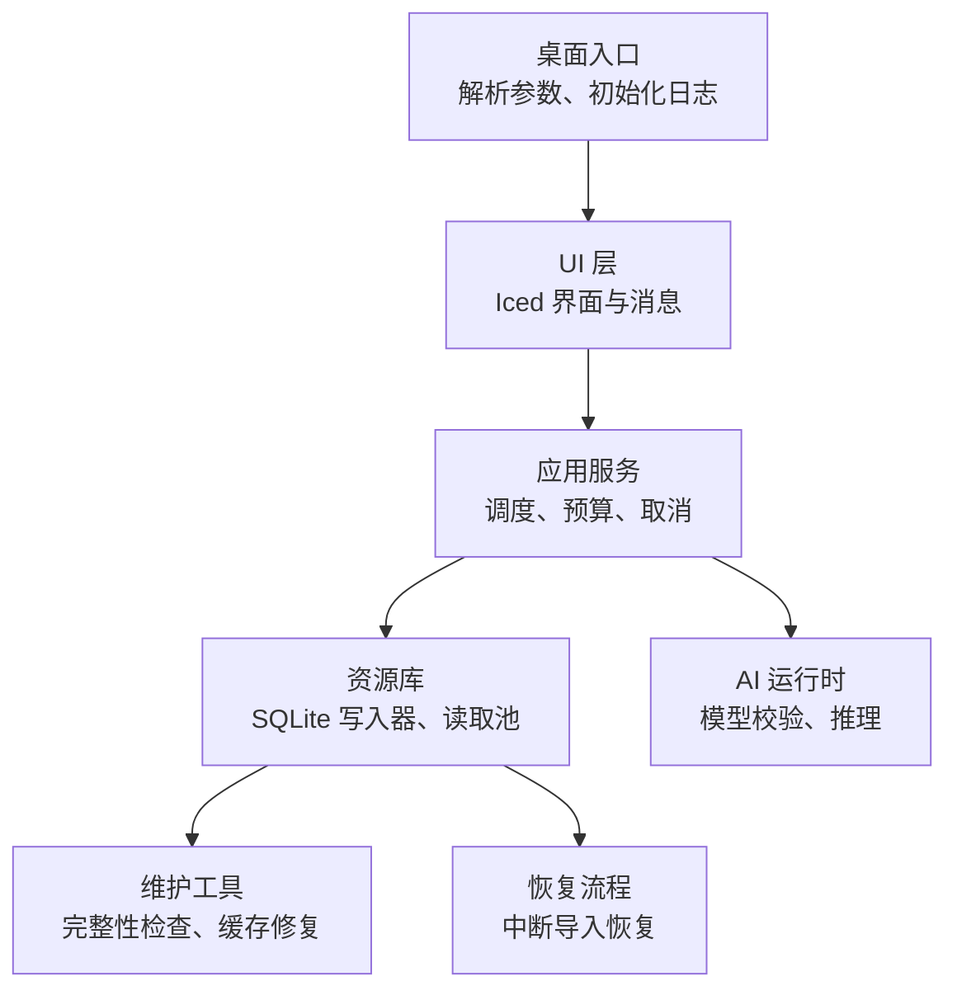
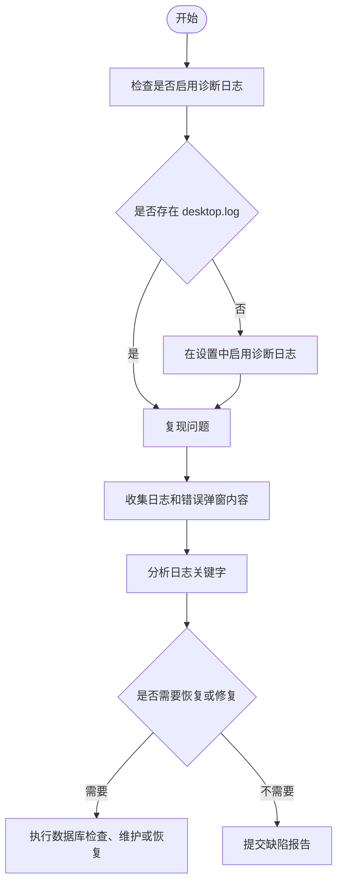
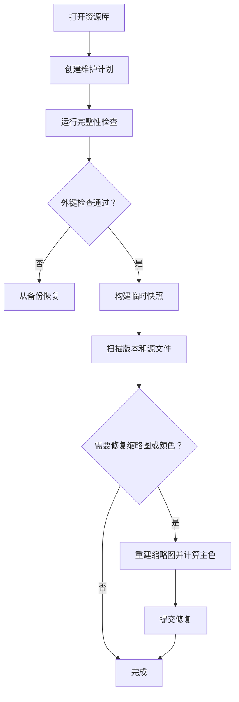
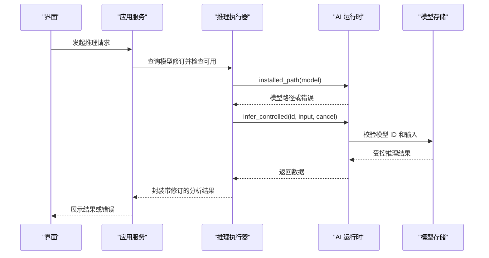

# 故障排除

> Repo Wiki 节点 `troubleshooting`
> 导出自 Qoder 知识库快照 `8fbe02f6-57c2-4874-b725-1a8130851fd9`，代码基线 `7a7a8e75e18bd90294e09cd422dd7ed5a04813a0`（分支 main，zh-CN）。

<cite>
**本文引用的文件**   
- [ARCHITECTURE.md](../ARCHITECTURE.md)
- [Cargo.toml](../Cargo.toml)
- [main.rs](../apps/desktop/src/main.rs)
- [launch.rs](../crates/moriq-app/src/launch.rs)
- [moriq-app/lib.rs](../crates/moriq-app/src/lib.rs)
- [inference.rs](../crates/moriq-app/src/inference.rs)
- [settings.rs](../crates/moriq-app/src/settings.rs)
- [lifecycle.rs](../crates/moriq-library/src/library/lifecycle.rs)
- [schema.sql](../crates/moriq-library/src/database/schema.sql)
- [journal.rs](../crates/moriq-library/src/database/journal.rs)
- [read_pool.rs](../crates/moriq-library/src/database/read_pool.rs)
- [maintenance.rs](../crates/moriq-library/src/maintenance/maintenance.rs)
- [recovery.rs](../crates/moriq-library/src/transfer/recovery.rs)
- [moriq-ai/lib.rs](../crates/moriq-ai/src/lib.rs)
- [moriq-ai/runtime.rs](../crates/moriq-ai/src/runtime.rs)
- [moriq-ui/lib.rs](../crates/moriq-ui/src/lib.rs)
</cite>

## 目录
1. [引言](#引言)
2. [项目结构与诊断入口](#项目结构与诊断入口)
3. [常见问题分类与解决方案](#常见问题分类与解决方案)
4. [日志分析方法](#日志分析方法)
5. [数据库损坏与恢复](#数据库损坏与恢复)
6. [AI 模型加载失败处理](#ai-模型加载失败处理)
7. [性能问题与内存泄漏排查](#性能问题与内存泄漏排查)
8. [兼容性冲突与安装问题](#兼容性冲突与安装问题)
9. [提交有效缺陷报告的步骤](#提交有效缺陷报告的步骤)
10. [结论](#结论)

## 引言
本指南面向 Moriq Space 用户和维护人员，覆盖安装、启动、运行时错误、性能退化、兼容性冲突和 AI 推理等常见故障。文档基于代码仓库中的桌面入口、应用服务层、资源库持久化、维护工具、恢复流程和 AI 运行时边界整理而成，并提供可操作的诊断步骤、日志定位方法和修复建议。

## 项目结构与诊断入口
Moriq Space 的桌面程序由平台入口、UI 框架、应用服务协调层、资源库持久化层、AI 推理层共同组成：

**图表来源** 
- [main.rs:1-97](../apps/desktop/src/main.rs#L1-L97)
- [moriq-ui/lib.rs:1-200](../crates/moriq-ui/src/lib.rs#L1-L200)
- [moriq-app/lib.rs:1-200](../crates/moriq-app/src/lib.rs#L1-L200)
- [maintenance.rs:1-200](../crates/moriq-library/src/maintenance/maintenance.rs#L1-L200)
- [recovery.rs:1-200](../crates/moriq-library/src/transfer/recovery.rs#L1-L200)
- [moriq-ai/runtime.rs:1-82](../crates/moriq-ai/src/runtime.rs#L1-L82)

关键职责边界：
- 桌面入口负责启动失败时弹出错误对话框，并根据是否启用诊断日志决定日志输出目标。
- UI 层不直接访问磁盘或解码媒体，所有 I/O 通过 Service 调用。
- 应用服务提供统一队列、并发槽位、共享内存预算和取消控制。
- 资源库使用单写者 SQLite 模式，维护读取连接池和临时快照。
- AI 推理层对模型 ID、安装路径、受控进程和保护命令进行校验。

**章节来源**
- [ARCHITECTURE.md:1-155](../ARCHITECTURE.md#L1-L155)
- [main.rs:1-97](../apps/desktop/src/main.rs#L1-L97)
- [moriq-app/lib.rs:1-200](../crates/moriq-app/src/lib.rs#L1-L200)

## 常见问题分类与解决方案

### 一、安装与打包问题
典型症状：
- 无法打开系统应用或模型目录。
- Windows 下 UNC 路径或带空格路径被截断。
- macOS/Linux 源码分支未提供完整验证的可移植包。

诊断要点：
- 确认当前仓库只保证 Windows x86_64 运行时的完整发布；macOS 和 Linux 仍为开发目标。
- 检查 `explorer.exe`、`open`、`xdg-open` 是否能正常启动。
- 在 Windows 上，路径规范化会去掉 `\\?\` 前缀并还原 `\\?\UNC\` 为普通 UNC 路径。

解决步骤：
1. 使用官方发布的 Windows 安装包。
2. 若“打开系统应用”失败，检查系统默认文件管理器、浏览器和网络协议关联。
3. 遇到 UNC 路径或含空格路径时，不要手动修改路径；让程序按既有规则转换。
4. 在 macOS 或 Linux 上构建源码时，预期可能缺少完整打包产物，优先用于本地调试而非生产分发。

**章节来源**
- [ARCHITECTURE.md:1-20](../ARCHITECTURE.md#L1-L20)
- [launch.rs:1-79](../crates/moriq-app/src/launch.rs#L1-L79)

### 二、启动失败与参数错误
典型症状：
- 启动后立即弹出“Moriq Space 无法启动”。
- 命令行参数无效或缺少值。
- 诊断日志未生成。

诊断要点：
- 桌面入口捕获 `run()` 的错误并通过消息框显示。
- 日志根目录取决于操作系统：Windows 使用 `LOCALAPPDATA/MORIQ/logs`，其他系统使用 `$HOME/.local/state/moriq`。
- 仅当设置中开启诊断日志时，才会创建 `desktop.log`。
- 已知参数包括 `--library`、`--import`、以及仅在 capture 特性下可用的 `--panel`、`--capture`、`--screen`、`--exit-after-capture`、`--select-first`。

解决步骤：
1. 查看启动错误弹窗内容，它直接来自 `run()` 返回的错误。
2. 检查设置文件中是否启用了诊断日志。
3. 修正命令行参数，确保每个参数都有对应值。
4. 如需截图诊断，仅在启用 capture 特性的构建中使用 `--panel` 和 `--capture`。

**章节来源**
- [main.rs:1-97](../apps/desktop/src/main.rs#L1-L97)
- [settings.rs:1-200](../crates/moriq-app/src/settings.rs#L1-L200)

### 三、资源库打开、锁竞争与切换
典型症状：
- 打开资源库时报错或被锁定。
- 维护任务期间无法编辑。
- 切换库后后台工作仍在继续。

诊断要点：
- 资源库维护任务会持有文件租约，防止同时打开同一库。
- 应用服务通过取消注册表停止已打开库的交互式工作。
- 关闭库时会清空媒体缓存并重置活动库句柄。

解决步骤：
1. 如果维护任务仍在运行，等待其完成或主动取消。
2. 不要在多个窗口同时打开同一资源库。
3. 切换库前先保存未完成修改。
4. 若库长期处于锁定状态，先结束相关 Moriq Space 进程，再重试。

**章节来源**
- [read_pool.rs:1-97](../crates/moriq-library/src/database/read_pool.rs#L1-L97)
- [moriq-app/lib.rs:1-200](../crates/moriq-app/src/lib.rs#L1-L200)
- [settings.rs:1-200](../crates/moriq-app/src/settings.rs#L1-L200)

### 四、外部素材重新连接失败
典型症状：
- 移动原片后无法重新连接。
- 提示新路径离开磁盘目录。
- 校验期间文件已改变。

诊断要点：
- 重新连接要求旧根目录是绝对路径且不含父目录组件。
- 新路径必须位于允许根目录下，不能逃逸到外部目录。
- 校验阶段会比对文件大小、修改时间和文件系统身份。
- 最终更新 `file_locations` 前再次校验哈希、路径、大小、时间和身份。

解决步骤：
1. 将原片移动到与原位置相同盘符或网络卷的新子目录。
2. 不要重命名或替换原片，除非重新导入。
3. 使用内置重新连接功能，而不是手动修改数据库。
4. 若提示校验期间文件变化，先恢复原片，再重试。

**章节来源**
- [lifecycle.rs:1-177](../crates/moriq-library/src/library/lifecycle.rs#L1-L177)

### 五、导入中断与恢复
典型症状：
- 导入中途崩溃或取消后无法继续。
- 恢复副本不完整。
- 引用原片被外部编辑器修改。

诊断要点：
- 中断导入会保留 `operation_journal` 中的 `interrupted` 记录。
- 恢复流程会硬链接到 `backups` 下的私有临时目录，避免误删原片。
- 恢复完成后把阶段改为 `committed`，并清理 `staging` 中的 `.part`、`.thumb`、`.ready`。
- 对于引用原片，恢复时会再次校验哈希。

解决步骤：
1. 不要删除 `staging` 或 `backups` 中的恢复相关文件。
2. 如果恢复副本长度不符合预期，保留原片并重新导入。
3. 如果引用原片已被修改，放弃自动恢复，手动重新导入。
4. 若恢复所属库已切换，说明该结果已失效，需重新选择库。

**章节来源**
- [recovery.rs:1-200](../crates/moriq-library/src/transfer/recovery.rs#L1-L200)
- [ARCHITECTURE.md:21-70](../ARCHITECTURE.md#L21-L70)

## 日志分析方法

### 日志位置与级别
- Windows：`%LOCALAPPDATA%\MORIQ\logs\desktop.log`
- 其他系统：`$HOME/.local/state/moriq/desktop.log`
- 默认非诊断模式下不输出日志文件。
- 诊断模式下过滤条件为 `moriq=info,wgpu=warn`。

### 快速诊断流程

**图表来源**
- [main.rs:1-97](../apps/desktop/src/main.rs#L1-L97)
- [settings.rs:1-200](../crates/moriq-app/src/settings.rs#L1-L200)

### 常用日志关键词
- `无法打开系统应用`：系统文件管理器或 URL 处理器不可用。
- `设置文件过大` / `设置文件无法解析`：用户配置损坏。
- `数据库完整性检查未通过`：SQLite 一致性异常。
- `包含失效的引用`：外键断裂。
- `剩余空间不足，无法暂存源文件以修复缓存`：维护修复失败。
- `此模型已移除，请使用 Qwen3.5-4B 重新分析`：AI 模型 ID 不合法。
- `AI 保护进程校验失败`：Windows AI 保护进程二进制不一致。

**章节来源**
- [main.rs:1-97](../apps/desktop/src/main.rs#L1-L97)
- [maintenance.rs:1-200](../crates/moriq-library/src/maintenance/maintenance.rs#L1-L200)
- [moriq-ai/runtime.rs:1-82](../crates/moriq-ai/src/runtime.rs#L1-L82)

## 数据库损坏与恢复

### 自检能力
维护流程会执行以下检查：
1. `PRAGMA integrity_check`。
2. `PRAGMA foreign_key_check`。
3. 建立临时快照 `maintenance_snapshot`，扫描版本、路径、哈希、缩略图和颜色信息。
4. 逐项核对源文件哈希，必要时解码缩略图并重建颜色。

### 常见损坏场景
| 场景 | 现象 | 建议操作 |
|---|---|---|
| 完整性检查失败 | 维护任务直接报错 | 从备份恢复资源库，不要手动修补 SQL |
| 外键断裂 | 提示存在失效引用 | 保留原库并从备份恢复 |
| 缩略图损坏 | 缩略图解码失败或颜色缺失 | 运行维护修复，让程序重建缩略图 |
| 源文件哈希不符 | 标记为损坏 | 检查原片是否被替换或删除 |
| 临时文件残留 | `staging` 或 `backups` 中有部分文件 | 不要手动删除，先完成恢复或重新导入 |

### 修复流程

**图表来源**
- [maintenance.rs:1-200](../crates/moriq-library/src/maintenance/maintenance.rs#L1-L200)
- [maintenance.rs:201-412](../crates/moriq-library/src/maintenance/maintenance.rs#L201-L412)

### 重要注意事项
- 维护任务不会直接递归删除未知文件。
- 恢复使用的私有临时目录属于 `backups`，不应手动清理。
- 过期修复不会被接受，避免覆盖重新定位后的外部引用缓存。
- 如果数据库结构或迁移历史异常，应优先备份整个资源库目录。

**章节来源**
- [maintenance.rs:1-412](../crates/moriq-library/src/maintenance/maintenance.rs#L1-L412)
- [schema.sql:1-42](../crates/moriq-library/src/database/schema.sql#L1-L42)
- [ARCHITECTURE.md:21-70](../ARCHITECTURE.md#L21-L70)

## AI 模型加载失败处理

### 模型生命周期与校验链

**图表来源**
- [inference.rs:1-200](../crates/moriq-app/src/inference.rs#L1-L200)
- [moriq-ai/runtime.rs:1-82](../crates/moriq-ai/src/runtime.rs#L1-L82)
- [moriq-ai/lib.rs:1-15](../crates/moriq-ai/src/lib.rs#L1-L15)

### 常见错误与修复
| 错误类型 | 原因 | 解决方案 |
|---|---|---|
| 未配置推理执行器 | 没有实际 AI 后端 | 安装并启用支持的模型 |
| 模型未登记 | 使用了未知模型 ID | 使用内置清单中的模型 |
| 模型已退役 | 使用旧版模型标识符 | 改用 Qwen3.5-4B |
| 模型未安装 | 下载不完整或路径不存在 | 重新下载模型 |
| AI 保护进程校验失败 | Windows 保护进程二进制不一致 | 重启应用或清理临时保护进程目录 |
| 缺少图片输入 | JSON 请求格式不正确 | 重新发起推理任务 |

### 模型常驻与释放
- 用户可通过“按需加载”偏好控制模型是否常驻。
- 常驻模式会减少重复加载开销，但占用更多内存。
- 卸载接口会释放模型运行器持有的进程和相关资源。

**章节来源**
- [inference.rs:1-200](../crates/moriq-app/src/inference.rs#L1-L200)
- [moriq-ai/runtime.rs:1-82](../crates/moriq-ai/src/runtime.rs#L1-L82)
- [moriq-ai/lib.rs:1-15](../crates/moriq-ai/src/lib.rs#L1-L15)
- [settings.rs:1-200](../crates/moriq-app/src/settings.rs#L1-L200)

## 性能问题与内存泄漏排查

### 资源库性能特征
- 数据库写入走单写者通道，读操作通过连接池复用。
- 维护任务使用临时 SQLite 快照，避免阻塞导入和编辑。
- 读取连接池限制最多复用 4 个连接。
- 临时表会在租约归还时回滚事务并清理。

### 性能调优建议
1. 调整导入并发数：范围为 1 到 32。
2. 调整导入内存预算：范围为 256 MiB 到 4096 MiB。
3. 在大型库中避免同时运行大量导入、维护和 AI 推理。
4. 关闭不必要的动画以减少 UI 渲染压力。
5. 使用“按需加载”降低常驻模型内存占用。

### 内存泄漏检测思路
虽然仓库未提供专用内存泄漏工具，但可依据以下信号判断潜在问题：
- 长时间高内存占用且无活跃导入或推理。
- 缩略图解码失败导致反复重建。
- 模型常驻但未卸载。
- 大量临时文件或临时表未清理。

缓解措施：
- 关闭不再使用的资源库。
- 完成或取消长任务后再观察内存。
- 重启应用释放底层 GPU、解码器和模型进程资源。
- 使用维护任务重建损坏缩略图。

**章节来源**
- [read_pool.rs:1-97](../crates/moriq-library/src/database/read_pool.rs#L1-L97)
- [maintenance.rs:1-200](../crates/moriq-library/src/maintenance/maintenance.rs#L1-L200)
- [moriq-app/lib.rs:1-200](../crates/moriq-app/src/lib.rs#L1-L200)
- [moriq-ai/runtime.rs:1-82](../crates/moriq-ai/src/runtime.rs#L1-L82)

## 兼容性冲突与安装问题

### 平台支持
- 当前发布重点为 Windows x86_64。
- macOS 和 Linux 源码分支尚未提供完整验证的便携运行时。
- UI 支持简体中文和英文，外观偏好持久化。

### 第三方依赖与编译选项
- Rust 工作区版本固定。
- 禁用 unwrap 和 expect，强制显式错误处理。
- 发布配置启用薄 LTO 和单代码生成单元。
- 开发构建中对图像、缩放、压缩和色彩关键包启用优化。

### 兼容性建议
1. 在 Windows 上使用官方发布包。
2. 不在不同 Moriq Space 版本之间混用同一个资源库。
3. 不要在数据库或媒体目录上进行外部同步、压缩或杀毒扫描。
4. 不要在资源库目录中手动修改 `catalog.db`、`library.toml` 或媒体索引。
5. 如遇编码、字体或 WGPU 相关错误，先检查系统图形驱动和字体环境。

**章节来源**
- [ARCHITECTURE.md:1-20](../ARCHITECTURE.md#L1-L20)
- [Cargo.toml:1-80](../Cargo.toml#L1-L80)

## 提交有效缺陷报告的步骤

### 第一步：收集基础信息
- 操作系统和架构。
- Moriq Space 版本号。
- 是否使用官方安装包。
- 是否自定义了 AI 模型镜像或路径。

### 第二步：复现问题并记录现象
- 描述触发步骤。
- 记录错误弹窗标题和内容。
- 记录是否涉及导入、维护、AI 推理、库切换或外部素材重连。

### 第三步：启用并收集日志
1. 在设置中启用诊断日志。
2. 退出并重新启动程序。
3. 复现问题。
4. 收集 `desktop.log`。
5. 同时复制错误弹窗文本。

### 第四步：准备资源库快照
- 如果问题与资源库有关，先备份整个资源库目录。
- 不要直接发送正在运行的资源库。
- 如怀疑数据库损坏，不要手动修改 `catalog.db`。

### 第五步：提交报告
建议包含：
- 问题标题。
- 复现步骤。
- 期望行为与实际行为。
- 日志文件。
- 错误弹窗截图或文本。
- 资源库版本信息和损坏情况（如有）。
- 是否尝试过恢复、维护或重装模型。

**章节来源**
- [main.rs:1-97](../apps/desktop/src/main.rs#L1-L97)
- [settings.rs:1-200](../crates/moriq-app/src/settings.rs#L1-L200)
- [moriq-library/src/database/journal.rs:1-200](../crates/moriq-library/src/database/journal.rs#L1-L200)

## 结论
Moriq Space 的故障排除应以“先隔离、再验证、最后修复”为原则：
- 启动失败优先检查日志开关和命令行参数。
- 资源库问题优先检查完整性、外键、原片路径和恢复状态。
- AI 推理问题优先检查模型 ID、安装路径和受控进程。
- 性能问题优先检查导入并发、内存预算、模型常驻和缩略图健康度。
- 提交缺陷报告时务必附带日志、复现步骤和资源库备份。