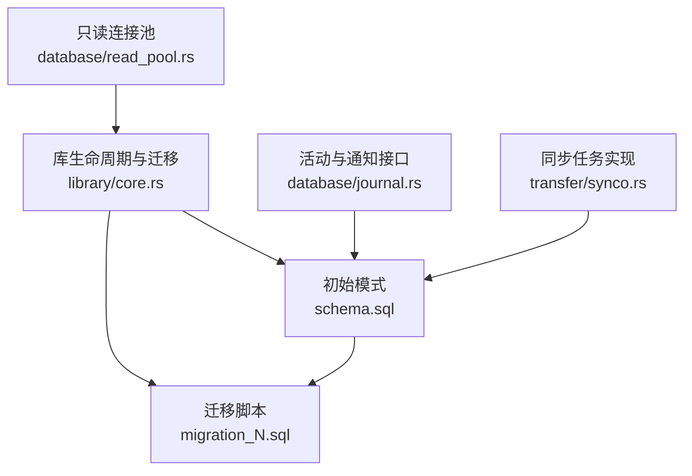
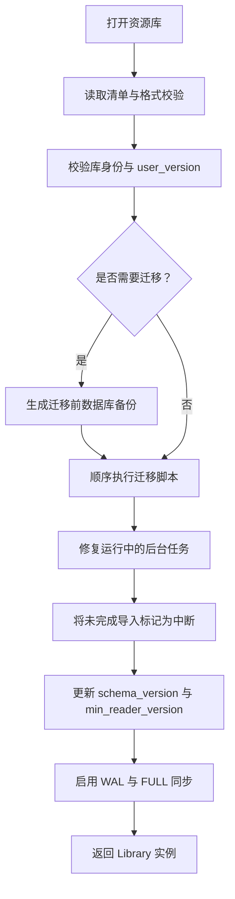
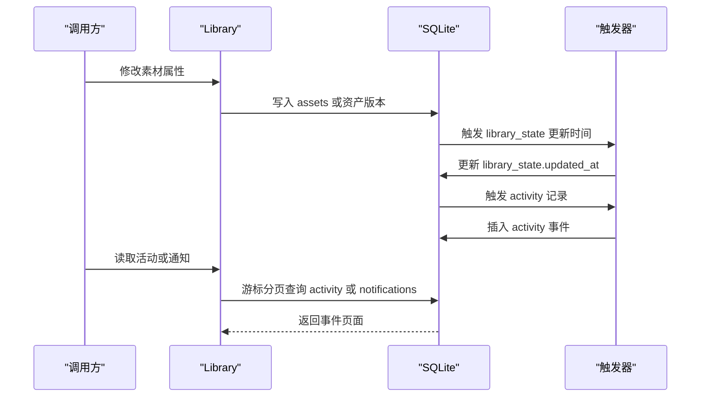
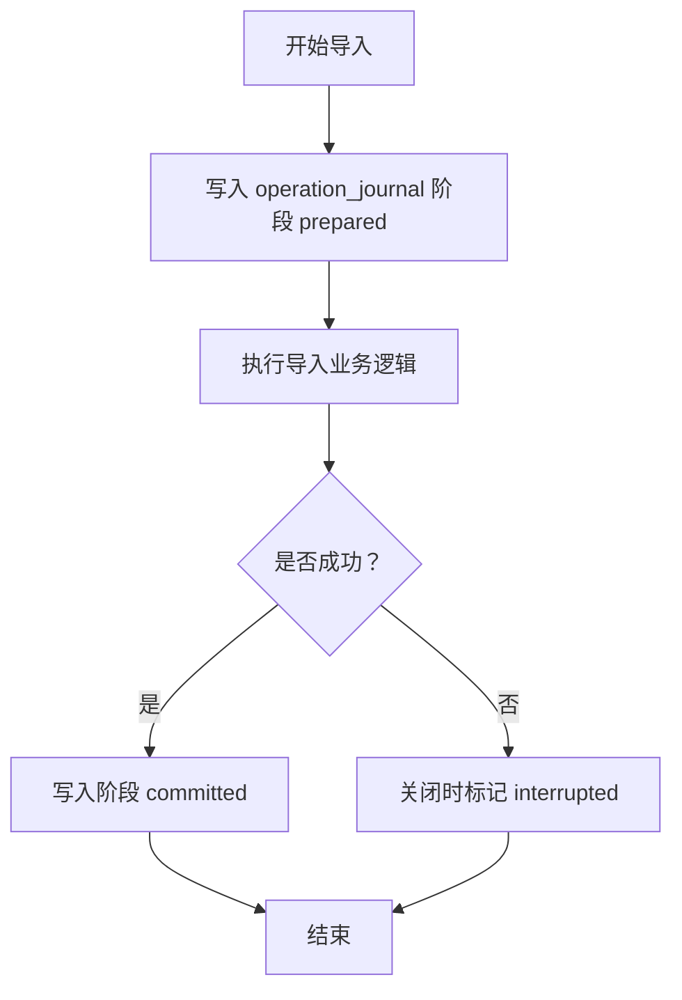
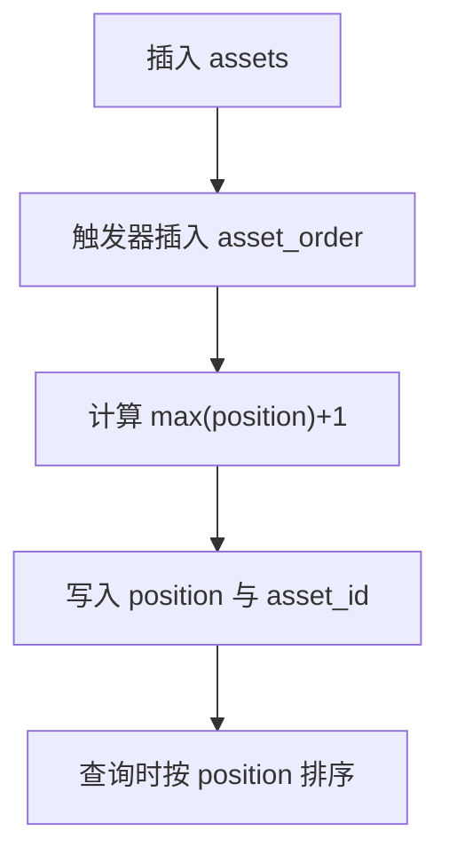
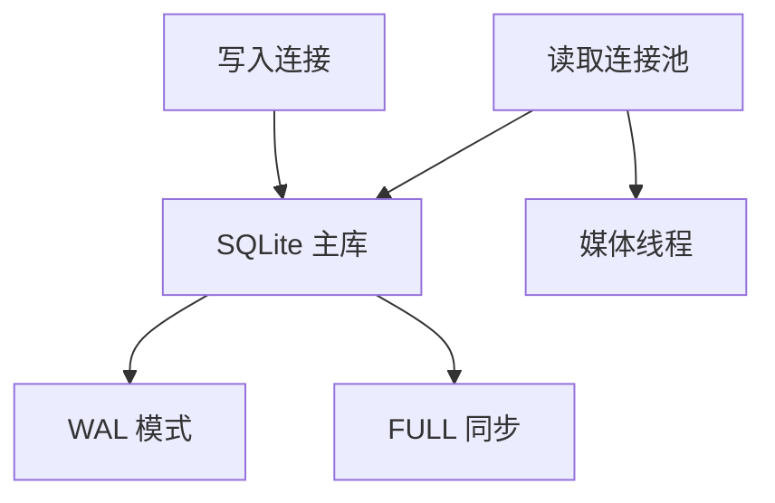

# 数据库设计

> Repo Wiki 节点 `database-schema`
> 导出自 Qoder 知识库快照 `8fbe02f6-57c2-4874-b725-1a8130851fd9`，代码基线 `7a7a8e75e18bd90294e09cd422dd7ed5a04813a0`（分支 main，zh-CN）。

<cite>
**本文引用的文件**   
- [schema.sql](../crates/moriq-library/src/database/schema.sql)
- [journal.rs](../crates/moriq-library/src/database/journal.rs)
- [read_pool.rs](../crates/moriq-library/src/database/read_pool.rs)
- [core.rs](../crates/moriq-library/src/library/core.rs)
- [migration_2.sql](../crates/moriq-library/src/database/migrations/migration_2.sql)
- [migration_3.sql](../crates/moriq-library/src/database/migrations/migration_3.sql)
- [migration_4.sql](../crates/moriq-library/src/database/migrations/migration_4.sql)
- [migration_5.sql](../crates/moriq-library/src/database/migrations/migration_5.sql)
- [migration_6.sql](../crates/moriq-library/src/database/migrations/migration_6.sql)
- [migration_7.sql](../crates/moriq-library/src/database/migrations/migration_7.sql)
- [migration_8.sql](../crates/moriq-library/src/database/migrations/migration_8.sql)
- [migration_9.sql](../crates/moriq-library/src/database/migrations/migration_9.sql)
- [migration_10.sql](../crates/moriq-library/src/database/migrations/migration_10.sql)
- [migration_11.sql](../crates/moriq-library/src/database/migration_11.sql)
- [migration_13.sql](../crates/moriq-library/src/database/migrations/migration_13.sql)
- [migration_14.sql](../crates/moriq-library/src/database/migrations/migration_14.sql)
- [migration_15.sql](../crates/moriq-library/src/database/migrations/migration_15.sql)
- [migration_16.sql](../crates/moriq-library/src/database/migrations/migration_16.sql)
- [migration_17.sql](../crates/moriq-library/src/database/migrations/migration_17.sql)
- [migration_18.sql](../crates/moriq-library/src/database/migrations/migration_18.sql)
- [migration_19.sql](../crates/moriq-library/src/database/migrations/migration_19.sql)
- [migration_20.sql](../crates/moriq-library/src/database/migrations/migration_20.sql)
- [migration_21.sql](../crates/moriq-library/src/database/migrations/migration_21.sql)
- [migration_22.sql](../crates/moriq-library/src/database/migrations/migration_22.sql)
- [migration_23.sql](../crates/moriq-library/src/database/migrations/migration_23.sql)
- [migration_24.sql](../crates/moriq-library/src/database/migrations/migration_24.sql)
- [migration_26.sql](../crates/moriq-library/src/database/migrations/migration_26.sql)
- [migration_27.sql](../crates/moriq-library/src/database/migrations/migration_27.sql)
- [synco.rs](../crates/moriq-library/src/transfer/synco.rs)
</cite>

## 目录
1. [引言](#引言)
2. [项目结构](#项目结构)
3. [核心表结构与字段定义](#核心表结构与字段定义)
4. [实体关系图](#实体关系图)
5. [数据库迁移与版本演进](#数据库迁移与版本演进)
6. [日志机制与操作追踪](#日志机制与操作追踪)
7. [查询优化与索引设计](#查询优化与索引设计)
8. [性能调优策略](#性能调优策略)
9. [数据备份与恢复实践](#数据备份与恢复实践)
10. [故障排查指南](#故障排查指南)
11. [结论](#结论)

## 引言
本文档系统性梳理 Moriq Space 的 SQLite 数据库设计，覆盖资源库基础表、素材及其版本、项目、标签、同步任务、后台任务、人工智能分析结果、虚拟文件夹、工作区隔离等全部持久化模型。文档重点说明：

- 核心实体 `Asset`、`AssetVersion`、`Project`、`Tag` 的结构与约束。
- 实体间一对多、多对多、层次化与隔离关系。
- 从初始版本到当前最高迁移版本的演进路径。
- `operation_journal` 导入操作状态表以及活动、通知、状态表的日志机制。
- 基于触发器、全文索引、外键和检查约束的一致性保障。
- 读取池、WAL 模式、事务回滚清理等性能与可靠性设计。
- 面向生产环境的备份、恢复与迁移注意事项。

## 项目结构
数据库相关代码集中在 `moriq-library` crate 中，采用“初始模式 + 顺序迁移”的设计：

- 初始模式由 `schema.sql` 定义，包含资源库身份、资产、资产版本、项目、标签、基本操作日志等核心表。
- 后续变更以 `migrations/migration_N.sql` 形式追加，通过 `library.core` 中的打开流程按 `user_version` 顺序执行。
- 读取连接通过 `ReadPool` 复用，写入端独占，媒体线程通过只读连接安全访问文件。
- 迁移过程会先创建带时间戳的数据库快照，再升级 `user_version` 并维护中断操作记录。



**图示来源**
- [schema.sql:1-42](../crates/moriq-library/src/database/schema.sql#L1-L42)
- [core.rs:60-300](../crates/moriq-library/src/library/core.rs#L60-L300)
- [journal.rs:1-120](../crates/moriq-library/src/database/journal.rs#L1-L120)
- [read_pool.rs:1-97](../crates/moriq-library/src/database/read_pool.rs#L1-L97)
- [synco.rs:1-120](../crates/moriq-library/src/transfer/synco.rs#L1-L120)

**章节来源**
- [schema.sql:1-42](../crates/moriq-library/src/database/schema.sql#L1-L42)
- [core.rs:60-300](../crates/moriq-library/src/library/core.rs#L60-L300)
- [read_pool.rs:1-97](../crates/moriq-library/src/database/read_pool.rs#L1-L97)

## 核心表结构与字段定义
本节按业务域归纳核心表，说明用途、主键、关键约束及典型查询方向。

### 资源库身份与偏好
| 表 | 主要字段 | 约束与用途 |
|---|---|---|
| `library_identity` | `id TEXT PRIMARY KEY` | 保存资源库唯一标识，用于校验清单与数据库一致性。 |
| `library_preferences` | `key TEXT PRIMARY KEY, value TEXT NOT NULL` | 存储显示名称、描述等键值配置。 |
| `library_state` | `id INTEGER PRIMARY KEY CHECK(id=1), updated_at INTEGER NOT NULL` | 单行元数据更新时间，供缓存与界面刷新判断。 |

### 资产与资产版本
| 表 | 主要字段 | 约束与用途 |
|---|---|---|
| `assets` | `id TEXT PRIMARY KEY, display_version_id TEXT NOT NULL UNIQUE, name TEXT NOT NULL, favorite INTEGER, rating INTEGER, imported_at INTEGER, deleted_at INTEGER, notes TEXT, edited_at INTEGER` | 展示层资产；`favorite` 取值 0 或 1；`rating` 取值 0 至 5；`display_version_id` 引用当前版本。 |
| `asset_versions` | `id TEXT PRIMARY KEY, asset_id TEXT, parent_version_id TEXT, origin TEXT, path TEXT NOT NULL UNIQUE, sha256 TEXT NOT NULL, format TEXT NOT NULL, width INTEGER, height INTEGER, bytes INTEGER, dominant_color TEXT` | 版本层；`origin` 限定为原始、同步、导入、导出；宽高字节必须为正；sha256 固定长度。 |
| `asset_order` | `position INTEGER PRIMARY KEY CHECK(position>=0), asset_id TEXT NOT NULL UNIQUE` | 密集序号表，避免深分页扫描，插入时自动递增。 |
| `project_assets` | `project_id TEXT, asset_id TEXT` | 项目与资产多对多关联，联合主键。 |
| `tags` / `asset_tags` | `tags.id INTEGER PRIMARY KEY, asset_tags.asset_id TEXT, tag_id INTEGER` | 标签主表与关联表，支持反向索引。 |

### 项目
| 表 | 主要字段 | 约束与用途 |
|---|---|---|
| `projects` | `id TEXT PRIMARY KEY, name TEXT NOT NULL UNIQUE, parent_id TEXT, visited_at INTEGER` | 支持父级项目；`visited_at` 表示最近访问时间。 |
| `project_storage` | `project_id TEXT PRIMARY KEY, folder TEXT NOT NULL UNIQUE` | 项目专属存储目录。 |
| `project_files` | `project_id TEXT, version_id TEXT, path TEXT NOT NULL UNIQUE` | 项目内受管文件映射。 |

### 同步任务与工作流
| 表 | 主要字段 | 约束与用途 |
|---|---|---|
| `synco_tasks` | `id TEXT PRIMARY KEY, asset_id TEXT, sent_version_id TEXT, request TEXT, state TEXT, error TEXT, result_id TEXT, returned_version_id TEXT, ack TEXT, created_at INTEGER, copy_removed INTEGER` | 记录待发送、处理、确认、清理状态。 |
| `background_jobs` | `id TEXT PRIMARY KEY, kind TEXT, state TEXT, priority INTEGER, checkpoint INTEGER, total INTEGER, failed INTEGER, error TEXT, inflight INTEGER, generation INTEGER, created_at INTEGER` | 可暂停恢复的后台任务。 |
| `background_job_items` | `job_id TEXT, seq INTEGER, version_id TEXT` | 任务逐项进度。 |
| `background_job_errors` | `job_id TEXT, seq INTEGER, version_id TEXT, message TEXT` | 逐项失败原因。 |
| `background_job_payload` | `job_id TEXT PRIMARY KEY, json TEXT` | 任务附加参数。 |

### 人工智能与人脸分类
| 表 | 主要字段 | 约束与用途 |
|---|---|---|
| `ai_results` | `version_id TEXT, model_id TEXT, revision TEXT, preprocessing TEXT, data TEXT, created_at INTEGER` | AI 历史回执。 |
| `ai_analysis_runs` | `id INTEGER, version_id TEXT, task TEXT, revision TEXT, preprocessing TEXT, data TEXT, created_at INTEGER` | 不可变分析运行记录。 |
| `ai_effective_results` | `version_id TEXT, task TEXT, run_id INTEGER` | 每个版本每个任务的最新有效结果指针。 |
| `ai_overrides` | `version_id TEXT PRIMARY KEY, medium TEXT, themes TEXT, description TEXT` | 人工覆盖。 |
| `ai_rejected_tags` | `version_id TEXT, name TEXT` | 被拒绝的标签。 |
| `ai_vocabulary` | `kind TEXT, id TEXT PRIMARY KEY, label TEXT, definition TEXT, position INTEGER, enabled INTEGER` | 主题与类型词表。 |
| `people` / `detected_faces` / `person_vectors` | 人物、人脸框、向量、样本数 | 人脸识别与人物聚合。 |
| `image_fingerprints` | `version_id TEXT, hash INTEGER, red INTEGER, green INTEGER, blue INTEGER, aspect REAL, algorithm INTEGER` | 图像指纹。 |

### 视频、EXIF、位置与虚拟文件夹
| 表 | 主要字段 | 约束与用途 |
|---|---|---|
| `video_metadata` | `version_id TEXT PRIMARY KEY, json TEXT` | 视频探测元数据。 |
| `version_exif` | `version_id TEXT PRIMARY KEY, json TEXT` | 规范化 EXIF。 |
| `version_locations` | `version_id TEXT PRIMARY KEY, latitude REAL, longitude REAL, label TEXT` | 补充地点。 |
| `virtual_folders` / `virtual_folder_assets` | 虚拟文件夹与成员 | 动态分组。 |

### 其他系统表
| 表 | 主要字段 | 约束与用途 |
|---|---|---|
| `operation_journal` | `id TEXT PRIMARY KEY, path TEXT, phase TEXT CHECK(phase IN('prepared','committed','interrupted'))` | 导入等操作阶段记录。 |
| `purge_jobs` / `purge_files` | 永久删除任务与文件映射 | 回收站清理。 |
| `orphan_quarantine` | `id TEXT, original TEXT, target TEXT, bytes INTEGER, state TEXT, created_at INTEGER` | 孤立文件隔离。 |
| `activity` / `notifications` | 活动事件与用户通知 | 界面活动流与未读计数。 |
| `search_fts` / `ai_text_fts` | FTS5 虚拟表 | 名称、笔记、标签与 AI 内容搜索。 |

**章节来源**
- [schema.sql:1-42](../crates/moriq-library/src/database/schema.sql#L1-L42)
- [migration_2.sql:1-9](../crates/moriq-library/src/database/migrations/migration_2.sql#L1-L9)
- [migration_3.sql:1-4](../crates/moriq-library/src/database/migrations/migration_3.sql#L1-L4)
- [migration_4.sql:1-3](../crates/moriq-library/src/database/migrations/migration_4.sql#L1-L3)
- [migration_5.sql:1-9](../crates/moriq-library/src/database/migrations/migration_5.sql#L1-L9)
- [migration_6.sql:1-4](../crates/moriq-library/src/database/migrations/migration_6.sql#L1-L4)
- [migration_7.sql:1-5](../crates/moriq-library/src/database/migrations/migration_7.sql#L1-L5)
- [migration_8.sql:1-31](../crates/moriq-library/src/database/migrations/migration_8.sql#L1-L31)
- [migration_9.sql:1-4](../crates/moriq-library/src/database/migrations/migration_9.sql#L1-L4)
- [migration_10.sql:1-43](../crates/moriq-library/src/database/migrations/migration_10.sql#L1-L43)
- [migration_11.sql:1-7](../crates/moriq-library/src/database/migrations/migration_11.sql#L1-L7)
- [migration_13.sql:1-3](../crates/moriq-library/src/database/migrations/migration_13.sql#L1-L3)
- [migration_14.sql:1-12](../crates/moriq-library/src/database/migrations/migration_14.sql#L1-L12)
- [migration_15.sql:1-30](../crates/moriq-library/src/database/migrations/migration_15.sql#L1-L30)
- [migration_16.sql:1-5](../crates/moriq-library/src/database/migrations/migration_16.sql#L1-L5)
- [migration_17.sql:1-7](../crates/moriq-library/src/database/migrations/migration_17.sql#L1-L7)
- [migration_18.sql:1-3](../crates/moriq-library/src/database/migrations/migration_18.sql#L1-L3)
- [migration_19.sql:1-4](../crates/moriq-library/src/database/migrations/migration_19.sql#L1-L4)
- [migration_20.sql:1-4](../crates/moriq-library/src/database/migrations/migration_20.sql#L1-L4)
- [migration_21.sql:1-6](../crates/moriq-library/src/database/migrations/migration_21.sql#L1-L6)
- [migration_22.sql:1-3](../crates/moriq-library/src/database/migrations/migration_22.sql#L1-L3)
- [migration_23.sql:1-128](../crates/moriq-library/src/database/migrations/migration_23.sql#L1-L128)
- [migration_24.sql:1-35](../crates/moriq-library/src/database/migrations/migration_24.sql#L1-L35)
- [migration_26.sql:1-47](../crates/moriq-library/src/database/migrations/migration_26.sql#L1-L47)
- [migration_27.sql:1-9](../crates/moriq-library/src/database/migrations/migration_27.sql#L1-L9)

## 实体关系图
下图展示核心实体及其在数据库中的关系。

```mermaid
erDiagram
  ASSETS {
    text id PK
    text display_version_id UK
    text name
    integer favorite
    integer rating
    integer imported_at
    integer deleted_at
    text notes
    integer edited_at
  }

  ASSET_VERSIONS {
    text id PK
    text asset_id FK
    text parent_version_id FK
    text origin
    text path UK
    text sha256
    text format
    integer width
    integer height
    integer bytes
    text dominant_color
  }

  PROJECTS {
    text id PK
    text name UK
    text parent_id FK
    integer visited_at
  }

  TAGS {
    integer id PK
    text name UK
  }

  ASSET_TAGS {
    text asset_id FK
    integer tag_id FK
  }

  PROJECT_ASSETS {
    text project_id FK
    text asset_id FK
  }

  SYNCO_TASKS {
    text id PK
    text asset_id FK
    text sent_version_id FK
    text request
    text state
    text error
    text result_id
    text returned_version_id
    text ack
    integer created_at
    integer copy_removed
  }

  BACKGROUND_JOBS {
    text id PK
    text kind
    text state
    integer priority
    integer checkpoint
    integer total
    integer failed
    text error
    integer inflight
    integer generation
    integer created_at
  }

  BACKGROUND_JOB_ITEMS {
    text job_id FK
    integer seq
    text version_id
  }

  BACKGROUND_JOB_ERRORS {
    text job_id FK
    integer seq
    text version_id
    text message
  }

  BACKGROUND_JOB_PAYLOAD {
    text job_id PK FK
    text json
  }

  AI_RESULTS {
    text version_id FK
    text model_id
    text revision
    text preprocessing
    text data
    integer created_at
  }

  AI_ANALYSIS_RUNS {
    integer id PK
    text version_id FK
    text task
    text revision
    text preprocessing
    text data
    integer created_at
  }

  AI_EFFECTIVE_RESULTS {
    text version_id FK
    text task
    integer run_id FK
  }

  AI_OVERRIDES {
    text version_id PK FK
    text medium
    text themes
    text description
  }

  AI_REJECTED_TAGS {
    text version_id FK
    text name
  }

  AI_VOCABULARY {
    text kind
    text id PK
    text label
    text definition
    integer position
    integer enabled
  }

  PEOPLE {
    text id PK
    text name
    text revision
    integer created_at
  }

  DETECTED_FACES {
    text id PK
    text version_id FK
    text revision
    integer ordinal
    text box
    blob vector
    text person_id FK
    integer manual
  }

  PERSON_VECTORS {
    text person_id FK
    text revision
    blob vector
    integer samples
  }

  IMAGE_FINGERPRINTS {
    text version_id PK FK
    integer hash
    integer red
    integer green
    integer blue
    real aspect
    integer algorithm
  }

  VIDEO_METADATA {
    text version_id PK FK
    text json
  }

  VERSION_EXIF {
    text version_id PK FK
    text json
  }

  VERSION_LOCATIONS {
    text version_id PK FK
    real latitude
    real longitude
    text label
  }

  VIRTUAL_FOLDERS {
    text id PK
    text name
    integer kind
    text cover_id FK
    integer created_at
  }

  VIRTUAL_FOLDER_ASSETS {
    text folder_id FK
    text asset_id FK
  }

  ACTIVITY {
    integer id PK
    integer at
    text kind
    text detail
    text asset_id
    text project_id
  }

  NOTIFICATIONS {
    integer id PK
    integer at
    text title
    text detail
    integer level
    text asset_id
    text retry
    integer read_at
  }

  PURGE_JOBS {
    text id PK
    integer committed
  }

  PURGE_FILES {
    text job_id FK
    text source
    text target
  }

  ORPHAN_QUARANTINE {
    text id PK
    text original
    text target UK
    integer bytes
    text state
    integer created_at
  }

  OPERATION_JOURNAL {
    text id PK
    text path
    text phase
  }

  SEARCH_FTS {
    virtual_table
  }

  AI_TEXT_FTS {
    virtual_table
  }

  ASSETS ||--o{ ASSET_VERSIONS : "拥有多个版本"
  ASSET_VERSIONS ||--o{ ASSET_VERSIONS : "父子版本"
  ASSETS ||--o{ ASSET_TAGS : "打标签"
  TAGS ||--o{ ASSET_TAGS : "被标记"
  PROJECTS ||--o{ PROJECT_ASSETS : "包含素材"
  ASSETS ||--o{ PROJECT_ASSETS : "属于项目"
  ASSETS ||--o{ SYNCO_TASKS : "发起同步"
  ASSET_VERSIONS ||--o{ BACKGROUND_JOB_ITEMS : "后台任务项"
  BACKGROUND_JOBS ||--o{ BACKGROUND_JOB_ITEMS : "包含任务项"
  BACKGROUND_JOBS ||--o{ BACKGROUND_JOB_ERRORS : "记录错误"
  BACKGROUND_JOBS |||-- BACKGROUND_JOB_PAYLOAD : "携带负载"
  ASSET_VERSIONS ||--o{ AI_RESULTS : "AI 结果"
  ASSET_VERSIONS ||--o{ AI_ANALYSIS_RUNS : "AI 分析运行"
  AI_ANALYSIS_RUNS ||--o{ AI_EFFECTIVE_RESULTS : "有效结果"
  ASSET_VERSIONS ||--o{ AI_OVERRIDES : "人工覆盖"
  ASSET_VERSIONS ||--o{ AI_REJECTED_TAGS : "拒绝标签"
  AI_VOCABULARY ||.. ASSET_VERSIONS : "参与语义分类"
  ASSET_VERSIONS ||--o{ PEOPLE : "检测人脸归属"
  PEOPLE ||--o{ DETECTED_FACES : "人脸记录"
  PEOPLE ||--o{ PERSON_VECTORS : "代表向量"
  ASSET_VERSIONS ||--o{ IMAGE_FINGERPRINTS : "图像指纹"
  ASSET_VERSIONS ||--o{ VIDEO_METADATA : "视频元数据"
  ASSET_VERSIONS ||--o{ VERSION_EXIF : "EXIF"
  ASSET_VERSIONS ||--o{ VERSION_LOCATIONS : "地点"
  VIRTUAL_FOLDERS ||--o{ VIRTUAL_FOLDER_ASSETS : "虚拟文件夹成员"
  ASSETS ||--o{ VIRTUAL_FOLDER_ASSETS : "虚拟文件夹成员"
  ASSETS ||--o{ ACTIVITY : "活动"
  PROJECTS ||--o{ ACTIVITY : "项目活动"
  ASSETS ||--o{ NOTIFICATIONS : "通知"
  PURGE_JOBS ||--o{ PURGE_FILES : "删除文件映射"
```

**图示来源**
- [schema.sql:1-42](../crates/moriq-library/src/database/schema.sql#L1-L42)
- [migration_10.sql:1-43](../crates/moriq-library/src/database/migrations/migration_10.sql#L1-L43)
- [migration_14.sql:1-12](../crates/moriq-library/src/database/migrations/migration_14.sql#L1-L12)
- [migration_15.sql:1-30](../crates/moriq-library/src/database/migrations/migration_15.sql#L1-L30)
- [migration_16.sql:1-5](../crates/moriq-library/src/database/migrations/migration_16.sql#L1-L5)
- [migration_17.sql:1-7](../crates/moriq-library/src/database/migrations/migration_17.sql#L1-L7)
- [migration_23.sql:1-128](../crates/moriq-library/src/database/migrations/migration_23.sql#L1-L128)
- [migration_26.sql:1-47](../crates/moriq-library/src/database/migrations/migration_26.sql#L1-L47)

## 数据库迁移与版本演进
数据库使用 SQLite `PRAGMA user_version` 作为内部版本号，并由 `library/core.rs` 在打开资源库时按顺序执行迁移。当前仓库中包含从版本 1 到 27 的迁移定义，但部分中间编号（如 12、25）可能由逻辑迁移函数或兼容处理完成，不一定对应独立 SQL 文件。

### 迁移阶段概览
| 版本范围 | 主要变更 | 设计意图 |
|---|---|---|
| 1 → 2 | 增加回收站、笔记、评分索引、智能集合、活动记录 | 引入软删除、用户编辑历史和活动流。 |
| 2 → 3 | 新增外部路径登记、库偏好表 | 支持跨平台原生路径与偏好配置。 |
| 3 → 4 | 新增导入上下文 | 支持导入中断恢复。 |
| 4 → 5 | 新增 `synco_tasks` | 支持外部同步协议任务。 |
| 5 → 6 | 增加主色字段与颜色索引 | 支持颜色筛选。 |
| 6 → 7 | 项目存储、项目文件、相对路径 | 支持项目隔离的文件管理。 |
| 7 → 8 | 全文搜索 FTS5、项目名称与标签搜索 | 提升文本检索能力。 |
| 8 → 9 | 永久删除任务与文件暂存 | 支持清理作业恢复。 |
| 9 → 10 | 项目访问时间、活动扩展、通知、库状态 | 增强活动流、通知与缓存失效。 |
| 10 → 11 | 版本地点与坐标索引 | 支持地理信息。 |
| 12 → 13 | 视频元数据 | 记录视频探测结果。 |
| 13 → 14 | 后台任务与图像指纹 | 支持可恢复后台计算。 |
| 14 → 15 | AI 结果、向量、分类、人物、人脸、FTS | 引入 AI 分析与人脸识别。 |
| 15 → 16 | 虚拟文件夹 | 动态分组。 |
| 16 → 17 | EXIF 与索引 | 相机、时间、ISO、GPS 筛选。 |
| 17 → 18 | 后台任务负载 | 任务恢复输入。 |
| 18 → 19 | 同步副本清理状态 | 重试清理已发送副本。 |
| 19 → 20 | 孤立文件隔离 | 回收站与孤儿文件恢复。 |
| 20 → 21 | 人物代表向量 | 人物识别聚合。 |
| 21 → 22 | 后台任务逐项错误 | 可诊断失败。 |
| 22 → 23 | AI 运行、有效结果、视图、FTS 重构 | 分离历史与可见结果。 |
| 23 → 24 | 词表定义、启用状态、AI 配置状态 | 支持主题启用与配置。 |
| 24 → 26 | 项目隔离、工作区、AI 配置、人物与集合范围 | 多项目工作区隔离。 |
| 26 → 27 | 简化可见标签视图 | 减少不必要展开。 |

### 迁移执行流程


**图示来源**
- [core.rs:120-300](../crates/moriq-library/src/library/core.rs#L120-L300)

**章节来源**
- [core.rs:120-300](../crates/moriq-library/src/library/core.rs#L120-L300)
- [migration_2.sql:1-9](../crates/moriq-library/src/database/migrations/migration_2.sql#L1-L9)
- [migration_10.sql:1-43](../crates/moriq-library/src/database/migrations/migration_10.sql#L1-L43)
- [migration_14.sql:1-12](../crates/moriq-library/src/database/migrations/migration_14.sql#L1-L12)
- [migration_15.sql:1-30](../crates/moriq-library/src/database/migrations/migration_15.sql#L1-L30)
- [migration_23.sql:1-128](../crates/moriq-library/src/database/migrations/migration_23.sql#L1-L128)
- [migration_26.sql:1-47](../crates/moriq-library/src/database/migrations/migration_26.sql#L1-L47)
- [migration_27.sql:1-9](../crates/moriq-library/src/database/migrations/migration_27.sql#L1-L9)

## 日志机制与操作追踪
数据库中的日志机制分为三类：

1. **操作阶段日志**：`operation_journal` 记录导入操作的准备、提交与中断状态。
2. **活动记录**：`activity` 表记录素材重命名、收藏、评分、备注、回收站、标签、项目、版本等操作。
3. **通知记录**：`notifications` 表记录标题、详情、级别、关联素材与重试策略。

此外，`library_state.updated_at` 通过大量触发器统一维护，任何影响资源库可见内容的变更都会推进更新时间，从而驱动缓存失效与界面刷新。



**图示来源**
- [migration_10.sql:1-43](../crates/moriq-library/src/database/migrations/migration_10.sql#L1-L43)
- [journal.rs:1-120](../crates/moriq-library/src/database/journal.rs#L1-L120)

### 导入操作日志设计
`operation_journal` 的 `phase` 字段严格限制为 `prepared`、`committed`、`interrupted` 三种状态。迁移打开流程会将仍处于 `prepared` 的记录改为 `interrupted`，保证不会误判未完成导入为成功，同时保留原始数据用于诊断。



**图示来源**
- [schema.sql:39-42](../crates/moriq-library/src/database/schema.sql#L39-L42)
- [core.rs:270-300](../crates/moriq-library/src/library/core.rs#L270-L300)

**章节来源**
- [schema.sql:39-42](../crates/moriq-library/src/database/schema.sql#L39-L42)
- [migration_10.sql:1-43](../crates/moriq-library/src/database/migrations/migration_10.sql#L1-L43)
- [journal.rs:1-120](../crates/moriq-library/src/database/journal.rs#L1-L120)
- [core.rs:270-300](../crates/moriq-library/src/library/core.rs#L270-L300)

## 查询优化与索引设计
数据库针对高频查询场景设计了多种索引与虚拟表：

| 查询目标 | 索引或结构 | 优化效果 |
|---|---|---|
| 按素材哈希去重 | `asset_versions.sha256` | 快速查重与重复检测。 |
| 按素材查找版本 | `asset_versions.asset_id` | 高效获取版本历史。 |
| 版本父子关系 | `asset_versions.parent_version_id` | 加速版本链查询。 |
| 默认排序 | `assets.imported_at DESC, id DESC` | 优化最近导入列表。 |
| 收藏排序 | `assets.favorite, imported_at DESC, id DESC` | 优先展示收藏素材。 |
| 回收站与评分筛选 | `assets.deleted_at, imported_at` 与 `assets.rating, imported_at` | 避免全表扫描。 |
| 路径模糊匹配 | `asset_versions.path COLLATE NOCASE` | 不区分大小写路径查询。 |
| 项目文件路径匹配 | `project_files.path COLLATE NOCASE` | 项目文件定位。 |
| 同步任务调度 | `synco_tasks.state, created_at` | 按状态与时间拉取任务。 |
| 后台任务调度 | `background_jobs.state, inflight, priority DESC, created_at` | 公平且高优先级优先。 |
| 地理筛选 | `version_locations.latitude, longitude` | 支持坐标范围查询。 |
| EXIF 筛选 | `json_extract(data,'$.camera')`、`$.taken_at`、`$.iso`、`$.latitude_e6, $.longitude_e6` | 相机、时间、ISO、GPS 快速过滤。 |
| 全文搜索 | `search_fts`、`ai_text_fts` | trigram 分词支持中文与英文混合搜索。 |
| 活动分页 | `activity.id DESC` | 避免深分页。 |
| 通知未读 | `notifications.read_at, id` | 快速统计未读数。 |
| 虚拟文件夹成员 | `virtual_folder_assets.asset_id` | 反向查找素材所属虚拟文件夹。 |
| 人物与修订 | `person_vectors.revision`、`detected_faces.person_id, revision` | 支持人物向量与人脸修订查询。 |

### 密集序号与避免深分页
`asset_order` 使用连续整数作为位置键，并在插入资产时自动追加最大位置加一。该设计避免依赖 `OFFSET` 深分页，适合大库稳定排序。



**图示来源**
- [schema.sql:32-35](../crates/moriq-library/src/database/schema.sql#L32-L35)

**章节来源**
- [schema.sql:13-31](../crates/moriq-library/src/database/schema.sql#L13-L31)
- [migration_2.sql:1-9](../crates/moriq-library/src/database/migrations/migration_2.sql#L1-L9)
- [migration_8.sql:1-31](../crates/moriq-library/src/database/migrations/migration_8.sql#L1-L31)
- [migration_10.sql:1-43](../crates/moriq-library/src/database/migrations/migration_10.sql#L1-L43)
- [migration_14.sql:1-12](../crates/moriq-library/src/database/migrations/migration_14.sql#L1-L12)
- [migration_17.sql:1-7](../crates/moriq-library/src/database/migrations/migration_17.sql#L1-L7)
- [migration_21.sql:1-6](../crates/moriq-library/src/database/migrations/migration_21.sql#L1-L6)

## 性能调优策略
数据库在连接层与引擎层做了多项调优：

- **WAL 模式与 FULL 同步**：打开资源库后设置 `journal_mode=WAL` 与 `synchronous=FULL`，提高并发读性能与数据持久性。
- **读取连接池**：`ReadPool` 最多复用 4 个只读连接，减少频繁打开数据库文件的开销。
- **临时存储与缓存**：读取连接启用 `temp_store=FILE`、负数 `cache_size`，让 SQLite 控制合适内存与临时文件策略。
- **忙超时**：写入端设置较短忙超时，读取端设置较长忙超时，降低竞争导致的失败。
- **游标分页**：活动与通知使用 `id < before` 游标分页，避免 `OFFSET` 深扫描。
- **触发器维护视图与索引**：FTS 表和视图由触发器自动同步，避免应用层手动维护。
- **任务状态修复**：启动时将仍在运行的后台任务重置为排队状态，避免僵尸任务长期占用调度。



**图示来源**
- [read_pool.rs:1-97](../crates/moriq-library/src/database/read_pool.rs#L1-L97)
- [core.rs:280-300](../crates/moriq-library/src/library/core.rs#L280-L300)

**章节来源**
- [read_pool.rs:1-97](../crates/moriq-library/src/database/read_pool.rs#L1-L97)
- [core.rs:280-300](../crates/moriq-library/src/library/core.rs#L280-L300)
- [journal.rs:1-120](../crates/moriq-library/src/database/journal.rs#L1-L120)

## 数据备份与恢复实践
### 推荐备份策略
- **完整资源库目录**：包括 `catalog.db`、`catalog.db-wal`、`catalog.db-shm`、`library.toml`、`backups`、`interop`、`metadata` 等目录。
- **迁移前快照**：迁移前会自动生成 `backups/schema-{version}-{uuid}.db`，可作为升级回滚点。
- **WAL 一致性**：由于使用 WAL 模式，应同时备份 WAL 与共享内存文件，或使用 `sqlite3_backup` 工具进行一致性拷贝。
- **离线备份**：停止应用程序后再复制目录，或在只读挂载点下备份。

### 恢复步骤
1. 找到最近的 `backups/schema-N-*.db`。
2. 将原 `catalog.db`、`catalog.db-wal`、`catalog.db-shm` 替换为备份文件。
3. 保持 `library.toml` 与目录结构一致。
4. 重新启动应用，让迁移流程重新加载。
5. 如果迁移失败，查看日志中的迁移前备份路径，使用更早版本快照。

### 注意事项
- 不要直接修改 `catalog.db`，除非具备 SQLite 运维经验。
- 不要仅备份 `catalog.db` 而忽略 WAL 文件，否则可能丢失最近写入。
- 不要根据 `operation_journal.phase='prepared'` 推断导入成功；应用会在启动时将其标记为 `interrupted`。
- 对于大型库，建议定期归档 `backups` 目录并按版本命名保留。

**章节来源**
- [core.rs:150-220](../crates/moriq-library/src/library/core.rs#L150-L220)
- [core.rs:270-300](../crates/moriq-library/src/library/core.rs#L270-L300)
- [schema.sql:1-42](../crates/moriq-library/src/database/schema.sql#L1-L42)

## 故障排查指南
### 常见错误与含义
| 现象 | 可能原因 | 排查建议 |
|---|---|---|
| 打开资源库提示格式不兼容 | `library.toml` 中的 `schema_version` 或 `min_reader_version` 超出当前程序支持范围 | 使用正确版本的 Moriq Space 打开。 |
| 清单与数据库身份不一致 | `library_identity.id` 与清单不一致 | 检查是否混用不同资源库文件。 |
| 资源库被锁定 | 已有进程持有独占锁 | 关闭其他正在使用该库的程序。 |
| 迁移失败 | 某个 `migration_N.sql` 执行异常 | 查看日志中的迁移前备份路径，回滚后修复。 |
| 后台任务一直运行 | 上次异常退出导致状态未修复 | 重启应用后观察任务是否被重置。 |
| 同步任务无法清理副本 | 文件路径无效或校验失败 | 检查 `interop/outgoing` 目录与权限。 |
| 活动或通知过多 | 长时间未消费 | 使用 `events` 分页接口逐步消费。 |

### 关键排查入口
- 资源库打开、身份校验、迁移执行、WAL 设置：`library/core.rs`。
- 活动与通知分页、未读计数：`database/journal.rs`。
- 同步任务状态、副本清理、重试：`transfer/synco.rs`。
- 读取连接池与临时表清理：`database/read_pool.rs`。

**章节来源**
- [core.rs:60-300](../crates/moriq-library/src/library/core.rs#L60-L300)
- [journal.rs:1-120](../crates/moriq-library/src/database/journal.rs#L1-L120)
- [synco.rs:120-260](../crates/moriq-library/src/transfer/synco.rs#L120-L260)
- [read_pool.rs:1-97](../crates/moriq-library/src/database/read_pool.rs#L1-L97)

## 结论
Moriq Space 的数据库设计以 SQLite 为基础，围绕“资产 + 版本 + 项目 + 标签”核心模型，逐步扩展出同步任务、后台任务、AI 分析、虚拟文件夹、工作区隔离、全文搜索与地理信息等功能。其关键设计特点包括：

- 使用 `user_version` 与顺序迁移脚本保证结构演进可控。
- 使用外键、检查约束与 FTS5 虚拟表保障数据一致性与检索能力。
- 使用触发器统一维护活动、通知、库状态与搜索结果。
- 使用密集序号、游标分页与索引优化避免深分页与全表扫描。
- 使用 WAL 模式、读取连接池与事务回滚清理提升并发与稳定性。
- 使用 `operation_journal`、迁移前备份与任务状态修复提供可恢复性。

在生产环境中，建议结合目录级备份、WAL 一致性拷贝、定期归档迁移前快照、监控活动与通知增长、评估 AI 与指纹数据体积，并结合磁盘 I/O 特性选择合适的存储介质与备份策略。