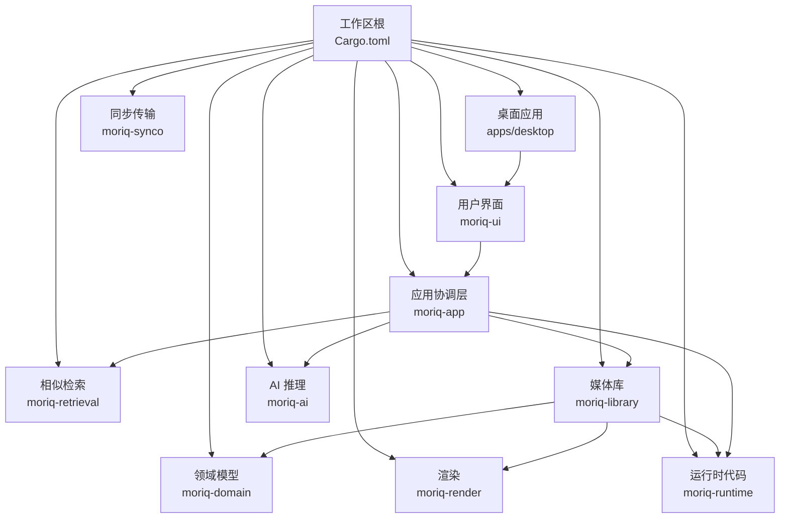
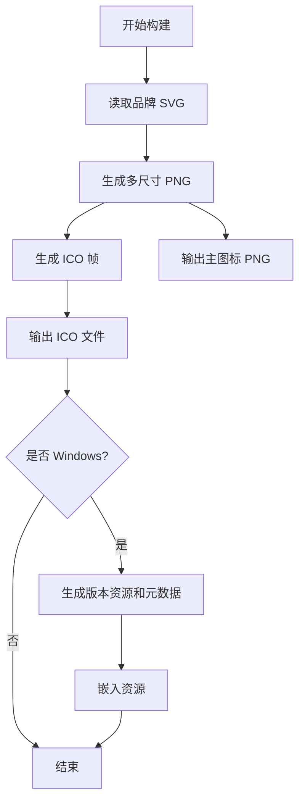
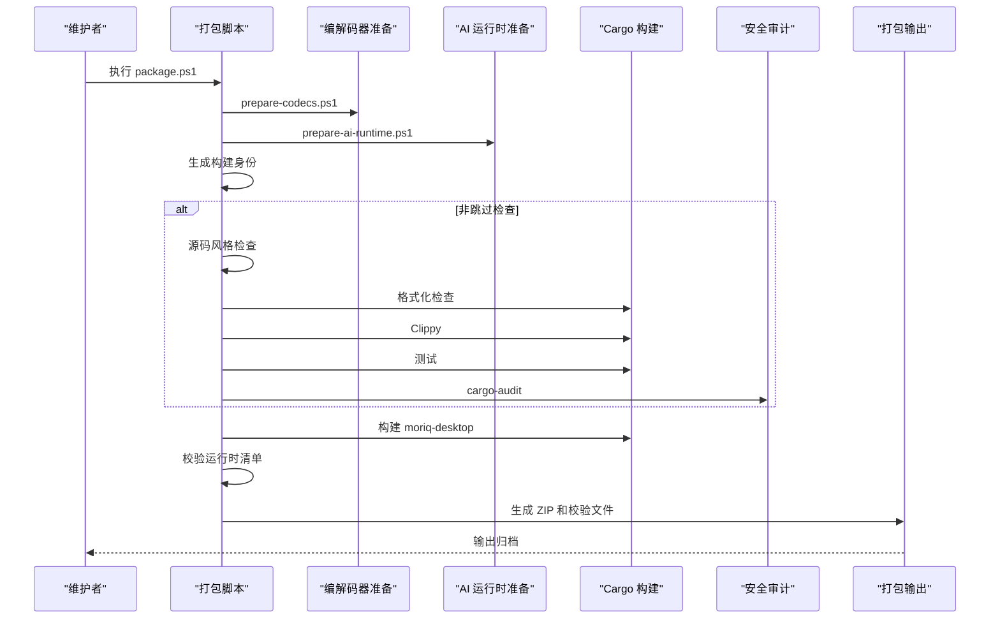
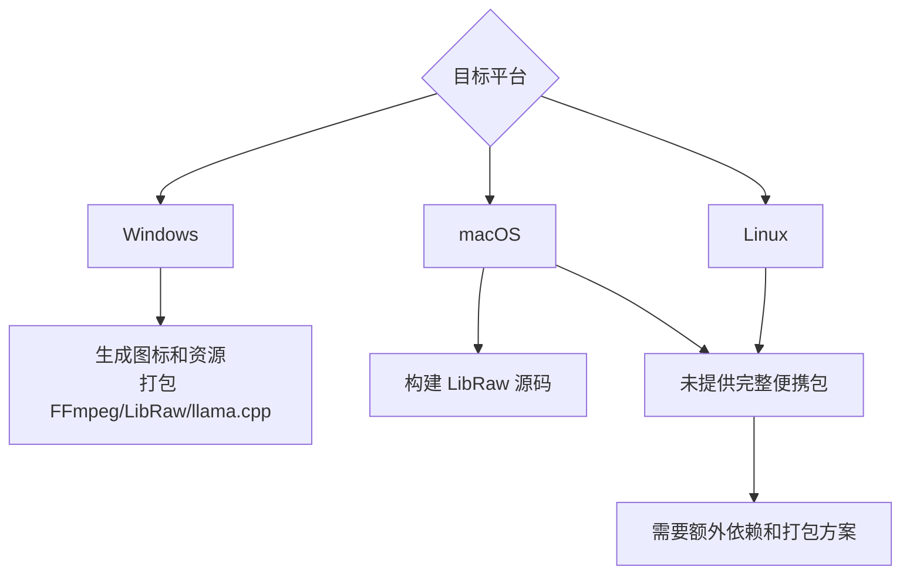
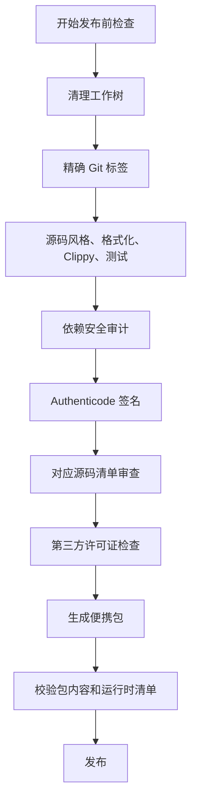

# 构建与部署

> Repo Wiki 节点 `build-deployment`
> 导出自 Qoder 知识库快照 `8fbe02f6-57c2-4874-b725-1a8130851fd9`，代码基线 `7a7a8e75e18bd90294e09cd422dd7ed5a04813a0`（分支 main，zh-CN）。

## 当前构建补充（2026-11-07）

以下补充对应 1.2.0 开发更新；后文保留旧快照作为背景，运行组件清单和发布条件以当前脚本为准。

Windows 完整包需要媒体组件、Qwen 运行器及内置 CPU 人脸组件。首次准备需要联网，在仓库根目录执行：

```powershell
./scripts/prepare-codecs.ps1
./scripts/prepare-ai-runtime.ps1
./scripts/prepare-face-runtime.ps1
./scripts/package.ps1 -PackageSuffix 'people-UI-20261107'
```

缓存已完整准备时可给打包命令增加 `-Offline`。人脸准备脚本下载固定版本的 OpenCV、YuNet 和 SFace，使用 [verified-download.ps1](../scripts/verified-download.ps1) 校验固定 SHA256。下载先写入 `.part`，校验成功后才替换缓存；失败清理临时下载，离线发现缺失或损坏缓存会拒绝继续。

[package.ps1](../scripts/package.ps1) 默认执行源码规范、下载回归、格式、Clippy、工作区测试及真实 CPU 进程生命周期检查，再构建、归档和生成验证记录。包中 `ai/faces` 包含原生工作进程、人脸模型、OpenCV、依赖运行库和许可说明；运行文件的构建摘要与校验流程见 [ai-runtime-files.ps1](../scripts/ai-runtime-files.ps1)。

默认生成开发包，未指定 `-PublicRelease` 不能称为公开发布包。公开模式要求干净工作区、准确源码标签且不能跳过检查；该选项也不等于已签名或已上传发布。检查归档旁的验证 JSON、运行组件报告和 SHA256，并区分本地成品校验、全新解压启动、清洁系统安装与公开发布证据。2026-11-07 的人物界面开发包未签名，`PublicRelease=false`。

相关文档：[测试策略](测试策略.md)、[AI 功能集成](AI%20功能集成.md)、[AI 工作室与人物整理](AI%20工作室与人物整理.md)。

## 历史构建说明

<cite>
**本文引用的文件**   
- [Cargo.toml](../Cargo.toml)
- [rust-toolchain.toml](../rust-toolchain.toml)
- [ARCHITECTURE.md](../ARCHITECTURE.md)
- [SECURITY.md](../SECURITY.md)
- [apps/desktop/Cargo.toml](../apps/desktop/Cargo.toml)
- [apps/desktop/build.rs](../apps/desktop/build.rs)
- [scripts/package.ps1](../scripts/package.ps1)
- [scripts/ai-runtime-files.ps1](../scripts/ai-runtime-files.ps1)
- [scripts/prepare-codecs.ps1](../scripts/prepare-codecs.ps1)
- [scripts/prepare-ai-runtime.ps1](../scripts/prepare-ai-runtime.ps1)
- [scripts/prepare-raw-macos.sh](../scripts/prepare-raw-macos.sh)
- [scripts/check-source-style.py](../scripts/check-source-style.py)
- [scripts/release-metadata.py](../scripts/release-metadata.py)
- [scripts/prune-runtime-notices.py](../scripts/prune-runtime-notices.py)
- [scripts/validate-source-archive.py](../scripts/validate-source-archive.py)
</cite>

## 目录
1. [简介](#简介)
2. [项目结构与构建目标](#项目结构与构建目标)
3. [开发环境搭建](#开发环境搭建)
4. [本地构建与编译配置](#本地构建与编译配置)
5. [打包脚本与发布流程](#打包脚本与发布流程)
6. [自动化测试与代码质量检查](#自动化测试与代码质量检查)
7. [依赖准备与完整性校验](#依赖准备与完整性校验)
8. [跨平台构建注意事项](#跨平台构建注意事项)
9. [生产环境部署最佳实践](#生产环境部署最佳实践)
10. [安全与合规检查清单](#安全与合规检查清单)
11. [故障排查](#故障排查)
12. [结论](#结论)

## 简介
本指南面向需要在本地或持续集成环境中构建、打包和发布 Moriq Space 的开发者与维护者。仓库以 Rust Workspace 为核心，桌面端入口位于 `apps/desktop`，核心领域逻辑分布在 `crates/moriq-*` 多个 crate 中；媒体解码、AI 推理、UI 渲染和运行时完整性等能力由脚本与原生组件共同支撑。

当前已验证的主要交付形态是 Windows x86_64 便携包；macOS 与 Linux 分支仍属于开发目标，仓库未提供完整可验证的便携式运行时或安装包。

## 项目结构与构建目标
仓库采用 Workspace 组织方式：

- 工作区根定义版本、Edition、Rust 工具链、共享依赖、发布优化参数和严格 lint。
- 桌面应用 `moriq-desktop` 是最终可执行程序的入口，依赖 UI、Iced、日志、文件对话框和图像库。
- 业务 crate 包括领域模型、渲染、检索、运行时代码、同步传输、AI 推理、媒体库和应用协调层。
- 构建阶段会生成图标、Windows 资源信息，并在打包时组装 AI 运行时、媒体编解码器和许可证说明。



**图示来源**
- [Cargo.toml:1-12](../Cargo.toml#L1-L12)
- [apps/desktop/Cargo.toml:1-21](../apps/desktop/Cargo.toml#L1-L21)

**章节来源**
- [Cargo.toml:1-80](../Cargo.toml#L1-L80)
- [ARCHITECTURE.md:1-30](../ARCHITECTURE.md#L1-L30)

## 开发环境搭建
### 必需工具
- Rust 工具链：固定通道 `1.99.0`，包含 `rustfmt` 和 `clippy`。
- Git：用于源码身份、标签检查和审计数据库更新。
- Python：用于源码风格检查、构建身份生成、第三方许可汇总和对应源码清单校验。
- PowerShell：用于主要打包、依赖下载和完整性校验。
- macOS 上可选工具：Shell、`curl`、`shasum`、`make`，用于 LibRaw 源码构建。

### 安装步骤
1. 使用 `rustup` 安装指定工具链并启用格式化和静态检查组件。
2. 确保系统 PATH 中包含 `cargo`、`git`、`python` 和 PowerShell。
3. 首次构建前运行以下命令安装审计工具：
   - `cargo install cargo-audit --locked --root target/audit-tools`
4. 如需离线构建，提前准备脚本所需的压缩包，并保留其 SHA-256 校验值。

**章节来源**
- [rust-toolchain.toml:1-4](../rust-toolchain.toml#L1-L4)
- [SECURITY.md:6-14](../SECURITY.md#L6-L14)
- [scripts/package.ps1:1-12](../scripts/package.ps1#L1-L12)

## 本地构建与编译配置
### 基本编译
在工作区根执行 Cargo 命令即可编译所有成员。默认开发构建会针对部分性能关键 crate 提高优化等级，使媒体解码、图像处理和哈希计算在开发模式下更快。

常用命令：
- `cargo build`：构建工作区。
- `cargo build -p moriq-desktop`：仅构建桌面应用。
- `cargo check --workspace`：快速检查编译错误。
- `cargo fmt --all --check`：检查代码格式。
- `cargo clippy --workspace --all-targets --all-features --locked`：运行静态检查。

### 发布构建优化
Workspace 的发布配置启用了薄链接并限制代码生成单元数量，有助于缩小和优化二进制体积。此外，`unsafe_code` 被禁止，Clippy 对 `unwrap_used` 和 `expect_used` 使用拒绝策略，从而减少构建期风险。

### 构建身份和资源生成
桌面应用的 `build.rs` 会在构建时：
- 从 SVG 图标生成多尺寸 PNG 和 ICO。
- 在 Windows 平台上生成 `.rc` 资源文件，写入公司名、产品名、文件描述、版本和构建身份。
- 将资源嵌入到 Windows 可执行文件中。
- 响应 `MORIQ_BUILD_ID` 环境变量变化，支持不同构建身份。



**图示来源**
- [apps/desktop/build.rs:1-58](../apps/desktop/build.rs#L1-L58)

**章节来源**
- [Cargo.toml:13-80](../Cargo.toml#L13-L80)
- [apps/desktop/Cargo.toml:1-21](../apps/desktop/Cargo.toml#L1-L21)
- [apps/desktop/build.rs:1-58](../apps/desktop/build.rs#L1-L58)

## 打包脚本与发布流程
### 打包脚本概览
`scripts/package.ps1` 是主要打包入口，负责：
- 准备媒体编解码器和 AI 运行时。
- 生成构建身份。
- 执行源码风格、格式化、Clippy、测试和可选的安全审计。
- 编译桌面程序。
- 校验运行时文件清单和 SHA-256。
- 生成许可证说明、SBOM、构建报告和校验文件。
- 输出便携 ZIP 包和签名摘要。

### 常规开发包
```powershell
.\scripts\package.ps1
```
这会以 Release 模式构建，但不强制要求干净工作树、精确标签或数字签名。

### 带安全检查的开发包
```powershell
.\scripts\package.ps1 -SkipChecks:$false
```
建议始终保留检查；跳过检查只适用于明确需要快速迭代且后续重新检查的场景。

### 公开发布包
```powershell
.\scripts\package.ps1 -PublicRelease
```
公开发布模式会额外执行：
- 检查工作树是否为空。
- 检查 HEAD 是否匹配精确 Git 标签。
- 不允许跳过检查。
- 要求已安装 `cargo-audit`。
- 要求有效 Authenticode 签名。
- 要求存在审查过的对应源码清单。
- 校验对应源码清单的 SHA-256 和必填字段。



**图示来源**
- [scripts/package.ps1:1-145](../scripts/package.ps1#L1-L145)

**章节来源**
- [scripts/package.ps1:1-145](../scripts/package.ps1#L1-L145)
- [scripts/ai-runtime-files.ps1:1-3](../scripts/ai-runtime-files.ps1#L1-L3)

## 自动化测试与代码质量检查
### 本地质量门禁
仓库文档和本地脚本都强调以下门禁顺序：
1. 源码密度检查。
2. 格式化检查。
3. Clippy 严格检查。
4. 全目标、全特性测试。
5. 工作区编译检查。

```powershell
python scripts/check-source-style.py
cargo fmt --all -- --check
cargo clippy --workspace --all-targets --all-features --locked -- -D warnings
cargo test --workspace --all-targets --all-features --locked
cargo check --workspace --all-targets --locked
```

### 源码密度检查
`scripts/check-source-style.py` 会扫描 `crates` 和 `apps` 下的 Rust 源码，忽略字符串字面量、注释、vendor 目录和 `target` 生成产物，并对实际可执行代码行进行长度限制检查。该检查能发现 rustfmt 可能未拆分的超长表达式。

### 测试范围
测试覆盖取消、库变更、快照一致性、写入器响应性、查询快照隔离等场景。但文档明确指出，这些回归测试不能替代大型库容量基准、真实模型推理、桌面视觉验收或强制终止进程后的恢复测试。

**章节来源**
- [ARCHITECTURE.md:97-131](../ARCHITECTURE.md#L97-L131)
- [scripts/check-source-style.py:1-48](../scripts/check-source-style.py#L1-L48)
- [scripts/package.ps1:43-72](../scripts/package.ps1#L43-L72)

## 依赖准备与完整性校验
### 媒体编解码器
`scripts/prepare-codecs.ps1` 会按固定 URL 和 SHA-256 下载 FFmpeg 和 LibRaw 二进制归档，解压后仅复制允许的工具和动态库到 `target/codecs/runtime`，并生成：
- 依赖来源说明。
- 许可证副本。
- 运行时文件清单。

离线模式下必须提前放置预期路径的归档，否则会失败。

### AI 运行时
`scripts/prepare-ai-runtime.ps1` 固定拉取 llama.cpp 的特定修订，并通过 SHA-256 校验后解压到 `target/ai-runtime`。它只复制必需的服务器、实现和 GPU/CPU 相关 DLL，同时生成：
- AI 子目录清单。
- 完整 AI 运行时清单。
- 上游来源说明。
- 模型清单。

AI 运行时还会拒绝包含重解析点（例如符号链接或目录 junction）的路径，防止恶意或意外链接污染构建产物。

### 运行时通知裁剪
打包前会调用 `scripts/prune-runtime-notices.py`，把独立许可证和版权声明从可分发运行时中移除并归档到 `target/package-reports/runtime-notices`，同时在最终包目录中进行二次检查，避免遗漏。

### 构建身份与依赖清单
`scripts/release-metadata.py` 会：
- 收集 Git 跟踪文件和未跟踪文件，计算源树摘要。
- 生成 `build-info.json`，包含版本、提交、脏标记、构建 ID、构建时间和源文件映射。
- 通过 Cargo metadata 生成 CycloneDX SBOM。
- 汇总 Rust 和 npm 依赖的许可证正文。
- 输出缺失许可证报告。

**章节来源**
- [scripts/prepare-codecs.ps1:1-60](../scripts/prepare-codecs.ps1#L1-L60)
- [scripts/prepare-ai-runtime.ps1:1-62](../scripts/prepare-ai-runtime.ps1#L1-L62)
- [scripts/prune-runtime-notices.py:1-96](../scripts/prune-runtime-notices.py#L1-L96)
- [scripts/release-metadata.py:1-143](../scripts/release-metadata.py#L1-L143)

## 跨平台构建注意事项
### Windows
- 主要支持的发布目标。
- 桌面应用构建会生成 Windows 图标、版本信息和资源。
- 打包脚本、FFmpeg、LibRaw、llama.cpp 预编译二进制均面向 Windows。
- 公开发布需要有效的 Authenticode 签名。

### macOS
- 提供 LibRaw 源码构建脚本，可在 macOS 上静态编译 LibRaw。
- 架构文档指出 macOS 和 Linux 仍是开发目标，未提供完整可验证的便携式运行时或安装包。
- 如果仅在 macOS 上构建 native 组件，需先运行 LibRaw 准备脚本，再执行 Rust 构建。

### Linux
- 没有独立的 Linux 预编译编解码器打包脚本。
- 现有脚本和工件主要围绕 Windows 构建。
- 若要在 Linux 上构建，应优先解决原生依赖、FFmpeg/LibRaw/libvips 的链接方式和打包方案，不能直接复用 Windows 脚本。

### 已知限制
- 当前仓库未声明完整的 CI 流水线，也没有自动触发 GitHub Actions。
- 截图捕获功能通过 `capture` 特性启用，属于诊断工具，不属于普通桌面构建的一部分。
- 某些第三方依赖警告会保留，不代表漏洞已被修复。



**图示来源**
- [ARCHITECTURE.md:1-10](../ARCHITECTURE.md#L1-L10)
- [scripts/prepare-raw-macos.sh:1-33](../scripts/prepare-raw-macos.sh#L1-L33)
- [scripts/prepare-codecs.ps1:1-60](../scripts/prepare-codecs.ps1#L1-L60)

**章节来源**
- [ARCHITECTURE.md:1-10](../ARCHITECTURE.md#L1-L10)
- [scripts/prepare-raw-macos.sh:1-33](../scripts/prepare-raw-macos.sh#L1-L33)

## 生产环境部署最佳实践
### 分发内容
生产便携包应包含：
- `Moriq Space.exe`
- `ai`
- `codecs`

不应包含：
- 审计报告、构建身份信息、许可证缺口报告。
- 独立运行时许可证原文（会被裁剪并归档到报告目录）。
- 未审查的对应源码清单。

### 启动行为
应用会在首次使用时验证 AI 和 codec 运行时清单；后续重启会复用结果。如果修复或替换运行时，应重启进程以确保新清单生效。未知文件会被拒绝，调试构建还会排除未使用的 Node 准备缓存。

### 监控建议
由于仓库未内置服务端监控组件，运维侧应关注：
- 进程退出码和崩溃日志。
- AI 推理失败、模型下载失败和运行时校验失败。
- 媒体解码失败、原始 RAW 处理失败。
- SQLite 写入器阻塞或恢复流程异常。
- 磁盘空间不足导致备份、导入、缩略图重建失败。
- 外部依赖（FFmpeg、LibRaw、llama.cpp）可用性。

### 回滚策略
- 保留上一个稳定版本的便携包。
- 保留构建报告中的版本、提交、构建 ID 和 SHA-256。
- 如果出现运行时完整性问题，回滚到上一份已知正确的 `ai` 和 `codecs` 目录。
- 如果数据库或库状态损坏，使用备份和恢复机制，而不是手动删除媒体文件。

**章节来源**
- [SECURITY.md:42-54](../SECURITY.md#L42-L54)
- [scripts/package.ps1:108-145](../scripts/package.ps1#L108-L145)
- [ARCHITECTURE.md:31-96](../ARCHITECTURE.md#L31-L96)

## 安全与合规检查清单
### 发布前必做项
- 清理工作树，确保没有未提交修改。
- 打上精确 Git 标签，并确保 HEAD 与该标签完全匹配。
- 安装并更新 `cargo-audit`。
- 运行源码风格检查、格式化检查、Clippy 和测试。
- 运行完整打包脚本，不要跳过安全检查。
- 为 Windows 可执行文件添加有效的 Authenticode 签名。
- 准备 FFmpeg、LibRaw、libvips 的对应源码清单，并确保审查字段完整。
- 运行对应源码清单校验脚本。
- 确认第三方许可证文本齐全，无缺失许可证条目。
- 确认便携包根目录只有应用、AI 运行时和编解码器。
- 确认便携包内没有残留独立许可证文件。

### 安全规则要点
- 漏洞和不安全依赖会阻止打包。
- 未维护依赖警告会保留，但不视为已修复。
- 运行时清单在进程启动时验证。
- AI 运行时不允许重解析点。
- 对应源码清单必须由维护者显式审查，脚本不会推断源码完整性。



**图示来源**
- [SECURITY.md:6-41](../SECURITY.md#L6-L41)
- [scripts/package.ps1:14-107](../scripts/package.ps1#L14-L107)
- [scripts/validate-source-archive.py:1-34](../scripts/validate-source-archive.py#L1-L34)

**章节来源**
- [SECURITY.md:6-54](../SECURITY.md#L6-L54)
- [scripts/package.ps1:14-145](../scripts/package.ps1#L14-L145)
- [scripts/validate-source-archive.py:1-34](../scripts/validate-source-archive.py#L1-L34)

## 故障排查
### 常见问题
| 现象 | 可能原因 | 处理方式 |
|---|---|---|
| 打包脚本提示工作树不干净 | 存在未提交修改或新增文件 | 提交、暂存或还原更改后重试 |
| 公开发布找不到精确标签 | HEAD 未指向某个 Git 标签 | 创建并切换到精确匹配的标签 |
| 缺少离线归档 | 离线模式依赖本地缓存 | 预先下载 FFmpeg、LibRaw、llama.cpp 归档并按预期路径存放 |
| 运行时清单校验失败 | AI 或 codec 目录内容与清单不一致 | 重新运行对应准备脚本，不要手动修改 `checksums.json` |
| 打包后便携包根目录条目异常 | 构建产物不完整或被意外注入 | 检查临时 staging 目录和打包前的校验输出 |
| 第三方许可证缺失 | 依赖未附带许可证文件或路径未被识别 | 检查依赖 manifest、licenses 目录和 `assets/licenses/upstream` |
| 对应源码清单校验失败 | 缺少 FFmpeg、LibRaw 或 libvips，或审查字段不完整 | 补充审查人、时间、修订和依赖完整性声明 |
| 安全审计失败 | 存在漏洞或不安全依赖 | 升级依赖或记录不可修复风险后再评估 |
| macOS 无法找到 LibRaw | 未运行源码构建脚本 | 运行 `scripts/prepare-raw-macos.sh` 并确认静态库生成成功 |

### 推荐调试命令
- 查看构建身份：检查 `target/build-info.json`。
- 查看 SBOM：检查 `target/package-reports/sbom.cdx.json`。
- 查看许可证缺口：检查 `target/package-reports/license-gaps.json`。
- 查看运行时通知归档：检查 `target/package-reports/runtime-notices`。
- 查看对应源码清单：检查 `target/corresponding-sources/verified.json`。

**章节来源**
- [scripts/package.ps1:14-145](../scripts/package.ps1#L14-L145)
- [scripts/release-metadata.py:1-143](../scripts/release-metadata.py#L1-L143)
- [scripts/prune-runtime-notices.py:1-96](../scripts/prune-runtime-notices.py#L1-L96)
- [scripts/validate-source-archive.py:1-34](../scripts/validate-source-archive.py#L1-L34)

## 结论
Moriq Space 的构建体系围绕 Rust Workspace、PowerShell 打包脚本和严格的完整性校验展开。当前官方支持重点在 Windows x86_64，公开发布要求干净源码、精确标签、安全审计、数字签名和对应源码清单。开发时应始终运行源码风格、格式化、Clippy 和测试；发布时应避免跳过检查，并保留构建报告、SBOM 和许可证说明以便审计与回滚。macOS 和 Linux 目前更适合本地原生组件开发和实验性构建，不建议直接作为生产发布目标。
