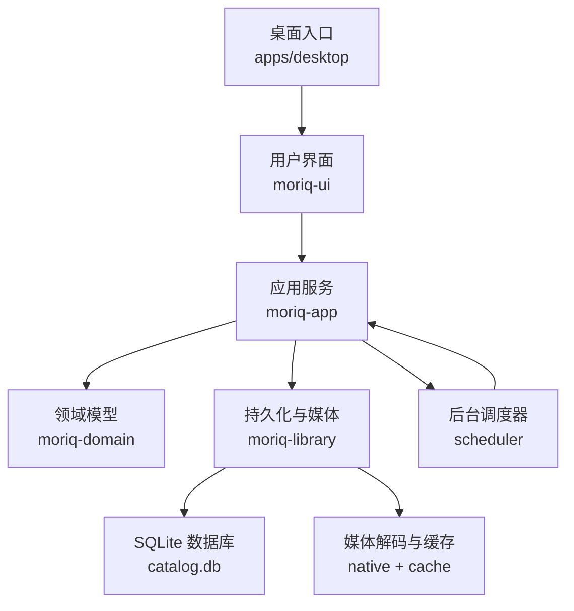
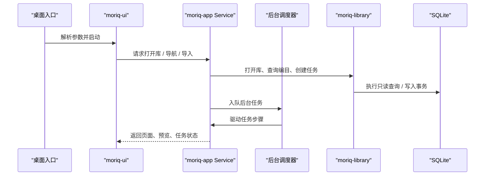
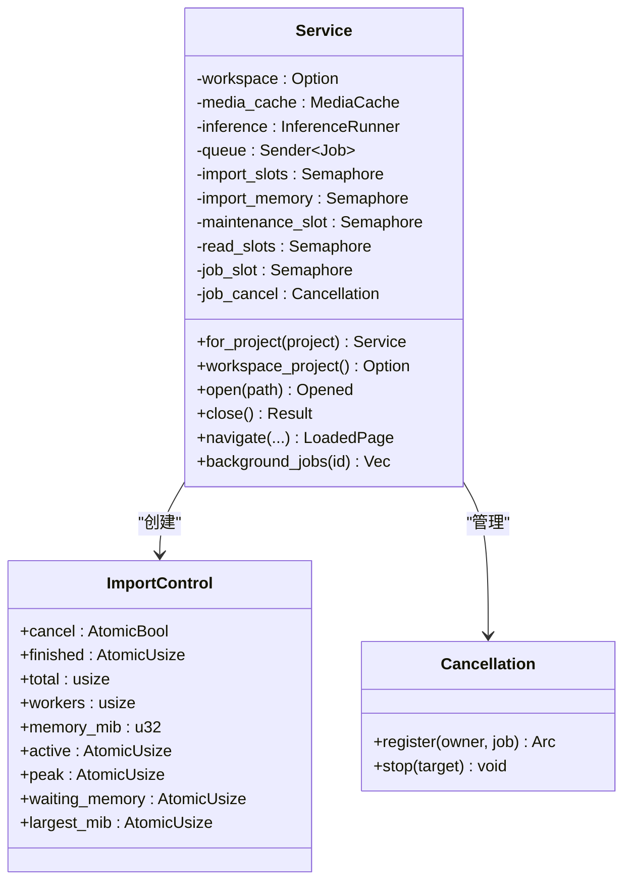
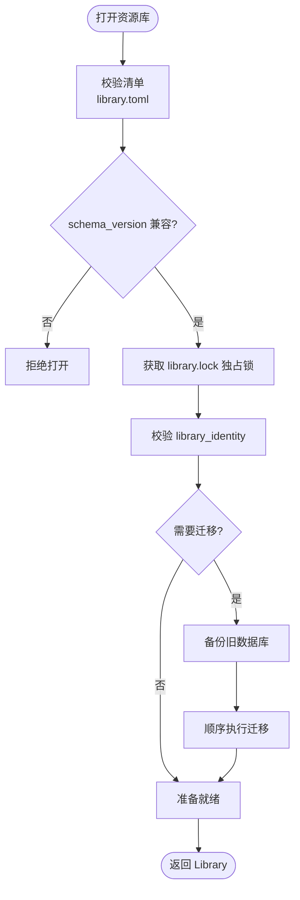
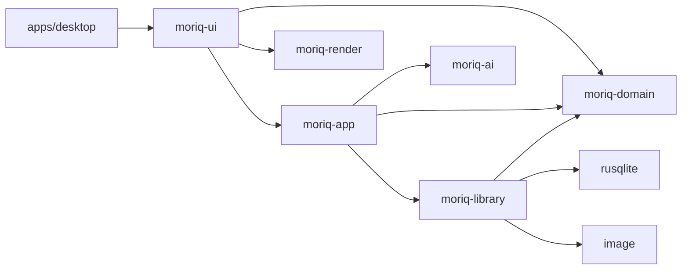
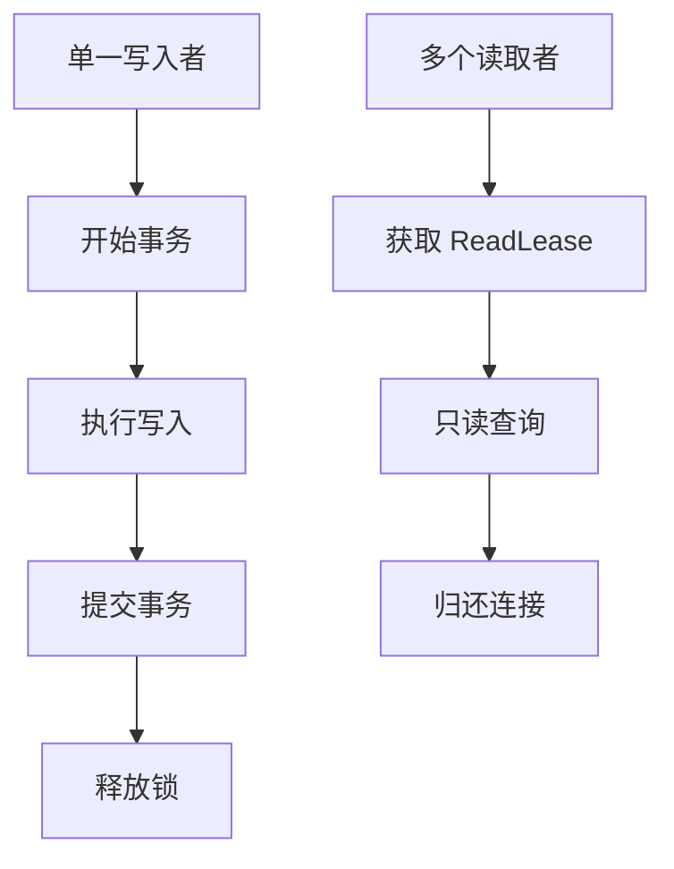
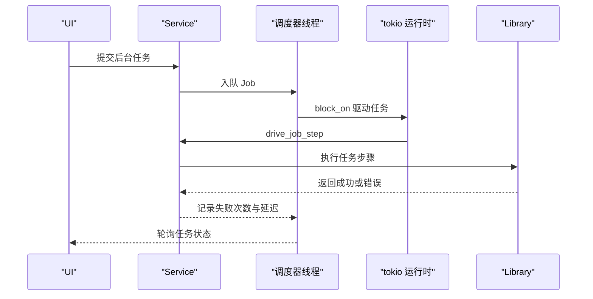
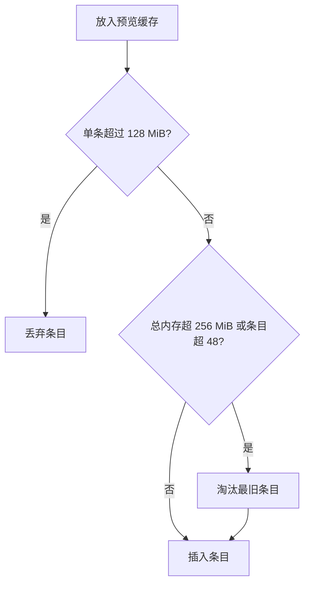

# 架构设计

> Repo Wiki 节点 `architecture-design`
> 导出自 Qoder 知识库快照 `8fbe02f6-57c2-4874-b725-1a8130851fd9`，代码基线 `7a7a8e75e18bd90294e09cd422dd7ed5a04813a0`（分支 main，zh-CN）。

<cite>
**本文引用的文件**   
- [ARCHITECTURE.md](../../ARCHITECTURE.md)
- [Cargo.toml](../../Cargo.toml)
- [apps/desktop/src/main.rs](../../apps/desktop/src/main.rs)
- [crates/moriq-ui/src/lib.rs](../../crates/moriq-ui/src/lib.rs)
- [crates/moriq-app/src/lib.rs](../../crates/moriq-app/src/lib.rs)
- [crates/moriq-app/src/scheduler.rs](../../crates/moriq-app/src/scheduler.rs)
- [crates/moriq-domain/src/lib.rs](../../crates/moriq-domain/src/lib.rs)
- [crates/moriq-domain/src/jobs.rs](../../crates/moriq-domain/src/jobs.rs)
- [crates/moriq-library/src/lib.rs](../../crates/moriq-library/src/lib.rs)
- [crates/moriq-library/src/database/read_pool.rs](../../crates/moriq-library/src/database/read_pool.rs)
- [crates/moriq-library/src/library/core.rs](../../crates/moriq-library/src/library/core.rs)
</cite>

## 目录
1. [引言](#引言)
2. [项目结构](#项目结构)
3. [核心组件](#核心组件)
4. [架构总览](#架构总览)
5. [详细组件分析](#详细组件分析)
6. [依赖关系分析](#依赖关系分析)
7. [性能与资源管理](#性能与资源管理)
8. [故障排查指南](#故障排查指南)
9. [结论](#结论)
10. [附录：关键技术决策](#附录关键技术决策)

## 引言
Moriq Space 是一个面向本地媒体资产管理的桌面应用，采用清晰的分层架构：UI 层负责界面和交互；应用服务层协调业务用例、调度后台任务并管理内存预算；领域模型层定义可序列化类型、身份标识和业务约束；持久化层封装 SQLite 数据库、媒体解码、导入导出、维护与恢复。整个系统强调单写者模式、受控并发、事务一致性和可恢复性，并通过 Iced GUI 提供跨平台原生体验。

## 项目结构
仓库以 Rust workspace 组织多个 crate：
- `apps/desktop`：桌面入口，解析命令行参数、初始化日志并启动 UI。
- `crates/moriq-ui`：Iced 驱动的界面模块，负责视图状态、消息路由、翻译和主题。
- `crates/moriq-app`：应用服务层，暴露 Service 协调器，管理数据库访问、异步任务、导入、推理、设置和缓存。
- `crates/moriq-domain`：纯领域模型，包含 LibraryId、AssetId、ProjectId、查询树、任务协议等。
- `crates/moriq-library`：持久化基础设施，封装库生命周期、编目、媒体、AI、传输、任务、维护和数据库读写。
- 其他辅助 crate：moriq-render、moriq-retrieval、moriq-runtime、moriq-synco、moriq-ai 等。

**图表来源**
- [apps/desktop/src/main.rs:1-97](../../apps/desktop/src/main.rs#L1-L97)
- [crates/moriq-ui/src/lib.rs:1-200](../../crates/moriq-ui/src/lib.rs#L1-L200)
- [crates/moriq-app/src/lib.rs:1-200](../../crates/moriq-app/src/lib.rs#L1-L200)
- [crates/moriq-domain/src/lib.rs:1-200](../../crates/moriq-domain/src/lib.rs#L1-L200)
- [crates/moriq-library/src/lib.rs:1-200](../../crates/moriq-library/src/lib.rs#L1-L200)

**章节来源**
- [apps/desktop/src/main.rs:1-97](../../apps/desktop/src/main.rs#L1-L97)
- [Cargo.toml:1-80](../../Cargo.toml#L1-L80)

## 核心组件
- **桌面入口**：处理错误弹窗、日志输出、图标加载、命令行参数解析，最终调用 UI 的启动函数。
- **UI 层（moriq-ui）**：使用 Iced 构建界面，持有屏幕、对话框、快捷键和消息枚举；所有磁盘、编目和媒体解码操作通过 Service 完成。
- **应用服务层（moriq-app）**：Service 是公共协调器，绑定工作区项目范围、媒体缓存、推理执行器、任务队列和多类信号量；对外暴露打开库、导航、导入、任务查询等接口。
- **领域模型层（moriq-domain）**：定义不可变身份、资产、项目、查询树、排序和任务协议；规则树具备深度、节点数和字段长度校验。
- **持久化层（moriq-library）**：实现库创建/打开、迁移、只读连接池、媒体源、导入提交、备份恢复、任务作业和维护工具。

**章节来源**
- [apps/desktop/src/main.rs:1-97](../../apps/desktop/src/main.rs#L1-L97)
- [crates/moriq-ui/src/lib.rs:1-200](../../crates/moriq-ui/src/lib.rs#L1-L200)
- [crates/moriq-app/src/lib.rs:1-200](../../crates/moriq-app/src/lib.rs#L1-L200)
- [crates/moriq-domain/src/lib.rs:1-200](../../crates/moriq-domain/src/lib.rs#L1-L200)
- [crates/moriq-library/src/lib.rs:1-200](../../crates/moriq-library/src/lib.rs#L1-L200)

## 架构总览
Moriq Space 的分层边界明确：
- UI 层不直接访问数据库或文件系统，仅发送消息并渲染 Service 返回的投影数据。
- 应用服务层聚合用例模块，限制并发、管理取消、跟踪进度，并将具体存储和媒体逻辑委托给 moriq-library。
- 领域模型层不包含 I/O 或渲染依赖，保证业务语义稳定。
- 持久化层实现单写者写入、多读取者连接池、WAL 模式、迁移和恢复。

**图表来源**
- [apps/desktop/src/main.rs:1-97](../../apps/desktop/src/main.rs#L1-L97)
- [crates/moriq-ui/src/lib.rs:1-200](../../crates/moriq-ui/src/lib.rs#L1-L200)
- [crates/moriq-app/src/lib.rs:1-200](../../crates/moriq-app/src/lib.rs#L1-L200)
- [crates/moriq-app/src/scheduler.rs:1-200](../../crates/moriq-app/src/scheduler.rs#L1-L200)
- [crates/moriq-library/src/lib.rs:1-200](../../crates/moriq-library/src/lib.rs#L1-L200)

## 详细组件分析

### UI 层（moriq-ui）
UI 层采用 Iced 的消息-更新-渲染循环。它维护 Screen、Dialog、Shortcut、Message 等枚举，负责国际化、主题、导航、筛选、画廊、查看器、上传、任务面板、偏好设置和捕获功能。UI 的状态是瞬时的，真实数据通过 Service 获取；例如页面加载、邻居资产、全尺寸预览、播放控制、导入报告和 Job 消息都由 Service 异步返回后由 UI 渲染。

关键职责边界：
- 视图状态：当前屏幕、选择、滚动、缩放、焦点、动画过渡。
- 用户输入：键盘快捷键、拖拽导入、窗口事件、DPI 变化。
- 外部集成：通过 LaunchOptions 传入图标、日志开关、调试面板。
- 严格禁止：UI 不直接访问磁盘、数据库或媒体解码。

**章节来源**
- [crates/moriq-ui/src/lib.rs:1-200](../../crates/moriq-ui/src/lib.rs#L1-L200)

### 应用服务层（moriq-app）
Service 是系统的中央协调器，具有以下特征：
- 项目作用域：通过 for_project 冻结后续调用的 ProjectId，避免 UI 切换时重定向已排队任务。
- 共享资源：MediaCache、InferenceRunner、任务通道、导入并发信号量、维护信号量、读取信号量、通用任务信号量和取消注册表。
- 结果投影：LoadedPage、LoadedNeighborhood、LoadedOverview、Tile、Opened 等结构用于 UI 展示。
- 导入控制：ImportControl 暴露取消标志、完成计数、活跃数、峰值、等待内存、最大项大小等进度指标。

Service 的关键方法包括打开库、关闭库、导航、浏览、搜索、收藏、导入、任务查询、设置保存、推理运行等。所有阻塞操作都通过专用线程或 tokio 运行时调度。

**图表来源**
- [crates/moriq-app/src/lib.rs:1-200](../../crates/moriq-app/src/lib.rs#L1-L200)
- [crates/moriq-app/src/scheduler.rs:1-200](../../crates/moriq-app/src/scheduler.rs#L1-L200)

**章节来源**
- [crates/moriq-app/src/lib.rs:1-200](../../crates/moriq-app/src/lib.rs#L1-L200)

### 领域模型层（moriq-domain）
领域模型层提供无 I/O 的可序列化类型和强约束：
- 身份标识：LibraryId、AssetId、AssetVersionId、ProjectId，基于 UUID，支持序列化、显示和默认值。
- 资产与项目：Asset 包含名称、格式、尺寸、字节、收藏、评分、标签、导入时间；Project 包含父项目、名称、计数。
- 查询与规则：Query 支持媒体类型、文本、收藏、项目、格式、存储、评分、尺寸、方向、标签、颜色等条件；Rule 支持 All、Any、Not、Name、Notes、Tag、Format、Rating、Favorite、Raw、HasLocation，并提供 validate 方法限制深度、节点数和字符串长度。
- 任务协议：JobKind、ModelId、JobState、TaskError 定义稳定的持久化协议值，未知值会被显式拒绝。

这种设计确保 UI 和服务可以安全传递查询和任务信息，而持久化层负责将其转换为 SQL 和运行时行为。

**章节来源**
- [crates/moriq-domain/src/lib.rs:1-200](../../crates/moriq-domain/src/lib.rs#L1-L200)
- [crates/moriq-domain/src/jobs.rs:1-200](../../crates/moriq-domain/src/jobs.rs#L1-L200)

### 持久化层（moriq-library）
持久化层是阻塞型基础设施，职责包括：
- 库生命周期：创建临时目录、生成清单、初始化 schema、硬链接目录、发布库、打开并校验 manifest 与 library_identity。
- 迁移与一致性：按 user_version 顺序执行迁移脚本，升级前备份旧数据库，校验 schema_version 与 min_reader_version。
- 只读连接池：ReadPool 持有 File 租约保护库生命周期，checkout 复用最多 4 个只读 Connection，drop 时回滚事务、清理临时表并归还连接。
- 媒体与 AI：媒体解码、缩略图、视频、色彩、区域、向量、AI 内容、人脸、相似性等。
- 传输与维护：导入、导出、恢复、备份、孤儿检测、清理、存储检查。
- 任务与取消：tasks/cancel、tasks/jobs 提供任务作业与取消能力。

**图表来源**
- [crates/moriq-library/src/library/core.rs:1-200](../../crates/moriq-library/src/library/core.rs#L1-L200)

**章节来源**
- [crates/moriq-library/src/lib.rs:1-200](../../crates/moriq-library/src/lib.rs#L1-L200)
- [crates/moriq-library/src/database/read_pool.rs:1-97](../../crates/moriq-library/src/database/read_pool.rs#L1-L97)
- [crates/moriq-library/src/library/core.rs:1-200](../../crates/moriq-library/src/library/core.rs#L1-L200)

## 依赖关系分析
各 crate 的依赖方向遵循分层原则：
- apps/desktop 依赖 moriq-ui。
- moriq-ui 依赖 moriq-app、moriq-domain、moriq-render。
- moriq-app 依赖 moriq-domain、moriq-library、moriq-ai。
- moriq-library 依赖 moriq-domain、rusqlite、image、fs2、sha2、toml 等。
- moriq-domain 无外部 I/O 依赖。

**图表来源**
- [Cargo.toml:1-80](../../Cargo.toml#L1-L80)

**章节来源**
- [Cargo.toml:1-80](../../Cargo.toml#L1-L80)

## 性能与资源管理

### 单写者模式与 SQLite 事务
持久化层采用单写者模式：所有写入通过一个 writer 串行执行，读取端使用 ReadPool 的只读连接池。写入端持有 library.lock 独占锁，确保同一时刻只有一个进程或窗口修改数据库。读取连接在 checkout 时启用 WAL 相关 PRAGMA，并在 drop 时自动回滚未提交事务、清理临时表并归还连接。

**图表来源**
- [crates/moriq-library/src/library/core.rs:1-200](../../crates/moriq-library/src/library/core.rs#L1-L200)
- [crates/moriq-library/src/database/read_pool.rs:1-97](../../crates/moriq-library/src/database/read_pool.rs#L1-L97)

**章节来源**
- [crates/moriq-library/src/library/core.rs:1-200](../../crates/moriq-library/src/library/core.rs#L1-L200)
- [crates/moriq-library/src/database/read_pool.rs:1-97](../../crates/moriq-library/src/database/read_pool.rs#L1-L97)

### 异步任务调度
后台调度器使用独立线程和 tokio 多核运行时，从弱引用队列中取出 Job 并调用 Service::drive_job_step。调度器对失败进行指数退避重试，连续失败超过阈值时会暂停该库的任务；取消令牌通过 Cancellation 注册并按 owner+job 精确停止，不会互相覆盖。

**图表来源**
- [crates/moriq-app/src/scheduler.rs:1-200](../../crates/moriq-app/src/scheduler.rs#L1-L200)
- [crates/moriq-app/src/lib.rs:1-200](../../crates/moriq-app/src/lib.rs#L1-L200)

**章节来源**
- [crates/moriq-app/src/scheduler.rs:1-200](../../crates/moriq-app/src/scheduler.rs#L1-L200)

### 内存预算管理策略
内存预算体现在两个层面：
- 媒体预览缓存：MediaCache 使用 HashMap 键为 (LibraryId, AssetVersionId, size)，按最近使用时间淘汰条目，限制总字节不超过 256 MiB，条目数不超过 48，单条超过 128 MiB 直接丢弃。
- 任务内存准入：JobKind.memory_mib 为不同任务类型分配共享内存配额，例如 Qwen 相关任务 3072 MiB，缩略图与指纹 1024 MiB，批量与元数据 128 MiB。导入控制对象同时暴露 waiting_memory 和 largest_mib 供 UI 显示。

**图表来源**
- [crates/moriq-app/src/cache.rs:1-65](../../crates/moriq-app/src/cache.rs#L1-L65)
- [crates/moriq-domain/src/jobs.rs:1-200](../../crates/moriq-domain/src/jobs.rs#L1-L200)

**章节来源**
- [crates/moriq-app/src/cache.rs:1-65](../../crates/moriq-app/src/cache.rs#L1-L65)
- [crates/moriq-domain/src/jobs.rs:1-200](../../crates/moriq-domain/src/jobs.rs#L1-L200)

## 故障排查指南
常见问题和定位方式：
- 启动失败：桌面入口会弹出“Moriq Space 无法启动”对话框，日志可输出到 LOCALAPPDATA/MORIQ/logs 或 ~/.local/state/moriq，可通过 diagnostic_logging_enabled 控制。
- 库被占用：打开库时若 library.lock 已被其他进程持有，会返回 Locked 错误，提示先关闭另一个窗口或进程。
- 清单损坏或不兼容：manifest 过大、格式错误或 schema_version 不匹配会导致 Invalid 错误，需使用对应版本或从备份恢复。
- 任务失败：调度器对连续失败进行退避，超过阈值会暂停库任务；可通过 background_jobs 查看状态，区分 Cancelled、StaleLibrary、InvalidInput、Storage、Runtime、Unavailable。
- 预览缓存异常：切换库时应清空 MediaCache，避免旧像素残留；单条过大或总预算超限会自动淘汰。

建议排查步骤：
1. 检查日志是否开启以及输出路径是否正确。
2. 确认库目录未被其他进程锁定。
3. 核对 library.toml 与 catalog.db 的版本一致性。
4. 查看后台任务状态和错误类型。
5. 清理预览缓存并重新打开库。

**章节来源**
- [apps/desktop/src/main.rs:1-97](../../apps/desktop/src/main.rs#L1-L97)
- [crates/moriq-library/src/lib.rs:1-200](../../crates/moriq-library/src/lib.rs#L1-L200)
- [crates/moriq-domain/src/jobs.rs:1-200](../../crates/moriq-domain/src/jobs.rs#L1-L200)

## 结论
Moriq Space 的分层架构将界面、业务协调、领域语义和持久化清晰分离，单写者模式和 SQLite 事务保障了数据一致性；异步调度器和内存预算机制确保响应性与稳定性；领域模型的可序列化类型和强约束使前后端协议稳定可靠。未来扩展应优先在 UI feature 边界和应用服务用例边界进行，保持 Service 作为唯一协调点，避免 UI 直接访问存储或媒体解码。

## 附录：关键技术决策

### 为什么选择 Iced GUI
- Iced 提供声明式 UI 和消息驱动模型，适合复杂交互和跨平台桌面应用。
- 工作区通过 Cargo.toml 的 patch.crates-io 固定 iced 版本，便于统一依赖和发布流程。
- UI 层专注渲染和交互，所有重型 I/O 下沉到 Service，符合响应式 UI 的最佳实践。

**章节来源**
- [Cargo.toml:1-80](../../Cargo.toml#L1-L80)
- [crates/moriq-ui/src/lib.rs:1-200](../../crates/moriq-ui/src/lib.rs#L1-L200)

### 为什么选择 SQLite
- SQLite 是轻量级嵌入式数据库，适合单机媒体资产管理。
- 通过 WAL 模式、只读连接池和单写者模式平衡读写性能与一致性。
- 迁移脚本按版本号顺序执行，升级前自动备份，降低数据风险。
- rusqlite 提供强类型查询和错误传播，配合 thiserror 和 serde 提升可维护性。

**章节来源**
- [crates/moriq-library/src/database/read_pool.rs:1-97](../../crates/moriq-library/src/database/read_pool.rs#L1-L97)
- [crates/moriq-library/src/library/core.rs:1-200](../../crates/moriq-library/src/library/core.rs#L1-L200)
- [crates/moriq-library/src/lib.rs:1-200](../../crates/moriq-library/src/lib.rs#L1-L200)

### 扩展点设计与插件机制现状
- UI feature 边界：moriq-ui/src/features 是第一个独立 feature 示例，拥有自己的草稿、上下文和请求生成，但当前不是动态插件系统。
- 应用服务扩展：可通过注入 InferenceRunner 扩展推理后端，通过 Service::for_project 扩展项目作用域用例。
- 领域协议扩展：JobKind 和 ModelId 提供稳定字符串协议，新增模型或任务需在枚举和解析逻辑中登记，避免未知值被静默接受。
- 持久化扩展：新增 schema 时需增加迁移脚本、递增 SCHEMA、并在 open_inner 中按版本顺序执行。

**章节来源**
- [ARCHITECTURE.md:1-155](../../ARCHITECTURE.md#L1-L155)
- [crates/moriq-domain/src/jobs.rs:1-200](../../crates/moriq-domain/src/jobs.rs#L1-L200)
- [crates/moriq-library/src/lib.rs:1-200](../../crates/moriq-library/src/lib.rs#L1-L200)