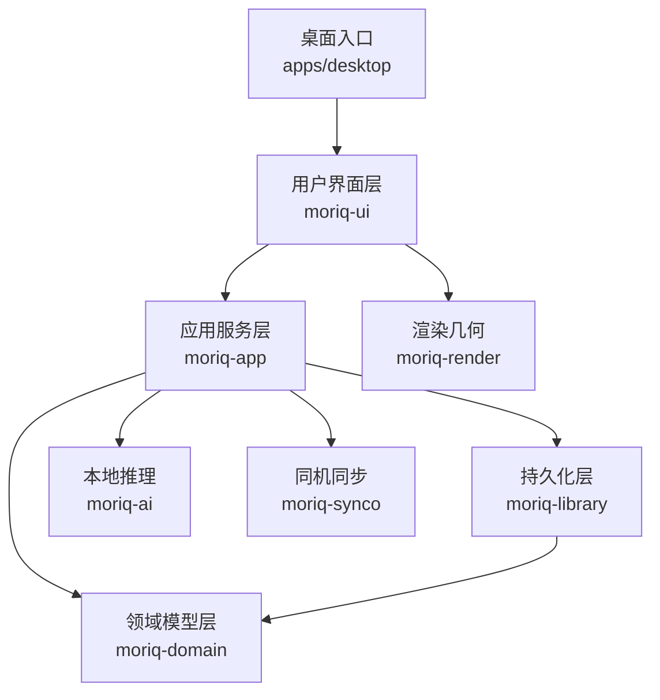
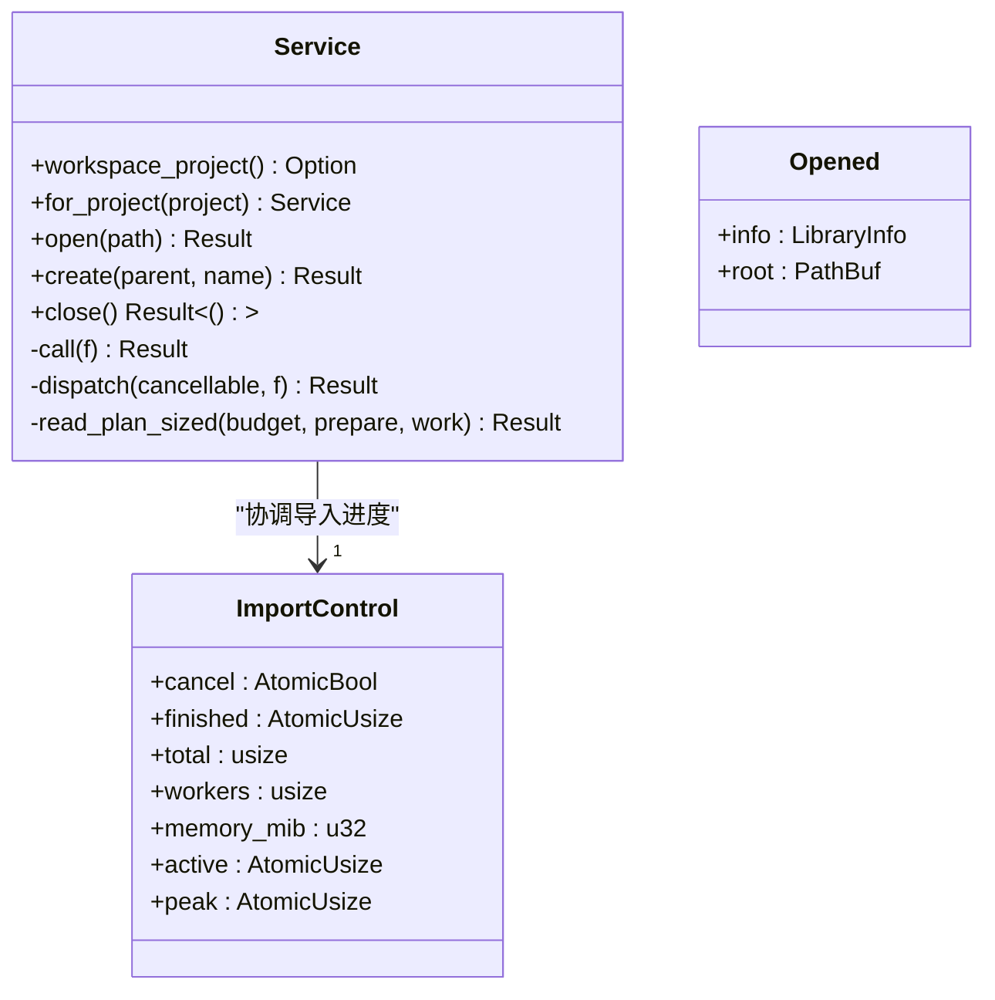
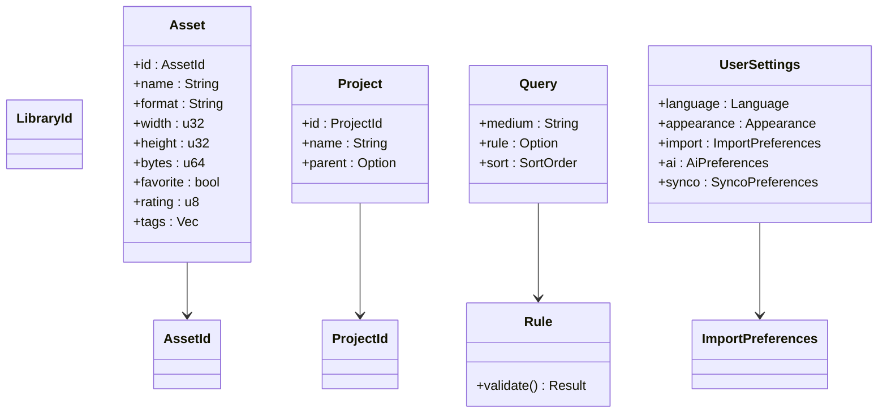
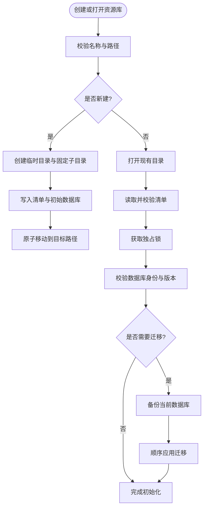
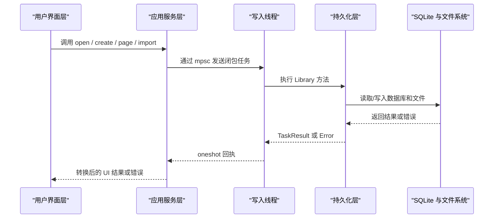
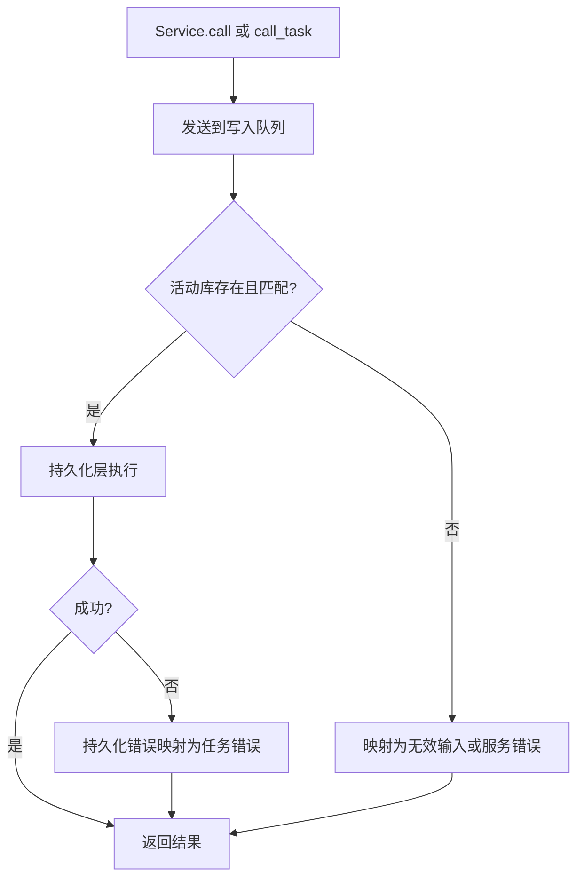
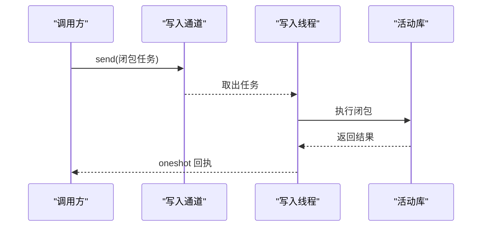

# 分层架构设计

> Repo Wiki 节点 `layered-design`
> 导出自 Qoder 知识库快照 `8fbe02f6-57c2-4874-b725-1a8130851fd9`，代码基线 `7a7a8e75e18bd90294e09cd422dd7ed5a04813a0`（分支 main，zh-CN）。

<cite>
**本文引用的文件**   
- [ARCHITECTURE.md](../../../ARCHITECTURE.md)
- [Cargo.toml](../../../Cargo.toml)
- [main.rs](../../../apps/desktop/src/main.rs)
- [lib.rs（领域层）](../../../crates/moriq-domain/src/lib.rs)
- [lib.rs（持久化层）](../../../crates/moriq-library/src/lib.rs)
- [core.rs（资源库实现）](../../../crates/moriq-library/src/library/core.rs)
- [lib.rs（应用服务层）](../../../crates/moriq-app/src/lib.rs)
- [lib.rs（用户界面层）](../../../crates/moriq-ui/src/lib.rs)
- [lifecycle.rs（生命周期与后台操作界面）](../../../crates/moriq-ui/src/lifecycle.rs)
</cite>

## 目录
1. [引言](#引言)
2. [项目结构与分层总览](#项目结构与分层总览)
3. [UI 层：用户界面与交互](#ui-层用户界面与交互)
4. [应用服务层：业务协调与执行边界](#应用服务层业务协调与执行边界)
5. [领域模型层：核心数据与验证规则](#领域模型层核心数据与验证规则)
6. [持久化层：存储、计划与恢复](#持久化层存储计划与恢复)
7. [跨层调用与单向数据流](#跨层调用与单向数据流)
8. [错误处理策略与状态同步](#错误处理策略与状态同步)
9. [命令模式与可取消工作](#命令模式与可取消工作)
10. [如何在不破坏分层约束的前提下添加新功能](#如何在不破坏分层约束的前提下添加新功能)
11. [性能与并发特性](#性能与并发特性)
12. [故障排查指南](#故障排查指南)
13. [结论](#结论)

## 引言
Moriq Space 是一个面向本地媒体资产的桌面应用，围绕“领域模型—应用服务—持久化”的分层组织代码。其核心目标是：
- 让 UI 只负责展示和接收用户输入。
- 让 Service API 统一协调打开库、查询、导入、维护、推理等用例。
- 让领域模型定义不可变身份、资产、项目、查询规则和设置等核心概念。
- 让持久化层封装 SQLite、文件系统、索引、备份、恢复和媒体计划。

仓库根文档明确划分了各 crate 的职责：`moriq-domain` 无 I/O；`moriq-render` 仅做几何计算；`moriq-runtime` 做运行时校验；`moriq-retrieval` 做范围化的相似性读取；`moriq-ai` 做本地推理；`moriq-synco` 做同机回环传输；`moriq-library` 负责阻塞式持久化、媒体计划和恢复日志；`moriq-app` 负责单写入器协调、调度、预算和系统集成；`moriq-ui` 负责 Iced 呈现、临时视图状态和服务请求回执；`apps/desktop` 是平台入口、图标资源和命令行解析。

**章节来源**
- [ARCHITECTURE.md:1-155](../../../ARCHITECTURE.md#L1-L155)

## 项目结构与分层总览
从 Cargo workspace 可见，顶层工作区包含 `apps/desktop` 以及多个 `crates/*` 子 crate。依赖关系遵循分层方向：UI 依赖 App，App 依赖 Domain 和 Library，Library 依赖 Domain；AI、Synco、Retrieval、Render、Runtime 作为辅助能力被上层按需使用。

**图示来源**
- [Cargo.toml:1-80](../../../Cargo.toml#L1-L80)
- [ARCHITECTURE.md:1-155](../../../ARCHITECTURE.md#L1-L155)

**章节来源**
- [Cargo.toml:1-80](../../../Cargo.toml#L1-L80)
- [ARCHITECTURE.md:1-155](../../../ARCHITECTURE.md#L1-L155)

## UI 层：用户界面与交互
UI 层基于 Iced，承担以下职责：
- 渲染概览、资产列表、查看器、偏好、任务面板等界面。
- 将用户输入转换为类型化消息。
- 调用 `moriq_app::Service` 发起异步请求。
- 根据返回回执更新本地临时状态，而不是直接读写磁盘或数据库。
- 通过主题、动画、过渡和缩放控制呈现细节。

UI 的顶层模块导出大量消息枚举，例如导航、库卡片、浏览、导入、删除、规则、存储、任务、区域、比较、上传、轮询等。这些消息最终由主应用的状态机分派到对应模块，再由模块把业务请求交给 Service。

关键点：
- UI 不拥有数据库连接。
- UI 不直接解码媒体。
- UI 不直接管理资源库生命周期。
- UI 的请求结果以带生成编号的回执形式处理，防止旧响应覆盖新状态。

**章节来源**
- [lib.rs（用户界面层）:1-200](../../../crates/moriq-ui/src/lib.rs#L1-L200)
- [ARCHITECTURE.md:1-155](../../../ARCHITECTURE.md#L1-L155)

## 应用服务层：业务协调与执行边界
应用服务层是 UI 与持久化层之间的唯一协调者。它暴露的类型包括：
- `Service`：绑定可选工作区项目、共享缓存、推理执行器、写入队列和各种信号量。
- `Opened`：表示已打开的资源库信息及其根路径。
- `LoadedPage`、`LoadedNeighborhood`、`Tile`：面向 UI 的分页和缩略图数据。
- `ImportControl`：共享导入进度、取消、内存预算和工作线程数量。

核心机制：
- 所有对资源库的写操作都进入一个专用写入线程。
- 读计划先申请读取槽位，再冻结来源，最后估算内存并在线程池中执行。
- 请求可以携带项目上下文，避免 UI 切换后旧请求重新路由。
- 关闭服务时会停止调度器、清空媒体缓存、取消在途工作，并等待推理进程释放。

**图示来源**
- [lib.rs（应用服务层）:1-200](../../../crates/moriq-app/src/lib.rs#L1-L200)
- [lib.rs（应用服务层）:200-446](../../../crates/moriq-app/src/lib.rs#L200-L446)

**章节来源**
- [lib.rs（应用服务层）:1-446](../../../crates/moriq-app/src/lib.rs#L1-L446)

## 领域模型层：核心数据与验证规则
领域层定义跨层共享的不可变身份和数据结构，不包含 I/O 或渲染依赖。主要实体包括：
- 身份标识：`LibraryId`、`AssetId`、`AssetVersionId`、`ProjectId`。
- 资产与版本：`Asset`、`AssetDetails`、`AssetVersion`。
- 项目与模板：`Project`、`ProjectTemplate`。
- 查询与规则：`Query`、`MetadataPredicate`、`Rule`。
- 任务与作业：`JobKind`、`JobState`、`ModelId`、`TaskError`、`TaskResult`、`BackgroundJob`、`JobCommand`。
- 用户设置：`UserSettings`、`Language`、`Appearance`、`ImportPreferences`、`AiPreferences`、`SyncoPreferences`。
- 集合与整理视图：`Collection`、`Organizer`、`VirtualFolder`、`Person`、`Face`。

重要设计点：
- 规则树具有显式验证：限制深度、节点数、字段长度和评分范围，防止无界输入导致查询爆炸。
- 导入偏好提供有效并发数和内存预算的规范化逻辑。
- 语言、外观、AI、同步等设置是可序列化配置，供 UI 与持久化层共享。

**图示来源**
- [lib.rs（领域层）:1-200](../../../crates/moriq-domain/src/lib.rs#L1-L200)
- [lib.rs（领域层）:201-450](../../../crates/moriq-domain/src/lib.rs#L201-L450)

**章节来源**
- [lib.rs（领域层）:1-450](../../../crates/moriq-domain/src/lib.rs#L1-L450)

## 持久化层：存储、计划与恢复
持久化层是阻塞式基础设施，对外暴露资源库、目录、媒体、AI、传输、任务和维护等模块。它的职责包括：
- 创建、打开、重命名、移除资源库。
- 管理 SQLite 模式、迁移、只写器和读取池。
- 处理导入、导出、恢复、孤儿文件清理、备份和存储检查。
- 提供媒体访问、元数据、色彩、缩放、视频、原始格式和本地解码接口。
- 提供分类、文件夹、位置、组织、查询、规则、概览和检索能力。

资源库创建与打开流程的关键约束：
- 名称需经组件校验，拒绝非法字符和过长名称。
- 先在临时目录建立目录结构和清单，再原子移动为正式库。
- 打开时校验清单、数据库版本、身份、锁状态和迁移历史。
- 迁移前会保留数据库快照，保证升级失败时可恢复。

**图示来源**
- [core.rs（资源库实现）:1-200](../../../crates/moriq-library/src/library/core.rs#L1-L200)
- [lib.rs（持久化层）:1-200](../../../crates/moriq-library/src/lib.rs#L1-L200)

**章节来源**
- [lib.rs（持久化层）:1-200](../../../crates/moriq-library/src/lib.rs#L1-L200)
- [core.rs（资源库实现）:1-200](../../../crates/moriq-library/src/library/core.rs#L1-L200)

## 跨层调用与单向数据流
Moriq Space 采用“UI 发送命令 → Service 执行 → 持久化层落盘 → 回执返回 UI”的单向数据流。典型调用链如下：

**图示来源**
- [lib.rs（应用服务层）:200-446](../../../crates/moriq-app/src/lib.rs#L200-L446)
- [lib.rs（用户界面层）:1-200](../../../crates/moriq-ui/src/lib.rs#L1-L200)
- [core.rs（资源库实现）:1-200](../../../crates/moriq-library/src/library/core.rs#L1-L200)

具体示例说明：
- UI 的生命周期模块发出“扫描孤立文件”“隔离”“恢复”“清理”等消息。
- 应用服务层将这些消息包装为异步任务，调用持久化层的相应模块。
- 持久化层返回报告或错误。
- UI 根据所有者库 ID 和忙碌状态决定是否更新面板和报告。

**章节来源**
- [lifecycle.rs（生命周期与后台操作界面）:1-200](../../../crates/moriq-ui/src/lifecycle.rs#L1-L200)
- [lib.rs（应用服务层）:200-446](../../../crates/moriq-app/src/lib.rs#L200-L446)

## 错误处理策略与状态同步
错误处理贯穿三层：
- 领域层使用类型化错误描述任务协议中的输入、取消、过时库、存储、运行时和不可用服务等问题。
- 应用服务层把持久化层错误映射为 UI 可读字符串或任务错误，并把调度失败转换为“服务已关闭”或“服务中断”。
- UI 层只展示错误文本，并通过请求生成编号、所有者库 ID 和忙碌标志保护状态一致性。

关键策略：
- 切库后旧请求会被拒绝，返回“旧库”语义错误。
- 未打开库时拒绝需要活动库的操作。
- 持久化层区分无效输入与底层存储错误。
- 后台调度关闭时，UI 得到统一的“服务不可用”提示，而不是暴露内部通道异常。

**图示来源**
- [lib.rs（应用服务层）:200-446](../../../crates/moriq-app/src/lib.rs#L200-L446)
- [lib.rs（持久化层）:1-200](../../../crates/moriq-library/src/lib.rs#L1-L200)

**章节来源**
- [lib.rs（应用服务层）:200-446](../../../crates/moriq-app/src/lib.rs#L200-L446)
- [lib.rs（持久化层）:1-200](../../../crates/moriq-library/src/lib.rs#L1-L200)

## 命令模式与可取消工作
应用服务层通过“闭包任务 + 通道 + 一次性通道回执”的方式实现命令模式：
- UI 或 Service 方法构造闭包。
- 闭包被发送到专用写入线程。
- 写入线程在活动的 Library 上执行闭包。
- 结果通过 `oneshot` 返回给调用方。
- 支持可取消调度、作业取消、导入取消、推理卸载和关闭流程。

这种设计的优势：
- 命令即闭包，天然携带上下文。
- 执行边界清晰：只有写入线程能修改活动库。
- 可组合：读取计划、预算、取消和回调可以复用。
- 可测试：可通过注入推理执行器进行隔离验证。

**图示来源**
- [lib.rs（应用服务层）:200-446](../../../crates/moriq-app/src/lib.rs#L200-L446)

**章节来源**
- [lib.rs（应用服务层）:200-446](../../../crates/moriq-app/src/lib.rs#L200-L446)

## 如何在不破坏分层约束的前提下添加新功能
要新增功能，应遵循以下约束：

1. 如果新增的是纯数据或验证规则，放在领域层。
   - 新增类型应可序列化、可比较、可显示，并尽量保持不可变。
   - 如果涉及复杂条件，提供独立的验证函数，限制深度、数量和长度。

2. 如果新增的是用例，放在应用服务层。
   - 不要直接访问数据库或文件系统。
   - 通过 `Service.call`、`call_task`、`read_plan` 或 `read_plan_sized` 执行。
   - 对耗时操作使用 `spawn_blocking` 或在写入线程中执行。
   - 对需要 UI 反馈的操作返回结构化结果，而不是抛出 UI 相关异常。

3. 如果新增的是存储或媒体处理逻辑，放在持久化层。
   - 保持阻塞式 API，由应用服务层决定并发和预算。
   - 使用事务、迁移和恢复日志保证一致性。
   - 对输入参数做边界校验，拒绝无限查询和无界对象。

4. 如果新增的是界面，放在 UI 层。
   - 使用类型化消息表达用户意图。
   - 调用 Service 而非绕过 Service 访问底层。
   - 使用回执、生成编号和库所有者判断丢弃旧响应。
   - 不要在 UI 中持有数据库连接、解码器或长生命周期资源。

5. 如果新增功能需要外部能力：
   - AI 推理通过注入的推理执行器调用。
   - 系统行为通过应用服务层提供的启动、浏览器、文件管理器接口调用。
   - 同步和检索通过已有 crate 的公开接口调用。

6. 新增功能的验收标准：
   - 保持原媒体不变。
   - 正确处理取消和切库。
   - 拒绝过期的库身份。
   - 失败路径有可观察的错误信息。
   - 不引入循环依赖。

**章节来源**
- [ARCHITECTURE.md:1-155](../../../ARCHITECTURE.md#L1-L155)
- [lib.rs（应用服务层）:200-446](../../../crates/moriq-app/src/lib.rs#L200-L446)

## 性能与并发特性
应用服务层使用多种并发控制手段降低峰值压力：
- 写入队列串行化所有写操作，避免多写竞争。
- 读取槽位限制同时准备读取计划的请求数。
- 内存信号量限制媒体解码、缩略图、索引等操作的总内存。
- 导入并发数和内存预算来自用户偏好和硬件探测。
- 维护类操作使用独立信号量，避免与维护任务争抢普通读取。
- 背景推理和交互式推理共用注入的执行器，避免 UI 直接管理模型进程。

此外：
- 发布构建启用薄 LTO。
- 开发构建中对图像、缩放、哈希和媒体相关包提升优化级别。
- 工作区禁止 unsafe 代码，并严格限制 unwrap 和 expect。

**章节来源**
- [lib.rs（应用服务层）:200-446](../../../crates/moriq-app/src/lib.rs#L200-L446)
- [Cargo.toml:1-80](../../../Cargo.toml#L1-L80)

## 故障排查指南
常见问题和定位建议：

| 现象 | 可能原因 | 排查步骤 |
|---|---|---|
| 打开资源库时报“仍在使用中” | 另一个窗口或进程持有锁，或后台任务尚未结束 | 检查其他 Moriq Space 实例、后台导入或维护任务；确认库未被外部工具占用 |
| 打开库报“清单损坏”或“身份不一致” | 清单与数据库版本或 ID 不匹配 | 检查 `library.toml`、`catalog.db`、迁移历史；必要时从备份恢复 |
| 页面加载或预览缓慢 | 媒体解码、缩放或索引消耗过多内存 | 调整导入偏好中的内存预算和并发数；减少同时进行的预览和批量操作 |
| 后台任务突然失败 | 切库、取消或服务关闭 | 检查 UI 是否切换了库；确认取消回调是否正确触发；查看任务错误类别 |
| 模型推理无法退出 | 推理进程仍在运行 | 等待关闭流程重试；检查是否有残留推理任务 |
| 导入部分文件失败 | 文件不可访问、格式不支持或存储权限不足 | 检查文件路径、权限、磁盘空间；查看导入报告中的跳过项 |

诊断日志可通过服务选项开启，并在 Windows 下默认输出到本地应用数据目录，在非 Windows 环境下输出到用户状态目录。

**章节来源**
- [main.rs:1-97](../../../apps/desktop/src/main.rs#L1-L97)
- [lib.rs（应用服务层）:1-200](../../../crates/moriq-app/src/lib.rs#L1-L200)
- [core.rs（资源库实现）:1-200](../../../crates/moriq-library/src/library/core.rs#L1-L200)

## 结论
Moriq Space 的分层架构通过明确的职责边界降低了耦合：
- 领域层定义稳定、可验证的核心数据。
- 应用服务层作为唯一协调者，统一调度写入、读取、预算、取消和外部集成。
- 持久化层封装数据库、文件系统和媒体计划。
- UI 层专注呈现和用户交互，并通过 Service API 单向消费后端状态。

这种设计使得扩展新功能时，可以通过新增领域类型、Service 方法和持久化模块逐步演进，而不必修改 UI 与底层存储的直接耦合。同时，类型化错误、请求回执、写入队列和信号量共同保证了状态一致性和系统健壮性。