# UI 层设计

> Repo Wiki 节点 `ui-layer`
> 导出自 Qoder 知识库快照 `8fbe02f6-57c2-4874-b725-1a8130851fd9`，代码基线 `7a7a8e75e18bd90294e09cd422dd7ed5a04813a0`（分支 main，zh-CN）。

<cite>
**本文引用的文件**   
- [moriq-ui/Cargo.toml](../../../crates/moriq-ui/Cargo.toml)
- [UI 入口与主状态机：lib.rs](../../../crates/moriq-ui/src/lib.rs)
- [主视图外壳与页面选择：view.rs](../../../crates/moriq-ui/src/view.rs)
- [主题系统：theme.rs](../../../crates/moriq-ui/src/theme.rs)
- [国际化模块：i18n.rs](../../../crates/moriq-ui/src/i18n.rs)
- [图库浏览：browsing.rs](../../../crates/moriq-ui/src/browsing.rs)
- [大图查看器：viewer.rs](../../../crates/crates/moriq-ui/src/viewer.rs)
- [设置面板：settings.rs](../../../crates/crates/moriq-ui/src/settings.rs)
- [任务管理：tasks.rs](../../../crates/crates/moriq-ui/src/tasks.rs)
- [组件库：components.rs](../../../crates/crates/moriq-ui/src/components.rs)
- [响应式布局：responsiveness.rs](../../../crates/crates/moriq-ui/src/responsiveness.rs)
- [启动流程：startup.rs](../../../crates/crates/moriq-ui/src/startup.rs)
- [生命周期与错误展示：lifecycle.rs](../../../crates/crates/moriq-ui/src/lifecycle.rs)
</cite>

## 目录

1. [引言](#引言)
2. [项目结构](#项目结构)
3. [核心组件](#核心组件)
4. [架构总览](#架构总览)
5. [详细组件分析](#详细组件分析)
6. [依赖关系分析](#依赖关系分析)
7. [性能考虑](#性能考虑)
8. [故障排查指南](#故障排查指南)
9. [结论](#结论)

## 引言

Moriq Space 的桌面端界面基于 Iced 构建，采用“应用状态驱动渲染”的单向数据流模式。UI 层负责用户交互、视图组合、主题与国际化显示；所有磁盘访问、目录索引、解码、导入导出和后台任务等重量级工作都委托给 Service 层，UI 通过消息和订阅机制与之同步。

本文聚焦 UI 层的架构与实现，包括：

- 组件树结构与页面路由
- 以 `App` 为中心的状态模型与消息分发
- 事件处理与异步回调流程
- 主要界面模块的职责划分
- 主题系统与国际化支持
- 响应式布局策略
- 自定义 UI 组件编写方式
- UI 状态与 Service API 的同步机制

## 项目结构

UI 代码集中在 `crates/moriq-ui` 中，采用按功能域划分的扁平化源码组织方式：每个业务区域通常对应一个源文件，例如浏览、查看器、设置、任务、图库、过滤器、导入、导出、收藏、文件夹、项目管理、规则、存储、封面、区域标注、AI 对话等。公共样式、图标、组件和基础工具则放在 `components.rs`、`icons.rs`、`theme.rs`、`i18n.rs` 等文件中。

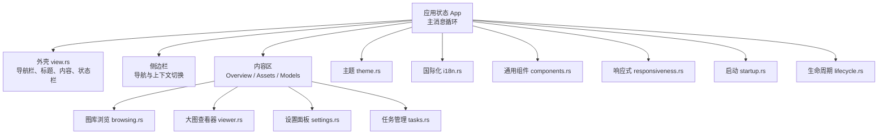

**图表来源**   
- [UI 入口与主状态机：lib.rs:1-120](../../../crates/moriq-ui/src/lib.rs#L1-L120)
- [主视图外壳与页面选择：view.rs:1-80](../../../crates/moriq-ui/src/view.rs#L1-L80)
- [主题系统：theme.rs:1-60](../../../crates/moriq-ui/src/theme.rs#L1-L60)
- [国际化模块：i18n.rs](../../../crates/moriq-ui/src/i18n.rs)
- [图库浏览：browsing.rs](../../../crates/moriq-ui/src/browsing.rs)
- [大图查看器：viewer.rs](../../../crates/crates/moriq-ui/src/viewer.rs)
- [设置面板：settings.rs](../../../crates/crates/moriq-ui/src/settings.rs)
- [任务管理：tasks.rs](../../../crates/crates/moriq-ui/src/tasks.rs)
- [组件库：components.rs](../../../crates/crates/moriq-ui/src/components.rs)
- [响应式布局：responsiveness.rs](../../../crates/crates/moriq-ui/src/responsiveness.rs)
- [启动流程：startup.rs](../../../crates/crates/moriq-ui/src/startup.rs)
- [生命周期与错误展示：lifecycle.rs](../../../crates/crates/moriq-ui/src/lifecycle.rs)

### 模块职责概览

| 文件 | 主要职责 | 与 Iced 的关系 |
|---|---|---|
| `lib.rs` | 定义 `App` 状态、全局 `Message`、命令、订阅、导航、主题加载、与 Service 的调用点 | 实现 Iced `Application` |
| `view.rs` | 组装壳层、头部、侧边栏、内容容器、底部状态栏、过渡动画遮罩 | 返回 `Element<Message>` |
| `theme.rs` | 明暗主题、语义色映射、控件样式工厂 | 使用 `iced::Theme`、`container::Style`、`button::Style` |
| `i18n.rs` | 多语言文本、占位符格式化、状态文案 | 提供 `tr!`、`trf!` 及状态翻译函数 |
| `browsing.rs` | 资产列表、分页、排序、筛选、选择状态 | 组合 Iced 列表、滚动、按钮、输入框 |
| `viewer.rs` | 大图预览、缩放、平移、版本切换、元数据 | 组合图片、滚动、叠加层 |
| `settings.rs` | 用户偏好、语言、外观、行为开关 | 表单控件 + 持久化结果回调 |
| `tasks.rs` | 任务队列、进度、取消、错误汇总 | 表格、进度条、操作按钮 |
| `components.rs` | 可复用 UI 片段，如分组数字、下拉选择、轻量按钮 | 封装 Iced 常用控件组合 |
| `responsiveness.rs` | 窗口尺寸变化、DPI 变化、布局适配 | 监听 `Resized`、`DpiChanged` |
| `startup.rs` | 首次运行、库选择、最近打开路径、初始加载 | 协调 `Opened`、库卡片、导航恢复 |
| `lifecycle.rs` | 恢复、备份、维护、错误状态、长时间任务提示 | 聚合后台控制对象并转为 UI 状态 |

**章节来源**   
- [UI 入口与主状态机：lib.rs:1-120](../../../crates/moriq-ui/src/lib.rs#L1-L120)
- [主视图外壳与页面选择：view.rs:1-80](../../../crates/moriq-ui/src/view.rs#L1-L80)

## 核心组件

### 应用状态机

`App` 是 Iced 应用的核心状态。它保存当前屏幕、选中的资源库、当前页面、对话框、导入状态、生命周期控制、任务状态、主题偏好、国际化语言、选择集、查看器状态等。所有用户操作都会转换为枚举化的 `Message`，再由 `update` 分支处理。

关键要点：

- 屏幕由 `Screen` 枚举区分，包括概览、素材、模型等。
- 全局消息类型 `Message` 聚合了各子模块的消息，如 `LifecycleMessage`、`BatchMessage`、`FolderMessage`、`AiMessage`、`ManageMessage`、`StorageMessage`、`JournalMessage`、`RuleMessage`、`DeletionMessage`、`CompareMessage`、`RegionMessage`、`MetadataMessage`、`DropMessage`、`TasksMessage` 等。
- 对外暴露部分子模块消息类型，便于其他模块转发或测试。
- 与 `Service` 的交互通过 `Task` 发起，例如打开库、读取导航、加载页、搜索、保存偏好、执行导入等。

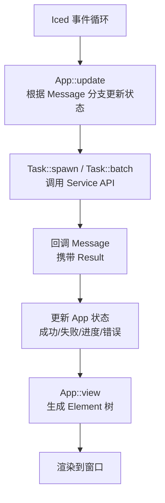

**图表来源**   
- [UI 入口与主状态机：lib.rs:1-120](../../../crates/moriq-ui/src/lib.rs#L1-L120)

**章节来源**   
- [UI 入口与主状态机：lib.rs:1-120](../../../crates/moriq-ui/src/lib.rs#L1-L120)

### 视图外壳与页面路由

`view.rs` 主要负责固定外壳：头部、侧边栏、内容区、底部状态栏，以及页面过渡遮罩。它会依据 `content_screen()` 决定当前展示的是欢迎页、概览页、素材页还是模型页。状态栏会根据当前是否处于导入、恢复、备份、维护、空间统计、加载中等不同阶段，显示不同文案和快捷操作。

重点：

- 外壳使用 Iced 的 `column`、`row`、`container`、`stack` 组合布局。
- 页面切换通过 `transition` 字段驱动透明遮罩和位移动画。
- 底部状态栏同时承担进度反馈、错误入口、任务终止等操作。
- 侧边栏和内容区共享主题颜色，并通过 `adaptive` 适配明暗主题。

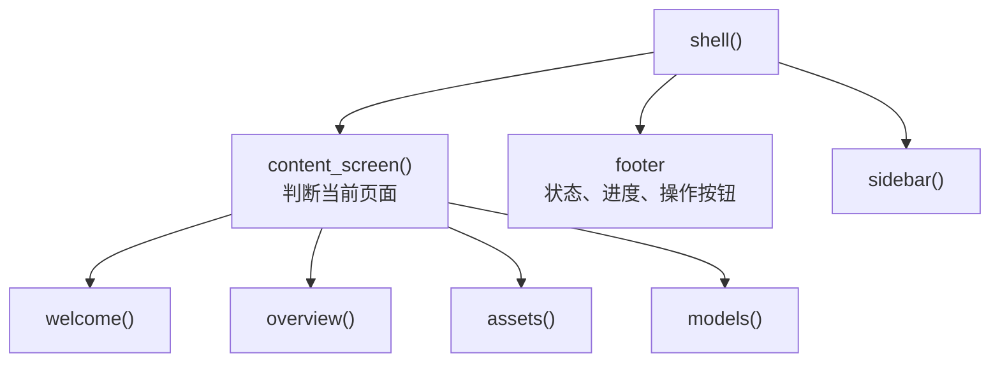

**图表来源**   
- [主视图外壳与页面选择：view.rs:1-120](../../../crates/moriq-ui/src/view.rs#L1-L120)

**章节来源**   
- [主视图外壳与页面选择：view.rs:1-120](../../../crates/moriq-ui/src/view.rs#L1-L120)

### 主题系统

主题系统基于 Iced 的 `Theme` 和 `Palette`，并提供一套语义化颜色常量，如背景、文本、主色、成功、危险、线条、弱化色等。`application_theme` 根据持久化的 `Appearance` 选择浅色或深色主题；`adaptive` 根据当前主题将语义色解析为实际颜色，从而让组件在不同主题下保持一致的可读性。

关键点：

- 浅色主题继承 `iced::theme::Palette::LIGHT`，深色主题继承 `iced::theme::Palette::DARK`。
- `adaptive` 对常见语义色做映射，包括文本、弱文本、图标、分割线、背景、高亮背景、主色、强调色等。
- `foreground` 确保照片和主按钮上的白色文字始终为白色。
- 组件样式工厂如 `panel`、`modal`、`form_card_style`、`primary`、`selected_row`、`pale` 等统一圆角、边框、阴影和交互态。

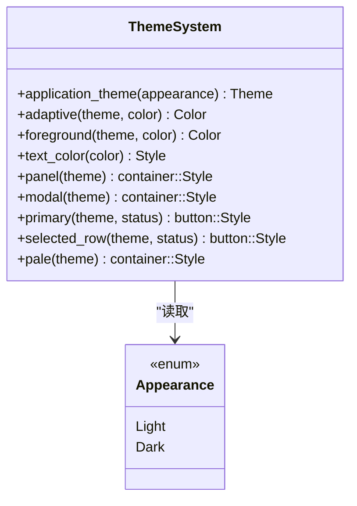

**图表来源**   
- [主题系统：theme.rs:1-120](../../../crates/moriq-ui/src/theme.rs#L1-L120)

**章节来源**   
- [主题系统：theme.rs:1-120](../../../crates/moriq-ui/src/theme.rs#L1-L120)

### 国际化支持

国际化模块提供本地化文本宏和状态文案。UI 在显示文本时优先使用 `tr!` 和 `trf!`，并根据当前 `preferences.language` 选择语言。状态栏、导入进度、恢复进度、备份进度、检查进度等都有对应的多语言文案。

关键点：

- 文本宏根据语言键值返回中文或英文。
- 带参数的文案使用 `trf!`，用于填充数量、进度、峰值内存等动态值。
- 状态文案还通过 `status(language, &self.status)` 从集中状态转换为用户可读信息。
- 主题颜色与国际化互不耦合，避免文案影响视觉。

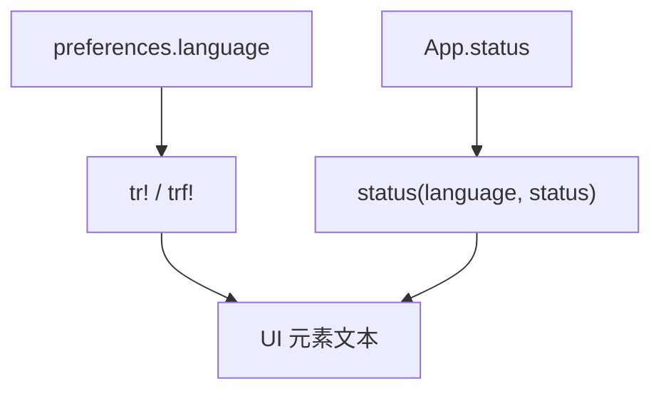

**图表来源**   
- [国际化模块：i18n.rs](../../../crates/moriq-ui/src/i18n.rs)
- [主视图外壳与页面选择：view.rs:1-120](../../../crates/moriq-ui/src/view.rs#L1-L120)

**章节来源**   
- [主视图外壳与页面选择：view.rs:1-120](../../../crates/moriq-ui/src/view.rs#L1-L120)

## 架构总览

UI 层整体遵循“状态 → 视图 → 事件 → 命令 → 状态”的单向流：

1. Iced 运行时派发事件。
2. `App::update` 把事件转成 `Message`。
3. `update` 调用 Service API，产生 `Task`。
4. Service 完成异步操作后，通过回调 `Message` 返回 `Result<T, String>`。
5. `update` 根据结果更新状态。
6. `App::view` 根据状态生成新的组件树。
7. Iced 重新渲染。

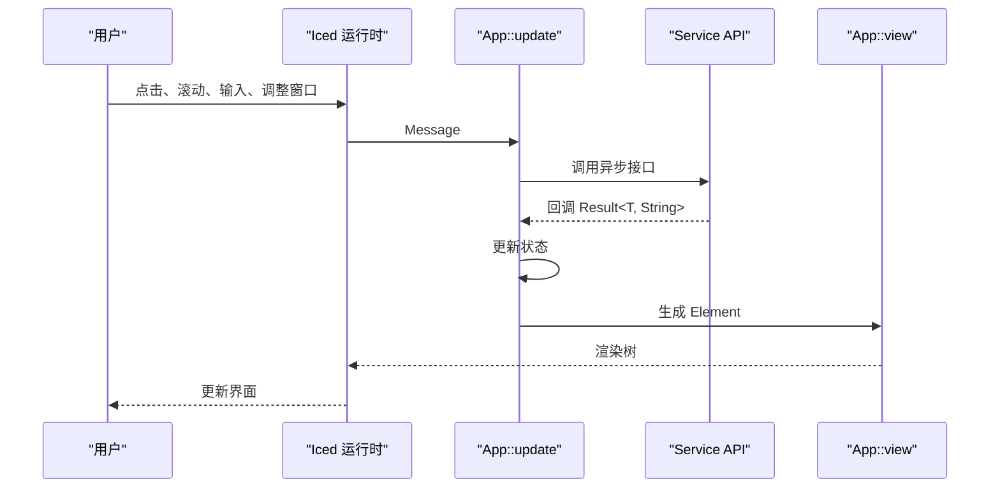

**图表来源**   
- [UI 入口与主状态机：lib.rs:1-120](../../../crates/moriq-ui/src/lib.rs#L1-L120)
- [主视图外壳与页面选择：view.rs:1-120](../../../crates/moriq-ui/src/view.rs#L1-L120)

## 详细组件分析

### 图库浏览模块

图库浏览负责展示当前项目或资源库中的资产列表，通常包含分页、排序、筛选、多选、批量操作入口、导入队列提示和总数显示。它与 `browsing.rs`、`filters.rs`、`selection.rs`、`favorites.rs`、`folders.rs`、`libraries.rs` 等模块协作。

交互模式：

- 用户点击资产卡片或列表项触发 `CardPressed`、`Select` 等消息。
- 翻页通过 `PageLoaded` 回调刷新 `LoadedPage`。
- 搜索通过 `Search`、`SearchReady`、`CancelSearch` 控制查询生命周期。
- 过滤条件变更通过 `FilterChange` 或内置过滤器消息通知。
- 选择状态通过 `selection` 状态保持，支持可见项选择、收藏、评分、批量动作等快捷键。

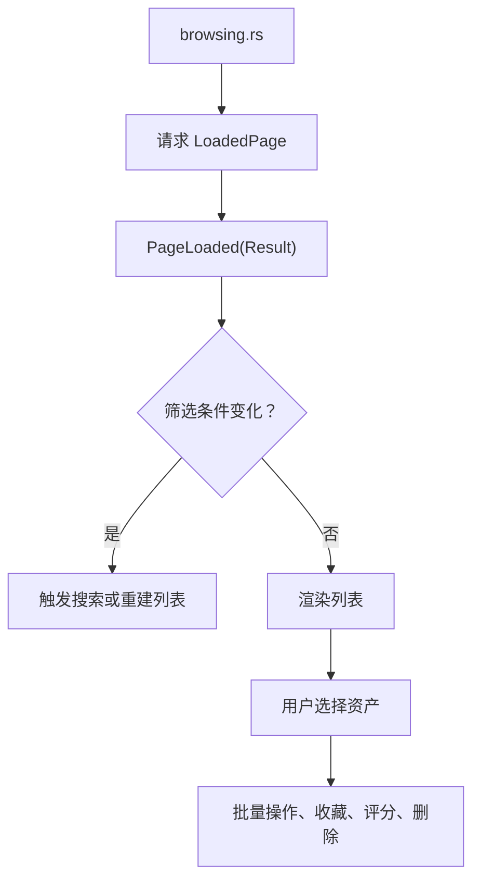

**图表来源**   
- [图库浏览：browsing.rs](../../../crates/moriq-ui/src/browsing.rs)
- [UI 入口与主状态机：lib.rs:1-120](../../../crates/moriq-ui/src/lib.rs#L1-L120)

**章节来源**   
- [图库浏览：browsing.rs](../../../crates/moriq-ui/src/browsing.rs)
- [UI 入口与主状态机：lib.rs:1-120](../../../crates/moriq-ui/src/lib.rs#L1-L120)

### 大图查看器

大图查看器负责单张资产的高清预览，包括图片加载、缩放、平移、版本切换、元数据展示、区域标注查看、运动画面预览等。它通常与 `viewer.rs`、`preview.rs`、`region_viewer.rs`、`metadata.rs`、`motion.rs` 等协同。

交互模式：

- 用户滚动滚轮或拖拽进行缩放和平移。
- 点击缩略图或版本号切换到另一版本。
- 双击或快捷键进入全屏预览。
- 元数据和区域信息作为叠加层显示在图片之上。
- 图片加载失败时显示错误状态，并可重试。

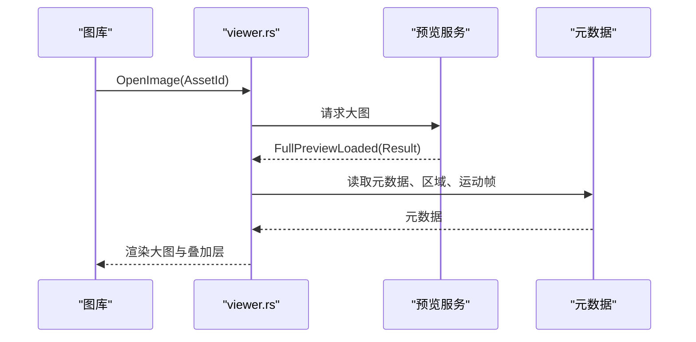

**图表来源**   
- [大图查看器：viewer.rs](../../../crates/crates/moriq-ui/src/viewer.rs)
- [UI 入口与主状态机：lib.rs:1-120](../../../crates/moriq-ui/src/lib.rs#L1-L120)

**章节来源**   
- [大图查看器：viewer.rs](../../../crates/crates/moriq-ui/src/viewer.rs)
- [UI 入口与主状态机：lib.rs:1-120](../../../crates/moriq-ui/src/lib.rs#L1-L120)

### 设置面板

设置面板承载用户偏好，包括语言、外观、导入偏好、行为开关等。设置变更会触发保存任务，并在 `PreferenceSaved` 或 `SettingsLoaded` 回调中更新 UI。

交互模式：

- 用户修改选项后点击保存。
- UI 调用 Service 保存 `UserSettings`。
- 成功后刷新偏好，可能触发主题或语言重渲染。
- 失败时显示错误状态，允许重试。

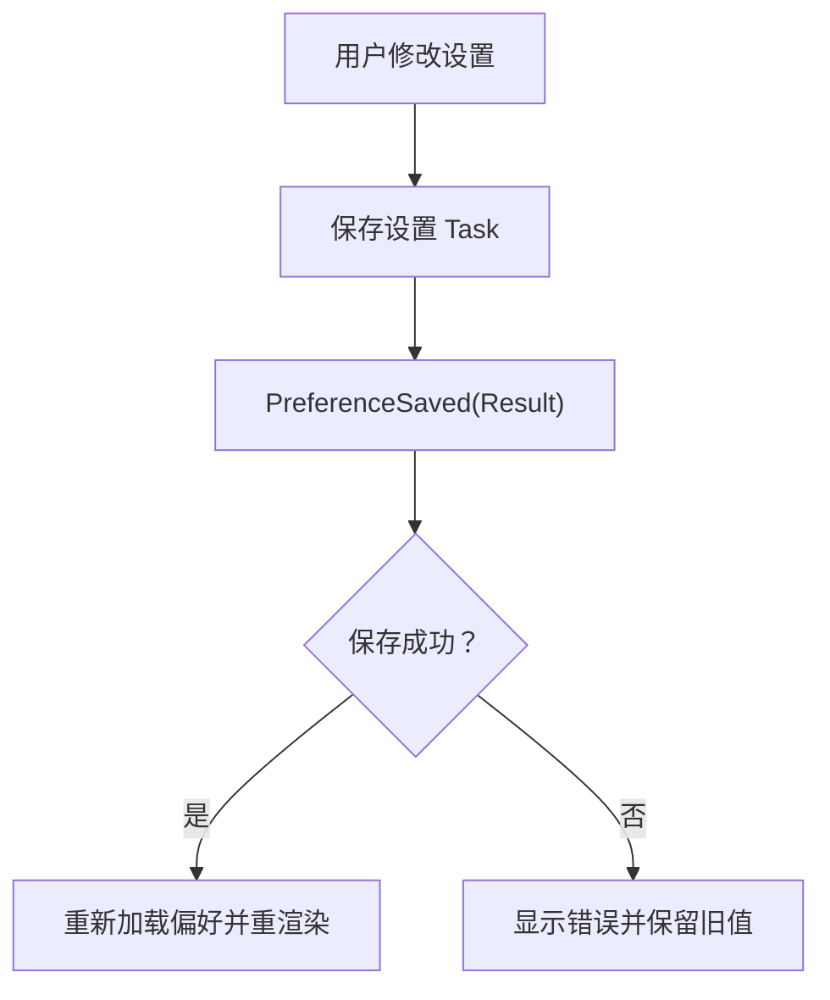

**图表来源**   
- [设置面板：settings.rs](../../../crates/crates/moriq-ui/src/settings.rs)
- [UI 入口与主状态机：lib.rs:1-120](../../../crates/moriq-ui/src/lib.rs#L1-L120)

**章节来源**   
- [设置面板：settings.rs](../../../crates/crates/moriq-ui/src/settings.rs)
- [UI 入口与主状态机：lib.rs:1-120](../../../crates/moriq-ui/src/lib.rs#L1-L120)

### 任务管理

任务管理负责展示后台任务、导入队列、维护检查、空间统计等。它通过 `tasks.rs` 和相关状态展示进度、错误和取消入口。

交互模式：

- 任务开始时显示进度条、已完成数、总数。
- 用户可点击“停止导入”“停止恢复”“停止备份”“查看检查进度”等操作。
- 任务失败时，底部状态栏提供查看详情入口。
- 多个任务状态由 `lifecycle`、`manager`、`storage`、`import` 等状态共同构成。

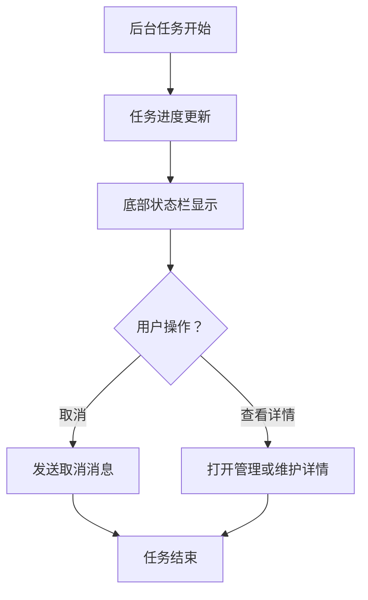

**图表来源**   
- [任务管理：tasks.rs](../../../crates/crates/moriq-ui/src/tasks.rs)
- [主视图外壳与页面选择：view.rs:1-120](../../../crates/moriq-ui/src/view.rs#L1-L120)

**章节来源**   
- [任务管理：tasks.rs](../../../crates/crates/moriq-ui/src/tasks.rs)
- [主视图外壳与页面选择：view.rs:1-120](../../../crates/moriq-ui/src/view.rs#L1-L120)

### 自定义 UI 组件示例

创建自定义 UI 组件的典型步骤：

1. 在 `components.rs` 中定义一个返回 `Element<'a, Message>` 的函数。
2. 使用 Iced 的 `column`、`row`、`container`、`button`、`text`、`icon` 等基础控件组合。
3. 通过 `theme.rs` 的 `adaptive`、`panel`、`primary`、`text_color` 等样式函数保证主题一致性。
4. 通过 `i18n.rs` 的 `tr!`、`trf!` 输出本地化文本。
5. 在父组件中调用该函数，并传入必要的状态和回调消息。

推荐实践：

- 组件只负责渲染和局部交互，复杂逻辑下沉到 `App::update`。
- 组件参数尽量使用不可变数据，避免跨层级状态污染。
- 对长列表使用懒加载和分页，避免一次性渲染大量图片。
- 对频繁变化的 UI 使用最小化状态更新，减少重绘。

**章节来源**   
- [组件库：components.rs](../../../crates/crates/moriq-ui/src/components.rs)
- [主题系统：theme.rs:1-120](../../../crates/moriq-ui/src/theme.rs#L1-L120)
- [国际化模块：i18n.rs](../../../crates/moriq-ui/src/i18n.rs)

## 依赖关系分析

UI 模块之间的依赖关系大致如下：

- `lib.rs` 是所有页面的根，聚合各子模块消息。
- `view.rs` 依赖 `theme.rs`、`i18n.rs`、`components.rs`、`icons.rs`、`transition.rs`、`motion.rs`。
- `browsing.rs`、`viewer.rs`、`settings.rs`、`tasks.rs` 依赖 `lib.rs` 暴露的 `Message` 和 `App` 状态。
- `theme.rs` 依赖 `moriq_domain::Appearance`。
- `i18n.rs` 被多处用于文本显示。
- `responsiveness.rs` 与 `startup.rs`、`lifecycle.rs` 共同处理窗口生命周期相关状态。

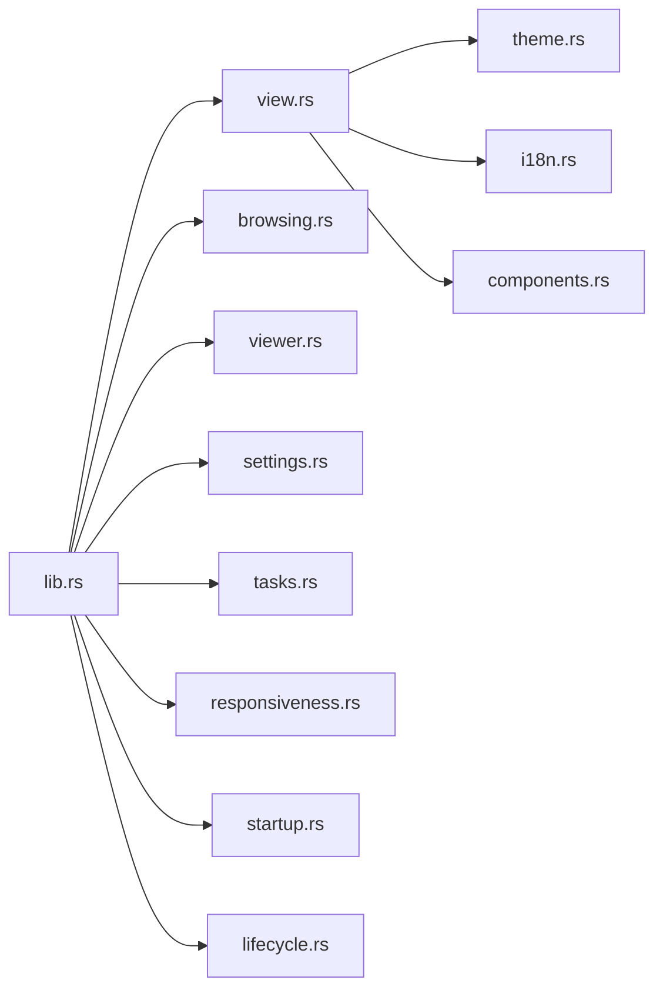

**图表来源**   
- [UI 入口与主状态机：lib.rs:1-120](../../../crates/moriq-ui/src/lib.rs#L1-L120)
- [主视图外壳与页面选择：view.rs:1-120](../../../crates/moriq-ui/src/view.rs#L1-L120)

**章节来源**   
- [UI 入口与主状态机：lib.rs:1-120](../../../crates/moriq-ui/src/lib.rs#L1-L120)

## 性能考虑

UI 层已有一些针对性能的优化思路，主要体现在：

- 使用分页加载 `LoadedPage`，避免一次性加载全部资产。
- 大图查看器按需加载完整图片，而不是在所有缩略图中加载高分辨率图。
- 主题和样式通过静态 `LazyLock` 缓存，避免重复构造 `Theme`。
- 页面过渡使用 `stack` 和 `translated` 保持滚动和输入状态，避免组件重新挂载。
- 底部状态栏使用原子计数器展示导入、恢复、备份、维护等任务的进度，减少不必要的全量重算。

建议进一步优化：

- 对大图和图片网格启用更严格的尺寸限制和懒加载。
- 对高频更新的状态使用增量更新，避免整棵树重绘。
- 对网络或磁盘密集型操作使用去抖和节流。
- 对长列表使用虚拟滚动或分页预取。
- 对错误重试增加退避策略，避免风暴式请求。

[本节为通用性能指导，不直接分析具体文件]

## 故障排查指南

常见问题与定位方式：

| 现象 | 可能原因 | 排查位置 |
|---|---|---|
| 页面空白 | 当前无资源库或页面未加载完成 | `view.rs` 中 `content_screen()` 与 `loading` 状态 |
| 图片无法显示 | 大图加载失败或路径无效 | `viewer.rs`、`FullPreviewLoaded` 回调 |
| 设置不生效 | 偏好未保存或保存失败 | `settings.rs`、`PreferenceSaved` |
| 语言未切换 | 语言偏好未更新或文案缺失 | `i18n.rs`、`preferences.language` |
| 任务卡住 | Service 未返回或用户取消未下发 | `tasks.rs`、`lifecycle.rs`、`view.rs` 底部状态栏 |
| 主题错乱 | 明暗主题切换后颜色未适配 | `theme.rs` 中 `adaptive` 与组件样式 |
| 列表加载缓慢 | 分页过大或缺少懒加载 | `browsing.rs`、`PageLoaded` |
| 窗口缩放异常 | DPI 或尺寸变化未处理 | `responsiveness.rs`、`DpiChanged`、`Resized` |

错误显示策略：

- 异步结果通常以 `Result<T, String>` 形式返回，UI 在 `update` 中根据 `Ok` 或 `Err` 更新状态。
- 非致命错误可通过底部状态栏、弹窗或详情页展示。
- 严重错误应阻止后续操作，并给出明确的用户提示。
- 可重试操作应保留原始输入，避免清空用户表单。

**章节来源**   
- [生命周期与错误展示：lifecycle.rs](../../../crates/crates/moriq-ui/src/lifecycle.rs)
- [主视图外壳与页面选择：view.rs:1-120](../../../crates/moriq-ui/src/view.rs#L1-L120)

## 结论

Moriq Space 的 UI 层以 `App` 为核心状态机，围绕 Iced 的事件循环构建组件树。其优点在于：

- 状态集中、消息清晰，便于追踪用户操作到界面更新的完整链路。
- 主题系统和国际化独立于业务组件，扩展成本低。
- 主要功能模块职责清晰，便于单独维护和测试。
- 通过 Service 抽象出磁盘、目录、解码、导入、AI 推理等重量级逻辑，UI 层专注交互与展示。

未来改进方向可以包括：

- 进一步拆分大组件，提升可测试性。
- 强化错误边界和降级显示。
- 完善键盘导航和可访问性。
- 引入更细粒度的性能监控，识别热点渲染路径。
- 对长列表和大图加载建立统一缓存和占位策略。

[本节为总结性内容，不直接分析具体文件]