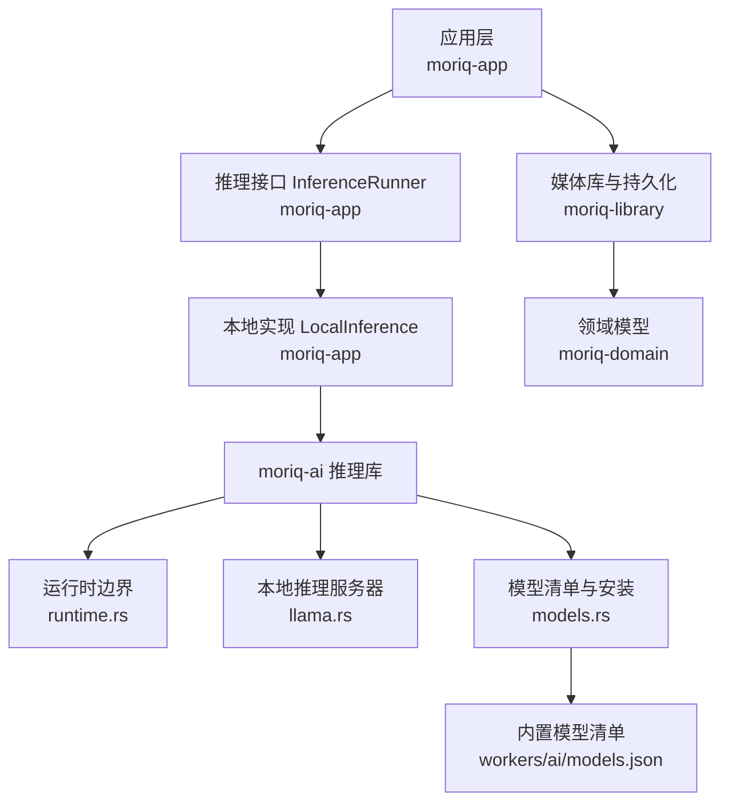
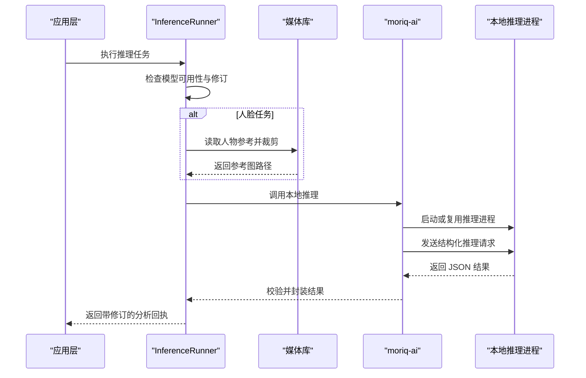
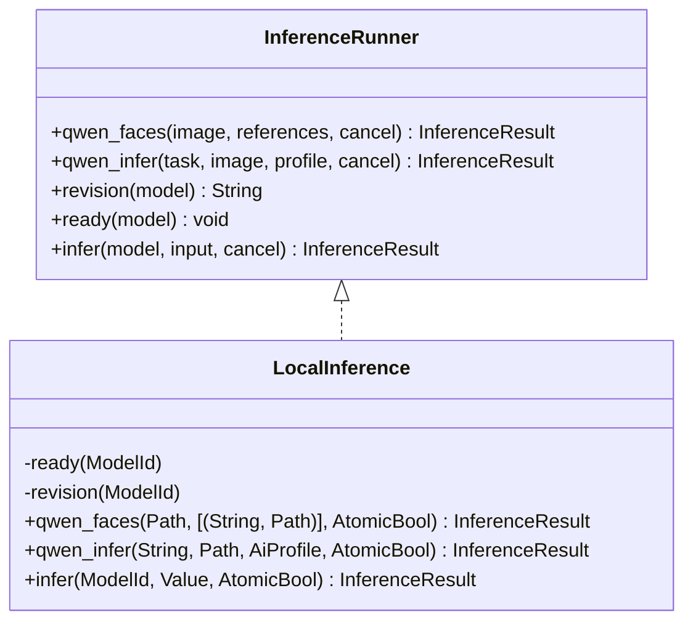
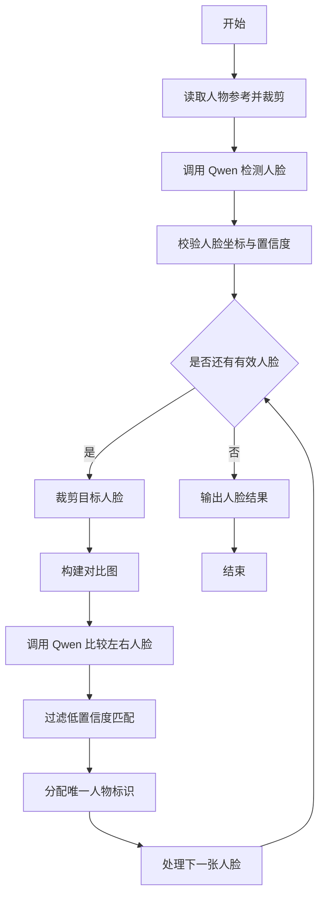
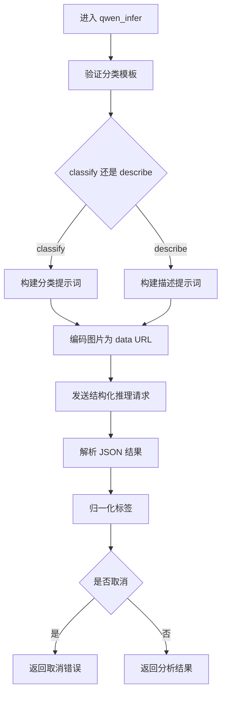
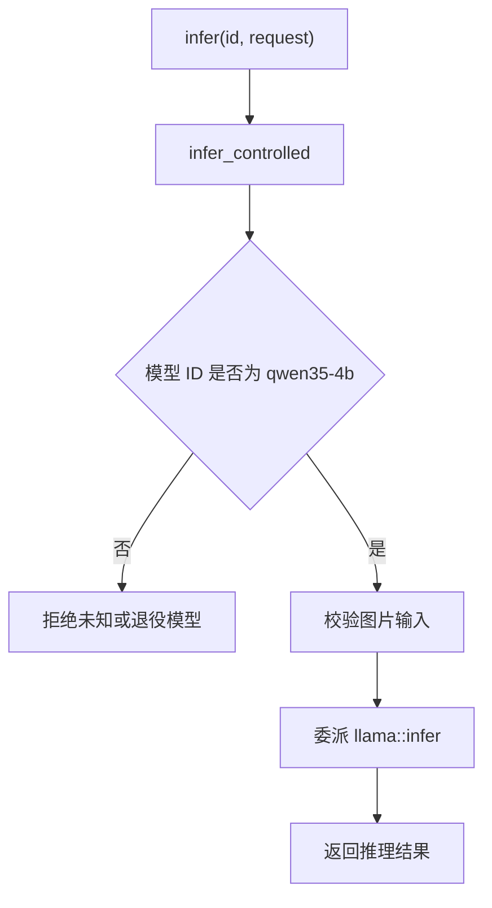
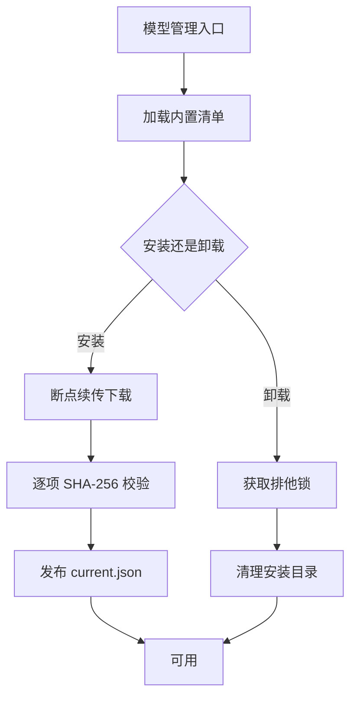
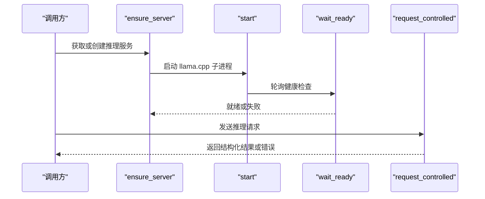
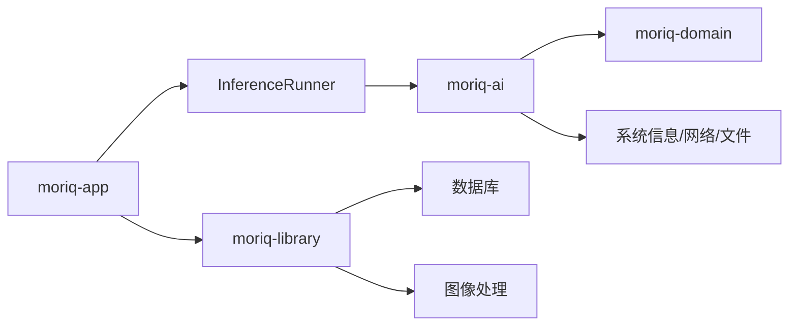

# AI 推理服务

> Repo Wiki 节点 `inference-service`
> 导出自 Qoder 知识库快照 `8fbe02f6-57c2-4874-b725-1a8130851fd9`，代码基线 `7a7a8e75e18bd90294e09cd422dd7ed5a04813a0`（分支 main，zh-CN）。

<cite>
**本文引用的文件**   
- [moriq-ai/src/lib.rs](../../../../crates/moriq-ai/src/lib.rs)
- [moriq-ai/src/runtime.rs](../../../../crates/moriq-ai/src/runtime.rs)
- [moriq-ai/src/llama.rs](../../../../crates/moriq-ai/src/llama.rs)
- [moriq-ai/src/models.rs](../../../../crates/moriq-ai/src/models.rs)
- [workers/ai/models.json](../../../../workers/ai/models.json)
- [moriq-app/src/inference.rs](../../../../crates/moriq-app/src/inference.rs)
- [moriq-library/src/ai/qwen_faces.rs](../../../../crates/moriq-library/src/ai/qwen_faces.rs)
- [moriq-domain/src/ai.rs](../../../../crates/moriq-domain/src/ai.rs)
- [moriq-ai/examples/infer_qwen.rs](../../../../crates/moriq-ai/examples/infer_qwen.rs)
</cite>

## 目录
1. [简介](#简介)
2. [项目结构](#项目结构)
3. [核心组件](#核心组件)
4. [架构总览](#架构总览)
5. [详细组件分析](#详细组件分析)
6. [依赖关系分析](#依赖关系分析)
7. [性能与资源特性](#性能与资源特性)
8. [故障排查指南](#故障排查指南)
9. [结论](#结论)
10. [附录：集成示例与最佳实践](#附录集成示例与最佳实践)

## 简介
本仓库中的 AI 推理服务以 Qwen3.5-4B 为本地视觉模型，通过受控的 llama.cpp 子进程提供图像分类、描述和人脸识别能力。应用层通过 `InferenceRunner` trait 暴露统一接口，默认实现 `LocalInference` 将高层任务委托给底层 `moriq-ai` 库；底层再管理模型安装、校验、版本检查和本地推理执行。该设计将“推理接口抽象”“模型生命周期管理”“本地推理执行”“结果持久化”分层解耦，便于扩展其他运行器或替换后端。

## 项目结构
AI 推理相关代码分布在四个 crate 中：
- `moriq-ai`：Qwen 模型清单、安装卸载、运行时受控启动、本地推理入口。
- `moriq-app`：应用侧推理调度、工作派发、取消控制与结果封装。
- `moriq-library`：人脸参考裁剪、结果存储、人物分组和数据库约束。
- `moriq-domain`：稳定领域模型，包括 AI 分类模板、主题配置和验证规则。

**图表来源**
- [moriq-app/src/inference.rs:1-120](../../../../crates/moriq-app/src/inference.rs#L1-L120)
- [moriq-ai/src/runtime.rs:1-82](../../../../crates/moriq-ai/src/runtime.rs#L1-L82)
- [moriq-ai/src/llama.rs:1-200](../../../../crates/moriq-ai/src/llama.rs#L1-L200)
- [moriq-ai/src/models.rs:1-120](../../../../crates/moriq-ai/src/models.rs#L1-L120)
- [workers/ai/models.json:1-24](../../../../workers/ai/models.json#L1-L24)
- [moriq-library/src/ai/qwen_faces.rs:1-80](../../../../crates/moriq-library/src/ai/qwen_faces.rs#L1-L80)
- [moriq-domain/src/ai.rs:1-80](../../../../crates/moriq-domain/src/ai.rs#L1-L80)

**章节来源**
- [moriq-ai/src/lib.rs:1-15](../../../../crates/moriq-ai/src/lib.rs#L1-L15)
- [workers/ai/models.json:1-24](../../../../workers/ai/models.json#L1-L24)

## 核心组件
- `InferenceRunner` trait：定义可取消的人脸推理、Qwen 分类、通用推理、修订查询和可用性检查等接口，使上层无需关心具体后端。
- `LocalInference`：默认实现，负责调用 `moriq-ai` 完成模型就绪检查、修订读取和本地推理。
- `moriq-ai::runtime`：历史模型 ID 兼容层，限制当前仅允许 Qwen3.5-4B，并封装请求校验、取消标志和平台保护命令。
- `moriq-ai::llama`：本地受控 llama.cpp 服务器，负责进程启动、健康检查、HTTP 推理请求、结果解析和常驻策略。
- `moriq-ai::models`：模型清单解析、安装/卸载、断点续传、SHA-256 校验、已安装路径验证和租约保护。
- `moriq-library::ai::qwen_faces`：从媒体库提取人脸参考资料、裁剪参考图、保存检测结果和人物分组，维护数据库一致性。
- `moriq-domain::ai`：AI 分类模板、主题配置及其上下文预算验证。

**章节来源**
- [moriq-app/src/inference.rs:1-120](../../../../crates/moriq-app/src/inference.rs#L1-L120)
- [moriq-ai/src/runtime.rs:1-82](../../../../crates/moriq-ai/src/runtime.rs#L1-L82)
- [moriq-ai/src/llama.rs:1-200](../../../../crates/moriq-ai/src/llama.rs#L1-L200)
- [moriq-ai/src/models.rs:1-120](../../../../crates/moriq-ai/src/models.rs#L1-L120)
- [moriq-library/src/ai/qwen_faces.rs:1-80](../../../../crates/moriq-library/src/ai/qwen_faces.rs#L1-L80)
- [moriq-domain/src/ai.rs:1-80](../../../../crates/moriq-domain/src/ai.rs#L1-L80)

## 架构总览
推理服务的整体流程如下：
1. 应用接收媒体任务（人脸检测、分类、描述或通用推理）。
2. `execute` 根据任务类型选择 `qwen_faces`、`qwen_infer` 或 `infer`。
3. `LocalInference` 先调用 `ready` 检查模型是否完整安装，再调用 `revision` 获取固定修订。
4. 针对 Qwen 人脸任务，`moriq-library` 先从数据库读取人物参考并裁剪预览图。
5. `moriq-ai` 通过 `ensure_server` 启动或复用本地 llama.cpp 子进程。
6. 构造结构化 JSON Schema 和提示词后发起 `/v1/chat/completions` 请求。
7. 结果经过严格校验、标签归一化和任务封装，最终返回到应用层写入库。

**图表来源**
- [moriq-app/src/inference.rs:120-200](../../../../crates/moriq-app/src/inference.rs#L120-L200)
- [moriq-library/src/ai/qwen_faces.rs:1-80](../../../../crates/moriq-library/src/ai/qwen_faces.rs#L1-L80)
- [moriq-ai/src/llama.rs:200-579](../../../../crates/moriq-ai/src/llama.rs#L200-L579)
- [moriq-ai/src/runtime.rs:1-82](../../../../crates/moriq-ai/src/runtime.rs#L1-L82)

## 详细组件分析

### 推理接口与本地实现
`InferenceRunner` 定义了统一的推理契约：
- `qwen_faces`：人脸检测与身份比较，返回结构化人脸框、匹配候选和对比证据。
- `qwen_infer`：使用指定分类配置执行 Qwen 任务，返回带模型修订的回执。
- `revision`：从内置清单读取模型固定修订信息。
- `ready`：检查模型是否完整安装且版本一致。
- `infer`：通用推理入口，接受模型 ID、JSON 输入和取消标志。

`LocalInference` 是默认实现，主要职责是：
- 在每次推理前检查模型可用性和修订。
- 调用 `moriq-ai` 完成实际推理。
- 将底层错误转换为应用层的 `TaskError::Runtime`。
- 对取消信号进行多次检查，避免发布无效结果。

**图表来源**
- [moriq-app/src/inference.rs:1-120](../../../../crates/moriq-app/src/inference.rs#L1-L120)

**章节来源**
- [moriq-app/src/inference.rs:1-120](../../../../crates/moriq-app/src/inference.rs#L1-L120)

### Qwen 人脸识别流程
人脸推理由三层协作完成：
1. **应用层派发**：`execute` 将 `Execution::QwenFaces` 转为 `runner.qwen_faces`。
2. **媒体库准备**：`references` 查询数据库，取出每个真实人物的最新人脸，裁剪为 256×256 参考图。
3. **底层推理**：`qwen_faces.rs` 先检测清晰人脸，再逐张与参考图拼接生成对比图，调用 Qwen 判断是否为同一人，最后按置信度阈值筛选匹配结果。

**图表来源**
- [moriq-app/src/inference.rs:120-200](../../../../crates/moriq-app/src/inference.rs#L120-L200)
- [moriq-library/src/ai/qwen_faces.rs:1-80](../../../../crates/moriq-library/src/ai/qwen_faces.rs#L1-L80)
- [moriq-ai/src/qwen_faces.rs:1-172](../../../../crates/moriq-ai/src/qwen_faces.rs#L1-L172)

**章节来源**
- [moriq-library/src/ai/qwen_faces.rs:1-80](../../../../crates/moriq-library/src/ai/qwen_faces.rs#L1-L80)
- [moriq-ai/src/qwen_faces.rs:1-172](../../../../crates/moriq-ai/src/qwen_faces.rs#L1-L172)

### Qwen 分类与描述任务
`qwen_infer` 支持两类任务：
- `classify`：根据启用的媒介和主题分类识别图片内容。
- `describe`：生成中文描述和检索标签。

关键处理步骤：
- 验证 `AiProfile` 的分类数量和说明长度，防止上下文爆炸。
- 构造结构化 JSON Schema，限制输出字段、枚举值和长度。
- 将图片编码为 data URL，组合系统提示词和用户提示词。
- 解析 `/v1/chat/completions` 响应，要求 finish_reason 为 stop。
- 对标签做去重、长度和词汇规范化。

**图表来源**
- [moriq-ai/src/llama.rs:200-579](../../../../crates/moriq-ai/src/llama.rs#L200-L579)
- [moriq-domain/src/ai.rs:1-120](../../../../crates/moriq-domain/src/ai.rs#L1-L120)

**章节来源**
- [moriq-ai/src/llama.rs:200-579](../../../../crates/moriq-ai/src/llama.rs#L200-L579)
- [moriq-domain/src/ai.rs:1-120](../../../../crates/moriq-domain/src/ai.rs#L1-L120)

### 通用推理入口
通用推理通过 `infer` 和 `infer_controlled` 暴露：
- `infer`：内部直接调用 `infer_controlled`，使用默认取消标志。
- `infer_controlled`：拒绝非 Qwen3.5-4B 的模型 ID，校验请求中包含图片路径，然后委派到底层 `llama::infer`。

这种设计保证：
- 历史模型 ID 不会被误启动。
- 所有通用推理都走 Qwen 视觉路径。
- 取消标志可以贯穿 UI 取消、后台任务取消和进程清理。

**图表来源**
- [moriq-ai/src/runtime.rs:1-82](../../../../crates/moriq-ai/src/runtime.rs#L1-L82)
- [moriq-ai/src/llama.rs:200-579](../../../../crates/moriq-ai/src/llama.rs#L200-L579)

**章节来源**
- [moriq-ai/src/runtime.rs:1-82](../../../../crates/moriq-ai/src/runtime.rs#L1-L82)

### 模型管理机制
模型管理覆盖注册、安装、校验、卸载和运行时访问：
- **清单与规格**：`registry()` 加载 `workers/ai/models.json`，得到固定 revision、文件大小和 SHA-256。
- **目录键**：按 revision 计算短摘要，形成隔离的版本目录。
- **安装状态**：`inventory()` 检查 `current.json` 和文件存在性，不哈希大权重。
- **已安装路径**：`installed_path()` 校验 revision、文件存在和完整性。
- **下载**：`install_with_mirror()` 支持断点续传、重试、范围响应校验和暂停。
- **卸载**：`uninstall()` 在排他锁下清理安装目录，并拒绝仍在使用的模型。
- **运行时租约**：`verified_lease()` 加共享锁并再次校验 SHA-256，防止推理期间被替换。

**图表来源**
- [moriq-ai/src/models.rs:1-200](../../../../crates/moriq-ai/src/models.rs#L1-L200)
- [moriq-ai/src/models.rs:201-589](../../../../crates/moriq-ai/src/models.rs#L201-L589)
- [workers/ai/models.json:1-24](../../../../workers/ai/models.json#L1-L24)

**章节来源**
- [moriq-ai/src/models.rs:1-200](../../../../crates/moriq-ai/src/models.rs#L1-L200)
- [moriq-ai/src/models.rs:201-589](../../../../crates/moriq-ai/src/models.rs#L201-L589)
- [workers/ai/models.json:1-24](../../../../workers/ai/models.json#L1-L24)

### 本地推理执行流程
本地推理的核心是受控子进程：
- **进程发现**：定位 `ai/llama` 目录，并通过构建时嵌入的校验清单验证运行时二进制。
- **端口分配**：绑定本机回环地址临时端口，避免外部访问。
- **参数构造**：设置模型路径、多模态投影、线程数、缓存、Jinja 模板和安全 API Key。
- **健康检查**：轮询 `/health`，等待子进程就绪或超时退出。
- **推理请求**：POST `/v1/chat/completions`，限制响应大小、超时和取消。
- **结果处理**：解析 choices、finish_reason、message content，并校验 JSON Schema。
- **常驻策略**：可通过 `set_keep_loaded` 控制是否在推理结束后释放进程。

**图表来源**
- [moriq-ai/src/llama.rs:1-200](../../../../crates/moriq-ai/src/llama.rs#L1-L200)
- [moriq-ai/src/llama.rs:200-579](../../../../crates/moriq-ai/src/llama.rs#L200-L579)
- [moriq-ai/src/runtime.rs:1-82](../../../../crates/moriq-ai/src/runtime.rs#L1-L82)

**章节来源**
- [moriq-ai/src/llama.rs:1-200](../../../../crates/moriq-ai/src/llama.rs#L1-L200)
- [moriq-ai/src/llama.rs:200-579](../../../../crates/moriq-ai/src/llama.rs#L200-L579)

## 依赖关系分析
AI 推理服务的依赖呈分层结构：
- 应用层依赖 `InferenceRunner`，不直接耦合本地进程细节。
- 本地实现依赖 `moriq-ai` 提供的公共 API。
- `moriq-ai` 依赖领域模型、操作系统信息、网络客户端、文件系统、加密摘要和临时文件。
- 媒体库依赖数据库连接、媒体源和图像处理。

**图表来源**
- [moriq-app/src/inference.rs:1-120](../../../../crates/moriq-app/src/inference.rs#L1-L120)
- [moriq-ai/src/lib.rs:1-15](../../../../crates/moriq-ai/src/lib.rs#L1-L15)
- [moriq-library/src/ai/qwen_faces.rs:1-80](../../../../crates/moriq-library/src/ai/qwen_faces.rs#L1-L80)

**章节来源**
- [moriq-ai/src/lib.rs:1-15](../../../../crates/moriq-ai/src/lib.rs#L1-L15)
- [moriq-app/src/inference.rs:1-120](../../../../crates/moriq-app/src/inference.rs#L1-L120)

## 性能与资源特性
- **内存门槛**：本地推理要求至少 4096 MiB 可用内存；模型清单声明最低 6144 MiB。
- **并发与线程**：推理进程使用逻辑 CPU 数量的一半作为线程数，并在 1~8 之间限制。
- **GPU/CPU 分工**：语言模型层尽量留在 GPU，CPU 视觉阶段有显式限制，避免 Vulkan 投影分配器耗尽。
- **单次请求上限**：图片输入最大 32 MiB，推理响应最大 1 MiB，请求体最大 36 MiB。
- **超时与延迟**：健康检查最多 120 秒，推理请求最多 300 秒，健康轮询间隔 100 毫秒。
- **常驻策略**：关闭常驻时会尝试释放空闲运行器，但正在使用的进程不能强制卸载。

这些特性表明推理服务更适合单任务、高准确率场景，不适合高频短小批量的实时服务。

[本节为通用性能讨论，未直接分析具体源码片段]

## 故障排查指南
常见错误及定位建议：
- **模型未安装或损坏**：`installed_path` 会报告缺失文件或校验失败，应重新安装。
- **模型版本不一致**：`current.json` 与清单 revision 不一致时提示升级。
- **推理进程启动失败**：健康检查超时或子进程退出，需检查内存、Vulkan 环境和诊断日志。
- **推理响应过大**：超过 1 MiB 响应会被拒绝，属于协议保护。
- **模型下载失败**：断点续传保留 `.part` 文件，可切换 Hugging Face 或 HF-Mirror 后继续。
- **卸载冲突**：模型正被推理占用时卸载会失败，应先停止分析。
- **人脸结果无效**：坐标越界、宽度高度非正、置信度过低都会被拒绝。

**章节来源**
- [moriq-ai/src/models.rs:201-589](../../../../crates/moriq-ai/src/models.rs#L201-L589)
- [moriq-ai/src/llama.rs:200-579](../../../../crates/moriq-ai/src/llama.rs#L200-L579)
- [moriq-ai/src/qwen_faces.rs:1-172](../../../../crates/moriq-ai/src/qwen_faces.rs#L1-L172)

## 结论
AI 推理服务通过 `InferenceRunner` 抽象出统一推理接口，并以 `LocalInference` 提供本地 Qwen 实现。底层 `moriq-ai` 库负责模型清单、安装校验、受控进程启动和结构化结果解析；上层应用负责任务派发、取消控制和结果持久化。该设计在安全、资源和结果质量方面做了较多保护，适合桌面端和工具链内嵌的本地 AI 能力。

[本节为总结性内容，未直接分析具体源码片段]

## 附录：集成示例与最佳实践

### 如何在应用中正确使用 AI 功能
- 使用 `InferenceRunner` 而非直接调用底层库，以便未来替换实现。
- 人脸任务优先使用 `qwen_faces`，让媒体库负责参考图和数据库操作。
- 分类和描述任务使用 `qwen_infer`，传入自定义 `AiProfile` 控制分类上下文。
- 通用任务使用 `infer`，并确保输入包含图片路径，模型 ID 为登记过的值。
- 始终传递 `AtomicBool` 取消标志，并在关键路径检查取消状态。
- 模型使用前调用 `ready`，展示前使用 `revision` 绑定结果版本。

**章节来源**
- [moriq-app/src/inference.rs:1-200](../../../../crates/moriq-app/src/inference.rs#L1-L200)

### 最小命令行示例
仓库提供了一个示例程序，用于验证受控 Qwen 推理：
- 用法：`infer_qwen classify|describe IMAGE [PROFILE_JSON]`
- 行为：读取图片与可选分类配置，调用 `llama_infer_profile`，打印 JSON 结果，最后尝试卸载推理进程。

这适合作为集成前的冒烟测试，帮助确认模型安装、运行时校验和推理链路正常。

**章节来源**
- [moriq-ai/examples/infer_qwen.rs:1-33](../../../../crates/moriq-ai/examples/infer_qwen.rs#L1-L33)

### 推荐的最佳实践
- **安装阶段**：使用 `install_with_mirror`，优先使用 HF-Mirror 提升下载稳定性。
- **推理阶段**：开启常驻模式以减少冷启动延迟，但在长时间空闲任务中关闭常驻以释放资源。
- **结果阶段**：始终记录 `revision`，避免旧模型结果参与新版本语义检索。
- **取消阶段**：UI 丢弃请求时应触发取消，阻止后台推理继续消耗资源。
- **错误处理**：区分“未配置运行器”“模型不可用”“任务已取消”“运行时错误”，便于用户理解。

**章节来源**
- [moriq-app/src/inference.rs:200-339](../../../../crates/moriq-app/src/inference.rs#L200-L339)
- [moriq-ai/src/llama.rs:200-579](../../../../crates/moriq-ai/src/llama.rs#L200-L579)