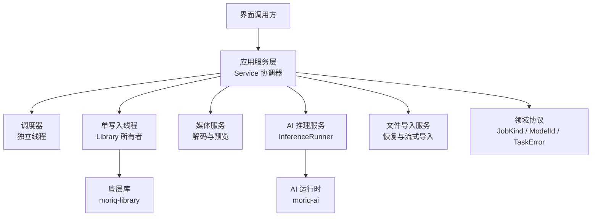
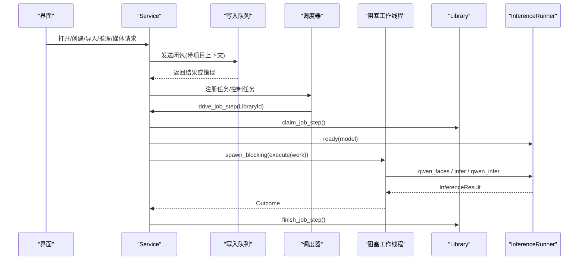
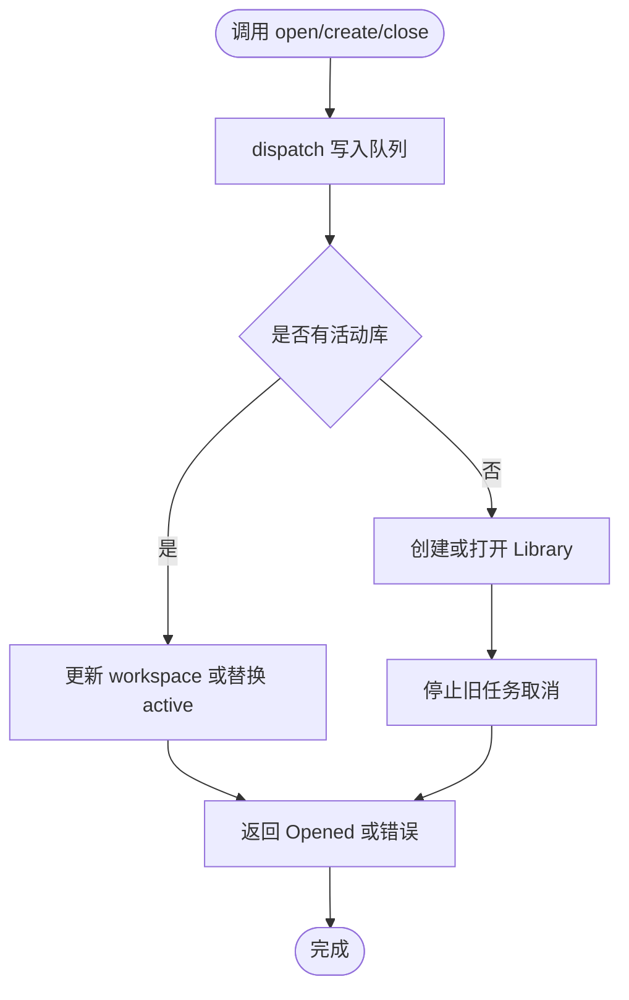
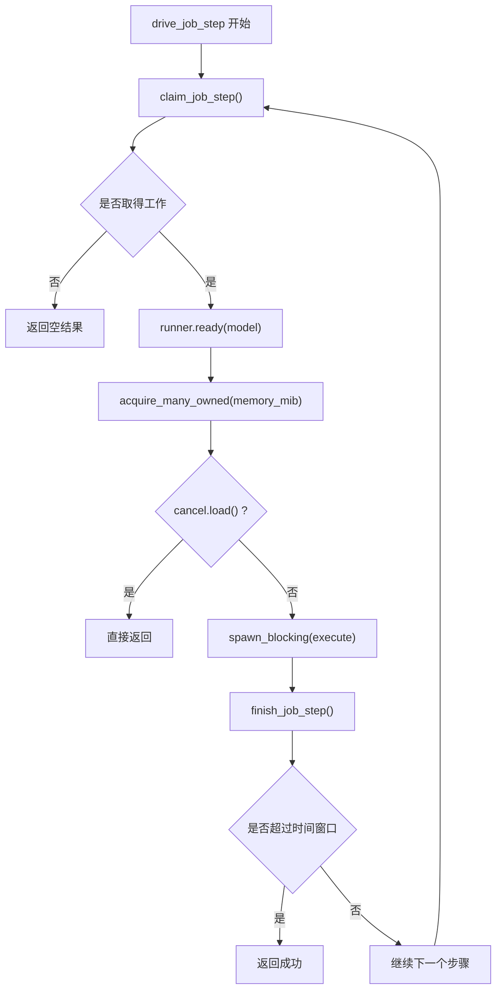
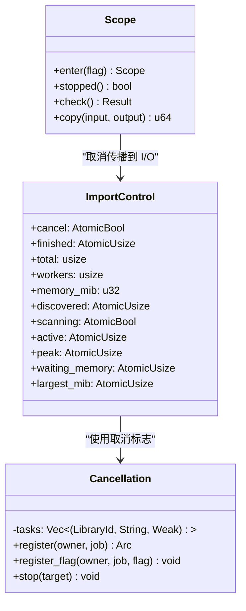
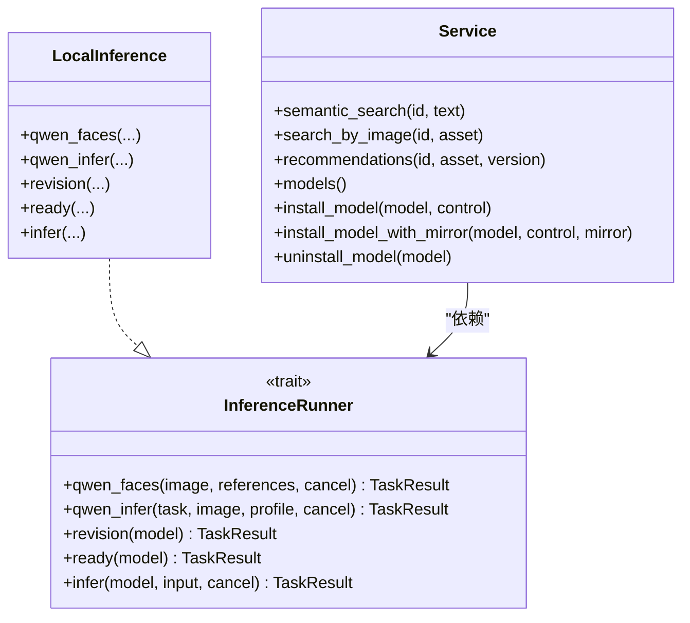
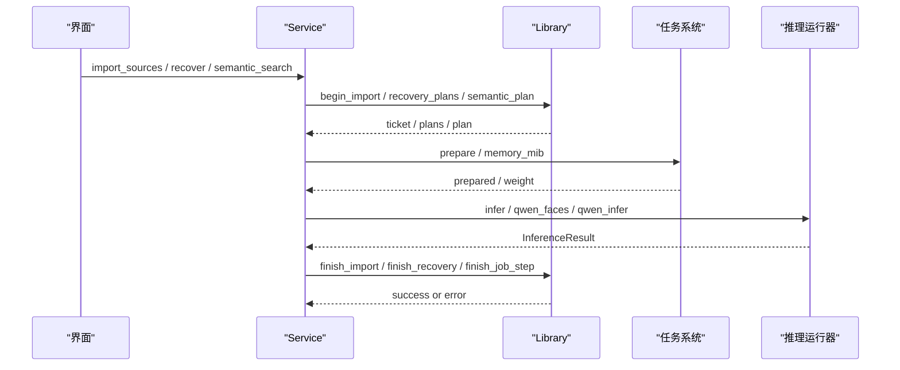
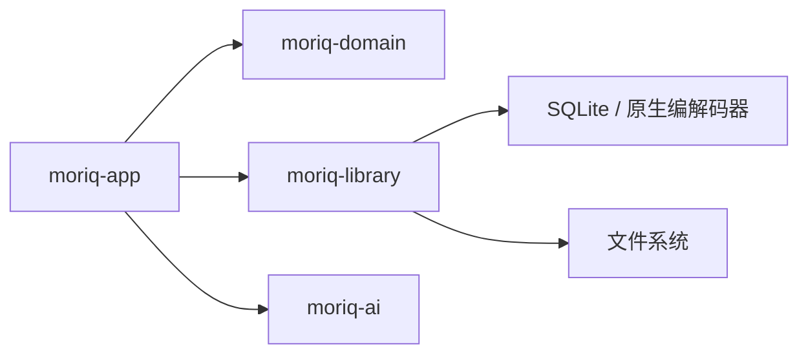

# 应用服务层设计

> Repo Wiki 节点 `application-service-layer`
> 导出自 Qoder 知识库快照 `8fbe02f6-57c2-4874-b725-1a8130851fd9`，代码基线 `7a7a8e75e18bd90294e09cd422dd7ed5a04813a0`（分支 main，zh-CN）。

<cite>
**本文引用的文件**   
- [crates/moriq-app/src/lib.rs](../../../../crates/moriq-app/src/lib.rs)
- [crates/moriq-app/src/scheduler.rs](../../../../crates/moriq-app/src/scheduler.rs)
- [crates/moriq-app/src/jobs.rs](../../../../crates/moriq-app/src/jobs.rs)
- [crates/moriq-app/src/import.rs](../../../../crates/moriq-app/src/import.rs)
- [crates/moriq-app/src/inference.rs](../../../../crates/moriq-app/src/inference.rs)
- [crates/moriq-app/src/media.rs](../../../../crates/moriq-app/src/media.rs)
- [crates/moriq-app/src/launch.rs](../../../../crates/moriq-app/src/launch.rs)
- [crates/moriq-domain/src/lib.rs](../../../../crates/moriq-domain/src/lib.rs)
- [crates/moriq-domain/src/jobs.rs](../../../../crates/moriq-domain/src/jobs.rs)
- [crates/moriq-library/src/tasks/jobs.rs](../../../../crates/moriq-library/src/tasks/jobs.rs)
- [crates/moriq-library/src/tasks/cancel.rs](../../../../crates/moriq-library/src/tasks/cancel.rs)
</cite>

## 目录
1. [引言](#引言)
2. [项目结构](#项目结构)
3. [核心组件](#核心组件)
4. [架构总览](#架构总览)
5. [详细组件分析](#详细组件分析)
6. [依赖关系分析](#依赖关系分析)
7. [性能与内存预算](#性能与内存预算)
8. [故障排查指南](#故障排查指南)
9. [结论](#结论)
10. [附录：扩展服务接口](#附录扩展服务接口)

## 引言
本文面向“应用服务层”，聚焦 Service 协调器如何统一调度资源库、后台任务、媒体解码、AI 推理和文件导入，并说明命令模式、观察者模式和取消机制在服务层的实现方式。重点包括：
- 单写入线程的 Service 协调器设计
- 资源库生命周期管理
- 有界任务队列、内存预算与并发许可
- 媒体处理、AI 推理和文件导入等核心服务接口
- 异步任务队列、进度回调与取消传播
- 错误传播与事务性提交边界
- 在不破坏现有架构的前提下扩展新服务的方法

## 项目结构
Moriq Space 的应用服务层位于 `crates/moriq-app`，其职责是协调领域模型 `moriq-domain` 和底层库实现 `moriq-library`，同时封装 AI 运行时 `moriq-ai`。关键组织方式如下：
- `lib.rs`：定义 `Service` 结构体、请求分发、资源库打开/创建、读取计划、关闭逻辑以及共享信号量。
- `scheduler.rs`：独立调度线程、弱引用队列所有权、失败退避、取消登记。
- `jobs.rs`：任务入队、控制、执行步进、失败查询、状态投影。
- `import.rs`：恢复、扫描、流式导入、逐文件导入流程及并发与内存控制。
- `inference.rs`：推理运行器接口、本地推理实现、语义检索、模型安装卸载。
- `media.rs`：分块会话、预览缓存、视频播放、对比预览、诊断截图。
- `launch.rs`：桌面系统集成，打开系统路径或浏览器。
- `moriq-domain/src/jobs.rs`：任务类型、模型身份、任务状态、任务错误协议。
- `moriq-library/src/tasks/jobs.rs`：可持久化工作项、执行分支、推理回执封装。
- `moriq-library/src/tasks/cancel.rs`：线程局部取消作用域、分块复制中断。

**图表来源**
- [crates/moriq-app/src/lib.rs:1-120](../../../../crates/moriq-app/src/lib.rs#L1-L120)
- [crates/moriq-app/src/scheduler.rs:1-80](../../../../crates/moriq-app/src/scheduler.rs#L1-L80)
- [crates/moriq-app/src/jobs.rs:1-60](../../../../crates/moriq-app/src/jobs.rs#L1-L60)
- [crates/moriq-app/src/import.rs:1-60](../../../../crates/moriq-app/src/import.rs#L1-L60)
- [crates/moriq-app/src/inference.rs:1-40](../../../../crates/moriq-app/src/inference.rs#L1-L40)
- [crates/moriq-domain/src/jobs.rs:1-40](../../../../crates/moriq-domain/src/jobs.rs#L1-L40)

**章节来源**
- [crates/moriq-app/src/lib.rs:1-120](../../../../crates/moriq-app/src/lib.rs#L1-L120)
- [crates/moriq-app/src/scheduler.rs:1-80](../../../../crates/moriq-app/src/scheduler.rs#L1-L80)
- [crates/moriq-domain/src/jobs.rs:1-40](../../../../crates/moriq-domain/src/jobs.rs#L1-L40)

## 核心组件
- Service 协调器：持有资源库句柄、推理执行器、消息通道、多个信号量和取消中心。提供打开、创建、关闭、读取计划、任务控制和状态查询方法。
- 调度器：维护一个弱引用的任务队列，启动独立线程驱动 `drive_job_step`，支持失败重试、指数退避和自动暂停。
- 任务子系统：基于 `JobKind`、`ModelId`、`TaskError` 协议，封装可持久化的 Work 和 Outcome，并在应用层执行推理。
- 导入服务：支持恢复、扫描、流式导入，并通过信号量控制并发、内存预算和活跃任务计数。
- 推理服务：抽象出 `InferenceRunner`，默认实现本地推理；提供语义搜索、图像语义检索和推荐。
- 媒体服务：封装分块区域访问、预览缓存、视频播放、对比预览，并使用统一的读取计划与预算。

**章节来源**
- [crates/moriq-app/src/lib.rs:60-120](../../../../crates/moriq-app/src/lib.rs#L60-L120)
- [crates/moriq-app/src/jobs.rs:1-60](../../../../crates/moriq-app/src/jobs.rs#L1-L60)
- [crates/moriq-domain/src/jobs.rs:1-120](../../../../crates/moriq-domain/src/jobs.rs#L1-L120)
- [crates/moriq-app/src/import.rs:1-60](../../../../crates/moriq-app/src/import.rs#L1-L60)
- [crates/moriq-app/src/inference.rs:1-40](../../../../crates/moriq-app/src/inference.rs#L1-L40)
- [crates/moriq-app/src/media.rs:1-40](../../../../crates/moriq-app/src/media.rs#L1-L40)

## 架构总览
Service 采用“单写入者 + 多消费者”的协调模式：
- UI 通过 Service API 发起请求。
- 所有对 Library 的写操作被发送到唯一的 writer 线程。
- 后台任务由独立调度器线程消费任务队列，申请资源预算后在阻塞线程执行媒体或推理工作。
- 取消通过全局 `Cancellation` 登记到具体 `(LibraryId, job)`，并在执行前和执行中检查。

**图表来源**
- [crates/moriq-app/src/lib.rs:120-220](../../../../crates/moriq-app/src/lib.rs#L120-L220)
- [crates/moriq-app/src/jobs.rs:60-175](../../../../crates/moriq-app/src/jobs.rs#L60-L175)
- [crates/moriq-app/src/inference.rs:120-200](../../../../crates/moriq-app/src/inference.rs#L120-L200)

## 详细组件分析

### Service 协调器与资源库生命周期
Service 的核心职责：
- 持有 `Option<Library>` 作为当前活动资源库。
- 通过 `dispatch` 将闭包发送到唯一 writer 线程，确保写操作的串行化。
- 提供 `open`、`create`、`close` 管理生命周期。
- 提供 `read_plan`、`read_plan_sized` 统一管理读取槽位和内存预算。
- 提供 `for_project` 冻结项目范围，避免 UI 切换影响已排队任务。

关键点：
- `open` 会尝试打开候选库，成功后停止旧任务并替换 active library。
- `close` 先触发全部取消，再清空媒体缓存，最后等待 AI 模型卸载完成。
- `dispatch` 支持可取消读取：若调用方 Future 提前结束，则跳过响应但仍允许写入提交。
- `check` 和 `check_task` 确保请求属于当前活动库，拒绝切库后的过期操作。

**图表来源**
- [crates/moriq-app/src/lib.rs:201-360](../../../../crates/moriq-app/src/lib.rs#L201-L360)

**章节来源**
- [crates/moriq-app/src/lib.rs:60-120](../../../../crates/moriq-app/src/lib.rs#L60-L120)
- [crates/moriq-app/src/lib.rs:201-446](../../../../crates/moriq-app/src/lib.rs#L201-L446)

### 任务调度与执行循环
调度器负责：
- 以弱引用持有任务队列，当最后一个 Service 释放时停止调度。
- 每次从队列取出任务后构造新的 Service，绑定共享资源。
- 调用 `drive_job_step` 领取并执行最多 64 个步骤。
- 根据失败次数进行指数退避，连续失败达阈值后暂停任务。

`drive_job_step` 的流程：
- 申请 `job_slot` 限制同时运行的任务步进数量。
- 从 Library 领取下一步工作。
- 如需模型，调用 `runner.ready` 校验模型可用性。
- 按任务种类获取内存预算，等待 `import_memory` 信号量。
- 在执行前和执行中检查取消标志。
- 在阻塞线程执行推理或媒体工作。
- 将结果提交给 Library 完成步骤。

**图表来源**
- [crates/moriq-app/src/jobs.rs:60-175](../../../../crates/moriq-app/src/jobs.rs#L60-L175)
- [crates/moriq-app/src/scheduler.rs:1-120](../../../../crates/moriq-app/src/scheduler.rs#L1-L120)

**章节来源**
- [crates/moriq-app/src/scheduler.rs:1-120](../../../../crates/moriq-app/src/scheduler.rs#L1-L120)
- [crates/moriq-app/src/jobs.rs:60-175](../../../../crates/moriq-app/src/jobs.rs#L60-L175)

### 命令模式与任务协议
命令模式体现在：
- 任务类型 `JobKind` 表示待执行的命令，如元数据、完整性、指纹、缩略图、批量、分类、描述、人脸。
- 任务状态 `JobState` 表示命令生命周期：排队、运行、暂停、完成、取消。
- 任务错误 `TaskError` 表示命令执行中的不同错误类别：取消、旧库、无效输入、存储、运行时、不可用。
- Library 中的 `Work` 将命令参数冻结为可执行对象，执行后返回 `Outcome`，再由应用层决定如何提交。

这种设计将“请求是什么”和“如何执行”分离，便于持久化、重试、回放和观察。

**章节来源**
- [crates/moriq-domain/src/jobs.rs:1-200](../../../../crates/moriq-domain/src/jobs.rs#L1-L200)
- [crates/moriq-library/src/tasks/jobs.rs:1-120](../../../../crates/moriq-library/src/tasks/jobs.rs#L1-L120)

### 观察者模式：进度回调与取消机制
观察者模式在服务层表现为：
- `ImportControl` 暴露取消、已完成计数、总数、发现数、扫描状态、活跃数、峰值、等待内存、最大文件大小等原子状态。
- 导入流程持续更新这些状态，UI 可轮询或订阅这些值。
- 取消通过 `Cancellation` 登记到具体任务和交互推理，所有执行路径检查该标志。
- 取消作用域 `Scope` 将取消状态注入阻塞 I/O 路径，使长复制能及时中断。

**图表来源**
- [crates/moriq-app/src/lib.rs:120-200](../../../../crates/moriq-app/src/lib.rs#L120-L200)
- [crates/moriq-app/src/scheduler.rs:1-60](../../../../crates/moriq-app/src/scheduler.rs#L1-L60)
- [crates/moriq-library/src/tasks/cancel.rs:1-85](../../../../crates/moriq-library/src/tasks/cancel.rs#L1-L85)

**章节来源**
- [crates/moriq-app/src/import.rs:1-120](../../../../crates/moriq-app/src/import.rs#L1-L120)
- [crates/moriq-app/src/scheduler.rs:1-60](../../../../crates/moriq-app/src/scheduler.rs#L1-L60)
- [crates/moriq-library/src/tasks/cancel.rs:1-85](../../../../crates/moriq-library/src/tasks/cancel.rs#L1-L85)

### 媒体处理服务
媒体服务通过 `Service` 暴露以下能力：
- 建立可取消的分块区域会话：`region_session`、`region_session_cancellable`。
- 读取指定区域的像素：`region_tile`、`region_tile_cancellable`。
- 人物头像裁剪：`person_portrait`。
- 预览生成与缓存：`preview_full`、`preview_version`、`preview`、`preview_original`。
- 视频播放会话：`playback`。
- 版本对比预览：`compare_versions`。
- 诊断截图保存：`save_capture_evidence`、`save_capture`。

所有媒体读取都通过 `read_plan` 或 `read_plan_sized` 申请读取槽位和内存预算，避免 UI 解码阻塞主线程并防止大图片挤占资源。

**章节来源**
- [crates/moriq-app/src/media.rs:1-277](../../../../crates/moriq-app/src/media.rs#L1-L277)
- [crates/moriq-app/src/lib.rs:300-446](../../../../crates/moriq-app/src/lib.rs#L300-L446)

### AI 推理服务
推理服务通过 `InferenceRunner` 抽象推理后端：
- `qwen_faces`：人脸推理。
- `qwen_infer`：按任务名称和配置执行推理。
- `revision`：查询模型修订信息。
- `ready`：检查模型是否可用。
- `infer`：通用推理入口，接收 JSON 输入和取消标志。

默认实现 `LocalInference` 调用 `moriq-ai`，并包装成 `InferenceResult`，包含模型身份、修订和分析数据。

应用层还暴露：
- `semantic_search`：文本语义检索。
- `search_by_image`：图像语义检索。
- `recommendations`：语义推荐。
- `models`、`install_model`、`install_model_with_mirror`、`uninstall_model`：模型管理与安装。

**图表来源**
- [crates/moriq-app/src/inference.rs:1-120](../../../../crates/moriq-app/src/inference.rs#L1-L120)
- [crates/moriq-app/src/inference.rs:201-339](../../../../crates/moriq-app/src/inference.rs#L201-L339)

**章节来源**
- [crates/moriq-app/src/inference.rs:1-120](../../../../crates/moriq-app/src/inference.rs#L1-L120)
- [crates/moriq-app/src/inference.rs:201-339](../../../../crates/moriq-app/src/inference.rs#L201-L339)

### 文件导入服务
导入服务支持：
- 恢复旧根目录引用：`reconnect_root`。
- 恢复整体流程：`recover`、`recover_controlled`。
- 扫描文件：`scan`。
- 流式导入：`import_sources`、`import_stream`。
- 单个文件导入：`import_one`。
- 移动外部原片引用：`relocate_reference`。

导入流程的关键特征：
- 使用 `buffer_unordered` 控制并发工作数。
- 使用 `import_slots` 控制全局导入并发。
- 使用 `import_memory` 控制全局内存预算。
- 使用 `ImportControl` 暴露进度、取消、活跃数和峰值。
- 对 RAW 头部探测和像素解码分别申请批处理和全局内存，避免绕过预算。
- 在导入失败时尝试调用 `interrupt_import`，保留可恢复的日志。

**章节来源**
- [crates/moriq-app/src/import.rs:1-478](../../../../crates/moriq-app/src/import.rs#L1-L478)

### 服务间通信：错误传播与事务管理
服务层通过以下方式保证跨组件通信的正确性：
- 错误分类：`TaskError` 区分取消、旧库、无效输入、存储、运行时、不可用；`storage_error` 将底层库错误映射到任务错误。
- 身份校验：`check` 和 `check_task` 确保请求属于当前活动库，拒绝切库后的旧请求。
- 事务性提交：导入过程先在阻塞线程准备工作，再在 writer 线程提交 `finish_import`；如果准备阶段失败，则回滚中断。
- 任务提交：`finish_job_step` 在成功执行后提交结果，失败则记录失败信息。
- 取消传播：`Cancellation.register` 登记任务取消标志，`Scope.enter` 将取消注入阻塞 I/O，`stopped()` 检查中断。

**图表来源**
- [crates/moriq-app/src/import.rs:120-478](../../../../crates/moriq-app/src/import.rs#L120-L478)
- [crates/moriq-app/src/jobs.rs:60-175](../../../../crates/moriq-app/src/jobs.rs#L60-L175)
- [crates/moriq-app/src/lib.rs:360-446](../../../../crates/moriq-app/src/lib.rs#L360-L446)

**章节来源**
- [crates/moriq-app/src/lib.rs:360-446](../../../../crates/moriq-app/src/lib.rs#L360-L446)
- [crates/moriq-app/src/import.rs:120-478](../../../../crates/moriq-app/src/import.rs#L120-L478)
- [crates/moriq-library/src/tasks/cancel.rs:1-85](../../../../crates/moriq-library/src/tasks/cancel.rs#L1-L85)

## 依赖关系分析
应用服务层依赖关系如下：
- `moriq-app` 依赖 `moriq-domain` 的任务协议。
- `moriq-app` 依赖 `moriq-library` 的资源库、媒体、任务、传输和存储。
- `moriq-app` 依赖 `moriq-ai` 的模型清单、安装、推理和硬件能力。
- `moriq-library` 依赖数据库、原生编解码器和文件系统。

**图表来源**
- [crates/moriq-app/src/lib.rs:1-60](../../../../crates/moriq-app/src/lib.rs#L1-L60)
- [crates/moriq-domain/src/lib.rs:1-40](../../../../crates/moriq-domain/src/lib.rs#L1-L40)

**章节来源**
- [crates/moriq-app/src/lib.rs:1-60](../../../../crates/moriq-app/src/lib.rs#L1-L60)
- [crates/moriq-domain/src/lib.rs:1-40](../../../../crates/moriq-domain/src/lib.rs#L1-L40)

## 性能与内存预算
服务层通过多层预算控制性能：
- `read_slots`：限制并发读取计划数量。
- `import_slots`：限制全局导入并发。
- `import_memory`：限制全局内存预算，单位为 MiB。
- `job_slot`：限制后台任务步进并发。
- `maintenance_slot`：限制维护任务并发。
- `ImportControl.memory_mib`：用户配置的导入内存上限，并 clamp 到 256~4096。
- `JobKind.memory_mib`：按任务种类设定固定预算。
- `Work.memory_mib`：按冻结任务实际计算预算。

关键优化点：
- 预览缓存复用，避免重复解码。
- 分块区域读取减少大图内存峰值。
- 向量检索和分类推理固定 3072 MiB 预算，避免挤占解码。
- 调度器失败退避，避免雪崩。
- 单写入线程避免锁竞争。

**章节来源**
- [crates/moriq-app/src/lib.rs:120-220](../../../../crates/moriq-app/src/lib.rs#L120-L220)
- [crates/moriq-domain/src/jobs.rs:120-200](../../../../crates/moriq-domain/src/jobs.rs#L120-L200)
- [crates/moriq-app/src/import.rs:120-478](../../../../crates/moriq-app/src/import.rs#L120-L478)

## 故障排查指南
常见问题和定位方法：
- “后台服务已关闭”：检查 `DispatchError::Closed` 或 `Unavailable`，确认 Service 未被关闭。
- “资源库已经切换”：检查 `check` 或 `check_task` 返回的旧库错误，确认请求属于当前活动库。
- “任务已停止”：检查 `Cancellation.stop` 是否被调用，或 `Scope.stopped()` 是否返回 true。
- “单张图片解码预计需要 X MiB”：提高 `ImportControl.memory_mib` 或减少并发。
- “恢复媒体预计需要 X MiB”：提高恢复内存预算或分批恢复。
- “模型未登记”：检查 `ModelId` 枚举和 `registry()` 是否匹配。
- “后台任务连续失败，已暂停”：查看调度器失败计数和错误日志，修复后重试。

建议排查步骤：
1. 查看 `background_jobs` 的状态、完成数和失败数。
2. 查看 `job_failures` 的具体失败信息。
3. 检查 `ImportControl` 的 `active`、`peak`、`waiting_memory` 是否异常。
4. 检查 `models()` 返回的硬件能力和模型清单。
5. 检查 `library` 是否仍被其他进程或窗口占用。

**章节来源**
- [crates/moriq-app/src/jobs.rs:1-60](../../../../crates/moriq-app/src/jobs.rs#L1-L60)
- [crates/moriq-app/src/scheduler.rs:80-160](../../../../crates/moriq-app/src/scheduler.rs#L80-L160)
- [crates/moriq-app/src/import.rs:120-478](../../../../crates/moriq-app/src/import.rs#L120-L478)
- [crates/moriq-app/src/inference.rs:201-339](../../../../crates/moriq-app/src/inference.rs#L201-L339)

## 结论
应用服务层通过 Service 协调器实现了清晰的职责分层：
- 资源库生命周期由单写入线程管理。
- 任务调度由独立线程负责，支持取消、暂停、重试和退避。
- 媒体处理、AI 推理和文件导入各自拥有明确接口，并通过统一预算和取消机制协同。
- 命令模式用于表达任务，观察者模式用于进度和取消，错误分类和身份校验保障一致性。
- 扩展新功能应优先新增 Service API 和任务类型，而不是直接修改 Library 内部状态。

## 附录：扩展服务接口
要扩展新服务而不破坏现有架构，建议遵循以下原则：
1. 在 `moriq-domain/src/jobs.rs` 中新增稳定的 `JobKind` 和 `ModelId` 协议值。
2. 在 `moriq-library/src/tasks/jobs.rs` 中新增 `Execution` 分支和 `Work` 执行逻辑。
3. 在 `crates/moriq-app/src/inference.rs` 中扩展 `InferenceRunner` 接口，并提供默认实现。
4. 在 `crates/moriq-app/src/jobs.rs` 中增加任务入队、控制和执行逻辑。
5. 在 `crates/moriq-app/src/lib.rs` 中增加 Service API，并使用 `read_plan` 或 `call` 安全访问 Library。
6. 使用 `ImportControl` 或自定义控制对象暴露进度和取消状态。
7. 使用 `TaskError` 分类错误，并用 `storage_error` 映射底层错误。
8. 通过测试覆盖切库、取消、失败重试和预算超限场景。

**章节来源**
- [crates/moriq-domain/src/jobs.rs:1-200](../../../../crates/moriq-domain/src/jobs.rs#L1-L200)
- [crates/moriq-library/src/tasks/jobs.rs:1-200](../../../../crates/moriq-library/src/tasks/jobs.rs#L1-L200)
- [crates/moriq-app/src/inference.rs:1-120](../../../../crates/moriq-app/src/inference.rs#L1-L120)
- [crates/moriq-app/src/jobs.rs:1-60](../../../../crates/moriq-app/src/jobs.rs#L1-L60)
- [crates/moriq-app/src/lib.rs:201-446](../../../../crates/moriq-app/src/lib.rs#L201-L446)