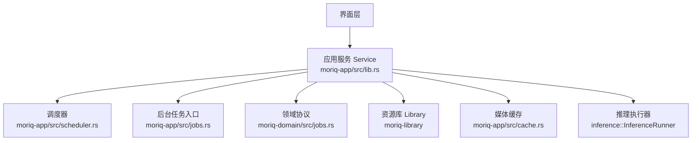
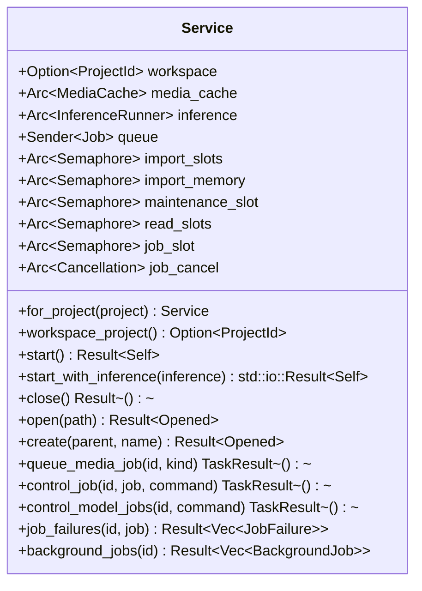
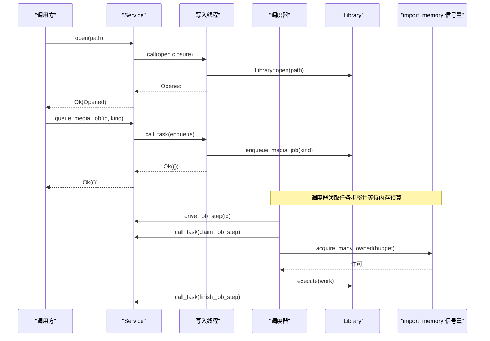
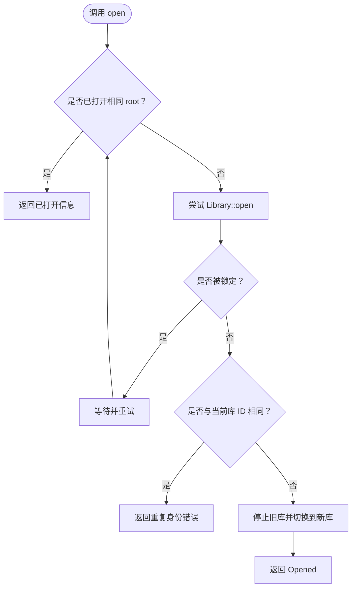
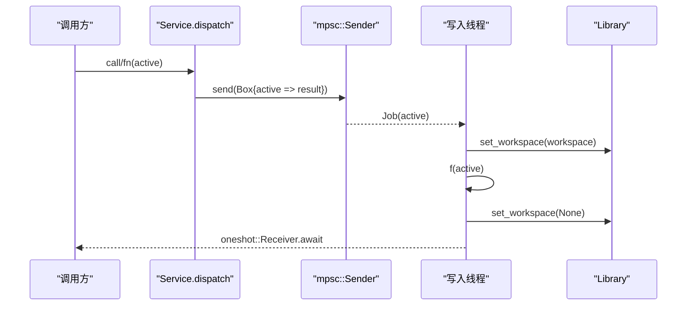
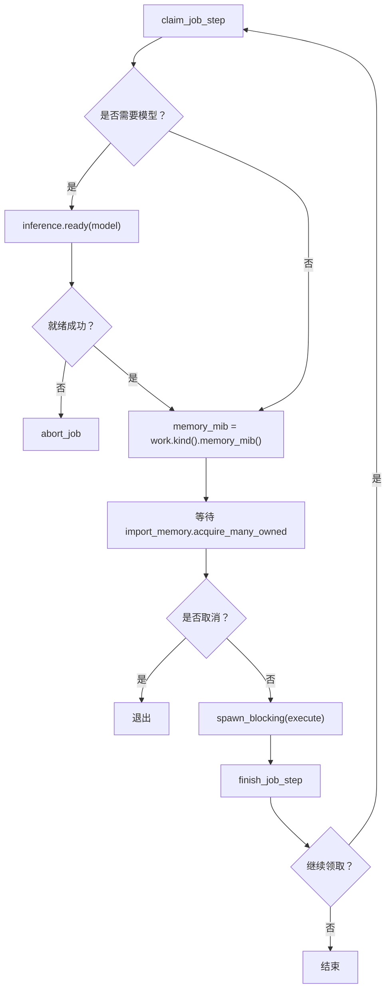
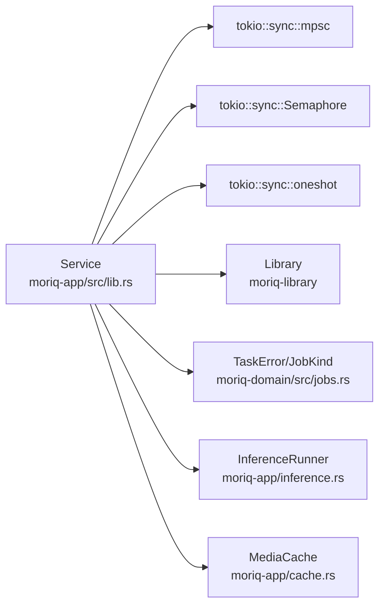
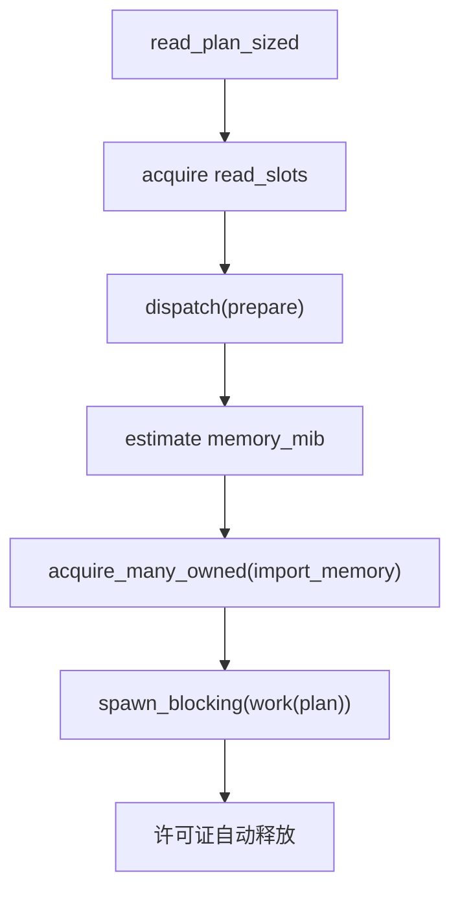
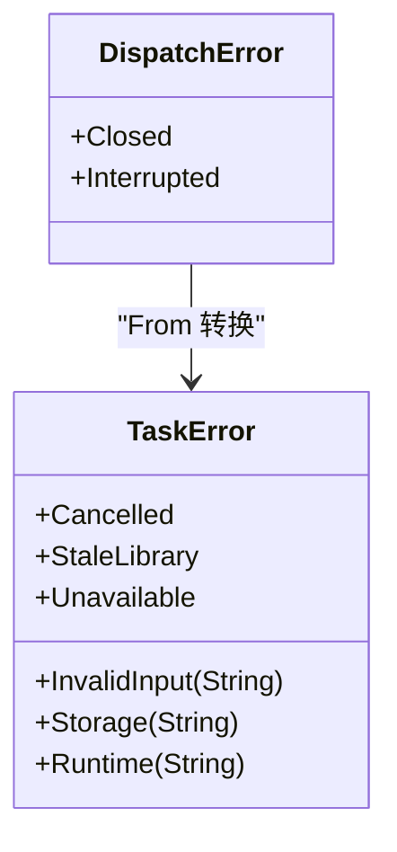

# Service 协调器

> Repo Wiki 节点 `service-coordinator`
> 导出自 Qoder 知识库快照 `8fbe02f6-57c2-4874-b725-1a8130851fd9`，代码基线 `7a7a8e75e18bd90294e09cd422dd7ed5a04813a0`（分支 main，zh-CN）。

<cite>
**本文引用的文件**   
- [crates/moriq-app/src/lib.rs](../../../../crates/moriq-app/src/lib.rs)
- [crates/moriq-app/src/scheduler.rs](../../../../crates/moriq-app/src/scheduler.rs)
- [crates/moriq-app/src/jobs.rs](../../../../crates/moriq-app/src/jobs.rs)
- [crates/moriq-domain/src/jobs.rs](../../../../crates/moriq-domain/src/jobs.rs)
</cite>

## 目录
1. [引言](#引言)
2. [项目结构](#项目结构)
3. [核心组件](#核心组件)
4. [架构总览](#架构总览)
5. [详细组件分析](#详细组件分析)
6. [依赖关系分析](#依赖关系分析)
7. [性能与资源预算](#性能与资源预算)
8. [错误处理策略](#错误处理策略)
9. [API 使用示例](#api-使用示例)
10. [故障排查指南](#故障排查指南)
11. [结论](#结论)

## 引言
Service 协调器是 Moriq Space 应用层的核心单写协调点。它负责：
- 将 UI 调用收敛到唯一写入线程，避免并发修改数据库或媒体状态。
- 管理 Library 生命周期：打开、创建、切换和关闭。
- 隔离多项目上下文，确保队列任务始终属于正确的 ProjectId。
- 通过信号量控制导入、读取、维护及后台任务的并发与内存占用。
- 提供命令式 API：for_project 范围隔离、open/close 库操作、call/call_task 任务调度。
- 统一错误类型 TaskError，使 UI、持久化层和运行期错误可区分、可恢复。

该文档面向希望理解 Service 设计、正确使用其 API 以及调试资源耗尽或任务失败的读者。

## 项目结构
Service 定义在 moriq-app crate 中，并依赖以下关键模块：
- moriq-domain：领域模型、任务协议（TaskError、JobKind、JobState）。
- moriq-library：Library 实体、存储抽象、媒体与 AI 能力。
- moriq-app：服务启动、调度器、作业执行、缓存、设置等。

**图示来源**
- [crates/moriq-app/src/lib.rs:1-80](../../../../crates/moriq-app/src/lib.rs#L1-L80)
- [crates/moriq-app/src/scheduler.rs:1-60](../../../../crates/moriq-app/src/scheduler.rs#L1-L60)
- [crates/moriq-app/src/jobs.rs:1-40](../../../../crates/moriq-app/src/jobs.rs#L1-L40)
- [crates/moriq-domain/src/jobs.rs:1-40](../../../../crates/moriq-domain/src/jobs.rs#L1-L40)

**章节来源**
- [crates/moriq-app/src/lib.rs:1-80](../../../../crates/moriq-app/src/lib.rs#L1-L80)

## 核心组件
Service 是共享句柄，内部持有：
- workspace：可选 ProjectId，表示当前请求的项目上下文。
- media_cache：媒体缩略图/中间结果的缓存。
- inference：推理执行器，用于 AI 任务准备和执行。
- queue：单向发送通道，所有写入都经此队列串行化。
- import_slots：导入并发许可。
- import_memory：导入与读计划内存预算信号量。
- maintenance_slot：维护任务互斥许可。
- read_slots：冻结读计划并发许可。
- job_slot：后台任务驱动互斥许可。
- job_cancel：取消令牌集合，按 LibraryId 与任务标识管理。

**图示来源**
- [crates/moriq-app/src/lib.rs:80-170](../../../../crates/moriq-app/src/lib.rs#L80-L170)
- [crates/moriq-app/src/lib.rs:170-320](../../../../crates/moriq-app/src/lib.rs#L170-L320)
- [crates/moriq-app/src/jobs.rs:1-175](../../../../crates/moriq-app/src/jobs.rs#L1-L175)

**章节来源**
- [crates/moriq-app/src/lib.rs:80-170](../../../../crates/moriq-app/src/lib.rs#L80-L170)
- [crates/moriq-app/src/lib.rs:170-320](../../../../crates/moriq-app/src/lib.rs#L170-L320)
- [crates/moriq-app/src/jobs.rs:1-175](../../../../crates/moriq-app/src/jobs.rs#L1-L175)

## 架构总览
Service 采用“单写者+后台调度”的架构：
- UI 层只持有 Service 的 Cloneable 句柄，不直接访问数据库或媒体 I/O。
- 所有写入通过 mpsc 通道投递到名为 “moriq-library-writer” 的工作线程。
- 调度器在独立线程循环领取 Library 的任务步骤，并在内存与并发许可约束下执行。
- 读写分离：读路径先申请 read_slots，再估算 memory_mib，最后阻塞执行 work。
- 取消系统以弱引用形式登记，支持按 LibraryId 与任务名精准取消。

**图示来源**
- [crates/moriq-app/src/lib.rs:170-320](../../../../crates/moriq-app/src/lib.rs#L170-L320)
- [crates/moriq-app/src/jobs.rs:40-175](../../../../crates/moriq-app/src/jobs.rs#L40-L175)
- [crates/moriq-app/src/scheduler.rs:60-160](../../../../crates/moriq-app/src/scheduler.rs#L60-L160)

**章节来源**
- [crates/moriq-app/src/lib.rs:170-320](../../../../crates/moriq-app/src/lib.rs#L170-L320)
- [crates/moriq-app/src/jobs.rs:40-175](../../../../crates/moriq-app/src/jobs.rs#L40-L175)
- [crates/moriq-app/src/scheduler.rs:60-160](../../../../crates/moriq-app/src/scheduler.rs#L60-L160)

## 详细组件分析

### Service 结构与项目上下文绑定
- for_project：克隆现有 Service，并将 workspace 固定为指定 ProjectId。后续所有 call/call_task 都会在该闭包内临时设置 Library 的 workspace，完成后清空。
- workspace_project：暴露当前句柄绑定的项目范围，便于 UI 显示或校验。

设计要点：
- Service 本身不可变地持有共享资源；project 绑定仅影响本次调用链。
- dispatch 在执行前设置 workspace，执行后清理，避免跨任务泄漏上下文。

**章节来源**
- [crates/moriq-app/src/lib.rs:100-140](../../../../crates/moriq-app/src/lib.rs#L100-L140)
- [crates/moriq-app/src/lib.rs:220-260](../../../../crates/moriq-app/src/lib.rs#L220-L260)

### 资源库生命周期：open / create / close
- open：尝试打开候选库；若检测到锁或身份冲突会返回特定错误；重复打开相同 root 时复用已打开实例；最多重试 20 次，间隔 100ms。
- create：根据用户设置中的分类模板初始化 Library，成功后替换 active 库并停止旧库工作。
- close：停止调度器、清空媒体缓存、关闭当前库，并轮询卸载推理进程，直到成功或达到超时上限。

**图示来源**
- [crates/moriq-app/src/lib.rs:260-320](../../../../crates/moriq-app/src/lib.rs#L260-L320)

**章节来源**
- [crates/moriq-app/src/lib.rs:260-320](../../../../crates/moriq-app/src/lib.rs#L260-L320)

### 命令模式：call / call_task / dispatch
- call：接受一个 FnOnce(&mut Option<Library>) -> Result<T>，用于普通业务写入，返回 String 错误。
- call_task：接受一个 FnOnce(&mut Option<Library>) -> TaskResult<T>，保留 TaskError 类型，供任务相关 API 使用。
- dispatch：内部实现，负责：
  - 通过 oneshot 传递结果。
  - 可取消模式下，如果接收端已关闭则跳过执行。
  - 在闭包执行前后设置/清除 Library.workspace。
  - 将队列关闭或中断转换为 DispatchError，再映射为 String 或 TaskError。

**图示来源**
- [crates/moriq-app/src/lib.rs:200-260](../../../../crates/moriq-app/src/lib.rs#L200-L260)

**章节来源**
- [crates/moriq-app/src/lib.rs:200-260](../../../../crates/moriq-app/src/lib.rs#L200-L260)

### 后台任务：queue_media_job / control_job / drive_job_step
- queue_media_job：如需模型任务，先调用 inference.ready(model) 预加载；随后进入 call_task 入队。
- control_job / control_model_jobs：持久化控制命令，并在暂停/取消时向 Cancellation 登记目标。
- drive_job_step：调度器主循环，步骤包括：
  - 申请 job_slot 限制同时驱动的任务数。
  - claim_job_step 领取下一步工作。
  - 对需要模型的步骤，调用 inference.ready；失败则 abort_job。
  - 计算 memory_mib，循环等待 import_memory 许可，支持取消。
  - 在阻塞线程执行 inference::execute，携带取消标志。
  - finish_job_step 提交回执。

**图示来源**
- [crates/moriq-app/src/jobs.rs:40-175](../../../../crates/moriq-app/src/jobs.rs#L40-L175)
- [crates/moriq-domain/src/jobs.rs:1-120](../../../../crates/moriq-domain/src/jobs.rs#L1-L120)

**章节来源**
- [crates/moriq-app/src/jobs.rs:1-175](../../../../crates/moriq-app/src/jobs.rs#L1-L175)
- [crates/moriq-domain/src/jobs.rs:1-120](../../../../crates/moriq-domain/src/jobs.rs#L1-L120)

### 调度器与取消机制
- Cancellation：保存 (LibraryId, job_name, Weak<AtomicBool>) 列表，支持按目标精确取消。
- start：启动独立线程，持有 Service 的弱引用；最后一个公开 Service 释放后，调度循环退出。
- 错误恢复：连续失败超过阈值时对 Library 暂停任务，并按指数退避重试。

**章节来源**
- [crates/moriq-app/src/scheduler.rs:1-120](../../../../crates/moriq-app/src/scheduler.rs#L1-L120)

## 依赖关系分析
Service 与其关键依赖的关系如下：

**图示来源**
- [crates/moriq-app/src/lib.rs:1-80](../../../../crates/moriq-app/src/lib.rs#L1-L80)
- [crates/moriq-domain/src/jobs.rs:1-40](../../../../crates/moriq-domain/src/jobs.rs#L1-L40)

**章节来源**
- [crates/moriq-app/src/lib.rs:1-80](../../../../crates/moriq-app/src/lib.rs#L1-L80)
- [crates/moriq-domain/src/jobs.rs:1-40](../../../../crates/moriq-domain/src/jobs.rs#L1-L40)

## 性能与资源预算
Service 通过多个信号量控制并发与内存占用，防止资源耗尽：

| 信号量 | 容量 | 用途 | 行为与影响 |
|---|---:|---|---|
| import_slots | 32 | 导入任务并发上限 | 控制同时进行的导入工作数量 |
| import_memory | 4096 MiB | 全局内存预算 | acquire_many_owned(memory_mib)，按需分配，防止 OOM |
| maintenance_slot | 1 | 维护任务互斥 | 保证维护类操作串行执行 |
| read_slots | 4 | 冻结读计划并发 | 限制同时构建读计划的数量 |
| job_slot | 1 | 后台任务驱动互斥 | 防止调度器并行驱动多个任务步 |

读计划流程：
1. 申请 read_slots。
2. 通过 dispatch(true, prepare) 构建冻结计划。
3. 根据计划估算 memory_mib。
4. 申请 import_memory。
5. 在阻塞线程执行 work，许可证随作用域自动释放。

任务内存预算：
- JobKind.memory_mib 为不同任务类型定义预算：AI 分析类通常为 3072 MiB，指纹/缩略图为 1024 MiB，批处理/元数据/完整性检查为 128 MiB。
- drive_job_step 在等待内存许可期间每 25ms 检查取消标志，避免长时间阻塞。

**图示来源**
- [crates/moriq-app/src/lib.rs:320-420](../../../../crates/moriq-app/src/lib.rs#L320-L420)
- [crates/moriq-domain/src/jobs.rs:80-140](../../../../crates/moriq-domain/src/jobs.rs#L80-L140)
- [crates/moriq-app/src/jobs.rs:80-140](../../../../crates/moriq-app/src/jobs.rs#L80-L140)

**章节来源**
- [crates/moriq-app/src/lib.rs:320-420](../../../../crates/moriq-app/src/lib.rs#L320-L420)
- [crates/moriq-domain/src/jobs.rs:80-140](../../../../crates/moriq-domain/src/jobs.rs#L80-L140)
- [crates/moriq-app/src/jobs.rs:80-140](../../../../crates/moriq-app/src/jobs.rs#L80-L140)

## 错误处理策略
Service 统一使用两种错误类型：
- String：用于 UI 友好的简单错误，如服务关闭、队列中断。
- TaskError：用于任务协议层，包含 Cancelled、StaleLibrary、InvalidInput、Storage、Runtime、Unavailable。

关键映射：
- DispatchError::Closed/Interrupted 映射为 String 或 TaskError::Unavailable。
- storage_error 将 moriq_library::Error::Invalid 转为 TaskError::InvalidInput，其他转为 Storage。
- check/check_task 在未打开或库 ID 不匹配时分别返回 String 或 TaskError::StaleLibrary。

**图示来源**
- [crates/moriq-domain/src/jobs.rs:140-200](../../../../crates/moriq-domain/src/jobs.rs#L140-L200)
- [crates/moriq-app/src/lib.rs:380-446](../../../../crates/moriq-app/src/lib.rs#L380-L446)

**章节来源**
- [crates/moriq-domain/src/jobs.rs:140-200](../../../../crates/moriq-domain/src/jobs.rs#L140-L200)
- [crates/moriq-app/src/lib.rs:380-446](../../../../crates/moriq-app/src/lib.rs#L380-L446)

## API 使用示例

### 基本创建与关闭
- 使用 Service::start 创建默认本地推理的服务实例。
- 使用 Service::close 停止调度、关闭当前库并卸载推理进程。

参考路径：
- [crates/moriq-app/src/lib.rs:140-170](../../../../crates/moriq-app/src/lib.rs#L140-L170)
- [crates/moriq-app/src/lib.rs:170-220](../../../../crates/moriq-app/src/lib.rs#L170-L220)

### 项目范围隔离
- 通过 service.for_project(Some(project_id)) 获取限定项目的 Service 副本。
- 在该副本上执行的 open/create/call/call_task 均会临时设置 Library.workspace。

参考路径：
- [crates/moriq-app/src/lib.rs:100-140](../../../../crates/moriq-app/src/lib.rs#L100-L140)
- [crates/moriq-app/src/lib.rs:220-260](../../../../crates/moriq-app/src/lib.rs#L220-L260)

### 打开与创建资源库
- open(path)：打开已有库，支持重试与冲突检测。
- create(parent, name)：创建库并应用分类模板。

参考路径：
- [crates/moriq-app/src/lib.rs:260-320](../../../../crates/moriq-app/src/lib.rs#L260-L320)

### 排队与控制后台任务
- queue_media_job(id, kind)：排队媒体任务，必要时预加载模型。
- control_job(id, job, command)：控制单个任务。
- control_model_jobs(id, command)：批量控制模型任务。

参考路径：
- [crates/moriq-app/src/jobs.rs:1-80](../../../../crates/moriq-app/src/jobs.rs#L1-L80)

### 查询后台任务状态
- background_jobs(id)：返回任务投影，供 UI 展示。

参考路径：
- [crates/moriq-app/src/jobs.rs:160-175](../../../../crates/moriq-app/src/jobs.rs#L160-L175)

## 故障排查指南
常见问题与定位建议：
- 服务已关闭或中断：
  - 现象：String 错误提示“后台服务已关闭”。
  - 原因：队列关闭或接收端断开。
  - 解决：重新创建 Service 或重启应用。
- 任务所属资源库已切换：
  - 现象：TaskError::StaleLibrary。
  - 原因：在 wait 预算或执行过程中切换了库。
  - 解决：重新打开目标库，让调度器从检查点恢复。
- 资源库仍在使用中：
  - 现象：open 多次重试后失败。
  - 原因：后台任务仍在收尾或其他窗口打开同一库。
  - 解决：等待任务完成或关闭其他窗口。
- 内存预算不足：
  - 现象：任务长时间等待 import_memory。
  - 原因：大量 AI 分析或大媒体任务占用内存。
  - 解决：降低并发、减少模型任务或调整系统资源。
- 调度器连续失败：
  - 现象：日志中出现后台任务调度失败，库任务被暂停。
  - 原因：底层存储或推理执行异常。
  - 解决：检查存储健康与模型可用性，重试或修复后恢复。

**章节来源**
- [crates/moriq-app/src/lib.rs:380-446](../../../../crates/moriq-app/src/lib.rs#L380-L446)
- [crates/moriq-app/src/scheduler.rs:100-160](../../../../crates/moriq-app/src/scheduler.rs#L100-L160)

## 结论
Service 协调器通过单写队列、信号量预算、取消系统与类型化错误，为 Moriq Space 提供了稳定、可控且可扩展的资源库管理能力。正确理解 for_project、open/close、call/call_task 以及 import_memory、maintenance_slot 等预算机制，有助于编写可靠的 UI 集成代码并有效排查资源耗尽与任务失败问题。