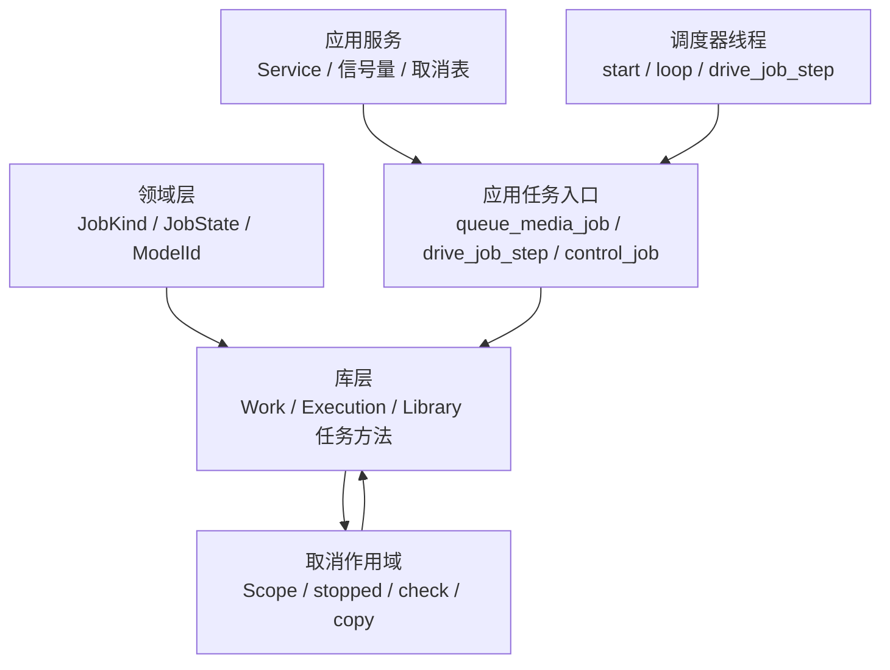
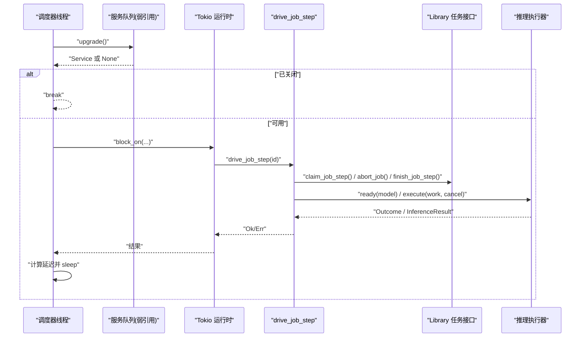
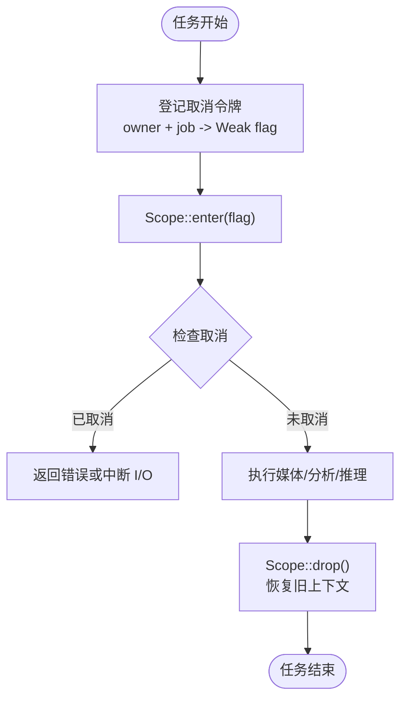
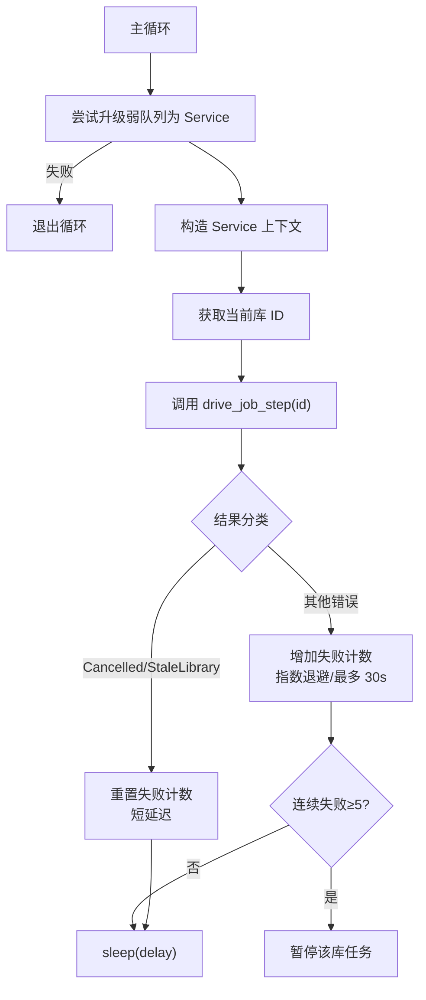
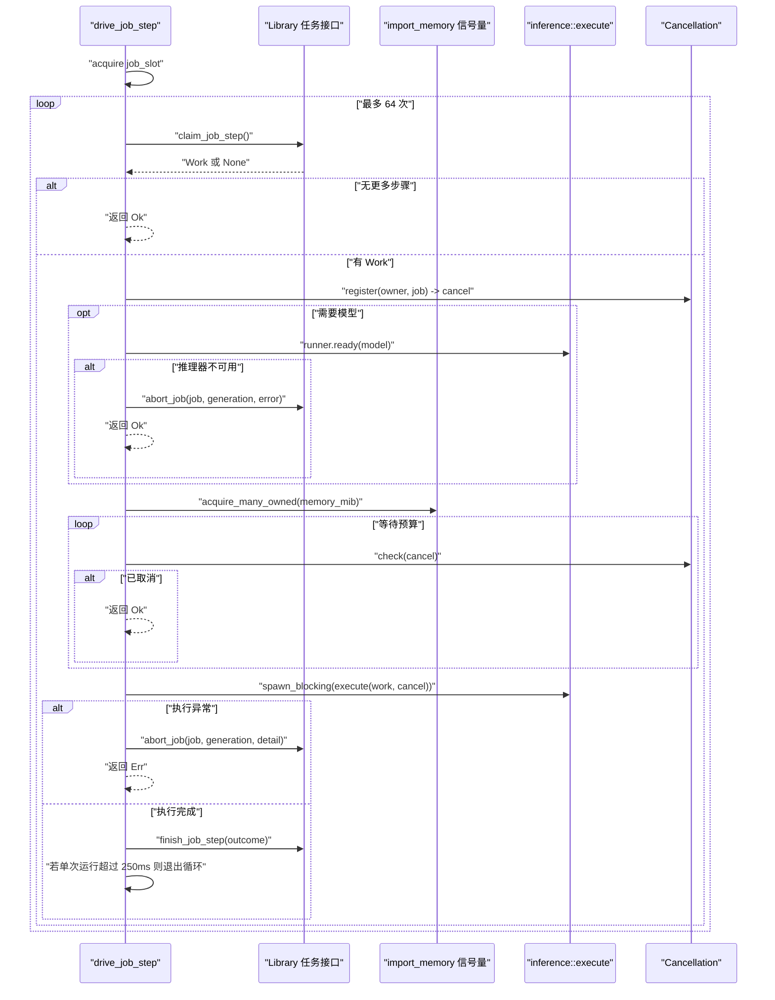
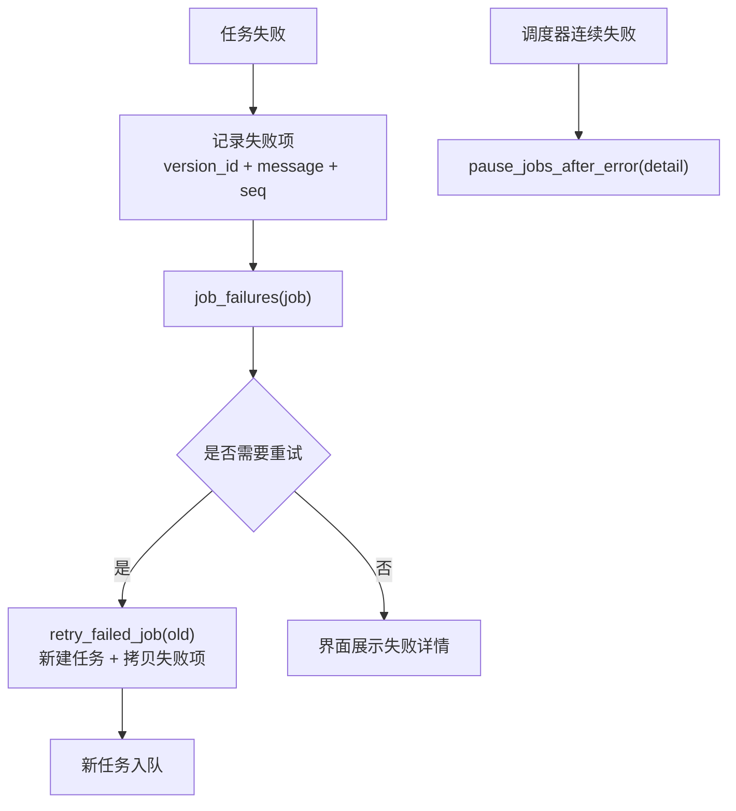
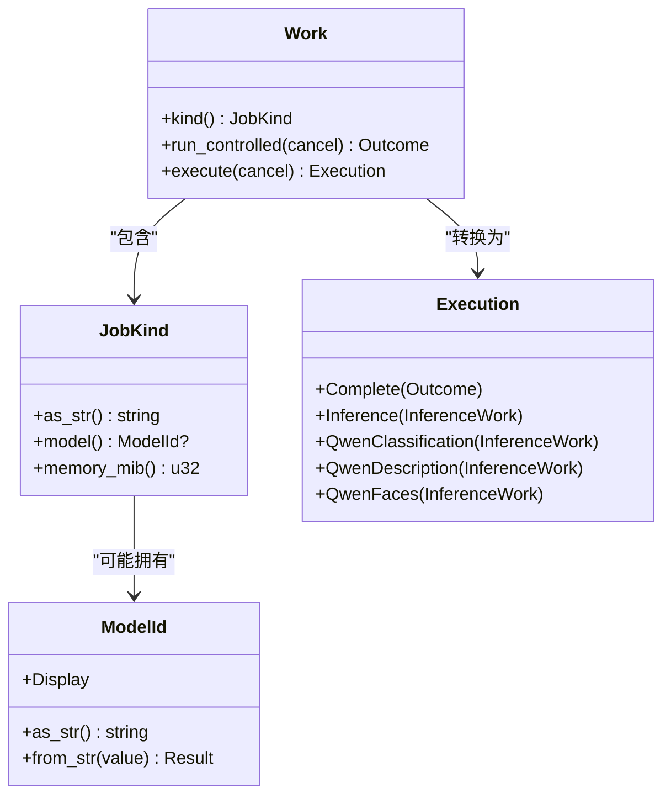
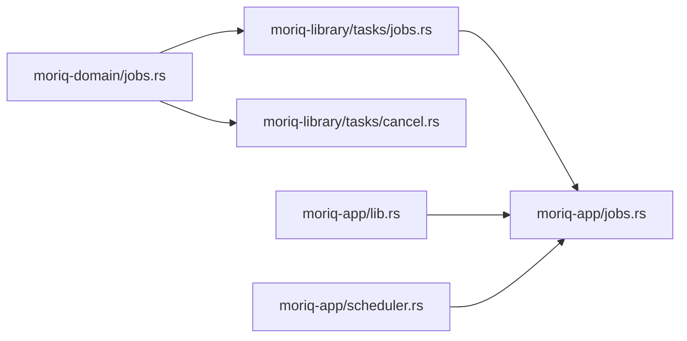

# 任务调度系统

> Repo Wiki 节点 `task-scheduler`
> 导出自 Qoder 知识库快照 `8fbe02f6-57c2-4874-b725-1a8130851fd9`，代码基线 `7a7a8e75e18bd90294e09cd422dd7ed5a04813a0`（分支 main，zh-CN）。

<cite>
**本文引用的文件**   
- [scheduler.rs](../../../../crates/moriq-app/src/scheduler.rs)
- [jobs.rs（应用层）](../../../../crates/moriq-app/src/jobs.rs)
- [cancel.rs](../../../../crates/moriq-library/src/tasks/cancel.rs)
- [jobs.rs（库层）](../../../../crates/moriq-library/src/tasks/jobs.rs)
- [jobs.rs（领域层）](../../../../crates/moriq-domain/src/jobs.rs)
- [lib.rs（应用服务）](../../../../crates/moriq-app/src/lib.rs)
</cite>

## 目录
1. [引言](#引言)
2. [项目结构与职责划分](#项目结构与职责划分)
3. [核心组件](#核心组件)
4. [架构总览](#架构总览)
5. [详细组件分析](#详细组件分析)
6. [依赖关系分析](#依赖关系分析)
7. [性能与资源特性](#性能与资源特性)
8. [故障排查指南](#故障排查指南)
9. [结论](#结论)

## 引言
本文面向“任务调度系统”，聚焦以下目标：
- 解释取消机制，包括任务注册、精确取消和自动清理。
- 说明调度器线程的工作流程：任务领取、资源等待、执行、结果提交。
- 深入解析 `drive_job_step` 的复杂逻辑：重试、失败处理与指数退避。
- 梳理 `JobKind` 枚举与各类任务的差异化处理方式。
- 给出任务队列管理的代码示例路径，展示如何正确提交和控制后台任务。

该系统采用分层设计：领域层定义协议类型，库层实现持久化任务模型与可取消执行体，应用层负责并发控制、调度循环、推理协调和用户交互边界。

## 项目结构与职责划分
| 层级 | 关键文件 | 主要职责 |
|---|---|---|
| 领域层 | [jobs.rs（领域层）](../../../../crates/moriq-domain/src/jobs.rs) | 定义任务类型、状态、错误、模型标识及其协议序列化/反序列化。 |
| 库层 | [jobs.rs（库层）](../../../../crates/moriq-library/src/tasks/jobs.rs)、[cancel.rs](../../../../crates/moriq-library/src/tasks/cancel.rs) | 实现冻结任务、媒体读取、分析准备、取消作用域、失败项重试与任务状态更新。 |
| 应用层 | [lib.rs（应用服务）](../../../../crates/moriq-app/src/lib.rs)、[jobs.rs（应用层）](../../../../crates/moriq-app/src/jobs.rs)、[scheduler.rs](../../../../crates/moriq-app/src/scheduler.rs) | 提供服务句柄、资源信号量、调度线程、任务入口、取消登记与控制。 |

**图表来源**
- [jobs.rs（领域层）](../../../../crates/moriq-domain/src/jobs.rs)
- [jobs.rs（库层）](../../../../crates/moriq-library/src/tasks/jobs.rs)
- [cancel.rs](../../../../crates/moriq-library/src/tasks/cancel.rs)
- [lib.rs（应用服务）](../../../../crates/moriq-app/src/lib.rs)
- [jobs.rs（应用层）](../../../../crates/moriq-app/src/jobs.rs)
- [scheduler.rs](../../../../crates/moriq-app/src/scheduler.rs)

**章节来源**
- [jobs.rs（领域层）](../../../../crates/moriq-domain/src/jobs.rs)
- [jobs.rs（库层）](../../../../crates/moriq-library/src/tasks/jobs.rs)
- [cancel.rs](../../../../crates/moriq-library/src/tasks/cancel.rs)
- [lib.rs（应用服务）](../../../../crates/moriq-app/src/lib.rs)
- [jobs.rs（应用层）](../../../../crates/moriq-app/src/jobs.rs)
- [scheduler.rs](../../../../crates/moriq-app/src/scheduler.rs)

## 核心组件
- 领域协议：`JobKind`、`JobState`、`ModelId`、`TaskError`。
- 取消系统：全局弱引用登记表 + 线程本地作用域 + 分块复制中断。
- 工作单元：`Work`（冻结任务）、`Execution`（执行分支）、`InferenceWork`（推理封装）。
- 调度线程：单调度器循环，使用弱队列所有权，最后一个服务释放后停止。
- 任务入口：`queue_media_job`、`control_job`、`control_model_jobs`、`drive_job_step`。
- 资源控制：导入内存、读槽、维护槽、通用任务槽等信号量。

**章节来源**
- [jobs.rs（领域层）](../../../../crates/moriq-domain/src/jobs.rs)
- [cancel.rs](../../../../crates/moriq-library/src/tasks/cancel.rs)
- [jobs.rs（库层）](../../../../crates/moriq-library/src/tasks/jobs.rs)
- [lib.rs（应用服务）](../../../../crates/moriq-app/src/lib.rs)
- [jobs.rs（应用层）](../../../../crates/moriq-app/src/jobs.rs)
- [scheduler.rs](../../../../crates/moriq-app/src/scheduler.rs)

## 架构总览
调度器线程持有对队列的弱引用；当所有公开服务释放时，循环退出，从而保证“最后服务释放即停止调度”。每个循环内：
1. 通过弱引用尝试获取当前队列。
2. 调用服务方法取得当前活动库标识。
3. 在 Tokio 多线程运行时中执行 `drive_job_step`。
4. 根据错误决定下次轮询延迟与是否暂停后续任务。

**图表来源**
- [scheduler.rs](../../../../crates/moriq-app/src/scheduler.rs)
- [jobs.rs（应用层）](../../../../crates/moriq-app/src/jobs.rs)
- [jobs.rs（库层）](../../../../crates/moriq-library/src/tasks/jobs.rs)

**章节来源**
- [scheduler.rs](../../../../crates/moriq-app/src/scheduler.rs)
- [jobs.rs（应用层）](../../../../crates/moriq-app/src/jobs.rs)

## 详细组件分析

### 取消机制：注册、精确取消与自动清理
取消系统由两部分组成：
- 全局取消表：按库 ID 与任务名登记 `Arc<AtomicBool>`；支持按目标精确取消或全部取消。
- 线程本地取消作用域：将当前任务取消标志安装为当前线程上下文，并在作用域退出时恢复上一个上下文，避免跨任务泄漏。

**图表来源**
- [scheduler.rs](../../../../crates/moriq-app/src/scheduler.rs)
- [cancel.rs](../../../../crates/moriq-library/src/tasks/cancel.rs)
- [jobs.rs（库层）](../../../../crates/moriq-library/src/tasks/jobs.rs)

关键点：
- 登记：为每个任务创建独立 `AtomicBool`，并以 `(LibraryId, String, Weak<AtomicBool>)` 形式保存，避免强引用导致无法回收。
- 精确取消：`stop(Some((id, name)))` 仅标记匹配的目标；`stop(None)` 取消全部仍被持有的任务。
- 自动清理：登记表中保留条件基于 `strong_count > 0`，任务结束后自动移除弱引用记录。
- 作用域安全：`Scope` 确保取消状态不泄漏到下一个任务；长 I/O 使用 `copy` 分块检查取消。

**章节来源**
- [scheduler.rs](../../../../crates/moriq-app/src/scheduler.rs)
- [cancel.rs](../../../../crates/moriq-library/src/tasks/cancel.rs)

### 调度器线程工作流程
调度器线程的职责是持续驱动单个库的任务步骤，直到队列不可用或服务释放。

**图表来源**
- [scheduler.rs](../../../../crates/moriq-app/src/scheduler.rs)
- [jobs.rs（应用层）](../../../../crates/moriq-app/src/jobs.rs)

行为要点：
- 成功或“已取消/过期库”：失败计数归零，固定短延迟继续。
- 普通错误：失败计数递增，延迟按 `1000 << (failures-1)` 增长，上限 30 秒。
- 连续失败阈值：达到 5 次时调用库层暂停相关任务，防止无限重试。

**章节来源**
- [scheduler.rs](../../../../crates/moriq-app/src/scheduler.rs)

### `drive_job_step` 复杂逻辑：领取、预算、执行、提交
`drive_job_step` 是任务执行的核心入口，负责：
- 获取任务槽许可。
- 多次尝试领取任务步骤（最多 64 次）。
- 对模型任务预检推理执行器可用性。
- 按任务类型申请共享内存预算，并周期性检查取消。
- 在阻塞任务中执行推理或媒体处理。
- 提交最终结果或中止任务。

**图表来源**
- [jobs.rs（应用层）](../../../../crates/moriq-app/src/jobs.rs)
- [jobs.rs（库层）](../../../../crates/moriq-library/src/tasks/jobs.rs)
- [cancel.rs](../../../../crates/moriq-library/src/tasks/cancel.rs)

重要细节：
- 任务领取：`claim_job_step` 返回可选 `Work`，None 表示没有可执行步骤。
- 推理预检：若任务需要模型，先调用 `runner.ready(model)`；失败则中止任务并返回成功（避免调度器误判为严重错误）。
- 资源预算：按 `memory_mib()` 申请共享内存；等待期间每 25ms 检查取消。
- 执行边界：推理执行放在 `spawn_blocking` 中，避免阻塞异步运行时。
- 提交结果：`finish_job_step` 写入完成/失败状态；若单次运行时间超过 250ms，跳出循环让出 CPU。

**章节来源**
- [jobs.rs（应用层）](../../../../crates/moriq-app/src/jobs.rs)

### 任务重试与失败处理
库层提供失败项查询与重试能力：
- `job_failures`：读取某任务逐项失败记录，关联资产版本与消息。
- `retry_failed_job`：从原任务的失败项重建新任务，继承优先级、载荷与工作区范围，并重新统计总量。
- `pause_jobs_after_error`：将排队或运行中的任务置为暂停，并附加错误信息。
- `abort_job`：原子撤销当前领取，避免旧工作覆盖新一轮执行。

**图表来源**
- [jobs.rs（库层）](../../../../crates/moriq-library/src/tasks/jobs.rs)

**章节来源**
- [jobs.rs（库层）](../../../../crates/moriq-library/src/tasks/jobs.rs)

### `JobKind` 枚举与任务类型处理
`JobKind` 统一描述任务种类，并提供协议字符串、模型映射与内存预算。

| 任务类型 | 含义 | 模型 | 内存预算 | 执行路径 |
|---|---|---|---|---|
| `Metadata` | 元数据记录 | 无 | 128 MiB | 直接生成元数据 |
| `Integrity` | 完整性校验 | 无 | 128 MiB | 调用 `verify_integrity` |
| `Fingerprints` | 指纹 | 无 | 1024 MiB | 媒体处理路径 |
| `Thumbnails` | 缩略图 | 无 | 1024 MiB | 生成预览边缘图 |
| `Batch` | 批量参数 | 无 | 128 MiB | 携带 payload |
| `Analysis(ModelId)` | 通用分析 | 对应模型 | 3072 MiB | 准备图片并走推理 |
| `QwenClassification` | Qwen 分类 | Qwen35_4b | 3072 MiB | 专用 Qwen 分类路径 |
| `QwenDescription` | Qwen 描述 | Qwen35_4b | 3072 MiB | 专用 Qwen 描述路径 |
| `QwenFaces` | Qwen 人脸 | Qwen35_4b | 3072 MiB | 专用 Qwen 人脸路径 |

**图表来源**
- [jobs.rs（领域层）](../../../../crates/moriq-domain/src/jobs.rs)
- [jobs.rs（库层）](../../../../crates/moriq-library/src/tasks/jobs.rs)

不同任务类型的处理策略：
- 非模型任务：直接进入 `run_controlled`，按类型生成元数据、校验或预览图。
- 模型任务：进入 `execute`，区分 Qwen 系列与普通分析；Qwen 系列进入专用分支。
- 模型不可用时：在 `drive_job_step` 中中止任务并记录错误，而不是立即视为调度器级失败。

**章节来源**
- [jobs.rs（领域层）](../../../../crates/moriq-domain/src/jobs.rs)
- [jobs.rs（库层）](../../../../crates/moriq-library/src/tasks/jobs.rs)
- [jobs.rs（应用层）](../../../../crates/moriq-app/src/jobs.rs)

### 任务队列管理：提交与控制示例
以下为推荐用法的路径索引，帮助读者快速定位实际实现：

- 提交媒体任务：  
  - 入口函数：`queue_media_job`  
    - 参考路径：[jobs.rs（应用层）](../../../../crates/moriq-app/src/jobs.rs)
  - 底层登记：`enqueue_media_job`  
    - 参考路径：[jobs.rs（库层）](../../../../crates/moriq-library/src/tasks/jobs.rs)

- 控制任务：
  - 单任务控制：`control_job`  
    - 参考路径：[jobs.rs（应用层）](../../../../crates/moriq-app/src/jobs.rs)
  - 批量模型任务控制：`control_model_jobs`  
    - 参考路径：[jobs.rs（应用层）](../../../../crates/moriq-app/src/jobs.rs)

- 读取任务状态：
  - 投影查询：`background_jobs`  
    - 参考路径：[jobs.rs（应用层）](../../../../crates/moriq-app/src/jobs.rs)
  - 失败详情：`job_failures`  
    - 参考路径：[jobs.rs（应用层）](../../../../crates/moriq-app/src/jobs.rs)

- 启动调度器：
  - 调度线程启动：`start`  
    - 参考路径：[scheduler.rs](../../../../crates/moriq-app/src/scheduler.rs)

典型流程建议：
1. 创建或打开库后，调用 `queue_media_job` 提交任务。
2. UI 侧定期调用 `background_jobs` 刷新进度。
3. 用户暂停或取消时调用 `control_job`，系统会同时向在途任务发送取消信号。
4. 如需查看失败原因，调用 `job_failures`，并可基于失败项进行重试。

**章节来源**
- [jobs.rs（应用层）](../../../../crates/moriq-app/src/jobs.rs)
- [jobs.rs（库层）](../../../../crates/moriq-library/src/tasks/jobs.rs)
- [scheduler.rs](../../../../crates/moriq-app/src/scheduler.rs)

## 依赖关系分析
- 领域层不依赖库层与应用层，仅提供稳定协议。
- 库层依赖领域层类型，并实现可取消的执行体与持久化操作。
- 应用层依赖库层与服务基础设施，负责并发、资源、调度与推理协调。

**图表来源**
- [jobs.rs（领域层）](../../../../crates/moriq-domain/src/jobs.rs)
- [jobs.rs（库层）](../../../../crates/moriq-library/src/tasks/jobs.rs)
- [cancel.rs](../../../../crates/moriq-library/src/tasks/cancel.rs)
- [jobs.rs（应用层）](../../../../crates/moriq-app/src/jobs.rs)
- [lib.rs（应用服务）](../../../../crates/moriq-app/src/lib.rs)
- [scheduler.rs](../../../../crates/moriq-app/src/scheduler.rs)

**章节来源**
- [jobs.rs（领域层）](../../../../crates/moriq-domain/src/jobs.rs)
- [jobs.rs（库层）](../../../../crates/moriq-library/src/tasks/jobs.rs)
- [cancel.rs](../../../../crates/moriq-library/src/tasks/cancel.rs)
- [jobs.rs（应用层）](../../../../crates/moriq-app/src/jobs.rs)
- [lib.rs（应用服务）](../../../../crates/moriq-app/src/lib.rs)
- [scheduler.rs](../../../../crates/moriq-app/src/scheduler.rs)

## 性能与资源特性
- 调度器线程：单线程循环 + Tokio 多线程运行时（默认 2 个工作线程），减少竞争并保持调度简单性。
- 资源信号量：
  - `job_slot`：限制同时运行的任务步数。
  - `import_memory`：按任务类型申请共享内存预算，避免 OOM。
  - `read_slots`、`maintenance_slot`：分别限制读取与维护操作的并发。
- 指数退避：调度器连续失败时按幂次增加延迟，上限 30 秒，减轻系统压力。
- 任务批量化：单次 `drive_job_step` 最多执行 64 个步骤，且若运行超过 250ms 主动让出，提高响应性。
- 取消高效：分块 I/O 与 25ms 周期检查，使长任务可在合理时间内响应取消。

**章节来源**
- [scheduler.rs](../../../../crates/moriq-app/src/scheduler.rs)
- [jobs.rs（应用层）](../../../../crates/moriq-app/src/jobs.rs)
- [cancel.rs](../../../../crates/moriq-library/src/tasks/cancel.rs)

## 故障排查指南
常见场景与建议：
- 任务一直排队：
  - 检查是否有任务占用 `job_slot` 或 `import_memory`。
  - 确认 `drive_job_step` 是否正常被调度器调用。
  - 参考路径：[scheduler.rs](../../../../crates/moriq-app/src/scheduler.rs)、[jobs.rs（应用层）](../../../../crates/moriq-app/src/jobs.rs)

- 任务被暂停：
  - 查看库层错误信息；可能是调度器连续失败触发了暂停。
  - 参考路径：[jobs.rs（库层）](../../../../crates/moriq-library/src/tasks/jobs.rs)

- 推理任务失败：
  - 检查 `runner.ready(model)` 是否成功；失败会中止任务并记录错误。
  - 参考路径：[jobs.rs（应用层）](../../../../crates/moriq-app/src/jobs.rs)

- 取消无效：
  - 确认是否调用了 `control_job` 或 `control_model_jobs`。
  - 检查取消表是否仍持有目标任务的强引用。
  - 参考路径：[scheduler.rs](../../../../crates/moriq-app/src/scheduler.rs)、[cancel.rs](../../../../crates/moriq-library/src/tasks/cancel.rs)

- 历史失败项：
  - 使用 `job_failures` 查看失败明细，并使用 `retry_failed_job` 重建任务。
  - 参考路径：[jobs.rs（库层）](../../../../crates/moriq-library/src/tasks/jobs.rs)

**章节来源**
- [scheduler.rs](../../../../crates/moriq-app/src/scheduler.rs)
- [jobs.rs（应用层）](../../../../crates/moriq-app/src/jobs.rs)
- [jobs.rs（库层）](../../../../crates/moriq-library/src/tasks/jobs.rs)
- [cancel.rs](../../../../crates/moriq-library/src/tasks/cancel.rs)

## 结论
该任务调度系统通过清晰的层次分工实现了稳健的后台任务管理：
- 领域层保持协议稳定。
- 库层提供可取消、可重试、可审计的任务执行模型。
- 应用层负责并发控制、资源预算、推理协调与调度循环。
- 取消机制兼顾精确性与安全性，避免跨任务泄漏。
- 调度器具备指数退避与失败暂停保护，提升系统在异常下的稳定性。

对于使用者而言，应遵循以下实践：
- 通过 `queue_media_job` 提交任务，并通过 `background_jobs` 观察进度。
- 使用 `control_job` 或 `control_model_jobs` 控制任务生命周期。
- 结合 `job_failures` 与重试机制处理部分失败。
- 避免长时间持有共享内存预算，以减少调度阻塞。