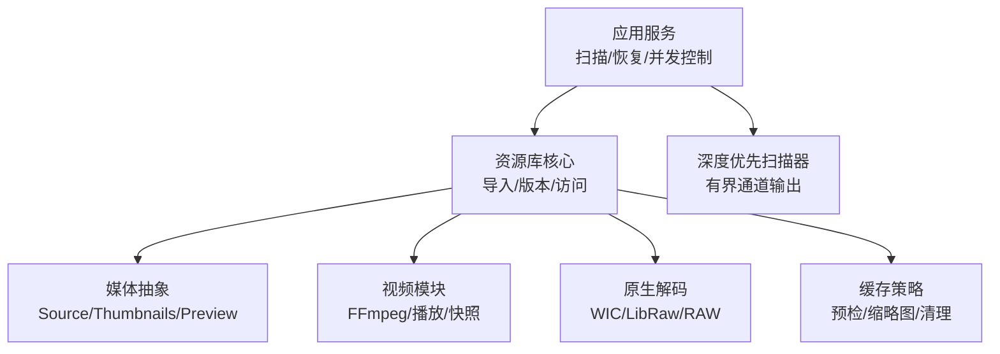
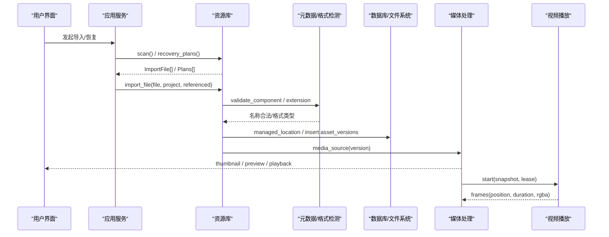
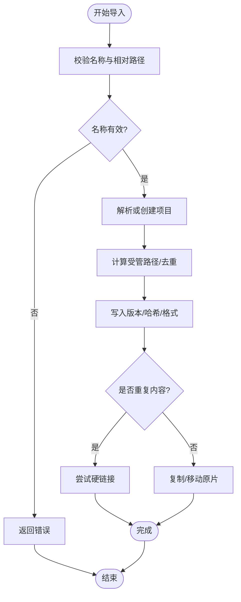
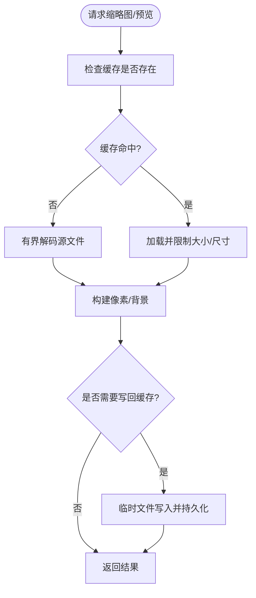
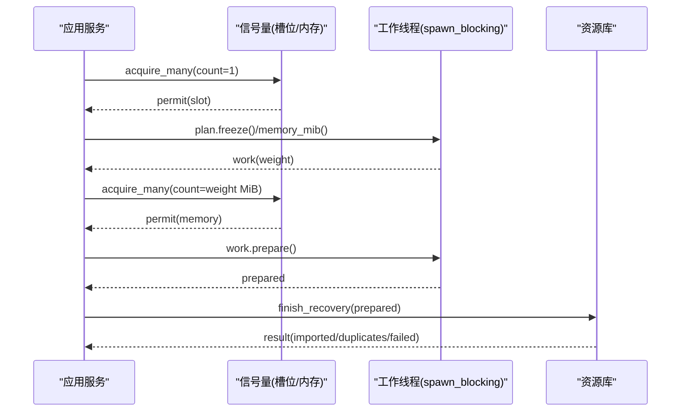
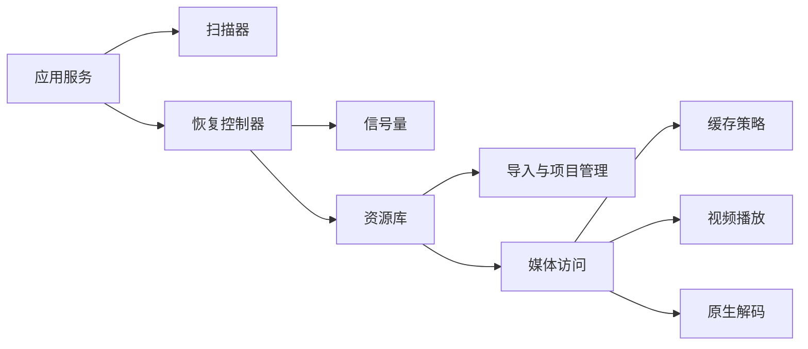

# 媒体处理服务

> Repo Wiki 节点 `media-processing-service`
> 导出自 Qoder 知识库快照 `8fbe02f6-57c2-4874-b725-1a8130851fd9`，代码基线 `7a7a8e75e18bd90294e09cd422dd7ed5a04813a0`（分支 main，zh-CN）。

<cite>
**本文引用的文件**   
- [crates/moriq-library/src/transfer/import.rs](../../../../crates/moriq-library/src/transfer/import.rs)
- [crates/moriq-library/src/media/media.rs](../../../../crates/moriq-library/src/media/media.rs)
- [crates/moriq-library/src/media/cache.rs](../../../../crates/moriq-library/src/media/cache.rs)
- [crates/moriq-library/src/media/video.rs](../../../../crates/moriq-library/src/media/video.rs)
- [crates/moriq-library/src/media/native.rs](../../../../crates/moriq-library/src/media/native.rs)
- [crates/moriq-library/src/library/lifecycle.rs](../../../../crates/moriq-library/src/library/lifecycle.rs)
- [crates/moriq-library/src/media/access.rs](../../../../crates/moriq-library/src/media/access.rs)
- [crates/moriq-app/src/import.rs](../../../../crates/moriq-app/src/import.rs)
- [crates/moriq-app/src/scan.rs](../../../../crates/moriq-app/src/scan.rs)
</cite>

## 目录
1. [简介](#简介)
2. [项目结构](#项目结构)
3. [核心组件](#核心组件)
4. [架构总览](#架构总览)
5. [详细组件分析](#详细组件分析)
6. [依赖关系分析](#依赖关系分析)
7. [性能与并发特性](#性能与并发特性)
8. [故障排查指南](#故障排查指南)
9. [结论](#结论)

## 简介
本文件面向需要理解并使用媒体处理服务的工程师与使用者，系统性说明 Moriq Space 库中媒体导入、元数据提取、缩略图与预览生成、缓存策略、批量恢复的并发控制，以及图片、视频和 RAW 格式的处理差异。文档以实际源码为依据，重点覆盖以下目标：
- 媒体文件导入流程：文件验证、格式检测、路径管理、版本与项目归属。
- 缩略图与预览：生成、缓存、重建与内存预算。
- 批量导入与恢复：工作线程、内存限制、进度跟踪与取消。
- 不同媒体格式的差异：图片、视频与 RAW 的特殊处理逻辑。
- 使用示例：通过公开接口展示常见媒体操作场景。

## 项目结构
媒体处理相关代码主要分布在两个 crate：
- `moriq-library`：资源库核心，负责导入、存储、媒体读取、解码、播放、缓存清理等。
- `moriq-app`：应用层服务编排，负责扫描、恢复、并发许可、进度上报等。

**图表来源**
- [crates/moriq-app/src/import.rs:1-120](../../../../crates/moriq-app/src/import.rs#L1-L120)
- [crates/moriq-library/src/media/media.rs:1-120](../../../../crates/moriq-library/src/media/media.rs#L1-L120)
- [crates/moriq-library/src/media/video.rs:1-60](../../../../crates/moriq-library/src/media/video.rs#L1-L60)
- [crates/moriq-library/src/media/native.rs:1-60](../../../../crates/moriq-library/src/media/native.rs#L1-L60)
- [crates/moriq-library/src/media/cache.rs:1-40](../../../../crates/moriq-library/src/media/cache.rs#L1-L40)
- [crates/moriq-app/src/scan.rs:1-60](../../../../crates/moriq-app/src/scan.rs#L1-L60)

**章节来源**
- [crates/moriq-library/src/transfer/import.rs:1-60](../../../../crates/moriq-library/src/transfer/import.rs#L1-L60)
- [crates/moriq-library/src/media/media.rs:1-120](../../../../crates/moriq-library/src/media/media.rs#L1-L120)
- [crates/moriq-library/src/media/video.rs:1-60](../../../../crates/moriq-library/src/media/video.rs#L1-L60)
- [crates/moriq-library/src/media/native.rs:1-60](../../../../crates/moriq-library/src/media/native.rs#L1-L60)
- [crates/moriq-library/src/media/cache.rs:1-40](../../../../crates/moriq-library/src/media/cache.rs#L1-L40)
- [crates/moriq-app/src/import.rs:1-120](../../../../crates/moriq-app/src/import.rs#L1-L120)
- [crates/moriq-app/src/scan.rs:1-60](../../../../crates/moriq-app/src/scan.rs#L1-L60)

## 核心组件
- 导入入口与项目解析
  - `Library::import_file`：按扫描结果导入单个文件，保留相对路径与项目归属。
  - `resolve_import_project`：根据显式项目或文件名自动创建/定位目标项目。
  - `managed_location`：为受管版本选择安全且不覆盖的路径，支持同名冲突序列号与项目隔离。
- 媒体访问与预览
  - `Source`：冻结文件句柄、身份、尺寸、扩展名、哈希，提供区域读取、预览、回放等能力。
  - `Thumbnails`：批量计划，支持缓存命中与重建。
  - `Preview`：统一预览像素及背景模糊图像。
- 视频播放与帧管道
  - `Playback`：外部视频工具播放，带帧缓冲替换、位置/时长时钟。
  - `receive_frames`：协议校验、尺寸上限、仅保留最新帧。
- 原生解码与 RAW
  - `decode`/`decode_raw`：系统解码器或 LibRaw 工作进程，带输出边长与内存预算。
  - `raw_memory_mib`：探测 RAW 内存开销，供准入控制。
- 缓存清理
  - `Plan::trim`：按字节预算淘汰可重建缓存（预检与缩略图），统计清理结果。

**章节来源**
- [crates/moriq-library/src/transfer/import.rs:1-120](../../../../crates/moriq-library/src/transfer/import.rs#L1-L120)
- [crates/moriq-library/src/media/media.rs:1-120](../../../../crates/moriq-library/src/media/media.rs#L1-L120)
- [crates/moriq-library/src/media/video.rs:1-120](../../../../crates/moriq-library/src/media/video.rs#L1-L120)
- [crates/moriq-library/src/media/native.rs:1-120](../../../../crates/moriq-library/src/media/native.rs#L1-L120)
- [crates/moriq-library/src/media/cache.rs:1-87](../../../../crates/moriq-library/src/media/cache.rs#L1-L87)

## 架构总览
媒体处理的服务流从应用层扫描开始，进入资源库导入，随后进行格式检测、元数据提取、路径管理、版本登记；之后由媒体层按需生成缩略图与预览，并通过缓存策略降低重复成本；视频则通过独立工作程序解码帧并返回给调用方。

**图表来源**
- [crates/moriq-app/src/import.rs:1-120](../../../../crates/moriq-app/src/import.rs#L1-L120)
- [crates/moriq-library/src/transfer/import.rs:1-120](../../../../crates/moriq-library/src/transfer/import.rs#L1-L120)
- [crates/moriq-library/src/media/media.rs:120-220](../../../../crates/moriq-library/src/media/media.rs#L120-L220)
- [crates/moriq-library/src/media/video.rs:60-120](../../../../crates/moriq-library/src/media/video.rs#L60-L120)

## 详细组件分析

### 媒体导入流程
导入流程包含以下关键阶段：
1. 扫描与过滤
   - 应用层递归遍历，跳过符号链接、库内路径、不支持的类型。
   - 输出 `ImportFile`，携带源路径、相对目录、可选项目名称。
2. 名称与路径校验
   - 拒绝危险字符、保留名称、无效路径成分。
   - 拒绝跨平台保留名与逃逸路径。
3. 项目归属与存储路径
   - 若未显式指定项目，可从文件夹名推断；不存在则创建。
   - 在目标项目下计算唯一且安全的受管路径，避免覆盖已有内容。
4. 版本与关联
   - 对重复内容建立独立的项目文件关联，不复制原片时采用硬链接。
   - 数据库登记资产、版本、格式、尺寸、哈希与相对路径。

**图表来源**
- [crates/moriq-library/src/transfer/import.rs:1-120](../../../../crates/moriq-library/src/transfer/import.rs#L1-L120)
- [crates/moriq-library/src/transfer/import.rs:201-352](../../../../crates/moriq-library/src/transfer/import.rs#L201-L352)
- [crates/moriq-app/src/scan.rs:1-137](../../../../crates/moriq-app/src/scan.rs#L1-L137)

**章节来源**
- [crates/moriq-app/src/scan.rs:1-137](../../../../crates/moriq-app/src/scan.rs#L1-L137)
- [crates/moriq-library/src/transfer/import.rs:1-120](../../../../crates/moriq-library/src/transfer/import.rs#L1-L120)
- [crates/moriq-library/src/transfer/import.rs:201-352](../../../../crates/moriq-library/src/transfer/import.rs#L201-L352)

### 文件验证与格式检测
- 名称与组件校验
  - 禁止空值、`.`、`..`、危险字符、尾随空格/点、控制字符、超长 UTF-16 编码、系统保留名。
- 路径安全
  - 拒绝逃逸到库外；相对路径需全部为普通组件。
- 格式识别
  - 视频扩展名白名单用于 SQL 筛选与播放判断。
  - RAW 扩展名白名单用于专用解码路径。
  - 通用支持性检查由原生模块提供。

**章节来源**
- [crates/moriq-library/src/transfer/import.rs:201-352](../../../../crates/moriq-library/src/transfer/import.rs#L201-L352)
- [crates/moriq-library/src/media/video.rs:1-40](../../../../crates/moriq-library/src/media/video.rs#L1-L40)
- [crates/moriq-library/src/media/native.rs:1-40](../../../../crates/moriq-library/src/media/native.rs#L1-L40)

### 元数据提取与详情组装
- 元数据来源
  - 数据库中的视频元数据 JSON，转换为显示字段：时长、编码、帧率、像素格式、音轨、色彩空间、传递函数。
  - AI 分类、主题、OCR 历史、人脸等附加信息。
- 当前展示版本
  - 通过 `details_plan` 组装完整详情，包括分类、AI 结果、OCR 等。
- 媒体来源绑定
  - 详情对象同时绑定媒体来源，便于后续解码或回放。

**章节来源**
- [crates/moriq-library/src/media/media.rs:201-260](../../../../crates/moriq-library/src/media/media.rs#L201-L260)

### 缩略图与预览处理
- 缩略图
  - 固定 256px PNG 缓存，缺失时重建；批量计划最多 128 张，防止过大请求。
  - 重建时使用有界解码，确保无像素时返回错误。
- 预览
  - 默认边长 1600px，失败时不走回退解码；仅读取已存在的有效预览缓存。
  - 写回预览缓存时先写入临时文件再持久化，失败则降级记录日志。
- 像素与背景
  - 将解码图像转为统一预览像素，并生成小图模糊背景。

**图表来源**
- [crates/moriq-library/src/media/media.rs:260-420](../../../../crates/moriq-library/src/media/media.rs#L260-L420)
- [crates/moriq-library/src/media/access.rs:1-23](../../../../crates/moriq-library/src/media/access.rs#L1-L23)

**章节来源**
- [crates/moriq-library/src/media/media.rs:260-420](../../../../crates/moriq-library/src/media/media.rs#L260-L420)
- [crates/moriq-library/src/media/access.rs:1-23](../../../../crates/moriq-library/src/media/access.rs#L1-L23)

### 缓存策略
- 可重建缓存范围
  - 仅 `previews` 与 `thumbnails/256` 下的特定命名规则文件。
  - 排除符号链接、非 PNG 或 RGBA 平面文件、非法 UUID 文件名。
- 淘汰算法
  - 按修改时间与路径排序，逐步删除直至剩余字节低于预算。
- 统计报告
  - 返回移除文件数、移除字节数、剩余字节数、跳过的条目数。

**章节来源**
- [crates/moriq-library/src/media/cache.rs:1-87](../../../../crates/moriq-library/src/media/cache.rs#L1-L87)

### 批量导入与恢复的并发控制
- 扫描
  - 深度优先遍历，保持目录游标而非全量列表，响应取消信号。
- 恢复计划
  - 应用层分页获取恢复计划，逐个冻结计划并估算内存需求。
- 并发许可
  - 使用信号量限制恢复任务槽位与内存占用。
  - 等待期间周期性检查取消标志，避免阻塞。
- 进度跟踪
  - 通过原子计数器上报发现数量、最大单任务内存、等待内存、完成数量。
- 工作线程
  - 使用 `spawn_blocking` 执行 I/O 密集准备，主线程提交结果。

**图表来源**
- [crates/moriq-app/src/import.rs:1-120](../../../../crates/moriq-app/src/import.rs#L1-L120)
- [crates/moriq-app/src/scan.rs:1-137](../../../../crates/moriq-app/src/scan.rs#L1-L137)

**章节来源**
- [crates/moriq-app/src/import.rs:1-120](../../../../crates/moriq-app/src/import.rs#L1-L120)
- [crates/moriq-app/src/scan.rs:1-137](../../../../crates/moriq-app/src/scan.rs#L1-L137)

### 图片、视频与 RAW 的处理差异
- 图片
  - 使用原生解码或系统解码器，输出有界 RGBA 像素。
  - 支持 RAW 扩展名白名单，走专用 LibRaw 路径。
- 视频
  - 使用捆绑 FFmpeg/ffprobe，校验运行时目录与组件完整性。
  - 播放通过外部工作程序接收帧，协议头含尺寸、位置、时长，帧缓冲区只保留最新帧。
  - 支持外部引用文件的快照与保护。
- RAW
  - 探测阶段启动子进程估算内存，限制探测超时与回执长度。
  - Windows 上通过 WIC/LibRaw 工作程序，确保输出边长预算与进程资源限制。

**章节来源**
- [crates/moriq-library/src/media/native.rs:1-200](../../../../crates/moriq-library/src/media/native.rs#L1-L200)
- [crates/moriq-library/src/media/video.rs:1-200](../../../../crates/moriq-library/src/media/video.rs#L1-L200)

## 依赖关系分析

**图表来源**
- [crates/moriq-app/src/import.rs:1-120](../../../../crates/moriq-app/src/import.rs#L1-L120)
- [crates/moriq-library/src/transfer/import.rs:1-120](../../../../crates/moriq-library/src/transfer/import.rs#L1-L120)
- [crates/moriq-library/src/media/media.rs:1-120](../../../../crates/moriq-library/src/media/media.rs#L1-L120)
- [crates/moriq-library/src/media/cache.rs:1-40](../../../../crates/moriq-library/src/media/cache.rs#L1-L40)
- [crates/moriq-library/src/media/video.rs:1-60](../../../../crates/moriq-library/src/media/video.rs#L1-L60)
- [crates/moriq-library/src/media/native.rs:1-60](../../../../crates/moriq-library/src/media/native.rs#L1-L60)

**章节来源**
- [crates/moriq-app/src/import.rs:1-120](../../../../crates/moriq-app/src/import.rs#L1-L120)
- [crates/moriq-library/src/transfer/import.rs:1-120](../../../../crates/moriq-library/src/transfer/import.rs#L1-L120)
- [crates/moriq-library/src/media/media.rs:1-120](../../../../crates/moriq-library/src/media/media.rs#L1-L120)
- [crates/moriq-library/src/media/cache.rs:1-40](../../../../crates/moriq-library/src/media/cache.rs#L1-L40)
- [crates/moriq-library/src/media/video.rs:1-60](../../../../crates/moriq-library/src/media/video.rs#L1-L60)
- [crates/moriq-library/src/media/native.rs:1-60](../../../../crates/moriq-library/src/media/native.rs#L1-L60)

## 性能与并发特性
- 批量缩略图上限：一次最多读取 128 张，防止过大请求导致内存压力。
- 预览解码边界：默认边长 1600px，限制图像宽高与分配大小，避免大图爆内存。
- 缩略图与预览缓存：临时文件写入后持久化，失败降级但不影响主流程。
- 视频帧管道：仅保留最新帧，避免慢渲染积压；帧尺寸上限 1920px，协议头校验严格。
- RAW 内存探测：子进程探测限时 15 秒，回执长度与取值范围校验，限制预估内存。
- 恢复并发：双信号量（槽位与内存）控制，等待间隔 25ms 并响应取消。
- 缓存清理：基于 SQLite 内存表排序淘汰，减少磁盘 IO 压力。

[本节为通用性能指导，不直接分析具体文件]

## 故障排查指南
- 导入阶段
  - 名称或相对路径非法：检查文件夹/文件名是否包含危险字符、系统保留名或逃逸路径。
  - 同名冲突：确认目标路径是否被占用，系统会追加序号；若多次导入同名文件但内容不同，会分别存储。
  - 外部引用变化：若原片在冻结期间被替换，会报错并要求重新定位。
- 预览与缩略图
  - 缓存损坏或过大：系统会跳过写回或忽略超大缓存；可触发重建或运行缓存清理。
  - 解码无像素：可能是格式异常或源文件损坏，需检查原始文件有效性。
- 视频播放
  - 组件缺失或校验失败：确认发行包包含视频工具与播放组件，或开发环境设置正确。
  - 帧协议无效：检查帧头、尺寸、像素数据长度是否符合协议。
- 恢复与连接
  - 新路径不在允许根目录：校验候选路径前缀。
  - 校验期间文件改变：重新连接以避免竞态条件。

**章节来源**
- [crates/moriq-library/src/transfer/import.rs:201-352](../../../../crates/moriq-library/src/transfer/import.rs#L201-L352)
- [crates/moriq-library/src/media/media.rs:300-420](../../../../crates/moriq-library/src/media/media.rs#L300-L420)
- [crates/moriq-library/src/media/video.rs:100-200](../../../../crates/moriq-library/src/media/video.rs#L100-L200)
- [crates/moriq-library/src/media/native.rs:120-200](../../../../crates/moriq-library/src/media/native.rs#L120-L200)
- [crates/moriq-library/src/library/lifecycle.rs:1-177](../../../../crates/moriq-library/src/library/lifecycle.rs#L1-L177)

## 结论
该媒体处理服务通过清晰的职责划分与严格的边界控制，实现了高可靠性的导入、解码、预览与播放能力。导入流程强调安全与幂等，媒体访问强调有界与可缓存，视频处理强调协议校验与进程隔离，RAW 解码强调内存估算与输出限制。应用层的并发控制确保了批量恢复的可控性与稳定性。整体设计适合大规模媒体库管理与多格式兼容场景。

[本节为总结性内容，不直接分析具体文件]