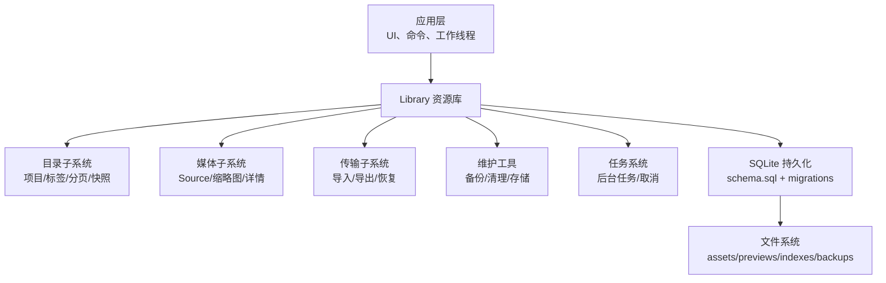
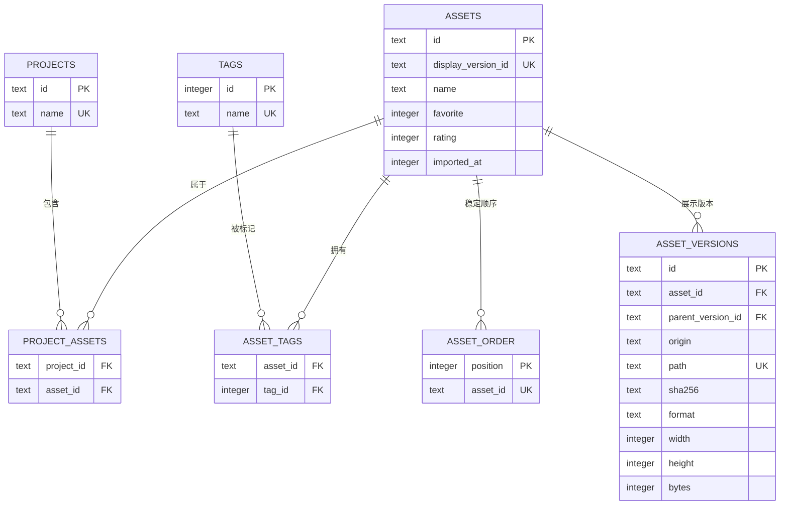
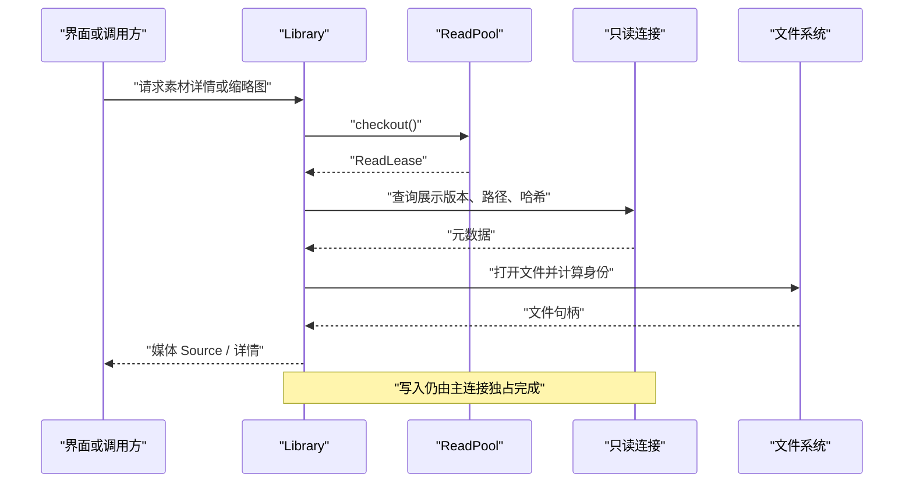
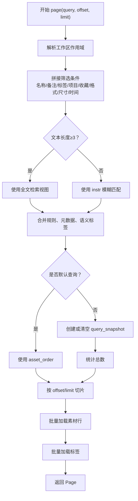
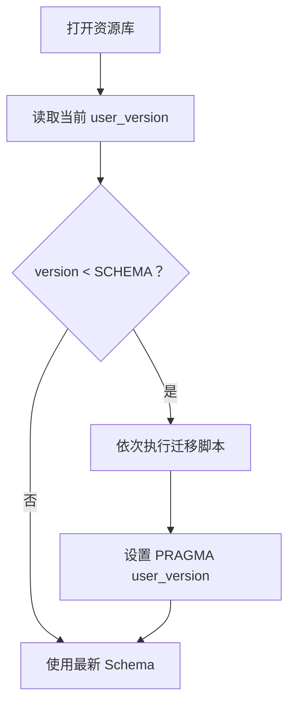

# 持久化层设计

> Repo Wiki 节点 `persistence-layer`
> 导出自 Qoder 知识库快照 `8fbe02f6-57c2-4874-b725-1a8130851fd9`，代码基线 `7a7a8e75e18bd90294e09cd422dd7ed5a04813a0`（分支 main，zh-CN）。

<cite>
**本文引用的文件**   
- [moriq-library/src/lib.rs](../../../../crates/moriq-library/src/lib.rs)
- [moriq-library/Cargo.toml](../../../../crates/moriq-library/Cargo.toml)
- [moriq-library/src/database/schema.sql](../../../../crates/moriq-library/src/database/schema.sql)
- [moriq-library/src/database/journal.rs](../../../../crates/moriq-library/src/database/journal.rs)
- [moriq-library/src/database/read_pool.rs](../../../../crates/moriq-library/src/database/read_pool.rs)
- [moriq-library/src/database/migrations/migration_10.sql](../../../../crates/moriq-library/src/database/migrations/migration_10.sql)
- [moriq-library/src/database/migrations/migration_18.sql](../../../../crates/moriq-library/src/database/migrations/migration_18.sql)
- [moriq-library/src/database/migrations/migration_27.sql](../../../../crates/moriq-library/src/database/migrations/migration_27.sql)
- [moriq-library/src/catalog/catalog.rs](../../../../crates/moriq-library/src/catalog/catalog.rs)
- [moriq-library/src/catalog/query.rs](../../../../crates/moriq-library/src/catalog/query.rs)
- [moriq-library/src/media/media.rs](../../../../crates/moriq-library/src/media/media.rs)
- [moriq-library/src/transfer/import.rs](../../../../crates/moriq-library/src/transfer/import.rs)
</cite>

## 目录
1. [引言](#引言)
2. [项目结构与职责边界](#项目结构与职责边界)
3. [数据库设计与单写者模式](#数据库设计与单写者模式)
4. [数据访问抽象与查询构建](#数据访问抽象与查询构建)
5. [核心子系统职责](#核心子系统职责)
6. [事务、日志与迁移机制](#事务日志与迁移机制)
7. [分页、大数据集与性能优化](#分页大数据集与性能优化)
8. [CRUD 与复杂查询示例](#crud-与复杂查询示例)
9. [故障排查与健壮性建议](#故障排查与健壮性建议)
10. [结论](#结论)

## 引言
本仓库的持久化层以 SQLite 为核心，围绕“一个资源库对应一个数据库文件”的模型组织。写入集中在单一 `Library` 实例上完成；读取通过共享只读连接池进行，从而兼顾一致性、并发浏览和媒体处理效率。Schema 版本由常量控制，并通过增量迁移脚本演进。目录管理、媒体处理、传输导入导出、维护工具和任务系统等上层模块都依赖这一持久化抽象。

## 项目结构与职责边界
持久化相关代码主要集中在 `moriq-library` crate 中：
- `lib.rs` 暴露资源库入口、错误类型、模块组织和 Schema 版本常量。
- `database/` 包含 SQL Schema、迁移脚本、活动日志辅助和只读连接池。
- `catalog/` 负责项目、标签、排序、筛选、分页和查询快照。
- `media/` 负责从数据库定位文件、生成缩略图、读取详情、校验完整性。
- `transfer/` 负责导入、复制、重定位、恢复和同步。
- `maintenance/` 提供备份、清理、孤儿检测和存储维护。
- `tasks/` 管理后台任务状态和取消。

**图表来源**
- [moriq-library/src/lib.rs:1-120](../../../../crates/moriq-library/src/lib.rs#L1-L120)
- [moriq-library/src/database/schema.sql:1-42](../../../../crates/moriq-library/src/database/schema.sql#L1-L42)

**章节来源**
- [moriq-library/src/lib.rs:1-120](../../../../crates/moriq-library/src/lib.rs#L1-L120)
- [moriq-library/Cargo.toml:1-35](../../../../crates/moriq-library/Cargo.toml#L1-L35)

## 数据库设计与单写者模式

### 核心表关系
最基础的资源库结构由初始 Schema 定义，核心实体包括：
- `library_identity`：资源库唯一标识。
- `assets`：素材逻辑记录，保存展示版本、名称、收藏、评分、导入时间等。
- `asset_versions`：素材物理或引用版本，保存路径、哈希、格式、尺寸、字节数。
- `asset_order`：稠密追加式顺序表，用于无深偏移扫描的稳定排序。
- `projects`、`project_assets`：项目和素材归属关系。
- `tags`、`asset_tags`：标签及素材标签关联。
- `activity`、`notifications`：活动与通知（后续迁移引入）。
- `library_state`、`library_preferences`、`background_job_payload` 等状态表（后续迁移引入）。

**图表来源**
- [moriq-library/src/database/schema.sql:1-42](../../../../crates/moriq-library/src/database/schema.sql#L1-L42)

### 单写者与只读副本
- 写入端使用主连接执行所有变更，包括创建资源库、导入、编辑、删除、项目操作、标签操作、通知和活动记录。
- 读取端通过 `ReadPool` 复用最多四个只读连接，避免与写入端竞争；连接在超时、缓存大小和临时表清理上做优化。
- 媒体读取流程会先获取读取租约，再打开实际文件句柄，并携带库生命周期租约，确保读取期间资源库不会被提前释放。

**图表来源**
- [moriq-library/src/database/read_pool.rs:1-97](../../../../crates/moriq-library/src/database/read_pool.rs#L1-L97)
- [moriq-library/src/media/media.rs:1-120](../../../../crates/moriq-library/src/media/media.rs#L1-L120)

**章节来源**
- [moriq-library/src/lib.rs:1-80](../../../../crates/moriq-library/src/lib.rs#L1-L80)
- [moriq-library/src/database/read_pool.rs:1-97](../../../../crates/moriq-library/src/database/read_pool.rs#L1-L97)
- [moriq-library/src/database/schema.sql:1-42](../../../../crates/moriq-library/src/database/schema.sql#L1-L42)

## 数据访问抽象与查询构建

### 查询作用域与快照
`page` 方法将用户查询转换为带参数的 SQL 条件，并按当前项目范围、筛选条件、排序策略生成结果。其关键抽象包括：
- 工作区作用域：通过 `workspace_query` 把查询限定到当前项目及其子项目。
- 文本搜索：短文本走 `instr` 匹配，较长文本走全文检索视图。
- 查询快照：非默认查询会把结果位置信息写入临时表 `query_snapshot`，复用同一查询对象时避免重复执行完整统计。
- 有序回退：默认查询直接使用 `asset_order`，其他查询使用 `query_snapshot`。

**图表来源**
- [moriq-library/src/catalog/query.rs:1-260](../../../../crates/moriq-library/src/catalog/query.rs#L1-L260)

### 结果映射
`read_assets` 将每一行映射为领域中的素材对象，并随后批量加载标签，避免对每个素材单独展开 AI 标签视图。这种方式显著降低大结果集的数据库往返次数。

**章节来源**
- [moriq-library/src/catalog/query.rs:1-260](../../../../crates/moriq-library/src/catalog/query.rs#L1-L260)

## 核心子系统职责

### 目录管理
目录子系统负责：
- 创建、移动、重命名项目，并检测循环父子关系。
- 创建子项目、保留项目树结构。
- 标签重命名和删除，同时更新素材关联和有效标签。
- 锚点附近浏览、选择范围计算，保证 UI 体验一致。
- 外部引用版本的哈希校验与重定位。

典型职责入口：
- 邻居浏览与范围选择：[catalog.rs](../../../../crates/moriq-library/src/catalog/catalog.rs#L1-L200)
- 项目树操作与标签管理：[catalog.rs](../../../../crates/moriq-library/src/catalog/catalog.rs#L1-L200)

**章节来源**
- [moriq-library/src/catalog/catalog.rs:1-200](../../../../crates/moriq-library/src/catalog/catalog.rs#L1-L200)

### 媒体处理
媒体子系统负责：
- 根据资产 ID 和版本构造 `Source`，支持本地文件和外部引用。
- 校验文件内容与登记哈希是否一致。
- 批量生成或读取缩略图。
- 组装素材详情，包括人脸、分类、OCR、视频元数据等。
- 通过 `retrieval_source` 复用检索作用域，确保跨模块一致性。

关键实现：
- 媒体源构造与校验：[media.rs](../../../../crates/moriq-library/src/media/media.rs#L1-L250)
- 缩略图计划与详情装配：[media.rs](../../../../crates/moriq-library/src/media/media.rs#L1-L250)

**章节来源**
- [moriq-library/src/media/media.rs:1-250](../../../../crates/moriq-library/src/media/media.rs#L1-L250)

### 传输层
传输层负责：
- 按扫描结果导入文件，保留相对目录信息和目标项目。
- 安全分配库内路径，避免覆盖已有内容。
- 硬链接或复制项目文件，并维护 `project_files` 关系。
- 校验平台保留名称和路径组件合法性。

关键实现：
- 导入与路径分配：[import.rs](../../../../crates/moriq-library/src/transfer/import.rs#L1-L250)

**章节来源**
- [moriq-library/src/transfer/import.rs:1-250](../../../../crates/moriq-library/src/transfer/import.rs#L1-L250)

### 维护工具
维护工具位于 `maintenance/`，提供备份、清理、孤儿检测、存储维护等功能。它们通常直接操作文件系统与数据库，用于修复不一致、回收空间、保护历史数据和提升长期稳定性。

**章节来源**
- [moriq-library/src/lib.rs:120-200](../../../../crates/moriq-library/src/lib.rs#L120-L200)

## 事务、日志与迁移机制

### 事务与原子性
- 资源库资料更新、项目创建、标签重命名等操作均显式开启事务并提交。
- 失败时不提交，避免部分更新导致的数据不一致。
- 活动记录、通知、状态更新时间通过触发器或显式更新保持与业务变更一致。

示例路径：
- 资料更新与通知：[journal.rs](../../../../crates/moriq-library/src/database/journal.rs#L1-L200)
- 项目创建与标签操作：[catalog.rs](../../../../crates/moriq-library/src/catalog/catalog.rs#L1-L200)

### 活动与通知
- 活动表记录素材导入、重命名、收藏、评分、备注、回收站、永久删除、标签变化、项目变更等事件。
- 通知表支持级别、关联资产、重试策略和已读截止位。
- 活动与通知通过游标分页，避免深偏移扫描。

关键迁移：
- 第 10 版迁移引入活动增强、通知表和库状态表：[migration_10.sql](../../../../crates/moriq-library/src/database/migrations/migration_10.sql#L1-L43)

**章节来源**
- [moriq-library/src/database/migrations/migration_10.sql:1-43](../../../../crates/moriq-library/src/database/migrations/migration_10.sql#L1-L43)
- [moriq-library/src/database/journal.rs:1-L200](../../../../crates/moriq-library/src/database/journal.rs#L1-L200)

### 迁移机制
- Schema 版本由 `SCHEMA` 常量控制，当前为第 27 版。
- 每次迁移脚本末尾设置 `PRAGMA user_version`，便于运行时识别数据库版本。
- 迁移脚本以增量方式扩展表结构、索引、视图和触发器。

示例迁移：
- 背景任务负载字段：[migration_18.sql](../../../../crates/moriq-library/src/database/migrations/migration_18.sql#L1-L3)
- AI 可见标签视图优化：[migration_27.sql](../../../../crates/moriq-library/src/database/migrations/migration_27.sql#L1-L9)
- 初始基础表与触发器：[schema.sql](../../../../crates/moriq-library/src/database/schema.sql#L1-L42)

**图表来源**
- [moriq-library/src/lib.rs:1-L80](../../../../crates/moriq-library/src/lib.rs#L1-L80)
- [moriq-library/src/database/migrations/migration_27.sql:1-L9](../../../../crates/moriq-library/src/database/migrations/migration_27.sql#L1-L9)

**章节来源**
- [moriq-library/src/lib.rs:1-L80](../../../../crates/moriq-library/src/lib.rs#L1-L80)
- [moriq-library/src/database/migrations/migration_18.sql:1-L3](../../../../crates/moriq-library/src/database/migrations/migration_18.sql#L1-L3)
- [moriq-library/src/database/migrations/migration_27.sql:1-L9](../../../../crates/moriq-library/src/database/migrations/migration_27.sql#L1-L9)
- [moriq-library/src/database/schema.sql:1-L42](../../../../crates/moriq-library/src/database/schema.sql#L1-L42)

## 分页、大数据集与性能优化

### 分页策略
- 默认查询使用 `asset_order` 表，按导入时间和 ID 稳定排序，避免深度 OFFSET。
- 非默认查询使用临时表 `query_snapshot`，先计算完整排序位置，再按偏移量切片。
- 单次最大限制为 128 条，防止一次性加载过多数据。
- 邻居浏览和选择范围基于 position 值计算，减少全表扫描。

优化点：
- 项目页专用分支仅投影所需列，避免展开昂贵的 AI 或全文视图。
- 标签通过批量查询加载，避免逐素材展开 AI 标签视图。

**章节来源**
- [moriq-library/src/catalog/query.rs:1-L260](../../../../crates/moriq-library/src/catalog/query.rs#L1-L260)
- [moriq-library/src/catalog/catalog.rs:1-L200](../../../../crates/moriq-library/src/catalog/catalog.rs#L1-L200)

### 只读连接池优化
- 空闲连接池上限为 4。
- 连接启用忙超时、负缓存大小、临时存储到文件、临时缓存大小调优。
- 归还连接前自动回滚未提交事务，并清理临时表。

**章节来源**
- [moriq-library/src/database/read_pool.rs:1-L97](../../../../crates/moriq-library/src/database/read_pool.rs#L1-L97)

### 媒体读取与完整性校验
- 媒体读取冻结文件句柄、路径、哈希、扩展名和维度。
- 对引用版本可期望注册哈希，并对本地文件做完整性校验。
- 缩略图优先读取缓存，缺失时重建。

**章节来源**
- [moriq-library/src/media/media.rs:1-L250](../../../../crates/moriq-library/src/media/media.rs#L1-L250)

## CRUD 与复杂查询示例

以下示例以“如何调用”和“涉及哪些数据”的方式描述，不直接粘贴源码。

### 创建资源库与项目
- 创建资源库时初始化目录、基础 Schema 和身份标识。
- 创建项目时验证名称、插入 `projects`，并在工作区配置中建立项目资料。
- 创建子项目时检查父级关系，并继承 AI 配置文件。

参考路径：
- 项目创建与子项目创建：[catalog.rs](../../../../crates/moriq-library/src/catalog/catalog.rs#L1-L200)

### 导入素材
- 解析导入上下文和目标项目。
- 计算安全的库内路径，避免覆盖。
- 若为目标项目，可能创建硬链接或复制文件，并写入 `project_files`。
- 最终写入 `assets` 和 `asset_versions`，并触发活动和状态更新。

参考路径：
- 导入与路径分配：[import.rs](../../../../crates/moriq-library/src/transfer/import.rs#L1-L250)
- 初始 Schema 与版本关系：[schema.sql](../../../../crates/moriq-library/src/database/schema.sql#L1-L42)

### 更新素材元数据
- 收藏、评分、备注、标签、回收站状态等修改应通过统一接口执行。
- 修改后触发活动记录和 `library_state.updated_at` 更新。
- 标签重命名或删除会同步更新 `asset_tags` 和 AI 拒绝标签，保持搜索结果一致。

参考路径：
- 通知与活动：[journal.rs](../../../../crates/moriq-library/src/database/journal.rs#L1-L200)
- 标签重命名与删除：[catalog.rs](../../../../crates/moriq-library/src/catalog/catalog.rs#L1-L200)
- 状态与活动触发器：[migration_10.sql](../../../../crates/moriq-library/src/database/migrations/migration_10.sql#L1-L43)

### 删除与恢复
- 软删除通过设置 `deleted_at` 实现，并在活动表中记录。
- 永久删除会从素材表和版本表移除记录，同时清理关联标签和项目成员。
- 恢复操作需要谨慎处理路径、版本和外部引用的一致性。

参考路径：
- 回收站状态查询：[journal.rs](../../../../crates/moriq-library/src/database/journal.rs#L1-L200)
- 活动触发器：[migration_10.sql](../../../../crates/moriq-library/src/database/migrations/migration_10.sql#L1-L43)

### 复杂查询：按多条件分页浏览
- 输入：文本、收藏、项目、回收站、格式、评分、大小范围、时间范围、方向、无标签、未分配、标签、颜色、编辑时间、存储位置、媒体类型、类别、人物、语义 ID、文件夹、媒介、主题、人工分类。
- 输出：总数量、偏移、素材列表。
- 实现：拼接条件、选择全文或模糊匹配、写入快照或直接使用顺序表、分批加载素材和标签。

参考路径：
- 分页查询构建与结果映射：[query.rs](../../../../crates/moriq-library/src/catalog/query.rs#L1-L260)

## 故障排查与健壮性建议

### 常见错误类型
- I/O 错误：文件或目录权限不足、空间不足。
- 数据库错误：SQLite 异常、锁冲突、参数转换失败。
- 图片解码错误：损坏或不受支持的图片文件。
- 色彩配置错误：色彩空间转换失败。
- 无效参数：名称过长、非法字符、超出业务约束。
- 锁定错误：资源库正被另一个进程或窗口占用。

参考路径：
- 错误枚举与转换：[lib.rs](../../../../crates/moriq-library/src/lib.rs#L80-L160)

### 排查建议
- 检查 `library_state.updated_at` 是否随主要表变更更新。
- 检查活动表是否存在预期事件，确认事务提交成功。
- 检查通知表是否按截止位正确标记已读。
- 检查 `query_snapshot` 是否在多次查询间被正确复用或清空。
- 检查只读连接池是否出现锁失效或连接泄漏。
- 检查媒体文件哈希是否与 `asset_versions.sha256` 一致。

**章节来源**
- [moriq-library/src/lib.rs:80-L160](../../../../crates/moriq-library/src/lib.rs#L80-L160)
- [moriq-library/src/database/journal.rs:1-L200](../../../../crates/moriq-library/src/database/journal.rs#L1-L200)
- [moriq-library/src/database/read_pool.rs:1-L97](../../../../crates/moriq-library/src/database/read_pool.rs#L1-L97)
- [moriq-library/src/media/media.rs:1-L250](../../../../crates/moriq-library/src/media/media.rs#L1-L250)

## 结论
该持久化层以 SQLite 为中心，采用单写者模式保障一致性，并通过只读连接池提升读取并发能力。Schema 通过增量迁移演进，核心表围绕素材、版本、项目、标签和顺序表组织。目录、媒体、传输和维护子系统围绕统一的 `Library` 抽象协作，形成清晰的职责边界。查询层通过作用域、全文检索、临时快照和批量映射实现高性能分页；媒体层通过冻结源、缩略图缓存和完整性校验保障用户体验和数据安全。整体设计适合桌面资源库场景，但在未来仍可考虑更细粒度的读写分离、更完善的迁移回滚和更强的并发写入隔离。