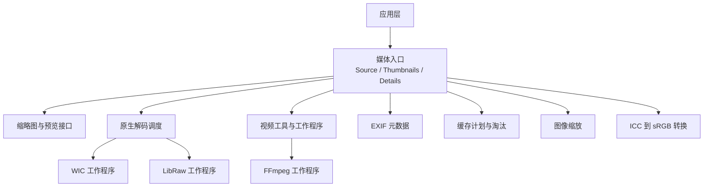
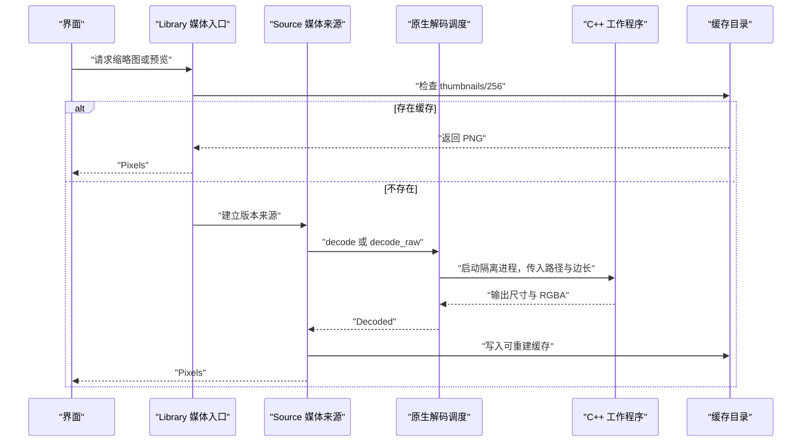
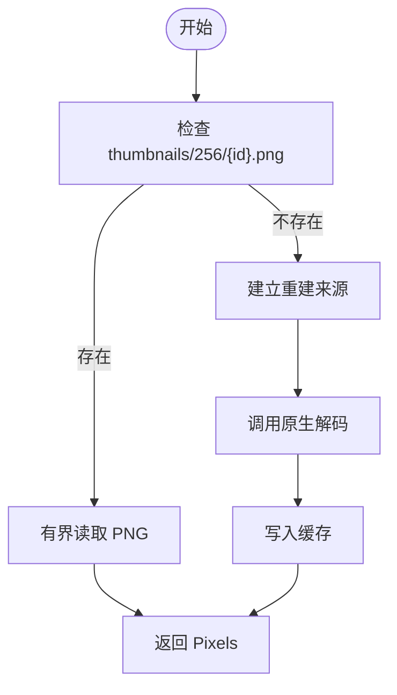
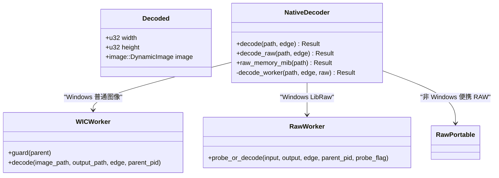
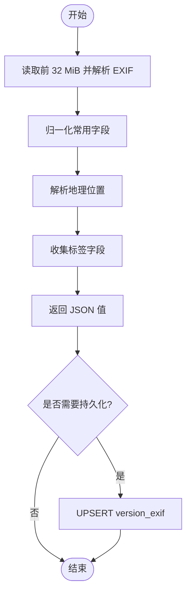
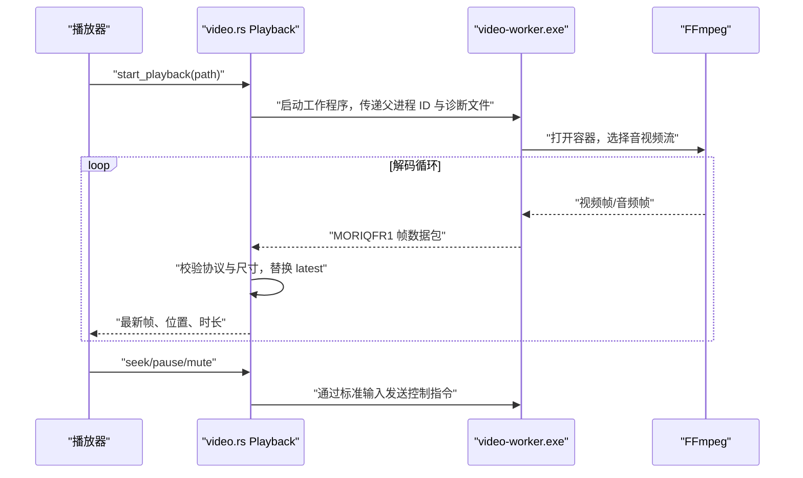
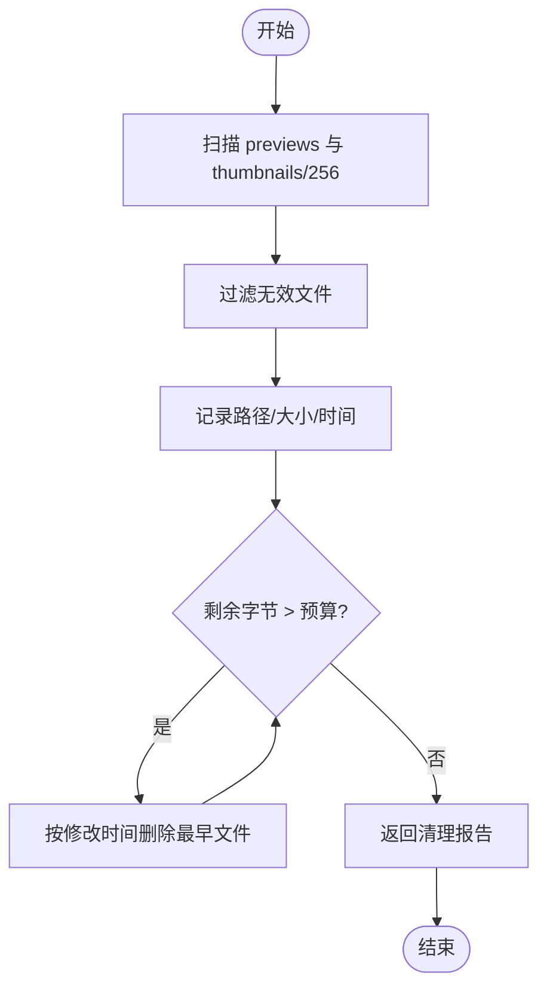
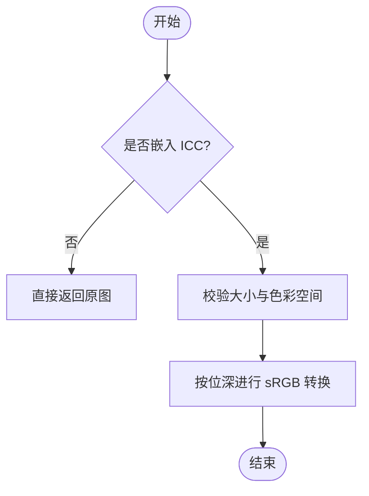
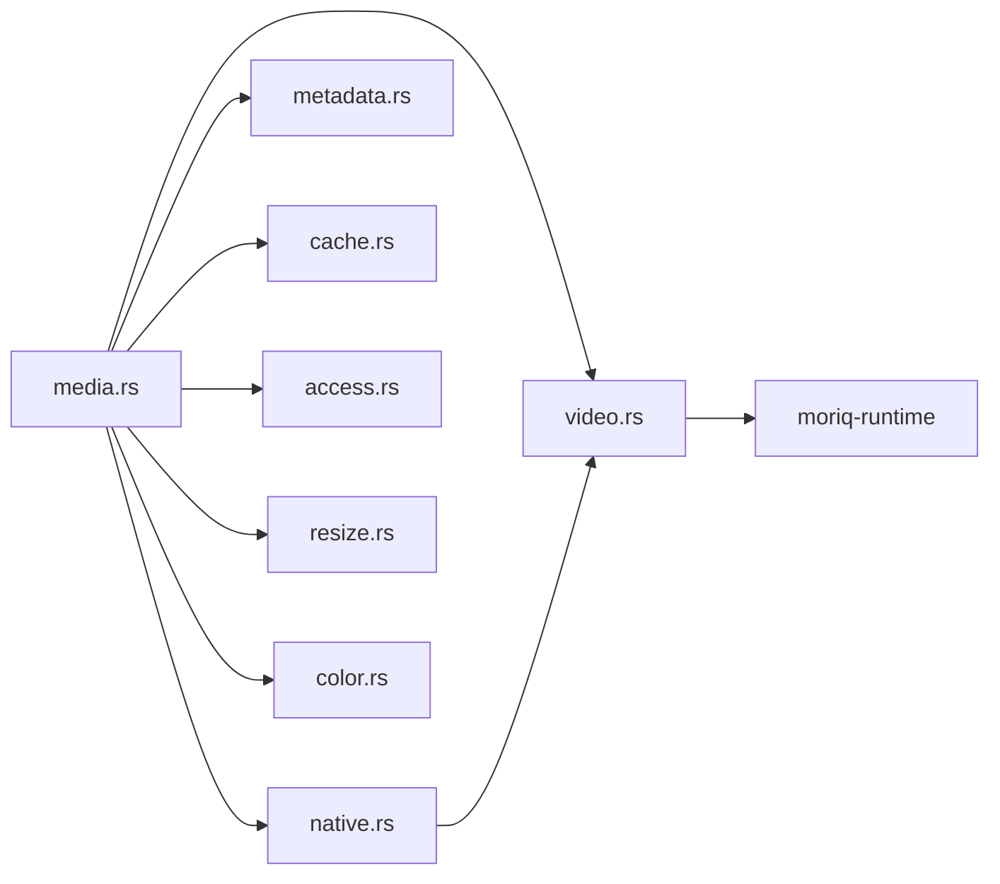

# 媒体处理子系统

> Repo Wiki 节点 `media-processing`
> 导出自 Qoder 知识库快照 `8fbe02f6-57c2-4874-b725-1a8130851fd9`，代码基线 `7a7a8e75e18bd90294e09cd422dd7ed5a04813a0`（分支 main，zh-CN）。

<cite>
**本文引用的文件**
- [lib.rs](../../../../crates/moriq-library/src/lib.rs)
- [media.rs](../../../../crates/moriq-library/src/media/media.rs)
- [native.rs](../../../../crates/moriq-library/src/media/native.rs)
- [cache.rs](../../../../crates/moriq-library/src/media/cache.rs)
- [video.rs](../../../../crates/moriq-library/src/media/video.rs)
- [metadata.rs](../../../../crates/moriq-library/src/media/metadata.rs)
- [access.rs](../../../../crates/moriq-library/src/media/access.rs)
- [resize.rs](../../../../crates/moriq-library/src/media/resize.rs)
- [color.rs](../../../../crates/moriq-library/src/media/color.rs)
- [raw_portable.rs](../../../../crates/moriq-library/src/media/raw_portable.rs)
- [build.rs](../../../../crates/moriq-library/build.rs)
- [Cargo.toml](../../../../crates/moriq-library/Cargo.toml)
- [wic-worker.cpp](../../../../crates/moriq-library/native/wic-worker.cpp)
- [video-worker.cpp](../../../../crates/moriq-library/native/video-worker.cpp)
- [raw-worker.cpp](../../../../crates/moriq-library/native/raw-worker.cpp)
- [raw-budget.h](../../../../crates/moriq-library/native/raw-budget.h)
</cite>

## 目录
1. [引言](#引言)
2. [项目结构](#项目结构)
3. [核心组件](#核心组件)
4. [架构总览](#架构总览)
5. [详细组件分析](#详细组件分析)
6. [依赖关系分析](#依赖关系分析)
7. [性能考虑](#性能考虑)
8. [故障排查指南](#故障排查指南)
9. [结论](#结论)

## 引言
本文件系统性地说明媒体处理子系统的实现，覆盖多媒体文件的格式检测、元数据提取、缩略图生成、原生解码器集成、内存与进程隔离、视频帧提取与播放预览、缓存策略、批量处理优化以及异常处理。该子系统以 Rust 为主逻辑层，通过构建阶段编译的 Windows C++ 工作程序调用系统 WIC、LibRaw 和 FFmpeg，完成安全、可审计且资源受限的多媒体解码与预览。

## 项目结构
媒体处理相关代码集中在 `moriq-library` crate 中，按职责分为：
- 媒体入口与来源抽象：[media.rs](../../../../crates/moriq-library/src/media/media.rs)
- 原生解码调度：[native.rs](../../../../crates/moriq-library/src/media/native.rs)
- 视频工具与工作程序：[video.rs](../../../../crates/moriq-library/src/media/video.rs)
- EXIF 元数据读写与查询：[metadata.rs](../../../../crates/moriq-library/src/media/metadata.rs)
- 缓存管理与淘汰：[cache.rs](../../../../crates/moriq-library/src/media/cache.rs)
- 缩略图读取与预览接口：[access.rs](../../../../crates/moriq-library/src/media/access.rs)
- 图像缩放与色彩转换：[resize.rs](../../../../crates/moriq-library/src/media/resize.rs)、[color.rs](../../../../crates/moriq-library/src/media/color.rs)
- 便携 RAW 解码：[raw_portable.rs](../../../../crates/moriq-library/src/media/raw_portable.rs)
- 构建脚本与原生二进制产物：[build.rs](../../../../crates/moriq-library/build.rs)
- 原生 C++ 工作程序：[wic-worker.cpp](../../../../crates/moriq-library/native/wic-worker.cpp)、[video-worker.cpp](../../../../crates/moriq-library/native/video-worker.cpp)、[raw-worker.cpp](../../../../crates/moriq-library/native/raw-worker.cpp)、[raw-budget.h](../../../../crates/moriq-library/native/raw-budget.h)

**图表来源**
- [media.rs:1-200](../../../../crates/moriq-library/src/media/media.rs#L1-L200)
- [native.rs:1-200](../../../../crates/moriq-library/src/media/native.rs#L1-L200)
- [video.rs:1-200](../../../../crates/moriq-library/src/media/video.rs#L1-L200)
- [metadata.rs:1-153](../../../../crates/moriq-library/src/media/metadata.rs#L1-L153)
- [cache.rs:1-87](../../../../crates/moriq-library/src/media/cache.rs#L1-L87)
- [access.rs:1-23](../../../../crates/moriq-library/src/media/access.rs#L1-L23)
- [resize.rs:1-72](../../../../crates/moriq-library/src/media/resize.rs#L1-L72)
- [color.rs:1-191](../../../../crates/moriq-library/src/media/color.rs#L1-L191)

**章节来源**
- [lib.rs:1-200](../../../../crates/moriq-library/src/lib.rs#L1-L200)

## 核心组件
- 媒体来源 `Source`：封装素材版本、路径、哈希、扩展名、尺寸与文件句柄，提供统一读取入口，避免界面直接访问文件系统。
- 缩略图计划 `Thumbnails`：批量冻结最多 128 个版本的缩略图路径或重建来源，用于媒体线程并行处理。
- 详情计划 `Details`：组合数据库分类、AI 主题、OCR 等展示信息，并将媒体来源解析结果作为可选字段返回。
- 原生解码器调度：根据普通图像或 RAW 走不同路径，调用隔离的 C++ 工作程序，限制输出边长与内存。
- 视频处理：通过 FFmpeg 工作程序进行解复用、解码、时间轴估计、帧输出与音频播放；Rust 端负责协议校验、进度与状态管理。
- 元数据处理：读取并规范化 EXIF 常用字段，支持 JSON 存储、SQL 筛选条件编译。
- 缓存管理：仅对可重建的预览与缩略图执行基于修改时间的淘汰，保留原片与不可重建数据。
- 图像后处理：等比缩放、ICC 到 sRGB 转换、像素类型与透明度保护。

**章节来源**
- [media.rs:1-200](../../../../crates/moriq-library/src/media/media.rs#L1-L200)
- [access.rs:1-23](../../../../crates/moriq-library/src/media/access.rs#L1-L23)
- [native.rs:1-200](../../../../crates/moriq-library/src/media/native.rs#L1-L200)
- [video.rs:1-200](../../../../crates/moriq-library/src/media/video.rs#L1-L200)
- [metadata.rs:1-153](../../../../crates/moriq-library/src/media/metadata.rs#L1-L153)
- [cache.rs:1-87](../../../../crates/moriq-library/src/media/cache.rs#L1-L87)
- [resize.rs:1-72](../../../../crates/moriq-library/src/media/resize.rs#L1-L72)
- [color.rs:1-191](../../../../crates/moriq-library/src/media/color.rs#L1-L191)

## 架构总览
媒体处理采用“Rust 控制平面 + C++ 隔离工作程序”的分层架构：
- Rust 侧负责输入校验、路径安全、预算约束、取消信号、缓存策略与 UI 数据组装。
- C++ 侧运行在独立进程中，受作业对象限制 CPU 与内存，并通过固定协议与 Rust 交换像素、时间与诊断信息。
- 视频播放使用 FFmpeg 工作程序；RAW 解码使用 LibRaw；普通图像使用 WIC。

**图表来源**
- [media.rs:1-200](../../../../crates/moriq-library/src/media/media.rs#L1-L200)
- [native.rs:1-200](../../../../crates/moriq-library/src/media/native.rs#L1-L200)
- [cache.rs:1-87](../../../../crates/moriq-library/src/media/cache.rs#L1-L87)

## 详细组件分析

### 媒体来源与缩略图
- `Source::from_read_connection` 与 `version_source` 从数据库获取素材版本的哈希、格式、宽高与相对路径，必要时解析引用路径并拒绝网络路径，打开文件并计算文件身份。
- `thumbnail_plan` 批量冻结多个版本的缩略图路径；若不存在则回退为重建来源，同时限制单次最多 128 张。
- `details_plan` 将数据库中的分类、人脸、AI 主题、OCR 与媒体内容细节组合成展示详情。
- 缩略图读取接口限制最大像素分配，防止损坏图片导致内存爆炸。

**图表来源**
- [media.rs:1-200](../../../../crates/moriq-library/src/media/media.rs#L1-L200)
- [access.rs:1-23](../../../../crates/moriq-library/src/media/access.rs#L1-L23)

**章节来源**
- [media.rs:1-200](../../../../crates/moriq-library/src/media/media.rs#L1-L200)
- [access.rs:1-23](../../../../crates/moriq-library/src/media/access.rs#L1-L23)

### 原生解码器集成机制
- 普通图像解码 `decode` 与 RAW 解码 `decode_raw` 均进入 `decode_worker`，后者根据是否 RAW 决定输出边长上限。
- Windows 上通过 `worker()` 定位并展开隔离的 WIC 工作程序；LibRaw 工作程序通过 `raw_worker()` 定位，并校验内置 DLL 与 exe 哈希。
- 非 Windows 平台提供便携 RAW 解码 `raw_portable::decode`，同样使用子进程与固定协议。
- 所有原生调用都包含：
  - 输出边长预算限制
  - 临时文件路径隔离
  - 取消信号轮询与超时
  - 子进程退出码校验
  - 固定协议头校验（如 `MORIQIMG`）
  - 像素长度与尺寸合法性校验

**图表来源**
- [native.rs:1-200](../../../../crates/moriq-library/src/media/native.rs#L1-L200)
- [wic-worker.cpp:1-113](../../../../crates/moriq-library/native/wic-worker.cpp#L1-L113)
- [raw-worker.cpp:1-102](../../../../crates/moriq-library/native/raw-worker.cpp#L1-L102)
- [raw_portable.rs:1-120](../../../../crates/moriq-library/src/media/raw_portable.rs#L1-L120)

**章节来源**
- [native.rs:1-200](../../../../crates/moriq-library/src/media/native.rs#L1-L200)
- [raw_portable.rs:1-120](../../../../crates/moriq-library/src/media/raw_portable.rs#L1-L120)
- [wic-worker.cpp:1-113](../../../../crates/moriq-library/native/wic-worker.cpp#L1-L113)
- [raw-worker.cpp:1-102](../../../../crates/moriq-library/native/raw-worker.cpp#L1-L102)

### 元数据提取与查询
- EXIF 读取 `read` 限制文件大小为 32 MiB，解析常用字段并归一化为 JSON，包括相机厂商、型号、镜头、拍摄时间、ISO、光圈、曝光时间、焦距与地理坐标。
- 额外收集标签字段，限制条数与字符长度，避免过大元数据。
- `store` 使用 UPSERT 写入 `version_exif`，并在同一事务中保证一致性。
- `compile` 将前端过滤条件转换为 SQL 条件，支持包含匹配与范围查询，限制条件数量与参数合法性。

**图表来源**
- [metadata.rs:1-153](../../../../crates/moriq-library/src/media/metadata.rs#L1-L153)

**章节来源**
- [metadata.rs:1-153](../../../../crates/moriq-library/src/media/metadata.rs#L1-L153)

### 视频处理与播放预览
- 视频格式识别 `extension` 与 SQL 筛选 `sql_formats` 统一管理支持的容器扩展。
- 工具定位 `tool` 与运行目录 `runtime_root` 拒绝 PATH 解析，确保来自发行包验证后的 codecs 目录。
- 播放工作程序 `playback_worker` 解压并校验 video-worker.exe，随后由 Rust 端通过管道接收帧数据包。
- 帧协议要求魔数 `MORIQFR1`，限制宽高不超过 1920，只保留最新帧，避免渲染慢导致缓冲堆积。
- FFmpeg 工作程序负责解复用、解码、时间轴对齐、旋转校正、缩放、音频重采样与播放；Rust 端维护 `PlaybackFrames` 状态，记录最新帧、收到帧数、位置与时长。
- 预览模式会在暂停状态下尽快输出一帧以便快速响应。

**图表来源**
- [video.rs:1-200](../../../../crates/moriq-library/src/media/video.rs#L1-L200)
- [video-worker.cpp:1-203](../../../../crates/moriq-library/native/video-worker.cpp#L1-L203)

**章节来源**
- [video.rs:1-200](../../../../crates/moriq-library/src/media/video.rs#L1-L200)
- [video-worker.cpp:1-203](../../../../crates/moriq-library/native/video-worker.cpp#L1-L203)

### 缓存策略
- 缓存仅针对 `previews` 与 `thumbnails/256` 两个目录下的可重建文件，文件名必须为 UUID，扩展名为 `.png` 或特定原始平铺像素文件。
- 快照扫描时跳过符号链接、非文件与系统隐藏属性文件，记录路径、字节与修改时间。
- 按修改时间升序淘汰，直到剩余字节数低于预算；删除失败时跳过但不中断整体流程。
- 报告统计项包括剩余字节、已删除文件数、已删除字节与跳过条目数。

**图表来源**
- [cache.rs:1-87](../../../../crates/moriq-library/src/media/cache.rs#L1-L87)

**章节来源**
- [cache.rs:1-87](../../../../crates/moriq-library/src/media/cache.rs#L1-L87)

### 图像缩放与色彩空间
- `fit` 与 `fit_with` 使用 fast_image_resize 实现等比缩放，不放大已有小图，保留颜色类型与预乘透明。
- ICC 到 sRGB 转换 `to_srgb` 校验配置大小与色彩空间，分别对 8bit 与 16bit RGBA 进行原地变换；灰度或 CMYK 配置会报错但允许原文件继续导出。
- 测试用例覆盖 Adobe RGB 转 sRGB、区域解码一致性与无效 ICC 拒绝行为。

**图表来源**
- [resize.rs:1-72](../../../../crates/moriq-library/src/media/resize.rs#L1-L72)
- [color.rs:1-191](../../../../crates/moriq-library/src/media/color.rs#L1-L191)

**章节来源**
- [resize.rs:1-72](../../../../crates/moriq-library/src/media/resize.rs#L1-L72)
- [color.rs:1-191](../../../../crates/moriq-library/src/media/color.rs#L1-L191)

### 构建与原生组件集成
- 构建脚本复制 codecs 校验清单到 OUT_DIR，并根据目标平台编译 WIC、Codec Runner、LibRaw 与 FFmpeg 工作程序。
- Windows 上若检测到 LibRaw 与 FFmpeg 库则启用 `bundled_libraw` 与 `bundled_video` 特性；发布构建缺少组件时会报错。
- macOS 上若发现静态 LibRaw 库则编译便携 RAW 工作程序并启用 `bundled_libraw`。
- 运行时通过 `verify_runtime` 校验 codecs 目录完整性，拒绝损坏或不完整组件。

**章节来源**
- [build.rs:1-157](../../../../crates/moriq-library/build.rs#L1-L157)
- [Cargo.toml:1-35](../../../../crates/moriq-library/Cargo.toml#L1-L35)
- [video.rs:1-200](../../../../crates/moriq-library/src/media/video.rs#L1-L200)

## 依赖关系分析
- Rust 层依赖 rusqlite、image、exif、fast_image_resize、moxcms、sha2、tempfile、fs2、uuid 等库，承担数据持久化、图像解码、缩放、色彩转换与安全随机与锁。
- 原生层依赖 Windows SDK（WIC、COM、Job Object）、LibRaw、FFmpeg、swscale、swresample 与系统音频 API。
- 模块耦合：
  - `media.rs` 依赖 `native.rs`、`video.rs`、`metadata.rs`、`cache.rs`、`access.rs`、`resize.rs`、`color.rs`。
  - `native.rs` 依赖 `video.rs` 的运行时目录与取消信号。
  - `video.rs` 依赖 `moriq-runtime` 的运行时校验。
  - `metadata.rs` 依赖 `location` 模块解析地理信息。

**图表来源**
- [media.rs:1-200](../../../../crates/moriq-library/src/media/media.rs#L1-L200)
- [native.rs:1-200](../../../../crates/moriq-library/src/media/native.rs#L1-L200)
- [video.rs:1-200](../../../../crates/moriq-library/src/media/video.rs#L1-L200)

**章节来源**
- [media.rs:1-200](../../../../crates/moriq-library/src/media/media.rs#L1-L200)
- [native.rs:1-200](../../../../crates/moriq-library/src/media/native.rs#L1-L200)
- [video.rs:1-200](../../../../crates/moriq-library/src/media/video.rs#L1-L200)

## 性能考虑
- 批量缩略图计划限制为 128 份，避免 UI 线程阻塞与过多文件句柄。
- 原生解码输出边长严格限制：WIC 默认 8192，RAW 可达 65535，视频帧显示维度上限 1920。
- 视频帧只保留最新帧，丢弃过期帧，降低渲染压力；解码线程数根据处理器核数自适应。
- RAW 探测先估算内存预算，再限制子进程内存，避免大传感器文件导致 OOM。
- 缓存淘汰基于修改时间顺序，减少频繁 I/O；仅清理可重建文件，保护原片与关键数据。
- ICC 转换与缩放仅在需要时进行，避免不必要的像素拷贝。

[本节为通用性能指导，未直接分析具体文件]

## 故障排查指南
- 原生组件校验失败：检查构建产物哈希与分发目录完整性，确认 `codecs-checksums.json` 与运行组件一致。
- RAW 解码失败：确认 LibRaw 已打包或便携组件可用；检查文件格式、压缩方式与传感器类型是否受支持；查看子进程退出码与错误信息。
- 视频播放无帧：确认 FFmpeg 工作程序存在且未被杀毒软件拦截；检查容器与编码是否属于白名单；查看诊断文件中首次帧时间与结束帧数。
- 缩略图缺失：确认 `thumbnails/256` 目录权限与命名规则；检查是否触发重建逻辑。
- 元数据为空：检查 EXIF 是否损坏或缺失；确认读取大小限制与字段解析逻辑。
- 缓存未释放：检查预算设置与目录扫描权限；确认未误删原片或非 PNG 文件。

**章节来源**
- [native.rs:1-200](../../../../crates/moriq-library/src/media/native.rs#L1-L200)
- [video.rs:1-200](../../../../crates/moriq-library/src/media/video.rs#L1-L200)
- [cache.rs:1-87](../../../../crates/moriq-library/src/media/cache.rs#L1-L87)
- [metadata.rs:1-153](../../../../crates/moriq-library/src/media/metadata.rs#L1-L153)

## 结论
媒体处理子系统通过 Rust 的安全控制面与 C++ 的高性能原生工作程序协同，实现了稳定的格式检测、元数据提取、缩略图生成、视频预览与缓存管理。其关键设计在于严格的预算约束、进程隔离、固定协议通信与可审计的构建产物校验。对于批量处理与复杂媒体格式，系统提供了明确的异常路径与性能优化点，适合在桌面应用中承载大规模媒体库的处理与展示需求。