# 数据传输层

> Repo Wiki 节点 `transfer-layer`
> 导出自 Qoder 知识库快照 `8fbe02f6-57c2-4874-b725-1a8130851fd9`，代码基线 `7a7a8e75e18bd90294e09cd422dd7ed5a04813a0`（分支 main，zh-CN）。

<cite>
**本文引用的文件**   
- [import.rs](../../../../crates/moriq-library/src/transfer/import.rs)
- [commit.rs](../../../../crates/moriq-library/src/transfer/commit.rs)
- [ingest.rs](../../../../crates/moriq-library/src/transfer/ingest.rs)
- [recovery.rs](../../../../crates/moriq-library/src/transfer/recovery.rs)
- [export.rs](../../../../crates/moriq-library/src/transfer/export.rs)
- [export_metadata.rs](../../../../crates/moriq-library/src/transfer/export_metadata.rs)
- [synco.rs](../../../../crates/moriq-library/src/transfer/synco.rs)
- [recovery_tests.rs](../../../../crates/moriq-library/src/transfer/recovery_tests.rs)
</cite>

## 目录
1. [引言](#引言)
2. [项目结构](#项目结构)
3. [核心组件](#核心组件)
4. [架构总览](#架构总览)
5. [详细组件分析](#详细组件分析)
6. [依赖关系分析](#依赖关系分析)
7. [性能与大数据传输优化](#性能与大数据传输优化)
8. [故障恢复与断点续传](#故障恢复与断点续传)
9. [导入策略与配置选项](#导入策略与配置选项)
10. [调度、并发与错误重试](#调度并发与错误重试)
11. [排错指南](#排错指南)
12. [结论](#结论)

## 引言
本文件聚焦资源库的数据传输层，说明导入、导出、数据同步和恢复机制的实现。该层围绕“受管暂存文件 + 操作日志 + 数据库事务”构建：所有写入先落盘到库根下的受管目录，再通过 SQLite 事务提交元数据；中断时保留暂存副本，后续通过恢复流程重建资产版本、缩略图和项目关联。

## 项目结构
传输层位于 `crates/moriq-library/src/transfer`，按职责拆分为以下模块：

| 模块 | 主要职责 |
| --- | --- |
| `import.rs` | 用户级导入入口、目标路径规划、重复内容处理、路径安全校验 |
| `commit.rs` | 复制源文件、登记操作日志、调用摄取器、安装版本和项目关联 |
| `ingest.rs` | 票据模型、分块复制、解码、哈希、缩略图、元数据和内存预算 |
| `recovery.rs` | 中断记录扫描、冻结可恢复输入、执行恢复并提交 |
| `export.rs` | 导出计划构建、原片复制或图像转换、目录布局与副作用输出 |
| `export_metadata.rs` | EXIF 规范化、ICC 色彩配置、导出目录模板解析 |
| `synco.rs` | Synco 发送任务、回执接收、状态机、重试与清理 |

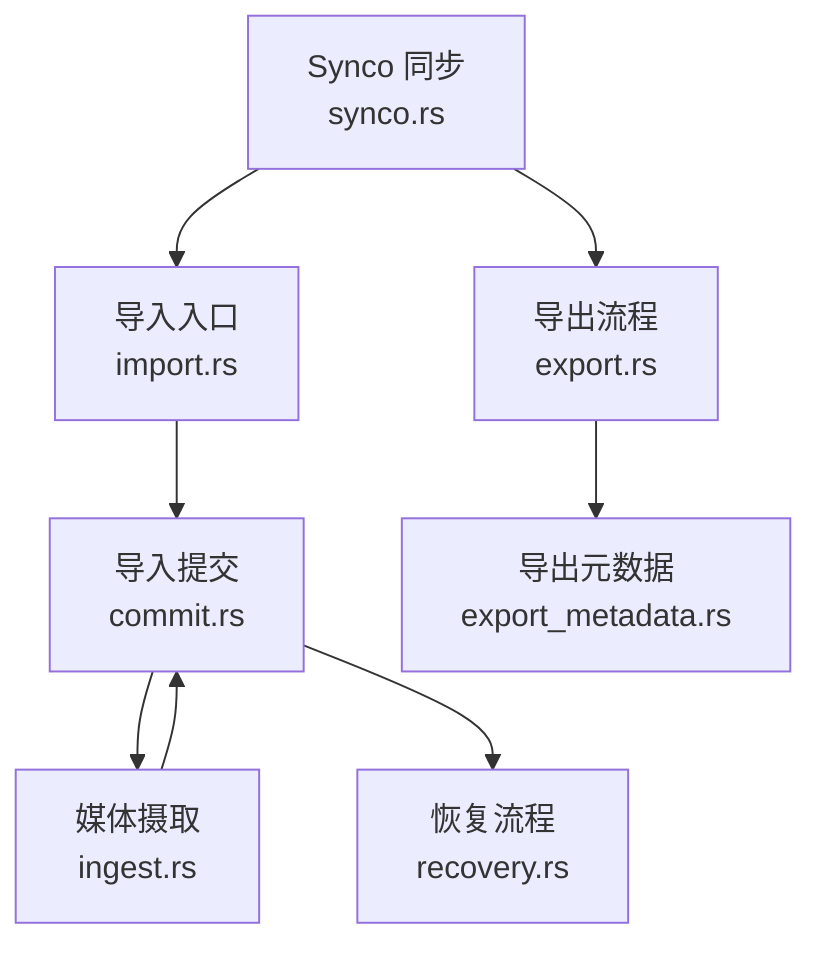

**图表来源**
- [import.rs:1-352](../../../../crates/moriq-library/src/transfer/import.rs#L1-L352)
- [commit.rs:1-293](../../../../crates/moriq-library/src/transfer/commit.rs#L1-L293)
- [ingest.rs:1-442](../../../../crates/moriq-library/src/transfer/ingest.rs#L1-L442)
- [recovery.rs:1-229](../../../../crates/moriq-library/src/transfer/recovery.rs#L1-L229)
- [export.rs:1-422](../../../../crates/moriq-library/src/transfer/export.rs#L1-L422)
- [export_metadata.rs:1-142](../../../../crates/moriq-library/src/transfer/export_metadata.rs#L1-L142)
- [synco.rs:1-595](../../../../crates/moriq-library/src/transfer/synco.rs#L1-L595)

**章节来源**
- [import.rs:1-352](../../../../crates/moriq-library/src/transfer/import.rs#L1-L352)
- [commit.rs:1-293](../../../../crates/moriq-library/src/transfer/commit.rs#L1-L293)
- [ingest.rs:1-442](../../../../crates/moriq-library/src/transfer/ingest.rs#L1-L442)
- [recovery.rs:1-229](../../../../crates/moriq-library/src/transfer/recovery.rs#L1-L229)
- [export.rs:1-422](../../../../crates/moriq-library/src/transfer/export.rs#L1-L422)
- [export_metadata.rs:1-142](../../../../crates/moriq-library/src/transfer/export_metadata.rs#L1-L142)
- [synco.rs:1-595](../../../../crates/moriq-library/src/transfer/synco.rs#L1-L595)

## 核心组件
- 导入入口与路径规划：负责从扫描结果或用户选择解析项目、计算受管目标路径、避免覆盖和路径逃逸。
- 提交管道：把源文件复制到 `staging`，记录操作日志，调用摄取器生成哈希、缩略图和元数据，再在事务中安装资产版本。
- 摄取器：跨工作线程运行，完成分块复制、尺寸和像素预算检查、格式识别、EXIF/视频元数据提取和相似性签名。
- 恢复引擎：读取 `operation_journal` 的中断记录，验证暂存回执，冻结同一卷硬链接副本，重新走摄取和安装流程。
- 导出器：冻结素材的有效版本和导出元数据，按布局生成临时目录，支持原片复制或图像重采样转换。
- Synco 同步：发送受管副本并登记任务；接收远端回执后幂等创建新版本，支持失败重试和已确认回执重试。

**章节来源**
- [import.rs:1-352](../../../../crates/moriq-library/src/transfer/import.rs#L1-L352)
- [commit.rs:1-293](../../../../crates/moriq-library/src/transfer/commit.rs#L1-L293)
- [ingest.rs:1-442](../../../../crates/moriq-library/src/transfer/ingest.rs#L1-L442)
- [recovery.rs:1-229](../../../../crates/moriq-library/src/transfer/recovery.rs#L1-L229)
- [export.rs:1-422](../../../../crates/moriq-library/src/transfer/export.rs#L1-L422)
- [synco.rs:1-595](../../../../crates/moriq-library/src/transfer/synco.rs#L1-L595)

## 架构总览
导入导出的整体控制流如下：

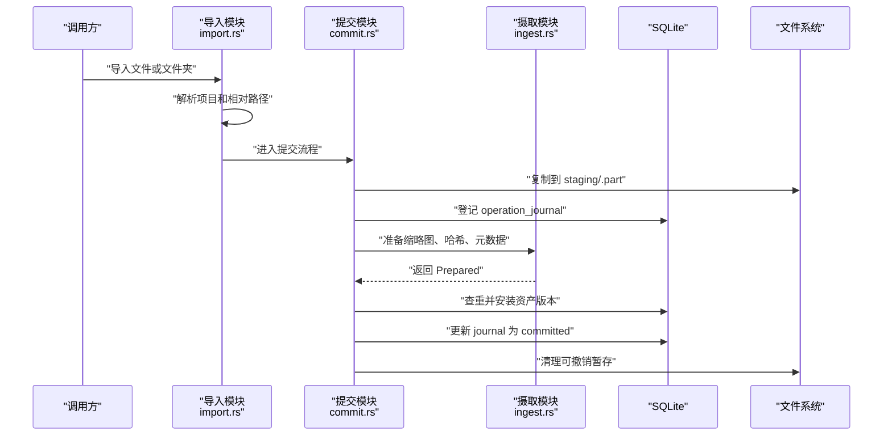

**图表来源**
- [import.rs:1-120](../../../../crates/moriq-library/src/transfer/import.rs#L1-L120)
- [commit.rs:1-120](../../../../crates/moriq-library/src/transfer/commit.rs#L1-L120)
- [ingest.rs:1-120](../../../../crates/moriq-library/src/transfer/ingest.rs#L1-L120)

**章节来源**
- [import.rs:1-120](../../../../crates/moriq-library/src/transfer/import.rs#L1-L120)
- [commit.rs:1-120](../../../../crates/moriq-library/src/transfer/commit.rs#L1-L120)
- [ingest.rs:1-120](../../../../crates/moriq-library/src/transfer/ingest.rs#L1-L120)

## 详细组件分析

### 导入与目标路径规划
导入入口接受文件、可选项目标识和是否引用外部源三个参数。其关键行为包括：
- 根据 `project_name` 查找或创建顶层项目，并把导入上下文中的相对路径用于保留原始目录结构。
- 使用 `managed_location` 在 `assets/<项目>/<相对路径>` 下寻找不冲突的目标文件名，最多尝试固定序列号以避免覆盖。
- 对相对路径进行逐段校验，拒绝 `..`、控制字符、平台保留名称和无损不可表示的字符。
- 当相同内容出现在多个项目时，通过 `duplicate_project_file` 建立独立的项目文件关联，而不是共享同一个版本。

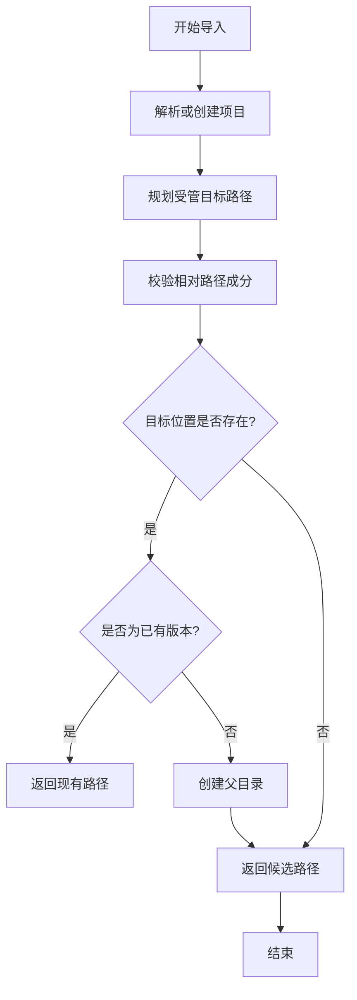

**图表来源**
- [import.rs:20-180](../../../../crates/moriq-library/src/transfer/import.rs#L20-L180)

**章节来源**
- [import.rs:1-180](../../../../crates/moriq-library/src/transfer/import.rs#L1-L180)
- [import.rs:201-352](../../../../crates/moriq-library/src/transfer/import.rs#L201-L352)

### 提交管道与去重
`import_inner` 是导入的核心管线：
1. 打开源文件并检查长度和非空约束。
2. 生成操作标识，插入 `operation_journal`，阶段标记为 `prepared`。
3. 编码源路径平台和原生路径，写入 `import_context`。
4. 将源文件复制到 `staging/{operation}.part`，写入 `ready` 回执。
5. 调用 `install` → `install_prepared` 完成摄取和提交。
6. 成功时将 `journal.phase` 改为 `committed` 并清理可删除暂存；失败则改为 `interrupted` 保留暂存供恢复。

去重逻辑基于哈希、字节数和项目可见范围：
- 若已存在相同内容且未在当前项目中关联，则复用已有资产。
- 如果当前导入属于某个项目，会为该项目建立独立项目文件关联，必要时生成带序号的副本路径。
- 引用导入不会创建普通副本，而是记录外部源路径并在提交前再次校验哈希。

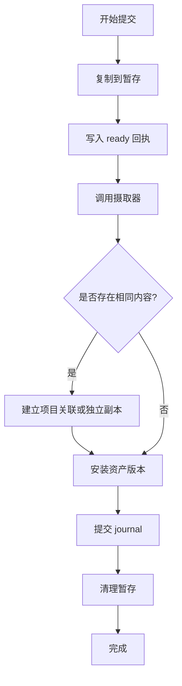

**图表来源**
- [commit.rs:1-120](../../../../crates/moriq-library/src/transfer/commit.rs#L1-L120)
- [commit.rs:120-293](../../../../crates/moriq-library/src/transfer/commit.rs#L120-L293)

**章节来源**
- [commit.rs:1-293](../../../../crates/moriq-library/src/transfer/commit.rs#L1-L293)

### 数据摄取流程
摄取模块提供两个重要能力：
- `Ticket::copy`：以 64 KiB 分块复制，持续检查取消标志和文件大小上限，完成后写入 `ready` 回执；失败时删除不完整的 `.part`。
- `prepare`：对暂存文件计算 SHA-256、识别格式、解码缩略图、提取主色、视频元数据和相似性签名，同时产出 `ImportMetrics`。

媒体类型识别优先级：
1. 视频扩展名。
2. SVG。
3. 解码得到的图片格式。
4. RAW 扩展名。
5. TIFF/AVIF/HEIC/HEIF/TIFF 等回退扩展名。

内存准入估算：
- RAW 文件优先使用原生解码预算。
- 视频统一分配较大预算。
- 其他图片根据宽高、颜色深度和暂存大小估算两次解码缓冲加输入缓冲。
- 超大像素乘积直接回退到保守预算，防止进程内存暴涨。

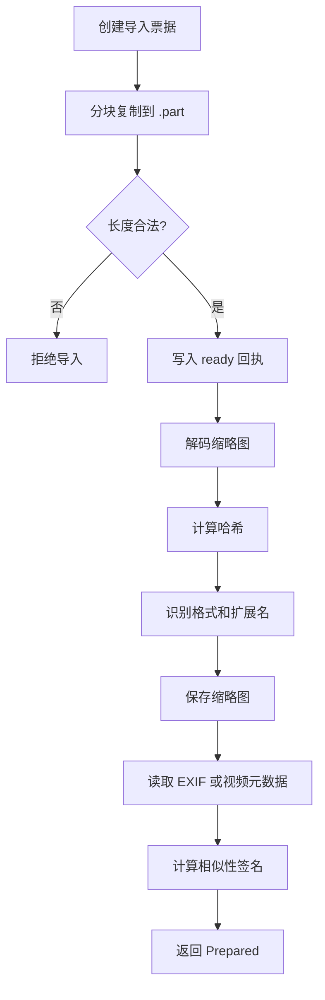

**图表来源**
- [ingest.rs:1-120](../../../../crates/moriq-library/src/transfer/ingest.rs#L1-L120)
- [ingest.rs:201-320](../../../../crates/moriq-library/src/transfer/ingest.rs#L201-L320)

**章节来源**
- [ingest.rs:1-442](../../../../crates/moriq-library/src/transfer/ingest.rs#L1-L442)

### 恢复机制
恢复流程面向 `operation_journal` 中处于 `interrupted` 的记录：
- `recovery_plans` 查询最多 100 条中断记录，每条记录包含操作标识、路径、平台、源路径、项目、是否引用和相对路径。
- `Plan::freeze` 读取 `ready` 回执，校验预期字节数，然后在 `backups` 下创建同卷硬链接作为不可变快照。
- `Work::prepare` 复用 `ingest::prepare` 生成媒体信息；如果是引用导入，会再次比对原文件哈希。
- `finish_recovery` 校验恢复归属，重新执行 `install_prepared`，把 `journal.phase` 改为 `committed`，并清理残留暂存。

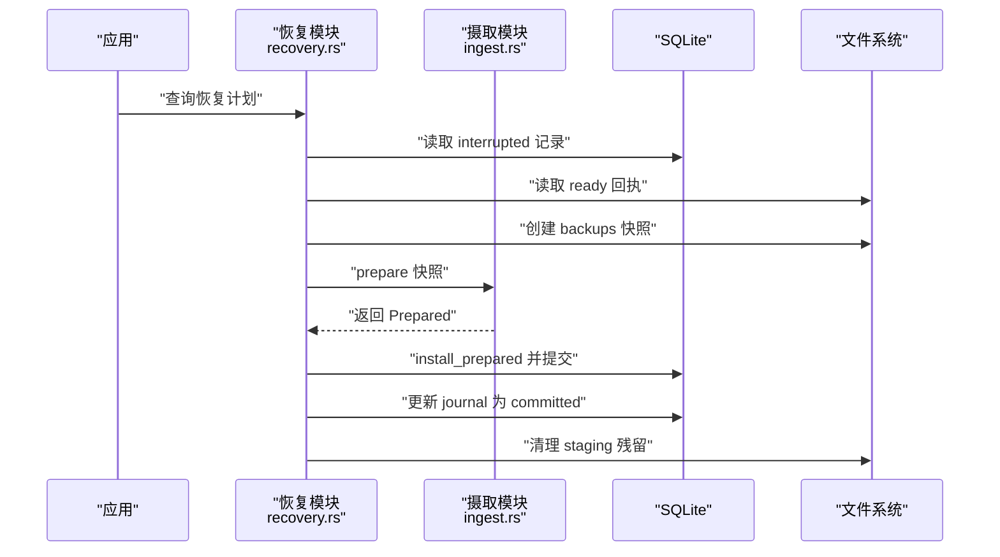

**图表来源**
- [recovery.rs:1-120](../../../../crates/moriq-library/src/transfer/recovery.rs#L1-L120)
- [recovery.rs:120-229](../../../../crates/moriq-library/src/transfer/recovery.rs#L120-L229)

**章节来源**
- [recovery.rs:1-229](../../../../crates/moriq-library/src/transfer/recovery.rs#L1-L229)
- [recovery_tests.rs:1-70](../../../../crates/moriq-library/src/transfer/recovery_tests.rs#L1-L70)

### 导出功能
导出分为两步：
1. `export_plan` 冻结所选素材的有效版本、哈希、名称、导入时间、备注、标签、AI 描述、主题、EXIF 和项目归属。
2. `run` 在临时目录内复制原片并校验哈希，然后根据选项决定原样输出或转换为 JPEG/PNG/WebP/TIFF/BMP。

导出布局支持：
- 扁平布局。
- 按输出格式分组。
- 按导入日期分组。
- 自定义目录模板，支持 `{date}`、`{year}`、`{month}`、`{day}`、`{format}`、`{camera}`、`{project}`。

EXIF 处理：
- 可选择保留 EXIF，但会移除方向、宽高、色彩空间等可能与输出不一致的字段。
- 非 JPEG/PNG/WebP 输出时，EXIF 会写成同名 `.exif` 旁支文件。
- 所有编码器附加 sRGB ICC 色彩配置。

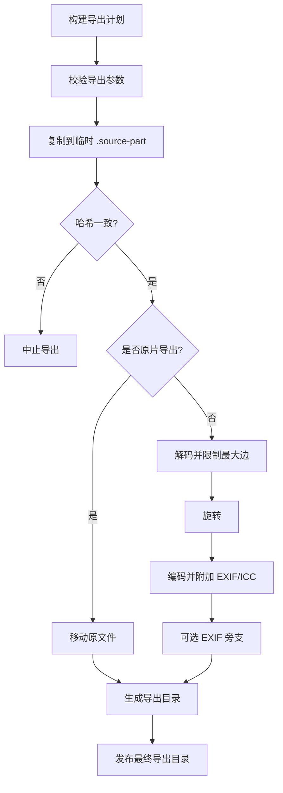

**图表来源**
- [export.rs:1-120](../../../../crates/moriq-library/src/transfer/export.rs#L1-L120)
- [export.rs:120-422](../../../../crates/moriq-library/src/transfer/export.rs#L120-L422)
- [export_metadata.rs:1-142](../../../../crates/moriq-library/src/transfer/export_metadata.rs#L1-L142)

**章节来源**
- [export.rs:1-422](../../../../crates/moriq-library/src/transfer/export.rs#L1-L422)
- [export_metadata.rs:1-142](../../../../crates/moriq-library/src/transfer/export_metadata.rs#L1-L142)

### Synco 数据传输
Synco 模块实现资源库与编辑端之间的受控版本交换：
- `prepare_synco` 复制当前展示版本到 `interop/outgoing/{task}.{format}`，校验哈希，写入 `queued` 任务。
- `receive_synco` 接收远端回执，校验任务身份、状态、输出格式、SHA-256、大小、尺寸和魔数，然后幂等创建新版本、缩略图和 ACK。
- `retry_synco` 基于失败或取消任务生成新任务，重新复制版本并校验哈希。
- `cleanup_synco_copies` 定期清理已结束任务但尚未删除的传输副本。

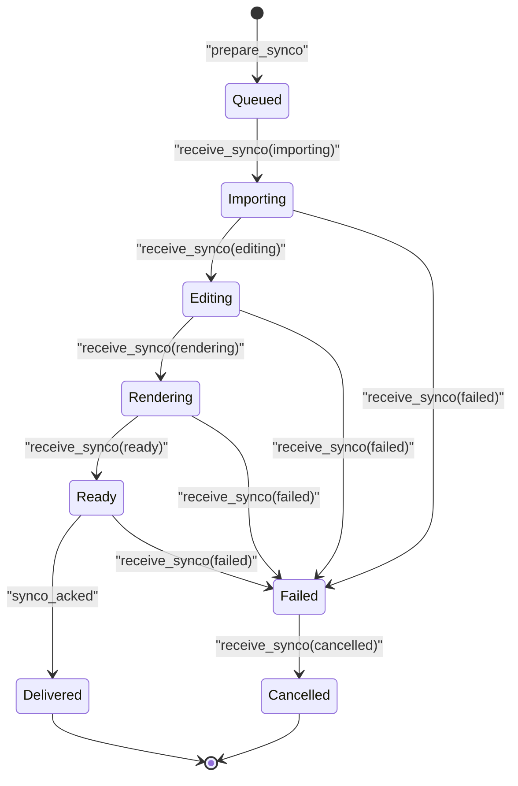

**图表来源**
- [synco.rs:1-200](../../../../crates/moriq-library/src/transfer/synco.rs#L1-L200)
- [synco.rs:200-595](../../../../crates/moriq-library/src/transfer/synco.rs#L200-L595)

**章节来源**
- [synco.rs:1-595](../../../../crates/moriq-library/src/transfer/synco.rs#L1-L595)

## 依赖关系分析
传输层内部依赖关系如下：

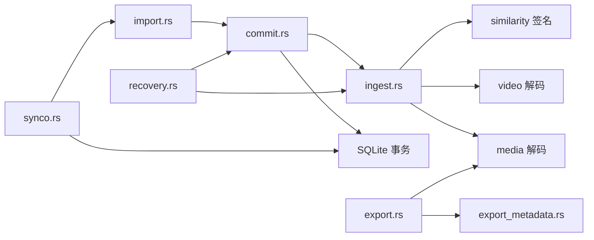

**图表来源**
- [import.rs:1-352](../../../../crates/moriq-library/src/transfer/import.rs#L1-L352)
- [commit.rs:1-293](../../../../crates/moriq-library/src/transfer/commit.rs#L1-L293)
- [ingest.rs:1-442](../../../../crates/moriq-library/src/transfer/ingest.rs#L1-L442)
- [recovery.rs:1-229](../../../../crates/moriq-library/src/transfer/recovery.rs#L1-L229)
- [export.rs:1-422](../../../../crates/moriq-library/src/transfer/export.rs#L1-L422)
- [export_metadata.rs:1-142](../../../../crates/moriq-library/src/transfer/export_metadata.rs#L1-L142)
- [synco.rs:1-595](../../../../crates/moriq-library/src/transfer/synco.rs#L1-L595)

**章节来源**
- [import.rs:1-352](../../../../crates/moriq-library/src/transfer/import.rs#L1-L352)
- [commit.rs:1-293](../../../../crates/moriq-library/src/transfer/commit.rs#L1-L293)
- [ingest.rs:1-442](../../../../crates/moriq-library/src/transfer/ingest.rs#L1-L442)
- [recovery.rs:1-229](../../../../crates/moriq-library/src/transfer/recovery.rs#L1-L229)
- [export.rs:1-422](../../../../crates/moriq-library/src/transfer/export.rs#L1-L422)
- [export_metadata.rs:1-142](../../../../crates/moriq-library/src/transfer/export_metadata.rs#L1-L142)
- [synco.rs:1-595](../../../../crates/moriq-library/src/transfer/synco.rs#L1-L595)

## 性能与大数据传输优化
- 分块复制：导入票据以 64 KiB 缓冲区循环读取，避免一次性加载大文件。
- 文件大小预算：所有导入和复制都检查 `native::file_limit`，超出预算立即失败。
- 解码尺寸限制：摄取阶段对图片尺寸和像素乘积做检查，超大图像回退到保守内存预算。
- RAW 和视频处理：RAW 使用原生解码预算，视频统一分配较大解码预算，避免通用解码路径爆炸。
- 导出缩放顺序：先限制最大边再解码，减少大图解码成本；旋转不放大来源。
- 临时目录隔离：导出和恢复都在 `tempfile` 临时目录中工作，最终原子移动到目标目录。
- 硬链接安装：正常导入和 Synco 接收使用硬链接，避免重复拷贝完整媒体。
- 批量限制：导出最多 10000 项，Synco 单次发送最多 100 项，防止一次任务过大。

[本节为通用性能建议汇总，不直接分析具体代码行]

## 故障恢复与断点续传
系统采用“操作日志 + 暂存回执 + 快照硬链接”的组合实现可靠恢复：

| 阶段 | 行为 |
| --- | --- |
| 准备阶段 | 写入 `operation_journal` 和 `import_context`，阶段为 `prepared` |
| 复制阶段 | 写入 `staging/{operation}.part` 和 `staging/{operation}.ready` |
| 摄取阶段 | 生成缩略图、哈希、元数据和签名 |
| 安装阶段 | 硬链接到受管位置，写入资产版本和项目关联 |
| 中断处理 | 失败时把 `journal.phase` 改为 `interrupted`，保留暂存 |
| 恢复流程 | 校验 `ready` 回执，创建 `backups` 快照，重新 prepare 并提交 |

恢复测试覆盖了：
- 操作日志被修改时拒绝恢复。
- 引用源被替换时拒绝恢复。
- 取消准备的恢复任务不发布媒体，也不删除 journal。
- 恢复完成后仍可继续恢复，直到 journal 被清理。

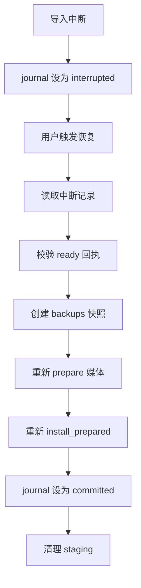

**图表来源**
- [commit.rs:60-120](../../../../crates/moriq-library/src/transfer/commit.rs#L60-L120)
- [recovery.rs:1-120](../../../../crates/moriq-library/src/transfer/recovery.rs#L1-L120)
- [recovery_tests.rs:1-70](../../../../crates/moriq-library/src/transfer/recovery_tests.rs#L1-L70)

**章节来源**
- [commit.rs:60-120](../../../../crates/moriq-library/src/transfer/commit.rs#L60-L120)
- [recovery.rs:1-229](../../../../crates/moriq-library/src/transfer/recovery.rs#L1-L229)
- [recovery_tests.rs:1-70](../../../../crates/moriq-library/src/transfer/recovery_tests.rs#L1-L70)

## 导入策略与配置选项
当前传输层支持的导入和导出数据语义如下：

| 功能 | 配置项 | 含义 | 默认或限制 |
| --- | --- | --- | --- |
| 导入 | `referenced` | 是否引用外部源而不复制 | 否 |
| 导入 | `relative` | 受管路径中的相对目录 | 回退到源文件名 |
| 导入 | `project_name` | 自动解析或创建项目 | 可为空 |
| 导入 | `project` | 显式指定目标项目 | 可为空 |
| 导出 | `format` | 输出格式：原片、JPEG、PNG、WebP、TIFF、BMP | 由选项决定 |
| 导出 | `max_edge` | 最大边长像素 | 0～8192 |
| 导出 | `quality` | JPEG 质量 | 1～100 |
| 导出 | `rotate` | 旋转角度 | 0/90/180/270 |
| 导出 | `preserve_exif` | 是否保留 EXIF | 由选项决定 |
| 导出 | `metadata_sidecar` | 是否写出 JSON 元数据旁支 | 由选项决定 |
| 导出 | `directory_template` | 自定义目录模板 | 空时使用内置布局 |
| 导出 | `layout` | 布局模式：扁平、按格式、按导入日期 | 由选项决定 |
| Synco | `project` | 发送任务所属项目 | 可空，回退到库名 |
| Synco | 批次大小 | 单次发送素材数量 | 1～100 |
| 导出批次 | 导出素材数量 | 单次导出素材数量 | 1～10000 |

**章节来源**
- [import.rs:1-120](../../../../crates/moriq-library/src/transfer/import.rs#L1-L120)
- [export.rs:1-120](../../../../crates/moriq-library/src/transfer/export.rs#L1-L120)
- [synco.rs:1-120](../../../../crates/moriq-library/src/transfer/synco.rs#L1-L120)

## 调度、并发与错误重试
传输层本身不是通用任务队列，但提供了适合调度的构件：

- 并发控制：
  - 导入票据持有库锁租约 `_lease`，确保文件系统和数据库访问不被并发破坏。
  - 票据可以在工作线程中执行复制和解码，但提交和安装回到写端。
  - 导出和 Synco 分别限制单次批量大小，避免单任务过大。

- 进度跟踪：
  - `ImportMetrics` 记录哈希、解码、缩略图和提交耗时。
  - `last_import` 维护最近一次导入指标。
  - Synco 任务状态机暴露 `queued/importing/editing/rendering/ready/delivered/failed/cancelled`。

- 错误重试：
  - 导入失败保留 `interrupted` 记录，可通过恢复流程重试。
  - Synco 失败任务可通过 `retry_synco` 生成新任务，重新复制版本并校验哈希。
  - Synco 已确认回执可重试，返回相同 ACK，保证幂等。
  - 传输副本清理失败会记录警告并延迟清理。

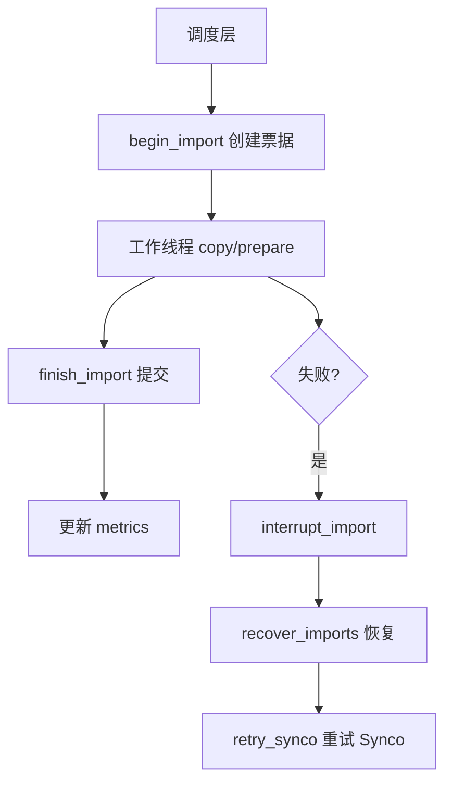

**图表来源**
- [ingest.rs:120-200](../../../../crates/moriq-library/src/transfer/ingest.rs#L120-L200)
- [ingest.rs:320-442](../../../../crates/moriq-library/src/transfer/ingest.rs#L320-L442)
- [recovery.rs:180-229](../../../../crates/moriq-library/src/transfer/recovery.rs#L180-L229)
- [synco.rs:400-595](../../../../crates/moriq-library/src/transfer/synco.rs#L400-L595)

**章节来源**
- [ingest.rs:120-442](../../../../crates/moriq-library/src/transfer/ingest.rs#L120-L442)
- [recovery.rs:180-229](../../../../crates/moriq-library/src/transfer/recovery.rs#L180-L229)
- [synco.rs:400-595](../../../../crates/moriq-library/src/transfer/synco.rs#L400-L595)

## 排错指南
常见问题和处理方式：

| 现象 | 可能原因 | 处理方式 |
| --- | --- | --- |
| 导入时报“媒体超出文件大小预算或为空文件” | 文件为空或超过 `native::file_limit` | 检查源文件大小和系统限制 |
| 导入时报“读取期间源文件长度改变” | 复制过程中源文件被修改 | 重新导入 |
| 导入时报“引用源在导入期间发生变化” | 引用导入的外部源被替换 | 重新导入，不要修改原引用 |
| 恢复时报“恢复副本不完整” | `ready` 回执缺失或字节数不符 | 保留原片并重新导入 |
| 恢复时报“恢复记录已改变” | 操作日志在恢复过程中被修改 | 停止旧恢复，重新查询恢复计划 |
| 导出时报“导出期间源文件发生变化” | 导出临时复制与原版本哈希不一致 | 重新导出 |
| 导出时报“请选择资源库之外的导出位置” | 导出目标位于 `.moriq` 库目录内 | 选择库外目录 |
| Synco 回执报“身份不匹配” | 远端响应字段与请求不一致 | 检查客户端任务 ID、来源项目、来源图片 ID |
| Synco 回执报“成图路径越界或指向资源库” | 成图路径非法或指向本地库 | 由远端修正路径，确保落在 `interop/returns` |
| Synco 重试失败 | 原交接版本内容变化 | 重新准备发送，不要复用过期版本 |

**章节来源**
- [commit.rs:1-120](../../../../crates/moriq-library/src/transfer/commit.rs#L1-L120)
- [ingest.rs:1-120](../../../../crates/moriq-library/src/transfer/ingest.rs#L1-L120)
- [recovery.rs:1-120](../../../../crates/moriq-library/src/transfer/recovery.rs#L1-L120)
- [export.rs:1-120](../../../../crates/moriq-library/src/transfer/export.rs#L1-L120)
- [synco.rs:200-595](../../../../crates/moriq-library/src/transfer/synco.rs#L200-L595)

## 结论
数据传输层以“受管暂存 + 操作日志 + 事务提交”为核心设计，把文件复制、链接创建、去重、元数据提取、导出转换和远端同步统一到一致的可靠性模型中。导入和恢复共享 `Prepared` 数据结构，避免重复解码；Synco 通过严格的路径、哈希、尺寸和状态校验保证双向版本交换安全；导出则在冻结计划和临时目录基础上提供灵活布局和元数据输出。对于大规模传输，应优先利用分块复制、解码尺寸限制、硬链接安装和批次上限来降低内存峰值，并通过恢复和重试机制提升容错能力。